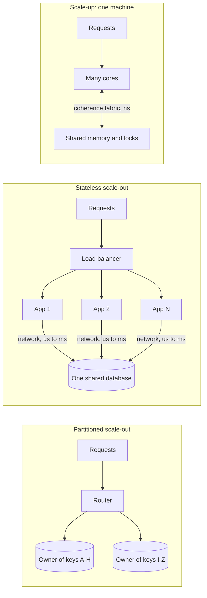
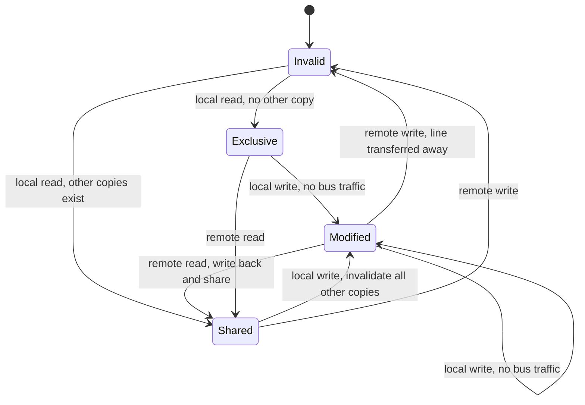
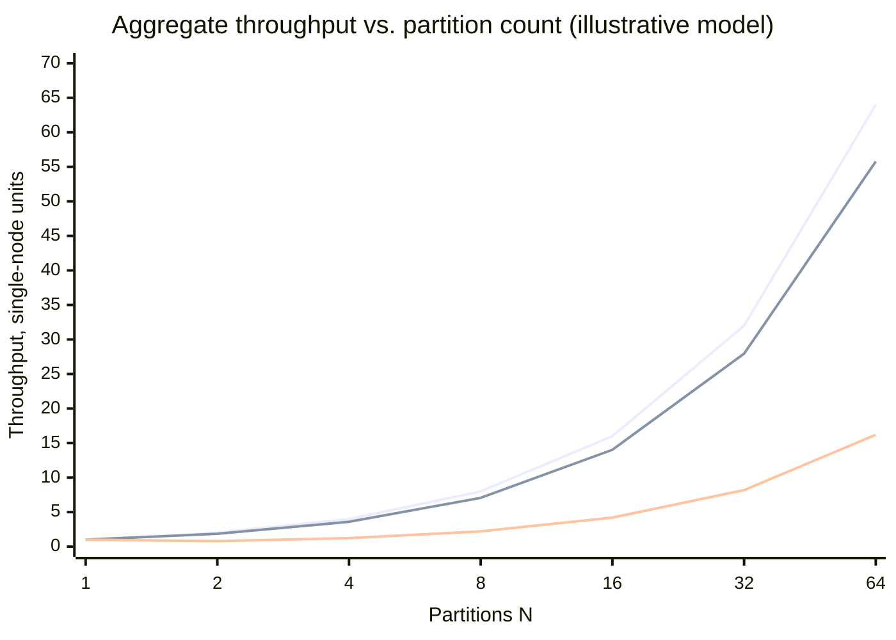
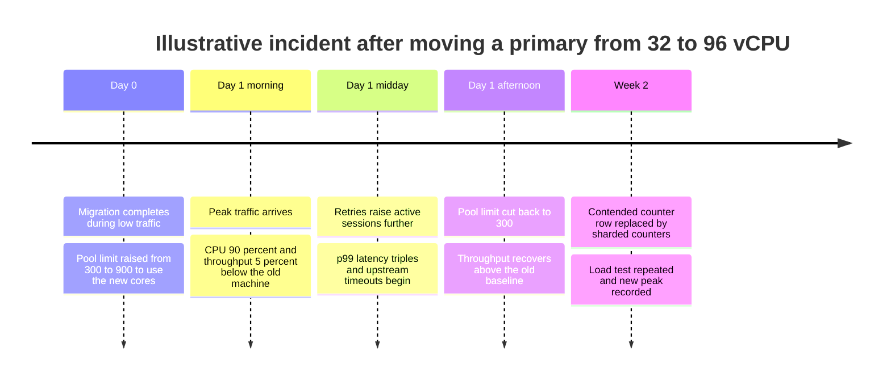

Vertical scaling (scale-up) adds capacity to a single machine: more cores, memory, memory bandwidth, and faster storage and network interfaces. Horizontal scaling (scale-out) adds machines and divides the work among them. Both aim at the request rate a system can sustain within its latency objective, and both stop working at a point set by the workload rather than by the hardware budget. A bigger machine stops paying off when requests serialize on something inside it or when its cores spend their time keeping shared data consistent. More machines stop paying off when requests must touch several machines to complete, or when all machines still depend on one shared component.

The core trade-off is where coordination happens and who pays for it. On one machine, coordination between cores is done by cache-coherence hardware in tens to hundreds of nanoseconds, invisible until it dominates the profile. Across machines, it is done by software protocols over a network whose round trips cost hundreds of microseconds inside a data center, and it shows up in latency, failure handling, the consistency model, and operational cost. Scale-up buys simplicity and strong consistency with a hard ceiling and a single failure domain; scale-out buys headroom and smaller failure units with a permanent coordination tax.

A second axis is independent of capacity: how many failure domains the service must survive. Treating "add machines for capacity" and "add machines for availability" as one decision is the root of most scaling mistakes covered below. Hardware price curves are covered in [Cost-Performance Curves and Hardware Limits](/distributed-systems/en/foundations/monoliths-to-distributed/cost-performance-curves/), and the question of where state may live in [Stateful vs. Stateless Services](/distributed-systems/en/foundations/monoliths-to-distributed/stateful-vs-stateless/).


*Three topologies and where the shared mutable state sits in each. Latency labels are orders of magnitude.*

In the first topology, shared state is in memory and coordination is cheap but bounded by one box. In the second, the application tier has been scaled out but every request still converges on one database, so the serialization point has moved rather than disappeared; this is the most common shape of a system that "scaled horizontally" and did not get faster. Only the third removes the shared resource, by giving each key exactly one owner, and it is also the only one that introduces requests spanning owners, which is where the cost of scale-out concentrates.

## The Scale-Up Ceiling: Serial Work and Coherence Traffic

A larger machine raises throughput only for work that can run on its additional cores at the same time. Two separate mechanisms limit this, and they respond to different fixes. The first is queueing for an exclusive resource: a lock, a log flush, a single-threaded component. The second is the work cores do to agree on the contents of shared memory. The first flattens the throughput curve; the second bends it downward.

### Serial Work and Amdahl's Ceiling

If a fraction `S` of each unit of work must execute serially and the rest parallelizes perfectly over `N` cores, Amdahl's Law gives the speedup as `1 / (S + (1 - S) / N)`, bounded by `1 / S`. With 4% serial work the ceiling is 25x; eight cores deliver 6.2x, 32 cores 14.3x, and 128 cores 21.1x. Quadrupling the machine from 32 to 128 cores buys 48% more throughput, and every further core is worth less than the last.

In a request-serving system, the serial fraction is rarely a single-threaded function. It is the share of each request's time spent holding something every other request also needs: a row lock on a counter, an index page latch, a write-ahead log (WAL) flush, a connection pool with too few slots. Otherwise independent requests line up behind it, and latency there rises sharply as its utilization approaches one, as analyzed in [Queueing Theory Foundations](/distributed-systems/en/resilience/flow-control/queueing-theory-littles-law/).

Gustafson's Law is the corrective: Amdahl fixes the problem size, but a larger machine is usually given more independent work, and the serial part does not grow with it. Extra cores are well spent on more independent requests and badly spent on requests that serialize on one resource.

### Coherence: The Cost of Sharing a Cache Line

Each core keeps recently used memory in private caches, in 64-byte units called cache lines on mainstream x86 and most ARM server parts. When two cores hold copies of one line, a coherence protocol, a per-line state machine run by the cache controllers, guarantees that a write by one is seen by the other. MESI is the textbook version; Intel uses an extension called MESIF and AMD one called MOESI, but the transitions that matter for scaling are the same in all three.


*MESI states of one cache line as seen by one core. Transitions labeled remote are caused by another core touching the same line.*

The expensive transitions move a line out of another core's cache: a core writing a line held `Modified` elsewhere must request ownership and wait for the other core to give it up. If many cores write the same line in turn (an atomic request counter, a shared reference count, a spinlock word, two unrelated hot fields on one line), the line ping-pongs between caches and each write costs a cross-core or cross-socket transfer instead of a few cycles. The case of unrelated fields sharing a line is called false sharing: the program has no logical sharing, but the hardware does. Adding cores adds more participants to this exchange, and the number of potential pairwise exchanges grows with the square of the core count.

Neil Gunther's Universal Scalability Law (USL) captures both mechanisms in one expression, `C(N) = N / (1 + alpha * (N - 1) + beta * N * (N - 1))`. The contention coefficient `alpha` is the serial share; the coherency coefficient `beta` is the cost of pairwise exchanges. With `beta = 0`, the curve is Amdahl's. With any positive `beta`, throughput peaks at `N_peak = sqrt((1 - alpha) / beta)` and then declines: past the peak, more cores, threads, or concurrent connections reduce throughput. Because the `beta` term grows quadratically, a load test on a small instance says almost nothing about a large one.

Production systems show both responses to `beta`. Redis executes commands on one thread, removing coherence traffic on data and accepting that one core bounds an instance; Redis 6 I/O threads parallelize only socket reads and writes, which touch no shared data. PostgreSQL runs one process per connection, and as active backends multiply, contention on shared lock and buffer-mapping structures flattens and then lowers throughput; poolers such as PgBouncer keep the active count near the peak however many clients connect.

### Limits Below the Application

Some scale-up ceilings sit in the operating system and network path. A single listening socket accepted by one thread serializes connection setup; Linux added `SO_REUSEPORT` in kernel 3.9 so that several sockets can bind the same port and the kernel spreads connections across them. A network interface delivering all packets to one receive queue concentrates interrupt processing on one core; Receive Side Scaling (RSS) hashes flows across several queues and cores. Memory-bound workloads can stop scaling before the CPUs are busy, because memory bandwidth does not grow in step with core count. On multi-socket machines, memory attached to the other socket is slower to reach (Non-Uniform Memory Access, NUMA), a placement problem on top of the coherence problem.

:::tip[Read per-core metrics, not the machine average]
A 96-core machine at 40% average CPU can be saturated: one core at 100% handling network interrupts or running a single-threaded component, and the rest waiting on it. Before concluding that a large machine has headroom, check per-core utilization and the run queue, and look for a component whose throughput stays constant as load rises.
:::

## The Scale-Out Ceiling: Cross-Partition Work and Shared Fate

Scale-out increases throughput only if it removes a shared resource rather than moving it. Stateless application instances share nothing with one another, so adding them removes contention in the application tier, but every instance still reads and writes the same database. Past the point where the database saturates, more application instances only add connections to it, pushing it toward its own coherency peak. A system decomposed into many services that all depend on one shared store has the operational cost of a distributed system and the scaling limit of one machine; this pattern is analyzed as the [distributed monolith](/distributed-systems/en/microservice-patterns/service-decomposition/distributed-monolith/).

Removing the shared resource for stateful data requires [partitioning](/distributed-systems/en/data-management/data-partitioning/): each key is owned by exactly one node, so single-key operations need no coordination with other nodes. Partitioning raises aggregate capacity, but each key's capacity is still bounded by one machine, and a key that receives a disproportionate share of traffic gains nothing from the rest of the cluster. Managed systems state this limit explicitly: DynamoDB documents a per-partition maximum of 3,000 read capacity units and 1,000 write capacity units per second, independent of the table's total provisioned throughput. Scale-out scales the sum; vertical limits still govern each part. Skewed keys are covered in [Skew and Hot-Spot Problems](/distributed-systems/en/data-management/data-partitioning/skew-hot-spots/).

### The Cross-Partition Tax

An operation touching several partitions needs a coordinator, extra round trips, locks held for the protocol's duration, and a recovery path; atomic multi-partition writes typically use [two-phase commit](/distributed-systems/en/coordination/distributed-transactions/two-phase-commit/) or a variant. Each such operation consumes capacity on every participant, for longer than a local one.

The share of operations that cross partitions is not a constant; it depends on how keys are assigned. If an operation touches two keys and keys are placed by a uniform hash, the probability that both land on the same partition is `1 / N`, so the cross-partition fraction is `1 - 1 / N` and approaches 100% as the cluster grows. If the two keys are placed together deliberately (for example both rows of an order are partitioned by customer), the fraction stays at whatever share of operations genuinely spans customers. A simple model makes the difference visible. Assume a single-partition operation costs one unit of capacity on one node, and a two-partition operation costs two units on each of two nodes because of the prepare and commit phases and the longer lock hold (an illustrative factor). The average cost per operation is then `1 + 3f` for a cross-partition fraction `f`.


*Top: linear reference. Middle: related keys co-located; 5% of operations span two customers, and 1 - 1/N of those land on different partitions. Bottom: two keys per operation placed by uniform hash, so 1 - 1/N of operations cross partitions. Cost factor of a cross-partition operation is illustrative.*

The bottom curve dips below one node at two partitions: half of all operations suddenly pay the cross-partition cost, and the cluster delivers 0.8 units where one machine delivered 1.0. At 64 partitions it reaches only a quarter of linear scaling, because almost every operation pays four units instead of one, while the co-located curve keeps 87% of linear scaling on the same hardware. The partitioning key, not the node count, decides which curve a system is on; [co-located joins and data placement](/distributed-systems/en/data-management/data-partitioning/colocated-joins/) covers how to choose it. Co-location also bounds fan-out: a request waiting on 50 partitions, each slow once per thousand calls, meets at least one slow call with probability `1 - 0.999^50`, about 4.9%, the effect Dean and Barroso describe in *The Tail at Scale*.

:::caution[Two partitions can be slower than one]
Splitting a database in two with a hash key that separates data accessed together does not halve the load per node; it turns local operations into distributed ones. Before partitioning, measure what fraction of transactions and queries touch more than one value of the candidate key. If that fraction is large, change the key or the access pattern first.
:::

### Replicas Add Failure Tolerance, Not Write Capacity

Replication obeys a different rule. In a leader-based or consensus group such as [Raft](/distributed-systems/en/coordination/consensus-algorithms/raft/), every member stores every write. Growing a Raft group from three to five members raises the number of tolerated failures from one to two and the commit quorum from two to three; the write capacity stays that of one leader, and commit latency can only rise. Read replicas add read capacity at the price of [replication lag](/distributed-systems/en/data-management/replication/replication-lag/). Systems that need both durability and write capacity run many small groups, one per partition: Kafka partitions with their in-sync replica sets, CockroachDB ranges, TiKV regions. Capacity comes from the number of groups; fault tolerance comes from the size of each.

## Worked Example: One Orders Database, Two Futures

Assume an orders service whose primary database runs on a 32-vCPU machine and sustains 6,000 writes per second at its latency objective. Peak traffic grows 4% per month. All numbers in this section are illustrative.

A load test at concurrency levels from 1 to 128 fits USL coefficients `alpha = 0.02` and `beta = 0.0002`. Relative capacity is `C(32) = 32 / (1 + 0.02 * 31 + 0.0002 * 32 * 31) = 17.60`, so one capacity unit corresponds to about 341 writes per second. The curve peaks at `N_peak = sqrt(0.98 / 0.0002) = 70`, with `C(70) = 20.92`.

The vertical option is a 64-vCPU machine: `C(64) = 20.87`, about 7,100 writes per second, 18.6% more than today for roughly twice the hourly price. At 4% monthly growth that gain lasts `ln(1.186) / ln(1.04)`, about 4.3 months. A 96-vCPU machine is worse, `C(96) = 20.32` or about 6,900 writes per second, because it sits past the peak.

The horizontal option is eight partitions by `customer_id`, each on a 16-vCPU machine. Each partition runs at lower concurrency, on the efficient part of the same curve: `C(16) = 11.87`, about 4,050 writes per second. Two corrections apply. 3% of writes touch two customers (transfers between accounts), costing `1 + 3 * 0.03 = 1.09` units on average. And the largest customer generates 6% of all writes, so its partition carries `0.94 / 8 + 0.06 = 17.75%` of total traffic instead of 12.5%. The hottest partition saturates first, so the system's limit is `4,050 / (0.1775 * 1.09)`, about 20,900 writes per second. That is 3.5 times today's load, or about 32 months of growth.

The failure arithmetic is less obvious. With one primary, every failover makes all writes unavailable. With eight, a failure affects 12.5% of customers (17.75% of writes for the hot partition), but eight machines can fail, so failovers happen about eight times as often. Expected write-minutes lost per year are roughly unchanged; partitioning changes the blast radius of each incident and the number of incidents, which matters only if the availability objective is defined per customer rather than fleet-wide.

The comparison is therefore not 7,100 against 20,900. It is 4 months of runway at low engineering cost against 32 months at the cost of a routing layer, a resharding procedure, a cross-partition write path, a plan for the 6% customer, and eight times as many failovers. If the team cannot deliver the partitioned design within the 4-month runway, the 64-vCPU machine is the right purchase today and the partitioned design is the right project to start the same day.

## Comparing the Strategies

The strategies commonly grouped under "horizontal" behave very differently, so the table separates them.

| Strategy | What grows | What does not grow | Unit of failure | When to prefer |
|---|---|---|---|---|
| Vertical, one node | Cores, memory, IOPS on one box | The serial share and coherency cost; capacity past `N_peak` | The whole service | Measured `beta` is small, the largest affordable machine covers the planning horizon, and strong single-node consistency matters |
| Stateless scale-out | Compute for independent requests | Capacity of shared downstream dependencies | One instance | Requests share no mutable state and the shared dependency has measured headroom |
| Partitioned scale-out | Aggregate storage and write throughput | Per-key and per-partition capacity | One partition | Data or writes exceed one machine and most operations touch one partition key |
| Replicated group | Read capacity (followers), fault tolerance | Write capacity of the leader | Tolerates a minority of members | Durability and failover for one partition or for coordination data |
| Diagonal: few large partitioned nodes | Both, with fewer coordination participants | Rebuild time of each node | One large node | Throughput-heavy stateful systems where node count drives coordination cost |

Diagonal scaling has its own bound: the cost of losing a node grows with its size. A node holding 8 TB that rebuilds from peers at an effective 250 MB/s (illustrative, after throttling to protect live traffic) needs about nine hours with one replica fewer than designed. In replicated storage, rebuild time rather than CPU usually caps node size.

### Measuring Which Limit You Will Hit

The USL coefficients come from measurement. Run a closed-loop load test at increasing concurrency, record throughput at a fixed latency objective, and fit `C(N)` by nonlinear regression as described in Gunther's *Guerrilla Capacity Planning*. Include points beyond the knee of the curve: if every point lies below `N_peak`, a large `alpha` and a small `beta` fit equally well and the forecast for a larger machine is a guess.

Contention shows up as flat throughput with CPU partly idle and threads blocked; coherency as falling throughput with CPU saturated and cycles spent in atomics and spin loops; cross-partition cost as coordinator latency growing with partition count. On Linux:

```shell
# Per-core utilization: look for single cores pinned at 100% (interrupts, one hot thread)
mpstat -P ALL 1 5
# Voluntary vs. involuntary context switches per thread: high voluntary = blocking
pidstat -w -t -p "$PID" 1 5
# Cache-to-cache transfers of contended lines (true and false sharing)
perf c2c record -p "$PID" -- sleep 10
perf c2c report --stdio | head -60
# Distribution of incoming connections and receive queues across cores
grep -E 'eth0|ens' /proc/interrupts
```

`perf c2c` is the most direct evidence of coherency cost: it reports cache lines frequently transferred between cores in modified state, with the code locations and data offsets responsible, enough to tell a contended counter from two fields that need padding onto separate lines.

## Failure Modes and How They Present

Vertical failures are often mistaken for capacity shortages; horizontal ones often hide behind healthy averages.

### Retrograde Throughput After an Upgrade

Trigger: a coherency-bound workload moves to a larger machine, or its pool limit is raised, pushing active concurrency past `N_peak`. Symptoms: throughput flat or lower at the same load, higher CPU, earlier latency rise. Detection: throughput per active session before and after, `perf c2c` transfer counts, lock-wait time in the database's wait-event views. Mitigation: cap active concurrency at the measured peak with a connection pooler or admission queue, and roll back if needed. Recovery is fast once concurrency is capped, but the root fix is design work that lowers `beta`: striped locks, per-core counters summed on read, padding hot fields onto separate cache lines, partitioning a hot table.


*A hypothetical timeline showing the shape of a coherency regression; not a real incident.*

The migration looks successful in low traffic because `beta` is small at low concurrency. At peak, more cores admit more active sessions, which is what moves the system past its peak, and retries then raise concurrency further: a feedback loop that can outlive the load spike, described as a metastable failure in [Retry Storms and Metastable Failures](/distributed-systems/en/resilience/flow-control/retry-storms-metastable-failures/). The fix that works within hours is not more hardware but less concurrency.

### Shared Fate on a Large Machine

Trigger: one workload on a vertically scaled node consumes a shared resource, such as an analytical query evicting the buffer cache or a compaction saturating disk bandwidth. Symptoms: every tenant and endpoint degrades at once. Detection: saturation (disk queue depth, memory pressure, cache hit ratio) correlated with one session or job. Mitigation: isolation inside the node (separate pools, cgroup limits, query timeouts) or moving the workload to a replica, the [bulkhead](/distributed-systems/en/resilience/protection-patterns/bulkhead-pattern/) principle applied within one machine. A large machine concentrates performance failures, not only crashes, into one failure domain.

### Connection Storms During Scale-Out

Trigger: an autoscaler adds instances and each opens its full connection pool to the shared database. Symptoms: the database rejects connections or slows down exactly when the tier grows, and new instances fail readiness checks, prompting the autoscaler to add more.

```mermaid
sequenceDiagram
    autonumber
    participant U as Traffic
    participant H as Autoscaler
    participant A as App instances
    participant D as Shared database
    U->>A: Load rises, 40 instances at high CPU
    H->>A: Scale from 40 to 120 instances
    A->>D: 80 new instances open 20 connections each
    Note over D: 2400 connections vs. limit of 1000, new connections rejected
    D-->>A: Connection errors, slow authentication and backend startup
    A->>A: Readiness probes fail, requests retried
    H->>A: CPU still high, scale further
    rect rgb(70, 40, 40)
    Note over A,D: Scale-out raised load on the one component that did not scale
    A->>D: Existing instances time out and reconnect
    end
```


*Autoscaling against a shared database. Counts are illustrative.*

Steps 2 and 3 are the trap: the autoscaler measures CPU on the tier that does not need help and acts in a way that loads the database; by step 7 the control loop amplifies the failure. Detection: database connections against the limit and connection-establishment rate, plotted with the replica count. Mitigation: size pools from the database side, put a transaction-mode pooler in between, cap the autoscaler's maximum replicas and rate of change, and scale on a signal that reflects the real bottleneck. Autoscaler behavior and stabilization settings are covered in [HPA and KEDA](/distributed-systems/en/kubernetes/fundamentals/hpa-keda/).

### Summary of Failure Signatures

| Failure | Path | Symptom from outside | Detection signal | Mitigation |
|---|---|---|---|---|
| Retrograde throughput | Vertical | Bigger machine is slower at peak | Throughput per active session falls; `perf c2c` transfers rise | Concurrency cap at `N_peak`; reduce `beta` |
| Hidden single core | Vertical | Latency rises at low average CPU | One core at 100% in `mpstat`; unbalanced `/proc/interrupts` | RSS, `SO_REUSEPORT`, removing the single-threaded stage |
| Shared fate | Vertical | Everything degrades together | Saturation correlated with one job | In-node isolation, offload to replica |
| Hot partition | Horizontal | One partition saturated, cluster average healthy | Per-partition throughput and latency | Split or salt the key, cache the hot key |
| Cross-partition collapse | Horizontal | Adding partitions does not raise throughput | Cross-partition fraction and coordinator latency growing with `N` | Change the partition key, co-locate related data |
| Connection storm | Horizontal | Database fails as the app tier grows | DB connections vs. limit, replica count | Pooler, pool sizing from the DB side, autoscaler caps |
| Split brain | Both, during failover | Divergent writes on two primaries | Two nodes claiming leadership | Quorum election and fencing |

Split brain is the only entry that corrupts data rather than degrading service; it is covered in [Split Brain and Fencing](/distributed-systems/en/coordination/consensus-algorithms/split-brain-fencing/) and, for database failover specifically, in [Failover and Leader Election](/distributed-systems/en/data-management/replication/failover-leader-election/). The hot-partition mode in a managed store is examined in [The Hot Partition Problem](/distributed-systems/en/case-studies/dynamodb-cassandra/hot-partition-problem/).

## Choosing Deliberately

The decision rests on three measurements and one requirement: where requests serialize, how large `beta` is, what fraction of operations would cross partitions under the best available key, and how many failure domains the service must survive.

Scale up when the bottleneck is a stateful component with small measured `beta`, when the largest machine you will buy gives a runway longer than the time to build a partitioned alternative, and when single-node transactional semantics are worth more than horizontal headroom. OLTP relational databases are the standard case; Stack Overflow has written publicly about serving its main sites from a few large SQL Server machines for many years. McSherry, Isard, and Murray's *Scalability! But at what COST?* showed single-threaded programs on one machine beating several published distributed graph-processing results, a reason to compare any cluster with the best single-machine baseline.

Do not scale up when the measured curve is near or past its peak at the target concurrency, when growth exhausts the largest available machine within the planning horizon, or when the availability objective cannot be met by one primary plus a standby in another zone.

Scale out when requests are independent or a partition key keeps cross-partition operations rare, when data volume or write throughput exceeds one machine, when users in several regions need local latency, or when data must reside in specific jurisdictions. Vitess, which grew out of YouTube's MySQL sharding, and Kafka, whose partitions are the unit of placement and consumer parallelism, scale with partition count because their common operation touches one partition.

Do not scale out to fix a hot key, because its traffic still lands on one owner; to raise write throughput by adding replicas, because every replica does the same work; to relieve a saturated database by adding application instances; or speculatively, before any of the conditions above exist. A system built for horizontal scale from day one pays for routing, resharding, and partial-failure handling when traffic is lowest and iteration speed matters most. A [modular monolith](/distributed-systems/en/microservice-patterns/service-decomposition/modular-monolith/) with clear data ownership keeps the partitioning option open without paying for it early.

:::note[Capacity and availability are separate purchases]
A service may need one machine for capacity and three for availability, or forty for capacity and still have one shared database as its availability ceiling. Size capacity against measured throughput curves and size redundancy against the failure domains the objective requires. Replicas bought for failover count as capacity only if they serve traffic and the system can still meet its objective after one of them is lost.
:::

## Further Reading

- Gene M. Amdahl, *Validity of the Single Processor Approach to Achieving Large Scale Computing Capabilities*, AFIPS Spring Joint Computer Conference, 1967.
- John L. Gustafson, *Reevaluating Amdahl's Law*, Communications of the ACM, 1988.
- Neil J. Gunther, *Guerrilla Capacity Planning*, Springer, 2007.
- Paul E. McKenney, *Is Parallel Programming Hard, And, If So, What Can You Do About It?*, kernel.org (continuously revised).
- Jeffrey Dean and Luiz André Barroso, *The Tail at Scale*, Communications of the ACM, 2013.
- Frank McSherry, Michael Isard, and Derek G. Murray, *Scalability! But at what COST?*, USENIX HotOS, 2015.
