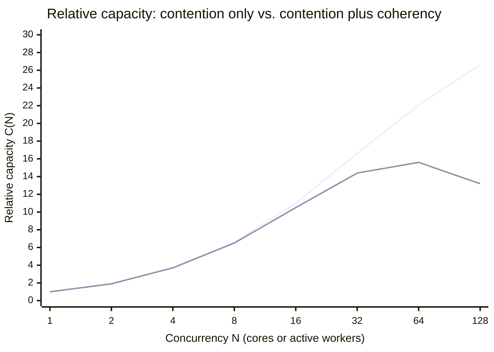
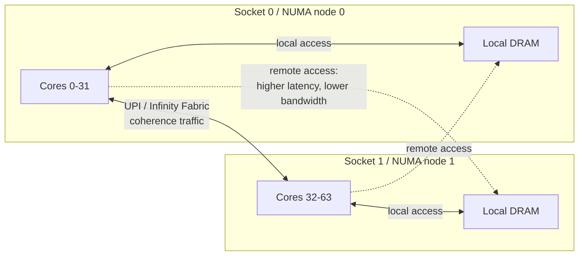
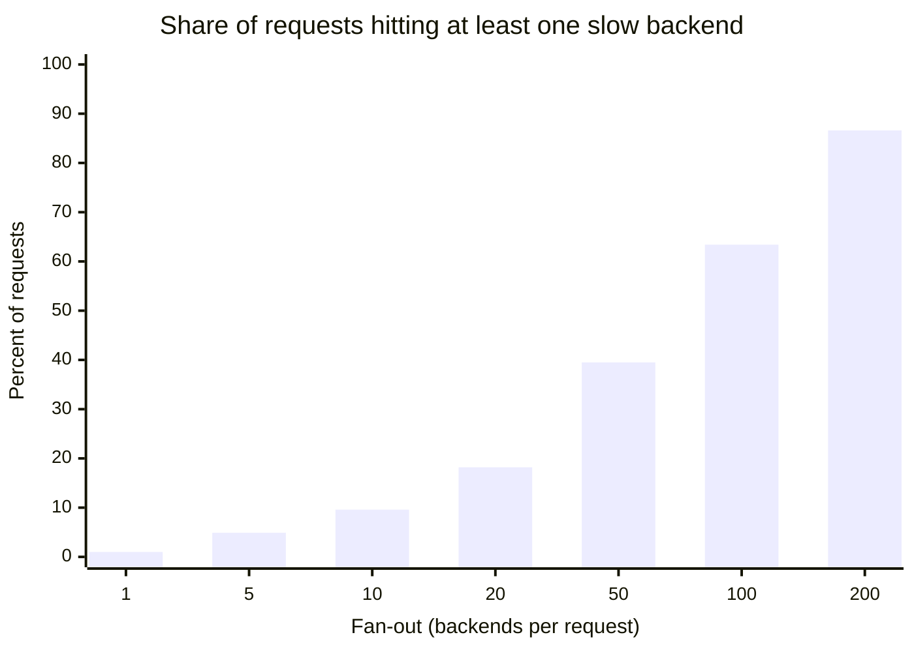
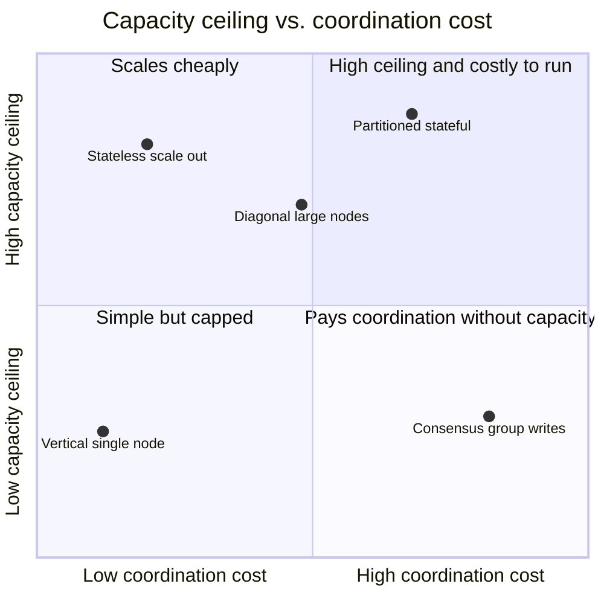
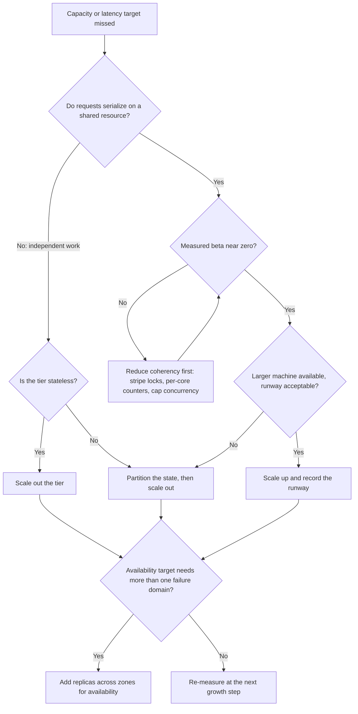

Vertical scaling (scale-up) raises the capacity of one machine: more cores, more memory, faster disks and network interfaces. Horizontal scaling (scale-out) raises the number of machines and divides the work among them. Both try to increase the throughput a system can sustain at an acceptable latency, but they hit different ceilings. Scale-up is bounded by the parts of the workload that cannot run in parallel and by the physical cost of keeping memory consistent between cores. Scale-out removes that bound only for work that can be divided without coordination; for everything else it charges network round trips, partial failure, and coordination protocols.

The real trade-off is therefore not one big machine versus many small ones. It is where shared mutable state lives and what it costs to keep it consistent. Inside one machine, consistency is enforced by cache-coherence hardware in nanoseconds, invisibly, until it becomes the bottleneck. Across machines, it is enforced by software protocols whose cost is measured in hundreds of microseconds to hundreds of milliseconds, and that cost surfaces everywhere: in request latency, in failure handling, and in the consistency model clients observe.

This page explains the mechanisms behind both ceilings, the scalability laws that turn load-test data into a capacity forecast, and the decision rules that follow from them. Hardware price curves are covered in [Cost-Performance Curves and Hardware Limits](/distributed-systems/en/foundations/monoliths-to-distributed/cost-performance-curves/), and the state question in depth in [Stateful vs. Stateless Services](/distributed-systems/en/foundations/monoliths-to-distributed/stateful-vs-stateless/).

## Where a Single Machine Stops Scaling

Adding cores raises throughput only if the work can be spread across them. Two distinct mechanisms prevent that, and they need different fixes: work that queues for a shared resource (contention) and work spent keeping shared data consistent between cores (coherency). Treating a coherency problem as a capacity problem is the most expensive mistake in vertical scaling, because buying a bigger machine can make it worse.

### Contention: The Serial Fraction

Amdahl's Law models a job in which a fraction `S` must run serially while the rest parallelizes perfectly across `N` processors. The speedup is `1 / (S + (1 - S) / N)`, which approaches `1 / S` no matter how large `N` gets. A workload that is 1% serial cannot exceed 100x; at 128 cores it reaches about 56x. At 5% serial the ceiling is 20x and 128 cores deliver about 17x. At 20% serial the ceiling is 5x, and going from 16 to 128 cores raises the speedup only from 4.0 to 4.85: eight times the hardware for 21% more throughput.

In an online service, "serial" rarely means single-threaded code. It means any interval during which a request holds something every other request needs: a global mutex, a hot row lock, the group-commit flush of a write-ahead log, a connection pool with too few slots to a downstream dependency, a single-threaded event loop. Requests that are otherwise independent queue at that point, and the queue, not the core count, sets the throughput limit. Queueing behavior at such a point is analyzed in [Queueing Theory Foundations](/distributed-systems/en/resilience/flow-control/queueing-theory-littles-law/).

Gustafson's Law (1988) is the necessary counterweight. Amdahl assumes a fixed problem size; Gustafson observed that larger machines are usually given larger problems, so the serial part shrinks relative to the total and the scaled speedup becomes `N - S * (N - 1)`. For a request-serving system the translation is direct: extra cores are well spent on more independent requests (more tenants, more partitions, larger batches) and poorly spent on making a request that is bottlenecked on a shared resource go faster.

### Coherency: Why Throughput Can Go Down

Neil Gunther's Universal Scalability Law (USL) adds a second penalty. Besides contention (`α`), concurrent workers must exchange information to keep shared data consistent: cache lines bouncing between cores, lock ownership handed off, invalidations broadcast. If each of `N` workers can interact with every other, that cost grows with `N(N - 1)` and is captured by a coherency coefficient `β`. The four laws relevant to this page, side by side:

```text
Amdahl     Speedup(N) = 1 / (S + (1 - S) / N)            limit: 1 / S
Gustafson  Scaled(N)  = N - S * (N - 1)
USL        C(N)       = N / (1 + alpha*(N - 1) + beta*N*(N - 1))
USL peak   N_peak     = sqrt((1 - alpha) / beta)
```

With `β = 0`, USL reduces to Amdahl: throughput rises monotonically toward a ceiling. With any positive `β`, the curve has a maximum at `N_peak` and declines beyond it. This retrograde region is the defining property of coherency-bound systems: past the peak, adding cores, threads, or connections lowers throughput.


*Upper line: alpha = 0.03, beta = 0 (Amdahl). Lower line: alpha = 0.03, beta = 0.0003 (USL). Parameters are illustrative.*

The two curves are indistinguishable up to about eight workers, which is why small-scale load tests rarely reveal coherency problems. They diverge after 16: the contention-only system keeps gaining, while the coherency-bound system peaks near 57 and has lost capacity by 128. Both share the same `α`; the entire difference comes from a coefficient of 0.0003, a pairwise interaction cost far too small to notice in any single profiling sample.

Production systems make this visible. PostgreSQL runs one backend process per connection; as the number of active backends grows, contention on shared lightweight locks and buffer-mapping structures, plus scheduler overhead, first flattens and then reduces throughput. Transaction-mode connection pooling with PgBouncer exists precisely to hold the number of active backends near the peak instead of letting the client count dictate it. Redis took the opposite route: command execution runs on a single thread, which eliminates `β` for data access entirely. When Redis 6 introduced I/O threads, it parallelized only socket reads and writes, the part with no shared state, and kept command execution serial.

### NUMA: Coherency Built Into the Hardware

On a multi-socket server, memory is not uniform. Each socket has its own memory controllers; a core reading memory attached to its own socket takes the local path, while a core reading memory attached to another socket crosses an inter-socket link (Intel UPI, AMD Infinity Fabric) and pays higher latency and lower bandwidth. This is Non-Uniform Memory Access (NUMA). The size of the penalty depends on platform generation and topology, so measure it rather than assume it: `numactl --hardware` prints the firmware's relative distance matrix, and a memory-latency benchmark gives absolute numbers.


*Two-socket NUMA topology. Remote memory access and cache-line transfers both traverse the inter-socket link.*

Two kinds of traffic cross the link in the diagram, and the second matters more than the first. Remote reads of data are a placement problem that memory policy can fix. Cache-line transfers are a coherence problem that placement cannot fix: when a core on socket 0 writes a line last written on socket 1 (an atomic counter, a spinlock word, a shared statistics struct), the line must be invalidated on one side and fetched across the link before the write completes. Every such write is a cross-socket round trip, which makes NUMA a physical source of `β`. A workload with one hot shared counter can run faster on a single-socket machine with fewer cores than on a two-socket machine with twice as many.

The topology is not always visible from the socket count. AMD EPYC processors can be configured to expose several NUMA nodes per socket (the NPS setting in firmware), and their last-level cache is split across core complexes, so a single-socket server can still have non-uniform access. Linux mitigates misplacement with automatic NUMA balancing (`kernel.numa_balancing`), which samples accesses through induced page faults and migrates pages toward the threads that use them. This helps long-lived processes with stable access patterns, but it costs CPU and causes latency spikes during migration. Databases with large shared buffers often bypass it; MongoDB's production notes, for example, have long recommended starting `mongod` with interleaved memory allocation on NUMA hardware so that no single node becomes a memory hotspot.

### Worked Example: The Runway a Bigger Machine Buys

Assume an OLTP service running on a 32-vCPU instance. A load test at concurrency levels from 1 to 128 fits USL parameters `α = 0.03` and `β = 0.0003` (illustrative values). Peak traffic is growing 5% per month, and the team plans to move to a 64-vCPU instance, roughly doubling the hourly price.

Relative capacity at 32 is 14.4 (from `32 / (1 + 0.03 * 31 + 0.0003 * 32 * 31)`). At 64 it is 15.6. The move buys 8.7% more capacity for about 100% more cost. Measured as runway, a linear doubling at 5% monthly growth would last `ln(2) / ln(1.05)`, about 14.2 months; the real gain of 8.7% lasts `ln(1.087) / ln(1.05)`, about 1.7 months. Had the same workload been contention-only (`β = 0`), 64 cores would have delivered 33% more than 32, about 5.9 months of runway: still far from linear, but a different decision.

The numbers point at the fix. The expensive part of this workload is `β`, and `β` is reduced by design changes, not hardware: splitting a global lock into striped locks, replacing a shared counter with per-core counters aggregated on read, partitioning a hot table, and capping active concurrency near `N_peak` (about 57 here) with an admission queue. Each of these lifts the curve for every machine size, including the one already paid for.

## What Scale-Out Buys and What It Charges

Scale-out improves throughput only when it removes a shared resource. Very often it merely moves it. Ten stateless application servers behind a load balancer remove contention from the application tier, because instances share no mutable state, but every one of them still writes to the same database primary. The serial fraction now lives in the database, and adding application servers beyond that point raises the database's connection count, pushing it toward its own coherency peak. This is the mechanism behind the [distributed monolith](/distributed-systems/en/microservice-patterns/service-decomposition/distributed-monolith/): the operational cost of a distributed system with the scaling limit of one machine.

Removing the shared resource for stateful data means [partitioning](/distributed-systems/en/data-management/data-partitioning/): assigning each key to exactly one owner so that single-key operations need no coordination with other owners. Partitioning raises aggregate capacity, but the per-key ceiling remains a single machine. A single hot key (a celebrity account, a flash-sale SKU, a global rate-limit counter) gains nothing from a thousand-node cluster, because all of its traffic still lands on one owner. Horizontal scaling scales the sum; vertical limits still govern each part. See [Skew and Hot-Spot Problems](/distributed-systems/en/data-management/data-partitioning/skew-hot-spots/).

:::caution[Moving the bottleneck is not removing it]
Before adding instances, find the resource every request ultimately serializes on. If it is a single database, lock, queue partition, or external API quota, more instances in front of it increase contention on it. The symptom is characteristic: per-instance CPU falls as instances are added while end-to-end throughput stays flat or drops.
:::

### Replication Adds Fault Tolerance, Not Write Capacity

Replicas are the other reason to add machines, and they obey a different rule. In a consensus group such as [Raft](/distributed-systems/en/coordination/consensus-algorithms/raft/), every member stores every write, and a write commits once a majority has persisted it. Commit latency is roughly the leader's own disk flush plus the round trip to the slowest member of the fastest majority. Growing a group from 3 to 5 members raises the number of tolerated failures from one to two, raises the quorum from 2 to 3, and adds no write capacity at all, because each member does the same work as before. This is why etcd's guidance favors small odd-sized clusters, and why systems that need both durability and capacity run many small groups, each owning one partition: Kafka partitions with their in-sync replica sets, CockroachDB ranges, TiKV regions. Capacity comes from the number of groups; fault tolerance comes from the size of each.

The communication pattern matters as well. Protocols in which every node talks to every other cost `O(N^2)` messages per round; leader-based replication costs `O(N)` per operation; [gossip](/distributed-systems/en/resilience/failure-detection/gossip-protocols/) spreads information in `O(log N)` rounds with bounded load per node. Large clusters use the latter two for anything that must reach all members.

### Fan-Out Turns Tail Latency Into Median Latency

Scale-out also changes the shape of the latency distribution. When a request fans out to `n` backends in parallel and waits for all of them, its latency is the maximum of `n` samples. If each backend independently exceeds its 99th-percentile latency 1% of the time, the probability that at least one of them is slow is `1 - 0.99^n`.


*Each backend is independently slower than its own p99 for 1% of calls.*

At a fan-out of 10, almost one request in ten waits for a straggler; at 100, nearly two in three do. A latency that was a rare tail event on one machine becomes the typical experience of the distributed request. Dean and Barroso described this effect in *The Tail at Scale* together with the standard mitigations: hedged requests (send a second copy after the expected p95 and take the first reply), tied requests (enqueue on two servers and cancel the loser), and returning partial results when a deadline expires. The cheapest mitigation is structural: keep fan-out low by co-locating data that is read together. The latencies themselves, from nanoseconds within a process to tens of milliseconds across regions, and the assumptions they break are covered in [The 8 Fallacies of Distributed Computing](/distributed-systems/en/foundations/monoliths-to-distributed/eight-fallacies/).

## Comparing the Strategies

The table separates strategies that are commonly lumped together as "horizontal", because their limits differ more than their names suggest.

| Strategy | Capacity ceiling | Coordination cost | Failure blast radius | When to prefer |
|---|---|---|---|---|
| Vertical (single node) | Largest available machine, reduced by `α` and `β` | None across machines; coherency inside | Entire service | Measured `β` near zero, growth fits the catalog, availability target met by one node plus a standby |
| Stateless scale-out | Shared downstream dependencies | Near zero within the tier | One instance | Compute-bound, independent requests; state already externalized |
| Partitioned stateful scale-out | Hottest partition (one machine) | Cross-partition operations only | One partition | Data or write throughput exceeds one machine and most operations touch one key |
| Replicated consensus group | One leader's write capacity | A quorum round per write | A minority of members is tolerated | Durability and failover for coordination data; never for write throughput |
| Diagonal (few large nodes, scaled out) | Node rebuild time and per-partition limits | Bounded by node count | One large node | Throughput-heavy stateful systems such as Kafka or Cassandra |


*Approximate positions; both axes are qualitative.*

The bottom-right quadrant is the trap: a consensus group pays per-write coordination yet never exceeds one leader's capacity, which is why it should hold only small, critical data and why sharded systems run many groups instead of one large one. The top-right is where serious stateful systems end up, and the move from top-left (stateless) to top-right is the moment an organization starts paying for partition maps, rebalancing, and cross-partition transactions.

Diagonal scaling has its own bound. Large nodes reduce coordination overhead, but the cost of losing one grows with its size. Assume a node holding 10 TB that must be rebuilt from peers at an effective 200 MB/s, the rate left after throttling so the rebuild does not starve live traffic: the rebuild takes about 14 hours, during which the affected data has one replica fewer than designed. In replicated storage, rebuild time rather than CPU usually caps node size, which is why Cassandra operators have historically favored moderate data density per node.

## Measuring Before Deciding

USL parameters are obtained empirically. Run a closed-loop load test at increasing concurrency (for example 1, 2, 4, 8, 16, 32, 64, and twice the expected production peak), hold each step until throughput is stable, and record throughput at a fixed latency objective. Fitting `C(N)` to the points by nonlinear regression yields `α` and `β`; Gunther's *Guerrilla Capacity Planning* describes the procedure, and tools such as the R `usl` package and `usl4j` automate it.

:::tip[Fit the curve before buying hardware]
The fit is trustworthy only with several points past the knee of the curve. If every measured point lies below `N_peak`, the data cannot distinguish a high `α` from a small `β`, and any forecast for a larger machine is a guess. Extend the test until throughput visibly flattens or falls.
:::

Runtime signals tell you which term dominates. Throughput flat while CPU sits partly idle points at contention: threads are blocked, not working; in PostgreSQL, `pg_stat_activity` shows such sessions with lock-related `wait_event_type` values. Throughput falling while CPU is saturated points at coherency: high context-switch rates, high cache-miss counts in `perf stat`, and time spent in spinlocks or atomic operations. Rising remote-allocation counters point at NUMA misplacement:

```shell
# NUMA nodes, CPUs per node, and the relative distance matrix
numactl --hardware
# Per-node counters: growing numa_miss / other_node means remote allocations
numastat
# Memory of one process split by node
numastat -p "$PID"
# 1 = automatic NUMA balancing enabled
sysctl kernel.numa_balancing
# A/B test: confine the server's CPUs and memory to node 0
numactl --cpunodebind=0 --membind=0 ./server
```

The last command is the quickest NUMA experiment available. If a server confined to half the machine is nearly as fast as the unconfined one, the second socket is contributing mostly coherence traffic rather than capacity.

## Failure Modes of Each Path

Scale-up concentrates risk in one failure domain. When the machine fails, the outage lasts for detection plus failover plus warm-up, and the last term grows with machine size. A database restarting on a standby replays the write-ahead log written since its last checkpoint, then serves traffic from a cold buffer pool: every read is a disk read until the working set is reloaded. Assuming a 512 GB working set reloaded at an effective 1.5 GB/s, warm-up alone takes about six minutes, during which latency is a multiple of normal and upstream timeouts begin to fire.

```mermaid
sequenceDiagram
    autonumber
    participant C as Clients
    participant P as Primary (large node)
    participant D as Failure detector
    participant S as Standby
    C->>P: Normal read/write traffic
    Note over P: T+0s: host failure
    C-xP: Requests time out
    D->>P: Health probe fails three times
    Note over D: T+30s: primary declared dead
    D->>S: Promote standby
    S->>S: Replay WAL since last checkpoint
    Note over S: T+60s: accepting writes
    C->>S: Traffic shifts to new primary
    rect rgb(70, 40, 40)
    Note over C,S: Cold buffer pool: every miss is a disk read, p99 several times baseline
    C->>S: Timed-out clients retry at once
    end
```


*Failover timeline of a vertically scaled primary. Timings are illustrative.*

The outage users see does not end after step 5, when the standby starts accepting writes. Steps 6 and 7 are the dangerous window: the new primary is up but slow, clients that timed out in step 2 retry together, and a node whose effective capacity is temporarily a fraction of normal receives more than normal load. This is how a clean failover turns into a [cascading failure](/distributed-systems/en/foundations/system-models/cascading-failure/). Restoring the buffer cache before taking traffic shortens the window: PostgreSQL's `pg_prewarm` extension can reload previously cached blocks, and MySQL's InnoDB can dump the buffer pool's page list at shutdown and reload it at startup.

Coherency collapse is the subtler vertical failure. A traffic spike pushes active concurrency past `N_peak`; throughput falls exactly when demand rises; queues grow, clients retry, and concurrency rises further. The system can stay in this degraded state after the original spike has passed, which is a metastable failure, analyzed in [Retry Storms and Metastable Failures](/distributed-systems/en/resilience/flow-control/retry-storms-metastable-failures/). The defense is an explicit concurrency cap near the measured peak, so that excess load waits in a queue instead of joining the contention.

Scale-out replaces total outages with partial ones, which are harder to see. The main modes:

| Failure | Trigger | Symptom | Detection | Mitigation |
|---|---|---|---|---|
| Hot partition | Skewed key popularity | One node saturated, cluster average healthy | Per-partition throughput and latency, not cluster averages | Key salting, splitting the partition, caching the hot key |
| Fan-out tail | Many backends per request | Request p99 rises with fan-out while each backend looks healthy | Request-level p99 compared with per-backend p99 | Hedged requests, lower fan-out, partial results |
| Rebalancing storm | Node join or loss triggers data movement | Network saturation and cluster-wide latency spikes | Streaming throughput, disk and NIC utilization during topology changes | Throttled streaming, moving fewer partitions at a time |
| Hidden singleton | Leader, sequencer, or lock service in the hot path | Throughput plateau independent of node count | Saturation of one component while throughput stays flat as nodes are added | Partitioning the coordinator or removing it from the request path |
| Split brain | Network partition plus unsafe failover | Divergent writes on two primaries | Two nodes reporting leadership; conflicting sequence numbers | Quorum-based election and fencing |

Split brain is the only mode in this table that corrupts data rather than slowing the system. It is covered in depth in [Failover and Leader Election](/distributed-systems/en/data-management/replication/failover-leader-election/), and [GitHub's 2018 incident](/distributed-systems/en/case-studies/famous-outages/github-2018-split-brain/) shows how 43 seconds of partition became roughly a day of recovery.

## Deciding: Scale Up, Scale Out, or Both

The decision follows from two measurements (where requests serialize, and how large `β` is) and from one requirement that has nothing to do with capacity: how many failure domains the service must survive.


*Scaling decision path. Capacity decisions and availability decisions are separate branches.*

The loop between the coherency box and its check is deliberate: when `β` is significant, no capacity decision is meaningful until it is reduced, because both a bigger machine and more nodes inherit the same retrograde curve. The final question stands apart from the rest. A service that fits on one machine still needs replicas in other zones if its availability target exceeds what one machine in one zone can deliver; those replicas are bought for failure tolerance and should not be counted as capacity unless they actually serve traffic.

Scale up when the bottleneck is a shared resource with measured `β` close to zero, when a larger machine in the catalog yields a runway longer than the time needed to build a partitioned design, and when strong consistency on a single node is worth more than horizontal headroom. Relational databases serving OLTP workloads are the canonical case; Stack Overflow has publicly documented running its main site on a small number of large SQL Server machines for many years. McSherry, Isard, and Murray showed in *Scalability! But at what COST?* that for several published graph-processing results, a carefully written single-threaded implementation on a laptop outperformed distributed systems running on many cores, which is a reason to compare any cluster against the best single-machine baseline before accepting its overhead.

Do not scale up when `β` is significant, because the bigger machine may deliver little more or even less; when the growth rate would exhaust the largest available machine within the planning horizon; or when the working set already approaches the largest memory configuration you can buy.

Scale out when requests are independent or can be made independent by partitioning, when data volume or write throughput exceeds one machine, when users in several regions need local latency, or when regulation requires data residency in specific jurisdictions.

Do not scale out to fix a single hot key, to raise write throughput by adding members to a consensus group, to work around a database bottleneck by splitting the application into more services, or speculatively before any of the constraints above exists. A design built for horizontal scale from day one pays for partition management, cross-partition consistency, and partial-failure handling during the phase when traffic is lowest and iteration speed matters most. A [modular monolith](/distributed-systems/en/microservice-patterns/service-decomposition/modular-monolith/) keeps that option open without paying for it early.

:::note[Capacity versus availability]
"Horizontal" covers two different decisions. Scaling out for capacity divides work; replicating for availability duplicates it. A three-node consensus group has the write capacity of one node, and a ten-node stateless tier in front of one database has the availability of that database. Size each decision against its own requirement.
:::

## Further Reading

- Gene M. Amdahl, *Validity of the Single Processor Approach to Achieving Large Scale Computing Capabilities*, AFIPS Spring Joint Computer Conference, 1967.
- John L. Gustafson, *Reevaluating Amdahl's Law*, Communications of the ACM, 1988.
- Neil J. Gunther, *Guerrilla Capacity Planning*, Springer, 2007.
- Jeffrey Dean and Luiz André Barroso, *The Tail at Scale*, Communications of the ACM, 2013.
- Frank McSherry, Michael Isard, and Derek G. Murray, *Scalability! But at what COST?*, USENIX HotOS, 2015.
- Martin Kleppmann, *Designing Data-Intensive Applications*, O'Reilly, 2017.
