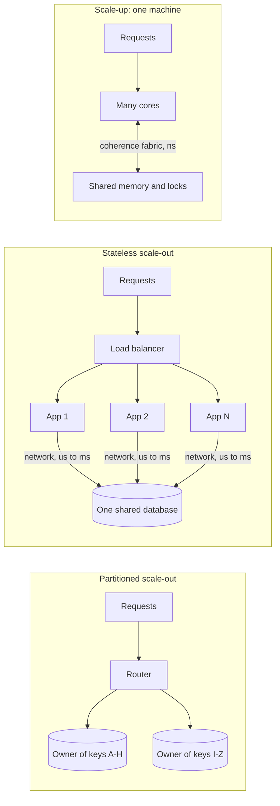
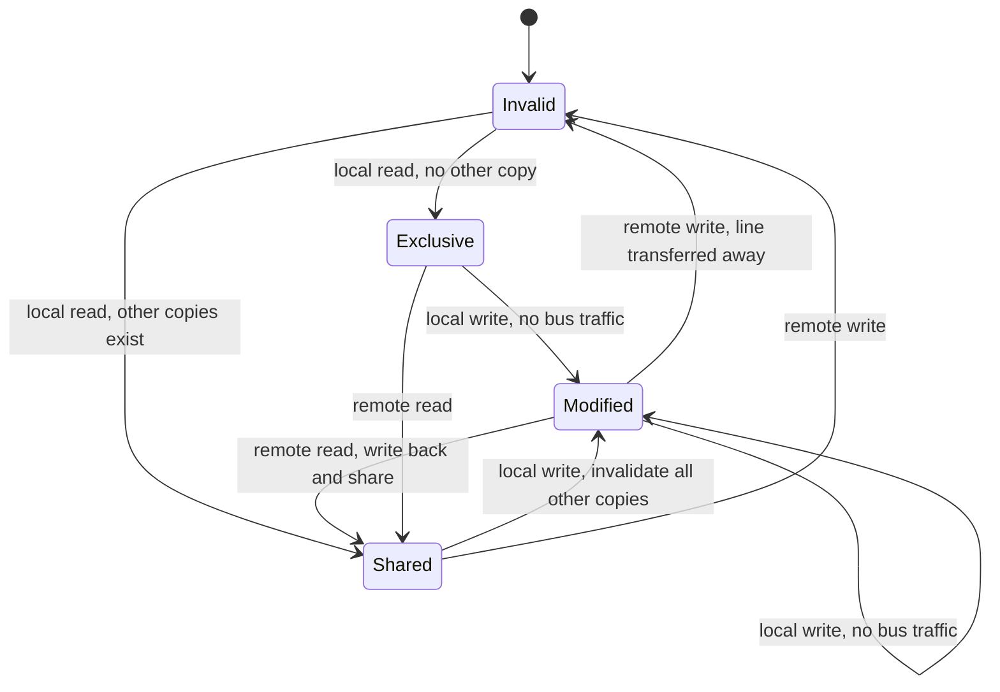
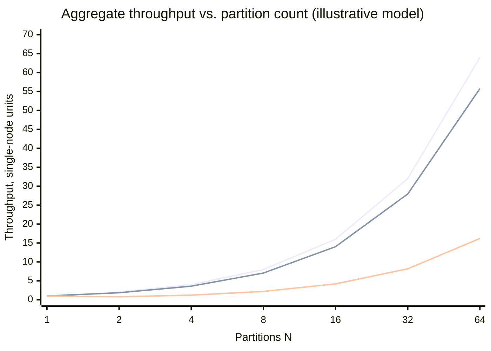
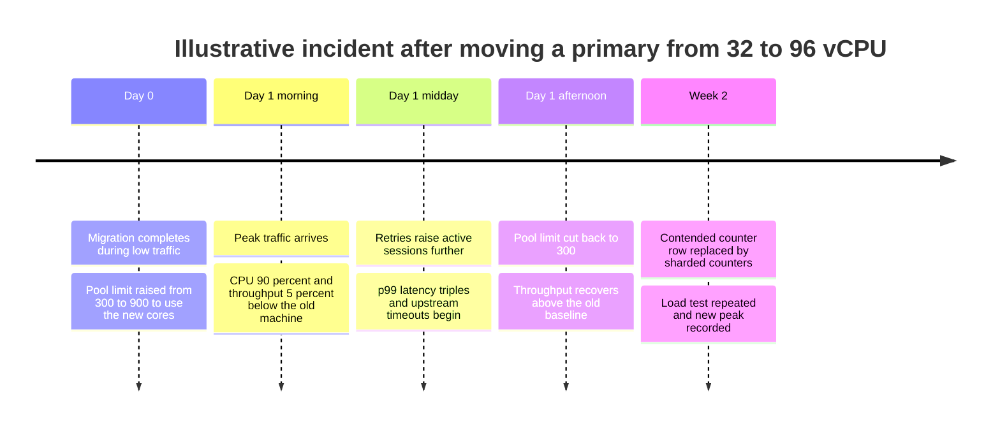

Dikey ölçekleme (scale-up), tek bir makineye kapasite ekler: daha fazla core, bellek, bellek bant genişliği, daha hızlı depolama ve ağ arayüzleri. Yatay ölçekleme (scale-out) ise makine ekler ve işi bu makineler arasında paylaştırır. İkisi de sistemin gecikme hedefi içinde taşıyabildiği istek hızını yükseltmeyi amaçlar ve ikisi de donanım bütçesinin değil, iş yükünün belirlediği bir noktada işe yaramaz hâle gelir. Daha büyük bir makine, istekler onun içindeki bir şey üzerinde seri hâle geldiğinde ya da core'ları zamanlarını paylaşılan veriyi tutarlı tutmakla geçirdiğinde getirisini yitirir. Daha fazla makine ise isteklerin tamamlanmak için birden fazla makineye dokunması gerektiğinde ya da tüm makineler hâlâ paylaşılan tek bir bileşene bağımlı olduğunda getirisini yitirir.

Asıl denge, koordinasyonun nerede gerçekleştiği ve bedelini kimin ödediğidir. Tek makinede core'lar arası koordinasyonu cache-coherence donanımı onlarca ila yüzlerce nanosaniyede yapar; profilde baskın hâle gelene kadar görünmezdir. Makineler arasında ise bunu, veri merkezi içinde round trip'i yüzlerce mikrosaniye tutan bir ağ üzerinden çalışan yazılım protokolleri yapar ve bedeli gecikmede, hata yönetiminde, tutarlılık modelinde ve operasyonel maliyette ortaya çıkar. Dikey ölçekleme sadelik ve güçlü tutarlılık satın alır; karşılığında katı bir tavan ve tek bir hata alanı (failure domain) kabul eder. Yatay ölçekleme pay ve daha küçük hata birimleri satın alır; karşılığında kalıcı bir koordinasyon vergisi öder.

İkinci bir eksen kapasiteden bağımsızdır: servisin kaç hata alanının kaybına dayanması gerektiği. "Kapasite için makine eklemek" ile "erişilebilirlik için makine eklemek" kararlarını tek bir karar gibi ele almak, aşağıda anlatılan ölçekleme hatalarının çoğunun kökenidir. Donanım fiyat eğrileri [Maliyet-Performans Eğrileri ve Donanım Sınırları](/distributed-systems/tr/foundations/monoliths-to-distributed/cost-performance-curves/) sayfasında, durumun (state) nerede yaşayabileceği sorusu ise [Stateful ve Stateless Servisler](/distributed-systems/tr/foundations/monoliths-to-distributed/stateful-vs-stateless/) sayfasında ele alınır.


*Üç topoloji ve her birinde paylaşılan, değişebilen durumun (shared mutable state) bulunduğu yer. Gecikme etiketleri büyüklük mertebesini gösterir.*

İlk topolojide paylaşılan durum bellektedir; koordinasyon ucuzdur ama tek bir kutuyla sınırlıdır. İkincisinde uygulama katmanı yatay ölçeklenmiştir, ancak her istek hâlâ tek bir veritabanında birleşir; yani seri hâle gelme noktası ortadan kalkmamış, yer değiştirmiştir. "Yatay ölçeklenip" hızlanmayan sistemlerin en yaygın şekli budur. Paylaşılan kaynağı her anahtara tam olarak tek bir sahip atayarak gerçekten ortadan kaldıran yalnızca üçüncüsüdür; aynı zamanda birden fazla sahibe yayılan istekleri ortaya çıkaran da yalnızca odur ve yatay ölçeklemenin maliyeti tam olarak burada yoğunlaşır.

## Dikey Ölçeklemenin Tavanı: Seri İş ve Coherence Trafiği

Daha büyük bir makine, throughput'u yalnızca ek core'larında aynı anda çalışabilen iş için artırır. Bunu iki ayrı mekanizma sınırlar ve her biri farklı bir çözüme yanıt verir. Birincisi, özel (exclusive) bir kaynak için kuyrukta beklemektir: bir kilit, bir log flush'ı, tek thread'li bir bileşen. İkincisi, core'ların paylaşılan belleğin içeriği üzerinde uzlaşmak için yaptığı iştir. Birincisi throughput eğrisini düzleştirir; ikincisi aşağı doğru büker.

### Seri İş ve Amdahl Tavanı

Her iş biriminin `S` oranındaki kısmı seri çalışmak zorundaysa ve geri kalanı `N` core'a kusursuz biçimde paralelleşiyorsa, Amdahl Yasası hızlanmayı `1 / (S + (1 - S) / N)` olarak verir; üst sınır `1 / S`'dir. %4 seri işte tavan 25x'tir; sekiz core 6.2x, 32 core 14.3x, 128 core ise 21.1x sağlar. Makineyi 32 core'dan 128 core'a, yani dört katına çıkarmak %48 fazla throughput getirir ve her yeni core bir öncekinden daha az değerlidir.

İstek işleyen bir sistemde seri pay nadiren tek thread'li bir fonksiyondur. Her isteğin, diğer tüm isteklerin de ihtiyaç duyduğu bir şeyi tutarak geçirdiği süre payıdır: bir sayaç satırı üzerindeki kilit, bir index sayfası latch'i, bir write-ahead log (WAL) flush'ı, yeterli slotu olmayan bir connection pool. Normalde birbirinden bağımsız istekler bunun arkasında sıraya girer ve oradaki gecikme, kullanım oranı bire yaklaştıkça keskin biçimde artar; bu davranış [Kuyruk Teorisi Temelleri](/distributed-systems/tr/resilience/flow-control/queueing-theory-littles-law/) sayfasında incelenir.

Gustafson Yasası buradaki düzelticidir: Amdahl problem boyutunu sabit tutar, oysa daha büyük bir makineye genellikle daha fazla bağımsız iş verilir ve seri kısım bununla birlikte büyümez. Ek core'lar daha fazla bağımsız isteğe harcandığında iyi, tek bir kaynakta seri hâle gelen isteklere harcandığında kötü değerlendirilmiş olur.

### Coherence: Bir Cache Line'ı Paylaşmanın Bedeli

Her core, yakın zamanda kullandığı belleği kendi özel cache'lerinde tutar; yaygın x86 ve çoğu ARM sunucu işlemcisinde bu birimler cache line adı verilen 64 baytlık bloklardır. İki core aynı line'ın kopyalarını tuttuğunda, cache denetleyicilerinin işlettiği ve line başına tutulan bir durum makinesi olan coherence protokolü, birinin yaptığı yazmanın diğeri tarafından görülmesini garanti eder. Ders kitabı sürümü MESI'dir; Intel MESIF, AMD ise MOESI adlı uzantıları kullanır, ancak ölçekleme açısından önemli olan geçişler üçünde de aynıdır.


*Tek bir core'un gözünden bir cache line'ın MESI durumları. Remote olarak etiketlenen geçişler, başka bir core'un aynı line'a dokunmasından kaynaklanır.*

Pahalı geçişler, bir line'ı başka bir core'un cache'inden çıkaran geçişlerdir: başka bir yerde `Modified` durumunda tutulan bir line'a yazmak isteyen core sahipliği talep etmeli ve diğer core'un onu bırakmasını beklemelidir. Birçok core aynı line'a sırayla yazıyorsa (atomik bir istek sayacı, paylaşılan bir referans sayacı, bir spinlock kelimesi, aynı line'a düşen iki ilgisiz sıcak alan), line cache'ler arasında gidip gelir ve her yazma birkaç cycle yerine core'lar ya da soketler arası bir transfere mal olur. İlgisiz alanların aynı line'ı paylaşması durumuna false sharing denir: programda mantıksal bir paylaşım yoktur, ama donanımda vardır. Core eklemek bu alışverişe daha fazla katılımcı ekler ve olası ikili alışverişlerin sayısı core sayısının karesiyle büyür.

Neil Gunther'in Evrensel Ölçeklenebilirlik Yasası (Universal Scalability Law, USL) iki mekanizmayı tek bir ifadede toplar: `C(N) = N / (1 + alpha * (N - 1) + beta * N * (N - 1))`. Contention (çekişme) katsayısı `alpha` seri paydır; coherency katsayısı `beta` ise ikili alışverişlerin maliyetidir. `beta = 0` olduğunda eğri Amdahl'ınkidir. `beta` sıfırdan büyük olduğu anda throughput `N_peak = sqrt((1 - alpha) / beta)` noktasında zirve yapar ve ardından düşer: tepe noktasından sonra daha fazla core, thread ya da eşzamanlı bağlantı throughput'u azaltır. `beta` terimi karesel büyüdüğü için küçük bir instance üzerindeki yük testi, büyük bir instance hakkında neredeyse hiçbir şey söylemez.

Production sistemleri `beta`'ya verilen iki yanıtı da gösterir. Redis komutları tek bir thread üzerinde yürütür; böylece veri üzerindeki coherence trafiğini ortadan kaldırır ve bir instance'ın tek bir core ile sınırlı olmasını kabul eder. Redis 6'nın I/O thread'leri yalnızca paylaşılan veriye dokunmayan socket okuma ve yazmalarını paralelleştirir. PostgreSQL her bağlantı için bir process çalıştırır; aktif backend'ler çoğaldıkça paylaşılan kilit ve buffer-mapping yapıları üzerindeki contention throughput'u önce düzleştirir, sonra düşürür. PgBouncer gibi pooler'lar, kaç istemci bağlanırsa bağlansın aktif sayıyı tepe noktasının yakınında tutar.

### Uygulamanın Altındaki Sınırlar

Bazı dikey ölçekleme tavanları işletim sisteminde ve ağ yolunda bulunur. Tek bir thread tarafından accept edilen tek bir dinleme soketi bağlantı kurulumunu seri hâle getirir; Linux, kernel 3.9 ile `SO_REUSEPORT` seçeneğini ekledi, böylece birden fazla soket aynı port'a bağlanabilir ve kernel bağlantıları bunlar arasında dağıtır. Tüm paketleri tek bir alma kuyruğuna (receive queue) teslim eden bir ağ arayüzü, interrupt işlemeyi tek bir core'da yoğunlaştırır; Receive Side Scaling (RSS) akışları hash'leyerek birden fazla kuyruğa ve core'a dağıtır. Bellek bant genişliği core sayısıyla aynı oranda büyümediği için, belleğe bağlı iş yükleri CPU'lar meşgul olmadan ölçeklenmeyi bırakabilir. Çok soketli makinelerde diğer sokete bağlı belleğe erişmek daha yavaştır (Non-Uniform Memory Access, NUMA); bu, coherence probleminin üzerine eklenen bir yerleşim problemidir.

:::tip[Makine ortalamasına değil, core başına metriklere bakın]
Ortalama %40 CPU'da çalışan 96 core'lu bir makine doymuş olabilir: bir core ağ interrupt'larını işlerken ya da tek thread'li bir bileşeni çalıştırırken %100'dedir, geri kalanlar onu bekler. Büyük bir makinede pay olduğuna karar vermeden önce core başına kullanımı ve run queue'yu kontrol edin, yük artarken throughput'u sabit kalan bir bileşen arayın.
:::

## Yatay Ölçeklemenin Tavanı: Partition'lar Arası İş ve Ortak Kader

Yatay ölçekleme throughput'u yalnızca paylaşılan bir kaynağı taşımak yerine ortadan kaldırdığında artırır. Stateless uygulama instance'ları birbiriyle hiçbir şey paylaşmaz; bu yüzden onları eklemek uygulama katmanındaki contention'ı ortadan kaldırır, ancak her instance hâlâ aynı veritabanına okur ve yazar. Veritabanının doyduğu noktadan sonra daha fazla uygulama instance'ı yalnızca ona bağlantı ekler ve onu kendi coherency tepe noktasına doğru iter. Hepsi paylaşılan tek bir veri deposuna bağımlı olan çok sayıda servise ayrıştırılmış bir sistem, dağıtık bir sistemin operasyonel maliyetini ve tek bir makinenin ölçekleme sınırını birlikte taşır; bu desen [dağıtık monolit](/distributed-systems/tr/microservice-patterns/service-decomposition/distributed-monolith/) olarak incelenir.

Stateful veri için paylaşılan kaynağı ortadan kaldırmak [veri bölümleme](/distributed-systems/tr/data-management/data-partitioning/) (partitioning) gerektirir: her anahtar tam olarak bir node'a aittir, böylece tek anahtarlı işlemler diğer node'larla koordinasyon gerektirmez. Partitioning toplam kapasiteyi artırır, ancak her anahtarın kapasitesi hâlâ tek bir makineyle sınırlıdır ve trafiğin orantısız bir payını alan bir anahtar cluster'ın geri kalanından hiçbir şey kazanmaz. Yönetilen sistemler bu sınırı açıkça belirtir: DynamoDB, tablonun toplam provisioned throughput'undan bağımsız olarak partition başına saniyede en fazla 3.000 read capacity unit ve 1.000 write capacity unit sınırını belgeler. Yatay ölçekleme toplamı ölçekler; her bir parçayı ise hâlâ dikey sınırlar yönetir. Çarpık anahtarlar [Çarpıklık ve Hot-Spot Problemleri](/distributed-systems/tr/data-management/data-partitioning/skew-hot-spots/) sayfasında ele alınır.

### Partition'lar Arası Vergi

Birden fazla partition'a dokunan bir işlem; bir koordinatör, ek round trip'ler, protokol süresince tutulan kilitler ve bir kurtarma yolu gerektirir. Atomik çok partition'lı yazmalar genellikle [iki aşamalı commit](/distributed-systems/tr/coordination/distributed-transactions/two-phase-commit/) ya da onun bir varyantını kullanır. Bu tür her işlem, her katılımcıda ve yerel bir işlemden daha uzun süre kapasite tüketir.

Partition'lar arası işlemlerin payı sabit değildir; anahtarların nasıl yerleştirildiğine bağlıdır. Bir işlem iki anahtara dokunuyorsa ve anahtarlar tekdüze bir hash ile yerleştiriliyorsa, ikisinin aynı partition'a düşme olasılığı `1 / N`'dir; dolayısıyla partition'lar arası pay `1 - 1 / N` olur ve cluster büyüdükçe %100'e yaklaşır. İki anahtar bilinçli olarak birlikte yerleştirilirse (örneğin bir siparişin her iki satırı da müşteriye göre partition'lanırsa), pay yalnızca gerçekten birden fazla müşteriye yayılan işlemlerin oranında kalır. Basit bir model farkı görünür kılar. Tek partition'lı bir işlemin tek bir node'da bir birim kapasite tükettiğini, iki partition'lı bir işlemin ise prepare ve commit aşamaları ile daha uzun kilit tutma süresi nedeniyle iki node'un her birinde iki birim tükettiğini varsayalım (örnek amaçlı bir çarpan). Bu durumda partition'lar arası pay `f` için işlem başına ortalama maliyet `1 + 3f` olur.


*Üst: doğrusal referans. Orta: ilişkili anahtarlar aynı yerde tutuluyor; işlemlerin %5'i iki müşteriye dokunuyor ve bunların 1 - 1/N'i farklı partition'lara düşüyor. Alt: işlem başına iki anahtar tekdüze hash ile yerleştiriliyor, dolayısıyla işlemlerin 1 - 1/N'i partition'lar arası. Partition'lar arası işlemin maliyet çarpanı örnek amaçlıdır.*

Alt eğri iki partition'da tek node'un altına iner: işlemlerin yarısı bir anda partition'lar arası bedeli öder ve cluster, tek makinenin 1.0 birim verdiği yerde 0.8 birim verir. 64 partition'da doğrusal ölçeklemenin yalnızca dörtte birine ulaşır, çünkü neredeyse her işlem bir yerine dört birim öder; aynı donanım üzerinde ilişkili anahtarları bir arada tutan eğri ise doğrusal ölçeklemenin %87'sini korur. Bir sistemin hangi eğride olduğunu node sayısı değil, partition anahtarı belirler; anahtarın nasıl seçileceği [colocated join'ler ve veri yerleşimi](/distributed-systems/tr/data-management/data-partitioning/colocated-joins/) sayfasında anlatılır. Bir arada yerleştirme fan-out'u da sınırlar: her biri bin çağrıda bir yavaşlayan 50 partition'ı bekleyen bir istek, `1 - 0.999^50` yani yaklaşık %4.9 olasılıkla en az bir yavaş çağrıya denk gelir; Dean ve Barroso'nun *The Tail at Scale* makalesinde tanımladığı etki budur.

:::caution[İki partition, tek bir partition'dan yavaş olabilir]
Bir veritabanını birlikte erişilen veriyi birbirinden ayıran bir hash anahtarıyla ikiye bölmek node başına yükü yarıya indirmez; yerel işlemleri dağıtık işlemlere dönüştürür. Partition'lamadan önce, transaction ve sorguların ne kadarının aday anahtarın birden fazla değerine dokunduğunu ölçün. Bu oran yüksekse önce anahtarı ya da erişim desenini değiştirin.
:::

### Replikalar Yazma Kapasitesi Değil, Hata Toleransı Ekler

Replikasyon farklı bir kurala tabidir. [Raft](/distributed-systems/tr/coordination/consensus-algorithms/raft/) gibi leader tabanlı ya da consensus grubunda her üye her yazmayı saklar. Bir Raft grubunu üç üyeden beşe büyütmek, tolere edilen hata sayısını birden ikiye ve commit quorum'unu ikiden üçe çıkarır; yazma kapasitesi tek bir leader'ınki olarak kalır ve commit gecikmesi yalnızca artabilir. Read replica'lar okuma kapasitesi ekler, bedeli [replikasyon gecikmesi](/distributed-systems/tr/data-management/replication/replication-lag/) olur. Hem dayanıklılık hem yazma kapasitesi gereken sistemler, her biri bir partition'a ait çok sayıda küçük grup çalıştırır: in-sync replica set'leriyle Kafka partition'ları, CockroachDB range'leri, TiKV region'ları. Kapasite grup sayısından, hata toleransı her grubun boyutundan gelir.

## Sayısal Örnek: Tek Sipariş Veritabanı, İki Gelecek

Primary veritabanı 32 vCPU'lu bir makinede çalışan ve gecikme hedefi içinde saniyede 6.000 yazma taşıyan bir sipariş servisi varsayalım. Tepe trafik ayda %4 büyüyor. Bu bölümdeki tüm sayılar örnek amaçlıdır.

1 ile 128 arasındaki eşzamanlılık seviyelerinde yapılan bir yük testi, USL katsayılarını `alpha = 0.02` ve `beta = 0.0002` olarak veriyor. Göreli kapasite `C(32) = 32 / (1 + 0.02 * 31 + 0.0002 * 32 * 31) = 17.60` olduğundan, bir kapasite birimi saniyede yaklaşık 341 yazmaya karşılık gelir. Eğri `N_peak = sqrt(0.98 / 0.0002) = 70` noktasında `C(70) = 20.92` ile zirve yapar.

Dikey seçenek 64 vCPU'lu bir makinedir: `C(64) = 20.87`, yani saniyede yaklaşık 7.100 yazma; bugünden %18.6 fazla, saatlik fiyat ise yaklaşık iki katı. Aylık %4 büyümede bu kazanç `ln(1.186) / ln(1.04)`, yani yaklaşık 4.3 ay yeter. 96 vCPU'lu bir makine daha kötüdür: tepe noktasının ötesinde kaldığı için `C(96) = 20.32`, yani saniyede yaklaşık 6.900 yazma.

Yatay seçenek, her biri 16 vCPU'lu bir makinede çalışan, `customer_id`'ye göre sekiz partition'dır. Her partition daha düşük eşzamanlılıkta, aynı eğrinin verimli kısmında çalışır: `C(16) = 11.87`, yani saniyede yaklaşık 4.050 yazma. İki düzeltme gerekir. Yazmaların %3'ü iki müşteriye dokunur (hesaplar arası transferler) ve ortalama `1 + 3 * 0.03 = 1.09` birime mal olur. Ayrıca en büyük müşteri tüm yazmaların %6'sını üretir; dolayısıyla onun partition'ı toplam trafiğin %12.5'ini değil `0.94 / 8 + 0.06 = 17.75%` kadarını taşır. İlk doyan en sıcak partition olduğundan sistemin sınırı `4,050 / (0.1775 * 1.09)`, yani saniyede yaklaşık 20.900 yazmadır. Bu, bugünkü yükün 3.5 katı ya da yaklaşık 32 aylık büyümedir.

Hata aritmetiği daha az belirgindir. Tek primary ile her failover tüm yazmaları erişilemez kılar. Sekiz primary ile bir hata müşterilerin %12.5'ini (sıcak partition için yazmaların %17.75'ini) etkiler, ancak hata verebilecek sekiz makine vardır ve failover'lar yaklaşık sekiz kat daha sık yaşanır. Yılda kaybedilen beklenen yazma-dakikası kabaca aynı kalır; partitioning her olayın etki alanını ve olay sayısını değiştirir. Bu da ancak erişilebilirlik hedefi filonun tamamı için değil, müşteri başına tanımlanmışsa önem taşır.

Dolayısıyla karşılaştırma 7.100'e karşı 20.900 değildir. Düşük mühendislik maliyetiyle 4 aylık pay ile; bir routing katmanı, bir resharding prosedürü, partition'lar arası bir yazma yolu, %6'lık müşteri için bir plan ve sekiz kat daha fazla failover pahasına 32 aylık pay arasındaki karşılaştırmadır. Ekip partition'lı tasarımı 4 aylık süre içinde teslim edemeyecekse, bugün doğru satın alma 64 vCPU'lu makinedir ve aynı gün başlanması gereken doğru proje partition'lı tasarımdır.

## Stratejilerin Karşılaştırılması

Genellikle "yatay" başlığı altında toplanan stratejiler birbirinden çok farklı davranır; tablo bu yüzden onları ayırır.

| Strateji | Büyüyen | Büyümeyen | Hata birimi | Ne zaman tercih edilmeli |
|---|---|---|---|---|
| Dikey, tek node | Tek kutudaki core, bellek, IOPS | Seri pay ve coherency maliyeti; `N_peak` ötesindeki kapasite | Servisin tamamı | Ölçülen `beta` küçük, alınabilecek en büyük makine planlama ufkunu karşılıyor ve güçlü tek node tutarlılığı önemli |
| Stateless yatay ölçekleme | Bağımsız istekler için hesaplama gücü | Paylaşılan downstream bağımlılıkların kapasitesi | Tek bir instance | İstekler değişebilir durum paylaşmıyor ve paylaşılan bağımlılığın ölçülmüş payı var |
| Partition'lı yatay ölçekleme | Toplam depolama ve yazma throughput'u | Anahtar ve partition başına kapasite | Tek bir partition | Veri ya da yazmalar tek makineyi aşıyor ve işlemlerin çoğu tek bir partition anahtarına dokunuyor |
| Replike grup | Okuma kapasitesi (follower'lar), hata toleransı | Leader'ın yazma kapasitesi | Üyelerin azınlığının kaybı tolere edilir | Tek bir partition ya da koordinasyon verisi için dayanıklılık ve failover |
| Diyagonal: az sayıda büyük, partition'lı node | İkisi birden, daha az koordinasyon katılımcısıyla | Her node'un yeniden inşa süresi | Tek bir büyük node | Node sayısının koordinasyon maliyetini belirlediği, throughput ağırlıklı stateful sistemler |

Diyagonal ölçeklemenin de kendi sınırı vardır: bir node'u kaybetmenin maliyeti boyutuyla birlikte büyür. 8 TB veri tutan ve eşlerinden efektif 250 MB/s hızla (canlı trafiği korumak için uygulanan throttling sonrası, örnek bir değer) yeniden inşa edilen bir node yaklaşık dokuz saat boyunca tasarlanandan bir eksik replikayla yaşar. Replike depolamada node boyutunu genellikle CPU değil, yeniden inşa süresi sınırlar.

### Hangi Sınıra Çarpacağınızı Ölçmek

USL katsayıları ölçümden gelir. Artan eşzamanlılıkta kapalı döngü (closed-loop) bir yük testi çalıştırın, throughput'u sabit bir gecikme hedefinde kaydedin ve `C(N)`'yi Gunther'in *Guerrilla Capacity Planning* kitabında anlatıldığı gibi doğrusal olmayan regresyonla uydurun. Eğrinin dirseğinin ötesinde noktalar da ekleyin: tüm noktalar `N_peak`'in altındaysa yüksek bir `alpha` ile küçük bir `beta` veriye eşit derecede uyar ve daha büyük bir makine için yapılan tahmin bir tahminden ibaret kalır.

Contention, CPU kısmen boştayken thread'lerin bloklanmasıyla birlikte yerinde sayan throughput olarak görünür; coherency, CPU doymuşken atomik işlemlerde ve spin döngülerinde harcanan cycle'larla birlikte düşen throughput olarak; partition'lar arası maliyet ise partition sayısıyla büyüyen koordinatör gecikmesi olarak. Linux'ta:

```shell
# Per-core utilization: look for single cores pinned at 100% (interrupts, one hot thread)
mpstat -P ALL 1 5
# Voluntary vs. involuntary context switches per thread: high voluntary = blocking
pidstat -w -t -p "$PID" 1 5
# Cache-to-cache transfers of contended lines (true and false sharing)
perf c2c record -p "$PID" -- sleep 10
perf c2c report --stdio | head -60
# Distribution of incoming connections and receive queues across cores
grep -E 'eth0|ens' /proc/interrupts
```

`perf c2c`, coherency maliyetinin en doğrudan kanıtıdır: core'lar arasında modified durumda sık transfer edilen cache line'ları, sorumlu kod konumları ve veri offset'leriyle birlikte raporlar. Bu, çekişmeli bir sayacı, ayrı line'lara padding ile ayrılması gereken iki alandan ayırt etmeye yeter.

## Hata Modları ve Dışarıdan Görünüşleri

Dikey hatalar çoğu zaman kapasite yetersizliği sanılır; yatay hatalar ise çoğu zaman sağlıklı görünen ortalamaların arkasına saklanır.

### Yükseltme Sonrası Geriye Dönük Throughput

Tetikleyici: coherency'ye bağlı bir iş yükü daha büyük bir makineye taşınır ya da pool sınırı yükseltilir ve aktif eşzamanlılık `N_peak`'i aşar. Belirtiler: aynı yükte yerinde sayan ya da düşen throughput, daha yüksek CPU, daha erken başlayan gecikme artışı. Tespit: öncesi ve sonrası için aktif oturum başına throughput, `perf c2c` transfer sayıları, veritabanının wait-event görünümlerindeki kilit bekleme süresi. Hafifletme: aktif eşzamanlılığı bir connection pooler ya da admission queue ile ölçülen tepe noktasında sınırlamak, gerekirse geri almak. Eşzamanlılık sınırlandığında toparlanma hızlıdır, ancak kök çözüm `beta`'yı düşüren tasarım çalışmasıdır: striped lock'lar, okuma sırasında toplanan core başına sayaçlar, sıcak alanların padding ile ayrı cache line'lara taşınması, sıcak bir tablonun partition'lanması.


*Bir coherency gerilemesinin şeklini gösteren varsayımsal bir zaman çizelgesi; gerçek bir olay değildir.*

Geçiş düşük trafikte başarılı görünür, çünkü `beta` düşük eşzamanlılıkta küçüktür. Tepe saatte daha fazla core daha fazla aktif oturuma izin verir ve sistemi tepe noktasının ötesine iten tam olarak budur; ardından retry'lar eşzamanlılığı daha da artırır. Bu, yük sıçramasından sonra da sürebilen bir geri besleme döngüsüdür ve [Retry Fırtınaları ve Metastabil Hatalar](/distributed-systems/tr/resilience/flow-control/retry-storms-metastable-failures/) sayfasında metastabil hata olarak anlatılır. Saatler içinde işe yarayan çözüm daha fazla donanım değil, daha az eşzamanlılıktır.

### Büyük Makinede Ortak Kader

Tetikleyici: dikey ölçeklenmiş bir node üzerindeki tek bir iş yükü paylaşılan bir kaynağı tüketir; örneğin buffer cache'i boşaltan analitik bir sorgu ya da disk bant genişliğini doyuran bir compaction. Belirtiler: tüm tenant'lar ve endpoint'ler aynı anda bozulur. Tespit: tek bir oturum ya da işle ilişkili doygunluk (disk kuyruk derinliği, bellek baskısı, cache isabet oranı). Hafifletme: node içinde izolasyon (ayrı pool'lar, cgroup sınırları, sorgu timeout'ları) ya da iş yükünü bir replikaya taşımak; yani [bulkhead](/distributed-systems/tr/resilience/protection-patterns/bulkhead-pattern/) ilkesinin tek bir makine içinde uygulanması. Büyük bir makine yalnızca çökmeleri değil, performans hatalarını da tek bir hata alanında toplar.

### Yatay Ölçekleme Sırasında Bağlantı Fırtınaları

Tetikleyici: bir autoscaler instance ekler ve her yeni instance paylaşılan veritabanına tam connection pool'unu açar. Belirtiler: veritabanı tam katman büyürken bağlantıları reddeder ya da yavaşlar, yeni instance'lar readiness kontrollerinden geçemez ve autoscaler daha fazla instance ekler.

```mermaid
sequenceDiagram
    autonumber
    participant U as Traffic
    participant H as Autoscaler
    participant A as App instances
    participant D as Shared database
    U->>A: Load rises, 40 instances at high CPU
    H->>A: Scale from 40 to 120 instances
    A->>D: 80 new instances open 20 connections each
    Note over D: 2400 connections vs. limit of 1000, new connections rejected
    D-->>A: Connection errors, slow authentication and backend startup
    A->>A: Readiness probes fail, requests retried
    H->>A: CPU still high, scale further
    rect rgb(70, 40, 40)
    Note over A,D: Scale-out raised load on the one component that did not scale
    A->>D: Existing instances time out and reconnect
    end
```


*Paylaşılan bir veritabanına karşı autoscaling. Sayılar örnek amaçlıdır.*

Tuzak 2. ve 3. adımlardadır: autoscaler, yardıma ihtiyacı olmayan katmandaki CPU'yu ölçer ve veritabanını yükleyen bir şekilde davranır; 7. adıma gelindiğinde kontrol döngüsü hatayı büyütmektedir. Tespit: veritabanı bağlantı sayısının sınıra oranı ve bağlantı kurma hızı, replica sayısıyla aynı grafikte. Hafifletme: pool boyutlarını veritabanı tarafından hesaplamak, araya transaction modunda bir pooler koymak, autoscaler'ın azami replica sayısını ve değişim hızını sınırlamak, gerçek darboğazı yansıtan bir sinyale göre ölçeklemek. Autoscaler davranışı ve stabilizasyon ayarları [HPA ve KEDA](/distributed-systems/tr/kubernetes/fundamentals/hpa-keda/) sayfasında ele alınır.

### Hata İmzalarının Özeti

| Hata | Yol | Dışarıdan belirti | Tespit sinyali | Hafifletme |
|---|---|---|---|---|
| Geriye dönük throughput | Dikey | Daha büyük makine tepe saatte daha yavaş | Aktif oturum başına throughput düşüyor; `perf c2c` transferleri artıyor | `N_peak`'te eşzamanlılık sınırı; `beta`'yı düşürmek |
| Gizli tek core | Dikey | Düşük ortalama CPU'da gecikme artıyor | `mpstat`'ta %100'de bir core; dengesiz `/proc/interrupts` | RSS, `SO_REUSEPORT`, tek thread'li aşamayı kaldırmak |
| Ortak kader | Dikey | Her şey birlikte bozuluyor | Tek bir işle ilişkili doygunluk | Node içi izolasyon, replikaya aktarma |
| Hot partition | Yatay | Bir partition doymuş, cluster ortalaması sağlıklı | Partition başına throughput ve gecikme | Anahtarı bölmek ya da salt'lamak, sıcak anahtarı cache'lemek |
| Partition'lar arası çöküş | Yatay | Partition eklemek throughput'u artırmıyor | `N` ile büyüyen partition'lar arası pay ve koordinatör gecikmesi | Partition anahtarını değiştirmek, ilişkili veriyi bir arada tutmak |
| Bağlantı fırtınası | Yatay | Uygulama katmanı büyürken veritabanı çöküyor | Veritabanı bağlantıları ve sınır, replica sayısı | Pooler, pool boyutunu veritabanı tarafından belirlemek, autoscaler sınırları |
| Split brain | İkisi de, failover sırasında | İki primary'de ayrışan yazmalar | Leader olduğunu iddia eden iki node | Quorum tabanlı seçim ve fencing |

Tablodaki girdilerden yalnızca split brain hizmeti yavaşlatmak yerine veriyi bozar; [Split-Brain Problemi ve Fencing Tokens](/distributed-systems/tr/coordination/consensus-algorithms/split-brain-fencing/) sayfasında ve özellikle veritabanı failover'ı için [Failover ve Lider Seçimi](/distributed-systems/tr/data-management/replication/failover-leader-election/) sayfasında ele alınır. Yönetilen bir veri deposundaki hot partition modu [Hot Partition Problemi](/distributed-systems/tr/case-studies/dynamodb-cassandra/hot-partition-problem/) sayfasında incelenir.

## Bilinçli Seçim Yapmak

Karar üç ölçüme ve bir gereksinime dayanır: isteklerin nerede seri hâle geldiği, `beta`'nın ne kadar büyük olduğu, mevcut en iyi anahtarla işlemlerin ne kadarının partition'lar arası olacağı ve servisin kaç hata alanının kaybına dayanması gerektiği.

Darboğaz ölçülen `beta`'sı küçük olan stateful bir bileşense, satın almaya razı olduğunuz en büyük makine partition'lı bir alternatifi kurmak için gereken süreden daha uzun bir pay veriyorsa ve tek node üzerindeki transaction semantiği yatay paydan daha değerliyse dikey ölçekleyin. OLTP ilişkisel veritabanları bunun standart örneğidir; Stack Overflow, ana sitelerini uzun yıllar boyunca az sayıda büyük SQL Server makinesinden sunduğunu kamuya açık olarak yazmıştır. McSherry, Isard ve Murray'in *Scalability! But at what COST?* makalesi, tek makinede çalışan tek thread'li programların yayımlanmış birkaç dağıtık graf işleme sonucunu geride bıraktığını göstermiştir; bu, her cluster'ı en iyi tek makine baz çizgisiyle karşılaştırmak için bir nedendir.

Ölçülen eğri hedef eşzamanlılıkta tepe noktasına yakınsa ya da onu geçmişse, büyüme planlama ufku içinde mevcut en büyük makineyi tüketiyorsa ya da erişilebilirlik hedefi başka bir zone'daki bir standby ile birlikte tek primary ile karşılanamıyorsa dikey ölçeklemeyin.

İstekler bağımsızsa ya da bir partition anahtarı partition'lar arası işlemleri seyrek tutuyorsa, veri hacmi ya da yazma throughput'u tek makineyi aşıyorsa, birden fazla bölgedeki kullanıcıların yerel gecikmeye ihtiyacı varsa ya da verinin belirli yetki alanlarında tutulması gerekiyorsa yatay ölçekleyin. YouTube'un MySQL sharding ihtiyacından doğan Vitess ve partition'ları hem yerleşimin hem de consumer paralelliğinin birimi olan Kafka, ortak işlemleri tek bir partition'a dokunduğu için partition sayısıyla ölçeklenir.

Sıcak bir anahtarı düzeltmek için yatay ölçeklemeyin, çünkü onun trafiği hâlâ tek bir sahibe düşer; replika ekleyerek yazma throughput'unu artırmak için yatay ölçeklemeyin, çünkü her replika aynı işi yapar; doymuş bir veritabanını uygulama instance'ı ekleyerek rahatlatmaya çalışmayın; ve yukarıdaki koşulların hiçbiri yokken spekülatif olarak yatay ölçeklemeyin. İlk günden yatay ölçek için kurulan bir sistem; routing, resharding ve kısmi hata yönetiminin bedelini trafiğin en düşük, iterasyon hızının ise en önemli olduğu dönemde öder. Veri sahipliği net olan bir [modüler monolit](/distributed-systems/tr/microservice-patterns/service-decomposition/modular-monolith/), bedelini erkenden ödemeden partitioning seçeneğini açık tutar.

:::note[Kapasite ve erişilebilirlik ayrı satın alımlardır]
Bir servis kapasite için tek makineye, erişilebilirlik için üç makineye ihtiyaç duyabilir; ya da kapasite için kırk makineye ihtiyaç duyup erişilebilirlik tavanı olarak hâlâ tek bir paylaşılan veritabanı taşıyabilir. Kapasiteyi ölçülmüş throughput eğrilerine, yedekliliği ise hedefin gerektirdiği hata alanlarına göre boyutlandırın. Failover için alınan replikalar ancak trafik sunuyorsa ve sistem bunlardan biri kaybedildikten sonra da hedefini karşılayabiliyorsa kapasite olarak sayılır.
:::

## İleri Okuma

- Gene M. Amdahl, *Validity of the Single Processor Approach to Achieving Large Scale Computing Capabilities*, AFIPS Spring Joint Computer Conference, 1967.
- John L. Gustafson, *Reevaluating Amdahl's Law*, Communications of the ACM, 1988.
- Neil J. Gunther, *Guerrilla Capacity Planning*, Springer, 2007.
- Paul E. McKenney, *Is Parallel Programming Hard, And, If So, What Can You Do About It?*, kernel.org (sürekli güncellenir).
- Jeffrey Dean ve Luiz André Barroso, *The Tail at Scale*, Communications of the ACM, 2013.
- Frank McSherry, Michael Isard ve Derek G. Murray, *Scalability! But at what COST?*, USENIX HotOS, 2015.
