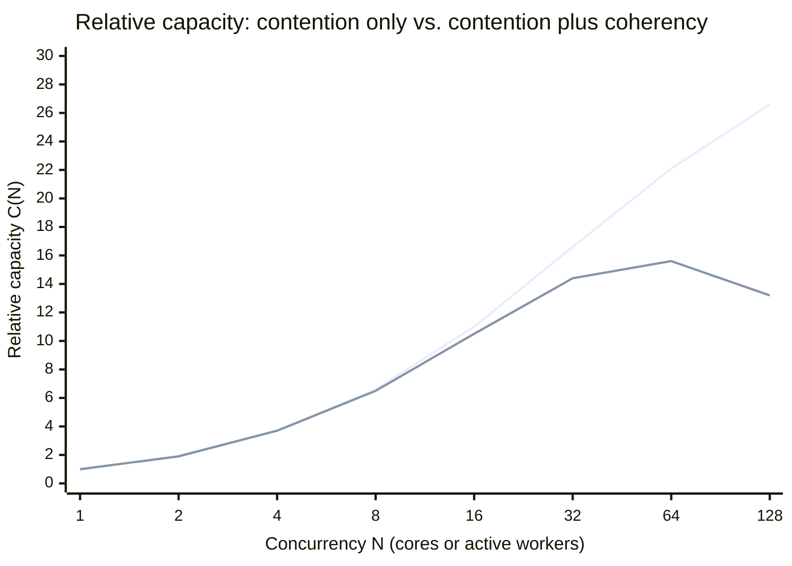
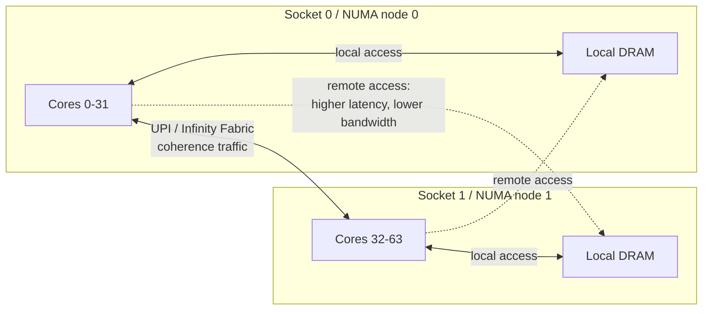
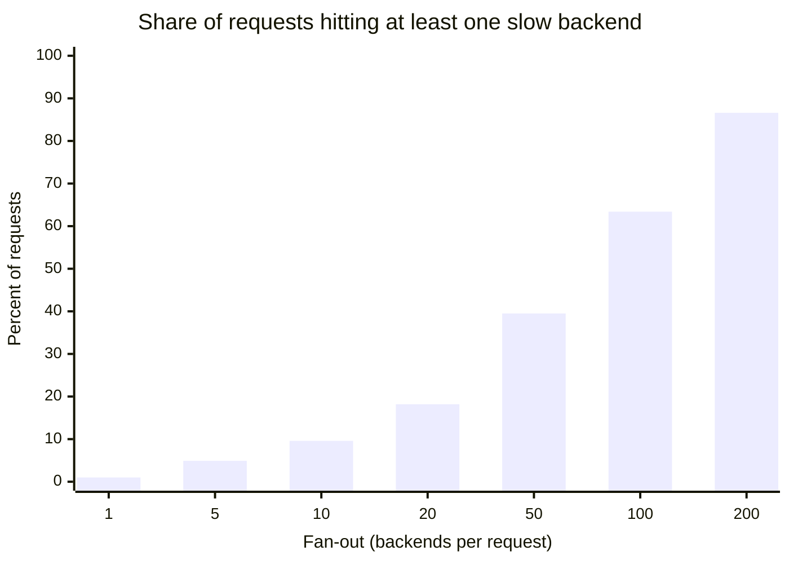
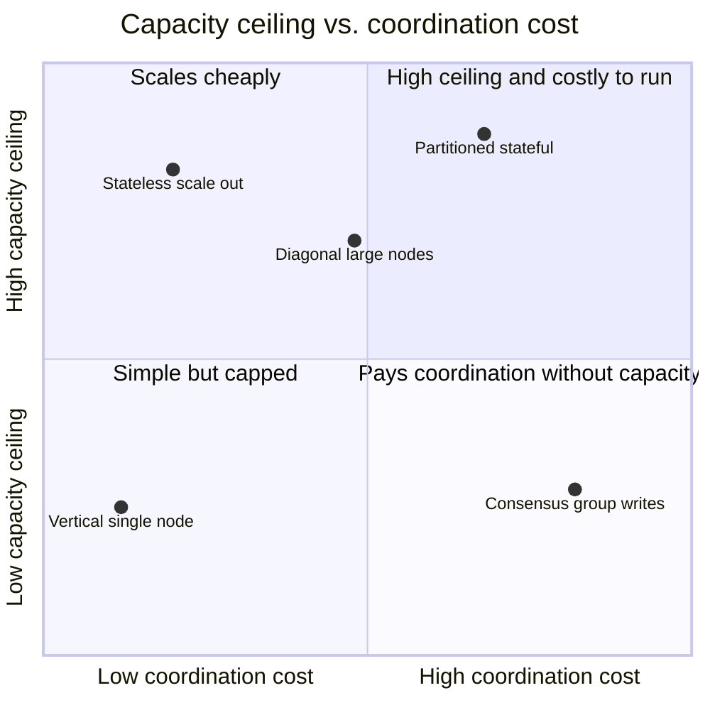
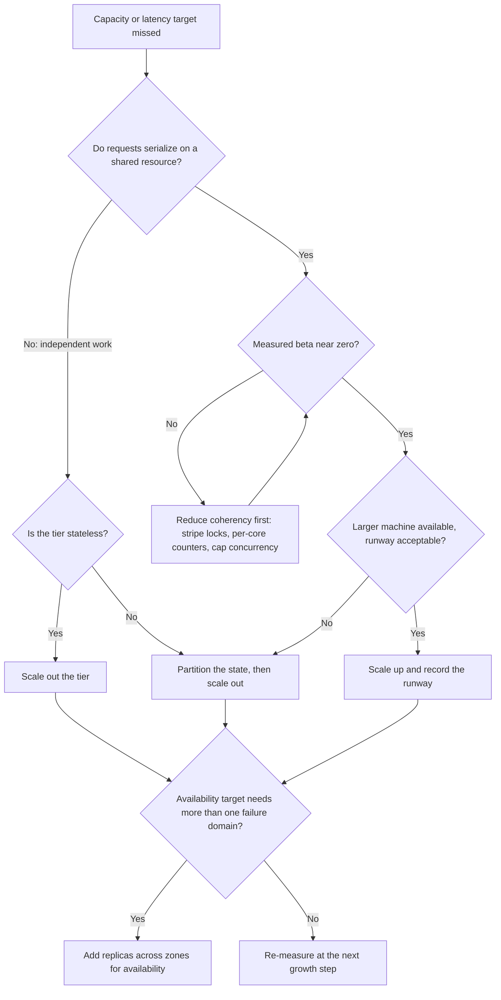

Dikey ölçekleme (scale-up), tek bir makinenin kapasitesini artırır: daha fazla core, daha fazla bellek, daha hızlı disk ve ağ arayüzleri. Yatay ölçekleme (scale-out) ise makine sayısını artırır ve işi bu makineler arasında paylaştırır. İkisi de sistemin kabul edilebilir bir gecikmeyle taşıyabildiği throughput'u yükseltmeyi hedefler, ancak farklı tavanlara çarparlar. Dikey ölçeklemenin sınırını, iş yükünün paralel çalıştırılamayan kısımları ve core'lar arasında belleği tutarlı tutmanın fiziksel maliyeti çizer. Yatay ölçekleme bu sınırı yalnızca koordinasyon gerektirmeden bölünebilen iş için kaldırır; geri kalan her şey için bedeli ağ round trip'leri, kısmi hatalar ve koordinasyon protokolleriyle tahsil eder.

Bu yüzden asıl denge, tek büyük makine ile çok sayıda küçük makine arasında değildir. Asıl soru, paylaşılan ve değişebilen durumun (shared mutable state) nerede yaşadığı ve onu tutarlı tutmanın neye mal olduğudur. Tek makine içinde tutarlılık, cache-coherence donanımı tarafından nanosaniyeler içinde ve görünmez biçimde sağlanır; ta ki darboğaz hâline gelene kadar. Makineler arasında ise maliyeti yüzlerce mikrosaniyeden yüzlerce milisaniyeye uzanan yazılım protokolleriyle sağlanır ve bu maliyet her yerde kendini gösterir: istek gecikmesinde, hata yönetiminde ve istemcilerin gözlemlediği tutarlılık modelinde.

Bu sayfa her iki tavanın arkasındaki mekanizmaları, yük testi verisini bir kapasite tahminine dönüştüren ölçeklenebilirlik yasalarını ve bunlardan çıkan karar kurallarını ele alır. Donanım fiyat eğrileri [Maliyet-Performans Eğrileri ve Donanım Sınırları](/distributed-systems/tr/foundations/monoliths-to-distributed/cost-performance-curves/) sayfasında, durum (state) sorusu ise derinlemesine [Stateful ve Stateless Servisler](/distributed-systems/tr/foundations/monoliths-to-distributed/stateful-vs-stateless/) sayfasında işlenir.

## Tek Bir Makinenin Ölçeklenmeyi Bıraktığı Nokta

Core eklemek, ancak iş bu core'lara dağıtılabiliyorsa throughput'u artırır. Bunu engelleyen iki ayrı mekanizma vardır ve her biri farklı bir çözüm ister: paylaşılan bir kaynak için kuyrukta bekleyen iş (contention, çekişme) ve paylaşılan veriyi core'lar arasında tutarlı tutmak için harcanan iş (coherency). Bir coherency problemini kapasite problemi sanmak, dikey ölçeklemedeki en pahalı hatadır; çünkü daha büyük bir makine satın almak durumu kötüleştirebilir.

### Contention: Seri Pay

Amdahl Yasası, `S` oranındaki kısmın seri çalışmak zorunda olduğu, geri kalanının ise `N` işlemciye kusursuz biçimde paralelleştiği bir işi modeller. Hızlanma `1 / (S + (1 - S) / N)` olur ve `N` ne kadar büyürse büyüsün `1 / S` değerine yaklaşır. %1'i seri olan bir iş yükü 100x'i geçemez; 128 core'da yaklaşık 56x'e ulaşır. %5 seri payda tavan 20x'tir ve 128 core yaklaşık 17x sağlar. %20 seri payda tavan 5x'tir; 16 core'dan 128 core'a çıkmak hızlanmayı yalnızca 4.0'dan 4.85'e taşır. Yani sekiz kat donanım, %21 fazla throughput demektir.

Çevrimiçi bir serviste "seri" nadiren tek thread'li kod anlamına gelir. Bir isteğin, diğer tüm isteklerin de ihtiyaç duyduğu bir şeyi tuttuğu her aralık seridir: global bir mutex, sık güncellenen bir satır üzerindeki kilit, write-ahead log'un group-commit flush'ı, downstream bir bağımlılığa giden ve yeterli slotu olmayan bir connection pool, tek thread'li bir event loop. Normalde birbirinden bağımsız olan istekler bu noktada kuyruğa girer ve throughput sınırını core sayısı değil, o kuyruk belirler. Böyle bir noktadaki kuyruk davranışı [Kuyruk Teorisi Temelleri](/distributed-systems/tr/resilience/flow-control/queueing-theory-littles-law/) sayfasında incelenir.

Gustafson Yasası (1988) gerekli karşı ağırlıktır. Amdahl problem boyutunun sabit olduğunu varsayar; Gustafson ise daha büyük makinelere genellikle daha büyük problemler verildiğini, dolayısıyla seri kısmın toplama oranla küçüldüğünü gözlemlemiştir. Bu durumda ölçeklenmiş hızlanma `N - S * (N - 1)` olur. İstek işleyen bir sistem için çevirisi doğrudandır: ek core'lar daha fazla bağımsız isteğe (daha fazla tenant, daha fazla partition, daha büyük batch'ler) harcandığında iyi değerlendirilir; paylaşılan bir kaynakta darboğaza girmiş tek bir isteği hızlandırmaya harcandığında ise boşa gider.

### Coherency: Throughput Neden Düşebilir

Neil Gunther'in Evrensel Ölçeklenebilirlik Yasası (Universal Scalability Law, USL) ikinci bir ceza terimi ekler. Eşzamanlı çalışan işçiler, contention'ın (`α`) yanında, paylaşılan veriyi tutarlı tutmak için bilgi alışverişi de yapmak zorundadır: core'lar arasında gidip gelen cache line'lar, el değiştiren kilit sahipliği, yayınlanan invalidation'lar. `N` işçinin her biri diğer her biriyle etkileşebiliyorsa bu maliyet `N(N - 1)` ile büyür ve bir coherency katsayısı olan `β` ile ifade edilir. Bu sayfayla ilgili dört yasa yan yana:

```text
Amdahl     Speedup(N) = 1 / (S + (1 - S) / N)            limit: 1 / S
Gustafson  Scaled(N)  = N - S * (N - 1)
USL        C(N)       = N / (1 + alpha*(N - 1) + beta*N*(N - 1))
USL peak   N_peak     = sqrt((1 - alpha) / beta)
```

`β = 0` olduğunda USL, Amdahl'a indirgenir: throughput bir tavana doğru monoton biçimde artar. `β` sıfırdan büyük olduğu anda ise eğrinin `N_peak` noktasında bir maksimumu olur ve bu noktanın ötesinde düşer. Bu geriye dönük (retrograde) bölge, coherency'ye bağlı sistemlerin belirleyici özelliğidir: tepe noktasından sonra core, thread ya da bağlantı eklemek throughput'u azaltır.


*Üstteki çizgi: alpha = 0.03, beta = 0 (Amdahl). Alttaki çizgi: alpha = 0.03, beta = 0.0003 (USL). Parametreler örnek amaçlıdır.*

İki eğri yaklaşık sekiz işçiye kadar ayırt edilemez; küçük ölçekli yük testlerinin coherency problemlerini nadiren ortaya çıkarmasının nedeni budur. 16'dan sonra ayrışırlar: yalnızca contention'a bağlı sistem kazanmaya devam ederken, coherency'ye bağlı sistem 57 civarında zirve yapar ve 128'e gelindiğinde kapasite kaybetmiştir. İkisinin `α` değeri aynıdır; aradaki farkın tamamı 0.0003'lük bir katsayıdan, yani tek bir profiling örneğinde fark edilemeyecek kadar küçük, ikili bir etkileşim maliyetinden gelir.

Üretimdeki sistemler bunu görünür kılar. PostgreSQL her bağlantı için bir backend process çalıştırır; aktif backend sayısı arttıkça paylaşılan lightweight lock'lar ve buffer-mapping yapıları üzerindeki contention, scheduler yüküyle birlikte önce throughput'u düzleştirir, sonra düşürür. PgBouncer ile transaction modunda connection pooling tam olarak bu yüzden vardır: aktif backend sayısını istemci sayısının belirlemesine izin vermek yerine tepe noktasının yakınında tutar. Redis ise tersi yolu seçmiştir: komut yürütme tek bir thread üzerinde çalışır ve bu, veri erişimi için `β`'yı tamamen ortadan kaldırır. Redis 6 I/O thread'lerini getirdiğinde yalnızca paylaşılan durumu olmayan kısmı, yani socket okuma ve yazmayı paralelleştirmiş, komut yürütmeyi seri bırakmıştır.

### NUMA: Donanıma Gömülü Coherency

Çok soketli bir sunucuda bellek tekdüze değildir. Her soketin kendi bellek denetleyicileri vardır; kendi soketine bağlı belleği okuyan bir core yerel yolu kullanırken, başka bir sokete bağlı belleği okuyan core soketler arası bir bağlantıyı (Intel UPI, AMD Infinity Fabric) geçer ve daha yüksek gecikme ile daha düşük bant genişliği öder. Buna Tekdüze Olmayan Bellek Erişimi (Non-Uniform Memory Access, NUMA) denir. Cezanın büyüklüğü platform nesline ve topolojiye bağlıdır; bu yüzden varsaymak yerine ölçülmelidir: `numactl --hardware` firmware'in göreli mesafe matrisini yazdırır, bir bellek gecikmesi benchmark'ı ise mutlak değerleri verir.


*İki soketli NUMA topolojisi. Uzak bellek erişimi ve cache line transferleri, soketler arası bağlantıdan geçer.*

Diyagramda bağlantıdan iki tür trafik geçer ve ikincisi birincisinden daha önemlidir. Verinin uzaktan okunması, bellek politikasıyla düzeltilebilecek bir yerleşim problemidir. Cache line transferleri ise yerleşimin çözemeyeceği bir coherence problemidir: soket 0'daki bir core, en son soket 1'de yazılmış bir line'a yazdığında (atomik bir sayaç, bir spinlock kelimesi, paylaşılan bir istatistik struct'ı) yazma tamamlanmadan önce line bir tarafta invalidate edilmeli ve bağlantı üzerinden diğer tarafa getirilmelidir. Bu tür her yazma soketler arası bir round trip demektir; bu da NUMA'yı `β`'nın fiziksel kaynaklarından biri yapar. Tek bir sıcak paylaşılan sayaca sahip bir iş yükü, daha az core'lu tek soketli bir makinede, iki kat core'a sahip iki soketli bir makineden daha hızlı çalışabilir.

Topoloji her zaman soket sayısından anlaşılmaz. AMD EPYC işlemciler soket başına birden fazla NUMA node gösterecek şekilde yapılandırılabilir (firmware'deki NPS ayarı) ve son seviye cache'leri core kompleksleri arasında bölünmüştür; dolayısıyla tek soketli bir sunucuda da erişim tekdüze olmayabilir. Linux yanlış yerleşimi otomatik NUMA dengeleme (`kernel.numa_balancing`) ile hafifletir: erişimleri yapay olarak tetiklenen page fault'lar aracılığıyla örnekler ve sayfaları onları kullanan thread'lere doğru taşır. Bu, erişim deseni kararlı olan uzun ömürlü process'lere yardımcı olur, ancak CPU tüketir ve taşıma sırasında gecikme sıçramalarına yol açar. Büyük paylaşılan buffer'ları olan veritabanları bu mekanizmayı genellikle devre dışı bırakır; örneğin MongoDB'nin production notları, hiçbir node'un bellek hotspot'ına dönüşmemesi için NUMA donanımında `mongod`'un interleaved bellek tahsisiyle başlatılmasını uzun süredir önerir.

### Sayısal Örnek: Daha Büyük Bir Makinenin Kazandırdığı Süre

32 vCPU'lu bir instance üzerinde çalışan bir OLTP servisi varsayalım. 1'den 128'e kadar eşzamanlılık seviyelerinde yapılan bir yük testi, USL parametrelerini `α = 0.03` ve `β = 0.0003` olarak veriyor (örnek değerler). Tepe trafik ayda %5 büyüyor ve ekip, saatlik fiyatı yaklaşık iki katına çıkaran 64 vCPU'lu bir instance'a geçmeyi planlıyor.

32'deki göreli kapasite 14.4'tür (`32 / (1 + 0.03 * 31 + 0.0003 * 32 * 31)`). 64'te ise 15.6'dır. Geçiş, yaklaşık %100 fazla maliyete karşılık %8.7 fazla kapasite getirir. Kazanılan süre (runway) olarak ölçüldüğünde, aylık %5 büyümede doğrusal bir ikiye katlama `ln(2) / ln(1.05)`, yani yaklaşık 14.2 ay yeterdi; gerçek %8.7'lik kazanç ise `ln(1.087) / ln(1.05)`, yani yaklaşık 1.7 ay yeter. Aynı iş yükü yalnızca contention'a bağlı olsaydı (`β = 0`), 64 core 32 core'dan %33 fazla kapasite sağlayacak ve yaklaşık 5.9 aylık süre kazandıracaktı: hâlâ doğrusal olmaktan çok uzak, ama bambaşka bir karar.

Sayılar çözümü işaret eder. Bu iş yükünün pahalı kısmı `β`'dır ve `β` donanımla değil, tasarım değişiklikleriyle düşürülür: global bir kilidi striped lock'lara bölmek, paylaşılan bir sayacı okuma sırasında toplanan core başına sayaçlarla değiştirmek, sıcak bir tabloyu partition'lara ayırmak ve aktif eşzamanlılığı bir admission queue ile `N_peak` civarında (burada yaklaşık 57) sınırlamak. Bunların her biri, zaten parası ödenmiş olan dahil, her makine boyutu için eğriyi yukarı taşır.

## Yatay Ölçeklemenin Kazandırdıkları ve Bedeli

Yatay ölçekleme throughput'u yalnızca paylaşılan bir kaynağı ortadan kaldırdığında iyileştirir. Çoğu zaman ise kaynağı yalnızca başka bir yere taşır. Bir load balancer arkasındaki on stateless uygulama sunucusu, instance'lar değişebilir durum paylaşmadığı için uygulama katmanındaki contention'ı ortadan kaldırır; ancak hepsi hâlâ aynı veritabanı primary'sine yazar. Seri pay artık veritabanında yaşar ve bu noktadan sonra uygulama sunucusu eklemek veritabanının bağlantı sayısını artırarak onu kendi coherency tepe noktasına doğru iter. [Dağıtık monolit](/distributed-systems/tr/microservice-patterns/service-decomposition/distributed-monolith/) olgusunun arkasındaki mekanizma budur: tek makinenin ölçekleme sınırına sahip bir sistemin, dağıtık bir sistemin operasyonel maliyetini ödemesi.

Stateful veri için paylaşılan kaynağı ortadan kaldırmak, [veri bölümleme](/distributed-systems/tr/data-management/data-partitioning/) (partitioning) anlamına gelir: her anahtarı tam olarak bir sahibe atamak, böylece tek anahtarlı işlemlerin diğer sahiplerle koordinasyon gerektirmemesini sağlamak. Partitioning toplam kapasiteyi artırır, ancak anahtar başına tavan tek bir makine olarak kalır. Tek bir sıcak anahtar (ünlü bir hesap, flash-sale'deki bir SKU, global bir rate-limit sayacı) bin node'luk bir cluster'dan hiçbir şey kazanmaz, çünkü trafiğinin tamamı hâlâ tek bir sahibe düşer. Yatay ölçekleme toplamı ölçekler; her bir parçayı ise hâlâ dikey sınırlar yönetir. Bkz. [Çarpıklık ve Hot-Spot Problemleri](/distributed-systems/tr/data-management/data-partitioning/skew-hot-spots/).

:::caution[Darboğazı taşımak onu ortadan kaldırmak değildir]
Instance eklemeden önce, her isteğin eninde sonunda seri hâle geldiği kaynağı bulun. Bu kaynak tek bir veritabanı, kilit, kuyruk partition'ı ya da harici bir API kotasıysa, önüne eklenen her instance onun üzerindeki contention'ı artırır. Belirti karakteristiktir: instance eklendikçe instance başına CPU düşer, uçtan uca throughput ise yerinde sayar ya da azalır.
:::

### Replikasyon Hata Toleransı Getirir, Yazma Kapasitesi Getirmez

Makine eklemenin diğer nedeni replikalardır ve bunlar farklı bir kurala tabidir. [Raft](/distributed-systems/tr/coordination/consensus-algorithms/raft/) gibi bir consensus grubunda her üye her yazmayı saklar ve bir yazma, üyelerin çoğunluğu onu kalıcı hâle getirdiğinde commit edilir. Commit gecikmesi kabaca leader'ın kendi disk flush'ı ile en hızlı çoğunluğun en yavaş üyesine olan round trip'in toplamıdır. Bir grubu 3 üyeden 5 üyeye büyütmek, tolere edilen hata sayısını birden ikiye, quorum'u 2'den 3'e çıkarır ve hiç yazma kapasitesi eklemez; çünkü her üye öncekiyle aynı işi yapar. etcd'nin küçük ve tek sayılı cluster'ları önermesinin ve hem dayanıklılık hem kapasite gerektiren sistemlerin her biri bir partition'a sahip çok sayıda küçük grup çalıştırmasının nedeni budur: in-sync replica set'leriyle Kafka partition'ları, CockroachDB range'leri, TiKV region'ları. Kapasite grup sayısından, hata toleransı ise her grubun boyutundan gelir.

İletişim deseni de önemlidir. Her node'un diğer her node'la konuştuğu protokoller tur başına `O(N^2)` mesaj harcar; leader tabanlı replikasyon işlem başına `O(N)` harcar; [gossip](/distributed-systems/tr/resilience/failure-detection/gossip-protocols/) ise bilgiyi node başına sınırlı yükle `O(log N)` turda yayar. Büyük cluster'lar tüm üyelere ulaşması gereken her şey için son ikisini kullanır.

### Fan-Out, Kuyruk Gecikmesini Medyan Gecikmeye Dönüştürür

Yatay ölçekleme gecikme dağılımının şeklini de değiştirir. Bir istek `n` backend'e paralel olarak dağılıp (fan-out) hepsini beklediğinde, gecikmesi `n` örneğin maksimumudur. Her backend bağımsız olarak zamanın %1'inde kendi 99. yüzdelik gecikmesini aşıyorsa, en az birinin yavaş olma olasılığı `1 - 0.99^n` olur.


*Her backend, çağrıların %1'inde bağımsız olarak kendi p99 değerinden daha yavaştır.*

Fan-out 10 olduğunda neredeyse her on istekten biri geride kalan bir backend'i bekler; 100'de ise neredeyse her üç istekten ikisi. Tek bir makinede nadir bir kuyruk olayı olan gecikme, dağıtık isteğin tipik deneyimine dönüşür. Dean ve Barroso bu etkiyi *The Tail at Scale* makalesinde standart çözümleriyle birlikte tanımlamıştır: hedged request'ler (beklenen p95'ten sonra ikinci bir kopya gönderip ilk gelen yanıtı almak), tied request'ler (iki sunucuda kuyruğa alıp kaybedeni iptal etmek) ve bir deadline dolduğunda kısmi sonuç döndürmek. En ucuz çözüm ise yapısaldır: birlikte okunan veriyi aynı yerde tutarak fan-out'u düşük tutmak. Bir process içindeki nanosaniyelerden bölgeler arası onlarca milisaniyeye uzanan gecikmelerin kendisi ve bozdukları varsayımlar [Dağıtık Hesaplamanın 8 Yanılgısı](/distributed-systems/tr/foundations/monoliths-to-distributed/eight-fallacies/) sayfasında ele alınır.

## Stratejilerin Karşılaştırılması

Tablo, genellikle "yatay" başlığı altında toplanan stratejileri birbirinden ayırır; çünkü sınırları, isimlerinin düşündürdüğünden çok daha farklıdır.

| Strateji | Kapasite tavanı | Koordinasyon maliyeti | Hatanın etki alanı | Ne zaman tercih edilmeli |
|---|---|---|---|---|
| Dikey (tek node) | Mevcut en büyük makine, `α` ve `β` oranında azalmış | Makineler arası yok; içeride coherency | Servisin tamamı | Ölçülen `β` sıfıra yakın, büyüme katalogdaki makinelere sığıyor, erişilebilirlik hedefi bir node artı bir standby ile karşılanıyor |
| Stateless yatay ölçekleme | Paylaşılan downstream bağımlılıklar | Katman içinde sıfıra yakın | Tek bir instance | CPU'ya bağlı, bağımsız istekler; durum zaten dışarıda tutuluyor |
| Partition'lanmış stateful yatay ölçekleme | En sıcak partition (tek makine) | Yalnızca partition'lar arası işlemler | Tek bir partition | Veri hacmi ya da yazma throughput'u tek makineyi aşıyor ve işlemlerin çoğu tek anahtara dokunuyor |
| Replike consensus grubu | Tek bir leader'ın yazma kapasitesi | Yazma başına bir quorum turu | Üyelerin azınlığının kaybı tolere edilir | Koordinasyon verisi için dayanıklılık ve failover; asla yazma throughput'u için değil |
| Diyagonal (az sayıda büyük node, yatay ölçeklenmiş) | Node yeniden inşa süresi ve partition başına sınırlar | Node sayısıyla sınırlı | Tek bir büyük node | Kafka veya Cassandra gibi throughput ağırlıklı stateful sistemler |


*Yaklaşık konumlar; iki eksen de nitelikseldir.*

Sağ alt çeyrek tuzaktır: bir consensus grubu yazma başına koordinasyon bedeli öder, ancak hiçbir zaman tek bir leader'ın kapasitesini aşamaz. Bu yüzden yalnızca küçük ve kritik veriyi tutmalıdır ve sharding yapan sistemler tek büyük grup yerine çok sayıda grup çalıştırır. Sağ üst, ciddi stateful sistemlerin vardığı yerdir; sol üstten (stateless) sağ üste geçiş, bir organizasyonun partition haritaları, yeniden dengeleme ve partition'lar arası transaction'lar için ödeme yapmaya başladığı andır.

Diyagonal ölçeklemenin de kendi sınırı vardır. Büyük node'lar koordinasyon yükünü azaltır, ancak birini kaybetmenin maliyeti boyutuyla birlikte büyür. 10 TB veri tutan ve canlı trafiği aç bırakmasın diye throttle edildikten sonra kalan efektif 200 MB/s hızla eşlerinden yeniden inşa edilmesi gereken bir node varsayalım: yeniden inşa yaklaşık 14 saat sürer ve bu süre boyunca etkilenen veri, tasarlanandan bir eksik replikayla yaşar. Replike depolamada node boyutunu genellikle CPU değil, yeniden inşa süresi sınırlar; Cassandra operatörlerinin tarihsel olarak node başına ölçülü veri yoğunluğunu tercih etmesinin nedeni budur.

## Karar Vermeden Önce Ölçmek

USL parametreleri deneysel olarak elde edilir. Artan eşzamanlılık seviyelerinde (örneğin 1, 2, 4, 8, 16, 32, 64 ve beklenen production tepe değerinin iki katı) kapalı döngü (closed-loop) bir yük testi çalıştırın, throughput kararlı hâle gelene kadar her adımı sürdürün ve sabit bir gecikme hedefinde throughput'u kaydedin. `C(N)`'yi bu noktalara doğrusal olmayan regresyonla uydurmak `α` ve `β`'yı verir; Gunther'in *Guerrilla Capacity Planning* kitabı yöntemi anlatır, R `usl` paketi ve `usl4j` gibi araçlar ise otomatikleştirir.

:::tip[Donanım almadan önce eğriyi uydurun]
Uydurma, ancak eğrinin dirseğinden sonra birkaç nokta varsa güvenilirdir. Ölçülen tüm noktalar `N_peak`'in altındaysa veri yüksek bir `α` ile küçük bir `β`'yı birbirinden ayıramaz ve daha büyük bir makine için yapılan her tahmin bir tahminden ibarettir. Testi, throughput gözle görülür biçimde düzleşene ya da düşene kadar uzatın.
:::

Çalışma zamanı sinyalleri hangi terimin baskın olduğunu gösterir. CPU kısmen boştayken throughput'un yerinde sayması contention'a işaret eder: thread'ler çalışmıyor, bloklanmış durumdadır; PostgreSQL'de `pg_stat_activity` bu oturumları kilitle ilgili `wait_event_type` değerleriyle gösterir. CPU doymuşken throughput'un düşmesi coherency'ye işaret eder: yüksek context-switch oranları, `perf stat`'ta yüksek cache-miss sayıları, spinlock'larda ya da atomik işlemlerde geçen zaman. Artan uzak tahsis sayaçları ise NUMA yerleşim hatasına işaret eder:

```shell
# NUMA nodes, CPUs per node, and the relative distance matrix
numactl --hardware
# Per-node counters: growing numa_miss / other_node means remote allocations
numastat
# Memory of one process split by node
numastat -p "$PID"
# 1 = automatic NUMA balancing enabled
sysctl kernel.numa_balancing
# A/B test: confine the server's CPUs and memory to node 0
numactl --cpunodebind=0 --membind=0 ./server
```

Son komut, yapılabilecek en hızlı NUMA deneyidir. Makinenin yarısına hapsedilmiş bir sunucu, sınırlandırılmamış hâline neredeyse eşit hızdaysa, ikinci soket kapasiteden çok coherence trafiği katkısı yapıyor demektir.

## Her İki Yolun Hata Modları

Dikey ölçekleme riski tek bir hata alanında (failure domain) toplar. Makine çöktüğünde kesinti; tespit, failover ve ısınma sürelerinin toplamı kadar sürer ve son terim makine boyutuyla büyür. Standby üzerinde yeniden başlayan bir veritabanı, son checkpoint'ten bu yana yazılan write-ahead log'u tekrar oynatır, ardından trafiğe soğuk bir buffer pool ile hizmet verir: working set yeniden yüklenene kadar her okuma bir disk okumasıdır. 512 GB'lık bir working set'in efektif 1.5 GB/s hızla yeniden yüklendiğini varsayarsak, yalnızca ısınma yaklaşık altı dakika sürer; bu süre boyunca gecikme normalin birkaç katıdır ve upstream timeout'lar tetiklenmeye başlar.

```mermaid
sequenceDiagram
    autonumber
    participant C as Clients
    participant P as Primary (large node)
    participant D as Failure detector
    participant S as Standby
    C->>P: Normal read/write traffic
    Note over P: T+0s: host failure
    C-xP: Requests time out
    D->>P: Health probe fails three times
    Note over D: T+30s: primary declared dead
    D->>S: Promote standby
    S->>S: Replay WAL since last checkpoint
    Note over S: T+60s: accepting writes
    C->>S: Traffic shifts to new primary
    rect rgb(70, 40, 40)
    Note over C,S: Cold buffer pool: every miss is a disk read, p99 several times baseline
    C->>S: Timed-out clients retry at once
    end
```


*Dikey ölçeklenmiş bir primary'nin failover zaman çizelgesi. Süreler örnek amaçlıdır.*

Kullanıcıların gördüğü kesinti, standby'ın yazma kabul etmeye başladığı 5. adımdan sonra bitmez. 6. ve 7. adımlar tehlikeli penceredir: yeni primary ayaktadır ama yavaştır, 2. adımda timeout alan istemciler hep birlikte yeniden dener ve efektif kapasitesi geçici olarak normalin bir kesri olan bir node, normalden fazla yük alır. Temiz bir failover'ın [kaskad bir hataya](/distributed-systems/tr/foundations/system-models/cascading-failure/) dönüşmesi böyle olur. Trafik almadan önce buffer cache'i geri yüklemek bu pencereyi kısaltır: PostgreSQL'in `pg_prewarm` eklentisi daha önce cache'lenmiş blokları yeniden yükleyebilir, MySQL'in InnoDB motoru ise kapanışta buffer pool'un sayfa listesini dump edip açılışta yeniden yükleyebilir.

Coherency çöküşü, dikey ölçeklemenin daha sinsi hatasıdır. Bir trafik sıçraması aktif eşzamanlılığı `N_peak`'in ötesine iter; throughput tam talep arttığı anda düşer; kuyruklar büyür, istemciler yeniden dener ve eşzamanlılık daha da artar. Sistem, ilk sıçrama geçtikten sonra da bu bozulmuş durumda kalabilir; bu bir metastabil hatadır ve [Retry Fırtınaları ve Metastabil Hatalar](/distributed-systems/tr/resilience/flow-control/retry-storms-metastable-failures/) sayfasında incelenir. Savunma, ölçülen tepe noktasının yakınında açık bir eşzamanlılık sınırı koymaktır; böylece fazla yük contention'a katılmak yerine bir kuyrukta bekler.

Yatay ölçekleme toplam kesintilerin yerine, görmesi daha zor olan kısmi kesintileri koyar. Başlıca modlar:

| Hata | Tetikleyici | Belirti | Tespit | Hafifletme |
|---|---|---|---|---|
| Sıcak partition | Anahtar popülerliğinde çarpıklık | Tek node doymuş, cluster ortalaması sağlıklı | Cluster ortalamaları değil, partition başına throughput ve gecikme | Anahtara salt eklemek, partition'ı bölmek, sıcak anahtarı cache'lemek |
| Fan-out kuyruğu | İstek başına çok sayıda backend | Her backend sağlıklı görünürken istek p99'u fan-out ile artıyor | İstek düzeyindeki p99'un backend başına p99 ile karşılaştırılması | Hedged request'ler, daha düşük fan-out, kısmi sonuçlar |
| Yeniden dengeleme fırtınası | Node katılımı ya da kaybının veri taşımayı tetiklemesi | Ağ doygunluğu ve cluster genelinde gecikme sıçramaları | Topoloji değişiklikleri sırasında streaming throughput'u, disk ve NIC kullanımı | Throttle edilmiş streaming, aynı anda daha az partition taşımak |
| Gizli singleton | Sıcak yolda bir leader, sequencer ya da kilit servisi | Node sayısından bağımsız throughput platosu | Node eklendikçe throughput sabit kalırken tek bir bileşenin doyması | Koordinatörü partition'lamak ya da istek yolundan çıkarmak |
| Split brain | Ağ bölünmesi artı güvensiz failover | İki primary üzerinde birbirinden ayrışan yazmalar | Liderlik bildiren iki node; çelişen sıra numaraları | Quorum tabanlı seçim ve fencing |

Bu tablodaki modlar arasında sistemi yavaşlatmak yerine veriyi bozan tek mod split brain'dir. Derinlemesine [Failover ve Lider Seçimi](/distributed-systems/tr/data-management/replication/failover-leader-election/) sayfasında ele alınır; [GitHub'ın 2018 olayı](/distributed-systems/tr/case-studies/famous-outages/github-2018-split-brain/) ise 43 saniyelik bir bölünmenin nasıl yaklaşık bir günlük kurtarma sürecine dönüştüğünü gösterir.

## Karar: Dikey mi, Yatay mı, İkisi Birden mi

Karar iki ölçümden (isteklerin nerede seri hâle geldiği ve `β`'nın ne kadar büyük olduğu) ve kapasiteyle hiçbir ilgisi olmayan bir gereksinimden çıkar: servisin kaç hata alanının kaybına dayanması gerektiği.


*Ölçekleme karar yolu. Kapasite kararları ile erişilebilirlik kararları ayrı dallardır.*

Coherency kutusu ile kontrolü arasındaki döngü bilinçlidir: `β` anlamlı büyüklükteyken, düşürülene kadar hiçbir kapasite kararı anlam taşımaz; çünkü hem daha büyük bir makine hem de daha fazla node aynı geriye dönük eğriyi miras alır. Son soru diğerlerinden ayrı durur. Tek bir makineye sığan bir servis de, erişilebilirlik hedefi tek bir zone'daki tek bir makinenin sağlayabileceğinin üzerindeyse, başka zone'larda replikalara ihtiyaç duyar; bu replikalar hata toleransı için alınır ve gerçekten trafik taşımadıkları sürece kapasite olarak sayılmamalıdır.

Darboğaz ölçülen `β`'sı sıfıra yakın paylaşılan bir kaynaksa, katalogdaki daha büyük bir makine partition'lanmış bir tasarımı inşa etmek için gereken süreden daha uzun bir süre kazandırıyorsa ve tek node üzerindeki güçlü tutarlılık yatay büyüme payından daha değerliyse dikey ölçekleyin. OLTP iş yüküne hizmet eden ilişkisel veritabanları bunun klasik örneğidir; Stack Overflow, ana sitesini uzun yıllar boyunca az sayıda büyük SQL Server makinesi üzerinde çalıştırdığını kamuya açık biçimde belgelemiştir. McSherry, Isard ve Murray, *Scalability! But at what COST?* makalesinde yayımlanmış birkaç graf işleme sonucunda, bir dizüstü bilgisayarda özenle yazılmış tek thread'li bir uygulamanın çok sayıda core üzerinde çalışan dağıtık sistemlerden daha iyi performans gösterdiğini ortaya koymuştur. Bu, herhangi bir cluster'ın ek yükünü kabul etmeden önce onu en iyi tek makine referansıyla karşılaştırmak için yeterli bir nedendir.

`β` anlamlı büyüklükteyse dikey ölçeklemeyin; çünkü daha büyük makine çok az fazlasını, hatta daha azını sağlayabilir. Büyüme hızı mevcut en büyük makineyi planlama ufku içinde tüketecekse ya da working set satın alınabilecek en büyük bellek yapılandırmasına zaten yaklaşmışsa da dikey ölçeklemeyin.

İstekler bağımsızsa ya da partitioning ile bağımsız hâle getirilebiliyorsa, veri hacmi ya da yazma throughput'u tek makineyi aşıyorsa, birden fazla bölgedeki kullanıcılar yerel gecikmeye ihtiyaç duyuyorsa ya da mevzuat verinin belirli yargı bölgelerinde tutulmasını zorunlu kılıyorsa yatay ölçekleyin.

Tek bir sıcak anahtarı düzeltmek, bir consensus grubuna üye ekleyerek yazma throughput'unu artırmak, uygulamayı daha fazla servise bölerek bir veritabanı darboğazından kaçmak ya da yukarıdaki kısıtların hiçbiri henüz mevcut değilken spekülatif olarak yatay ölçeklemeyin. İlk günden yatay ölçek için kurulmuş bir tasarım, partition yönetiminin, partition'lar arası tutarlılığın ve kısmi hata yönetiminin bedelini trafiğin en düşük, iterasyon hızının ise en önemli olduğu dönemde öder. Bir [modüler monolit](/distributed-systems/tr/microservice-patterns/service-decomposition/modular-monolith/), bu seçeneği bedelini erkenden ödemeden açık tutar.

:::note[Kapasite ve erişilebilirlik]
"Yatay" iki farklı kararı kapsar. Kapasite için yatay ölçekleme işi böler; erişilebilirlik için replikasyon ise işi çoğaltır. Üç node'lu bir consensus grubu tek bir node'un yazma kapasitesine sahiptir, tek bir veritabanının önündeki on node'luk stateless bir katman ise o veritabanının erişilebilirliğine sahiptir. Her kararı kendi gereksinimine göre boyutlandırın.
:::

## İleri Okuma

- Gene M. Amdahl, *Validity of the Single Processor Approach to Achieving Large Scale Computing Capabilities*, AFIPS Spring Joint Computer Conference, 1967.
- John L. Gustafson, *Reevaluating Amdahl's Law*, Communications of the ACM, 1988.
- Neil J. Gunther, *Guerrilla Capacity Planning*, Springer, 2007.
- Jeffrey Dean ve Luiz André Barroso, *The Tail at Scale*, Communications of the ACM, 2013.
- Frank McSherry, Michael Isard ve Derek G. Murray, *Scalability! But at what COST?*, USENIX HotOS, 2015.
- Martin Kleppmann, *Designing Data-Intensive Applications*, O'Reilly, 2017.
