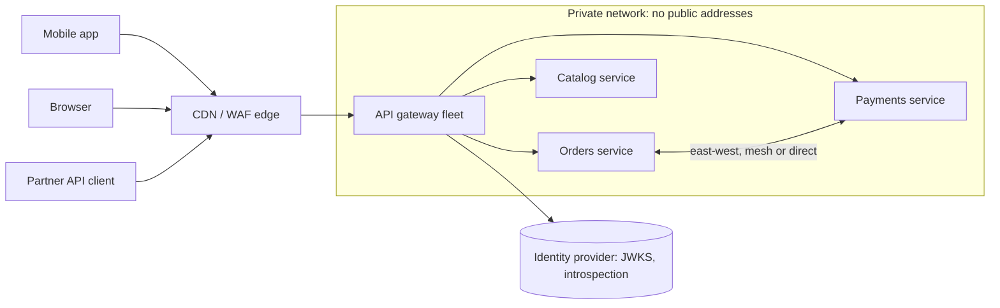
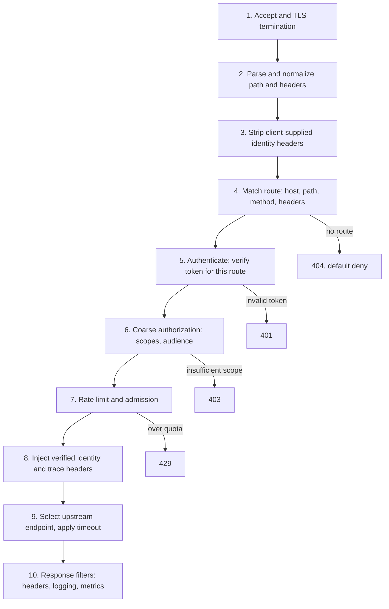
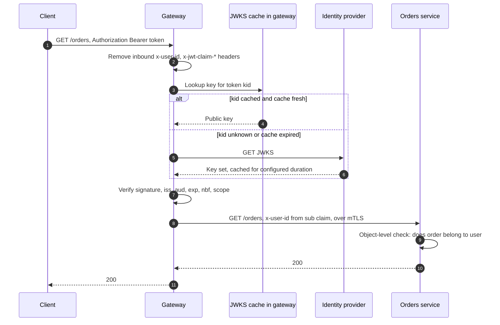
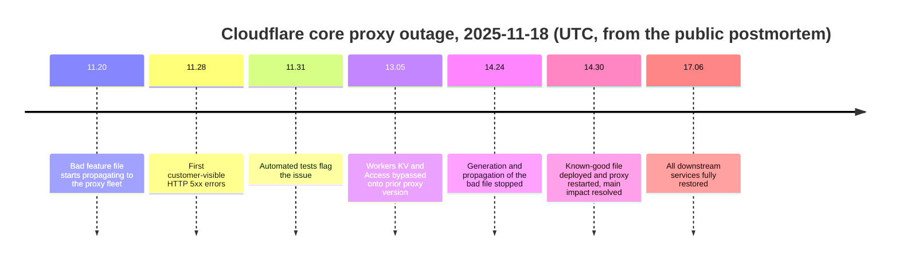

An API gateway is a reverse proxy that every external request must traverse before it reaches any internal service. It terminates the client connection, decides which backend owns the request (routing), establishes who the caller is (authentication) and whether the caller may reach that route at all (coarse authorization), applies cross-cutting policy such as rate limits and header normalization, and forwards the request with a verified identity attached. The internal services behind it are not reachable from outside; their only external interface is whatever the gateway's route table exposes.

The problem it solves appears as soon as a system has more than a handful of services. Without a gateway, every service needs a public address, a TLS certificate, its own token validation, its own rate limiting, and its own access log format, and every client needs to know which host serves which resource. Each of those duplicated implementations drifts: one service accepts an expired token because its library is two years old, another forgets to check the audience claim, a third logs no caller identity. Moving a resource from one service to another becomes a client-visible change. The gateway concentrates these concerns at one enforcement point that one team can reason about, test, and audit.

The core trade-off is concentration. A single entry point gives one place to enforce policy and one place to change routing without touching clients, and it gives one place where a mistake takes down every route at once. Every request pays an extra network hop and proxy processing; every route shares the gateway's capacity, configuration pipeline, and failure domain. The second trade-off is about scope: the more logic the gateway absorbs (aggregation, transformation, business rules), the more every team's release depends on the gateway team, until the gateway becomes the coupling point that the service decomposition was meant to remove.

This page owns the pattern itself: the request pipeline, route matching semantics, edge authentication and identity propagation, and the failure behavior of a shared entry layer. Per-client aggregation is covered in [Backend for Frontend (BFF) Pattern](/distributed-systems/en/communication/api-gateway/bff-pattern/), quota enforcement in [Throttling and Rate Limiting at the Gateway Level](/distributed-systems/en/communication/api-gateway/throttling-rate-limiting/), retry safety in [Idempotency and Safe HTTP Methods](/distributed-systems/en/communication/api-gateway/idempotency/), and service-to-service traffic inside the cluster in [Why Service Mesh Exists](/distributed-systems/en/service-mesh/service-mesh-architecture/why-service-mesh/).


*North-south traffic enters only through the gateway fleet; services have no public addresses. East-west calls between services do not pass through the gateway.*

Notice what the diagram does not show: there is no arrow from any client to a service. That absence is the property the pattern depends on, and it is enforced by the network (private subnets, security groups, Kubernetes network policies), not by the gateway. The edge tier in front of the gateway (content delivery network and web application firewall) is optional and handles volumetric attacks and caching; the gateway is the first component that understands the application's routes and identities. Calls between services stay east-west and are governed by the mesh or by service-to-service authentication, because routing internal traffic back through the edge gateway adds a hop, couples internal calls to the external failure domain, and gives the gateway a view of identities it should not need.

## The Request Pipeline: What Happens Between Accept and Forward

A gateway processes each request through an ordered chain of filters. The order is not cosmetic: each stage depends on facts established by the stages before it, and a stage placed too early either cannot work or works on untrusted data. Envoy calls this the HTTP filter chain, Kong calls the stages plugins with fixed execution phases, Spring Cloud Gateway calls them gateway filters, and AWS API Gateway exposes a fixed pipeline of authorizer, request validation, mapping, and integration. The stages below are common to all of them.


*A typical gateway filter chain. Rejections exit the chain at the stage that detects them, before any upstream capacity is consumed.*

Normalization (step 2) precedes everything that inspects the path, because route matching and authorization rules compare strings. If the gateway matches the raw path `/public/../admin/users` against a rule for `/public` and the backend's framework resolves the dot segments to `/admin/users`, the request reaches an admin handler having passed only the public route's checks. The same applies to percent-encoded slashes, duplicate slashes, and case differences. Envoy's HTTP connection manager exposes `normalize_path`, `merge_slashes`, and an action for escaped slashes for exactly this reason; the rule is that the gateway must interpret the path exactly as the backend will, or reject paths whose interpretation is ambiguous.

Header stripping (step 3) precedes authentication because the gateway is about to assert identity to the backend through headers such as `x-user-id` or `x-jwt-claim-sub`. If a client can send those headers and the gateway forwards them unchanged when a route skips authentication, any caller can claim to be any user. Route matching (step 4) precedes authentication because authentication requirements are per route: a health endpoint, a login endpoint, and a payments endpoint need different providers and different audiences. Rate limiting (step 7) follows authentication so that quotas can be keyed on the verified caller rather than on a spoofable header or a shared NAT address; an unauthenticated pre-limit keyed on client IP usually sits earlier to protect the authentication stage itself.

Steps 9 and 10 are where the gateway acts as a client of the backend: endpoint selection, connection pooling, per-route timeouts, and the circuit-breaking thresholds that cap how much gateway capacity one upstream can hold. Those are the stages that decide whether one slow service degrades every route, as described in the failure modes below. Endpoint selection itself is covered in [Server-Side Service Discovery](/distributed-systems/en/microservice-patterns/service-discovery/server-side-discovery/) and [Load Balancing Algorithms](/distributed-systems/en/communication/load-balancing/algorithms/).

### Route Matching Semantics Differ Between Implementations

A route table maps request attributes (host, path, method, headers, query parameters) to an upstream and a policy set. The table looks declarative, but each implementation resolves overlapping routes with its own rule, and the rule decides which policy a request gets. Two routes that overlap are normal (`/orders` and `/orders/export`); the question is which one wins.

Envoy first selects a virtual host by the `Host` header, preferring exact domain matches over wildcard ones, and then evaluates the routes inside that virtual host in the order they are listed: the first match wins. A broad prefix route placed above a narrow one shadows it permanently, and no error is raised. NGINX resolves `location` blocks differently: an exact match (`location = /path`) wins immediately; otherwise it remembers the longest matching prefix, uses it if it is marked `^~`, and otherwise tries regular-expression locations in file order and takes the first that matches, falling back to the remembered prefix. Kubernetes Gateway API `HTTPRoute` resources use specificity: among matching rules, precedence goes to the most characters in a matching non-wildcard hostname, then in a matching hostname, then in a matching path, then the most header matches, then the most query parameter matches; ties across routes go to the oldest route by creation timestamp, then to alphabetical `namespace/name`. AWS API Gateway HTTP APIs select the most specific route and fall back to a `$default` route, and REST APIs resolve through a resource tree in which a greedy path variable such as `{proxy+}` catches whatever more specific resources do not.

The practical consequence is that a route table is only meaningful together with its matching rule. Migrating from NGINX to Envoy, or from a hand-written Envoy configuration to Gateway API, can silently change which route, and therefore which authentication requirement, a request receives. The reliable defense is a route-table test suite: a set of request samples with the expected route and policy for each, run in CI against the generated configuration, plus a lint that flags any route that can never match because an earlier one covers it.

## Edge Authentication and Identity Propagation

Authentication at the gateway answers one question per request: does the credential attached to this request prove a caller identity acceptable for this route? There are four production models, and they differ in latency, in how quickly revocation takes effect, and in what happens when the identity provider is unreachable.

The first is local verification of a self-contained token. The client presents a JSON Web Token (JWT) signed by the identity provider. The gateway checks the signature against the provider's public keys, which it fetches from a JSON Web Key Set (JWKS) endpoint and caches, then checks issuer, audience, expiry, and not-before claims. No network call is made per request. The cost is revocation latency: a token remains valid until its expiry, because the gateway has no way to learn it was revoked. Token structure and signing are covered in [JWT](/distributed-systems/en/security/authentication-authorization/jwt/), and the flows that issue tokens in [OAuth 2.0 and OIDC](/distributed-systems/en/security/authentication-authorization/oauth2-oidc/).

The second is token introspection: the token is opaque, and the gateway asks the authorization server whether it is active, using the OAuth 2.0 Token Introspection protocol (RFC 7662). Revocation is immediate, but every request (or every cache miss) depends on the authorization server's latency and availability. The third is external authorization: the gateway sends request attributes to a policy service and forwards or rejects based on the answer. Envoy's `ext_authz` filter and AWS Lambda authorizers are the common forms; the decision can include anything the policy service knows, at the cost of a call per request or per cache key. The fourth applies to machine clients: mutual TLS, where the client certificate is the credential, or API keys checked against a store, as compared in [API Keys vs. Service Accounts](/distributed-systems/en/security/authentication-authorization/api-key-vs-service-account/).


*Local JWT verification with a cached key set. The identity provider is contacted only when a key is unknown or the cache has expired.*

Step 2 happens before any verification, on every route, whether or not the route requires authentication. Steps 3 to 6 are the only path by which the gateway learns a public key, and the alternative branch is the one that matters operationally: an unknown key identifier (`kid`) forces a fetch, so a token signed with a key the gateway has never seen costs a round trip to the identity provider, and a flood of tokens with random `kid` values would cost one each unless fetches are rate limited per instance. In step 8 the gateway forwards identity as headers, but over a connection the service can authenticate (mTLS with the gateway's workload identity) so that the service can tell a header set by the gateway from one set by anything else. Step 9 is the part the gateway cannot do: deciding whether this user may read this particular order requires the service's data.

### The Invariant and Why It Holds

The guarantee edge authentication is meant to provide is: every request that reaches a backend on a protected route carries an identity that the gateway verified for that route, and backends act on identity only as asserted by the gateway. This is complete mediation, one of the protection principles Saltzer and Schroeder set out in 1975: every access is checked, by a mechanism the caller cannot bypass.

The invariant holds only when four conditions hold together, and each failure of a condition is a known class of incident. First, the gateway is the only network path from outside to the services; if a service has a public load balancer or an exposed node port, requests can skip the gateway entirely. Second, the gateway removes client-supplied identity headers on every route before it sets its own; otherwise an unauthenticated route becomes a channel for injecting identity. Third, the asserted identity is bound to the gateway, by mTLS on the gateway-to-service hop or by a signed internal token the gateway mints, so that a compromised internal workload cannot forge an `x-user-id` header and be believed. Fourth, route policy is total: a request that matches no route is rejected, and a route with no authentication rule is public only because someone wrote that down, not because a rule was missing.

The argument is short once the conditions are stated. Take any request that reaches service S on a protected route with an identity assertion H. By the first condition it did not arrive from outside except through the gateway; by the third, if it arrived from inside, S rejects it unless it came from the gateway's identity. So it came through the gateway. By the second condition the gateway removed any H the client sent, so H was set by the gateway; by the fourth the request matched a route with an authentication rule; and the gateway sets H only after that rule's verification succeeds. Path normalization is the hidden fifth condition: "the route the gateway matched" must be the same route the backend dispatches to, or the fourth condition is satisfied for a different resource than the one served.

What the invariant does not cover matters as much. It does not authorize access to individual objects: the gateway knows that the caller is user 42 with scope `orders:read`, not that order 9001 belongs to user 41. Broken object-level authorization is the first entry in the OWASP API Security Top 10 (2023) precisely because teams assume the gateway's check covers it. It does not make tokens revocable when tokens are verified locally. It does not protect east-west calls between services, which need their own authentication, covered in [mTLS](/distributed-systems/en/service-mesh/network-policies-mtls/mtls/) and [Workload Identity](/distributed-systems/en/security/authentication-authorization/workload-identity/).

:::caution[An unauthenticated route can still carry forged identity]
Header stripping must apply to every route, including health checks, login, and public catalog endpoints. A common configuration strips `x-user-id` only inside the JWT filter, which runs only on protected routes; a request to a public route with a forged `x-user-id` is then forwarded intact, and any backend handler that reads the header on that path trusts it. Strip at the listener or virtual-host level, and have services reject identity headers that did not arrive over the gateway's authenticated connection.
:::

### Coarse Authorization at the Edge, Fine Authorization in the Service

The gateway can enforce decisions that depend only on the request and the token: is the token's audience this API, does it carry the scope this route requires, is the client application allowed to call this route at all, is the tenant suspended. These checks are cheap, uniform, and worth doing centrally because they keep unauthorized traffic off backend capacity. Decisions that depend on resource state (ownership, sharing, workflow status) belong in the service that owns the data, because the gateway would need to read that data to make them, which turns it into a client of every service's database. The models for expressing either layer are compared in [RBAC vs. ABAC](/distributed-systems/en/security/authentication-authorization/rbac-vs-abac/).

## Worked Example: Sizing the Gateway and Choosing an Authentication Model

Assume a consumer API with a peak of 24,000 requests per second across three availability zones. All numbers in this section are illustrative assumptions, chosen to show the method.

**Fleet size.** A load test shows one gateway instance sustains 4,000 requests per second before its p99 latency leaves the objective. Planning for 50% utilization at peak gives 2,000 per instance and 12 instances. The fleet must survive losing a zone, so the surviving two zones must hold 12 instances between them: 6 per zone, 18 in total. The zone-loss requirement, not the traffic, sets half the fleet's size, which is normal for a component every request depends on.

**Local JWT verification.** Assume signature verification plus claim checks costs 50 microseconds of CPU per request. At 24,000 requests per second that is 1.2 CPU-seconds per second across the fleet, about 1.2 cores out of 18 instances' worth. Key-set fetches are negligible: 18 instances refreshing every 5 minutes is 0.06 fetches per second. The cost that matters is revocation: with a 15-minute token lifetime, a stolen or revoked token stays usable for up to 15 minutes.

**Introspection without a cache.** Every request calls the authorization server: 24,000 introspection calls per second, and each adds the authorization server's round trip, say 2 ms, to every request's latency. The authorization server must now be sized for the API's peak traffic, and it sits in series with every request. If the gateway fleet is available 99.95% of a month and the introspection endpoint 99.9%, the authenticated path is available at most `0.9995 * 0.999 = 0.9985`, about 65 minutes of unavailability per 30-day month instead of the gateway's own 22.

**Introspection with a per-instance cache.** Caching each token's introspection result for 60 seconds looks like it removes most of the load. Assume 150,000 distinct tokens are active per minute, each making about 9.6 requests per minute (1.44 million requests per minute in total). With requests spread randomly across 18 instances, a token making 9.6 requests per minute reaches `18 * (1 - (17/18)^9.6)`, about 7.6 distinct instances, and each of those caches miss once per minute. Introspection calls fall to `150,000 * 7.6 / 60`, about 19,000 per second: a 21% reduction, far from the roughly 90% that a single shared cache gives.

**Introspection with a shared or token-affine cache.** If the cache is shared across the fleet, or if requests are routed to instances by a hash of the token so each token's results live on one instance, the miss rate becomes one per token per minute: `150,000 / 60 = 2,500` calls per second, roughly a tenth of the uncached rate. The shared cache adds its own round trip and its own availability dependency; token-affine routing makes cache contents move whenever the fleet scales.

| Model | Calls to identity provider at peak | Added latency per request | Revocation delay | Behavior when identity provider is down |
|---|---|---|---|---|
| Local JWT, cached JWKS | about 0.06 per second | CPU only, about 50 us | up to token lifetime, 15 min | keeps working until key cache expires or new `kid` appears |
| Introspection, no cache | 24,000 per second | one round trip, about 2 ms | immediate | every authenticated request fails, or passes if fail-open |
| Introspection, per-instance 60 s cache | about 19,000 per second | round trip on miss | up to 60 s | most requests fail within 60 s |
| Introspection, shared 60 s cache | about 2,500 per second | cache round trip plus round trip on miss | up to 60 s | fails as entries expire over 60 s |

*All figures follow from the assumptions above and are illustrative.*

The table frames the decision as a revocation-latency budget. If the business can tolerate a revoked credential working for 15 minutes, local verification with short-lived tokens is the cheapest and most available option. If it cannot, the identity provider becomes a tier-zero dependency of the entire API, and its capacity plan must match the gateway's. A common hybrid verifies JWTs locally and consults a small revocation list (by token identifier or by user) that the gateway pulls every few seconds, which bounds revocation delay by the pull interval without a per-request call.

:::tip[Per-instance caches shrink as the fleet grows]
Any cache that lives inside each gateway instance (introspection results, authorizer decisions, rate-limit counters) has a hit rate that falls as instances are added, because each key's traffic is spread over more caches. Scaling the gateway out to handle an identity-provider latency problem therefore increases the load on the identity provider. Measure hit rate per instance, and prefer a shared cache or token-affine routing when the fleet is large.
:::

## Gateways and the Components They Are Confused With

The same reverse-proxy software appears in several roles, and the roles differ in what they own. Envoy can be a gateway, a mesh sidecar, and an ingress controller; NGINX can be a load balancer and a gateway. The distinction is the responsibility, not the binary.

| Component | Traffic it handles | Owns | Does not own | When to prefer |
|---|---|---|---|---|
| L7 load balancer | north-south or east-west | spreading requests over healthy endpoints, TLS termination | per-route authentication policy, API product concerns | one backend or a few with uniform policy; see [L4 vs. L7 Load Balancing](/distributed-systems/en/communication/load-balancing/l4-vs-l7/) |
| Kubernetes Ingress / Gateway API | north-south into a cluster | a portable route model mapped onto a proxy | identity and quota policy, unless the implementation adds extensions | route declaration owned by app teams on Kubernetes; see [Ingress vs. Gateway API](/distributed-systems/en/service-mesh/network-policies-mtls/ingress-vs-gateway-api/) |
| API gateway | north-south | routing, edge authentication, coarse authorization, quotas, API keys, consistent edge behavior | object-level authorization, business logic, aggregation | many services behind one public API with shared policy |
| Service mesh | east-west | service-to-service mTLS, retries, traffic splitting between services | public API surface, end-user identity | many services calling each other; see [Why Service Mesh Exists](/distributed-systems/en/service-mesh/service-mesh-architecture/why-service-mesh/) |
| Backend for Frontend | north-south, one client type | aggregation and shaping for that client | shared edge policy | client types with very different data needs; see [BFF](/distributed-systems/en/communication/api-gateway/bff-pattern/) |
| GraphQL federation router | north-south | query planning across subgraphs | per-field domain authorization | a graph API across many teams; see [GraphQL](/distributed-systems/en/communication/synchronous-protocols/graphql/) |

The rows are layers, not alternatives. A common production stack is an edge network, an API gateway for policy, and a service mesh for internal traffic, with BFFs behind the gateway as ordinary upstreams. The gateway and the BFF are the pair most often merged: putting per-client aggregation into the shared gateway is how the gateway acquires business logic. Aggregating calls in a component that every team depends on, with fan-out latency governed by the slowest backend, is the [API Composition](/distributed-systems/en/microservice-patterns/data-management-patterns/api-composition/) pattern placed in the worst possible location.

### Control Plane, Data Plane, and Configuration Propagation

A gateway fleet has two halves. The data plane is the set of proxy instances handling requests. The control plane holds the desired configuration (routes, upstreams, authentication providers, quotas) and pushes it to the data plane. In Envoy this is the xDS family of APIs: listeners, routes, clusters, and endpoints arrive as separate resource streams, and the proxy applies each update without restarting. Kong in database mode has each node poll a shared database; in its hybrid mode, control-plane nodes push configuration to data-plane nodes. Managed gateways hide the control plane but still have one: a deploy of an AWS API Gateway stage is a configuration push.

Configuration is eventually consistent across the fleet. During a push, some instances run the old route table and some the new, so a client retrying across instances can see two behaviors. This window is harmless for additive changes and dangerous for changes that couple to a backend deploy (a renamed path, a new required scope), which is why route changes that depend on a backend change should be made backward compatible first, as in [API Versioning Strategies](/distributed-systems/en/communication/synchronous-protocols/api-versioning/). More dangerous is the opposite property: a push reaches every instance quickly, and a configuration that crashes or misroutes the proxy reaches every instance just as quickly.

### Parameters That Matter in Production

The defaults that cause incidents are rarely the obvious ones. Per-route upstream timeouts must be shorter than the client's timeout and longer than the backend's worst-case successful latency, or the gateway returns `504` for work that completes, a sequence analyzed in [REST](/distributed-systems/en/communication/synchronous-protocols/rest/); AWS API Gateway capped integration timeouts at 29 seconds until June 2024, when regional and private REST APIs gained the option to raise it, with a possible reduction of account-level throttle quota as the trade-off. Per-upstream concurrency limits (Envoy's circuit-breaker thresholds for connections, pending requests, active requests, and retries per cluster) cap how much of the gateway one backend can hold. Retries at the gateway must be limited to idempotent methods and bounded by a budget, or the gateway multiplies load on a failing backend, as covered in [Retry Storms and Metastable Failures](/distributed-systems/en/resilience/flow-control/retry-storms-metastable-failures/). Key-set cache duration and refetch behavior decide how the gateway behaves during key rotation and identity-provider outages. Authorizer result caching on AWS defaults to 300 seconds and can be set up to 3,600, which is also the revocation delay for any decision it caches.

```yaml
# Envoy (v3 API) excerpt: strip identity headers everywhere, verify JWT on /orders
route_config:
  request_headers_to_remove: ["x-user-id", "x-jwt-claim-sub"]  # all routes
  virtual_hosts:
  - name: api
    domains: ["api.example.com"]
    routes:
    - match: { prefix: "/orders" }
      route: { cluster: orders, timeout: 3s }  # below client timeout, above backend p99.9
# http_filters -> envoy.filters.http.jwt_authn
providers:
  idp:
    issuer: https://idp.example.com/
    audiences: ["orders-api"]
    remote_jwks:
      http_uri: { uri: https://idp.example.com/jwks, cluster: idp, timeout: 1s }
      cache_duration: 300s
    forward: false                       # do not pass the raw token upstream
    claim_to_headers: [{ header_name: x-user-id, claim_name: sub }]
rules:
- match: { prefix: "/orders" }
  requires: { provider_name: idp }
```

The excerpt shows the three choices that carry the invariant: header removal at the route-configuration level rather than inside the JWT filter, a per-route timeout that is chosen rather than inherited, and an audience restriction so that a valid token issued for a different API is rejected. Setting `forward` to false keeps bearer tokens out of backend logs; services that need claims receive them as headers set by the gateway.

## Failure Modes of a Shared Entry Layer

Every failure of the gateway is a failure of every route at once, which is why the gateway's failure modes deserve more design attention than any single service's.

### Bad Configuration Reaches the Whole Fleet

Trigger: a configuration change, or an input file that the proxy loads as configuration, that is valid enough to be distributed but makes the proxy crash, reject requests, or misroute. Because configuration propagation is designed to be fast and uniform, the fault is global within minutes. Symptoms: a sudden rise in `5xx` across all routes at once, regardless of backend, often with gateway-generated responses rather than upstream ones.

The public postmortem of Cloudflare's November 18, 2025 outage is the clearest recent example of the mechanism in an edge proxy that every request traverses. A permissions change on a ClickHouse database cluster changed the output of the query that generated a feature file for the Bot Management system; the file gained duplicate rows, doubled in size, and exceeded a hard limit in the core proxy, which then failed requests. The file was regenerated and pushed every five minutes, and because only part of the database cluster had been changed, good and bad files alternated, which made the failure look intermittent at first.


*Timeline from Cloudflare's public postmortem. Times use dots instead of colons because the colon is the Mermaid timeline separator.*

The timeline shows why detection was not the problem: automated tests flagged the issue three minutes after first impact. The two hours between detection and the main recovery went to understanding a failure whose alternating good and bad pushes resembled an attack, and to stopping the generator, not just the symptom. The lessons transfer directly to any gateway fleet. Treat generated inputs that the proxy loads (feature files, route tables compiled from service registries, certificate bundles, WAF rule sets) with the same staged rollout as code; validate them against the proxy's actual limits before distribution; and make the proxy keep its last known-good version when a new one fails to load, rather than failing requests. Detection signals: configuration version per instance, configuration load failures, and the fraction of responses generated by the gateway itself rather than by an upstream. Envoy's response flags make the last one precise: `NR` (no route), `UH` (no healthy upstream), `UF` (upstream connection failure), and `UT` (upstream request timeout) in access logs distinguish gateway-side failure from backend failure. The general class of edge-config incidents is discussed in [Cloudflare 2019: Regex Outage](/distributed-systems/en/case-studies/famous-outages/cloudflare-2019-regex/).

### One Slow Upstream Exhausts Shared Gateway Capacity

Trigger: one backend's latency rises from milliseconds to seconds while request arrival continues. In a thread-per-request gateway, each in-flight request holds a thread; in an event-driven gateway such as Envoy or Zuul 2, each holds memory, a connection, and a slot in the upstream's pending queue. By Little's law the number of in-flight requests to that backend grows in proportion to its latency, and if nothing caps it, it absorbs the gateway's shared resources and every other route starts failing.

```mermaid
sequenceDiagram
    autonumber
    participant C as Clients
    participant G as Gateway, 200 workers shared
    participant R as Reports service
    participant O as Orders service
    Note over R: Latency rises from 50 ms to 10 s
    loop 40 requests per second to /reports
        C->>G: GET /reports
        G->>R: Forward, worker held for 10 s
    end
    Note over G: 40 per s x 10 s = 400 in flight, pool of 200 exhausted after 5 s
    C->>G: GET /orders
    G-->>C: 503, no worker available
    Note over O: Orders service healthy and idle
    rect rgb(60, 60, 30)
    Note over G,R: With a per-route cap of 40 concurrent requests
    C->>G: GET /reports beyond the cap
    G-->>C: 503 fast, only /reports degraded
    C->>G: GET /orders
    G->>O: Forward normally
    end
```


*Illustrative numbers. A shared worker pool turns one slow upstream into a gateway-wide outage; a per-route concurrency cap confines it.*

Steps 1 and 2 repeat until step 3's arithmetic catches up: 40 requests per second held for 10 seconds needs 400 workers, so a pool of 200 is exhausted after 5 seconds, and at step 4 the healthy orders service becomes unreachable. The fix in the second half is the [Bulkhead Pattern](/distributed-systems/en/resilience/protection-patterns/bulkhead-pattern/) applied per upstream: reports gets a fixed share of gateway concurrency, and requests beyond it fail fast without consuming anything. Event-driven proxies change the resource that runs out (memory and file descriptors instead of threads), not the need for a cap; Netflix's move from the blocking Zuul 1 to the asynchronous Zuul 2 reduced the cost of each in-flight request but did not remove the need for per-origin concurrency limits. Detection: in-flight requests per upstream, gateway worker or connection utilization, and the error rate on routes whose backends report no errors of their own. Recovery is automatic once the cap is in place; without it, recovery requires the slow backend to recover or its route to be disabled. Upstream timeouts bound how long each request is held, as covered in [Timeouts](/distributed-systems/en/resilience/protection-patterns/timeouts/), and [Load Shedding](/distributed-systems/en/resilience/flow-control/load-shedding/) covers rejection when the gateway as a whole is saturated.

### Identity Bypass

Trigger: one of the four conditions of the invariant fails. A service is exposed through its own public load balancer during a migration; a public route forwards a forged `x-user-id`; the gateway and the backend disagree on path normalization; a new route is added without an authentication rule and the gateway's default is to allow. Symptoms: none, from the outside, until the access is noticed in an audit or exploited. This is the failure mode with no error rate to alert on.

Detection must be designed in. Services should log the authenticated peer identity of every inbound connection, and an alert should fire on any request to a protected handler that did not come from the gateway's identity. The gateway should export a count of requests served on routes with no authentication rule, broken down by route, so that a new unauthenticated route is visible on a dashboard the day it ships. Periodic external scans should confirm that no service address answers from the internet. Mitigation is to restore the violated condition; recovery includes reviewing access logs for the exposure window, which is only possible if the services logged the identity they acted on.

### Key Rotation and Identity-Provider Outages

Trigger: the identity provider starts signing tokens with a new key before gateway caches contain it, or removes an old key while tokens signed with it are still unexpired, or becomes unreachable when caches expire. Symptoms: a sudden wave of `401` responses for valid users, often from a subset of instances whose caches refreshed at different times.

```mermaid
gantt
    title Safe signing-key rotation with a 5 min JWKS cache and 15 min tokens (illustrative)
    dateFormat HH:mm
    axisFormat %H:%M
    section Identity provider
    Publish key B in JWKS, still sign with A   :a1, 10:00, 10m
    Sign new tokens with B                     :a2, 10:10, 30m
    Remove key A from JWKS                     :milestone, a3, 10:40, 0m
    section Gateway caches
    Caches pick up key B within one TTL        :b1, 10:00, 5m
    section Tokens in circulation
    Last tokens signed with A still valid      :c1, 10:10, 15m
```


*Rotation timing: publish the new key at least one cache duration before signing with it, and keep the old key published for at least one token lifetime after the last signature with it.*

The gantt chart encodes two inequalities. The gap between publishing key B and signing with it must exceed the gateway's JWKS cache duration plus any propagation delay, here 5 minutes with a 10-minute margin; otherwise tokens signed with B arrive at instances that only know A. The gap between the last signature with A and A's removal must exceed the token lifetime, here 15 minutes with a 15-minute margin; otherwise tokens that are still valid fail verification. Gateways that refetch the key set on an unknown `kid` hide the first mistake at the cost of a fetch per instance, which is why that refetch must be rate limited. Detection: `401` rate broken down by token `kid` and by gateway instance, and JWKS fetch failures. Recent Envoy versions add background key-set fetching and fetch retries to the remote JWKS configuration; whichever gateway is used, the behavior when the cache has expired and the fetch fails decides whether an identity-provider outage of a few minutes becomes an API outage.

### Fail-Open and Fail-Closed External Authorization

Trigger: the external authorization service or Lambda authorizer times out or errors. The gateway must then decide whether to allow the request. Envoy's `ext_authz` filter has a `failure_mode_allow` setting, off by default, so the default is to reject. Failing closed turns an authorization-service outage into an API outage; failing open turns it into a window in which every route is effectively public, which nobody notices because the API works. The defensible choice is fail-closed for routes that act on user data, with the authorization service given the same capacity and redundancy planning as the gateway itself, and fail-open only for low-risk decisions such as optional personalization, combined with an alert on every fail-open decision.

| Failure | Symptom | Detection | Mitigation |
|---|---|---|---|
| Bad config push | `5xx` on all routes at once | config version per instance, gateway-generated response share, `NR` flags | staged rollout, validation against proxy limits, last known-good |
| Slow upstream | errors on healthy routes | in-flight per upstream, worker utilization | per-upstream concurrency caps, timeouts |
| Identity bypass | none externally | peer identity on service logs, unauthenticated-route counters | network isolation, global header stripping, default deny |
| Key rotation error | `401` wave for valid users | `401` by `kid` and instance, JWKS fetch errors | publish-before-sign, keep old key one token lifetime |
| Authorizer outage | `5xx` or silent open access | authorizer latency, fail-open counter | fail-closed by default, capacity parity with gateway |

## When a Gateway Is the Right Boundary

Use an API gateway when several independently deployed services sit behind one externally consumed API, when the same authentication, quota, and logging policy must apply to all of them, and when clients must be insulated from how resources are distributed across services, for example during a [Strangler Fig](/distributed-systems/en/microservice-patterns/service-decomposition/strangler-fig/) migration where routes move from the monolith to new services one at a time. It is also the right place to expose API keys and per-partner quotas for a public API, because those are properties of the API product rather than of any one service.

Keep the gateway thin. It should route, authenticate, apply coarse authorization and quotas, normalize, and observe. Once it aggregates responses from several services, transforms payloads per client, or encodes rules about orders or accounts, every product change waits on the gateway's release, and the gateway team becomes the bottleneck the service split was meant to remove; that state is described in [Distributed Monolith](/distributed-systems/en/microservice-patterns/service-decomposition/distributed-monolith/). Push aggregation into BFFs owned by client teams and domain authorization into the services that own the data.

Do not add a gateway for a single service or a monolith: a load balancer with TLS termination provides the same isolation without a second routing layer, and the application's own middleware already enforces authentication uniformly. Do not route east-west traffic through the edge gateway; it couples internal reliability to the external entry layer and adds a hop to every internal call, which a mesh or direct mTLS handles better. Do not treat the gateway as the authorization layer for object access, and do not make it the only place identity is checked if any service is reachable by another path. Do not run one gateway fleet for workloads with very different risk and traffic profiles (a public consumer API, a partner API, and internal admin tooling) when a configuration error in one would take down the others; separate fleets, or at least separate listeners with separate rollout pipelines, give each a smaller failure domain.

:::note[Gateway versus identity-aware proxy]
An identity-aware proxy also authenticates every request at a single entry point, but it protects human access to internal applications, typically with session cookies and device signals, rather than exposing an API to programmatic clients. The mechanism overlaps; the policy model and the clients do not. It is covered in [Identity-Aware Proxy](/distributed-systems/en/security/zero-trust/identity-aware-proxy/).
:::

## Further Reading

- Chris Richardson, *Microservices Patterns*, Manning, 2018.
- Jerome H. Saltzer and Michael D. Schroeder, *The Protection of Information in Computer Systems*, Proceedings of the IEEE, 1975.
- Justin Richer (ed.), *RFC 7662: OAuth 2.0 Token Introspection*, IETF, 2015.
- Kubernetes SIG Network, *Gateway API: HTTPRoute specification*, gateway-api.sigs.k8s.io.
- Envoy Project, *Envoy Proxy documentation: HTTP route matching, JWT Authentication filter, External Authorization filter*, envoyproxy.io.
- Matthew Prince, *Cloudflare outage on November 18, 2025*, Cloudflare Blog, 2025.
