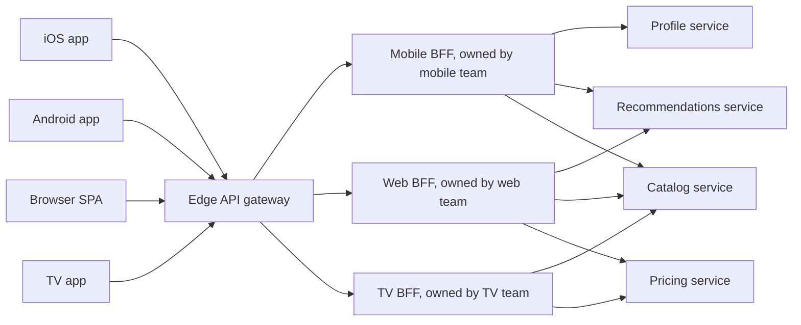
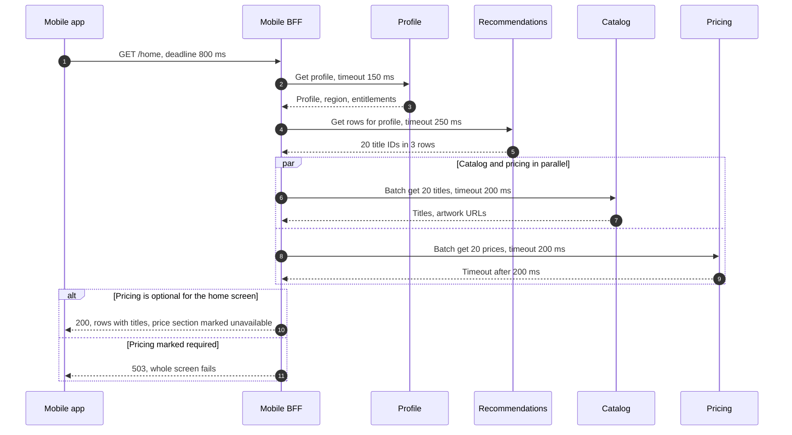
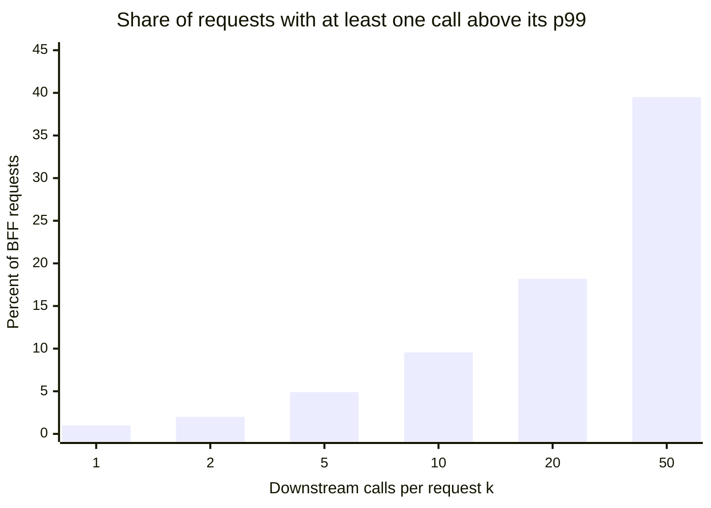
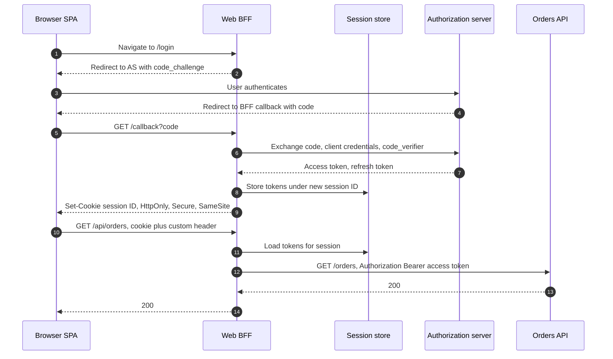

A Backend for Frontend (BFF) is a server-side component built for exactly one user experience, such as the iOS app, the Android app, the web application, or the TV application, and owned by the team that builds that experience. It receives one coarse request per screen or interaction from its client, calls the internal services that hold the data, combines and trims the results into the shape the client renders, and returns them in one response. It sits behind the edge [API gateway](/distributed-systems/en/communication/api-gateway/api-gateway-pattern/) as an ordinary upstream and in front of domain services that know nothing about screens.

The pattern exists because a single general-purpose API cannot be optimal for clients whose network costs, payload budgets, release cadences, and credential models differ by orders of magnitude. A phone on a cellular network pays a round trip of tens to hundreds of milliseconds for every request, so an API that needs five dependent calls to render one screen spends most of its latency on the radio. A browser cannot keep a refresh token safe from injected script, while a native app can use the platform keychain. A mobile binary released today will still be calling the API in two years, while a web bundle is replaced on every deploy. A shared API absorbs these differences either by becoming the lowest common denominator, chatty and over-fetching for everyone, or by accumulating per-client conditionals until no team can change it without asking every other team.

The core trade-off is client fit and team autonomy against duplication and operational surface. Each BFF moves composition from the slow client network to the fast data-center network and lets a client team change its contract on its own schedule. In exchange the organization runs one more service per experience, similar aggregation code appears in several BFFs, and every BFF becomes a component whose availability and latency are compositions of its dependencies. The second trade-off is about what the BFF is allowed to know: the more domain logic leaks into it, the more two clients disagree about the same order, price, or entitlement, and the closer the system drifts toward a [distributed monolith](/distributed-systems/en/microservice-patterns/service-decomposition/distributed-monolith/) with several heads.

This page owns per-client composition, shaping, and the browser-side token-handling role of a BFF. Shared edge policy belongs to the API gateway, the generic mechanics of joining data from several services to [API Composition](/distributed-systems/en/microservice-patterns/data-management-patterns/api-composition/), and client-selected shaping through a query language to [GraphQL](/distributed-systems/en/communication/synchronous-protocols/graphql/).


*Three BFFs behind one gateway. Each BFF is owned by a client team; domain services are shared and owned by domain teams.*

The diagram has two kinds of boundaries. The vertical one between gateway and BFFs is a policy boundary: authentication, quotas, and edge logging happen once, before any BFF sees the request. The one between BFFs and services is an ownership boundary: everything to the left of it changes with the user interface, everything to the right changes with the business. iOS and Android share one BFF here because one team owns both apps and their screens are the same; the TV BFF exists because its experience differs. The fan-in on the catalog and pricing services is the cost the diagram hides: every BFF is another caller with its own traffic pattern against the same shared services.

## Why One API Cannot Serve Every Client Well

Four differences between clients push toward separate backends, and each one acts through a different mechanism.

The first is round-trip cost. Latency inside a data center is a fraction of a millisecond; latency from a phone to the nearest point of presence is commonly tens of milliseconds and much worse on a congested cell. A screen whose data has dependencies (the recommendations depend on the profile, the catalog details depend on the recommendations) needs one round trip per dependency level when the client composes it, and the client cannot parallelize across levels. Phil Calçado's account of SoundCloud, where the pattern was named, starts exactly here: the generic public API forced many requests to render a profile page, which hurt mobile users on slow networks, and the team replaced them with one resource per screen. Netflix's 2012 API redesign, which served more than 800 device types, made the same argument and called the network round trip the most expensive part of a transaction.

The second is payload and representation. A general resource returns every field any client might need: all image sizes, all localized strings, full nested objects. A TV needs large artwork and no reviews; a watch needs a title and a status. Over-fetching costs bytes on the slowest link and CPU on the weakest device, which on low-end hardware means parse and render time, not only transfer time.

The third is release cadence and version lifetime. A web bundle is replaced on every deploy, so the web contract can change daily. A native app binary stays installed until the user updates, and the business decides how many old builds it still supports. A shared API must therefore keep every field any live binary reads; with a BFF, the mobile team owns the translation between the binaries it shipped and the internal APIs, as noted in [API Versioning Strategies](/distributed-systems/en/communication/synchronous-protocols/api-versioning/).

The fourth is the credential model. A native app can store a refresh token in the operating system's protected storage. A single-page application cannot protect any token from script running in its own origin, so its safest design keeps tokens on a server and gives the browser only a cookie. That server is a BFF in a second, security-specific sense, covered later on this page.

SoundCloud's write-up records the organizational driver alongside the technical ones: changing a shared endpoint required checking compatibility with every client, which slowed every team and made A/B tests and gradual rollouts hard. A BFF lets the team that owns a screen change the endpoint behind it in the same release, without a cross-team negotiation.

### What a BFF Guarantees and What It Does Not

The guarantee a BFF is meant to provide has two parts. Toward its client: one response per interaction, shaped for that client, with a contract that changes only when its owning team changes it. Toward the rest of the system: it is a presentation layer, so its output is a function of the client's context (identity, locale, device class, app version) and of the domain services' responses, and it holds no domain state and decides no domain rule.

The second part is the invariant that keeps the pattern correct. Call a rule any decision that affects what is true about the business: the price a customer pays, whether a user may stream a title, whether an order can be cancelled. If such a rule exists only in BFF A, then client B either does not apply it or applies its own copy. Either way the two clients disagree about a fact, and no test of either client alone can detect it, because each behaves consistently with its own BFF. Conversely, if every rule lives in a domain service and BFFs only select, project, order, and format what services return, then two clients showing the same entity at the same time show the same facts and differ only in presentation. The invariant is therefore "every rule observable by more than one client lives in exactly one service", and violations are detectable by asking, for each piece of BFF logic, whether its output would be wrong on another client if that client lacked it. Formatting a price for a locale passes the test; computing a discount fails it.

What the BFF explicitly does not guarantee matters as much. It does not provide a consistent snapshot: five calls made in parallel read five services at slightly different times, so the composed response can show an item as available in the catalog and sold out in inventory. It does not authorize access to individual objects; that remains with the service that owns the data, as on the gateway page. It does not reduce load on domain services and frequently increases it, because each BFF adds its own call pattern and a screen redesign can multiply calls without any service team noticing. And it does not make the backend more available: a BFF that requires five services is less available than any of them.

## Inside a BFF Request: Fan-Out, Deadlines, and Partial Responses

A BFF request handler is a small scheduler over a dependency graph. It receives the client request with an identity already verified by the gateway, builds the set of downstream calls the screen needs, runs each level of the graph in parallel, waits for each call no longer than the remaining time budget allows, decides which failures are fatal and which degrade a section of the screen, and serializes a response in the client's shape.


*One home-screen request in a mobile BFF. Timeouts are illustrative; pricing is the failing dependency.*

Steps 2 to 5 are sequential because the recommendations need the profile's region and entitlements, so the handler pays two internal round trips before it can fan out. Steps 6 to 9 run in parallel, so their cost is the slower of the two, not the sum. The `alt` block is the design decision that most BFFs leave implicit: whether a dependency is required or optional for this screen. If pricing is optional, its timeout costs one section of the screen; if it is required, a pricing slowdown becomes a home-screen outage for every user. The client has to cooperate: it must render a response with a missing section, which means the response schema must express "section unavailable" explicitly rather than by an absent field the client might treat as an empty list. Sam Newman's original description of the pattern makes the same point: the BFF degrades instead of failing when a non-critical dependency is down, and the client must be able to interpret a partial response.

Deadlines decide how much of the budget each call may use. The client sends, or the BFF assumes, an overall deadline; each downstream timeout is the smaller of its own static limit and the time remaining minus the work still to do after it. Without this, static timeouts add up: three sequential levels each allowed 300 ms can exceed an 800 ms screen budget while every individual timeout is "reasonable". Timeout selection and deadline propagation are covered in [Timeouts](/distributed-systems/en/resilience/protection-patterns/timeouts/); the BFF-specific part is that the dependency graph, and therefore the remaining-work estimate, is known per screen.

```text
handle(screen, ctx):                      # ctx carries user, locale, app_version
  deadline = now() + min(ctx.client_deadline, screen.budget)
  for level in screen.dependency_levels:  # e.g. [profile], [recs], [catalog, pricing]
    calls = [dep.call(ctx, results) for dep in level]
    for c in calls:
      c.timeout = min(c.dep.max_timeout, deadline - now() - level.reserve_after)
    wait_all(calls)                       # parallel within a level
    for c in calls:
      if c.failed and c.dep.required:  return error(503, c.dep.name)
      if c.failed:                     results[c.dep.name] = UNAVAILABLE
      else:                            results[c.dep.name] = c.value
  return render(screen.client_schema, results)   # projection, formatting only
```

The last line is where the invariant from the previous section is enforced or broken. `render` selects fields, formats values for the locale, and arranges sections. If it ever computes something another client would also need, that computation belongs in a service.

### Worked Example: A Mobile Home Screen With and Without a BFF

Assume a home screen that needs a profile, three rows of recommendations totalling 20 titles, catalog details for those titles, and their prices. All numbers in this section are illustrative. The phone's round trip to the edge is 120 ms; round trips inside the data center are 1 ms. Server processing is 30 ms for profile, 60 ms for recommendations, and 40 ms for each of the catalog and pricing batches. The general-purpose catalog representation is 6 KB per title; the fields the home screen renders amount to 0.8 KB. Effective downlink throughput is 2 Mbit/s, or 250 KB/s.

Composed on the client, the screen needs three dependency levels over the cellular link: profile (120 + 30 ms), recommendations (120 + 60 ms), then catalog and pricing in parallel (120 + 40 ms). That is 490 ms of request latency. The catalog payload is 20 x 6 KB = 120 KB, which takes 480 ms to download; prices and the rest are small. The screen is ready after about 970 ms.

Composed in a BFF, the phone makes one request: 120 ms of round trip. Inside, the BFF pays the same server times (30 + 60 + 40 = 130 ms) plus three internal round trips (3 ms) and, say, 10 ms of its own processing. The response carries 20 x 0.8 KB = 16 KB, which takes 64 ms. The screen is ready after about 327 ms, roughly a third. Two thirds of the saving came from round trips and one third from bytes; on a faster network the byte share shrinks and the round-trip share dominates, which is why the benefit survives HTTP/2 multiplexing: multiplexing removes the connection limit but cannot remove dependency levels.

The same screen shows the cost side. The BFF now depends on four services for every home-screen request. If each has 99.95% availability and failures are independent, a BFF that treats all four as required has at most `0.9995^4`, about 99.80%, before counting its own failures; treating pricing as optional raises that to `0.9995^3`, about 99.85%. Tail latency composes in the same direction. If each call independently exceeds its own 99th-percentile latency 1% of the time, the probability that at least one of `k` parallel calls does so is `1 - 0.99^k`.


*`1 - 0.99^k` for independent calls. Correlated slowness changes the numbers but not the direction.*

With five calls, 4.9% of BFF requests wait for at least one call slower than that call's p99, so the BFF's 95th percentile is set by its dependencies' 99th. With 20 calls, as in a naive implementation that fetches each title individually, almost one request in five does. This is the effect Dean and Barroso analyze in *The Tail at Scale*, and it is the quantitative reason to prefer batch endpoints over per-item calls and to give optional dependencies a short timeout rather than letting them wait as long as required ones.

:::tip[Classify dependencies per screen, not per service]
The same pricing service can be required on the checkout screen and optional on the home screen. Record the classification in the BFF's screen definition and make the response schema express an unavailable section explicitly. A BFF that classifies by service, or not at all, turns every optional dependency's incident into a full-screen failure, and that coupling is invisible until the first outage.
:::

## The Browser BFF as an OAuth Client

A second, security-driven meaning of BFF is now standardized. RFC 10017, *OAuth 2.0 for Browser-Based Applications*, published as Best Current Practice (BCP 212) in August 2026, describes three architectures for single-page applications and ranks a Backend for Frontend as the most secure. In it, the BFF is a confidential OAuth client: it holds client credentials registered with the authorization server, runs the authorization code flow with Proof Key for Code Exchange (PKCE), and keeps the access and refresh tokens on the server, bound to the user's session. The browser receives only a session cookie. When the application calls an API, it calls the BFF with the cookie; the BFF looks up the session, attaches the access token, refreshes it when needed, and forwards the call. Token formats and the code flow themselves are covered in [JWT](/distributed-systems/en/security/authentication-authorization/jwt/) and [OAuth 2.0 and OIDC](/distributed-systems/en/security/authentication-authorization/oauth2-oidc/).


*Token-handling BFF following the RFC 10017 architecture. The access and refresh tokens never reach the browser.*

Steps 6 and 7 are the security gain: the token exchange uses the BFF's own client credentials, so a stolen authorization code is useless without them, and the tokens returned in step 7 exist only on the server. Step 9 is the only state the browser holds, and because the cookie is `HttpOnly`, script cannot read it. Step 10 carries a custom request header; RFC 10017 recommends requiring one so that any cross-origin request must pass a Cross-Origin Resource Sharing (CORS) preflight the BFF can reject, which together with `SameSite` closes the cross-site request forgery (CSRF) path. Steps 11 and 12 make the BFF a proxy, and the RFC's warning applies: the BFF must forward only to an allowlist of API destinations, or it becomes an open proxy that attaches a user's token to requests for arbitrary hosts.

```text
Set-Cookie: __Host-Http-session=8f3c...; Secure; HttpOnly; SameSite=Strict; Path=/
# Name prefix recommended by RFC 10017; the __Host- part makes the browser
# reject the cookie unless it is Secure, has Path=/ and has no Domain
# HttpOnly: invisible to script, so injected code cannot exfiltrate it
# SameSite=Strict: not sent on cross-site requests; CSRF defense still required
```

The RFC is explicit about what this design does not prevent. Script injected into the application can still send requests through the BFF from inside the user's browser while the session is alive, because the browser attaches the cookie automatically. What it cannot do is extract the tokens and use them from elsewhere, obtain fresh tokens through a silent flow, or keep access after the user closes the tab. The middle design in the RFC, the token-mediating backend, runs the code flow on a server but hands the access token to the browser, which calls APIs directly; it protects the refresh token but leaves the access token readable by injected script, and the RFC recommends it only when a proxying BFF is not possible.

The operational consequence is that the browser BFF is stateful. Sessions live in a shared store such as Redis, or in an encrypted cookie that carries the tokens, which must then fit within browser cookie size limits. A shared session store becomes a dependency of every authenticated request; its outage logs out every user or fails every call, and its latency adds to every request. That is the price of keeping tokens out of the browser, and RFC 10017 judges it worth paying for business and sensitive applications.

## BFFs Against the Alternatives

The pattern competes with designs that put composition and shaping in a different place. Where composition runs decides who pays the round trips; who owns the contract decides who can change it without negotiation.

| Approach | Where composition runs | Who owns the client contract | Main cost | When to prefer |
|---|---|---|---|---|
| General-purpose API, client composes | On the client, over its network | Service teams | Round trips per dependency level, over-fetching, slow contract changes | One client type, or third-party consumers who need a stable, generic product API |
| Aggregation in the shared gateway | In the shared gateway | Gateway team | Gateway becomes a deployment bottleneck and carries business logic | Rarely; only small, stable, cross-client compositions |
| BFF per experience | In a server owned by the client team | Client team | Duplication across BFFs, one more service to operate per experience | Few experiences with distinct needs, and client teams able to run a service |
| Client adapters on a shared API platform | Scripts written by client teams, run on a platform team's servers | Client team, within platform limits | A badly written adapter loads a shared runtime | Many device types and a platform team willing to run multi-tenant code, as in Netflix's 2012 design |
| GraphQL graph or federation | In a query engine, driven by the client's query | Schema owners, with the client choosing fields | Query cost control, caching, and a schema governance process | Many clients with varied, fast-changing shapes; see [GraphQL](/distributed-systems/en/communication/synchronous-protocols/graphql/) |
| Token-handling BFF only | No composition; proxies with tokens attached | Web team | A stateful session layer in the request path | Browser apps that need RFC 10017 token protection but no aggregation |

The rows are not mutually exclusive. A GraphQL server per client type is a BFF with a query language, and a token-handling BFF often also aggregates. The Netflix history shows the pattern's pressure points at scale. The 2012 design ran device-specific Groovy adapters, written by UI teams, inside the API servers; its own announcement named the risk that poorly written adapters could overload those servers. By 2020, Netflix engineers described their centralized aggregation gateway for the Studio API as having become a monolith that a single team struggled to maintain, and replaced it with GraphQL federation, in which domain teams own their part of the graph and the gateway only plans queries.

### How Many BFFs: Experience, Team, and the Duplication Budget

Newman's rule, which he credits to Stewart Gleadow, is "one experience, one BFF". iOS and Android may share a BFF when they present the same experience and one team owns both apps and the backend; SoundCloud did this. When different teams own the two apps, a shared BFF reintroduces the cross-team negotiation the pattern was meant to remove, and separate BFFs are the better choice. The rule follows [Conway's Law](/distributed-systems/en/microservice-patterns/service-decomposition/conways-law/): a BFF is the server-side half of a client team's product, so its boundary should match that team's.

Duplication is the predictable result. SoundCloud ran about five BFFs, several of which fetched and merged the same user-profile data in slightly different shapes; the team read that duplication as a missing domain concept and extracted a user-profile service, and over time most core user-facing objects got their own service. The three options for removing duplication have very different coupling. A shared client library is cheapest and is, in Newman's words, a prime source of coupling, because every BFF must upgrade in lockstep when it changes. Extracting a service works when the duplicated logic corresponds to a domain concept. Pushing the aggregation into an existing downstream service removes it from all BFFs at once. A reasonable budget is to tolerate duplication of presentation logic indefinitely, and to extract on the second or third copy of anything that fails the rule test from the guarantee section.

## Operating a BFF: Parameters That Matter

A BFF's behavior under load is determined by a small number of per-dependency settings. The values below are starting points to measure against, not recommendations.

| Parameter | Effect | Tuning guidance |
|---|---|---|
| Screen budget (overall deadline) | Upper bound on the client's wait | Derive from the client's own timeout minus the edge round trip; propagate it downstream |
| Per-dependency timeout | Bounds how long one call can hold resources | Short for optional dependencies; required ones get the remaining budget |
| Required or optional, per screen | Whether a dependency failure fails the response | Default to optional for everything not needed to render the core content |
| Concurrency limit per dependency | Confines one slow dependency's in-flight requests | A [bulkhead](/distributed-systems/en/resilience/protection-patterns/bulkhead-pattern/) sized from Little's law at normal latency, with headroom |
| Retry policy | Masks transient errors, multiplies load during incidents | Retry at one layer only, with a retry budget; never retry a non-idempotent call without a key |
| Circuit breaker per dependency | Stops calls to a dependency that is failing | Fail optional sections fast while open; see [Circuit Breaker](/distributed-systems/en/resilience/protection-patterns/circuit-breaker/) |
| Cache scope | Whether a response may be shared between users | `Cache-Control: private` for anything personalized; shared caching only for responses keyed without identity |
| Caller identity downstream | Lets services attribute load to a BFF | Send the BFF's workload identity and the client app version on every call |

Two metrics are specific to BFFs and are worth an alert each. The partial-response rate per screen and per dependency (the fraction of responses with at least one section marked unavailable) shows a degraded dependency before users report broken screens, because optional failures never appear as errors in the BFF's status codes. Requests per screen to each downstream service, broken down by app version, catch a release that multiplies calls before the service team sees it as unexplained load.

## Failure Modes of BFF Fleets

BFF failures fall into two groups: those that a BFF causes in the services behind it, and those caused by state or logic that should not be in the BFF at all.

### Retry Amplification Through Layered Fan-Out

Trigger: a dependency slows, and retries are configured at several layers: the mobile client retries a failed screen, the BFF retries each failed call, and the service retries its own database call. Symptoms: load on the slowest dependency rises exactly when it is least able to absorb it, and it does not recover when the original cause clears.

```mermaid
sequenceDiagram
    autonumber
    participant M as Mobile clients
    participant B as Mobile BFF
    participant R as Recommendations
    participant D as Recs datastore
    Note over D: Datastore p99 rises from 20 ms to 400 ms
    M->>B: GET /home
    B->>R: Get rows, timeout 250 ms
    R->>D: Query, slow
    Note over B: BFF timeout fires first
    B->>R: Retry 1, then retry 2
    Note over R: 3 attempts per BFF call, each still querying D
    B-->>M: 503 after budget spent
    M->>B: App retries screen twice
    rect rgb(70, 40, 40)
    Note over M,D: 3 client attempts x 3 BFF attempts = 9 requests to R per user action
    R->>D: Abandoned queries keep running, load on D grows further
    end
    Note over D: Stays slow after the original cause clears
```


*Illustrative numbers. Retries at two layers multiply; requests abandoned upstream still consume the datastore.*

The note before step 4 is where the arithmetic turns: the BFF's timeout is shorter than the slowed query, so every attempt fails and every attempt still runs to completion on the datastore. Steps 4 and 6 multiply the load by three at each layer, and the `rect` block shows the result, nine requests per user action against a dependency that was already slow at one. Because abandoned work keeps running, the datastore can stay overloaded after the trigger is gone, which is the metastable pattern analyzed in [Retry Storms and Metastable Failures](/distributed-systems/en/resilience/flow-control/retry-storms-metastable-failures/). Detection: ratio of attempts to unique requests at each dependency, retry counters in the BFF, and the dependency's in-flight requests rising while its successful throughput falls. Mitigation: retry at one layer only (usually the BFF, never the client and the BFF both), cap retries with a budget such as 10% of requests, cancel downstream work when the deadline expires, and serve the section as unavailable. Recovery: shed retries first, then let the datastore drain.

:::caution[A BFF retry is a retry for every screen at once]
A client retry repeats one user's request; a BFF retry repeats a call made on behalf of every user rendering that screen. Retries configured as "three attempts with backoff" in the BFF, the client, and the service library together produce up to 27 attempts per user action during an incident. Choose one layer, give it a retry budget, and make the other layers fail fast.
:::

### A Client Release Overloads a Shared Service

Trigger: a new app version changes a screen so that the BFF calls a service per item instead of per batch, or adds a dependency for every row. The BFF team ships it as a client change; the service team is not involved. Symptoms: load on the shared service rises with app adoption over days, not at a deploy moment, which makes it look like organic growth. Detection: requests per screen to each service, broken down by app version and caller identity, which is only possible if the BFF sends both. Mitigation: per-caller quotas at the service, batch endpoints, and a review step for screen definitions that adds downstream calls.

### Personalized Responses in a Shared Cache

Trigger: a BFF response that depends on the caller's identity is stored by a shared cache (a content delivery network (CDN), a reverse proxy, or an in-process cache) under a key that does not include identity. Symptoms: users see other users' names, addresses, or orders; there is no error anywhere, because every component is working as configured. Detection: responses with `Set-Cookie` or per-user content served with a cache hit status, and user reports. Mitigation: `Cache-Control: private` or `no-store` on every personalized response, caching keys that include identity where per-user caching is intended, and splitting personalized and shared parts of a screen into separate responses so only the shared part is cacheable. Valve's account of the Steam incident of 25 December 2015 shows the mechanism outside any BFF: during a denial-of-service attack, a caching partner deployed a configuration that cached web traffic for authenticated users, and for about 90 minutes store page requests for about 34,000 users may have been served to other users, exposing billing addresses and purchase history among other details.

:::danger[Composed responses mix shared and personal data]
A BFF response often combines public catalog data, which is safe to cache for everyone, with the user's entitlements or prices, which are not. One cache rule written for the public part and applied to the whole response leaks personal data to other users with no error signal. Mark every personalized response private at the BFF, and verify with a test that two different users never receive the same cached body for a personalized route.
:::

### Old Clients Pinned to Removed Fields

Trigger: the BFF removes or renames a field that the current app no longer reads, but builds still in use do. Symptoms: crashes or empty screens for a subset of users on old versions, invisible in the BFF's error rate because the BFF returns 200. Detection: client crash reports correlated with BFF deploys, and request counts by app version, which show the population still at risk. Mitigation: treat the BFF contract per app version, keep fields until the oldest supported build has fallen below a usage threshold, and use a minimum-version mechanism to force upgrades when a field must go. A contract-testing setup that records each app version's expectations, as in [Consumer-Driven Contract Testing](/distributed-systems/en/communication/api-gateway/contract-testing/), catches the removal before deploy.

### Domain Logic Drifts Into the BFF

Trigger: a feature is needed quickly on one client, and the rule (a discount, an eligibility check, an availability threshold) is written in that client's BFF because the client team owns it. Symptoms: two clients disagree about the same fact, for example the app shows a promotion the web checkout does not honor; support tickets arrive before any alert. Detection: there is no runtime signal; it shows up in code review, in cross-client comparison tests that render the same entity through each BFF and compare facts, and in incident reviews. Mitigation: apply the rule test from the guarantee section in review, move the rule into the owning service, and have BFFs call it. Recovery requires reconciling whatever the divergent rule already did, such as orders accepted at a price the business did not intend.

### Session Store Outage in a Browser BFF

Trigger: the shared session store of a token-handling BFF becomes unavailable or slow. Symptoms: every authenticated request fails or is redirected to login at once, although the authorization server and all APIs are healthy. Detection: session lookup latency and error rate, and a spike in login redirects. Mitigation: replicate the store across failure domains, keep lookup timeouts short, and decide in advance whether a lookup failure returns an error (users retry) or forces a new login (users lose state and stampede the authorization server). Encrypted cookies that carry tokens remove the store from the request path at the cost of larger cookies and harder revocation.

| Failure | Symptom from outside | Detection signal | Mitigation |
|---|---|---|---|
| Retry amplification | Dependency stays overloaded after the trigger clears | Attempts per unique request, in-flight vs. successful throughput | One retry layer, retry budget, deadline cancellation |
| Release overloads a service | Gradual load growth tracking app adoption | Calls per screen by app version and caller | Per-caller quotas, batch endpoints, screen review |
| Personalized response cached | Users see others' data, no errors | Cache hits on personalized routes | `Cache-Control: private`, split responses, cache tests |
| Old clients pinned | Crashes on old versions, BFF returns 200 | Crash reports by version, requests by version | Per-version contract, minimum version |
| Logic drift | Clients disagree on a fact | Cross-client comparison tests, review | Move rule to owning service |
| Session store outage | Mass logout or auth failures | Session lookup errors, login redirect spike | Replicated store, short timeouts, chosen failure policy |

## When a BFF Is the Right Layer

Use a BFF when at least two client experiences have materially different needs in round trips, payload, release cadence, or credential handling, and when the team that owns each experience can build and operate a service, including its on-call. It is the right default for native mobile apps from the start, because old binaries and cellular latency make a shared contract expensive, and for browser applications that hold OAuth tokens, where RFC 10017 recommends the token-handling BFF for business and sensitive applications. It is also the natural place to absorb version differences between shipped app builds and evolving internal APIs.

Do not add a BFF for a single web client that needs little aggregation; Newman's own guidance is that for web-only applications a BFF earns its place mainly when significant server-side aggregation is needed, and a token-handling proxy can be a thin component without composition logic. Do not build one when the client team cannot run a service: an unowned BFF degrades into a general-purpose API with nobody accountable for its latency. Do not share one BFF among teams whose experiences diverge, because it becomes the negotiated general-purpose API again under a new name. Do not use a BFF as the public API for third parties; a partner API is a product with its own stability and versioning obligations and belongs behind the gateway as a general-purpose contract. And when there are many client types whose data needs change faster than client teams can ship backend endpoints, a GraphQL schema with trusted documents usually fits better than a growing number of BFFs.

:::note[BFF, API Composition, and the gateway]
API Composition is the mechanism of joining data from several services in one component, and it can live in a service, a BFF, or a gateway. A BFF is defined by ownership and audience: one client experience, owned by its team. The API gateway is defined by policy shared across all clients. Putting composition in the gateway gives it business logic; putting edge policy in each BFF duplicates security checks that must be identical everywhere.
:::

## Further Reading

- Phil Calçado, *The Back-end for Front-end Pattern (BFF)*, philcalcado.com, 2015.
- Sam Newman, *Pattern: Backends For Frontends*, samnewman.io, 2015.
- Sam Newman, *Building Microservices*, 2nd edition, O'Reilly Media, 2021.
- Daniel Jacobson, *Embracing the Differences: Inside the Netflix API Redesign*, Netflix Technology Blog, 2012.
- Aaron Parecki, Philippe De Ryck, and David Waite, *OAuth 2.0 for Browser-Based Applications*, RFC 10017 (BCP 212), IETF, 2026.
- Jeffrey Dean and Luiz André Barroso, *The Tail at Scale*, Communications of the ACM, 2013.
