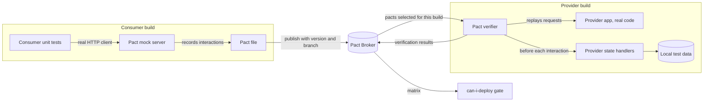
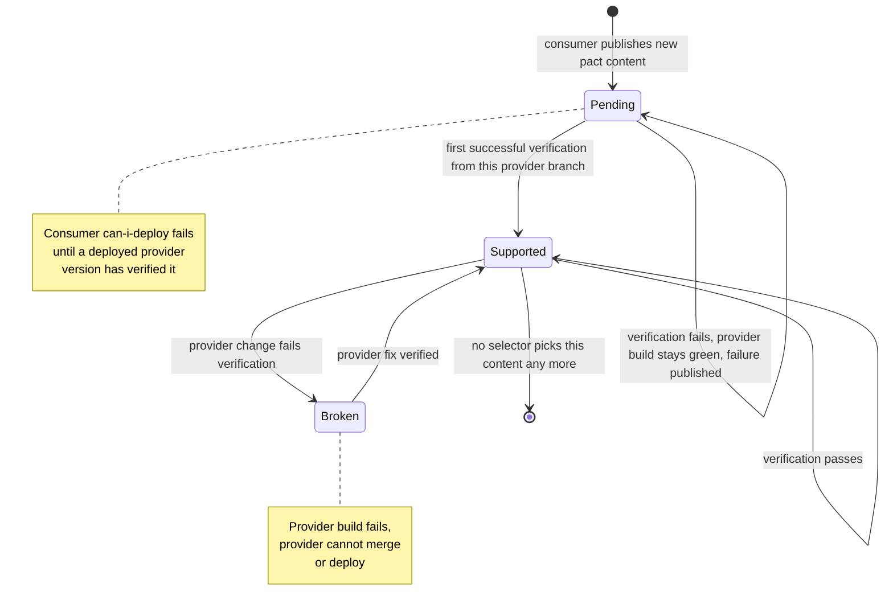
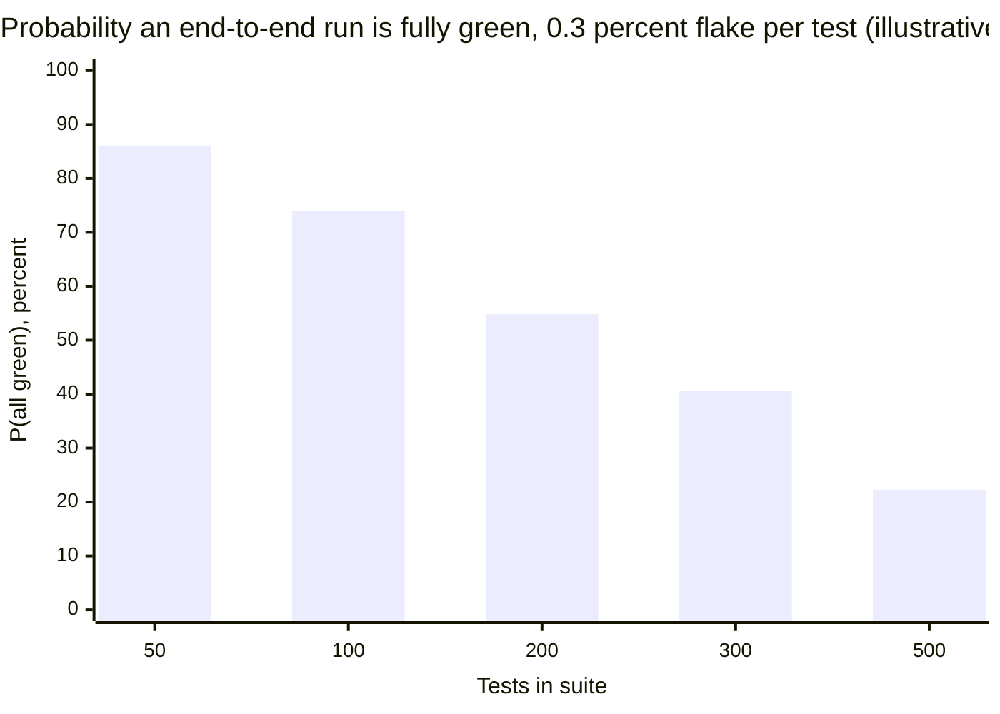
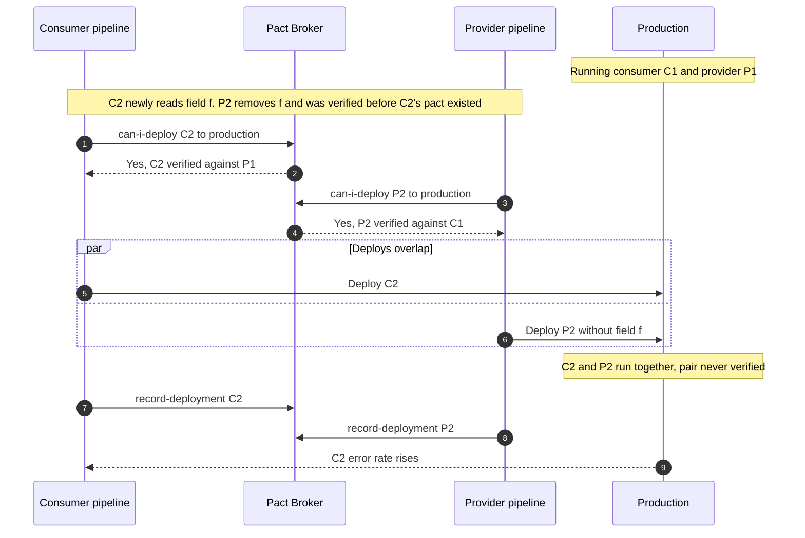

Consumer-driven contract testing verifies a provider against the exact requests each of its consumers sends and the parts of the responses each consumer reads, instead of against a provider-authored specification or a shared test environment. Each consumer's unit tests run against a mock provider; every interaction the mock serves is written to a contract file (in Pact, a "pact"). The provider later replays those requests against its real code, in isolation, and checks that its responses satisfy the consumer's expectations. A central service (the Pact Broker) records which consumer versions have been verified against which provider versions and answers, before every deployment, whether the version about to ship is compatible with everything already running in the target environment.

The problem it removes is the one that end-to-end environments solve badly. With ten services owned by ten teams, the only conventional way to know that a provider change does not break a consumer is to deploy compatible versions of everything into one environment and run tests through it. That environment is slow to build, shared by everyone, flaky in proportion to the number of moving parts, and tests one combination of versions, while production runs whatever combination the deployment pipelines happen to have produced. A schema diff of an OpenAPI description, covered in [OpenAPI / Swagger](/distributed-systems/en/communication/api-gateway/openapi-swagger/), is fast but answers a different question: whether a document changed compatibly under an assumed consumer policy, not whether any real consumer will keep working.

The core trade-off is precision against coverage and ownership cost. A pact proves compatibility for exactly what known consumers wrote down, with no shared environment and with feedback in minutes, and it lets a provider remove a field the moment no pact uses it. It proves nothing about consumers that publish no pact, nothing about interactions a consumer forgot to record, and nothing about behavior the provider fakes during verification. It also moves work: consumers must write and maintain interaction tests, and providers must maintain state setup code for every scenario consumers depend on. The approach pays off where consumers are known, internal, and deployable by the same organization, and loses much of its value where they are anonymous.

## Recording and Replaying: The Two Halves of a Pact

A pact is produced and checked in two separate builds, owned by two different teams, that never run at the same time. The consumer build writes it; the provider build verifies it; the broker connects them asynchronously and remembers the outcome.


*The two builds and the broker. Arrows into the broker carry versions; the broker's only output that affects production is the answer at the deployment gate.*

The diagram contains three asymmetries that explain most of Pact's behavior. The consumer test exercises the consumer's real client code (HTTP library, serializer, error handling) against a mock, so the pact describes what that code actually sends and reads, not what a developer believes it does. The provider side replays requests against the real provider application, but with its own downstream dependencies stubbed and its data set up by state handlers, so verification tests the provider's request handling and response shape, not its integration with the rest of the system. And nothing in either build talks to the other team's running service: the only shared artifact is a file, which is why both builds are fast and deterministic.

### Consumer Side: Tests Against a Mock That Writes the Contract

A consumer test declares an interaction before exercising the code: given a provider state such as "order 42 exists", when the consumer sends `GET /orders/42`, the provider responds with status 200 and a body of a given shape. The Pact library starts a local mock server that knows this expectation. The test then calls the consumer's own client class, pointed at the mock, and asserts on what the client returns to the rest of the consumer application. When the test finishes, the mock checks that every declared interaction was received exactly as declared and that no unexpected request arrived. Only if both hold does it write the interaction into the pact file.

That last check is what makes the contract honest. If the consumer's code sends a header the test did not declare, or never calls an endpoint the test declared, the test fails. A pact therefore cannot drift from the consumer's real code in the way a hand-written specification can drift from a provider's code, because it is produced by running that code.

```json
{
  "consumer": { "name": "checkout-web" },
  "provider": { "name": "orders-api" },
  "interactions": [{
    "description": "a request for an existing order",
    "providerStates": [{ "name": "order exists", "params": { "id": 42 } }],
    "request": { "method": "GET", "path": "/orders/42" },
    "response": {
      "status": 200,
      "body": { "id": 42, "status": "PAID", "lines": [{ "sku": "A-1", "qty": 2 }] },
      "matchingRules": { "body": {
        "$.id":    { "matchers": [{ "match": "integer" }] },
        "$.status": { "matchers": [{ "match": "regex", "regex": "^(PAID|PENDING|SHIPPED)$" }] },
        "$.lines": { "matchers": [{ "match": "type", "min": 1 }] }
      }}
    }
  }],
  "metadata": { "pactSpecification": { "version": "3.0.0" } }
}
```

The example values in the body are what the mock returns to the consumer test; the matching rules are what the provider is held to. Here the provider must return an integer `id`, a `status` matching one of three values, and a non-empty `lines` array whose elements have the same types as the example. The provider is not held to the value `42` in the body, or to `"A-1"`, and it is free to return fields the consumer never mentioned, such as `createdAt`, because the consumer does not read them.

### Provider Side: Replay Under Provider States

The provider build fetches the pacts it must verify from the broker, starts the provider application with its downstream dependencies replaced by stubs, and for each interaction runs three steps: call the state handler for the interaction's provider state, send the recorded request, and compare the actual response with the expected one under the matching rules.

```mermaid
sequenceDiagram
    autonumber
    participant T as Consumer test
    participant M as Pact mock server
    participant B as Pact Broker
    participant V as Provider verifier
    participant S as State handler
    participant P as Provider app
    rect rgb(40, 60, 80)
    Note over T,M: Consumer build
    T->>M: Register interaction with state "order exists" id 42
    T->>M: Client code sends GET /orders/42
    M-->>T: Example response from the expectation
    T->>B: Publish pact for checkout-web version a1f3, branch main
    end
    rect rgb(40, 80, 60)
    Note over V,P: Provider build, later and independently
    V->>B: Fetch pacts for orders-api using selectors
    V->>S: Set up state "order exists" with id 42
    S->>P: Insert order 42 into local test database
    V->>P: Replay GET /orders/42
    P-->>V: 200 with actual body
    V->>V: Compare under matching rules
    V->>B: Publish result for orders-api version 9c2e, branch main
    end
```


*One interaction from recording to verification. Steps 1-4 and 5-11 happen in different builds, often hours apart, and are connected only through the broker.*

Step 6 is where most of the long-term cost and most of the risk sit. A provider state is a name (and since Pact specification version 3, parameters) that the consumer chose; the provider team implements a handler that makes that state true, usually by writing rows into a local database or configuring a stubbed dependency. The handler is test code owned by the provider, and verification is only as truthful as the data it sets up. If a handler inserts an order with every optional field populated while production orders created through a legacy path have `lines` missing, verification passes and production fails. Step 9 compares only what the matching rules constrain; it says nothing about latency, ordering of concurrent requests, idempotency under retries, or side effects in other systems.

Message interactions follow the same pattern without HTTP. For a consumer of events, the pact records the message payload (and metadata) the consumer can handle; provider verification calls a function in the producer's code that builds that message for a given state and checks it against the expectations. Topology, delivery semantics, and ordering are outside the pact; broker-level contracts are covered in [AsyncAPI](/distributed-systems/en/communication/async-messaging/asyncapi/) and [Schema Evolution and Schema Registry](/distributed-systems/en/communication/async-messaging/schema-evolution-registry/), and testing asynchronous flows end to end in [Testing Event-Driven Systems](/distributed-systems/en/deployment/distributed-testing/testing-event-driven/).

### Matching: How Strict the Contract Is

Pact's matching follows Postel's robustness principle in both directions. Toward the provider's responses it is liberal: unexpected keys in a JSON object are allowed, because a consumer that ignores unknown fields is not affected by them, and extra response headers are allowed. Toward the consumer's requests, checked by the mock server in the consumer build, it is strict by default: unexpected keys in a request body and unexpected query parameters are mismatches, because a request the provider did not agree to receive is exactly what a pact must catch. Arrays are compared element by element unless a rule such as "each element like this example, at least one" is used, and an example array of length one without such a rule pins the provider to returning exactly one element.

The rules a consumer chooses decide what the provider may change without breaking the build. Matching on type rather than value lets the provider return any order identifier; a regular expression on an enum field turns "new enum value" into a verification failure only if the provider returns that value in a verified state. Over-specification, matching on exact values where the consumer does not care about them, is the most common reason provider teams come to resent their pacts: a pact that pins `"createdAt": "2026-01-01T00:00:00Z"` fails every verification and teaches nothing. The working rule is that a consumer constrains what its code depends on and nothing else, which is also what makes "the provider may remove any field no pact constrains" a safe statement.

:::caution[A pact is not a functional test of the provider]
Consumers often add interactions that check business rules: a discount is applied, an order in state X cannot be cancelled. Those belong in the provider's own tests. Encoding them in pacts couples the consumer's build to the provider's business logic, multiplies provider states, and turns every rule change into a cross-team negotiation. A pact should state what the consumer sends and what shape and values of the response its code depends on, including the error responses it handles, and stop there.
:::

## The Deployment Invariant: Broker, Matrix, and can-i-deploy

Verification by itself proves that some consumer version and some provider version are compatible. What a team needs is a statement about production: the version about to be deployed is compatible with everything it will run alongside. The Pact Broker turns the first into the second by recording three kinds of facts. Each published pact is attached to a consumer version (in practice the commit SHA) and a branch. Each verification result is attached to a provider version and branch and to the pact content it verified. Each deployment is recorded with `record-deployment` (or `record-release` for software such as mobile apps, where several released versions are supported at once), so the broker knows which versions of which applications are in which environment. The table of verification outcomes indexed by consumer version and provider version is called the matrix.

`can-i-deploy` queries the matrix. Asked whether application A at version x may go to environment E, it collects every application A integrates with, in either direction, finds the versions of each recorded as deployed or released in E, and requires a successful verification for each pair. It exits 0 if all pairs are verified and 1 otherwise, which makes it a pipeline gate rather than a report.

### Why Pairwise Verification Is Enough

The gate maintains an invariant over environments. Call an environment safe if, for every pair of integrated applications, every consumer version deployed there has a successful verification against every provider version deployed there. An empty environment is trivially safe. Suppose E is safe and A at version x is deployed after `can-i-deploy` passed. The pairs that exist after the deployment are the pairs that existed before, minus those involving A's previous version, plus the new pairs (x, b) for every counterpart version b in E. The removed pairs cannot make E unsafe, the unchanged pairs were already verified, and the new pairs are exactly what `can-i-deploy` checked. E is therefore still safe, and by induction stays safe across any sequence of gated deployments.

Two features of request-response communication make pairwise checking sufficient where checking whole-system combinations would be intractable. A consumer's success in an interaction depends only on the provider's response to that consumer's request, not on which versions of other applications are running, so compatibility of a whole environment decomposes into compatibility of its edges. And the number of edges grows with the number of integrations, while the number of version combinations grows exponentially with the number of services: seven services with three live versions each (main, staging, production) form `3^7 = 2,187` combinations, while ten integrations among them have at most `10 * 3 * 3 = 90` version pairs, most of which never need to be verified because the selectors below pick only the pairs that can coexist.

The induction rests on four assumptions, and every serious failure of Pact in practice breaks one of them. The environment state in the broker must match reality, so every deployment, rollback, and decommissioning must be recorded. Checks and deployments to one environment must be serialized, or two deployments can each pass against the other's old version. The deployed artifact must be the one that was verified, which is why versions should be commit SHAs and never reused labels such as `latest`. And a successful verification must mean real compatibility, which requires that the pact covers everything the consumer depends on and that provider states produce realistic data. The failure modes section maps each of these to what it looks like in production.

### Selecting Which Pacts to Verify

A provider build cannot verify every pact ever published, and must not verify only the newest. The broker resolves consumer version selectors into a set of pacts. The commonly recommended set for a provider's main pipeline is `mainBranch: true` (the latest pact from each consumer's main branch, so the provider learns about upcoming consumer changes), `deployedOrReleased: true` (every consumer version currently deployed or still supported as a release, so the provider never breaks something in production), and `matchingBranch: true` (the latest pact from any consumer branch with the same name as the provider's branch, so a pair of feature branches developed together can verify against each other). Identical pact content selected by several selectors is verified once.

New consumer expectations create a sequencing problem. When a consumer publishes a pact that requires a field the provider does not yet return, the provider's build would fail through no change of its own. The pending pacts feature solves this: pact content is pending for a provider branch until a successful verification of that content has been published from that branch, and a failing pending pact does not fail the provider's build, although the failure is still published to the broker. The consumer, meanwhile, cannot deploy, because `can-i-deploy` sees no successful verification against the provider version in production. Work-in-progress (WIP) pacts extend this to pacts nobody selected explicitly: with `includeWipPactsSince` set to a date, the provider's main build also verifies the latest pact from each consumer branch that is still pending for it, always in pending mode, so consumer feature branches get feedback without the provider changing its configuration.


*Lifecycle of one pact's content as seen by one provider branch. Pending protects the provider from consumers; the deployment gate protects the consumer from deploying ahead of the provider.*

The diagram shows why the two mechanisms enforce deployment order without anyone coordinating it. A consumer that needs a new field publishes its pact; the content is pending, so the provider's build stays green. The provider implements the field, verification passes on the provider's main branch, and the content becomes supported there; from now on, a provider change that removes the field fails the provider's build. The consumer's `can-i-deploy` passes only after the provider version that verified the content has been recorded as deployed to the target environment. The result is "provider first, consumer second", the readers-first ordering described in [API Versioning Strategies](/distributed-systems/en/communication/synchronous-protocols/api-versioning/), enforced by the matrix instead of by a release calendar.

### Worked Example: Verification Cost Against an End-to-End Environment

Assume an `orders-api` provider with six consumers: two BFFs, a billing service, a search indexer, a notification service, and an iOS app that calls the API directly and has four released versions still supported. All numbers in this section are illustrative.

With the recommended selectors, the main-branch selector yields six pacts. The deployed-or-released selector yields the pacts of consumer versions in staging and production, plus the four app releases; assume that after content deduplication this adds seven distinct pacts (the server-side consumers rarely differ between staging and main, and three of the four app releases have distinct pacts). A matching feature branch adds one. Fourteen pacts with an average of 20 interactions give 280 interactions. If a state handler that truncates and seeds a local database takes about 30 ms and the replayed request about 8 ms, verification takes `280 * 38 ms`, about 10.6 seconds, plus the provider's startup time, say 25 seconds. The whole check runs in under a minute on a build agent with a local database and no network access to any other service.

The comparable end-to-end check needs all seven applications deployed at mutually compatible versions and a suite that drives the iOS flows through the BFFs. Its main cost is not duration but flakiness. If each of 300 end-to-end tests fails spuriously with probability 0.3% (timeouts, data left by another team's run, a dependency mid-deployment), and failures are independent, a run is fully green with probability `0.997^300`, about 40.6%.


*Green-run probability falls exponentially with suite size at a fixed per-test flake rate. Independence of failures is a simplifying assumption; correlated failures make the picture worse.*

A suite that is red more often than green trains its users to re-run until green, at which point it no longer gates anything. Verification avoids this by construction: each interaction involves one process and its local data, so its flake rate is that of the provider's own test suite, and a failure points to one interaction of one consumer, not to "somewhere in checkout". The end-to-end suite still has a role, as a small set of journeys that check wiring and configuration, as discussed in [End-to-End Testing](/distributed-systems/en/deployment/distributed-testing/end-to-end-testing/); it stops being the mechanism that decides whether a provider change is compatible.

The example also shows where the cost moves. Fourteen pacts mean the provider team owns state handlers for every state name those consumers invented. If the six consumers have collectively named 45 distinct states, the provider maintains 45 pieces of fixture code whose realism decides whether the green result means anything.

## Pact Among Other Contract Mechanisms

Consumer-driven contracts are one of several ways to keep services compatible, and they are usually combined with at least one other.

| Mechanism | Source of truth | What it proves | Blind spot | When to prefer |
|---|---|---|---|---|
| Pact (consumer-driven) | Interactions recorded by consumer tests | Provider satisfies what each known consumer sends and reads; deployment gate per environment | Consumers without pacts; unrecorded interactions; unrealistic provider states | Known internal consumers, independent deploys, need to remove fields safely |
| Bi-directional contract testing (PactFlow) | Consumer pacts compared with the provider's OpenAPI description | Each consumer pact is a subset of the provider description, which the provider tests separately | Whether the provider really behaves as its description says; values and states | Provider cannot run Pact verification (third-party, gateway, many consumers) but publishes a tested description |
| Provider-driven contracts (Spring Cloud Contract) | Contracts in the producer's repository | Producer passes generated tests; consumers test against generated stubs | What consumers actually depend on, unless they contribute contracts | Producer-led JVM teams that want stubs and producer tests from one definition |
| Specification diff (OpenAPI, AsyncAPI, registry) | Provider's interface description | New description compatible with old under a stated policy | Code that does not match the description; consumer interpretation | Many or unknown consumers; public APIs; event topics with many subscribers |
| End-to-end tests in a shared environment | Running system | One combination of versions works for scripted journeys | Other version combinations; flakiness grows with system size | A few critical journeys, wiring and configuration checks |

Bi-directional contract testing, a PactFlow feature not available in the open-source broker, replaces replay with comparison: the consumer still publishes a pact from its mock-based tests, the provider publishes its OpenAPI description together with evidence that it tested the provider against that description, and the service checks that every interaction in the pact is valid against the description. The pact is never replayed against provider code, so the guarantee is a chain of two weaker links: the pact is a subset of the description, and the description is (by whatever test the provider ran) a fair account of the provider. It is the practical choice when the provider is a third party or an API gateway in front of many services, where running consumer scenarios is impossible, and the wrong choice when the provider's description is generated from annotations nobody tests.

Spring Cloud Contract inverts ownership. Contracts are written in a Groovy or YAML DSL in the producer's repository; the producer build generates tests that check the producer against them and publishes WireMock stubs that consumers use in their tests. Consumers can propose contracts through pull requests to the producer, which makes it consumer-driven by convention rather than by construction. The mechanism has no equivalent of the matrix and `can-i-deploy`: compatibility across environments depends on stub versioning and release discipline.

The Pact specification itself has evolved in ways that change what can be expressed. Version 2 introduced language-independent matching rules; version 3 added multiple provider states with parameters, generators, and message pacts; version 4 combines HTTP, asynchronous message, and synchronous message interactions in one file and adds a plugin interface, used for example to verify Protobuf and gRPC interactions whose wire format Pact does not natively understand. Pact implementations moved from wrapping a Ruby mock service to a shared Rust core exposed through a foreign function interface, which is why newer releases of the JavaScript, Go, and Python libraries support the newer specification versions, and older ones may not. A pact's metadata states its specification version, and a provider verifier older than the pact's version may reject it or ignore rules it does not know.

:::note[Where this page stops]
This page owns the consumer-driven mechanism and its deployment gate. Testing a service against real instances of its immediate dependencies is covered in [Integration Testing](/distributed-systems/en/deployment/distributed-testing/integration-testing/), the fidelity of shared environments in [Staging Fidelity](/distributed-systems/en/deployment/distributed-testing/staging-fidelity/), and fixture data in [Test Data Management](/distributed-systems/en/deployment/distributed-testing/test-data-management/).
:::

## Wiring Pact Into Delivery Pipelines

A working setup has four pipeline steps and one webhook. The consumer build runs its pact tests and publishes the pact with its commit SHA and branch. The provider build verifies selected pacts and publishes results with its own SHA and branch, but only from CI, so developers' local runs do not pollute the matrix. Every deployment job, for consumers and providers alike, runs `can-i-deploy` before deploying and `record-deployment` after the deployment succeeds. A broker webhook on the event `contract_requiring_verification_published` triggers a provider verification build for the specific changed pact, so the consumer gets a result without waiting for the provider's next commit.

```shell
# Consumer build: publish the pact generated by the tests
pact-broker publish ./pacts --consumer-app-version "$GIT_SHA" --branch "$GIT_BRANCH"

# Any deploy job: gate, waiting a bounded time for a verification still in flight
pact-broker can-i-deploy --pacticipant checkout-web --version "$GIT_SHA" \
  --to-environment production --retry-while-unknown 30 --retry-interval 10

# After the deploy succeeded (also after a rollback, with the version now running)
pact-broker record-deployment --pacticipant checkout-web --version "$GIT_SHA" \
  --environment production
```

The retry flags matter because publication and verification are asynchronous. A consumer that publishes a pact and reaches its deployment job before the webhook-triggered verification finishes would otherwise get an "unknown" result and fail; polling for a bounded time converts the race into a short wait.

The provider verification configuration is where most production mistakes are made. The parameters below are named as in pact-js and are similar in other implementations.

| Parameter | Typical value | Effect | Guidance |
|---|---|---|---|
| `consumerVersionSelectors` | `mainBranch`, `deployedOrReleased`, `matchingBranch` | Which consumer versions' pacts are verified | Never drop `deployedOrReleased`; it is what protects production consumers and supported app releases |
| `enablePending` | `true` in the main pipeline | New pact content does not fail the provider build until first verified on that branch | Do not set it in webhook-triggered builds, which verify one pact by URL and should report its real result |
| `includeWipPactsSince` | A recent date, main branch only | Also verifies unselected, still-pending pacts from consumer branches | Keep the window short (the Pact docs suggest starting around 30 days) to bound load on the broker |
| `providerVersion` | Commit SHA | Identity of the verified build in the matrix | Must equal the version the deployment job passes to `can-i-deploy` |
| `providerVersionBranch` | Current Git branch | Branch used for pending calculation and `matchingBranch` | Missing branch makes pending and WIP behave as if every branch were new |
| `publishVerificationResult` | Only when running in CI | Whether results enter the matrix | Local runs must not publish; a developer's uncommitted code would appear verified |

:::tip[Record rollbacks and decommissions too]
The matrix is only as correct as the broker's view of each environment. A rollback that redeploys an older version without `record-deployment` leaves the broker believing the newer version is live, so the next `can-i-deploy` for a counterpart checks against the wrong version. Make `record-deployment` part of the deployment tool, not a step teams add by hand, and record the end of support for released versions (`record-support-ended`) so that selectors stop verifying app versions nobody runs.
:::

## Failure Modes of Consumer-Driven Contracts

Each failure below breaks one of the assumptions behind the deployment invariant, which is why a green `can-i-deploy` can coexist with a production incident.

### Concurrent Deployments Pass Against Each Other's Old Versions

Trigger: a consumer and a provider deploy to the same environment at overlapping times, carrying changes developed in parallel. Each `can-i-deploy` checks the counterpart version currently recorded, which is the other's old version. Each passes; the new pair was never verified, or was verified and failed.


*Two gated deployments that are each correct and jointly unsafe. The broker answered both questions accurately for the state it knew.*

The window is the time between a pipeline's gate (steps 1-2 or 3-4) and its `record-deployment` (steps 7-8), which includes the entire rollout. It is not rare. Assume two teams each deploy eight times in an eight-hour day, at independent uniformly random times, and each pipeline's window is 12 minutes (illustrative). Two windows overlap when their start times are less than 12 minutes apart, so each consumer deployment overlaps with an expected `8 * 24 / 480 = 0.4` provider deployments, and the pair produces about 3.2 overlapping deployments per day. Only the overlaps where the new pair is incompatible cause an incident, but nothing in the gate prevents them.

Symptoms: errors in the consumer immediately after two near-simultaneous deployments, with both pipelines green. Detection: the broker's matrix for the two recorded versions shows no successful verification or a failed one; deployment logs show overlapping windows. Mitigation: serialize deployments per environment (a deployment lock in the pipeline or the deployment tool), or run `can-i-deploy` a second time after the rollout and roll back on failure. Recovery is a rollback of whichever side the matrix says is incompatible, followed by `record-deployment` of the version now running.

### Provider States That Do Not Resemble Production Data

Trigger: a state handler sets up idealized data: all optional fields present, one currency, no legacy records, no soft-deleted rows. Symptoms: verification green, consumer errors in production on null fields, empty arrays, or values the handler never produced. Detection: consumer-side error logs naming the field; response validation in production, described in [OpenAPI / Swagger](/distributed-systems/en/communication/api-gateway/openapi-swagger/), reporting violations the pacts did not catch. Mitigation: consumers record the edge cases they handle as separate interactions with explicit states ("order with no lines", "order imported from legacy system"), and providers build state data through the same code paths production uses rather than inserting rows directly. This is the most common reason a pact suite proves less than its green results suggest.

### Pacts That Do Not Cover What Consumers Use

Trigger: a consumer reads a field in code that no pact interaction constrains (an interaction was never written for a rarely used screen, or a second client library in the same consumer bypasses the tested client), and the provider removes the field because no pact needs it. Symptoms: consumer failures after a provider deploy that `can-i-deploy` approved. Detection: a field removal in the provider's change log correlated with consumer errors; for consumers that also generate pacts from tests of only one client class, a code search for other callers. Mitigation: route every call to a provider through one tested client per consumer, and treat "remove a field" as needing evidence from traffic (field-level usage metrics at the provider or gateway) in addition to the absence of pacts. Pact's guarantee is closed over the pact's content; a consumer outside the pact system or an interaction outside the pact is not protected at all.

### Verifying Only the Latest Consumer Version

Trigger: the provider's selectors include only `mainBranch` (or a configuration copied from an old example that used `latest: true`), and a consumer has an older version in production or, typically, older mobile releases still in use. Symptoms: the provider removes a field the current consumer no longer reads; users on old app versions see failures; the consumer's current pipeline shows nothing wrong. Detection: client error rates segmented by app version; the matrix shows no verification of the provider version against the released consumer versions. Mitigation: always include `deployedOrReleased`, record every app release with `record-release`, and end support explicitly. The same failure in a BFF context, without Pact, is described in [Backend for Frontend](/distributed-systems/en/communication/api-gateway/bff-pattern/).

:::caution[Pending mode can hide a real break in the provider's own build]
If `providerVersionBranch` is missing or changes on every run (for example, a CI system that checks out a detached commit and reports a generated branch name), every branch looks new, all pact content looks pending, and every failure is reported without failing the build. The provider merges a change that breaks a consumer's main-branch pact and learns about it only when that consumer's `can-i-deploy` starts blocking days later. Production is still protected if the provider's deployment job runs `can-i-deploy`, because failed verifications against deployed consumer versions are in the matrix; without that gate, nothing stops the break. Set the branch explicitly and alert on any failed verification of a pact selected by `mainBranch` or `deployedOrReleased`.
:::

### Broker Unavailable or Matrix Stale

Trigger: the broker is down, or deployments were made outside the pipeline (manual hotfixes, a second deployment tool) without `record-deployment`. Symptoms: every deployment blocked because `can-i-deploy` cannot answer, or `can-i-deploy` answering about versions that are not running. Detection: gate failures caused by connection errors rather than verification failures; a periodic job that compares the broker's environment view with the versions actually running (from the orchestrator's API) and alerts on differences. Mitigation: run the broker as a production dependency of the delivery system, with backups of its database; define a break-glass path for emergency deployments that is audited and followed by a reconciliation of the broker's environment records.

### Summary of Failure Signatures

| Failure | Assumption broken | Symptom from outside | Detection signal | Mitigation |
|---|---|---|---|---|
| Concurrent deployments | Serialized deployments | Breakage after two green deploys close in time | Matrix shows recorded pair unverified; overlapping deploy windows | Per-environment deployment lock; post-rollout re-check |
| Unrealistic provider states | Verification means compatibility | Green verification, production errors on edge-case data | Consumer error logs; production response validation | Edge-case interactions; states built through production code paths |
| Uncovered usage | Pact covers consumer dependencies | Field removal approved, consumer breaks | Field-level usage metrics at provider or gateway | One tested client per provider; usage evidence before removal |
| Latest-only selectors | Production versions verified | Old app versions or deployed consumers fail | Errors by client version; gaps in the matrix | `deployedOrReleased`, `record-release`, explicit end of support |
| Misused pending mode | Provider build reflects breaks | Provider merges a change that already failed verification; consumers blocked later | Failed verifications published while provider builds stay green | Explicit provider branch; alert on failures for selected pacts; provider-side gate |
| Stale matrix or broker outage | Broker reflects reality | Blocked deploys or checks against wrong versions | Reconciliation job; gate errors by cause | Recording built into the deploy tool; break-glass with audit |

## When Consumer-Driven Contracts Pay Off

Adopt Pact when the consumers of an API are known and inside the organization, when providers and consumers deploy independently and several times a week, and when the main cost today is either a slow, flaky shared environment or fear of removing anything from an API because nobody knows who uses it. It is particularly effective for the BFF-to-backend and service-to-service HTTP calls inside a product, for mobile and web clients whose released versions must keep working, and for message consumers whose producer belongs to another team. It is what makes the internal-API strategy in [API Versioning Strategies](/distributed-systems/en/communication/synchronous-protocols/api-versioning/), evolving without version numbers and removing fields only when nothing uses them, safe to operate.

Prefer a specification-first approach with diffing, and possibly bi-directional checks, when consumers are numerous, external, or unknown: a public API, a partner integration, an event topic with dozens of subscribers. Consumers there will not publish pacts, and a gate that protects only the ones that do gives a false sense of safety. Prefer provider-side tests when one team owns both sides and deploys them together; a contract between two modules released as one artifact adds a broker and a matrix to protect against a skew that cannot happen. And do not adopt Pact without the deployment gate: pacts that are verified but never consulted by `can-i-deploy` with accurate `record-deployment` data catch breaks in the provider's build at best, and the matrix that justifies the tool's cost is never used.

Expect the cost to land on providers with many consumers. A provider with 20 consuming teams owns state handlers for every state those teams invent and becomes the bottleneck of every consumer's change. Agree on state naming conventions across consumers, review pacts for over-specification like any other code, and consider bi-directional checks for the long tail of consumers that need only a few read endpoints. When consumer and provider teams cannot agree on what a contract should contain, the disagreement is about service boundaries rather than testing, and [Conway's Law](/distributed-systems/en/microservice-patterns/service-decomposition/conways-law/) and the [distributed monolith](/distributed-systems/en/microservice-patterns/service-decomposition/distributed-monolith/) are the better places to start.

## Further Reading

- Ian Robinson, *Consumer-Driven Contracts: A Service Evolution Pattern*, martinfowler.com, 2006.
- Pact Foundation, *Pact Documentation* (consumer version selectors, pending and WIP pacts, can-i-deploy, recording deployments and releases), docs.pact.io.
- Pact Foundation, *Pact Specification* (versions 1 to 4), GitHub repository pact-foundation/pact-specification.
- SmartBear, *Bi-Directional Contract Testing Guide*, PactFlow documentation.
- Spring, *Spring Cloud Contract Reference Documentation*, Spring project.
- Sam Newman, *Building Microservices*, 2nd edition, O'Reilly Media, 2021.
