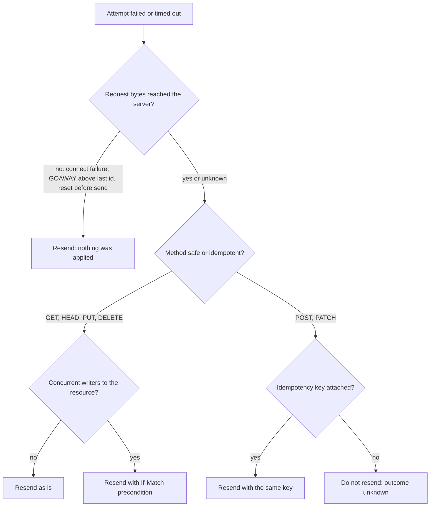
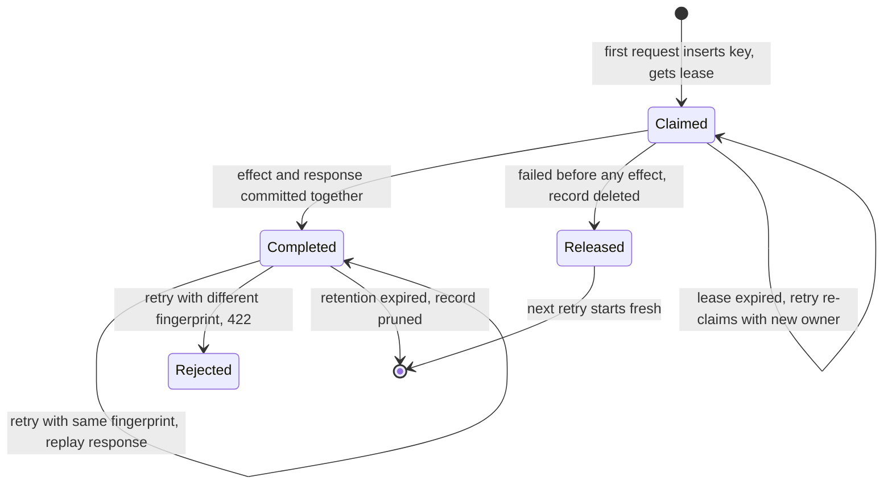
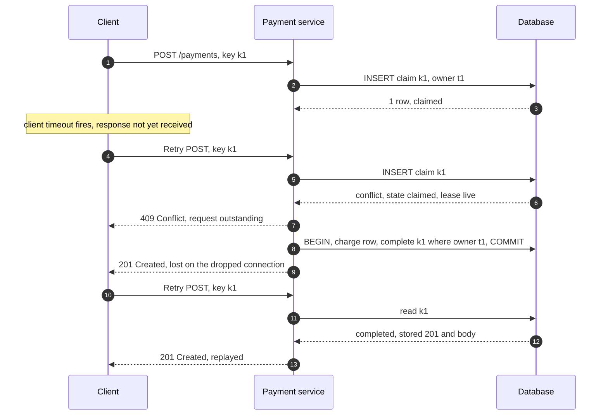
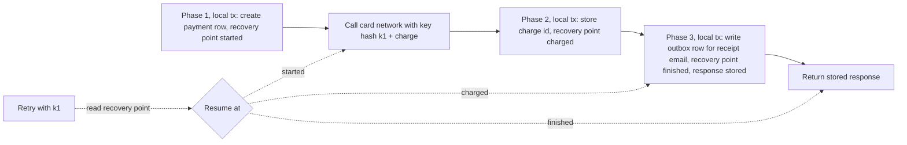
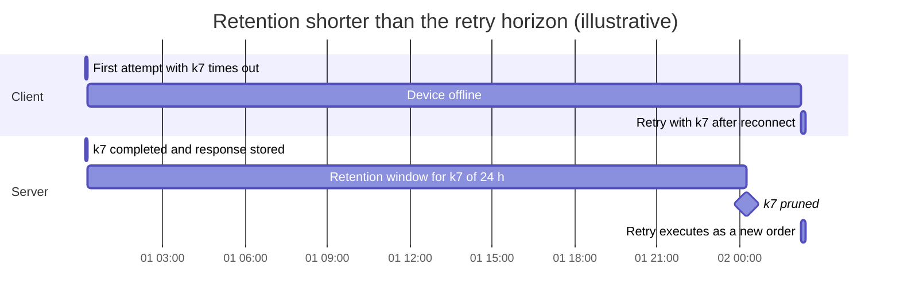
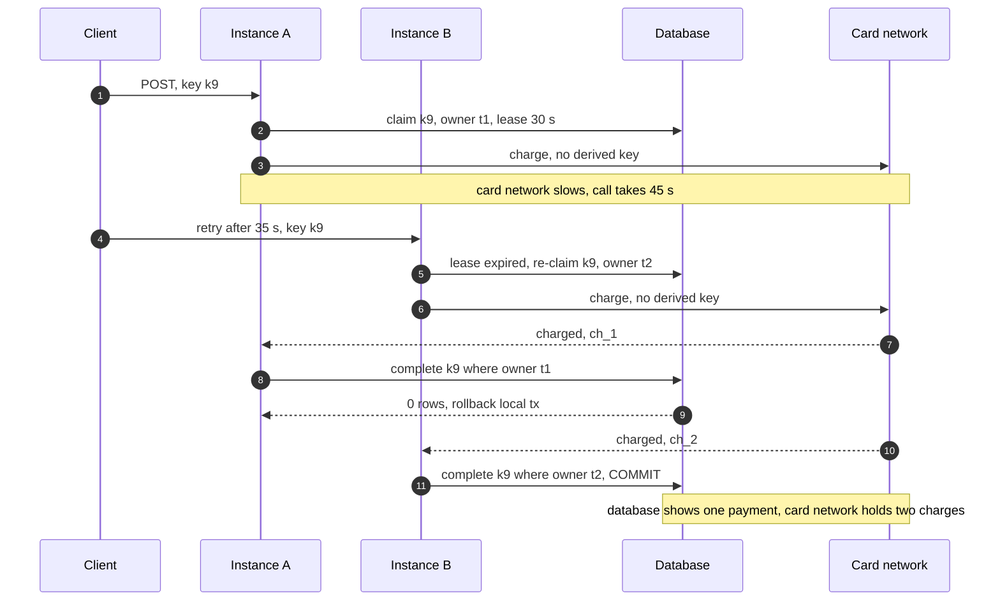

An operation is idempotent when performing it several times leaves the system in the same state as performing it once. In HTTP the property is attached to request methods: a method is idempotent if the intended effect on the server of several identical requests is the same as the effect of one, and safe if the client requests no state change at all. These properties exist for one reason: a client whose request timed out, or whose connection broke before the response arrived, cannot tell whether the server acted. If the request is idempotent, the client, a proxy, or a library may resend it without knowing the answer. If it is not, resending risks a second order, a second payment, or a second email, and not resending risks losing the operation entirely.

`POST` and `PATCH` are not idempotent by definition, and most of the business operations that matter most (create an order, capture a payment, start a job) are naturally expressed as `POST`. The idempotency key closes that gap: the client attaches a unique identifier to the intent, the server records the first execution under that identifier, and every later request with the same identifier receives the recorded outcome instead of executing again. The method's semantics are unchanged; what changes is that the server can now recognize a retry.

The core trade-off is state and coordination against ambiguity. Without keys, a system chooses between at-most-once behavior (never retry an ambiguous write, and accept lost operations) and at-least-once behavior (retry, and accept duplicates). With keys, the server holds a record per operation for as long as retries can arrive, serializes concurrent attempts on that record, and must commit the record atomically with the effect. That costs storage, one extra write per request, an availability dependency on the key store, and a careful design for effects that live outside the server's database. The guarantee is also bounded: it holds within one key scope, for as long as the record is retained, and only for effects the server controls.

This page owns method safety and idempotency as retry contracts and the idempotency-key protocol for request/response APIs. The HTTP method and precondition vocabulary is introduced in [REST](/distributed-systems/en/communication/synchronous-protocols/rest/); consumer-side deduplication of messages, including the inbox table and dedup store sizing, is canonical in [Delivery Semantics](/distributed-systems/en/communication/async-messaging/delivery-semantics/); retry timing and amplification are covered in [Retry with Exponential Backoff and Jitter](/distributed-systems/en/resilience/protection-patterns/retry-exponential-backoff/) and [Retry Storms and Metastable Failures](/distributed-systems/en/resilience/flow-control/retry-storms-metastable-failures/).

## What Safe and Idempotent Actually Promise

RFC 9110 defines both properties in terms of what the client requests, not what the server happens to do. A safe method (`GET`, `HEAD`, `OPTIONS`, `TRACE`, and the newer `QUERY`) asks for no state change, but the server may still log the request, increment a rate-limit counter, warm a cache, or bill for it; those effects are not part of the client's request, so a crawler or prefetcher that issues the request carries no responsibility for them. An idempotent method (the safe methods plus `PUT` and `DELETE`) may change state, but the change requested by N identical requests equals the change requested by one. `PUT /users/7` with a full representation sets the resource to that representation, and setting it again changes nothing further. `DELETE /users/7` removes the resource, and a second removal finds nothing to remove.

Two consequences are routinely missed. First, idempotency is about server state, not about the response. The first `DELETE` returns `204 No Content` and the second returns `404 Not Found`; both are correct, and a client that treats the second as an error after a retry has misread the contract. A retry-aware client must accept "already done" responses as success for the operation it intended. Second, the property is a promise made by the implementer, not enforced by the protocol. A `PUT` handler that also sends a notification email, appends to an audit trail that customers see, or decrements stock has broken the promise, and every intermediary that relied on it now generates duplicates. A `GET` that changes state, such as `GET /unsubscribe?token=...` or a one-click "confirm" link, is broken in the other direction: link previewers, email security scanners that follow links, and browser prefetching all issue safe requests freely, and each of them will perform the change.

### Who Acts on the Method Semantics

The promise matters because software you did not write acts on it. RFC 9110 says a client should not automatically retry a request with a non-idempotent method unless it has some means to know the request is in fact idempotent or that the original was never applied, and HTTP/1.1 permits automatic retry of idempotent requests when a connection closes before the response arrives. Browsers and most HTTP client libraries follow that rule on stale pooled connections. Proxies differ, and the differences decide whether a configuration is safe.

NGINX changed its default in version 1.9.13 (2016): non-idempotent requests (`POST`, `LOCK`, `PATCH`) are no longer passed to the next upstream server after they have been sent to one, unless the `non_idempotent` parameter of `proxy_next_upstream` is set. Envoy's router takes the opposite approach: its retry policies are conditioned on response and connection outcomes (`5xx`, `reset`, `connect-failure`, `retriable-status-codes`), not on the method, and a route that enables `5xx` retries will resend a `POST` after a backend returned `503` mid-processing. The only Envoy retry condition that is safe for any method is `reset-before-request`, which retries only when the request headers were never sent upstream. gRPC has no methods in the HTTP sense, so Protocol Buffers carries the information as a method option, `idempotency_level`, with values `NO_SIDE_EFFECTS` and `IDEMPOTENT`; client retry policies in the service config are configured per method, and the operator must keep them aligned with that declaration, as discussed in [gRPC and Protocol Buffers](/distributed-systems/en/communication/synchronous-protocols/grpc-protocol-buffers/). HTTP/2 and HTTP/3 add one more safe case: streams above the last-stream-id of a `GOAWAY` frame were never processed and may be retried regardless of method, as described in [HTTP/2 and HTTP/3](/distributed-systems/en/communication/synchronous-protocols/http2-http3-quic/).


*The decision a client, library or proxy must make before resending. Only the first branch is safe without any server cooperation.*

The tree separates two questions that retry configurations usually merge. The first is whether the request was transmitted at all. A connection refused, a `GOAWAY` that excludes the stream, or a reset before the headers were written proves the server never saw the request, and any method can be resent. Every other failure, including a read timeout, a reset after sending, a `502`, and a `504`, leaves the outcome unknown, and only then does the method matter. The third question, about concurrent writers, is the subject of the next subsection; it is why "idempotent" alone is not enough even for `PUT`. The final branch is where most production duplicates originate: a generic retry layer that resends a keyless `POST` because the status code looked transient.

### Idempotent Is Not the Same as Safe to Interleave

Idempotency is defined for one request repeated in isolation. It says nothing about a retry that arrives after another client's write. Suppose client A sends `PUT /config/42` with value `x`, the response is lost, client B then sends `PUT /config/42` with value `y` and succeeds, and A's retry arrives and sets `x` again. Each request was idempotent, yet B's write was silently erased by a request that A believed it was merely confirming. The same happens with `DELETE` followed by a re-create: a delayed retry of the delete removes the new resource.

The fix is to make the retry conditional on the state the original request was based on. A `PUT` carrying `If-Match` with the entity tag A read before writing fails with `412 Precondition Failed` when B's write has changed the resource, and A then learns that its intent must be re-evaluated rather than reapplied. When A's first attempt did succeed, its retry also fails the precondition, because A's own write changed the tag; the client must then read the resource and compare it with what it sent, which is the price of a conditional protocol. The mechanics of validators and `412` handling belong to [REST](/distributed-systems/en/communication/synchronous-protocols/rest/); the point here is that the method's idempotency protects against duplicate application, and preconditions protect against reordering, and a retrying client needs both.

## Idempotency Keys: Turning a POST into a Retryable Request

For non-idempotent operations, the server cannot recognize a retry from the request alone. Two identical `POST /payments` bodies may be one payment retried or two legitimate payments of the same amount to the same merchant. The idempotency key supplies the missing identity. The client generates a unique value once per intent, stores it with the intent before the first attempt, and sends it in every attempt; the server uses it to find any earlier execution. The emerging standard is the `Idempotency-Key` request header, specified by the IETF HTTPAPI working group in draft-ietf-httpapi-idempotency-key-header (still an Internet-Draft, not an RFC; the working group's October 2026 editor's draft targets Standards Track). It defines the header as a Structured Field string, recommends a UUID or similar random value, and lists Stripe, Adyen, Dwolla, Worldpay and others as using it, with PayPal, Square and Google Standard Payments implementing the same concept under a different header or a body field. AWS EC2 uses a `ClientToken` parameter of up to 64 ASCII characters on `RunInstances` and dozens of other mutating actions.

The server keeps one record per key within a scope, typically the authenticated account plus the endpoint. The record holds a fingerprint of the original request, a state, a lock owner with an expiry, an optional recovery point for multi-phase operations, the stored response, and timestamps for retention. Its lifecycle is a small state machine.


*Lifecycle of an idempotency record. A concurrent request that finds the record `Claimed` with a live lease receives `409 Conflict` and does not change the state.*

The diagram contains the three decisions that distinguish a correct implementation from a cache. `Released` exists because a request that failed validation, was rate limited, or failed before touching any state should not pin its key to an error forever; deleting the record lets the client fix and resend. The self-transition on `Claimed` exists because the process holding the claim can crash, and without lease expiry the key would be stuck and the operation could never complete. And `Completed` is reached only by a transaction that also commits the business effect, which is what makes the replayed response truthful. The `[*]` exit from `Completed` is the guarantee's boundary: after pruning, the same key is a new request.

### The Request Path Step by Step

The handler runs in four steps. It first claims the key: it inserts the record with state `Claimed`, a fresh owner token, a lease expiry, and the request fingerprint, relying on a unique constraint on the scope and key. If the insert succeeds, this request owns the execution. If it conflicts, the handler reads the existing record and branches: a different fingerprint returns `422 Unprocessable Content`; a `Completed` record returns the stored status code and body; a `Claimed` record with a live lease returns `409 Conflict`, telling the client to retry later; a `Claimed` record with an expired lease is taken over with a conditional update that installs a new owner token. Second, the owner executes the business logic. Third, in the same database transaction as the business writes, it updates the record to `Completed` and stores the response, conditioned on the record still carrying its owner token. Fourth, it returns the response. The draft standard uses the same status codes: `400` for a missing key on an endpoint that requires one, `422` for a key reused with a different payload, and `409` while a request with the same key is outstanding.

```sql
CREATE TABLE idempotency_keys (
  scope_id     bigint      NOT NULL,  -- account or tenant
  idem_key     text        NOT NULL,
  fingerprint  bytea       NOT NULL,  -- hash of method, path, canonical body
  state        text        NOT NULL,  -- claimed | completed
  owner_token  uuid        NOT NULL,  -- changes on every (re)claim
  lease_until  timestamptz NOT NULL,
  recovery_pt  text,                  -- last finished phase, if multi-phase
  resp_status  int,
  resp_body    bytea,
  created_at   timestamptz NOT NULL DEFAULT now(),
  PRIMARY KEY (scope_id, idem_key)
);
-- claim: one row inserted means this request owns the execution
INSERT INTO idempotency_keys (scope_id, idem_key, fingerprint, state, owner_token, lease_until)
VALUES ($1, $2, $3, 'claimed', $4, now() + interval '30 seconds')
ON CONFLICT DO NOTHING;
-- completion, inside the business transaction; 0 rows updated means ROLLBACK
UPDATE idempotency_keys SET state = 'completed', resp_status = $5, resp_body = $6
WHERE scope_id = $1 AND idem_key = $2 AND owner_token = $4;
```

The claim is committed in its own short transaction, so concurrent requests can see it and receive `409`; the completion is not. That split is deliberate, and it is the subject of the correctness argument below.


*An illustrative retry sequence. The second attempt overlaps the first and is turned away; the third arrives after completion and receives the original response.*

Step 8 is the reason the record has a `Claimed` state instead of only a `Completed` one. Without it, the overlapping retry in step 5 would find no record, execute the charge in parallel, and both executions would race to complete. Step 10 shows why the client cannot rely on seeing the first response: the connection on which the original request arrived has already been abandoned by the client, so the only way the client learns the outcome is the replay in step 14. That replay must be byte-for-byte the response the first execution produced, including the resource identifier, because the client is going to store that identifier as the result of its intent.

### Why the Construction Is Correct

The invariant is that, for each scope and key within the retention period, at most one execution commits business effects, and every attempt that receives a success response receives the response of that execution. Three properties combine to uphold it.

The unique constraint serializes claims. Two concurrent inserts of the same primary key cannot both succeed under any isolation level, because uniqueness is enforced by the index, not by the snapshot each transaction reads. This is the reason the claim must be an insert against a constraint and never a `SELECT` followed by an `INSERT`; the read-then-write variant is the check-then-act race analyzed in [Delivery Semantics](/distributed-systems/en/communication/async-messaging/delivery-semantics/).

The completion is fenced by the owner token. Leases can expire while their holder is still running, for example during a long garbage-collection pause or a slow downstream call. A retry then re-claims the key with a new token and starts a second execution. Both executions may reach their business transactions, but each transaction ends with an update conditioned on its own token, and only the current owner's update matches a row. The stale owner's update affects zero rows, and the handler rolls back the whole transaction, including its business writes. The token plays exactly the role of a [fencing token](/distributed-systems/en/coordination/distributed-locking/fencing-tokens/) against a [lease](/distributed-systems/en/coordination/distributed-locking/lease-based-locking/) that cannot be trusted to still be held; here the resource that checks it is the row itself.

The effect and the completion commit atomically. Because the business writes and the `Completed` transition are one transaction, there is no state in which the effect exists without the record saying so, or the record says so without the effect. A crash before commit leaves a `Claimed` record and no effect, which a later retry re-claims after the lease expires; a crash after commit leaves a `Completed` record and the effect, which a later retry replays. This is the same "effect and marker in one transaction" argument that makes an inbox correct, applied to a request instead of a message, and it holds only while the key table lives in the same database as the effects. When it cannot, the next section applies.

What the construction does not guarantee should be stated as plainly. It does not deduplicate two different keys for the same intent, so a client that mints a new key per attempt gets no protection. It does not hold after retention, after a key store failover that loses recent writes, or across scopes. It does not make external side effects exactly-once by itself. And it does not order operations: two different keys that update the same resource still need preconditions or serializable transactions.

### Fingerprints and Scope

The fingerprint protects the client from its own bugs. A key reused for a different request, for example because a client library cached the header value on a reused request object, would otherwise receive the first request's response for an operation that never ran: a customer pays for order A, then submits order B with the same key, and is shown a confirmation for B carrying A's payment. Comparing a hash of the method, the path, and a canonicalized body turns that into a `422`. Canonicalization matters: the hash must be computed over the parsed request with stable field order and must exclude fields that legitimately change between attempts, such as a client timestamp, a tracing header, or a signature nonce, or every retry will be rejected as a mismatch. Stripe documents that its idempotency layer compares incoming parameters with those of the original request and errors if they differ. EC2 returns `IdempotentParameterMismatch` in the same situation.

Scope prevents one tenant's key from colliding with another's and, worse, from replaying another tenant's response. Keys should be unique within the authenticated principal plus the operation, never globally. EC2 makes scope explicit in a different dimension: `RunInstances` idempotency is regional, or zonal when the request names an Availability Zone, so the same token can launch instances in two regions.

:::danger[A global key namespace replays one customer's data to another]
If the key table is keyed by the key alone, a key collision between two accounts, accidental or deliberate, returns the first account's stored response body to the second account: payment details, addresses, resource identifiers. Fingerprint comparison does not prevent this when the two requests happen to be identical. Always include the authenticated scope in the primary key, and check it before reading the stored response.
:::

### Which Outcomes to Store

A replayed response is only useful if it is the answer the client needs. Three classes of outcome deserve different treatment. Terminal outcomes produced after the business logic ran, success or a deterministic business error such as "card declined", are stored and replayed, because re-executing could produce a different answer and the client must see the one that took effect. Failures before any effect, such as request validation errors, authentication failures, and `429` throttling, should release the key, because nothing happened and the client should be able to correct and resend. Ambiguous internal failures are the hard class. Stripe's v1 API saves the status code and body once endpoint execution begins and replays it on retries, including `500` errors, and does not save results when parameters fail validation or the request conflicts with one that is executing concurrently; its v2 API instead retries failed or partially failed work to completion where possible and returns an updated response. The v1 choice is safe because the server cannot know whether a crash halfway through produced a partial effect, but it means a transient failure is permanent for that key and the client must create a new intent. The v2 choice requires the recovery-point machinery described next.

### Effects Outside the Database: Atomic Phases and Recovery Points

The atomicity argument breaks as soon as the handler calls something outside its own database: a card network, an email provider, another team's service. A remote call cannot join the local transaction, so either it happens and the local commit fails, or the local commit happens and the remote call failed or is unknown. A retry that re-executes from the start would repeat the remote call.

The standard remedy, described for Stripe-style keys by Brandur Leach, splits the handler into atomic phases separated by recovery points. Each phase is a local transaction that performs its writes and advances the record's recovery point in the same commit. Each foreign call sits between phases and carries its own idempotency key derived deterministically from the request's key and the phase name, so that a retry of the foreign call is recognized by the foreign system. A retry reads the recovery point and resumes from the next phase instead of starting over.


*An illustrative three-phase payment handler. Solid arrows are the first execution; dotted arrows show where a retry re-enters.*

The diagram shows why two mechanisms are needed together. Recovery points make the local part resumable: a crash after phase 1 resumes at the card call, never re-creating the payment row. The derived key makes the foreign part idempotent: if the process crashed after the card network charged but before phase 2 committed, the resumed call sends the same derived key, and the network returns the original charge instead of a second one. The email is not sent from the handler at all; phase 3 writes it to an outbox table in the same transaction that finishes the request, and a relay sends it with its own deduplication, which is the [Outbox Pattern](/distributed-systems/en/coordination/distributed-transactions/outbox-pattern/). Without the derived key, recovery points only narrow the window; without recovery points, derived keys still need the whole handler to be deterministic to reproduce the same foreign requests on a retry.

The construction has a requirement that is easy to violate: everything a phase sends to a foreign system must be reproducible from stored state. If the amount, currency, or merchant reference is computed from a live price table or the current time, a resumed call may send different parameters under the same derived key, and a foreign system that fingerprints requests will reject it while one that does not will silently return the original result for a different request. Store every input to a foreign call in the phase before the call. When the foreign system offers no idempotency mechanism at all, the handler cannot achieve exactly-once effects there and must fall back to a reconciliation or a compensating action, the territory of [Compensating Transactions](/distributed-systems/en/coordination/distributed-transactions/compensating-transactions/) and [the Saga Pattern](/distributed-systems/en/coordination/distributed-transactions/saga-pattern/).

## Where to Enforce Idempotency: Client, Gateway, or Service

Idempotency is an end-to-end property: only the component that commits the effect can make the commit and the record atomic. Every other layer can help but cannot replace it. The client's job is to mint the key where the intent is born and persist it with the intent, so that a crash and restart of the client, not just a network retry, reuses the key. A mobile app that queues an order offline should store the key in the queued record; a backend that receives an order from an upstream caller should derive its keys for downstream calls from the upstream key rather than generate fresh ones.

:::tip[Derive child keys, never mint them per hop]
A service that receives a keyed request and calls three downstream services should send each a key computed from the incoming key and a stable step name, for example a hash of both. If it generates a random key per downstream call, its own retry after a crash produces new keys, and the downstream services cannot recognize the repetition. The same rule applies to messages produced from the request.
:::

A gateway can enforce idempotency in a weaker form: it caches responses keyed by the header and scope, returns `409` for concurrent duplicates, and rejects keyless `POST`s on routes that require keys. That absorbs duplicate traffic before it reaches services and gives a uniform client contract across teams, which suits the shared-entry role described in [API Gateway Pattern](/distributed-systems/en/communication/api-gateway/api-gateway-pattern/). It cannot be authoritative. The gateway writes its cache entry after the origin responds; if the origin commits and the gateway times out, crashes, or loses the response before writing, the client's retry finds no entry and the origin executes again. The gateway also cannot know whether a `500` was produced before or after an effect. A gateway cache is an optimization and a policy-enforcement point; the service must still hold the record in its own database.

The key protocol is also not the only way to make a write retryable. A client-chosen resource identifier turns a create into a naturally idempotent operation: `PUT /orders/0b3f...` with `If-None-Match: *` creates the order if absent and fails with `412` if it exists, and the client can then fetch it to confirm it is its own. This avoids a separate key table and a response store, at the cost of exposing identifier generation to clients and handling only single-resource creates; ID schemes that make client-side generation safe are compared in [Distributed ID Generation](/distributed-systems/en/foundations/time-and-ordering/distributed-id-generation/).

| Approach | Where the dedup state lives | Survives client restart | Handles concurrent duplicates | Replays original response | When to prefer |
|---|---|---|---|---|---|
| Idempotent method semantics (`PUT`, `DELETE`) | Resource state itself | Yes | Last writer wins unless preconditioned | No, current state | Replace or remove a resource whose identity the client knows |
| Client-chosen ID with `If-None-Match: *` | Resource primary key | Yes, if the ID is persisted | Yes, one create wins | No, client re-reads | Single-resource creates where clients can generate collision-free IDs |
| Idempotency key at the service | Key table in the service's database | Yes, if the key is persisted | Yes, `409` while claimed | Yes | Non-idempotent operations, multi-phase handlers, external effects |
| Idempotency cache at the gateway | Gateway cache | Yes, until eviction | Yes, within one cache | Yes, if stored before the client retries | Absorbing duplicate traffic and enforcing key presence; never alone |
| Consumer-side inbox | Inbox table next to the effect | Not applicable | Yes, per message | No | Asynchronous processing; see Delivery Semantics |

The table's middle columns explain why the service-level key is the default for business operations. It is the only approach that both replays the original response and serializes concurrent attempts with a guarantee tied to the effect's own commit. The client-chosen ID is the cheaper choice whenever the operation is a single-resource create, and in practice both are combined: the order is created with a client-chosen ID, and the payment against it carries a key.

### Worked Example: Duplicates Avoided, Storage Paid, Keys Chosen

Assume a payment API averaging 800 `POST` requests per second, about 69.1 million per day. Assume, illustratively, that 0.05% of requests end with an ambiguous client-side failure (a timeout, a reset after sending, a `502` or `504`) and that in half of those the server had in fact committed. Without keys, a client that retries ambiguous failures creates 69.1 million × 0.00025 ≈ 17,300 duplicate payments per day; a client that does not retry loses the same number of operations it believes failed and must reconcile them by hand. Neither is acceptable for money movement, which is why payment APIs make keys mandatory or strongly recommended.

Storage follows from the record size and the retention period. Take a record of roughly 1.4 KB: a 36-byte UUID key, a 32-byte SHA-256 fingerprint, a scope, a state, two timestamps, an owner token, and a stored response body averaging 1.2 KB. With 24-hour retention the table holds about 69.1 million × 1.4 KB ≈ 97 GB of row data before index overhead; with 7 days it holds about 680 GB. Response bodies dominate, so the most effective lever is storing a compact response (the resource identifier and status) and re-rendering the full representation on replay, accepting that fields like a current status may then differ from the original response, as AWS documents for EC2 retries.

Key quality is the last calculation. With random 122-bit UUIDv4 keys, the expected number of colliding pairs among n keys is about `n^2 / 2^123`; for n = 69.1 million per day that is roughly 4.8e15 / 1.06e37 ≈ 4.5e-22, effectively zero, and scoping per tenant shrinks n further. A client that uses a 32-bit random number instead gets about `n^2 / 2^33` ≈ 4.8e15 / 8.6e9 ≈ 560,000 colliding pairs per day across a global namespace; with fingerprints each becomes a spurious `422`, and without fingerprints each is a request answered with another request's response. A key built from a millisecond timestamp fails faster still: at 800 requests per second the average millisecond carries 0.8 requests, so, treating arrivals as Poisson, about 55% of requests share their millisecond with at least one other request. These failures are why the draft standard recommends UUIDs and why services should validate key length and format at the edge.

## Parameters That Matter in Production

Four parameters decide whether the protocol holds under real traffic. Their values are policy, not constants, and each one has a failure mode when set against the wrong measurement.

Retention must exceed the longest interval over which a retry can arrive, not the typical one. Stripe documents that v1 keys may be pruned once they are at least 24 hours old, after which a reused key starts a new request; the IETF draft leaves the period to each resource but requires it to be published. The retry horizon includes client retry schedules, offline mobile queues, batch jobs that resume the next day, and manual replays by operators. A key that outlives its record is a new key.

The claim lease must exceed the handler's worst-case execution time, including slow downstream calls, so that a live execution is not taken over. It must also be short enough that a crashed owner does not block retries for long. Because the completion is fenced, an expired lease costs only wasted work and a rolled-back transaction, not a duplicate effect; set it from the handler's p99.9 latency plus the downstream timeout budget and alert when executions approach it.

The key store must be read from the primary. A replica that lags behind the primary will not show a just-committed record, and a retry routed to a read replica proceeds to claim, which then conflicts on the primary at best or executes against a different region at worst. The lag mechanics are in [Replication Lag](/distributed-systems/en/data-management/replication/replication-lag/); the rule here is that both the claim and the lookup run where the unique constraint is enforced.

Response size and retention cost scale together. Cap stored bodies, store compact responses for large resources, and partition the table by creation day so retention is a partition drop rather than a long-running delete.


*An illustrative timeline in which a mobile client reconnects 26 hours after its first attempt, two hours after the key's 24-hour record was pruned.*

The gantt makes the inequality visible: the server's retention bar ends before the client's offline bar does, so the retry lands on an empty key table and creates a second order. Nothing in either component is misbehaving by its own rules. The mitigation is to bound the retry horizon on the client (expire queued intents and ask the user after a limit shorter than retention), to lengthen retention for endpoints used by offline clients, and to back the key with a business uniqueness constraint, such as one order per cart identifier, which has no retention limit at all.

## Failure Modes and Their Signatures

Idempotency failures share a signature: duplicate business records with distinct identifiers, created seconds to hours apart, each with a clean success log. Detection therefore relies on a few metrics that every keyed endpoint should export: the replay rate (requests answered from a `Completed` record), the `409` rate, the `422` rate, lease takeovers, fenced rollbacks, and an offline reconciliation that counts business duplicates by natural key.

### Keys Minted per Attempt

Trigger: the client generates the key inside the retry loop, or a middleware adds a fresh key to any request that lacks one. Symptoms: duplicates continue at the pre-key rate although every request carries a key. Detection: a replay rate near zero on an endpoint with a non-trivial timeout rate is the tell, because retries that carry the same key must produce replays; a second signal is many distinct keys sharing one fingerprint within seconds. Mitigation: generate keys where the intent is created and persist them with it; never auto-generate keys in transport middleware. Recovery: reconcile by business key, which requires one to exist.

### Lease Expiry and Double Execution

Trigger: an execution outlives its lease, for example because a downstream call slows to well above the lease duration, and a retry takes over the key.


*An illustrative lease-expiry failure. Fencing keeps the database consistent, but the foreign effect was not fenced.*

Steps 9 and 10 show the fence working: instance A's completion is rejected and its local transaction rolls back, so the database records exactly one payment. Steps 3 and 7 show why that is not enough: both instances called the card network without a derived key, and the network has no way to know the second charge is a retry. The customer is charged twice, and the local record points only at `ch_2`, so the duplicate is invisible in the service's own data. Detection: fenced rollbacks and lease takeovers are both rare under normal operation and should page when they appear together with foreign calls; reconciliation of charges against payment rows finds the orphan `ch_1`. Mitigation: derive a foreign key from the request key and phase (the previous section), size the lease above the downstream timeout, and have the owner refresh its lease while waiting on slow calls. Recovery: refund or void orphan foreign effects found by reconciliation.

### Retention Shorter Than the Retry Horizon

Trigger: a retry arrives after the record was pruned, as in the gantt chart above. Symptoms: duplicates clustered after outages, mobile reconnect waves, or batch job restarts, with creation gaps close to or above the retention period. Detection: track the age distribution of keys on incoming requests where the client sends an original-attempt timestamp, or log first-seen times per key in a cheaper long-retention store. Mitigation and recovery as described above.

### Key Store Divergence: Replicas, Failover and Multiple Regions

Trigger: the claim or lookup reads a replica, a failover promotes a replica that missed recent records, or two regions accept writes for the same scope with separate key tables. Symptoms: duplicates concentrated around failovers or at region boundaries, typically when a client's retry is routed to a different region by global server load balancing (GSLB) after a timeout. Detection: duplicates whose two executions ran in different regions or on different database primaries; replication-lag alerts preceding the duplicate window. Mitigation: pin each scope to a home region for writes and send keyed requests there, or use a key store whose uniqueness is enforced across regions; accept that an asynchronous failover can lose the most recent records and treat the failover window as a reconciliation trigger.

### Replayed Transient Failures

Trigger: the implementation stores every response, including `500` and `503` produced before any effect. Symptoms: a client retries correctly after a transient fault and receives the same error forever; support tickets report operations that "keep failing" while the service is healthy. Detection: replays whose stored status is `5xx` and whose record shows no recovery point beyond the start. Mitigation: release the key when the failure occurred before any effect, store only post-effect outcomes, and document which errors are final for a key.

:::caution[A retry layer that ignores the method turns idempotency into a client-only feature]
An Envoy route or service-mesh policy with `retry_on: 5xx` resends `POST` and `PATCH` requests whose keys the gateway or mesh does not see as special. If the backend implements keys correctly, the retries replay or receive `409` and no harm is done; if one endpoint on the route lacks key support, the mesh creates duplicates that no client asked for. Restrict proxy retries on mutating routes to `reset-before-request` and connect failures, and let the client, which owns the key, decide the rest. Mesh retry configuration is covered in [Traffic Management](/distributed-systems/en/service-mesh/service-mesh-architecture/traffic-management/).
:::

| Failure | Symptom | Detection | Mitigation |
|---|---|---|---|
| Key minted per attempt | Duplicates despite keys | Replay rate near zero; many keys per fingerprint | Mint at intent creation, persist with intent |
| Lease expiry with unfenced foreign call | Double foreign charge, one local record | Lease takeovers with fenced rollbacks; reconciliation orphans | Derived foreign keys, lease above downstream timeout, lease refresh |
| Retention too short | Duplicates after long outages or reconnects | Key age at arrival near retention | Bound client retry horizon; business uniqueness constraint |
| Key store divergence | Duplicates around failover or across regions | Executions on different primaries or regions | Home region per scope; primary reads only |
| Replayed transient failure | Permanent error for one key | Stored `5xx` with no progress | Release key on pre-effect failures |
| Payload mismatch or collision | `422` spikes; wrong response without fingerprint | `422` rate by client version | Fingerprint, scoped keys, UUID validation |

## When to Use Idempotency Keys and When Not To

Use idempotency keys on every non-idempotent operation whose duplication has a cost the business cares about and whose outcome a client may not observe: payments, transfers, orders, provisioning calls that create billable resources, and any endpoint that triggers an external side effect such as a message or a shipment. Make them mandatory, with `400` on a missing key, for public and partner APIs where you do not control client retry behavior, and for endpoints called by mobile or offline-capable clients. Use them on internal calls whenever a retry layer, a mesh, or an upstream caller can resend the request, which in a microservice system is nearly always.

Prefer natural idempotency when it is available. If the operation can be expressed as a `PUT` to a client-chosen identifier, an absolute assignment, or a conditional write with a version, the resource itself is the dedup record, with no retention limit and no extra table. Combine it with preconditions whenever more than one actor can write the resource, because method idempotency alone does not prevent a delayed retry from overwriting a newer write.

Do not add keys to safe methods; `GET` and `HEAD` are retryable by definition, and Stripe documents that keys on `GET` and `DELETE` have no effect. Do not rely on a gateway idempotency cache as the only protection for an operation that moves money or creates external effects, because it cannot be atomic with the commit. Do not implement keys with a key table in a different database from the effects without the phase-and-recovery-point design, because the two writes will diverge on the first crash between them. And do not treat keys as a substitute for business uniqueness constraints: a key protects one intent against its own retries, while a constraint such as "one subscription per account and plan" protects against two intents that should never both succeed, including ones created by two different clients.

## Further Reading

- R. Fielding, M. Nottingham, J. Reschke (eds.), *RFC 9110: HTTP Semantics*, IETF, 2022. Sections 9.2.1 and 9.2.2 define safe and idempotent methods and the automatic retry rule.
- J. Jena, S. Dalal, *The Idempotency-Key HTTP Header Field* (draft-ietf-httpapi-idempotency-key-header), IETF HTTPAPI Working Group, Internet-Draft (work in progress), 2026.
- B. Leach, *Implementing Stripe-like Idempotency Keys in Postgres*, brandur.org, 2017.
- M. Featonby, *Making Retries Safe with Idempotent APIs*, Amazon Builders' Library, 2021.
- Stripe, *Idempotent Requests*, Stripe API documentation, https://docs.stripe.com/idempotency
- J. H. Saltzer, D. P. Reed, D. D. Clark, *End-to-End Arguments in System Design*, ACM Transactions on Computer Systems, 1984.
