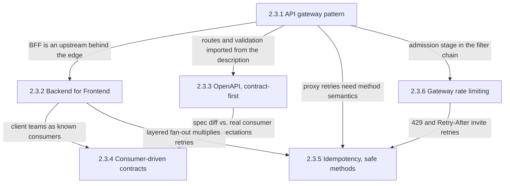
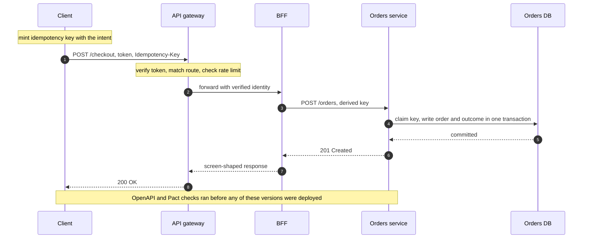
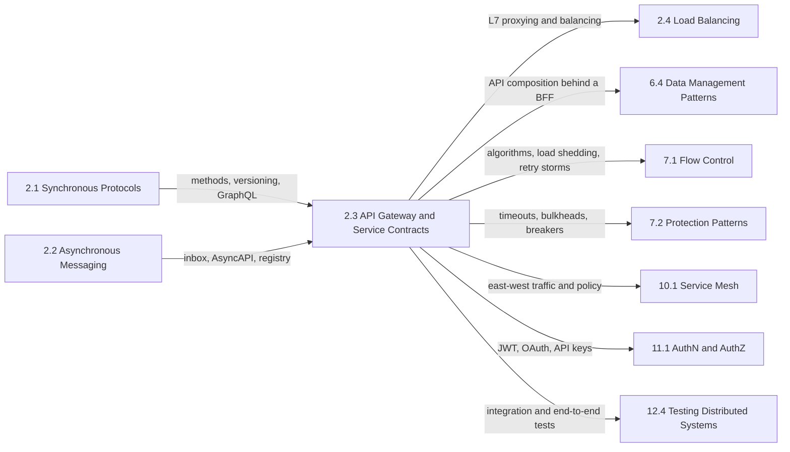

A service contract is everything a caller is allowed to rely on when it sends a request across a team boundary: which address and route reach the operation, who may call it and how often, what the request and response look like, and what happens when the same request arrives twice. Inside one codebase, a compiler and a shared test suite hold these promises together; across services nothing does unless something enforces them, and the result is familiar: each service validates tokens with a different library, a provider removes a field that a mobile app released last year still reads, a timed-out payment is retried and captured twice, and one partner's batch job consumes the capacity every other caller was counting on.

The single problem this chapter addresses is how to expose request-response APIs to clients and to other teams so that these promises are explicit, checked before deployment, and enforced on every request. Its six topics fall into three concerns. The entry layer decides where requests enter and how they are shaped for each client: the gateway and the Backend for Frontend (BFF). The contract decides what the interface is and how a change is proven compatible: OpenAPI descriptions and consumer-driven contract tests. The safety rules decide what a request may cost and what repeating it does: rate limiting and idempotency.

The tension that runs through all six topics is that every one of these policies is cheapest to enforce at a shared layer and only authoritative inside the service that owns the data. A gateway can verify a token for every route at once, but only the service can decide whether this caller may read this particular order. A gateway can cache responses by idempotency key, but if the service commits and the gateway loses the response, the retry executes again; only a record committed with the effect is a guarantee. A gateway can reject a caller over budget, but it cannot see whether the database behind the service is overloaded. Each page draws this line for one policy, and most failure modes the chapter documents begin when a team treats the shared layer's cheap check as the authoritative one.

A second tension follows: centralization against autonomy. A shared gateway is one place to change routing and policy, one place whose configuration mistake breaks every route, and one team whose release calendar everyone waits on. The BFF, consumer-driven contracts, and contract-first pipelines are partly ways to give teams independent release schedules without losing what centralization guaranteed.

## From Entry Point to Safe Retry: How the Topics Build on Each Other

The gateway page is the root: every other page sits behind, inside, or in front of the entry layer it defines. The contract pages form a pair, and the safety pages attach to the gateway's pipeline while reaching past it into the service.

*Dependencies between the chapter's topics. Each arrow names what a page inherits from, or hands to, the one it connects to.*

Three edges carry most of the chapter's reasoning. Gateways import route tables and request validators from descriptions, which makes the OpenAPI document an operational artifact, not only documentation. The edge from OpenAPI to consumer-driven contracts separates two questions: whether a document changed compatibly under an assumed consumer policy, and whether the consumers that exist still work. The edges into idempotency show why it sits near the end: proxies retry on connection failures, rate limiters tell clients when to return, and BFFs fan one client action out to several services, so the other pages all create repeated requests that idempotency must make harmless.

## The Question Each Topic Answers

[API Gateway Pattern: Single Entry Point, Routing, Auth](/distributed-systems/en/communication/api-gateway/api-gateway-pattern/) answers what a single entry point must guarantee about routing and identity, why route precedence differs between real gateways in ways that change which backend receives a request, and what happens to every route at once when the shared layer fails. Open it before putting a gateway in front of services, when choosing between local token verification and introspection, and when a configuration push or a slow upstream degrades unrelated routes.

[Backend for Frontend (BFF) Pattern](/distributed-systems/en/communication/api-gateway/bff-pattern/) answers when one general-purpose API cannot serve phones, browsers, and TVs well, what a per-experience server owned by the client team is allowed to know, and how a browser BFF keeps OAuth tokens out of reach of injected script. Open it when client round trips dominate screen latency, when client teams queue behind a shared API team, and when designing token handling for a single-page application.

[OpenAPI / Swagger: Contract-First Development](/distributed-systems/en/communication/api-gateway/openapi-swagger/) answers how an HTTP interface is described precisely enough to generate servers, clients, mocks, and gateway validators from it, which schema semantics decide whether a change is compatible, and what keeps the running code from drifting away from the description. Open it when starting an API that other teams will build against, when wiring a breaking-change check into CI, and when turning on request or response validation in front of existing clients.

[Consumer-Driven Contract Testing (Pact)](/distributed-systems/en/communication/api-gateway/contract-testing/) answers how a provider is verified against what each real consumer sends and reads, and how a deployment gate decides whether a version is compatible with everything already running in an environment. Open it when a shared end-to-end environment is the bottleneck of every release, when a provider needs to know whether a field can be removed, and when consumers are internal teams that deploy independently.

[Idempotency and Safe HTTP Methods](/distributed-systems/en/communication/api-gateway/idempotency/) answers what safe and idempotent methods promise to the clients and proxies that retry them, and how an idempotency key turns a `POST` into a request whose retry returns the original outcome instead of executing again. Open it before any write operation that a client, proxy, or library might retry, and when duplicate orders, payments, or emails appear after timeouts.

[Throttling and Rate Limiting at the Gateway Level](/distributed-systems/en/communication/api-gateway/throttling-rate-limiting/) answers what a per-caller limit is keyed on, how one limit is enforced across many gateway instances and how far each enforcement mode can drift from the configured number, and what the limiter does when its own counter store fails. Open it when one caller can starve others, when sizing partner quotas, and when observed limits do not match configured ones.

| Topic | Question it answers | Open it when |
|---|---|---|
| [API gateway pattern](/distributed-systems/en/communication/api-gateway/api-gateway-pattern/) | Where do requests enter, and who is the caller? | Introducing an entry layer, choosing an auth model, diagnosing fleet-wide degradation |
| [Backend for Frontend](/distributed-systems/en/communication/api-gateway/bff-pattern/) | Who shapes the API for each client experience? | Chatty clients, client teams blocked on a shared API, browser token storage |
| [OpenAPI, contract-first](/distributed-systems/en/communication/api-gateway/openapi-swagger/) | What is the interface, written down before the code? | Designing a new API, gating breaking changes, enabling validation |
| [Consumer-driven contracts](/distributed-systems/en/communication/api-gateway/contract-testing/) | Does this version still work for the consumers that exist? | Replacing end-to-end environments, removing fields, gating deploys |
| [Idempotency and safe methods](/distributed-systems/en/communication/api-gateway/idempotency/) | What happens when the same request arrives twice? | Any retryable write, duplicate effects after timeouts |
| [Gateway rate limiting](/distributed-systems/en/communication/api-gateway/throttling-rate-limiting/) | How much may each caller consume? | Noisy neighbors, partner quotas, limits that do not behave as configured |

The chapter can also be read along one write request, asking which page owns each step and where the cheap check at the edge hands over to the authoritative one in the service.

*One write request through the layers. The gateway page owns the identity and routing checks between steps 1 and 2, the rate-limiting page the admission check at the same point, the BFF page steps 3 and 7, and the idempotency page the key minted before step 1, derived in step 3, and committed in step 4.*

Two features of the sequence explain the chapter's shape. Every gateway check runs before the request reaches the data, which is why each is coarse: the gateway knows the caller and the route, not the order or the database's load. The authoritative step is step 4, where the key record and the effect commit together; a timeout anywhere between steps 5 and 8 leaves the client unable to tell whether the order exists, and only that record makes the retry safe. The final note marks the contract pages' place: they act on no message at runtime, and decide in CI whether these versions may be deployed together.

## Reading Order and Why

Read the chapter in sidebar order on a first pass. The gateway page comes first, because the BFF, rate limiting, and validation pages refer to its pipeline, route table, and failure domain without re-explaining them. The BFF follows as the first component behind the gateway, introducing the client teams whose expectations the contract pages capture. OpenAPI must precede consumer-driven contracts, because the Pact page positions itself against a specification diff and assumes the reader knows what a description can prove. Idempotency and rate limiting come last because both depend on the pipeline and on retries that the earlier pages generate.

Three shortcuts are reasonable. An engineer designing a public or partner API should read the gateway page, rate limiting, and OpenAPI: these decide who gets in, how much they may consume, and what they can rely on. An engineer whose writes produce duplicates or lost operations should go directly to idempotency, whose section on which clients and proxies retry automatically identifies the layer that is resending, then read the gateway page's failure modes for the timeouts that make those retries ambiguous. An engineer whose releases are blocked by a shared test environment or by fear of breaking clients should read OpenAPI and consumer-driven contracts together, then the BFF page if the consumers are the organization's own client applications.

## Where the Chapter Sits in the Handbook

[Synchronous Communication Protocols](/distributed-systems/en/communication/synchronous-protocols/) defines the request-response protocols this chapter puts a boundary around: [REST](/distributed-systems/en/communication/synchronous-protocols/rest/) introduces the methods and preconditions whose retry semantics the idempotency page builds on, [gRPC and Protocol Buffers](/distributed-systems/en/communication/synchronous-protocols/grpc-protocol-buffers/) carries its own idempotency declaration, [GraphQL](/distributed-systems/en/communication/synchronous-protocols/graphql/) is the main alternative to a BFF for client-specific shaping, and [API Versioning Strategies](/distributed-systems/en/communication/synchronous-protocols/api-versioning/) owns the taxonomy of breaking changes that the contract pages enforce. [Asynchronous Messaging Fundamentals](/distributed-systems/en/communication/async-messaging/) solves the same problems for messages, and its pages are the counterparts of this chapter's: [Delivery Semantics](/distributed-systems/en/communication/async-messaging/delivery-semantics/) for the consumer-side inbox that mirrors the idempotency key, [AsyncAPI](/distributed-systems/en/communication/async-messaging/asyncapi/) for the description that mirrors OpenAPI, and [Schema Evolution and Schema Registry](/distributed-systems/en/communication/async-messaging/schema-evolution-registry/) for compatibility enforced on the data path.

*Prerequisites on the left and the chapters that own mechanisms this chapter relies on, on the right. Each arrow names what is handed over.*

Several mechanisms this chapter uses have their canonical pages elsewhere. [Rate Limiting](/distributed-systems/en/resilience/flow-control/rate-limiting/) owns the counting algorithms the gateway limiter runs, [Adaptive Rate Limiting](/distributed-systems/en/resilience/flow-control/adaptive-rate-limiting/) the limits that move with backend health, and [Load Shedding](/distributed-systems/en/resilience/flow-control/load-shedding/) the overload protection that no per-caller limit provides. [Timeouts](/distributed-systems/en/resilience/protection-patterns/timeouts/), [Bulkhead Pattern](/distributed-systems/en/resilience/protection-patterns/bulkhead-pattern/), and [Retry Storms and Metastable Failures](/distributed-systems/en/resilience/flow-control/retry-storms-metastable-failures/) explain the slow-upstream and retry-amplification failures that the gateway and BFF pages diagnose. [JWT](/distributed-systems/en/security/authentication-authorization/jwt/) and [OAuth 2.0 and OpenID Connect](/distributed-systems/en/security/authentication-authorization/oauth2-oidc/) define the tokens the gateway verifies and the browser BFF holds. [API Composition](/distributed-systems/en/microservice-patterns/data-management-patterns/api-composition/) owns the generic mechanics of joining data from several services that a BFF performs for one client.

Two boundaries are commonly blurred. The gateway governs north-south traffic entering the system; east-west calls between services belong to the mesh, introduced in [Why Service Mesh Exists](/distributed-systems/en/service-mesh/service-mesh-architecture/why-service-mesh/), with the Kubernetes routing APIs compared in [Ingress vs. Gateway API](/distributed-systems/en/service-mesh/network-policies-mtls/ingress-vs-gateway-api/). And contract tests do not replace [Integration Testing](/distributed-systems/en/deployment/distributed-testing/integration-testing/) or [End-to-End Testing](/distributed-systems/en/deployment/distributed-testing/end-to-end-testing/), which cover wiring, configuration, and critical journeys. A gateway or BFF that absorbs business logic becomes the coupling point described in [The Distributed Monolith](/distributed-systems/en/microservice-patterns/service-decomposition/distributed-monolith/).
