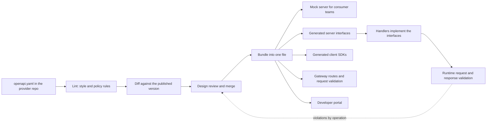
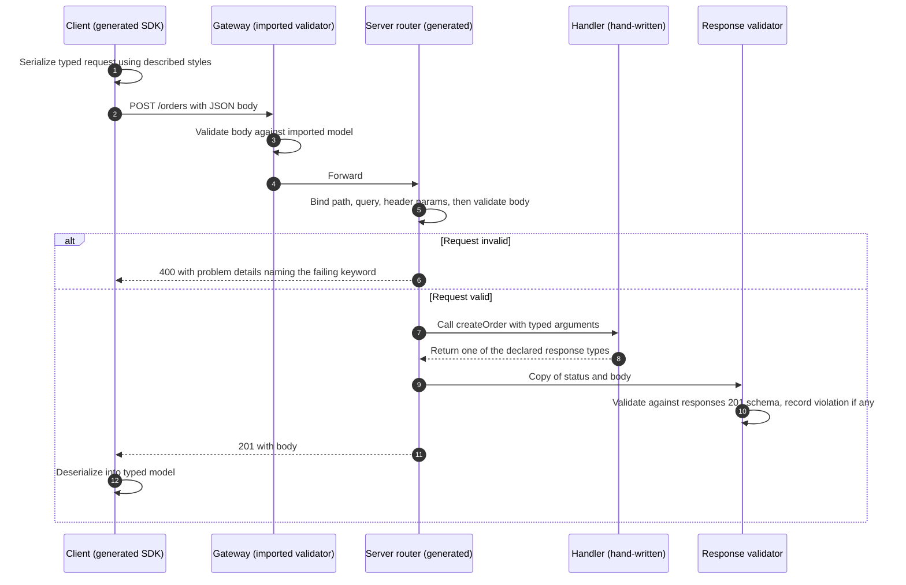
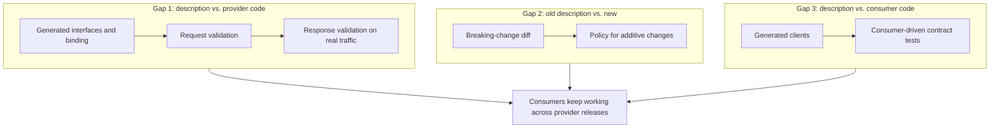
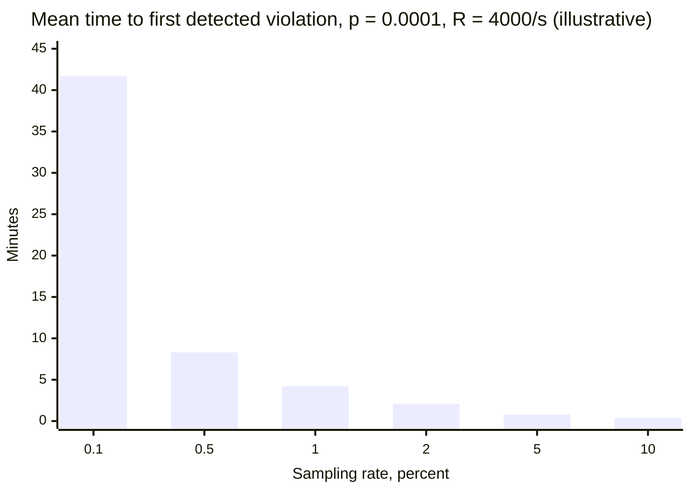

OpenAPI is a machine-readable format, written in YAML or JSON, for describing an HTTP API: its paths and methods, the parameters and bodies each operation accepts, the responses it can return for each status code, the authentication it requires, and the schemas of every payload. Contract-first development (also called design-first) makes that description the primary artifact: the interface is written and reviewed before the implementation exists, and server interfaces, client SDKs, mock servers, gateway configuration, request validators and documentation are all derived from it. The alternative, code-first, writes the implementation and generates the description from annotations or framework metadata.

The problem contract-first addresses is that an HTTP interface between teams is otherwise defined by whatever the provider's code happens to do. Consumers read prose documentation that lags behind the code, hand-write clients from example payloads, and learn the real contract from production errors. The provider cannot answer "is this change breaking?" without knowing what consumers depend on, and consumers cannot start building until a working endpoint exists. A description that is written first, reviewed as a design, and enforced mechanically gives every party the same reference, lets consumer and provider teams work in parallel against a mock, and turns compatibility into something a CI job can check.

The core trade-off is that a description buys parallel development, generated code and pre-deployment compatibility gates at the price of a second source of truth, a schema language with sharp edges, and a toolchain whose components each understand a different subset of that language. The description proves nothing on its own. Its guarantees come from the machinery that binds it to code (generation and runtime validation) and to its own history (breaking-change diffing), and even then it describes structure, not behavior: it says that `total` is an integer, not that it is in cents, and it says that `POST /orders` returns `201`, not that a retried request will not create two orders.

This page covers HTTP request-response APIs. The equivalent specification for message-driven interfaces is covered in [AsyncAPI](/distributed-systems/en/communication/async-messaging/asyncapi/); the taxonomy of which changes are breaking in which direction, and how versions are introduced and retired, in [API Versioning Strategies](/distributed-systems/en/communication/synchronous-protocols/api-versioning/); and verification of a provider against the expectations of specific consumers in [Consumer-Driven Contract Testing](/distributed-systems/en/communication/api-gateway/contract-testing/).


*A contract-first pipeline. Every artifact on the right is derived from the same bundled description; the dotted edge is the only evidence that the running code still matches it.*

The left half of the diagram is design and review: nothing reaches consumers until the description passes the linter, the breaking-change diff, and a human review in which the interface is discussed as an interface rather than as a side effect of a pull request full of handler code. The right half fans out from a single bundled file, which is the point of the approach: the mock a consumer team builds against, the SDK it ships, the gateway that validates its requests, and the interface the provider's handlers implement are all generated from the same bytes, so they cannot disagree about the shape of a payload unless a generator mistranslates it. The dotted edge closes the loop. Without validation of real traffic, the claim that the running service matches the description is an assumption.

## The Description Model: Operations, Parameters, and Schemas

An OpenAPI document has a small number of top-level objects. `info` carries the title and the version of the description itself. `servers` lists base URLs. `paths` maps path templates such as `/orders/{orderId}` to path items, and each path item holds one operation per HTTP method. An operation is the unit everything else attaches to: it has an `operationId` that generators use as a method name, a list of parameters, an optional `requestBody` keyed by media type, a `responses` map keyed by status code (or `default`), and a `security` requirement that refers to schemes declared under `components.securitySchemes`. `components` holds reusable schemas, parameters, responses and examples that operations reference with `$ref`. Version 3.1 added a top-level `webhooks` map for requests the provider sends to subscribers and made `paths` optional, so a document can describe only webhooks or only shared components.

Parameters are where most of HTTP's irregularity lives. Each has a location (`path`, `query`, `header`, `cookie`), a schema, and a serialization style. An array in a query string can be sent as `ids=1&ids=2` (style `form`, `explode: true`), as `ids=1,2` (`form`, `explode: false`), or with pipe or space delimiters, and an object can be flattened into separate keys or encoded with `deepObject` brackets. The description must say which, because a generated client and a generated server that guess differently produce requests that both consider valid and neither can parse. Path parameters are always required; header names are case-insensitive, so a description that declares the same header twice with different capitalization is invalid.

```yaml
openapi: 3.1.0
paths:
  /orders/{orderId}:
    get:
      operationId: getOrder              # becomes the method name in generated code
      parameters:
        - { name: orderId, in: path, required: true, schema: { type: string } }
      responses:
        '200':
          content:
            application/json:
              schema: { $ref: '#/components/schemas/Order' }
components:
  schemas:
    Order:
      type: object
      required: [id, status, totalMinor]
      properties:
        id: { type: string, readOnly: true }       # server-assigned, never sent by clients
        status: { type: string, enum: [PENDING, PAID, SHIPPED] }
        totalMinor: { type: integer, format: int64, description: Amount in minor units }
        couponCode: { type: [string, 'null'] }     # 3.1: nullable is a type union
```

Three choices in this fragment carry contract weight beyond their syntax. `readOnly` tells generators and validators that `id` appears in responses and must not be required in requests, so one schema can serve both directions. `couponCode` is optional and nullable, which gives it three distinguishable states on the wire (absent, `null`, a string) that most generated models in languages without an explicit "undefined" collapse into two. The unit lives in a `description`, the only place OpenAPI has for meaning, which is why a change from cents to euros passes every tool discussed below.

### From Swagger 2.0 to OpenAPI 3.2

Swagger was created by Tony Tam at Wordnik around 2010. SmartBear acquired it in 2015 and donated the specification to the newly formed OpenAPI Initiative under the Linux Foundation in November 2015, and it was renamed the OpenAPI Specification at the start of 2016. Swagger 2.0 (2014) is therefore also "OpenAPI 2.0"; the name Swagger now refers to SmartBear's tools (Swagger UI, Swagger Editor, Swagger Codegen), which is why "Swagger file" and "OpenAPI document" are used interchangeably in practice.

| Version | Released | Changes that matter for tooling and compatibility |
|---|---|---|
| 2.0 (Swagger) | September 2014 | One body parameter, `definitions`, a single `host` and base path; no `oneOf` |
| 3.0.0 | July 2017 | `requestBody` keyed by media type, `components`, `servers`, `oneOf`/`anyOf`, `discriminator`, links and callbacks; schema dialect is an extended subset of an early JSON Schema draft with its own `nullable` |
| 3.1.0 | February 2021 | Schema Object becomes full JSON Schema 2020-12; `nullable` removed in favor of `type` arrays; `exclusiveMinimum` becomes a number; `webhooks`; `paths` optional |
| 3.2.0 | September 2025 | `QUERY` method and `additionalOperations` for other methods; `itemSchema` for streamed media types such as `text/event-stream` and `application/jsonl`; `querystring` parameter location; tag hierarchy; OAuth device authorization flow |

The 3.0-to-3.1 boundary is the one that bites. A 3.0 schema is not valid JSON Schema, and a 3.1 schema uses keywords (`type` arrays, `const`, `unevaluatedProperties`, `$defs`) that 3.0-era tools do not know. Tools that ignore unknown keywords degrade silently: a validator built for 3.0 that reads a 3.1 document may skip the constraints it does not recognize and report success. Before raising a description's version, check each tool in the pipeline (linter, diff, generator, gateway importer, mock server, validator library) for the version it actually implements, not the version it parses.

:::note[Two related specifications from the same initiative]
The OpenAPI Initiative also publishes Overlay 1.0.0 (October 2024), a format for ordered, deterministic edits applied to a description, used to produce audience-specific variants such as a public description without internal operations; and Arazzo 1.0.0 (2024), which describes multi-step workflows across operations. Neither changes what a single description guarantees.
:::

### Schema Semantics That Decide Compatibility

JSON Schema is a constraint language, not a type system, and four of its defaults surprise engineers who read a schema as a class definition.

First, objects are open by default. A schema with properties `a` and `b` accepts `{"a":1,"b":2,"c":3}` unless it declares `additionalProperties: false` (or, in 3.1, `unevaluatedProperties: false`, which also sees properties contributed by `allOf` branches). An open request schema lets clients send fields the server ignores; closing it later is a breaking change for every client that did. An open response schema is what lets the provider add fields compatibly, but only for consumers whose deserializers are also open, which [API Versioning Strategies](/distributed-systems/en/communication/synchronous-protocols/api-versioning/) discusses as the tolerant-reader rule.

Second, `required` and nullability are independent. `required` says the key must be present; the type says whether its value may be `null`. A field can be required and nullable, or optional and non-nullable, and the four combinations behave differently in a `PATCH` body, where "absent" means "leave unchanged" and `null` means "clear it". Generators for Java, Go or C# typically map both absent and `null` to the same null reference unless configured to use a wrapper type, which makes "clear the coupon" and "do not touch the coupon" indistinguishable to the handler.

Third, `format` is an annotation, not an assertion, in JSON Schema 2020-12 unless the validator enables format assertion. A field declared `format: date-time` or `format: uuid` accepts any string in a conforming default validator. Some OpenAPI validators assert common formats anyway, others do not, and a gateway may do a third thing; the same request can pass at one layer and fail at another.

Fourth, `oneOf` means exactly one. A payload that matches two branches is invalid. Two branches that differ only by optional properties, or a branch whose schema is open and therefore matches anything with the right required keys, make perfectly reasonable payloads fail validation. A `discriminator` names a property whose value selects the branch, which helps generators produce polymorphic types, but in 3.0 and 3.1 it is a hint: validators are not required to use it, and the `oneOf` rule still applies.

:::caution[Overlapping oneOf branches reject valid payloads]
`oneOf: [Card, Wallet]` where both schemas are open objects requiring only `type` accepts nothing: every payload with a `type` matches both branches. The fix is to make branches mutually exclusive, usually with a `const` on the discriminating property in each branch, or to use `anyOf` when overlap is acceptable. Test polymorphic schemas with a validator before publishing; generators will happily produce code for a schema no payload can satisfy.
:::

## Contract-First as a Pipeline: From Description to Running Code

Contract-first is not a single step but a chain of transformations, each of which can preserve or lose the contract. Understanding where each stage gets its guarantee, and what it hands to the next, is what separates a pipeline that enforces the contract from one that only renders documentation.

The chain starts with authoring in the provider's repository, often split across files by resource and joined with `$ref`. A linter (Spectral and Redocly CLI are the common ones) checks the description against structural validity and against organizational rules: every operation has a unique `operationId`, every error response uses the shared problem-details schema, collections are paginated with the standard parameters, no operation lacks a `security` requirement. Lint rules are where API style guides become enforceable; a style guide that is only a wiki page is reviewed inconsistently.

A breaking-change diff compares the candidate description with a baseline and classifies each difference. oasdiff, for example, reports changes at `ERR` level (definitely breaking, such as removing an operation, adding a required request property, or removing a response property) and `WARN` level (possibly breaking, such as adding an enum value to a response), and `--fail-on ERR` turns the report into a CI gate. The classification encodes a policy about consumers that the description cannot observe, and the baseline decides what the gate protects, a point the failure modes below return to.

Merged descriptions are bundled into one self-contained file, and every derived artifact is produced from that bundle. A mock server such as Prism serves responses from the description's examples or from generated data and validates incoming requests against it, so a consumer team can build and test its client before the provider has written a handler. Code generators (OpenAPI Generator, which forked from Swagger Codegen in 2018, and many language-specific ones) emit two kinds of code. Client SDKs serialize requests and deserialize responses into typed models. Server stubs emit routing, parameter binding, and an interface per operation that the provider's handlers implement; the generated code is regenerated on every build and never edited by hand, so the description stays the source of truth (the "generation gap" pattern). Gateways import the bundle to create routes and request validators, and the developer portal renders it.


*One request through a contract-first stack. Steps 3, 5, 10 and 12 each check the same contract with a different implementation of the schema language.*

The sequence shows why "the request was validated" is not one fact. In step 3 the gateway checks the body against a model it imported from the description, possibly with a reduced keyword set. In step 5 the server's generated router checks it again with its own validator library. Steps 7 and 8 are where hand-written code runs, and its return type is constrained by the generated interface, so a handler in a statically typed language cannot return a response shape the description does not declare for that operation. Step 10 checks what the type system cannot: values (a `null` where the schema forbids it, a string that violates a `pattern`, a missing required field that the generated model allowed to be null). Step 12 is the consumer's own check, done by its deserializer, which is the check that actually decides whether the consumer breaks. Each of those five checks interprets the schema independently, and their disagreements are where contract-first systems fail.

### What Conformance Means and Why the Pipeline Upholds It

The invariant contract-first aims for can be stated precisely. A provider conforms to a description when three conditions hold for every operation. Acceptance: every request that is valid under the description is accepted and processed, not rejected. Rejection: every request that is invalid under the description is rejected with a client error before it reaches business logic, or is explicitly tolerated by documented policy. Emission: every response the provider returns is valid under the schema declared for its status code and media type. A consumer conforms when every request it sends is valid and it handles every response that is valid, including those carrying content the description declares extensible.

The pipeline upholds these conditions by construction, each stage covering a different one. Generated routing and parameter binding make acceptance hold for the shape of requests: if the generator and the client agree on serialization styles, a valid request binds without error, because both sides were produced from the same declaration. Request validation middleware, configured from the same bundle, makes rejection hold: invalid requests are stopped at the boundary with a `400` that names the failing keyword, rather than surfacing as a `NullPointerException` and a `500` three layers deep. Generated interfaces make emission hold for shape, because a handler can only return declared types, and response validation covers the value-level constraints that types cannot express. Breaking-change diffing extends the guarantee across time: if every change from the published description to the new one is classified as non-breaking under the stated consumer policy, then every consumer that conformed to the old description conforms to the new one. That last step is a transitivity argument and is only as sound as the policy, which is why the policy for additive changes (new response fields, new enum values) must be part of the contract, not an assumption.

The pipeline does not make any guarantee about behavior. It cannot say whether `POST /orders` is safe to retry, whether a `GET` result may be cached and for how long, whether pagination is stable under concurrent inserts, what rate limits apply, or what the fields mean. Those belong in descriptions, specification extensions (`x-` keys that the organization's linter and generators understand), and the canonical pages for [idempotency](/distributed-systems/en/communication/api-gateway/idempotency/), [HTTP caching and status codes](/distributed-systems/en/communication/synchronous-protocols/rest/), and [rate limiting](/distributed-systems/en/communication/api-gateway/throttling-rate-limiting/). Nor does it guarantee that consumers conform. A consumer that wrote its client by hand, uses a strict deserializer, or depends on an undocumented field ordering is outside the argument; verifying what specific consumers actually rely on is the job of consumer-driven contract tests, which complement the provider-side description rather than replacing it.


*The three gaps a contract must close. A pipeline that closes only the second (the common case: diff in CI, nothing else) proves that the document is compatible with its previous version, not that any running system is.*

Teams that adopt OpenAPI usually start with the middle box, because a diff in CI is cheap and visible. It closes the gap between two documents. It says nothing about whether the provider's code matches either document, which is gap 1, or whether consumers interpret the document the way the diff's policy assumes, which is gap 3. A breaking change shipped in the code without a matching edit to the description passes the diff, because the diff never saw it.

### Worked Example: The Price of Closing Gap 1 With Response Validation

Assume an orders API serving 4,000 responses per second at peak across its fleet, with a mean response body of 6 KB. Assume the validator library costs about 25 microseconds per KB of JSON validated, so about 150 microseconds per response. All numbers in this example are illustrative; measure the validator on representative payloads before relying on any of them.

Validating every response inline costs `4,000 * 150 us = 0.6` CPU-seconds per second, about 0.6 of one core across the whole fleet, and adds about 150 microseconds to every response. The CPU is negligible. The risk is not: inline validation that rejects a non-conforming response turns a provider bug into a `500` for every consumer, including the tolerant ones that would have ignored the bad field. In production, response validation should observe rather than enforce: copy the body, validate it off the request path, and increment a violation counter labeled by operation, status code and schema location.

Whether to validate all responses or a sample depends on how quickly a conformance bug must be found. Suppose a bug makes a fraction `p` of responses invalid, for example a field declared non-nullable that is `null` for orders created through a legacy import path. With a request rate `R` and sampling rate `s`, sampled violations arrive at rate `R * s * p`, and the time to the first detected violation is exponentially distributed with mean `1 / (R * s * p)`.


*Detection time falls in inverse proportion to the sampling rate. The model assumes violations are independent and evenly spread over time.*

At `p = 0.0001`, 0.4 invalid responses leave the fleet every second. A 1% sample catches the first one after about 250 seconds on average, and the probability of having seen none after an hour is `e^(-14.4)`, effectively zero; even 0.1% sampling finds it after about 42 minutes on average. A bug in a rare branch is a different problem. At `p = 1e-7`, for example a field that is malformed only for one currency used by one merchant, invalid responses occur once every 2,500 seconds. A 1% sample needs on average 250,000 seconds, about 69 hours, to see one; full validation sees the first in about 42 minutes. For this service, full asynchronous validation costs 0.6 cores and is the right choice. For a service doing 40,000 responses per second with 60 KB bodies, the same validator would need `40,000 * 1.5 ms = 60` cores, and sampling at 1% (0.6 cores) plus pre-release testing that drives rare branches deliberately is the better trade. Sampling bounds the detection time of common drift; it does not find rare drift in useful time, and schema-driven test generation in CI (tools such as Schemathesis derive request cases from the description and check responses against it) is what covers the branches traffic rarely exercises, as long as test fixtures contain the data that triggers them.

## Contract-First, Code-First, and Other Contract Sources

The real choice is not whether to have a contract but where its source of truth lives and what keeps derived artifacts in agreement with it.

| Approach | Source of truth | What it guarantees mechanically | Main drift risk | When to prefer |
|---|---|---|---|---|
| Design-first OpenAPI | Hand-written description | Generated code and validators agree with the description; diff gates evolution | Handlers bypass generated types; generator mistranslations | Public or cross-team APIs, parallel development, SDKs in several languages |
| Code-first OpenAPI | Implementation plus annotations | Description reflects what the scanner sees in code | Annotations that lie; internal types leaking into the contract; design reviewed after it ships | One team owning provider and main consumer; fast iteration on internal APIs |
| Higher-level IDL emitting OpenAPI (e.g. TypeSpec) | Definition in a typed design language | Consistent conventions across many APIs; reusable templates | Emitter output differs from what hand-written OpenAPI would express; two languages to know | Large API estates that need uniform patterns across many teams |
| Protobuf and gRPC | `.proto` files | Wire compatibility rules enforced by field numbers; codegen in every language | HTTP transcoding layer adds a second contract | Internal service-to-service calls; see [gRPC and Protocol Buffers](/distributed-systems/en/communication/synchronous-protocols/grpc-protocol-buffers/) |
| GraphQL SDL | Schema served by the API | Every query validated against the schema; introspection | Field-level deprecation instead of versions; behavior hidden in resolvers | Clients that choose their own data shape; see [GraphQL](/distributed-systems/en/communication/synchronous-protocols/graphql/) |
| Consumer-driven contracts (Pact) | Consumers' recorded expectations | Provider verified against what known consumers actually use | Consumers that publish no contract | Known, few consumers whose usage should gate releases |

Design-first and code-first differ mainly in when the interface is reviewed and what drifts. Design-first reviews the interface before it is built and makes drift a matter of discipline (handlers must use generated types). Code-first cannot drift in the "description is stale" sense, since it is regenerated from code, but it drifts in the opposite direction: whatever the code does becomes the contract, including accidents like a Java class name as a schema name, internal enum values, or a field exposed because a serializer annotation was forgotten. A useful compromise is code-first with a committed, generated description that must be updated in the same pull request, so that every change to the contract appears as a reviewable diff and passes the same lint and breaking-change gates as a hand-written one.

### Where Generators Lose Information

A generator translates JSON Schema, a constraint language, into a target language's type system, and the translation is lossy in predictable places. Polymorphism (`oneOf`, `anyOf`, `allOf` with a discriminator) is represented differently by each generator and each language: as an inheritance hierarchy, a tagged union, a wrapper with one field per branch, or an untyped map when the generator gives up. Nullability and optionality collapse as described above. Enums become closed types in most languages, so a generated client fails, or falls into an "unknown" value only if the generator was configured to add one, when the server returns a new value; whether that counts as a breaking change is a policy question that [API Versioning Strategies](/distributed-systems/en/communication/synchronous-protocols/api-versioning/) treats in detail. Constraints such as `pattern`, `minimum` and `maxLength` are usually emitted as annotations or dropped, so the generated type admits values the schema forbids. And typed models drop unknown fields during deserialization, so a client that reads a resource and writes it back with `PUT` can erase fields added after it was generated; the versioning page covers that lost-update pattern.

The gap between `integer` with `format: int64` and the languages that consume JSON is the sharpest of these. JSON numbers have no defined precision, and JavaScript parses them into IEEE 754 doubles, which represent integers exactly only up to `2^53`. A generated TypeScript client typically maps `int64` to `number`. IDs, counters, or amounts above about `9.007e15` are rounded silently when parsed, and the rounded value is what the client sends back.

:::danger[64-bit integers are silently corrupted in JavaScript clients]
An `int64` ID such as `9007199254740993` parses in JavaScript as `9007199254740992`. A browser or Node.js client that reads the ID and later updates or deletes "that" resource acts on a different resource or on none, without any error. For identifiers, declare `type: string` in the description. For quantities that may exceed `2^53`, either declare them as strings with a documented decimal format or ensure every consumer's generator maps `int64` to a big-integer type, and add a lint rule that flags `format: int64` in response schemas.
:::

## Running the Pipeline: Gates, Parameters, and Gateway Import

The CI steps are short; the decisions inside them are what matter.

```shell
# Lint with the organization ruleset; warnings fail the build
spectral lint openapi.yaml --ruleset .spectral.yaml --fail-severity=warn
# Breaking-change gate against what consumers have, not against main
oasdiff breaking published/openapi.yaml openapi.yaml --fail-on ERR
# One self-contained file for every derived artifact
redocly bundle openapi.yaml -o dist/openapi.yaml
# Server interfaces and client SDK from the same bundle (generator version pinned)
openapi-generator-cli generate -i dist/openapi.yaml -g spring -o gen/server
openapi-generator-cli generate -i dist/openapi.yaml -g typescript-fetch -o gen/client
# Mock for consumer teams: serves examples, validates their requests
prism mock dist/openapi.yaml
```

The baseline of the diff is the most consequential parameter. Diffing a pull request against `main` checks each change in isolation; two pull requests that are each compatible with `main` can be breaking together, and a change that was merged and later reverted in the description but not in production disappears from the comparison. Diffing against the description of what is deployed, or of what was last published to consumers, checks the property that matters: whether the next release breaks someone running against the current one. The table lists the other parameters that change behavior in production.

| Parameter | Typical default | Effect | Guidance |
|---|---|---|---|
| Diff baseline | Target branch | Defines what "breaking" is measured against | Use the published or deployed description |
| Diff failure level | Report only | Whether possibly-breaking changes block | Fail on `ERR`; require an explicit review label for `WARN` |
| Response enum policy | Additions allowed | Whether new response enum values are breaking | Declare extensibility per enum and lint for it; mark closed enums as such |
| `additionalProperties` on requests | Open | Whether unknown request fields are rejected | Decide per API before first release; closing later is breaking |
| Request validation mode | Varies by library | Reject versus log on violation | Log-only first, measure would-reject rate per client, then enforce |
| Response validation mode | Off | Detection of provider drift | Enforce in tests, observe asynchronously in production |
| Generator version | Latest at install | Shape of generated code | Pin; review regenerated output on upgrade like a dependency change |
| Format assertion | Annotation only (2020-12) | Whether `date-time`, `uuid` are checked | Enable explicitly where the format is part of the contract |

Gateways deserve separate attention because they validate requests with their own interpretation of the description. Amazon API Gateway's REST APIs, for example, import OpenAPI 2.0 and 3.0 descriptions but document a list of exceptions: models are defined in JSON Schema draft 4 rather than OpenAPI's dialect; `discriminator`, `nullable`, `readOnly`, `default`, `example` and `exclusiveMinimum` are not supported; only a few parameter attributes are honored; root-level `security` is not applied, so security must be declared per operation; and `$ref` cannot point to other files. A description that is correct for the service can therefore produce a gateway that rejects `null` values the service accepts, ignores constraints the service enforces, or exposes an operation without the intended authorizer. Treat the imported gateway as a separate validator with its own conformance tests, and lint the description for the constructs the target gateway drops. The gateway's broader role is covered in [API Gateway Pattern](/distributed-systems/en/communication/api-gateway/api-gateway-pattern/).

:::tip[Publish the description as a versioned artifact]
Store each released description as an immutable, versioned artifact next to the service build, and record which version every environment runs. The breaking-change gate then has a correct baseline, consumer teams can pin the exact version they generated against, and an incident review can answer "what contract was live at 14:00" without reconstructing it from git history.
:::

## Failure Modes of Contract-First Systems

Contract failures surface as client-side deserialization errors, unexplained `400` spikes after a deploy, or wrong values with no errors at all. They rarely surface on the provider's own error dashboards, which is why detection has to be designed in.

### Enforcing Validation Breaks Existing Clients

Trigger: request validation is switched from off or log-only to enforcing, or the description is tightened (an object closed with `additionalProperties: false`, a new `maxLength`, a format assertion enabled), and some clients have been sending requests the handler tolerated but the description forbids. Symptoms: a sudden rise in `400` responses concentrated in a few client identities, often batch integrations that do not retry client errors and fail entire jobs.

```mermaid
sequenceDiagram
    autonumber
    participant P as Partner batch client
    participant G as Gateway
    participant S as Orders service v5.2
    participant O as On-call
    Note over S: Deploy enables strict validation, CreateOrder closed with additionalProperties false
    P->>G: POST /orders with extra field clientRef
    G->>S: Forward
    S-->>P: 400, additional property clientRef not allowed
    rect rgb(70, 40, 40)
    Note over P: 400 is not retryable, nightly job aborts after 3000 failed orders
    P->>G: Next record, same shape
    S-->>P: 400
    end
    O->>O: Alert on 4xx rate for one client ID
    O->>S: Switch validator to log-only
    P->>S: Job rerun succeeds
    Note over O,S: Would-reject rate per client measured before enforcing again
```


*An illustrative rollout of strict request validation. The partner's requests were never valid under the description; they only became failing requests when enforcement began.*

The partner did nothing wrong by the only contract it could observe, which was the server's behavior. The deploy noted at the top of the diagram changed that contract, even though the description did not change, because the enforced contract is whatever the validator does. Detection: `4xx` rate segmented by client identity and operation, and the validator's violation counter labeled by schema keyword (`additionalProperties`, `format`, `required`). Mitigation: return to log-only. Prevention: run the validator in log-only mode first, measure the would-reject rate per client for a full business cycle (including weekly and monthly batch jobs), contact those clients, and enforce per operation once the rate is zero. The [canary release](/distributed-systems/en/deployment/deployment-patterns/canary-release/) of a validation change must be segmented by client, not only by traffic share, because a single client's failure disappears in a fleet-wide error rate.

### Drift Between Description and Implementation

Trigger: a handler returns data through a path that bypasses the generated types (a raw map, a hand-written serializer, a field added by a framework), or a code-first annotation describes something the code no longer does. Symptoms: consumers that generated a client from the description fail on real traffic while the provider's tests pass; a new consumer finds that documented fields are missing. Detection: the asynchronous response-validation counter by operation and schema location; in code-first setups, a CI step that regenerates the description and fails if it differs from the committed one. Mitigation: fix the code or change the description, and in the second case treat the change as a contract change that was already shipped, running it through the breaking-change gate retroactively and notifying consumers who built in the interval.

### Breaking Change Hidden in a Shared Component

Trigger: a schema under `components` is referenced by many operations, sometimes in both requests and responses, and an edit made for one operation changes all of them. Adding a required property to a shared `Address` schema to support a new request breaks every existing request that uses `Address`; removing a property from a shared response schema removes it from every response. Symptoms: failures in operations nobody intended to change. Detection: a diff tool that reports changes per operation after resolving references, not per component; oasdiff reports at operation level, a text diff of the YAML does not. Mitigation: separate request and response schemas for resources whose shape differs by direction, or rely on `readOnly` and `writeOnly` consistently; treat shared components as a public API of their own.

### Generator Upgrade Changes Behavior

Trigger: the code generator is upgraded, or runs unpinned, and its output changes: an enum gains or loses an "unknown" fallback, nullable fields become wrapper types, date fields switch representation, a polymorphic type changes from inheritance to a wrapper. Symptoms: compilation failures in the best case; in the worst case, code that compiles and serializes differently, for example omitting null fields that used to be sent explicitly. Detection: commit or archive generated output and review its diff on every generator change; run the consumer's contract tests against the provider after regeneration. Mitigation: pin generator versions per repository, and upgrade them as deliberately as any dependency that touches serialization.

### Gateway and Service Validate Different Contracts

Trigger: the gateway imports the description with unsupported keywords dropped or translated (as in the Amazon API Gateway list above), or uses a different JSON Schema dialect than the service's validator. Symptoms: requests rejected at the gateway that the service would accept (or the reverse), operations exposed without the authorizer the description declared at root level, `null` handling differing between layers. Detection: contract tests run through the gateway, not only against the service directly; a lint ruleset specific to the gateway's documented limitations. Mitigation: keep gateway validation coarse (presence, content type, size) and leave full schema validation to the service, or generate the gateway configuration from a profile of the description restricted to what the gateway supports.

### Summary of Failure Signatures

| Failure | Symptom from outside | Detection signal | Mitigation |
|---|---|---|---|
| Validation enforcement breaks clients | `400` spike for a few clients after deploy | 4xx by client and operation; violations by keyword | Log-only first; per-client would-reject rate; segmented canary |
| Description-implementation drift | Generated clients fail on real traffic | Response violation counter; regenerated-vs-committed diff | Generated types only; async response validation |
| Breaking change in shared component | Failures in unchanged operations | Operation-level breaking diff | Direction-specific schemas; component review |
| Generator upgrade | Serialization changes without contract change | Diff of generated code | Pin generator; review output |
| Gateway-service validation mismatch | Inconsistent rejections between layers | Contract tests through the gateway | Coarse gateway validation; gateway-specific lint |
| int64 precision loss | Wrong resource updated, no errors | Lint for `int64` in responses; ID round-trip tests | Strings for IDs; big-integer mapping |
| Semantic change under same schema | No errors; wrong values downstream | Reconciliation and business metrics | Treat unit and meaning changes as breaking |

The last row is outside the reach of every tool on this page. A change of unit, time zone or meaning passes lint, diff, generation and validation, because the schema is unchanged; the only defense is a review policy that treats meaning as part of the contract and a new field for every change of meaning.

## When Contract-First Pays Off

Adopt contract-first when the API crosses a team or organizational boundary and its consumers cannot be upgraded with the provider: public APIs, partner integrations, platform APIs consumed by many internal teams. It pays off when consumers and provider must build in parallel, because the mock server removes the provider's implementation from the consumer's critical path; when SDKs are shipped in several languages, because generation removes a class of hand-written serialization bugs; and when an API program needs uniform conventions (errors, pagination, authentication) enforced by lint rather than by review. Stripe and GitHub both publish OpenAPI descriptions of their public APIs, which is the scale at which a single reviewed source for docs, SDKs and change review becomes indispensable.

Prefer code-first with a committed, gated description when one team owns the provider and its main consumer, iterates quickly, and would otherwise write the same interface twice; the gates still apply, only the authoring direction changes. Do not adopt either as a documentation exercise with no generation, validation or diff behind it: a hand-maintained description that nothing checks drifts within months and misleads more than it helps. Do not use OpenAPI as the primary contract for internal high-throughput service-to-service calls where both sides can use protobuf, whose compatibility rules are enforced by the encoding itself. Do not rely on it to describe behavior: retries, idempotency, ordering, caching and rate limits need their own specification and tests. And do not let a green breaking-change gate stand in for knowledge of consumers; when a few critical consumers' exact usage must gate releases, add [consumer-driven contract tests](/distributed-systems/en/communication/api-gateway/contract-testing/), and when a breaking change is unavoidable, follow the version and sunset procedure in [API Versioning Strategies](/distributed-systems/en/communication/synchronous-protocols/api-versioning/). Clients whose needs diverge enough that one description cannot serve them well are the case for a [Backend for Frontend](/distributed-systems/en/communication/api-gateway/bff-pattern/), each with its own description.

## Further Reading

- OpenAPI Initiative, *OpenAPI Specification 3.2.0*, spec.openapis.org, 2025.
- OpenAPI Initiative, *Migrating from OpenAPI 3.0 to 3.1.0*, openapis.org blog, 2021.
- Austin Wright, Henry Andrews, Ben Hutton, and Greg Dennis, *JSON Schema: A Media Type for Describing JSON Documents* (draft 2020-12), IETF Internet-Draft, 2022.
- Amazon Web Services, *Amazon API Gateway important notes* (OpenAPI import exceptions for REST APIs), API Gateway Developer Guide.
- Tufin, *oasdiff: Breaking Changes*, oasdiff documentation on GitHub.
- Arnaud Lauret, *The Design of Web APIs*, Manning, 2019.
