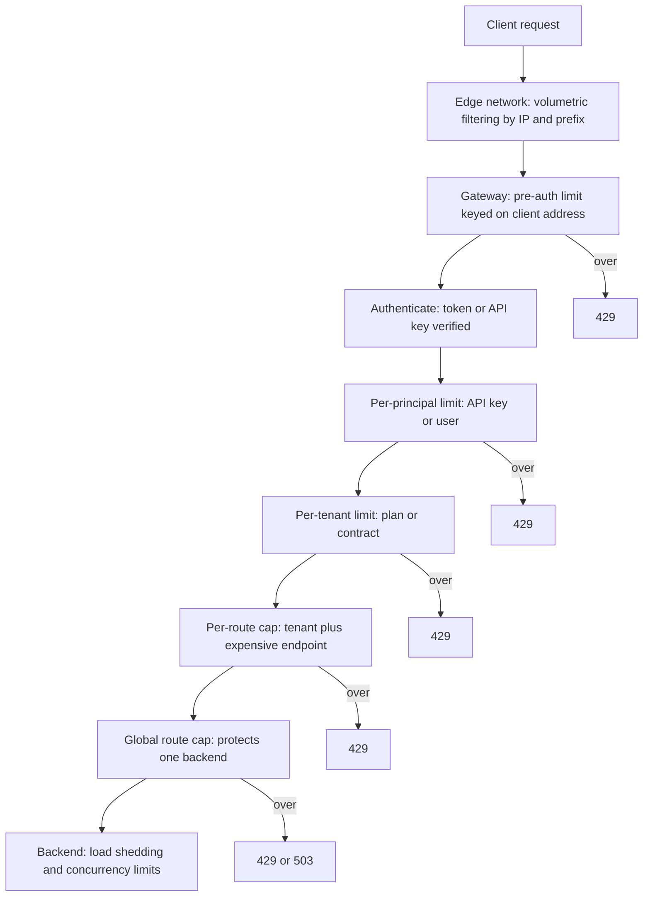
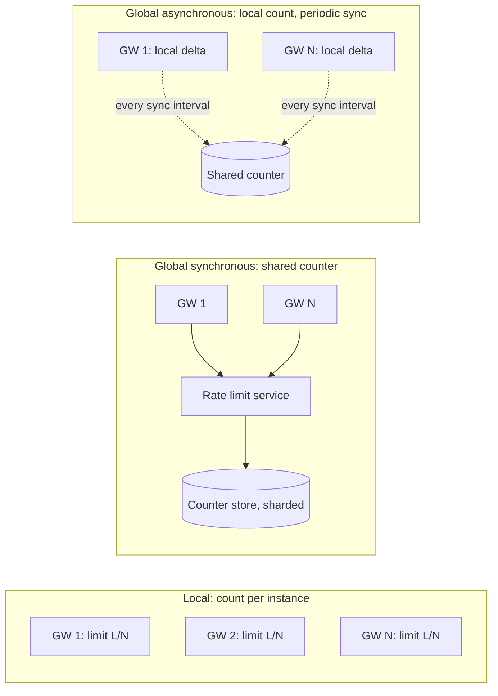
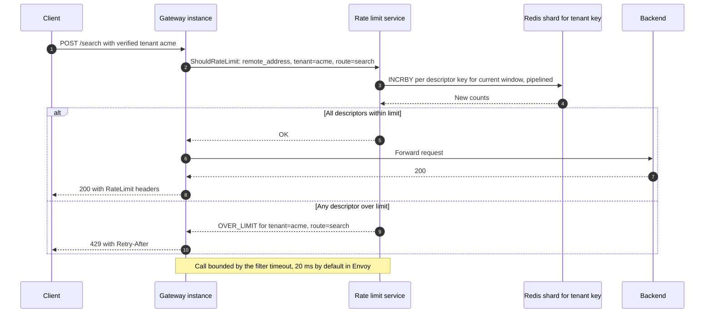
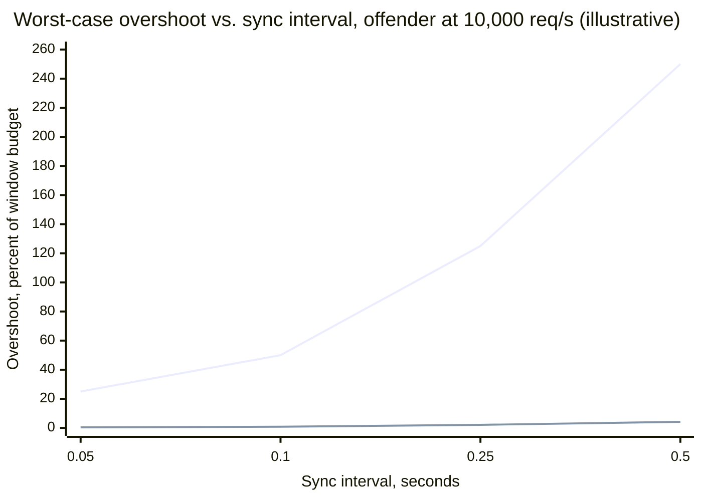

Gateway rate limiting is the admission decision a shared entry layer makes for each request before any backend capacity is spent: does the caller identified by this request still have budget under the policies that apply to it? The decision is keyed on something the gateway knows about the request (a client address, an API key, a verified tenant, a route), evaluated against a count of that key's recent requests, and enforced by rejecting the request with `429 Too Many Requests` or, less often, by delaying it until it fits. Throttling is the umbrella term; in this handbook a rate limit rejects, a throttle delays, and a quota is a budget over a long period (a day, a month) that usually doubles as a commercial entitlement.

The problem it solves is that a gateway concentrates many callers onto shared capacity. Without per-caller budgets, one partner's runaway batch job, one misconfigured retry loop, or one credential-stuffing campaign consumes capacity that every other caller was counting on, and the backends see an overload they cannot attribute. A limit at the gateway isolates callers from one another at the cheapest possible point: the rejected request costs a few microseconds of proxy work instead of a database query, and the rejection names the cause, so the offending client can slow down instead of failing at random.

The core trade-off is accuracy against coordination. A gateway fleet of `N` instances sees each caller's traffic split across instances. Enforcing a limit exactly requires every instance to consult one shared counter on every request, which adds a network round trip, a new dependency in the request path, and a hot spot in the counter store. Enforcing it locally, with each instance counting only what it sees, costs nothing per request but makes the effective limit depend on how the load balancer happens to spread that caller's connections. Every production design sits somewhere between the two, and the second trade-off follows from the first: when the shared counter store is unreachable, the gateway must either admit everything (fail open, losing protection) or reject everything (fail closed, turning a limiter outage into an API outage).

This page owns enforcement at the gateway: keys and policy layering, distributed counting across instances, the client-facing contract, real implementations, and the failure modes of the limiter itself. The counting algorithms (token bucket, leaky bucket, fixed and sliding windows) are covered in [Rate Limiting](/distributed-systems/en/resilience/flow-control/rate-limiting/), limits that change with backend health in [Adaptive Rate Limiting](/distributed-systems/en/resilience/flow-control/adaptive-rate-limiting/), and protecting a server from aggregate overload regardless of caller in [Load Shedding](/distributed-systems/en/resilience/flow-control/load-shedding/). Where rate limiting sits in the gateway's filter chain is described in [API Gateway Pattern](/distributed-systems/en/communication/api-gateway/api-gateway-pattern/).

## What a Gateway Limit Is Keyed On

A limit is only as good as its key. The key decides who shares a budget, and a wrong key either lets an abuser escape by changing an attribute it controls or punishes innocent callers who happen to share an attribute with the abuser. Gateways therefore evaluate several limits per request, each with a different key, placed at the pipeline stage where that key becomes trustworthy.


*Limits layered by the trust level of their key. A request must pass every applicable limit; each rejection exits before any later stage runs.*

The order follows from what each stage can trust. Before authentication the only attribute the gateway can rely on is the transport peer address, so the first limit is keyed on it and exists mainly to protect the authentication stage: token verification, API key lookup and introspection calls all cost something, and an unauthenticated flood must not be able to spend them. After authentication the gateway knows a principal (a user, an API key, a client application) and the tenant it belongs to, and these are the keys a commercial or fairness policy actually means. Per-route caps combine the tenant with an endpoint whose cost is far above average, such as a search or an export, because a budget denominated in requests treats a cheap `GET` and an expensive report as equal. The last gateway limit is not per caller at all: a global cap on a route protects one fragile backend from the sum of all tenants. Behind the gateway, the backend still needs its own overload protection, because nothing at the gateway knows how busy the backend actually is.

The client address deserves its own warning because it is the most common key and the most often wrong. Behind a corporate proxy, a mobile carrier's carrier-grade NAT, or a university network, thousands of users share one IPv4 address, so an address limit sized for one user blocks all of them. In the other direction, a single IPv6 client typically controls an entire `/64` prefix and can rotate addresses within it indefinitely, so IPv6 limits are keyed on a prefix rather than on a full address. Address limits are coarse guards against floods, not fairness policy.

:::caution[Key on what the gateway verified, not on what the client sent]
A limit keyed on the leftmost `X-Forwarded-For` entry, a client-supplied `X-User-Id`, or an unverified tenant header is a limit the client chooses. Take the client address from the trusted proxy hop count (Envoy's `xff_num_trusted_hops`, NGINX's `real_ip` module with `set_real_ip_from`), and take principal and tenant from headers the gateway itself injected after authentication, having stripped any client-supplied copies first.
:::

### What a Limit Guarantees and What It Does Not

For a key `k` with a configured budget of `L` requests per window `W`, an exact limiter guarantees that the number of requests admitted for `k` within any window, as the chosen algorithm defines windows, does not exceed `L` plus the configured burst. Each algorithm defines "any window" differently, which is why a fixed-window limiter can admit `2L` within one second straddling a boundary while a sliding-window or token-bucket limiter cannot; the details belong to [Rate Limiting](/distributed-systems/en/resilience/flow-control/rate-limiting/). Distributed enforcement adds an error term to this guarantee, examined in the next section, and the honest statement of any gateway limit is "at most `L` plus an overshoot that depends on the enforcement mode".

Four things are explicitly not guaranteed. A gateway limit does not protect the backend: if the sum of all tenants' budgets exceeds backend capacity, which is normal for plans sold on the assumption that tenants do not peak together, every tenant can be within budget while the backend is overloaded. It does not guarantee fairness among keys, only an upper bound per key; a tenant whose limit is 10,000 and a tenant whose limit is 100 are not sharing anything. It does not stop volumetric attacks, because by the time a packet reaches the gateway it has already consumed the link, the TLS handshake and the parse; that is the edge network's job. And it does not make a quota a reliable billing record: counters held in a cache are soft state that can be lost, and AWS states this directly for its own usage plans, which are applied "on a best-effort basis" and should not be relied on "to control costs or block access to an API".

## Enforcing One Limit Across Many Gateway Instances

A single gateway instance enforcing a limit has an easy job: the counter lives in its memory and every request for the key passes through it. A fleet does not, because each instance sees only the requests that the load balancer sent to it. Three enforcement modes exist, and they differ in where the authoritative count lives.


*Three places the authoritative count can live. Solid arrows are on the request path; dotted arrows are off it.*

In local mode the authoritative count is fragmented across instances and no instance ever sees the whole. In synchronous global mode it lives in one store that every request consults, so the store's latency and availability become part of every request's. In asynchronous mode each instance decides locally against a view of the global count that is at most one sync interval old, and the store is consulted only in the background. The rest of this section derives what each mode costs and how far each can overshoot.

### Local Counting and the Connection-Affinity Trap

Local mode divides the budget: with `N` instances, each enforces `L / N`. This is exact only if the caller's requests are spread evenly over all instances, and load balancers spread connections, not requests. A browser opening many short connections approaches even spread. A server-side client using HTTP/2 or keep-alive HTTP/1.1 sends thousands of requests over a handful of long-lived connections, each pinned to one gateway instance, so it reaches only as many instances as it holds connections, and its effective limit is `L * c / N` for `c` connections smaller than `N`. The limit silently shrinks for exactly the high-volume, well-behaved server integrations that commercial limits are written for.

The opposite error comes from autoscaling. If each instance's limit is configured as an absolute number rather than computed from the current fleet size, doubling the fleet doubles every caller's effective limit. Kong's documentation describes the same property for its `local` strategy: accuracy diverges as nodes are added unless a consistent-hashing load balancer in front of the gateway sends each key to one node. Hashing on the key (consistent hashing is covered in [Load Balancing Algorithms](/distributed-systems/en/communication/load-balancing/algorithms/)) makes local counting exact for that key, at the cost of turning a heavy tenant into a hot instance and of resetting counts whenever the hash ring changes. Local mode is the right choice for limits whose purpose is protection rather than contract, where a factor-of-two error is acceptable and a dependency in the request path is not.

### Synchronous Global Counting

In synchronous mode every request asks a shared store to increment the key's counter and return the new value, and the gateway admits the request only if the value is within budget. Correctness rests on one property: the increment and the comparison must be atomic with respect to other instances. A read followed by a separate write lets two instances both read 999 against a limit of 1,000, both write 1,000, and both admit. Redis's `INCR` is atomic per key, and a Lua script executes atomically on one Redis node, which is why Redis is the usual store: a fixed-window counter is an `INCR` on a key whose name includes the window number plus an `EXPIRE` so old windows disappear, and a token bucket or the generic cell rate algorithm (GCRA, which stores one timestamp per key) is a short script. Because all operations on a key execute serially on the node that owns it, the count is linearizable per key, and the guarantee holds as long as that node does.

Envoy implements this mode as a separate service. The gateway's rate limit filter builds descriptors, ordered lists of key-value pairs generated by actions attached to the route (the remote address, a request header, a constant), and sends them in one gRPC `ShouldRateLimit` call to a rate limit service. The reference implementation, `envoyproxy/ratelimit`, matches each descriptor against a YAML configuration, increments fixed-window counters in Redis, and answers `OK` or `OVER_LIMIT` per descriptor; the request is rejected if any descriptor is over limit.


*One request in Envoy's global mode. Steps 2 to 4 are added to every request's latency, admitted or not.*

Step 3 is where the costs concentrate. Every request, including every rejected one, produces one counter operation per descriptor, so a request evaluated against three limits costs three store operations, and an abusive client sending at ten times its limit still drives ten times its limit in store load. The reference service mitigates the second problem with an optional in-process cache of keys already over limit, which answers `OVER_LIMIT` without touching Redis until the window ends. Step 2 is where availability is decided: if the call fails or exceeds its timeout, Envoy's `failure_mode_deny` setting chooses the outcome, and its default, `false`, admits the request and counts it under the `ratelimit.failure_mode_allowed` statistic. A store that is slow rather than down is the worse case, because every request waits for the full timeout before being admitted.

The per-key linearizability argument has two caveats. Redis replication is asynchronous, so when a primary fails and a replica is promoted, increments acknowledged by the old primary but not yet replicated are lost, and every affected key's count drops. For a one-second window the damage is at most one window's budget per key; for a daily quota held in the same store it can be a day's worth of usage, which is why quotas that matter commercially are accounted in a durable store and reconciled, not held only in a cache (failover mechanics are in [Redis Cluster Architecture](/distributed-systems/en/data-management/distributed-caching/redis-cluster/)). The second caveat is time. If each gateway computes the window number from its own clock, instances whose clocks differ by more than a small fraction of the window increment different keys for the same instant, and the count splits. Computing the window in one place, the rate limit service or the store itself, removes the gateway clocks from the argument; the bounds on clock agreement are in [Physical Clocks](/distributed-systems/en/foundations/time-and-ordering/physical-clocks/).

### Asynchronous Counting and Leased Budgets

Asynchronous mode removes the store from the request path. Each instance counts locally, decides against the last known global count plus its own unsynchronized increments, and every sync interval `D` pushes its delta to the store and pulls the new total. Kong's Rate Limiting Advanced plugin works this way with its `cluster` and `redis` strategies when `sync_rate` is positive; with `sync_rate` set to `0` it counts synchronously, and Kong's documentation states that only the synchronous setting is accurate.

The overshoot bound follows from what instances cannot see. Once a key's global count reaches its limit, no instance learns this until its next sync, and in the worst case every instance admits whatever arrives for that key during that interval. If the key's traffic arrives at a total rate `R` across the fleet, the overshoot per window is at most about `R * D`, independent of the number of instances, and its size relative to the budget is `R * D / L`, where `L` is the budget for the window. Kong's documentation gives its own worst case in the same spirit: a limit of 1,000 requests per 5 seconds, a sync rate of 0.5 seconds and 10 nodes can admit up to 1,100 requests, a 10% overage.

Leased budgets invert the error. Instead of reporting what it has admitted, each instance takes a batch of `b` tokens from the global counter with one atomic decrement and spends them locally, returning for another batch when they run out. The limit can never be exceeded, because tokens are taken before they are spent, but up to `N * b` tokens can be stranded on instances that hold them while the key's traffic arrives elsewhere, so under uneven spread a caller can be rejected while budget remains. Store load falls by a factor of `b`. The batch size is the dial between store load and under-admission, and it must scale with each instance's share of the key's traffic; a fixed `b` that suits a 10,000-per-second tenant strands most of a 50-per-second tenant's budget.

### Worked Example: Choosing a Mode for a Partner API

Assume a partner API served by 20 gateway instances carrying 40,000 requests per second in aggregate. Tenant `acme` has a contract of 2,000 requests per second; every request is evaluated against three limits (client address, tenant, tenant plus route). All numbers in this example are illustrative.

In local mode each instance enforces 100 requests per second for `acme`. `acme` calls the API from a backend service that holds four HTTP/2 connections, so its traffic reaches at most four instances, and its effective limit is 400 requests per second: 20% of the contract. Its requests are rejected at a fifth of what it pays for while the gateway reports plenty of headroom. If the fleet autoscales to 40 instances and the per-instance limit was configured as the absolute number 100, a client that spreads its connections widely now gets 4,000 per second, twice the contract.

In synchronous mode, three descriptors per request produce 120,000 counter increments per second. Assume one Redis primary sustains comfortably 100,000 of these operations per second with pipelining (an assumed figure; measure your own); the store needs at least two shards, and four leave headroom for a flood. A client flooding at ten times its limit adds ten times its limit in store load unless over-limit keys are cached locally. Assume the rate limit call costs 0.5 ms at the median and 3 ms at p99 within one zone: acceptable against a 20 ms timeout and a 100 ms latency objective, but a store stall converts directly into every request waiting up to 20 ms and then being admitted unchecked.

In asynchronous mode with a 100 ms sync interval, assume `acme` misbehaves and sends 10,000 requests per second. The overshoot bound is `10,000 * 0.1 = 1,000` requests per window. Against a budget of 2,000 per one-second window that is 50%, which makes the limit nearly meaningless as protection. If the same contract is expressed as 120,000 requests per minute, the same 1,000 requests are 0.83%. The relative error of asynchronous counting falls with the window length, which is the decisive observation for mode selection.


*Upper line: budget of 2,000 per 1-second window. Lower line: the same contract as 120,000 per 60-second window. Overshoot is R times D divided by the window budget.*

The chart settles the design for this API. Short windows that protect capacity need either synchronous counting or local counting whose error is tolerable; long windows that express contracts tolerate asynchronous counting with a sync interval of hundreds of milliseconds, at no cost on the request path. A common production split follows: a local per-instance token bucket at a generous per-second rate as a flood guard, and a globally counted per-minute or per-hour budget as the contract. The per-day quota, if it is billed, lives in a durable usage store fed from access logs and is enforced from there with a lag of seconds to minutes.

## Rejecting, Delaying, and Telling the Client

Once a request is over budget, the gateway can reject it or hold it until it fits. NGINX's `limit_req` does both: requests above the rate are delayed so that they leave at the configured rate, up to `burst` queued requests, and rejected beyond that; `nodelay` admits the burst immediately instead of spacing it, and `delay` (since 1.15.7) sets how many excess requests pass undelayed before spacing begins. Delay is gentle on the client and expensive for the gateway. By Little's law, covered in [Queueing Theory Foundations](/distributed-systems/en/resilience/flow-control/queueing-theory-littles-law/), a gateway delaying 5,000 excess requests per second by an average of 200 ms holds 1,000 requests in flight, each with a connection, a buffer and a timer, and those requests consume the client's timeout budget while they wait. Delay suits short bursts from clients that cannot retry gracefully; rejection suits everything else, because it makes the overload the client's problem at the client's cost.

### The 429 Contract

`429 Too Many Requests` (RFC 6585) says that this client has sent too many requests and that the same request may succeed later. It is different from `503 Service Unavailable`, which says the server cannot serve anyone right now. Keeping the two distinct matters for both sides: a client receiving `429` should slow its own sending, while a client receiving `503` from load shedding is a victim of aggregate overload, and dashboards that merge the two cannot tell a misbehaving tenant from a struggling backend. Defaults do not always respect the distinction. NGINX's `limit_req_status` defaults to `503`, so an NGINX limiter reports caller overuse as server unavailability until it is set to `429`; Envoy's filter returns `429` and adds an `x-envoy-ratelimited` header so that downstream proxies can tell a limiter rejection from an upstream one.

`Retry-After` (RFC 9110) tells the client how long to wait, as seconds or as a date. The emerging standard for the rest of the budget is the IETF RateLimit header fields draft, still an Internet-Draft (version 11 in May 2026). It defines `RateLimit-Policy`, which lists the server's policies with a quota `q`, a window `w` in seconds and an optional partition key, and `RateLimit`, which reports the remaining quota `r` and the effective window `t` for the policy that applies; when both `RateLimit` and `Retry-After` are present, `Retry-After` takes precedence. Many APIs predate it and use vendor headers: GitHub's REST API returns `x-ratelimit-limit`, `x-ratelimit-remaining`, `x-ratelimit-used`, `x-ratelimit-reset` and `x-ratelimit-resource`, with the reset expressed as an epoch timestamp.

That last detail is not cosmetic. An absolute reset time tells every throttled client to come back at the same instant, and a fixed window resets every key at the same instant anyway, so a fleet of well-behaved clients that honor the header return together. The draft expresses the effective window in relative seconds partly for this reason and recommends adding jitter to spread returning clients.

```mermaid
gantt
    title Fixed one-minute windows and synchronized returns (illustrative)
    dateFormat HH:mm:ss
    axisFormat %M:%S
    section Window counters
    Window 1, budget L                          :w1, 00:00:00, 60s
    Window 2, budget L                          :w2, 00:01:00, 60s
    section Batch client
    Spends L in last 5 s of window 1           :crit, b1, 00:00:55, 5s
    Spends L again in first 5 s of window 2    :crit, b2, 00:01:00, 5s
    section 400 throttled clients
    Told reset at 01.00 by absolute header      :t1, 00:00:20, 40s
    All retry at the boundary                   :crit, t2, 00:01:00, 3s
```


*Two boundary effects of fixed windows: one client spends two budgets within ten seconds, and every throttled client returns at the same instant.*

The first section of the chart is the algorithmic weakness: the batch client is within budget in each window and still sends `2L` in ten seconds, which a backend sized for `L` per minute experiences as a burst. The second is the protocol weakness, and it compounds the first: at the one-minute mark every counter resets, every waiting client is told it may resume, and the backend receives the boundary burst plus the returning herd in the same seconds. Token-bucket and sliding-window algorithms remove the first effect; relative, jittered retry hints remove the second. Clients that ignore `Retry-After` and retry immediately turn the limiter into a load amplifier, because each rejected request returns as several; retry budgets and backoff are covered in [Retry Storms and Metastable Failures](/distributed-systems/en/resilience/flow-control/retry-storms-metastable-failures/) and [Retry with Exponential Backoff and Jitter](/distributed-systems/en/resilience/protection-patterns/retry-exponential-backoff/).

:::note[Counting requests is not counting cost]
A request-count limit assumes that requests cost roughly the same. For GraphQL, batch endpoints and exports they do not, and a single request can do the work of thousands. Such APIs denominate the budget in cost units computed per request, an approach described with GitHub's and Shopify's published rules in [GraphQL](/distributed-systems/en/communication/synchronous-protocols/graphql/); the gateway enforcement mechanics on this page stay the same, only the increment changes from one to the request's cost.
:::

## How Real Gateways Implement It

The same ideas appear in every gateway, but where the count lives, which algorithm defines the window, and what happens on store failure differ, and those differences decide how a limit behaves in production.

| Implementation | Where the count lives | Window model | On store failure | When to prefer |
|---|---|---|---|---|
| NGINX `limit_req` | Shared memory zone per NGINX instance; cross-instance sync only in the commercial edition | Leaky bucket with burst, optional delay | No external store; LRU eviction of states when the zone is full | Single-instance or per-instance protection, address-based flood guards |
| Envoy local rate limit filter | Per Envoy process, optionally per downstream connection | Token bucket | No external store | Coarse per-instance protection with zero added latency |
| Envoy global rate limit with `envoyproxy/ratelimit` | Redis (or Memcached) behind a gRPC service | Fixed windows per configured time unit | `failure_mode_deny` false by default: admit | Per-tenant contracts across a large fleet, many descriptor combinations |
| Kong Rate Limiting Advanced | Local, Kong data store, or Redis, synchronized every `sync_rate` seconds | Sliding (default) or fixed windows | Falls back to local counting, resyncs when Redis returns | Kong fleets; contract limits on long windows with async sync |
| AWS API Gateway | Managed by AWS | Token bucket for rate and burst; quotas per day, week or month | Not exposed; usage plans are best effort | Managed APIs where approximate per-key limits suffice |

AWS layers its limits rather than offering one. Each account has a per-Region throttle, by default 10,000 requests per second with a burst bucket of 5,000 that cannot be raised; stages and methods can have lower limits; and usage plans attach per-API-key rate, burst and quota limits that, in AWS's own words, are "not hard limits". Its documentation also tells users not to treat API keys as authentication, because a key valid for one API in a usage plan is valid for every API in it. Stripe described a layered design from the other side of the boundary in 2017: a request-rate limiter and a concurrent-request limiter per user, in front of two fleet-wide load shedders that drop lower-priority traffic when the fleet as a whole is short of capacity. The concurrent-request limiter is the piece most gateways lack. It bounds requests in flight rather than requests per second, and because in-flight requests equal arrival rate times latency, it tightens automatically when a backend slows down, which a rate limit never does.

### Configuration That Matters

In Envoy's global model, two configurations meet: the route declares which descriptors a request produces, and the rate limit service decides what each descriptor is allowed. The service configuration below is in the `envoyproxy/ratelimit` format; nesting expresses compound keys, and a specific value overrides the default for its key.

```yaml
domain: partner-api
descriptors:
  - key: remote_address              # pre-auth flood guard, per client address
    rate_limit: { unit: second, requests_per_unit: 50 }
  - key: tenant
    value: acme                      # contract override for one tenant
    rate_limit: { unit: minute, requests_per_unit: 120000 }
  - key: tenant                      # default for every other tenant
    rate_limit: { unit: minute, requests_per_unit: 12000 }
    descriptors:
      - key: route
        value: search                # compound key: tenant + expensive route
        rate_limit: { unit: minute, requests_per_unit: 600 }
        shadow_mode: true            # count and report, never reject
```

The gateway side names the service, the failure policy and the per-route actions. The tenant header must be one the gateway injected after authentication, as discussed above.

```yaml
http_filters:
  - name: envoy.filters.http.ratelimit
    typed_config:
      "@type": type.googleapis.com/envoy.extensions.filters.http.ratelimit.v3.RateLimit
      domain: partner-api
      timeout: 0.02s                 # budget for the RLS call
      failure_mode_deny: false       # RLS error or timeout -> admit (the default)
      rate_limit_service:
        transport_api_version: V3
        grpc_service: { envoy_grpc: { cluster_name: ratelimit } }
# on the route: which descriptors each request produces
rate_limits:
  - actions:
      - request_headers: { header_name: x-tenant-id, descriptor_key: tenant }
      - generic_key: { descriptor_key: route, descriptor_value: search }
```

The parameters with the largest effect are not the limits themselves. The window unit decides the boundary behavior shown above. The timeout decides how much latency a degraded store adds before the failure policy takes over, and it must be set against the route's latency objective, not left at whatever the example used. The failure policy decides whether a store outage is a protection outage or an API outage. Shadow mode decides whether a new limit can be observed against real traffic before it rejects anything. NGINX's equivalent of shadow mode is `limit_req_dry_run` (since 1.17.1), which counts excess requests without limiting them.

:::tip[Every new limit starts in shadow mode]
A limit's correct value is a property of real traffic: how many clients sit behind each address, how bursty each integration is, which tenants peak together. Deploy each new or tightened limit in shadow or dry-run mode, read the would-have-rejected counts per key for at least one weekly cycle, and contact the tenants who would be rejected before turning enforcement on. Limits enabled without this step are the usual cause of rejecting a top customer on launch day.
:::

## Failure Modes of the Limiter Itself

A rate limiter is a dependency on the request path of every route it protects, and its failures look different from the overloads it exists to prevent.

### Counter Store Outage: Fail Open or Fail Closed

Trigger: the counter store, or the rate limit service in front of it, becomes unreachable or slow; a Redis primary failover, a network partition between the gateway and the store, or the store's own CPU saturating under a flood. Symptoms with fail-open: the API stays up, but every limit silently stops, so a tenant that was being throttled suddenly reaches the backend at full rate. Symptoms with fail-closed: every request on every protected route is rejected, which is an API outage caused by a component that serves no user data.

```mermaid
sequenceDiagram
    autonumber
    participant T as Abusive tenant
    participant G as Gateway fleet
    participant R as Rate limit service
    participant S as Redis primary
    participant B as Search backend
    T->>G: 10,000 req/s against a 2,000 req/s budget
    G->>R: ShouldRateLimit per request
    R-->>G: OVER_LIMIT for 80 percent of requests
    Note over S: Primary fails, replica promotion in progress
    rect rgb(70, 40, 40)
    G->>R: ShouldRateLimit
    R--xG: Timeout after 20 ms
    Note over G: failure_mode_deny false, request admitted
    G->>B: All 10,000 req/s forwarded
    Note over B: Backend saturates, all tenants see latency
    end
    S-->>R: Replica promoted, current-window counts lost
    R-->>G: OK until counts rebuild within the window
    G->>B: Over-admission continues to the next window boundary
```


*Illustrative fail-open sequence during a counter-store failover; not a real incident. The shaded block is the window in which no limit is enforced.*

The sequence shows two distinct periods of unprotected traffic. During the outage itself (steps 4 to 8), the failure policy admits every request, and the abusive tenant's full rate reaches a backend that was sized on the assumption that the limit holds; every other tenant pays for it. After recovery (steps 9 to 11), the promoted replica lacks increments that were never replicated, so counts restart low and the limiter admits again until they rebuild. Detection: Envoy's `ratelimit.error` and `ratelimit.failure_mode_allowed` counters per cluster, rate limit service gRPC latency at p99, store connection errors and failover events, and the ratio of `ratelimit.over_limit` to `ratelimit.ok` dropping abruptly to zero, which almost never happens naturally while an abuser is active. Mitigation: keep a local per-instance token bucket as a backstop that remains in force when the global store is unreachable, so fail-open degrades to local accuracy rather than to no limit; Kong's fallback to local counting is this design. Keep the store's timeout tight, and protect the backend independently with load shedding and concurrency limits. Recovery is automatic once the store returns; the residual risk is the backend overload that started during the gap, which may persist if retries keep it saturated.

:::caution[Fail-closed turns a limiter outage into an API outage]
Setting `failure_mode_deny: true` everywhere looks conservative and makes the counter store as critical as the most critical route. Reserve fail-closed for the few limits whose purpose is security, such as login and password-reset endpoints where an unmetered window enables credential stuffing, and give those routes a store whose availability is engineered accordingly. Everything else fails open to a local backstop.
:::

### Hot Keys in the Counter Store

Trigger: one key receives a large share of all limit checks, typically a large tenant, a shared address such as a carrier NAT, or a global route cap that every request increments. All operations on a key execute on the one shard that owns it, so adding shards does not help, and an abusive client drives store load at its sending rate, not its admitted rate. Symptoms: one shard at high CPU while others idle, rate limit latency rising for every request whose descriptors hash to that shard, and therefore for unrelated tenants. Detection: per-shard operations per second and latency, the top keys by operation count (Redis's `--hotkeys` scan or command sampling). Mitigation: cache over-limit decisions locally until the window ends, split a global cap into per-instance or per-zone sub-budgets, and count very large tenants asynchronously. The general treatment of skewed keys is in [Skew and Hot-Spot Problems](/distributed-systems/en/data-management/data-partitioning/skew-hot-spots/).

### Silent Under-Admission

Trigger: local counting combined with connection affinity, a per-instance limit computed for a fleet size that has since grown or shrunk, or an address limit applied to a large NAT population. Symptoms: one tenant or one network reports `429` responses while gateway dashboards show the fleet far below any limit and the tenant's own measured rate far below its contract. This failure is easy to dismiss because the limiter is behaving exactly as configured. Detection: compare each key's admitted rate with its configured budget; a key that receives `429` at a fraction of its budget is being limited by topology, not by policy. Mitigation: global or hashed counting for contractual limits, per-instance limits derived from the live fleet size, and prefix-aware address limits with allowances for known shared networks.

### Synchronized Returns and Retry Amplification

Trigger: fixed windows with absolute reset times, or clients that retry `429` immediately. Symptoms: load spikes at window boundaries, a sawtooth in backend traffic with a period equal to the window, and a rejected-request rate higher than the offending clients' original sending rate. Detection: request rate at one-second resolution aligned to window boundaries, the ratio of rejected requests to distinct clients, and repeated rejections of the same client within one window. Mitigation: token-bucket or sliding-window algorithms, relative and jittered retry hints, and, for clients the API operator also ships, SDKs that honor `Retry-After` with backoff.

| Failure | Symptom from outside | Detection signal | Mitigation |
|---|---|---|---|
| Store outage, fail-open | Throttled tenant suddenly reaches the backend | `ratelimit.failure_mode_allowed` rising, over-limit ratio drops to zero | Local backstop limit, tight timeout, backend load shedding |
| Store outage, fail-closed | Every protected route returns errors | `ratelimit.error` with rejections on all routes | Fail-closed only for security limits, highly available store |
| Counter loss on failover | Over-admission after recovery | Failover event followed by low counts for active keys | Short windows for protection, durable accounting for quotas |
| Hot counter key | Limiter latency rises for unrelated tenants | One shard hot, top keys by operation count | Local over-limit cache, sub-budgets, async counting |
| Silent under-admission | `429` far below contract | Admitted rate per key vs. budget | Global or hashed counting, fleet-aware limits |
| Spoofable key | Abuser evades limits or blocks others | Many distinct keys from one connection or address | Key on verified attributes, trusted proxy hop count |
| Synchronized returns | Spikes at window boundaries | Request rate aligned to windows | Token bucket or sliding window, jittered retry hints |

## Choosing Where and How to Limit

The decision begins with the purpose of each limit, because purpose decides the key, the window, the enforcement mode and the failure policy together.

Use a gateway limit when the goal is to isolate callers from one another: a public or partner API with many tenants on shared capacity, an endpoint whose abuse is cheap for the attacker and expensive for the operator (login, signup, password reset, search, export), or a commercial plan that promises a rate. Key it on the most specific verified identity available at that pipeline stage, express protection limits in short windows enforced locally or synchronously, and express contracts in long windows where asynchronous counting is accurate enough and free on the request path.

Use synchronous global counting when the limit is contractual, the window is short, and the fleet is large enough that local error would be visible to tenants; accept the store as a tier-zero dependency, size it for the flood rather than the admitted traffic, and give it a local backstop. Use local counting when the limit is a flood guard whose error can be a factor of two, or when a consistent-hashing load balancer already sends each key to one instance. Use leased budgets when a hard ceiling must never be exceeded and some under-admission is acceptable.

Do not use gateway rate limits to protect a backend from overload. A limit is configured in advance and per caller, while overload is a property of the backend at this moment; the right tools are [Load Shedding](/distributed-systems/en/resilience/flow-control/load-shedding/), concurrency limits, and [Adaptive Rate Limiting](/distributed-systems/en/resilience/flow-control/adaptive-rate-limiting/), with [Backpressure](/distributed-systems/en/resilience/flow-control/backpressure/) where the protocol allows it. Do not use them against volumetric denial of service, which must be absorbed before the gateway. Do not use a cache-held quota as a billing record, or an API key as an authentication credential; the distinction between keys and identities is covered in [API Key vs. Service Account](/distributed-systems/en/security/authentication-authorization/api-key-vs-service-account/). And do not put a synchronously counted limit on internal east-west traffic between services whose callers are few and known; a [Bulkhead](/distributed-systems/en/resilience/protection-patterns/bulkhead-pattern/) per caller in the receiving service isolates them without a shared store on every call.

## Further Reading

- Mark Nottingham and Roy T. Fielding, *RFC 6585: Additional HTTP Status Codes*, IETF, 2012.
- Roberto Polli, Alex Martínez Ruiz, and Darrel Miller, *RateLimit header fields for HTTP*, IETF Internet-Draft draft-ietf-httpapi-ratelimit-headers, 2026 (work in progress).
- Paul Tarjan, *Scaling your API with rate limiters*, Stripe Engineering Blog, 2017.
- Envoy Project, *Global rate limiting* and *Rate limit filter*, Envoy documentation, envoyproxy.io.
- Kong Inc., *Rate Limiting Advanced plugin*, Kong documentation, developer.konghq.com.
- Amazon Web Services, *Throttle requests to your REST APIs* and *Usage plans and API keys for REST APIs*, Amazon API Gateway Developer Guide.
