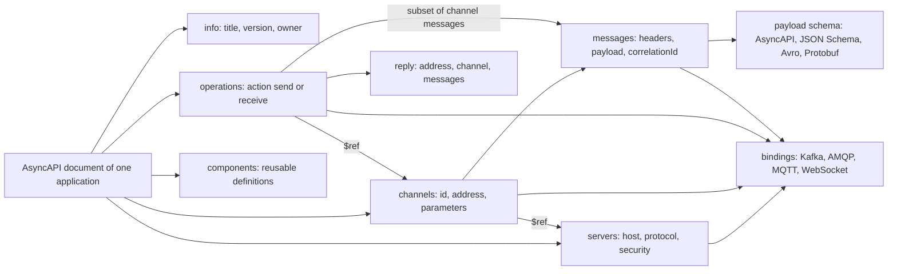
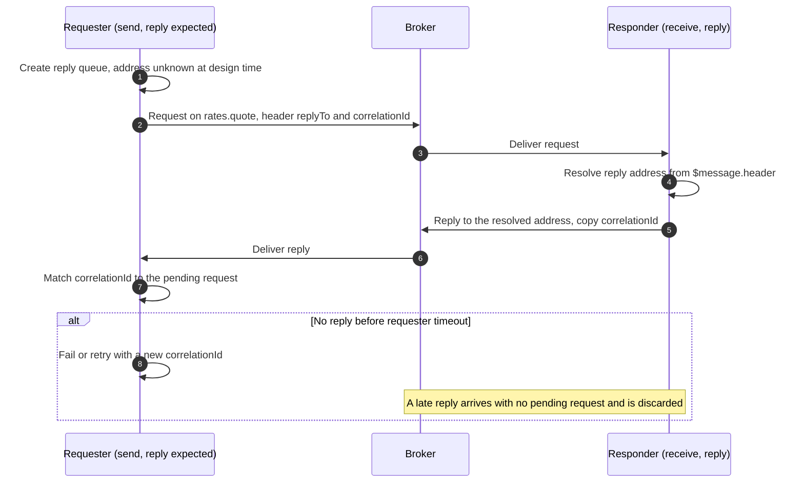
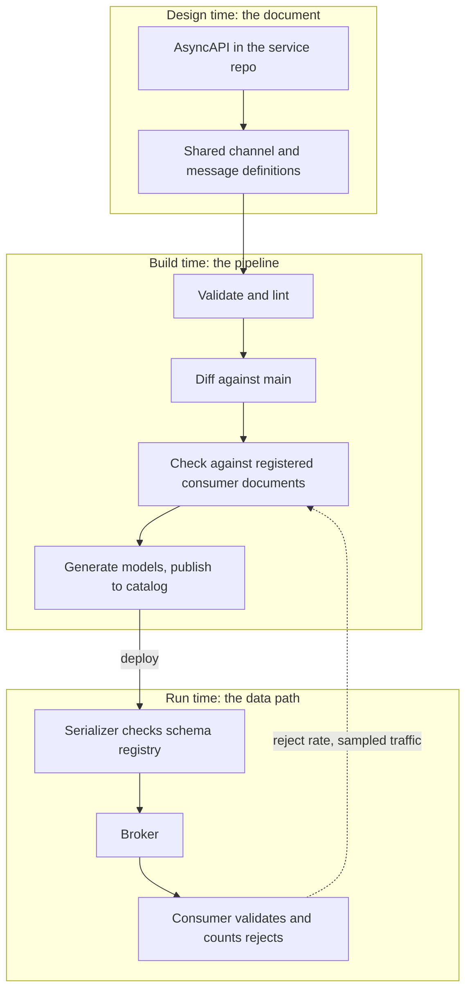
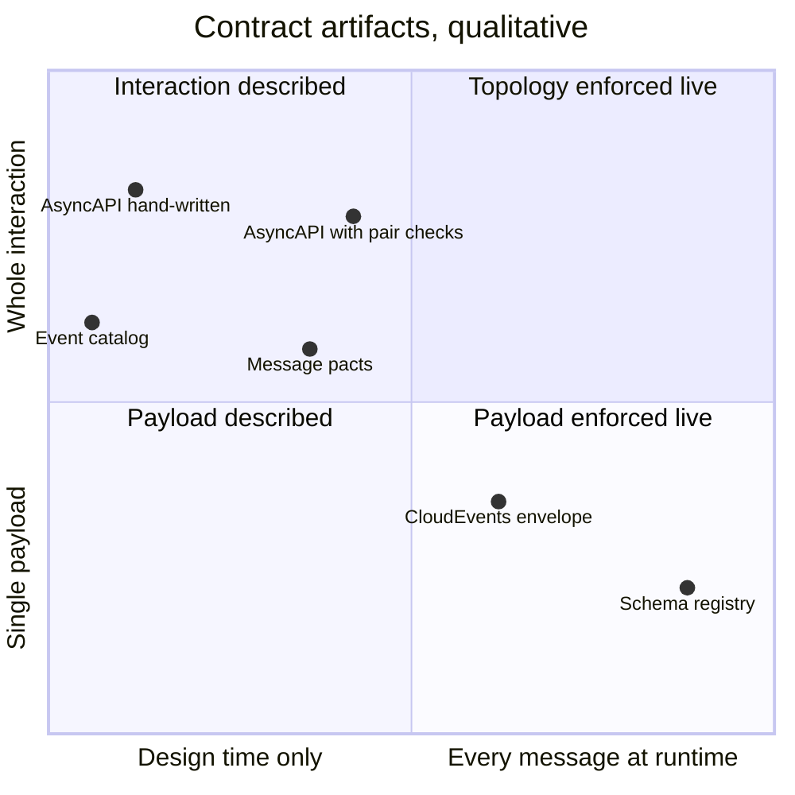

AsyncAPI is a machine-readable specification for describing the messaging interface of one application: the brokers it connects to, the channels (topics, queues, routing keys, WebSocket paths) it uses, whether it sends or receives on each, the structure of every message, and protocol-specific details such as a Kafka consumer group or an AMQP exchange type. It plays the role for message-driven interfaces that OpenAPI plays for HTTP request-response APIs, and it is maintained by the AsyncAPI Initiative under the Linux Foundation. Version 3.0.0 was released in December 2023 and restructured the document model; 3.1.0, released in January 2026, is a minor release that added a protocol binding without breaking changes.

The problem it addresses is that asynchronous contracts are invisible by construction. A broker decouples producers from consumers in time and in knowledge: a producer writes to a topic without knowing who reads it, and a consumer subscribes without the producer's permission. That decoupling is the point of messaging, and it is also why nobody can answer three questions from the running system alone: which applications depend on this topic, what exactly is allowed inside a message on it, and who breaks if a field disappears. In an HTTP API a breaking change fails the caller's request immediately and visibly; in a messaging system it is accepted by the broker, stored, and fails later inside a consumer the producer never heard of, often as a stream of messages diverted to a [dead letter queue](/distributed-systems/en/communication/async-messaging/dlq-poison-messages/) or as a partition stuck behind one record it cannot parse.

The core trade-off is that a contract document buys discoverability, code generation, and pre-deployment compatibility checks at the price of a second source of truth that drifts from the code unless something forces them to agree. An AsyncAPI document describes structure; it does not enforce anything at runtime, does not state delivery semantics, ordering, or retention unless someone writes them in prose or extensions, and describes one application's view rather than the topic as a whole. Its value is therefore proportional to the machinery around it: generated from or verified against code, diffed in CI against the consumers that actually exist, and backed on the wire by a [schema registry](/distributed-systems/en/communication/async-messaging/schema-evolution-registry/) or broker-side validation.

## The Document Model: Servers, Channels, Messages, Operations

An AsyncAPI document is written from the perspective of one application. It does not describe "the orders topic"; it describes what the payments service does with the orders topic. Each team owns the document of its own application, and the system-wide picture is assembled by joining documents on the channels they share.


*Object graph of an AsyncAPI 3.x document. Operations point at channels; channels own messages and optionally restrict themselves to servers; bindings attach protocol detail at every level.*

Four object types carry the contract. A server names a broker or endpoint by `host`, `pathname`, and `protocol`, together with its security schemes. A channel is a named destination: its map key is an arbitrary identifier used only for references inside documents, while its `address` is the string the broker actually sees, such as a Kafka topic name, an AMQP routing key, or a WebSocket path. Addresses can be templated with parameters written in curly braces, as in `orders.{region}.placed`, and a null or absent address means the address is unknown at design time, which happens for reply queues created per client. A channel owns the set of messages that may appear on it. A message has optional `headers` and `payload` schemas, a `contentType`, an optional correlation identifier location, and examples. An operation is the only object that says what the application does: it carries an `action` of `send` or `receive`, a reference to one channel, and optionally the subset of that channel's messages it handles. The specification requires that subset to be drawn from the messages defined on the referenced channel, so an operation cannot introduce a message type the channel does not admit.

The arrows in the diagram matter more than the boxes. Because operations reference channels rather than containing them, the same channel definition can be shared across documents: the producer's document says `send` on it, each consumer's says `receive`, and all three point at one definition of the address and its messages. That shared definition is the seam where a cross-team contract lives, and it is the reason the 3.x model replaced the 2.x one.

### Why Version 3 Separated Operations From Channels

In AsyncAPI 2.x, operations lived inside channels as `publish` and `subscribe`, and they were read from the perspective of the client, not the application: a `publish` operation in the payments service's document meant that others publish to this channel and payments consumes it. Teams routinely read it the other way round, and the inversion propagated into generated code, catalogs, and diagrams that drew arrows backwards. Channels were also keyed by their address, so a channel could carry one operation of each kind and could not be reused across documents with different roles.

Version 3 removed the ambiguity rather than documenting it better. `action: send` means this application sends; `action: receive` means it receives; there is no implied observer. The channel key became an opaque identifier and the address moved into its own field, so renaming a topic no longer renames every reference to it. Messages moved into channels as a keyed map, which made the message identifier its key. All references became explicit `$ref` pointers, and trait merging was reversed so that a property on a trait must not override the same property on the object it is applied to. The AsyncAPI CLI's `convert` command performs the migration; done by hand, the flip is where a wrong document appears, since a 2.x `publish` operation becomes a `receive`.

```yaml
asyncapi: 3.0.0
info:
  title: payments-service
  version: 2.3.0
channels:
  orderPlaced:                          # channel ID: stable name used by $ref
    address: 'orders.{region}.placed'   # what the broker actually sees
    parameters:
      region:
        enum: [eu, us]
    messages:
      orderPlaced:
        $ref: './shared/orders/order-placed.yaml'
operations:
  consumeOrderPlaced:
    action: receive                     # this application consumes
    channel:
      $ref: '#/channels/orderPlaced'
    bindings:
      kafka:
        groupId: { type: string, enum: [payments] }
```

The message definition is referenced from a shared location, not written inline, so the producer of `orderPlaced` and every consumer read the same schema file. The Kafka binding records the consumer group, which turns the document into something a platform can join against broker metadata: the group `payments` reading `orders.eu.placed` in the cluster can be matched to this operation.

### Payload Formats and Protocol Bindings

A message payload defaults to the AsyncAPI Schema format, a superset of JSON Schema, but the payload can instead be a multi-format schema object that pairs a `schemaFormat` media type with the schema in that format. Avro (`application/vnd.apache.avro;version=1.9.0`) and Protobuf (`application/vnd.google.protobuf;version=3`) are the common cases in Kafka estates, where the binary schema already exists in a registry. Protobuf schemas must be embedded as a complete string because `$ref` cannot point inside them, which is one reason teams with Protobuf contracts often reference the `.proto` file from documentation rather than duplicating it.

Bindings carry protocol detail that the protocol-neutral core cannot express. The Kafka binding, at version 0.5.0, describes a server's schema registry URL and vendor, a channel's topic name, partition count, replica count, and topic configuration such as `cleanup.policy` and `retention.ms`, an operation's `groupId` and `clientId`, and a message's `key` schema together with where the schema identifier travels, in a header or in the payload (`schemaIdLocation`), and how the schema is looked up. Bindings are descriptive. Declaring `partitions: 12` in a document creates nothing and checks nothing; a platform that wants the document to govern topic configuration has to read the binding and reconcile the cluster against it, the same way an infrastructure-as-code tool reconciles declared and actual state.

### Request and Reply Over a Broker

Version 3 added an explicit model for request-reply, the pattern in which a requester sends a message carrying a return address and a correlation identifier and waits for a response on that address, described as the Return Address and Correlation Identifier patterns in Hohpe and Woolf's *Enterprise Integration Patterns*. An operation can carry a `reply` object naming the reply channel and its messages, and a reply address can be resolved at runtime from the request itself with a runtime expression such as `$message.header#/replyTo`. The message's `correlationId` object points to where the identifier lives, for example `$message.header#/correlationId`.


*Request-reply as AsyncAPI 3 describes it. The reply channel has a null address in the document because the responder learns it from each request at runtime.*

Steps 4 and 5 are what the runtime expression describes: the responder does not know the reply address when its document is written, only where in each request to find it. The document therefore states a rule ("the reply goes wherever the request's `replyTo` header says") rather than a destination, and the correlation identifier location states how the requester tells concurrent replies apart. The alternate branch is not in the document at all. Timeouts, retry policy, and what happens to a late reply are behavior, and AsyncAPI has no field for them; they belong in the operation's description or in a specification extension, and the failure modes of request-reply over a broker (the reply queue disappearing with the requester, duplicate replies after a retried request) are the same as for any at-least-once flow, covered in [delivery semantics](/distributed-systems/en/communication/async-messaging/delivery-semantics/). The `correlationId` here pairs a reply with its request and is unrelated to the trace identifiers of [distributed tracing](/distributed-systems/en/observability/logs-metrics-traces/distributed-tracing/); a message usually carries both.

## What a Contract Can Guarantee, and What Keeps It True

The safety property a messaging contract protects can be stated precisely. For every channel, let the producer's message set be every message any deployed version of any sending application can emit on it, and the consumer's accepted set be every message a deployed version of a receiving application can process without error. The system is structurally safe when, for every sender-receiver pair on the channel and every pair of versions running at the same time, the producer's set is contained in the consumer's. Messages persist, so "running at the same time" includes old messages still retained on the channel: a consumer that is redeployed and replays seven days of history must accept everything produced during those seven days, not only what the current producer emits.

An AsyncAPI document gives each side of that inclusion a written form. The sender's payload schema describes its message set, and the receiver's schema describes what it accepts. The guarantee then holds only if three conditions hold together, and the document by itself supplies none of them.

The first condition is fidelity: the document must describe what the code does. A schema that says a field is required while the code stopped populating it last month proves nothing. Fidelity comes from generating the document from code (annotation scanners exist for Spring and .NET, among others), from generating code from the document (typed models via the AsyncAPI generator or Modelina), or from verifying recorded traffic against the document. A document that is written by hand and checked by nothing has no fidelity guarantee at all.

The second condition is a compatibility check across the pairs that actually exist. Comparing a producer's new document with its previous version is sound only under an assumption about consumers. If the new message set is a subset of the old one, the change is safe for every consumer that accepted the old set, by transitivity. If the change adds anything, a new optional field or a new enum value, it is safe only for consumers that tolerate unknown content, and the producer's document cannot say whether they do. JSON Schema's default of allowing additional properties describes an open set; the consumer's deserializer, configured to fail on unknown properties, may implement a closed one. The general rules for which changes are compatible in which direction are developed in [API Versioning Strategies](/distributed-systems/en/communication/synchronous-protocols/api-versioning/) and, for serialized schemas with registry-enforced modes, in [Schema Evolution and Schema Registry](/distributed-systems/en/communication/async-messaging/schema-evolution-registry/).

The third condition is runtime enforcement for whatever the first two missed: a producer deployed without passing the pipeline, a script publishing test data to a production topic, a library upgrade that changes serialization. Only something on the data path can stop those messages, which is the job of a schema registry checked at serialization time or of broker-side validation where the broker supports it.


*Three enforcement layers. The document is only the first; the guarantee comes from the build-time pair check and the runtime gate, with runtime evidence feeding back into the checks.*

Design time catches nothing on its own; it produces the artifact the later stages consume. The build stage catches breaking changes for consumers whose documents it can see, which is why step B3 is separate from B2: diffing a document against its own history answers "did this producer change?", while checking it against registered consumer documents answers "does anyone who reads this channel break?". The runtime stage is the only one that sees every producer, including those that bypassed the pipeline. The dotted edge closes the loop: consumer-side reject counts and sampled traffic validated against the document are the only evidence that the document still describes reality, and without that feedback fidelity is an assumption.

### What the Document Does Not Say

Several properties a consumer depends on have no first-class field. Ordering guarantees (per key, per partition, none), the [delivery guarantee](/distributed-systems/en/communication/async-messaging/delivery-semantics/) and whether duplicates should be expected, the idempotency key a consumer should deduplicate on, retention and therefore how far back a replay can reach, expected rate and burst size, and the meaning of each field all fall outside the schema. Some of these can be carried by bindings (Kafka topic retention, partition count), the rest by descriptions or by `x-` specification extensions that the organization defines and its tooling reads. An extension such as an ordering key or a deduplication key is useful exactly to the extent that a linter enforces its presence and a generator or test uses its value.

:::danger[A schema-compatible change can still corrupt data]
Changing `amount` from integer cents to integer euros, reusing an enum value with a new meaning, or switching a timestamp from UTC to local time passes every schema check, every diff, and every registry compatibility mode, because the type is unchanged. Consumers keep processing and write wrong values into their own stores. Treat any change to a field's unit, reference frame, or meaning as breaking by policy: add a new field or a new message version, and keep the old one populated until every consumer has moved.
:::

### Worked Example: Drift and the Cost of a Missed Break

Assume a platform of 40 services sharing 120 channels, with on average one producer and three consumers per channel. All numbers in this example are illustrative.

Start with fidelity. Suppose each service changes a message shape three times a month and, with hand-written documents, the author forgets the document 15% of the time. The fleet accumulates `40 * 3 * 0.15 = 18` undocumented changes per month. For a single service, the probability that its document is still fully accurate after six months is `0.85^18`, about 5.4%. After half a year, nineteen in twenty hand-written documents are wrong somewhere, and nobody knows which. With generated documents, drift falls to the rate at which the generator itself misses something, typically a field set through reflection or a header added by a library, which the runtime feedback loop is there to catch.

Next, the pair check. 120 channels with three consumers each give 360 producer-consumer pairs. During a rolling deploy two versions of each side can be live, so a complete check over one channel's pairs is up to `3 * 2 * 2 = 12` schema comparisons, and a fleet-wide sweep is at most `360 * 4 = 1,440`. Each comparison is a schema-subsumption test that runs in milliseconds; the cost of the check is not computation but having every consumer's document available and current, which is an organizational property.

Finally, the cost of not checking. Suppose the orders producer renames `amount` to `totalAmount` on a channel carrying 800 messages per second, and two of its three consumers fail on the missing field. If detection relies on a dead-letter alert that fires after five minutes and triage takes another 25, the exposure is 30 minutes, or `800 * 1,800 = 1,440,000` failed messages per affected consumer. On a [partitioned log](/distributed-systems/en/communication/async-messaging/kafka-architecture/) where the consumer blocks instead of dead-lettering, the same number appears as lag. Once the producer is rolled back and the consumers can process again, a consumer with a maximum throughput of 3,000 messages per second drains the backlog at `3,000 - 800 = 2,200` messages per second net of live traffic, which takes `1,440,000 / 2,200`, about 11 minutes, per consumer, and the replayed messages are processed late with whatever effect lateness has on the business. The same rename caught by the pair check costs one failed pipeline run.

## AsyncAPI Among Its Neighbors

AsyncAPI is often confused with tools covering other slices of the contract problem. What separates them is what each describes and when it can stop a bad message.

| Artifact | What it describes | Enforced when | Blind spot | When to prefer |
|---|---|---|---|---|
| AsyncAPI | One application's channels, roles, message structure, bindings | Build time, if a pipeline diffs and checks it | Runtime; semantics; producers outside the pipeline | Many teams share channels and need discovery, codegen, and pre-deploy checks |
| Schema registry | Versions of one subject's schema and a compatibility mode | Serialization time, every message | Who produces and consumes; channels and topology | Every Kafka or Pulsar estate with binary payloads; complements AsyncAPI |
| OpenAPI webhooks and callbacks | HTTP requests a provider sends to subscribers | Build time | Brokers, topics, consumer groups | Events delivered over HTTP to external subscribers |
| CloudEvents | A common envelope: id, source, type, time, data content type | Wherever producers adopt the SDK | The `data` payload structure; topology | Routing and filtering on metadata across heterogeneous producers |
| Consumer-driven message pacts | Examples a specific consumer relies on, verified against the producer | Producer's CI | Consumers that publish no pact; topology | Few, known consumers whose expectations should gate producer releases |
| Event catalog or developer portal | Aggregated view of documents, owners, and dependencies | Never; it is a view | Anything not fed into it | Discovery and ownership questions at organizational scale |

The rows are layers, not alternatives: a mature estate keeps payload schemas in a registry and references them from AsyncAPI documents, generates the catalog from the documents, and adds message pacts only where a consumer's exact expectations are business-critical. The consumer-driven approach is covered in [Consumer-Driven Contract Testing](/distributed-systems/en/communication/api-gateway/contract-testing/), the HTTP side in [OpenAPI / Swagger](/distributed-systems/en/communication/api-gateway/openapi-swagger/), and the test strategy for asynchronous flows as a whole in [Testing Event-Driven Systems](/distributed-systems/en/deployment/distributed-testing/testing-event-driven/).


*Qualitative positions. Nothing sits in the upper right: no common tool enforces the whole interaction on every message.*

The empty upper-right quadrant is the point of the chart. Interaction-level contracts (who sends what to whom) are checked before deployment and message-level contracts at runtime; nothing mainstream checks "may this application send this message on this channel" on every message, apart from broker ACLs, which check identity and destination but not content. Pair checks and runtime sampling move AsyncAPI rightward; they never reach the right edge.

## Producing, Checking, and Publishing Documents

Two workflows produce documents, and they fail differently. Code-first generates the document from annotations or framework metadata at build time, so fidelity is high for whatever the scanner can see, but the document arrives after the design decision and tends to describe implementation accidents (a Java class name as a message name, internal headers) as contract. Document-first writes the document, reviews it as the design artifact, and generates typed models and client stubs from it, so the contract is deliberate, but fidelity depends on the generated code actually being used for every message on the wire. A workable hybrid is document-first for shared channel and message definitions, owned by the producing team in a shared repository, and code-first for each application's operations, so that the part most likely to drift (which application does what) is derived and the part that needs deliberate review (message structure) is designed.

The AsyncAPI CLI provides the pipeline steps. `validate` runs structural validation and the parser's rule set, with `--fail-severity` deciding whether warnings fail the build. `diff` compares two documents and classifies each change as breaking, non-breaking, or unclassified using a preconfigured standard keyed by document location, with overrides per JSON pointer for organizations whose policy differs. `bundle` resolves references into one file for catalogs and generators, and `generate models` emits typed payload classes in a dozen languages.

```shell
# Structural and rule validation; fail CI on warnings as well as errors
asyncapi validate asyncapi.yaml --fail-severity warn
# Compare with the copy on main; exits non-zero on breaking changes
asyncapi diff main-asyncapi.yaml asyncapi.yaml --type breaking --format md
# Reclassify changes by JSON pointer to match local policy
asyncapi diff main-asyncapi.yaml asyncapi.yaml --overrides diff-policy.json
# Resolve every $ref into one file for the catalog and generators
asyncapi bundle asyncapi.yaml -o dist/asyncapi.yaml
# Typed payload models from the same bundled document
asyncapi generate models typescript dist/asyncapi.yaml -o src/contracts
```

`diff` compares one document with another; it does not know which other applications read the channel, so it implements condition two only for changes that are breaking regardless of consumer. The pair check against registered consumer documents is something a platform builds on top: collect bundled documents into a registry or catalog (Backstage models AsyncAPI as an API entity type, and EventCatalog imports AsyncAPI documents), join operations on server and channel address, and for each sending operation whose message changed, run the compatibility check against each receiving operation's schema.

Joining on address is less trivial than it looks. Addresses are templates, so `orders.{region}.placed` in one document must match `orders.eu.placed` in another; environments often prefix topic names, so the address in the document is not the topic in the cluster unless the convention is encoded; and an application that subscribes by pattern (a Kafka regex subscription, an AMQP topic binding with wildcards) consumes channels it never names. The join should be checked against broker metadata (consumer groups and their assigned topics, queue bindings) so that a consumer missing from the documents shows up as an unexplained group rather than as nobody.

:::caution[Tooling support for version 3 is uneven]
The AsyncAPI parser and CLI support 3.x, but not every tool around them does. Stoplight Spectral's built-in AsyncAPI ruleset has an open feature request for 3.0 support, and the AsyncAPI parser's own rule set for v3 is smaller than for v2. A pipeline that hands a 3.x document to a tool that only understands 2.x may reject it or validate far less than it appears to. Check, per tool, which specification versions it actually validates before relying on a green build.
:::

Shared definitions should be referenced by immutable version. A `$ref` to a URL on a main branch makes builds non-reproducible and lets a change in the shared repository alter the contract of every referencing service without any of them being rebuilt, reviewed, or diffed. Pin references to a tag or commit, or vendor the bundled shared definitions into each repository and update them through the same review flow as a dependency upgrade.

## Failure Modes of Asynchronous Contracts

Contract failures present as consumer errors, dead-letter growth, lag, or a topic deleted because a catalog said nothing used it.

### Breaking Change Passed by a Per-Document Diff

Trigger: a producer changes a message in a way its own diff classifies as safe, for example adding a value to an enum or tightening a string format, and a consumer whose code treats the enum as closed or parses the old format fails. Symptoms: consumer exceptions and dead-letter growth starting at the producer's deploy, isolated to some consumers. Detection: per-consumer deserialization and validation failure counters, dead-letter queue ingress rate, consumer lag on the affected channel, all correlated with the producer's deploy marker.

```mermaid
sequenceDiagram
    autonumber
    participant CI as Producer CI
    participant P as Orders producer v2
    participant B as Broker
    participant C1 as Billing consumer
    participant C2 as Fulfilment consumer
    CI->>CI: asyncapi diff v1 v2, enum value added, not breaking
    CI->>P: Deploy v2
    P->>B: OrderPlaced with status PARTIAL
    B->>C1: Deliver, tolerant reader ignores unknown status
    B->>C2: Deliver, strict enum mapping throws
    rect rgb(70, 40, 40)
    Note over C2,B: Each retry fails the same way, messages go to DLQ or block the partition
    C2->>B: Nack or no commit
    B->>C2: Redeliver, fails again
    end
    Note over CI,C2: The pair check against C2's document would have flagged it before step 2
```


*An illustrative break that a producer-only diff accepts. Steps 1 and 2 pass every check that looks at one document; step 5 is where the contract was actually violated.*

The diff in step 1 was correct about the producer: adding an enum value enlarges the message set without removing anything. It was silent about the consumer, whose accepted set was closed. The failure is deterministic, so the redeliveries in steps 6 and 7 only multiply load; this is a poison-message pattern, handled in [Dead Letter Queues and Poison Message Handling](/distributed-systems/en/communication/async-messaging/dlq-poison-messages/). Mitigation: roll back the producer or deploy a consumer that maps unknown values to a fallback, then redrive the dead-lettered messages. Prevention: declare in policy that enum additions are breaking unless consumer documents mark the field as open, and run the pair check.

### Silent Drift Between Document and Code

Trigger: code changes a message and the document is not updated, or the document is generated from a class that no longer matches the bytes on the wire because a custom serializer or a library adds fields. Symptoms: none until someone builds against the document, at which point a new consumer written from the documentation fails on real traffic. Detection: validate a sample of production messages per channel against the bundled document and alert on the mismatch rate; compare the document generated in CI with the committed one and fail on difference. Mitigation and recovery: regenerate, review the diff as if it were a contract change (it is one, already shipped), and notify consumers built in the interval.

### Topology Gaps and the Unused Topic That Was Not

Trigger: the catalog built from documents shows a channel with a producer and no consumers, because the consumer has no document, subscribes by pattern, or uses a prefixed topic name that the join does not resolve. Someone retires the channel. Symptoms: a consumer starves silently, or fails on a missing topic, often days later in a batch or reconciliation job. Detection: reconcile documented receivers against broker consumer groups and queue bindings; any group with committed offsets on a channel that has no documented receiver is a gap. Mitigation: require broker-metadata confirmation (no consumer group activity for the full retention window) before deleting any channel, regardless of what the catalog says.

### Remote Reference Changed Under Running Builds

Trigger: shared message definitions are referenced by a mutable URL and the owning team edits them. Symptoms: unrelated services' generated models change on their next build, sometimes breaking compilation, sometimes changing serialization without anyone reviewing it. Detection: bundled-document hash changing without a change in the service's own files. Mitigation: pin references to immutable versions as described above, and treat a shared-definition release as a producer change subject to the pair check.

### Summary of Failure Signatures

| Failure | Symptom from outside | Detection signal | Mitigation |
|---|---|---|---|
| Break passed by per-document diff | Some consumers fail after a producer deploy | Per-consumer validation failures and DLQ rate aligned with deploy | Pair check against consumer documents; policy for enum and format changes |
| Document-code drift | New consumers fail on real traffic | Sampled message validation against the document; generated vs committed diff | Generate from code or verify traffic continuously |
| Semantic change | No errors; wrong values downstream | Reconciliation jobs, business metric shifts | Treat unit and meaning changes as breaking; new field or version |
| Topology gap | Consumer starves after channel retired | Consumer groups with no documented receiver | Broker-metadata reconciliation before deletion |
| Mutable remote reference | Unreviewed model changes across services | Bundle hash changes without local edits | Pin references; release shared definitions as versions |
| Version skew between tools | Green validation that checked little | Tool's supported spec version vs document's | Verify per-tool support; fail on unsupported versions |

## When AsyncAPI Pays Off

Adopt AsyncAPI when channels are shared across team boundaries and producers do not know their consumers, which is the normal state of an event-driven estate past a few teams; when external parties subscribe to your event streams or WebSocket channels and need a published interface; when the same messages are consumed from several languages and generated models remove a class of serialization bugs; or when a platform team needs an inventory of who sends and receives what for ownership, access control, and impact analysis. In each case, budget for the machinery around the document, not only the document.

Do not adopt it as a documentation exercise with no pipeline behind it; by the arithmetic above, the documents will be wrong within months, and a wrong contract misleads more than a missing one. Do not use it to replace a schema registry; the document gates deploys that go through the pipeline, and the registry gates every message. Do not expect it to pay off when one team owns a channel's producer and all its consumers in one repository, where shared types checked by the compiler give the same guarantee for less. It describes poorly the systems whose channels are created dynamically and without bound, such as one topic per user or per tenant, where a parameterized address documents the shape but no catalog can join or audit the instances. And it is not the place to model the workflow across many messages; sagas and process managers are covered in [the Saga pattern](/distributed-systems/en/coordination/distributed-transactions/saga-pattern/), while AsyncAPI describes each hop of such a workflow separately.

Versioning events kept as long-lived stored history, with upcasting and replay, is covered in [Event Versioning and Schema Evolution](/distributed-systems/en/microservice-patterns/event-sourcing-cqrs/event-versioning/); the queue-or-log choice that a document's bindings merely record is made in [Message Queue vs. Event Streaming](/distributed-systems/en/communication/async-messaging/message-queue-vs-event-streaming/).

:::tip[Start from the broker, not the documents]
On an estate that already runs without contracts, generate a first inventory from broker metadata (topics, consumer groups, queue bindings) and only then ask teams to write or generate documents for the channels that appear in it. The inventory exposes the shared channels with the most consumers, which is where the pair check pays off first, and it gives the reconciliation baseline that later catches documentation gaps.
:::

## Further Reading

- AsyncAPI Initiative, *AsyncAPI Specification 3.1.0*, asyncapi.com, 2026.
- AsyncAPI Initiative, *Migrating to AsyncAPI v3*, asyncapi.com documentation, 2023.
- AsyncAPI Initiative, *Kafka Bindings*, asyncapi.com bindings reference (binding version 0.5.0).
- Gregor Hohpe and Bobby Woolf, *Enterprise Integration Patterns*, Addison-Wesley, 2003.
- CNCF Serverless Working Group, *CloudEvents Specification*, Cloud Native Computing Foundation.
- Martin Kleppmann, *Designing Data-Intensive Applications*, O'Reilly, 2017 (chapter 4, Encoding and Evolution).
