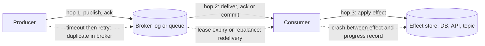
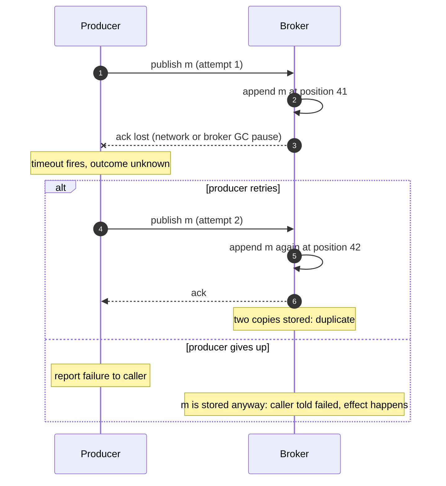
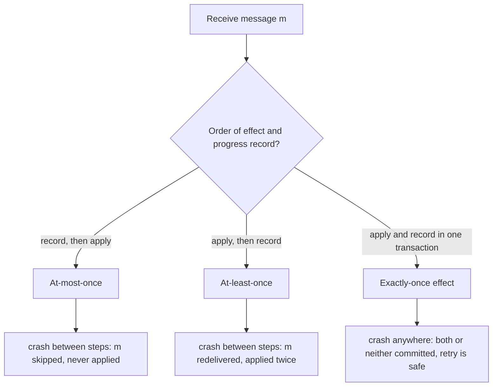
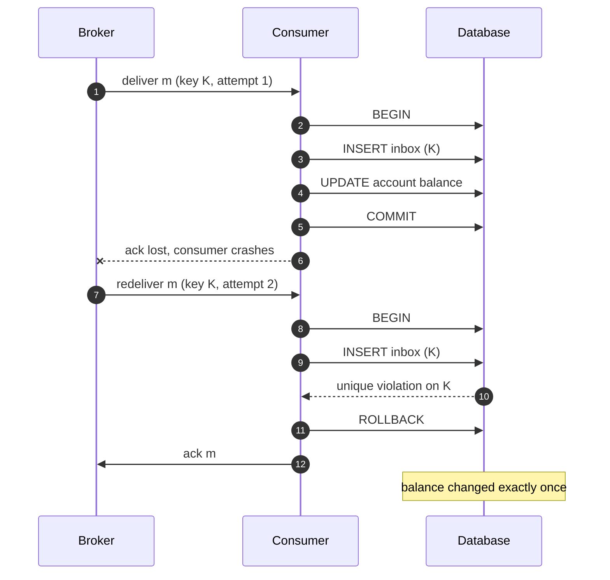
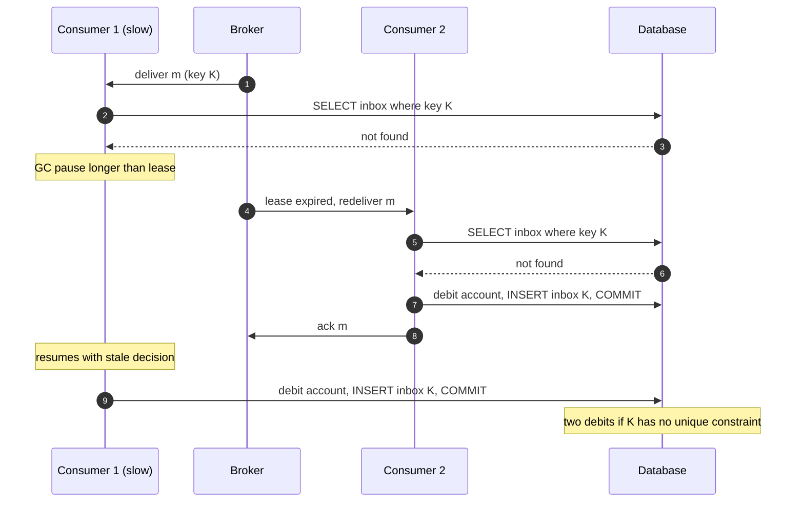

A delivery guarantee states how many times a message's effect can occur for each message the producer intended to send: at most once (zero or one), at least once (one or more), or exactly once. The guarantee is a property of the whole path, from the producer's decision to send to the durable effect at the consumer, and it is set by the weakest step on that path. A broker that never loses a stored message does not give at-least-once end to end if the producer gives up after one timeout, and a broker that deduplicates publishes does not give exactly-once if the consumer applies an effect and crashes before recording it.

The problem that forces a choice is that acknowledgements travel over the same unreliable network as messages. A sender whose request times out cannot tell whether the request was lost, the receiver crashed before acting, the receiver acted and crashed before replying, or only the reply was lost. It has two options: resend, and risk doing the work twice, or do not resend, and risk not doing it at all. No protocol over a lossy channel with crash-recovery processes removes this choice; it can only move where the choice is made and who pays for it.

The core trade-off is therefore between loss and duplication, and then between the cost of tolerating duplicates and the cost of suppressing them. At-most-once is cheap and loses messages under failure. At-least-once loses nothing and delivers duplicates under failure. Exactly-once, as a property of effects rather than of delivery, is at-least-once plus a deduplication step whose state must be committed atomically with the effect; it costs a write per message, a store sized by how late a duplicate can arrive, and a coupling between the message system and the system that holds the effect. Vendors that advertise exactly-once delivery provide that deduplication inside a boundary they control, and the guarantee ends at that boundary.


*The three hops of a message's life and the event on each hop that turns an ambiguous outcome into either loss or duplication.*

Each dashed edge is a separate source of duplicates, and each needs its own defense. Hop 1 duplicates come from producer retries after an acknowledgement is lost; they are two distinct records in the broker, often with different broker-assigned identifiers. Hop 2 duplicates come from the broker redelivering a message whose acknowledgement it never received, which the [queue lease model](/distributed-systems/en/communication/async-messaging/message-queue-vs-event-streaming/) and the [Kafka offset commit](/distributed-systems/en/communication/async-messaging/kafka-architecture/) both do by design. Hop 3 is where the guarantee is actually decided: the consumer performs a side effect in a system the broker knows nothing about and then records its progress in the broker, and those two writes are not atomic unless the design makes them so. A guarantee on hop 1 or hop 2 alone says nothing about hop 3.

## The Acknowledgement Dilemma: Why Delivery Cannot Be Exactly Once

The impossibility is a direct consequence of the [crash-recovery failure model](/distributed-systems/en/foundations/system-models/failure-models/) combined with a lossy channel, and it is worth stating precisely because vendor terminology blurs it. Consider a broker delivering message `m` to a consumer that will perform an effect and then acknowledge. The broker observes only two things: whether an acknowledgement arrived, and when. Now compare two executions. In the first, the consumer crashes after receiving `m` and before performing the effect. In the second, the consumer performs the effect and crashes before the acknowledgement leaves the machine (or the acknowledgement is lost on the network). From the broker's side the two executions are identical: `m` was sent, no acknowledgement arrived, the lease expired. Any rule the broker applies must treat them the same. If it redelivers, the second execution performs the effect twice. If it does not redeliver, the first execution never performs it. No timeout value, retry count, or acknowledgement scheme separates the two cases, because the information that distinguishes them lives only in the consumer's crashed process and in the effect store.

This is the same structure as the Two Generals problem, first described by Akkoyunlu, Ekanadham, and Huber in 1975 and named by Jim Gray in 1978: two parties communicating over a channel that can lose messages cannot reach common knowledge that a message was received, because the last message of any finite protocol might be the one that was lost, and its sender cannot know whether to act. Adding acknowledgements of acknowledgements only moves the uncertainty to the last message. Exactly-once delivery, in the sense of "the consumer's handler is invoked exactly once for each message, across crashes", is therefore unachievable. Exactly-once effect is achievable, because the effect store can hold the missing information: whether `m` was already applied.


*The ambiguous publish. After step 3 the producer cannot know whether position 41 exists, so both branches are wrong in some execution.*

The diagram shows hop 1, but the shape repeats on every hop. In step 3 the broker has stored the message; the producer cannot learn that. The retry branch produces a duplicate at position 42 that is indistinguishable from a legitimate second message unless the record carries an identity the broker can compare. The give-up branch is worse than it looks: the caller is told the publish failed and may compensate or report an error to a user, while the message is in fact stored and will be processed. "At-most-once" on a producer is therefore not "no duplicates and possible loss" from the caller's perspective; it is "possible loss, and an error report that may be false".

### Three Guarantees as Three Orderings

On the consumer side, every message goes through three steps: receive it, apply its effect, and record progress (acknowledge to a queue, commit an offset, advance a checkpoint). The guarantee is decided by the order of the last two steps and by whether they can be made one atomic step.


*The consumer's guarantee is the order of its two writes. Only the third branch closes the window, and it requires both writes to land in one store or one transaction.*

Recording progress first is at-most-once: a crash after the commit and before the effect loses `m`, and nothing will retry it, because the progress record says it is done. Applying first is at-least-once: a crash after the effect and before the record causes redelivery, and the effect happens again. The third branch is the only one with no window, and it is available only when the progress record and the effect can share a transaction. That is the case when the consumer stores its own progress in the same database as its effect (the offset or the message identifier is written in the same transaction as the business row), or when the effect is itself a write to the broker that supports transactions covering both the output and the input position, which is what Kafka's transactional read-process-write loop does.

When the effect and the progress record live in different systems, as with a consumer that calls a payment API and then acknowledges an SQS message, the only option is the second branch plus making the effect idempotent at its destination: the payment API must recognize the retry as the same request. This is the end-to-end argument of Saltzer, Reed, and Clark applied to messaging: a guarantee about effects can be implemented completely only at the endpoint that holds the effect, and lower layers can make the endpoint's job cheaper but cannot replace it.

## Building Exactly-Once Effects on At-Least-Once Delivery

The construction has three parts, and each one is necessary. First, delivery is at-least-once: the producer retries until acknowledged, the broker stores durably, and the consumer records progress only after the effect. Second, every message carries a stable identity, a deduplication key that is the same on every copy of the same logical message. Third, the consumer applies the effect and records the key as applied in one atomic step, and that step fails if the key is already recorded.

The deduplication key is the part most often gotten wrong. A broker-assigned identifier such as a log offset, an SQS receipt handle, or a Pub/Sub message ID identifies a stored copy, not the producer's intent: two publish attempts of the same logical event receive two identifiers. A key that suppresses hop 1 duplicates must be assigned by the producer before the first attempt and reused on every retry. The best keys come from the business operation itself (an order ID plus an event type and version, a payment intent ID) because they also survive a producer crash and restart, which a key generated in producer memory does not. A content hash is a key only if two legitimate messages can never have identical content; that assumption fails for events such as "increment counter" or "send reminder" that are legitimately repeated.

### The Inbox: Effect and Marker in One Transaction

When the consumer's effect is a write to a transactional database, the cleanest implementation is an inbox table (also called a processed-messages or deduplication table) with a uniqueness constraint on the key, written in the same transaction as the business change.


*An inbox insert and the business update commit together. The redelivered copy fails on the unique constraint and is acknowledged without a second effect.*

Steps 2 to 5 are one transaction, so after any crash the database holds either both the inbox row and the balance change, or neither. In step 6 the acknowledgement is lost; the broker redelivers in step 7, and the second attempt fails at step 9 because the key is already present. The consumer rolls back and, crucially, acknowledges the message in step 11: a duplicate that is rejected but never acknowledged would be redelivered forever and would eventually be classified as a [poison message](/distributed-systems/en/communication/async-messaging/dlq-poison-messages/).

The correctness argument is short. Take any message `m` with key `K`. Because delivery is at-least-once, `m` is delivered until some attempt is acknowledged, and an attempt is acknowledged only after its transaction committed or failed on the unique constraint; either way a transaction containing `K` has committed. Because the inbox insert and the effect are in one transaction, every committed transaction that contains the effect for `m` also contains the row `K`. Because `K` is unique, at most one such transaction can commit. Therefore the effect of `m` is committed exactly once. The argument depends on three conditions that real designs break: the uniqueness check must be enforced by the database at commit time rather than by a read before the write, both writes must be in one transaction, and the row `K` must still exist when the last duplicate arrives.

```sql
-- Inbox row and business change commit together; a duplicate fails on the PK.
CREATE TABLE inbox (
  message_key  text        PRIMARY KEY,   -- producer-assigned, stable across retries
  received_at  timestamptz NOT NULL DEFAULT now()
);

BEGIN;
INSERT INTO inbox (message_key) VALUES ('order-8812:paid:v1')
  ON CONFLICT DO NOTHING;                 -- 0 rows inserted means duplicate
-- application checks the inserted row count; if 0: ROLLBACK and ack the message
UPDATE accounts SET balance = balance - 4200 WHERE id = 77;
COMMIT;
-- retention job: DELETE FROM inbox WHERE received_at < now() - interval '7 days';
```

The `ON CONFLICT DO NOTHING` form avoids aborting the transaction on a duplicate and lets the application branch on the row count; the plain insert that raises a unique violation is equally correct. A read-then-insert (`SELECT` for the key, then insert if absent) is not equivalent under read committed isolation, as the failure section shows.

### Position Instead of Keys: Deduplication on an Ordered Log

A consumer of a partitioned log has a cheaper option for hop 2 duplicates. Each partition is consumed by a single owner in offset order, so the consumer can store, per partition, the highest offset it has applied, in the same transaction as the effect. On restart or reassignment it reads that offset from its own database and seeks to the next one, ignoring the broker's committed offset. Any redelivered record has an offset at or below the stored one and is skipped. The state is one row per partition instead of one row per message, and it never needs expiry.

This removes only redelivery duplicates. A producer retry creates a new record at a new offset, which the position check accepts. Position-based deduplication must therefore be combined with a duplicate-free hop 1: an idempotent producer for broker-level retries, and a business key for duplicates created above the producer client, such as an upstream service that re-sends after its own timeout. It also requires the single-owner property to hold; two consumers that both believe they own a partition, during a rebalance with a long processing pause, can both pass the position check, so the stored-offset update must be conditional (`UPDATE ... WHERE partition = p AND last_offset < :new`), which turns the stored offset into a [fencing token](/distributed-systems/en/coordination/distributed-locking/fencing-tokens/) against stale owners.

### Naturally Idempotent Effects

Some effects need no deduplication state because applying them twice yields the same state as applying them once. An absolute assignment (`set status = SHIPPED`), an upsert keyed by entity identity, inserting into a set, and a conditional write that carries a version (`set price = 12 where version = 7`, then increment the version) are idempotent. Relative updates (`balance = balance - 42`), appends to a list, sending an email, and calling a non-idempotent external API are not. Idempotence of a single message is not the same as correctness under reordering: two different messages `set status = SHIPPED` and `set status = CANCELLED` are each idempotent, yet applying an old duplicate of the first after the second reverts the entity. Versioned writes solve both problems at once, since a stale or duplicate message carries an old version and is rejected. Idempotency for request/response APIs, including idempotency keys at the HTTP layer and how a server stores and replays responses, is covered in [Idempotency and Safe HTTP Methods](/distributed-systems/en/communication/api-gateway/idempotency/).

### Worked Example: Sizing a Deduplication Store

Assume, for illustration, a payments consumer processing 2,000 messages per second from a log with 24 partitions, writing to a relational database. The consumer commits progress every 5 seconds and is redeployed or rebalanced 20 times a day. The producer sees a publish timeout on 0.05% of sends and retries them.

Duplicate volume first. Daily traffic is 2,000 × 86,400 = 172.8 million messages. Producer retries add up to 0.0005 × 172.8 million = 86,400 hop 1 duplicates per day (an upper bound, since some timed-out first attempts were never stored). Each rebalance replays, on average, half a commit interval of work across the affected partitions: 2.5 s × 2,000 = 5,000 records, so 20 rebalances add about 100,000 hop 2 duplicates. Roughly 186,000 duplicates a day, about 0.1% of traffic. If the effect is a debit, each one is a customer charged twice, so 0.1% is far too high even though it looks small.

Now the two store designs. Position-based deduplication needs 24 rows, updated 2,000 times per second in transactions the consumer already runs; its storage cost is negligible and it removes the 100,000 redelivery duplicates. It does not remove the 86,400 producer duplicates, which have new offsets, so the producer must be idempotent at the broker (Kafka's idempotent producer removes retries within one producer session) and the upstream request must carry a business key that the consumer checks.

A key-based inbox removes both classes. Its size is set by the window: how long after the first copy a duplicate can still arrive. The window must exceed the longest of the producer's total retry duration, the consumer's redelivery horizon (lease timeout or maximum time a partition can sit unacknowledged during an incident), and any replay the operators might perform by resetting offsets. Assume each inbox row costs about 120 bytes including the primary-key index entry (illustrative; a 30-byte key plus row and index overhead). A 24-hour window holds 172.8 million rows, about 21 GB. A 7-day window holds 1.2 billion rows, about 145 GB, and makes every insert an index probe into a structure far larger than memory, which is where the throughput cost appears. The inbox also doubles the write count: 2,000 extra inserts and, from the retention job, 2,000 deletes per second at steady state. Partitioning the inbox table by day and dropping whole partitions instead of deleting rows removes the delete load.

The numbers drive the design choice: on an ordered log with a single writer per partition, position-based deduplication plus an idempotent producer plus a narrow business-key check for upstream retries costs a fraction of a 7-day inbox. On a queue, where there is no position and messages from many producers interleave, a key-based inbox is the only option, and its window is a capacity-planning decision.

## How Real Systems Draw the Boundary

Every system that offers more than at-least-once does it with the same ingredients: a producer-assigned identity, a deduplication state with a window, and an atomic commit inside a boundary. They differ in where the boundary sits, how long the window is, and what happens to a duplicate.

Kafka's idempotent producer, the default since Kafka 3.0 (`enable.idempotence=true`), assigns each producer a producer ID and numbers its batches per partition; the partition leader rejects a batch whose sequence number it has already appended, which removes hop 1 duplicates caused by client retries. The guarantee holds for one producer session: a restarted producer without a `transactional.id` gets a new producer ID, and a message it re-sends after restarting is a new message. Transactions extend the boundary to a read-process-write loop that consumes from Kafka and produces to Kafka, committing output records and input offsets atomically, with `read_committed` consumers seeing only committed output. The mechanism, including producer fencing by epoch and the transaction coordinator, is the subject of [Exactly-Once Semantics in Kafka](/distributed-systems/en/case-studies/apache-kafka/exactly-once-semantics/); for this page the relevant fact is that it covers effects only when the effect is a Kafka write. A consumer that writes to a database inside a Kafka transaction gets no atomicity between the two.

Amazon SQS FIFO queues deduplicate on the send side: a message with the same deduplication ID sent within the 5-minute deduplication interval is not added to the queue again. The ID is either supplied by the producer (`MessageDeduplicationId`) or, with content-based deduplication enabled, derived as a SHA-256 hash of the message body (attributes are excluded). AWS calls this exactly-once processing, but the consumer side remains a lease: a consumer that exceeds the visibility timeout, or deletes the message after the effect and crashes before the delete, causes redelivery. SQS standard queues have no deduplication at all.

Google Cloud Pub/Sub offers exactly-once delivery as a subscription property with a narrowly stated scope: it applies only to pull subscriptions (including StreamingPull), only when subscribers connect in the same region, and it guarantees that a message whose acknowledgement succeeded is not redelivered. Clients must use the acknowledgement-with-response interface to learn whether an ack succeeded; an ack that fails, or arrives after the deadline expired, means the message will be redelivered, and only the newest ack ID of a redelivered message is valid. Publish-side duplicates are outside the guarantee: two publish attempts by the client produce two messages with different IDs. The guarantee therefore removes redeliveries after a successful ack, and leaves the hop 3 window (effect done, ack not yet sent) exactly where it was. Google documents higher publish-to-subscribe latency for such subscriptions.

Azure Service Bus duplicate detection records the application-set `MessageId` for a configurable window, 10 minutes by default, from 20 seconds to 7 days; a duplicate send is reported to the sender as accepted and then dropped. It is available on the standard and premium tiers, and on partitioned entities uniqueness is `MessageId` plus partition key. NATS JetStream deduplicates on the `Nats-Msg-Id` header within a per-stream duplicate window (2 minutes by default) and answers a duplicate publish with the original stream sequence, so the publisher can tell it was a duplicate. The window is held in memory, which bounds how long it can practically be on high-rate streams.

RabbitMQ has no broker-side deduplication in its core. Delivered messages carry a `redelivered` flag, and quorum queues track a delivery count, but both describe broker redelivery, not publisher retries: a message republished after a lost confirm arrives with `redelivered=false` and is still a duplicate. The flag is a hint that a consumer may use to take a slower, checked path, never a deduplication mechanism. Partial routing nacks, which create duplicates on republish, are described on the [RabbitMQ page](/distributed-systems/en/communication/async-messaging/rabbitmq/).

Stream processors move the boundary to a checkpoint. Apache Flink's Kafka sink in exactly-once mode writes output inside Kafka transactions and commits them only when the checkpoint that covers them completes, which is a two-phase commit between the checkpoint and the sink; how checkpoints achieve consistent snapshots is covered in [Apache Flink](/distributed-systems/en/data-processing/stream-processing/apache-flink/). Two consequences follow from the mechanism. Downstream `read_committed` consumers see output only after a checkpoint, so end-to-end latency is at least the checkpoint interval. And a transaction that stays open longer than the broker allows is aborted by the broker; Kafka's `transaction.max.timeout.ms` defaults to 15 minutes, and if a job is down longer than the transaction timeout, the data of the open transaction is lost on recovery, which Flink logs as an error rather than failing.

| Approach | Removes hop 1 duplicates | Removes hop 2 duplicates | Covers external effects | State and window | When to prefer |
|---|---|---|---|---|---|
| At-most-once (record, then apply) | Not applicable | Yes, by losing messages | No | None | Telemetry, metrics, cache invalidation hints where loss is cheaper than a duplicate |
| At-least-once, no dedup | No | No | No | None | Naturally idempotent effects (upserts, absolute sets, versioned writes) |
| Broker send-side dedup (SQS FIFO, Service Bus, JetStream) | Within the window | No | No | Per-message key, minutes to days | Producer retries are the dominant duplicate source and the window covers them |
| Idempotent producer (Kafka) | Within one producer session | No | No | Per-producer sequence, in broker | Always on for Kafka producers; a base layer, not a full guarantee |
| Broker transactions (Kafka read-process-write) | Yes | Yes | Only Kafka writes | Transaction state in broker | Kafka-to-Kafka pipelines, Kafka Streams |
| Consumer inbox with unique key | Yes, within window | Yes, within window | Only writes in the same DB | Per-message key, sized by redelivery horizon | Queue consumers with a transactional DB; mixed producers |
| Consumer-stored log position | No | Yes, no expiry | Only writes in the same DB | One row per partition | Single-owner log consumers with a transactional DB |
| Idempotency key at the external API | Yes, within the API's retention | Yes, within retention | Yes, that API only | Held by the provider | Payments, email, any third-party side effect |

### Settings That Decide the Guarantee

A handful of settings decide which branch of the ordering a system is on, often silently. In Kafka consumers, `enable.auto.commit=true` (the default) commits the position returned by the previous `poll` every `auto.commit.interval.ms`; it is at-least-once only if every record of a poll is fully processed before the next poll, and turns into at-most-once when records are handed to other threads. `isolation.level` decides whether a consumer can see aborted transactional output (`read_uncommitted`, the default) or only committed output. On the producer, `acks=all` and idempotence (both defaults since 3.0) make hop 1 duplicate-free per session; setting `max.in.flight.requests.per.connection` above 5 disables the idempotence guarantee, and explicitly disabling idempotence while keeping retries reintroduces duplicates and reordering. In SQS the visibility timeout must exceed the worst-case processing time, and for FIFO queues the deduplication ID must be stable across retries, which a random ID generated per attempt is not. In Pub/Sub, the exactly-once property is set on the subscription, and the client's minimum lease extension should be raised (Google recommends up to 600 seconds) to avoid acks that expire in transit.

:::tip[Generate the deduplication key where the intent is born]
A key created in the producer process just before publishing protects against producer-client retries and nothing else. If an upstream HTTP caller times out and calls again, the producer creates a second key for the same intent. Derive the key from the business operation that caused the message (the request's idempotency key, the entity ID plus a version, the source row's primary key and change sequence in [change data capture](/distributed-systems/en/data-processing/hybrid-architectures/change-data-capture/)), so that every retry at every layer maps to the same key.
:::

Atomicity on the producer side is a separate problem with the same shape. A service that writes a row to its database and then publishes an event has two writes that can diverge: a crash between them loses the event, and retrying the publish after a timeout duplicates it. The [Outbox Pattern](/distributed-systems/en/coordination/distributed-transactions/outbox-pattern/) writes the event into an outbox table in the same transaction as the row, and a relay publishes it at least once; the consumer-side inbox then turns that into exactly-once effect. Outbox and inbox are the two halves of the same construction, one per side of the broker.

## Failure Modes and Their Signatures

Most delivery-semantics failures are silent at the time they happen: the duplicate charge or the missing order is discovered later by a reconciliation, a customer, or an audit. Detection therefore relies on invariants that can be checked continuously rather than on errors.

### At-Most-Once in Disguise

Trigger: the consumer records progress before the effect without intending to. The typical forms are Kafka auto-commit with asynchronous processing (records handed to a worker pool, poll called again, the previous position committed while the work is still in flight), acknowledging an SQS or RabbitMQ message on receipt "to avoid redelivery", and frameworks whose default acknowledgement mode acknowledges before the handler returns. Symptoms: after a crash or deploy, a small number of messages are never processed, with no error anywhere; lag returns to zero, so dashboards look healthy. Detection: end-to-end counts compared per time bucket between producer and effect store, gaps in per-entity sequence numbers when the producer stamps them, and a test that kills consumers mid-batch and checks counts. Mitigation: commit only offsets of completed records (track completion per partition and commit the lowest contiguous completed offset), acknowledge in the handler's success path, and audit framework acknowledgement modes. Recovery: replay from a known-good offset or from the source of truth into an idempotent consumer.

:::danger[Acknowledging before the effect loses messages silently]
Any path that records progress before the effect is durable converts a crash into permanent loss with no error, no retry, and no dead-letter entry. Auto-commit with a worker pool, acknowledge-on-receive, and a deduplication marker written to a different store before the effect all have this property. If a design has a window in which progress is recorded and the effect is not, it is at-most-once regardless of how the broker is configured.
:::

### Duplicates Arriving After the Window

Trigger: the deduplication window is shorter than the time a duplicate can take to arrive. Common cases are a producer that buffers and retries for longer than the broker's window during an outage, an operator who resets consumer offsets by a day to recover from a bug while the inbox keeps only 24 hours minus the time taken to notice, and a relay that republishes an outbox backlog after a long stall.

```mermaid
gantt
    title Producer outage longer than a 5-minute broker dedup window (illustrative)
    dateFormat HH:mm
    axisFormat %H:%M
    section Producer
    Send K, ack lost              :done, s1, 10:00, 1m
    Broker unreachable, buffering :crit, b1, 10:01, 9m
    Retry K after recovery        :active, r1, 10:10, 1m
    section Broker
    K remembered in dedup window  :w1, 10:00, 5m
    K forgotten                   :crit, f1, 10:05, 5m
    Retry stored as new message   :crit, n1, 10:10, 1m
    section Consumer
    First copy processed          :c1, 10:01, 1m
    Second copy processed         :crit, c2, 10:11, 1m
```


*A retry that outlives the broker's deduplication window is stored as a new message. Every duration here is illustrative.*

The chart shows why a broker window must be compared with the producer's longest retry horizon, not its typical retry delay. At 10:00 the first copy is stored and its acknowledgement is lost. The broker remembers key `K` until 10:05. The producer cannot reach the broker until 10:10, by which time `K` has been forgotten, so the retry is accepted as a new message and processed a second time at 10:11. Nothing in the broker's metrics shows a duplicate, because from the broker's point of view there was none. Symptoms: duplicate effects clustered after outages and replays rather than spread evenly. Detection: a consumer-side check that logs (rather than suppresses) business keys already seen in a longer-lived store, and a metric on producer retry age at send time. Mitigation: bound producer retry duration below the window and drop or dead-letter older sends for manual handling, or keep a consumer-side inbox whose window covers replays, as in the worked example. Recovery: identify duplicates by business key in the effect store and compensate.

### Check-Then-Act Deduplication and Zombie Consumers

Trigger: the deduplication check is a read followed by a write instead of a constraint enforced at commit, and two attempts for the same key overlap. Overlap happens whenever a consumer's lease expires while it is still working: the broker redelivers to a second consumer, and both are now processing the same message.


*A zombie consumer acting on a check it made before its lease expired. Only a uniqueness constraint evaluated at commit stops step 11.*

Both consumers read "not found" because neither had written yet (steps 2-3 and 6-7). Consumer 2 commits in step 8. Consumer 1 resumes after its pause in step 10 and commits a second debit in step 11; if `K` has no unique constraint, or the inbox write is in a different transaction from the debit, the effect happens twice. With a primary key on `K` and both writes in one transaction, step 11 fails and rolls back the debit. Symptoms: duplicates correlated with long GC pauses, slow downstream calls, or lease-expiry metrics (SQS `ApproximateAgeOfOldestMessage` spikes with receive counts above 1, RabbitMQ consumer timeouts, Kafka rebalances caused by `max.poll.interval.ms`). Detection: count unique-constraint violations on the inbox as a metric; a steady nonzero rate is expected, a spike marks overlapping attempts. Mitigation: enforce uniqueness in the database, keep both writes in one transaction, and size leases above worst-case processing time. For effects outside the database, pass a fencing token or version with the write so that the destination rejects the stale attempt.

### Deduplication Key That Is Not a Key

Trigger: the key does not identify the logical message. A broker-assigned ID changes per publish attempt, so it misses hop 1 duplicates; a random UUID generated per attempt has the same flaw; a content hash merges legitimately distinct messages with identical bodies. SQS content-based deduplication is a common case of the last one: two genuine "send reminder to user 7" messages within 5 minutes collapse into one, and the second is lost without error. Symptoms: either duplicates that the dedup layer claims to remove, or rare missing messages with identical payloads. Detection: compare the inbox's unique-violation count with the producer's retry count; they should be of similar magnitude. Mitigation: define the key in the event contract, include an event version or sequence in it, and document which fields form it.

### Non-Idempotent External Effects

Trigger: the effect is a call to a system outside the consumer's transaction, such as sending email, charging a card, or calling a partner API, and the consumer is at-least-once. No inbox in the consumer's database can make the call atomic with the marker: if the marker is written first, a crash before the call loses it; if the call is made first, a crash before the marker repeats it. Symptoms: duplicate emails and charges after deploys and incidents. Mitigation: pass a stable idempotency key to the external system so that it deduplicates (most payment APIs support this), and record the call's outcome in the consumer's database keyed by message so that the retry reads the stored result instead of calling again when the provider confirms it. When the provider offers no idempotency, the residual duplicate rate must be accepted and reconciled; this is a business decision, not a messaging one.

| Failure | Symptom | Detection | Mitigation |
|---|---|---|---|
| At-most-once in disguise | Rare missing effects, lag looks healthy | Producer vs effect counts per bucket; sequence gaps | Commit completed offsets only; ack on success path |
| Duplicate after window | Duplicates clustered after outages or replays | Producer retry age; long-horizon key audit | Bound retry age below window; consumer inbox sized for replays |
| Check-then-act race | Duplicates correlated with pauses and lease expiry | Inbox unique-violation rate; receive count above 1 | Unique constraint, one transaction, fencing for external writes |
| Key not a key | Duplicates despite dedup, or lost identical messages | Violations vs producer retries | Business-derived key in the event contract |
| External side effect | Duplicate charges or emails after incidents | Provider-side duplicate reports; reconciliation | Provider idempotency keys; stored call outcomes |

Retry behavior shapes all of these. A consumer that retries a failing effect immediately and indefinitely amplifies load on the destination and stretches the redelivery horizon; bounded [retries with exponential backoff](/distributed-systems/en/resilience/protection-patterns/retry-exponential-backoff/) keep both under control, and messages that exhaust their attempts belong in a dead-letter destination rather than in an endless loop.

## Choosing a Guarantee

Choose at-most-once when a lost message is cheaper than a duplicate and cheaper than the machinery to suppress duplicates: high-volume telemetry, sampled metrics, presence updates superseded within seconds, cache-invalidation hints backed by a TTL. Make it explicit, by acknowledging on receipt and never retrying, so that nobody later assumes otherwise. Do not choose it for anything a user or an auditor would notice missing.

Choose at-least-once with naturally idempotent effects when the consumer's writes are upserts, absolute assignments, or versioned conditional writes. This is the cheapest correct design for most entity-state propagation, read-model updates, and search indexing, and it needs no deduplication state. It is not sufficient when effects are relative (counters, balances, inventory decrements), when they trigger external actions, or when consumers apply messages out of order without versions.

Choose exactly-once effects, built as at-least-once plus an atomic inbox or stored position, when duplicates cause financial, legal, or user-visible harm and the effect lives in a transactional store the consumer controls. Prefer the stored position on a single-owner log, and a key-based inbox on queues or when producers can re-send above the client. Choose Kafka transactions when both input and output are Kafka topics, and only then: they add latency (output is visible after commit), they do not cover writes to other systems, and a consumer pipeline that calls a database inside a Kafka transaction has gained nothing for that database.

Do not trust a product's exactly-once label without locating its boundary. Ask which hop it covers, how long its window is, whether it holds across producer restarts and regions, and what happens to the effect when the consumer crashes after acting and before acknowledging. In every system on this page the answer to the last question is the same: redelivery, unless the consumer's own effect store can recognize the message.

:::caution[Exactly-once is a property of a boundary, not of a message]
"Exactly-once" in Kafka transactions, SQS FIFO, Pub/Sub, Service Bus, and Flink means "exactly once within this system's state, under these conditions". Each of them still redelivers to a consumer that crashes after its side effect and before its acknowledgement. The guarantee extends to a database, an email, or a payment only if that destination participates in the same transaction or deduplicates by key.
:::

:::note[Adjacent topics]
Ordering is a separate guarantee from delivery count: a queue can be exactly-once in effect and still apply messages out of order, which is discussed in [Message Queue vs. Event Streaming](/distributed-systems/en/communication/async-messaging/message-queue-vs-event-streaming/). Partition ownership changes that cause redelivery are covered in [Consumer Group Rebalancing](/distributed-systems/en/case-studies/apache-kafka/consumer-group-rebalancing/), and atomic commitment across independent databases in [Two-Phase Commit](/distributed-systems/en/coordination/distributed-transactions/two-phase-commit/).
:::

## Further Reading

- J. H. Saltzer, D. P. Reed, D. D. Clark, *End-to-End Arguments in System Design*, ACM Transactions on Computer Systems, 1984.
- J. N. Gray, *Notes on Data Base Operating Systems*, in Operating Systems: An Advanced Course, Springer, 1978.
- Apache Software Foundation, *KIP-98: Exactly Once Delivery and Transactional Messaging*, Apache Kafka Improvement Proposals, 2017.
- Amazon Web Services, *Exactly-once processing in Amazon SQS*, Amazon SQS Developer Guide.
- Google Cloud, *Exactly-once delivery*, Pub/Sub documentation.
- Microsoft, *Duplicate detection*, Azure Service Bus documentation.
