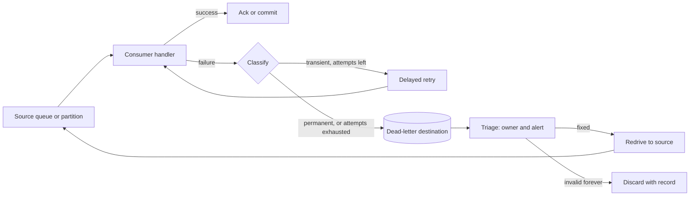
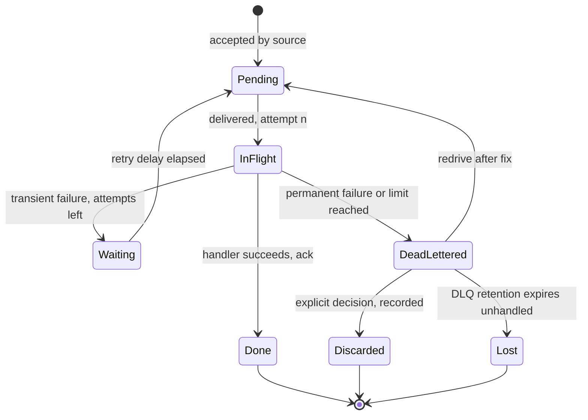
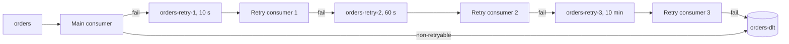
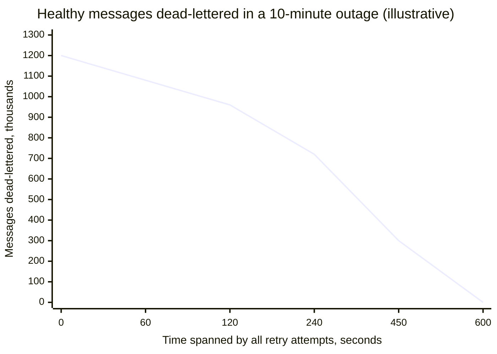
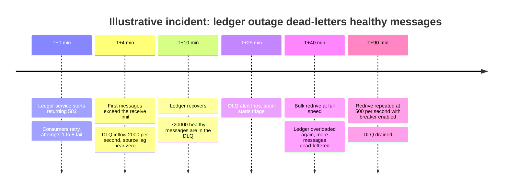

A poison message is a message that fails every time it is processed, for a reason contained in the message or in the consumer's code rather than in the environment: a payload that does not deserialize, a field that violates an invariant the handler asserts, a value that triggers a bug, a record too large for the downstream API. Retrying it changes nothing. A dead-letter queue (DLQ), or dead-letter topic, is a separate destination where a messaging system or a consumer moves a message after it has failed a bounded number of times or has been classified as unprocessable, together with enough context to diagnose it later. The two exist together because at-least-once delivery, the default of every durable broker, redelivers anything that is not acknowledged, and a message that can never be acknowledged will be redelivered forever unless something takes it out of the stream.

Without that exit, the damage depends on the consumption model. In a queue with per-message acknowledgement, a poison message occupies a worker on every redelivery and, if it crashes the process, takes the worker down with it; the healthy traffic keeps flowing, but a slowly accumulating set of poison messages consumes a growing share of capacity. In a partitioned log with a committed offset, the consumer cannot move its position past the failing record without abandoning it, so the whole partition stops: every key hashed to it waits behind one bad record, as described in [Message Queue vs. Event Streaming](/distributed-systems/en/communication/async-messaging/message-queue-vs-event-streaming/). A single malformed event can therefore halt order processing for a fraction of all customers until a human intervenes.

The core trade-off is progress against completeness and order. Dead-lettering a message lets everything behind it proceed, but it removes that message from the ordered flow, defers its effect to an unknown later time, and creates a second store that someone must own, watch, and drain. Retrying longer protects messages that failed for transient reasons, but every extra attempt spent on a true poison message is capacity or partition time taken from healthy traffic. A DLQ does not handle a failure; it postpones the decision about it and makes the postponement visible. The engineering problem is to classify failures well enough that transient ones are retried, deterministic ones are diverted quickly, and the diverted ones are neither lost, forgotten, nor replayed in a way that corrupts state.


*The poison-handling loop. Every message ends at an acknowledgement, in the dead-letter destination, or in an explicit, recorded discard.*

The diagram has two loops, and both are bounded on purpose. The inner retry loop runs a limited number of times with a delay, which absorbs transient failures without letting a poison message cycle indefinitely. The outer redrive loop runs only after a human or an automated rule has decided that the cause is fixed. Most production incidents involving DLQs come from one of these loops losing its bound: retries that never stop, retries that stop too early during an outage, or a redrive that returns messages to a consumer that still cannot process them.

## Anatomy of a Poison-Message Loop

### Classifying Failures: Transient, Deterministic, and Ambiguous

Every failure a handler sees belongs to one of three classes, and the right response differs for each. A transient failure is caused by the environment and is expected to clear: a timeout from a dependency, a throttling response, a lost database connection, a lock conflict. Retrying after a delay is correct. A deterministic failure is caused by the message or the code and will recur on every attempt: a deserialization exception, a schema the consumer cannot resolve, a validation error, a null dereference on an unexpected field combination. Retrying is pure waste, and the message should be diverted on the first occurrence if the consumer can recognize the class. An ambiguous failure could be either: a referenced entity that does not exist yet (which may be a bad reference or an event that arrived before the event creating the entity), an HTTP 500 from a downstream service (which may be an outage or a bug that this specific payload triggers), or an out-of-memory error (which may be a large message or a leak elsewhere in the process).

Classification is done with an allow-list of non-retryable exception types plus a default. Deserialization errors, schema-resolution errors, and validation errors are marked non-retryable and go straight to the DLQ. Everything else is retried with backoff up to a bound, after which it is also dead-lettered. The bound is what converts an ambiguous failure into a decision: a missing reference that resolves within the retry window is processed late; one that does not becomes a DLQ entry that a human examines. Getting this default wrong in either direction is costly. Treating everything as transient spends the retry budget on true poison; treating everything as permanent dead-letters thousands of healthy messages the first time a dependency blinks.

:::caution[Validate where the failure is cheapest]
A schema or validation failure discovered in the consumer is a poison message; the same failure discovered at the producer is a rejected publish that the producer's caller sees immediately. Schema compatibility checks in a [schema registry](/distributed-systems/en/communication/async-messaging/schema-evolution-registry/) and contract checks in CI remove most deserialization poison before it is written. A DLQ is the last line, not the first.
:::

### Who Counts the Attempts

A bound on attempts requires a counter, and where that counter lives decides which poison messages it can catch. If the consumer counts, for example by catching an exception and incrementing a field in an in-memory map or in a retry header it republishes, the count survives only failures the consumer survives. A message that crashes the process, exhausts its heap, triggers a native-library segmentation fault, or hangs until the container is killed by its liveness probe never reaches the catch block. The consumer restarts, receives the same message again, crashes again, and the in-memory counter is reset each time.

A broker-side counter does not have this blind spot, because the broker increments it when it hands the message out, before the consumer touches it. SQS increments `ApproximateReceiveCount` on every receive and moves the message to the DLQ when the count exceeds the queue's `maxReceiveCount`. RabbitMQ quorum queues track a delivery count per message and dead-letter it when the count exceeds the queue's delivery limit. Google Cloud Pub/Sub counts delivery attempts per message and Azure Service Bus counts deliveries against `MaxDeliveryCount`. A Kafka consumer group has no per-record counter at all: the broker stores one committed offset per partition and does not know how many times a client fetched a given record.

```mermaid
sequenceDiagram
    autonumber
    participant B as Broker
    participant C as Consumer process
    participant S as Supervisor
    participant D as DLQ
    B->>C: Deliver m17, broker count = 1
    Note over C: Handler parses m17, allocates 4 GB, process killed
    S->>C: Restart consumer
    B->>C: Lease expired, redeliver m17, count = 2
    Note over C: Same crash, in-memory retry counter lost again
    S->>C: Restart consumer
    B->>C: Redeliver m17, count = 3
    Note over C: Same crash
    rect rgb(40, 60, 40)
    Note over B,D: Broker-side limit of 3 reached
    B->>D: Move m17 with reason and count
    end
    B->>C: Deliver m18, normal processing resumes
```


*A crash-type poison message. Only a counter outside the consumer process advances across restarts. Counts and sizes are illustrative.*

Steps 2, 5, and 7 are the same failure, and none of them executes any error-handling code in the consumer. A design that relies on the handler's catch block to dead-letter messages would loop at step 4 forever, restarting the process each time; from outside, this looks like a crash-looping deployment with no application error in its logs, because the process dies before it can log one. Only in step 9 does something outside the process decide to divert the message. On a Kafka consumer group the equivalent safeguard must be built: the consumer persists an attempt count keyed by topic, partition, and offset in a durable store before processing, or a supervisor detects that the group's committed offset has not moved across N restarts and moves the record aside. Kafka's share groups, which add per-record acknowledgement on top of partitions, do keep a broker-side delivery count, with a default limit of 5 attempts.

### What the Consumer Must Record with the Message

A DLQ entry is useful only if someone can answer, months later, what failed, where, and why, and can put the message back exactly as it was. That requires the original bytes, not a re-serialized object: a consumer that deserialized the payload, failed, and wrote its in-memory representation to the DLQ has already lost the evidence when the failure was a deserialization problem. It also requires the origin (topic or queue, partition, offset or message ID), the failure (exception class, message, and a truncated stack trace), the history (attempt count, time of first and last failure), and the identity of the code that failed (consumer group or service name and build version). Trace context, if the message carried it, ties the DLQ entry to the request that produced it, as described in [Distributed Tracing](/distributed-systems/en/observability/logs-metrics-traces/distributed-tracing/).

Brokers that dead-letter on their own record part of this. RabbitMQ adds an `x-death` header, an array with the most recent event first, whose entries hold the queue, the reason (`rejected`, `expired`, `maxlen`, or `delivery_limit`), a count, the time, the exchange, and the original routing keys, plus `x-first-death-*` headers that never change after the first event. Azure Service Bus records a dead-letter reason such as `MaxDeliveryCountExceeded` or `TTLExpiredException`. Kafka Streams, since 4.2, writes failed records to the topic named in `errors.dead.letter.queue.topic.name` with headers carrying the exception class, message, stack trace, and source topic, partition, and offset. None of them records the business reason, which only the consumer knows, so consumer-side dead-lettering should add it.

## The Dead-Letter Step: Guarantees and Correctness

### The Conservation Invariant

The invariant a dead-letter design must uphold is conservation: every message accepted from the source ends in exactly one of three terminal outcomes, each durable and attributable. It is processed and acknowledged; it is stored in the dead-letter destination with its original bytes and failure context; or it is discarded by an explicit policy that leaves a record of the discard. Nothing leaves the source without reaching one of these outcomes, and nothing in the DLQ is deleted without a decision. This extends the queue invariant from [Message Queue vs. Event Streaming](/distributed-systems/en/communication/async-messaging/message-queue-vs-event-streaming/) to consumers that build the DLQ themselves and to the DLQ's own lifecycle.


*Lifecycle of one message under bounded retry and dead-lettering. `Lost` is the transition the design exists to prevent.*

The `Waiting` state is what separates retry with backoff from immediate redelivery: the message is not eligible for delivery until its delay has elapsed, so a burst of failures does not become a burst of retries against the same struggling dependency, the mechanism covered in [Retry with Exponential Backoff](/distributed-systems/en/resilience/protection-patterns/retry-exponential-backoff/). The transition from `DeadLettered` back to `Pending` makes the DLQ a holding area rather than a grave. The transition to `Lost` is the silent one, and it is real: an SQS DLQ deletes messages when its retention period ends, and nobody receives an error. Conservation requires that the DLQ's retention exceed the time it takes to notice and triage an entry, and that an alert fire before the oldest entry approaches it.

### Ordering the Two Writes

When the consumer dead-letters a message itself, it performs two operations on two systems: it writes the message to the DLQ and it acknowledges or commits it at the source. There is no atomic commit across them, so the order decides the failure behavior, exactly as the order of effect and progress record does in [delivery semantics](/distributed-systems/en/communication/async-messaging/delivery-semantics/). Writing to the DLQ, waiting for the write to be durable (a publisher confirm, `acks=all` on a Kafka producer), and only then acknowledging the source means a crash between the two steps causes the message to be delivered again and, eventually, dead-lettered again: a duplicate in the DLQ, which is harmless if redrive is idempotent. Acknowledging first and then writing means a crash between the steps loses the message, with no error, no retry, and no DLQ entry. The first order is the only acceptable one.

The same reasoning applies to broker-side dead-lettering, where the broker performs both steps internally. RabbitMQ by default republishes dead-lettered messages without internal publisher confirms and removes them from the source right after publishing, so a message can be lost if the dead-letter target is unavailable; quorum queues offer an at-least-once dead-lettering strategy that uses internal confirms. If the configured dead-letter exchange does not exist when a message is dead-lettered, RabbitMQ drops the message silently. Pub/Sub documents dead-lettering as best effort: a message may be dead-lettered more than once. In all of these, the DLQ is an at-least-once destination, and anything that consumes it must tolerate duplicates.

:::danger[A dead-letter step that acknowledges first loses data silently]
Consumer frameworks that catch an exception, log it, and commit the offset "so the partition is not blocked" implement acknowledge-before-store with no store at all. The message is gone, the log line is the only evidence, and log retention will delete that too. If a consumer may skip a record, it must durably copy the record to a dead-letter destination and confirm the write before committing past it.
:::

### What a DLQ Does Not Guarantee

A DLQ does not preserve order. Once message 43 is diverted and message 44 for the same key is processed, the effects are applied out of order, and redriving 43 later applies it after 44 and possibly after 45 through 90. For commutative effects (incrementing a counter, adding an item to a set) this is harmless. For state transitions (an order moving from created to paid to shipped) it can corrupt state: a late "created" event applied after "shipped" may reset the order. A DLQ also does not guarantee that the deferred effect remains valid: a redriven price update from last Tuesday may now overwrite this morning's price. And a DLQ does not guarantee that anyone will look at it. Unowned DLQs fill until their retention deletes the evidence.

Three strategies handle the ordering problem, each with a cost. The first accepts reordering, which is correct only when messages for a key are independent or idempotent with respect to order, for example because each carries a version number and the consumer ignores versions older than the stored one. The second blocks: the consumer stops the partition, or the ordering group, until the poison message is fixed or skipped by an operator, giving up availability for the affected keys and, on a log, for every key sharing the partition. The third parks the key: when a message for key K is dead-lettered, the consumer records K in a durable "parked keys" set, and every later message for K is diverted to the same destination in arrival order until an operator resolves the head of the line, after which the parked messages are redriven in order. Parking preserves per-key order and lets other keys proceed, at the cost of a lookup on every message and an operational procedure for unparking. AWS states the ordering consequence directly for SQS FIFO queues: do not attach a DLQ when the exact order of messages must not be broken.

## Retry Tiers and Their Cost

### Immediate, Delayed, and Dead-Lettered

Production consumers usually combine three tiers. Immediate in-process retries, two or three attempts a few hundred milliseconds apart, absorb momentary glitches such as a dropped connection without involving the broker. Delayed retries, seconds to minutes apart, absorb short dependency outages and throttling; they must release the message or move it somewhere so that the consumer is not blocked while waiting. The dead-letter tier receives what survives both. The tiers differ in what they block: in-process retries hold the worker and, on a log, the partition; delayed retries via the broker hold neither, but they change the order in which messages complete.

Queue brokers implement delay in different ways. SQS relies on the visibility timeout: a message that is not deleted reappears after the timeout, and a consumer can shorten or extend it per message with `ChangeMessageVisibility` to approximate backoff. RabbitMQ has no built-in delayed redelivery on classic queues, and the traditional construction is a chain of "wait" queues with a message TTL and a dead-letter exchange pointing back to the work exchange, so that an expired message returns to processing. Azure Service Bus supports scheduled messages, and Pub/Sub supports a retry policy with exponential backoff on the subscription.

On a partitioned log, a non-blocking delayed retry must be built from topics, because the log cannot hold one record back while serving the next. The pattern Uber described for Kafka in 2018 is a chain of retry topics, each consumed by a consumer that waits until the record's delay has elapsed before processing it.


*Non-blocking retries on a log. Each retry topic has its own consumer that pauses until the record's due time; delays are illustrative.*

The main consumer never blocks: it copies a failing record to the first retry topic, waits for the write to be acknowledged, and commits past it. Each retry consumer reads its topic in order, and because every record in a given retry topic has the same delay, the record at the head is always the one due soonest, so the consumer can pause its partition until the head is due without starving later records. Non-retryable failures skip the chain. The price is the ordering loss described above, now across up to four topics, plus additional topics, consumer groups, and lag metrics to operate. Spring for Apache Kafka packages both variants: its `DefaultErrorHandler` performs blocking retries (by default 9 retries, 10 attempts in total, with no delay) and then calls a recoverer such as `DeadLetterPublishingRecoverer`, which by default publishes to a topic named after the source topic with a `.DLT` suffix, into the same partition number; its non-blocking retry support creates retry and DLT topics of this shape automatically.

### Integration Frameworks and Brokers Compared

The systems below differ in who counts attempts, where the dead-letter destination lives, and what context is preserved. Those differences decide which poison messages are caught and how much work the consumer must do itself.

| System | Who counts attempts | Dead-letter destination | Context preserved | Ordering after diversion | When to prefer |
|---|---|---|---|---|---|
| Amazon SQS | Broker: `ApproximateReceiveCount` vs. `maxReceiveCount` | Separate queue, same account, region, and queue type | Message and attributes; no failure reason | Standard: none to lose; FIFO: group order broken | Task queues with independent messages; managed redrive |
| RabbitMQ quorum queue | Broker: delivery count vs. delivery limit (20 by default since 4.0) | Any exchange via dead-letter exchange | `x-death` with reason, count, queue, routing keys | Lost for diverted messages | Routing-heavy systems already on RabbitMQ |
| Azure Service Bus | Broker: `MaxDeliveryCount`, 10 by default | Built-in `$DeadLetterQueue` subqueue per entity | Dead-letter reason and description | Sessions keep order only for processed messages | Enterprise workflows needing built-in DLQ per queue or subscription |
| Google Cloud Pub/Sub | Broker, approximate: 5 to 100 attempts | Another topic | Delivery attempt count | Ordering keys: diversion breaks key order | GCP pipelines; tolerate duplicate dead-lettering |
| Kafka consumer group | Nobody; must be built | Application-written topic | Whatever the consumer writes | Blocking keeps order; diverting breaks it | High-throughput logs where the team owns the error path |
| Kafka share group | Broker: delivery count, default limit 5 | Broker-side DLQ only with KIP-1191 support; otherwise archived | Depends on version | No per-partition order to begin with | Queue-style work on Kafka topics |
| Kafka Connect sink | Framework: `errors.retry.timeout` | Topic in `errors.deadletterqueue.topic.name` | Optional `__connect.errors.*` headers | Diverted records leave the sequence | Converter and transform failures in sink pipelines |

Two rows deserve a qualification. Kafka Connect's dead-letter queue applies only to sink connectors and only to failures in the converter and transformation stages; a failure in the connector's `put()` to the external system is retried and tolerated or not according to `errors.tolerance`, but it is not written to the DLQ, because the framework cannot attribute a batch failure to a specific record. And the share-group DLQ is new: KIP-1191 defines broker-side dead-lettering for records that exceed the delivery limit or are rejected, and vendor documentation gates it behind a feature version that every broker in the cluster must support. Without it, records that reach the limit are archived and skipped, which is conservation-breaking unless something else captures them.

Pulsar sits between the two models: its client library implements a dead-letter policy with a maximum redelivery count for Shared and Key_Shared subscriptions, publishing the message to a dead-letter topic named after the topic and subscription by default, and a separate retry-letter topic supports delayed reconsumption. Because the consumer client performs the dead-letter publish, the ordering of the dead-letter write and the acknowledgement, discussed above, is the client library's responsibility rather than the broker's, and it should be verified for the client version in use.

### Worked Example: Choosing Retry Bounds for a Payments Consumer

Assume a consumer of payment events reads from a queue at 2,000 messages per second. Each message takes 50 ms of handler time, of which most is a call to a ledger service, so by [Little's Law](/distributed-systems/en/resilience/flow-control/queueing-theory-littles-law/) the steady state needs `2,000 * 0.05 = 100` concurrent handlers. All numbers in this section are illustrative.

**The cost of no limit.** Suppose one message in 100,000 is poison and crashes its handler after 2 seconds, and the lease (visibility timeout) is 60 seconds, so each poison message is redelivered about once a minute forever. New poison arrives at `2,000 / 100,000 = 0.02` per second, or 1,728 per day. After one day, those messages consume `1,728 * 2 / 60`, about 58 handler-seconds every second, or 58 concurrent handlers: more than half the capacity the healthy load needs, and growing by the same amount every day. Each of those deliveries also kills a process. The system does not fail at once; it gets slower every day until someone notices.

**The bound against independent failures.** Suppose transient failures are independent and each attempt fails with probability 1%. A healthy message is dead-lettered only if all `k` attempts fail, with probability `0.01^k`. Over a day of 172.8 million messages, `k = 3` dead-letters about 173 healthy messages per day, and `k = 5` about 0.02 per day, one every couple of months. Each poison message, by contrast, costs `k` attempts, so `k = 5` spends 10 handler-seconds per poison message, negligible at 1,728 per day. Against independent failures a small `k` is enough.

**The bound against correlated failures.** Now the ledger service is unavailable for 10 minutes. Every attempt during that window fails, and the probabilities above no longer apply. What matters is not the number of attempts but the time they span. With `k = 5` and redelivery every 60 seconds, a message's attempts span 240 seconds; any message that arrives in the first `600 - 240 = 360` seconds of the outage fails all five attempts and is dead-lettered. That is `2,000 * 360 = 720,000` healthy messages in the DLQ. With exponential delays of 30, 60, 120, and 240 seconds, the span is 450 seconds, and `2,000 * 150 = 300,000` messages are dead-lettered. Only a retry span longer than the outage avoids mass dead-lettering.


*2,000 messages per second, outage of 600 s. A message is dead-lettered if its first arrival plus its retry span both fall inside the outage.*

The curve is linear because arrival is uniform: each second of retry span saves 2,000 messages. It makes the design choice explicit. Raising `k` from 5 to 20 at a fixed 60-second interval would extend the span to 19 minutes and avoid the DLQ entirely, but it also lets each poison message consume 20 attempts, and a 10-minute outage would leave 1.2 million messages cycling through retries, putting `1.2 million / 60 = 20,000` extra receives per second on the broker. The better answer is to stop consuming during a correlated failure rather than to retry harder: a [circuit breaker](/distributed-systems/en/resilience/protection-patterns/circuit-breaker/) around the ledger call, which pauses the consumer when the failure rate crosses a threshold, keeps messages in the source queue untouched, where they cost nothing and keep their attempt counts. With the breaker, `k = 5` with exponential backoff handles poison and independent glitches, and the outage turns into lag rather than DLQ entries.

**The same bound on a log.** On a partitioned log with blocking retries of 1, 2, 4, 8, and 16 seconds, a poison record holds its partition for 31 seconds plus six handler executions, about 31.3 seconds. At 20 records per second per partition, about 626 records queue behind it, each delayed by up to 31 seconds. With 1,728 poison records per day spread over 100 partitions, each partition stalls about 17 times a day, losing about 9 minutes of processing time per partition per day. Non-blocking retry topics reduce the stall to one handler execution and one produce, at the price of per-key order.

## Operating the Dead-Letter Queue

### Configuration That Decides Behavior

The broker-side settings are few, and each has a failure mode attached. In SQS, the redrive policy on the source queue names the DLQ and the `maxReceiveCount`; the redrive allow policy on the DLQ restricts which source queues may use it.

```json
{
  "RedrivePolicy": {
    "deadLetterTargetArn": "arn:aws:sqs:eu-west-1:111122223333:payments-dlq",
    "maxReceiveCount": "5"
  },
  "VisibilityTimeout": "60",
  "MessageRetentionPeriod": "345600"
}
```

This source queue retains messages for 4 days. The DLQ's retention must be longer, because for standard queues SQS keeps the original enqueue timestamp when it moves a message: a message that spent 3 days in the source queue and lands in a DLQ with a 4-day retention is deleted from the DLQ after 1 day. For FIFO queues the timestamp resets on the move. The visibility timeout and `maxReceiveCount` together set the retry span analyzed in the worked example; on standard queues with `maxReceiveCount` above 3, SQS also moves a message that has been received 3 or more times without being deleted to the back of the queue, so a slow-failing message does not hold `ApproximateAgeOfOldestMessage` at its own age.

On a Kafka Connect sink, the equivalent settings are `errors.tolerance=all` (without it, the first conversion failure stops the task), `errors.deadletterqueue.topic.name`, and `errors.deadletterqueue.context.headers.enable=true`, which adds headers naming the source topic, partition, offset, and exception. `errors.retry.timeout` bounds how long a retriable operation is retried; its default of 0 means no retry. In RabbitMQ the dead-letter exchange, its routing key, and the quorum queue's delivery limit are best set through policies, so they can be changed without redeclaring queues, as described in [RabbitMQ: Exchange Types and Routing](/distributed-systems/en/communication/async-messaging/rabbitmq/).

### Signals and Ownership

A DLQ needs three signals. The first is inflow: the rate of messages entering the DLQ, compared with the source's throughput, alerted on any sustained nonzero rate for queues where poison should be rare, and on a ratio for queues where some invalid input is expected. A sudden jump after a deploy points at a consumer bug; a jump coinciding with a dependency outage points at retry bounds that are too short. The second is depth together with the age of the oldest entry, alerted well before the DLQ's retention, because that is the deadline for conservation. In SQS, CloudWatch's `ApproximateNumberOfMessagesVisible` and `ApproximateAgeOfOldestMessage` on the DLQ provide both. The third is the reason distribution: a DLQ dominated by one exception class at one consumer version is a bug with one fix, while a spread of validation errors from one producer is a contract problem.

Every DLQ needs a named owner, normally the team that owns the consumer, because only they can tell a consumer bug from bad input. A shared, organization-wide DLQ is an anti-pattern: entries from twenty services mix, nobody feels responsible, and redrive cannot target the right consumer.

:::tip[Alert on the DLQ, page on the source]
DLQ inflow is usually a ticket, not a page: the messages are safe and nothing is stalled. The page belongs on the symptoms that mean progress has stopped: source lag or the age of the oldest source message rising, a consumer crash loop, or a DLQ approaching its retention limit. Paging on every DLQ message trains on-call engineers to ignore the DLQ.
:::

### Redrive

Redrive moves messages from the DLQ back to the source, or to a dedicated reprocessing destination, after the cause is fixed. SQS provides managed DLQ redrive, through the console or the `StartMessageMoveTask` API, with a configurable rate; Azure Service Bus Explorer can inspect, edit, and resend dead-lettered messages; for RabbitMQ and Kafka, redrive is a shovel, a small replay tool, or a consumer of the DLQ. Whatever the mechanism, a safe redrive follows a fixed order: confirm that the fix is deployed to every consumer instance, redrive a small sample and watch it succeed, then redrive the rest at a rate the consumer and its dependencies can absorb. Redriven messages are duplicates by construction whenever the original attempt partially applied its effect, so the consumer must be idempotent, using the techniques in [delivery semantics](/distributed-systems/en/communication/async-messaging/delivery-semantics/) or [Idempotency and Safe HTTP Methods](/distributed-systems/en/communication/api-gateway/idempotency/).

Before redriving, decide what happens to stale messages. A redriven message is processed with today's state, and for ordered entities it may be older than what the consumer has already applied. Version checks in the handler, which reject an event whose version is not newer than the stored one, turn redrive of superseded updates into a no-op rather than a regression.

## Failure Modes and How They Present

### Mass Dead-Lettering During a Dependency Outage

Trigger: a downstream dependency fails for longer than the retry span, as in the worked example. Symptoms: DLQ depth jumps by hundreds of thousands of messages within minutes, while source lag stays low because messages are leaving it quickly, into the DLQ. Detection: DLQ inflow rate correlated with the dependency's error rate; the dominant exception is a timeout or connection error rather than a validation error. Mitigation: pause consumption with a circuit breaker when the failure is correlated; classify connection and timeout errors as retryable with a long horizon. Recovery: once the dependency is back, redrive at a controlled rate.


*A hypothetical timeline with the numbers of the worked example; not a real incident.*

The first 10 minutes are the expected cost of retry bounds that are shorter than the outage. The second overload at T+40 is the more instructive part: a DLQ that has accumulated 720,000 messages is a backlog, and redriving it at full speed adds that backlog to live traffic against a dependency that has just recovered. This is the same overload pattern described in [Retry Storms and Metastable Failures](/distributed-systems/en/resilience/flow-control/retry-storms-metastable-failures/), triggered by an operator rather than by clients. Rate-limited redrive and a breaker in front of the dependency turn it into a drain.

### Crash Loop on a Log Partition

Trigger: a record crashes the consumer process on a Kafka consumer group with no external attempt counter. Symptoms: the consumer deployment crash-loops, the group rebalances repeatedly, lag grows on one partition while other partitions are handled by surviving members until they too are assigned the bad partition and crash. Detection: maximum per-partition lag rather than total lag, a committed offset that does not change across restarts, and rebalance rate, as discussed in [Consumer Group Rebalancing](/distributed-systems/en/case-studies/apache-kafka/consumer-group-rebalancing/). Mitigation: a durable attempt counter keyed by partition and offset, written before processing, so that a restarted consumer diverts the record; or an operator tool that copies the record to the DLT and commits past it. Recovery: deploy the fix and redrive the record.

### Dead Letters That Expire or Never Arrive

Trigger: a DLQ retention shorter than the source's on SQS standard queues; a RabbitMQ dead-letter exchange that does not exist or has no binding for the routing key; a quorum queue on RabbitMQ 4.0 or later with the default delivery limit and no dead-letter exchange, where messages are dropped after 20 attempts; a share group without DLQ support where exhausted records are archived. Symptoms: none. Messages disappear and no counter rises, which is the defining property of this mode. Detection: reconciliation between source counts and terminal counts (acknowledged plus dead-lettered plus discarded), and configuration audits that assert every source has a DLQ, that the DLQ exists and is bound, and that its retention exceeds the source's. Mitigation: those audits in CI for infrastructure definitions. Recovery: from the producer or the system of record, if at all.

### Redrive Before the Fix

Trigger: an operator redrives the DLQ while the consumer still has the bug, often because the fix is deployed to some instances and not others. Symptoms: DLQ depth drops to zero, then returns to its previous value one retry span later; each message has consumed another set of attempts and accumulated another `x-death` entry or receive count. Detection: DLQ entries whose redrive count is greater than one; DLQ inflow matching the redrive rate. Mitigation: redrive a sample first, and tag redriven messages with a redrive count so that a message redriven more than once goes to a parking destination for manual handling instead of cycling.

### Order Corruption on Redrive

Trigger: a state-transition event is dead-lettered, later events for the same entity are processed, and the dead-lettered event is redriven. Symptoms: entities regress to earlier states, typically discovered by customers or reconciliation jobs, not by metrics. Detection: version or sequence checks in the handler that log rejections; reconciliation against the system of record. Mitigation: version-guarded handlers, or key parking for streams whose effects do not commute.

| Failure | Symptom from outside | Detection signal | Mitigation |
|---|---|---|---|
| Unbounded poison loop | Capacity falls a little every day; crash restarts | Receive count distribution, per-message redelivery | Broker-side delivery limit with DLQ |
| Mass dead-lettering | DLQ jumps during a dependency outage | DLQ inflow vs. dependency error rate | Circuit breaker pauses consumption; longer retry horizon |
| Log crash loop | One partition's lag grows; group rebalances | Max partition lag, unchanged committed offset | Durable attempt counter; DLT copy before commit |
| Silent loss | Nothing | Source vs. terminal reconciliation; config audit | DLQ retention above source; DLX existence checks |
| Redrive before fix | DLQ refills after redrive | Redrive count above one | Sample redrive, redrive-count cap |
| Order corruption | Entities regress | Version-check rejections, reconciliation | Version guards or key parking |

## When to Use Dead-Lettering and When Not To

Dead-lettering fits when messages are independent units of work, or when per-key reordering is harmless because effects are idempotent and version-guarded, and when delaying one message's effect is acceptable while the rest proceed. Task queues, notification fan-out, search indexing, and most integration pipelines meet these conditions. On queues it should be the default for every consumer, configured broker-side so that crash-type poison is caught; on logs it should be built, with the copy confirmed before the commit, whenever one bad record would otherwise stall a partition that carries unrelated keys.

Do not dead-let when skipping a message makes everything after it wrong. A consumer that applies a change data capture (CDC) stream to a replica, rebuilds state from an event-sourced stream, or maintains a materialized view whose correctness depends on every prior event must stop and alert rather than continue with a gap; that is what the stream's order is for, and the [projections](/distributed-systems/en/microservice-patterns/event-sourcing-cqrs/projections/) built on it inherit the rule. Do not use the DLQ as the main retry mechanism for transient failures, because a correlated outage then turns into a bulk redrive. Do not rely on a DLQ to catch contract breaks that a schema registry or a producer-side validation could reject at write time. And do not create a DLQ without an owner, an alert, and a retention longer than the time to triage; an unwatched DLQ is a slower way to drop messages.

Between these, there are workflows where a failed step must trigger a business response rather than an operator's attention: a payment that cannot be captured, an order that cannot be fulfilled. Those failures belong in the domain model as explicit failure events and compensations, the subject of the [Saga pattern](/distributed-systems/en/coordination/distributed-transactions/saga-pattern/), not in a DLQ that an engineer drains by hand.

:::note[Dead-letter channels and invalid-message channels]
Hohpe and Woolf distinguish a Dead Letter Channel, for messages the messaging system cannot deliver, from an Invalid Message Channel, for messages delivered successfully that the receiver cannot process. Most modern brokers use "dead letter" for both. Keeping the two apart in routing and alerting is still useful: delivery problems are owned by the platform team, invalid messages by the producer and consumer teams.
:::

## Further Reading

- Gregor Hohpe and Bobby Woolf, *Enterprise Integration Patterns*, Addison-Wesley, 2003 (Dead Letter Channel, Invalid Message Channel).
- Amazon Web Services, *Using dead-letter queues in Amazon SQS*, Amazon SQS Developer Guide.
- RabbitMQ, *Dead Letter Exchanges*, RabbitMQ documentation.
- Apache Kafka, *KIP-298: Error Handling in Connect*, Apache Kafka Improvement Proposals, 2018.
- Apache Kafka, *KIP-1034: Dead letter queue in Kafka Streams*, Apache Kafka Improvement Proposals.
- Ning Xia, *Building Reliable Reprocessing and Dead Letter Queues with Apache Kafka*, Uber Engineering Blog, 2018.
