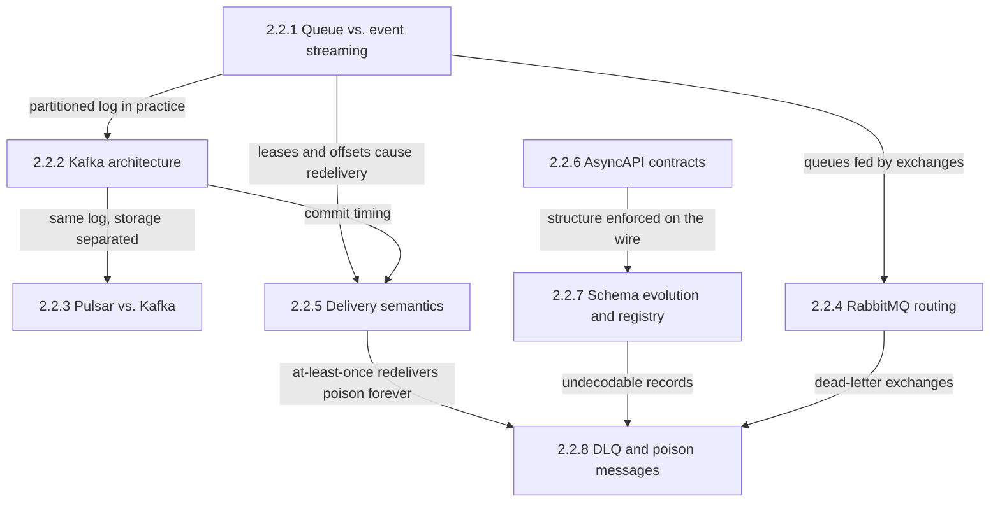
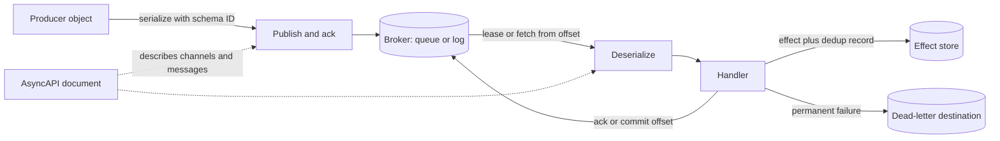
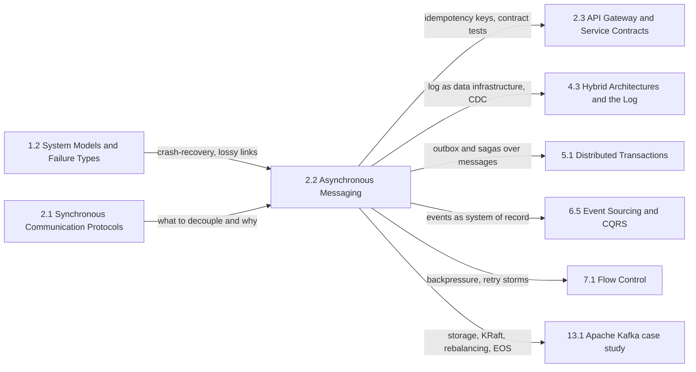

An asynchronous message is a unit of work or a statement of fact that a producer hands to a broker and then stops waiting for. The broker stores it durably, and a consumer the producer may never have heard of processes it later: milliseconds later normally, hours later after an outage, days later when a new consumer replays history. That one change removes the coupling that defines a synchronous call. The producer's latency no longer includes the consumer's, the producer's availability no longer depends on the consumer being up, and a burst that would have overloaded the callee becomes a backlog that drains at the rate the consumer can sustain.

The single problem this chapter addresses is how to move work and facts between programs that run, fail, and deploy on independent schedules without losing them, duplicating their effects, or breaking the programs that read them. The tension that runs through all eight topics is that decoupling in time also decouples failure from its cause. In a synchronous call, a malformed request, an incompatible field, or a crashed callee fails the caller's request immediately and in front of the engineer who caused it. On a broker the same message is accepted, replicated, and acknowledged to the producer, and fails later, repeatedly, inside a consumer owned by another team. Every mechanism in the chapter is an attempt to buy back some of the visibility that the broker took away: which consumer has processed what, how many times an effect happened, what a message on a topic is allowed to contain, and where the messages that can never be processed went.

A second axis cuts across the first: where consumption state lives. A queue broker remembers the state of every message and deletes it on acknowledgement; a log broker remembers nothing about consumers and lets each one keep a position in a retained, ordered sequence. That choice decides ordering, replay, parallelism, fan-out cost, and what a stuck message does to its neighbors, and it reappears on every page of the chapter.

## From Broker Models to the Failure Exit: How the Topics Build on Each Other

The chapter has four layers: the two broker models and three real brokers that implement them; delivery semantics, which sits above all brokers because its guarantees belong to the whole path; two pages on the contract a message carries over time; and the message that no contract or retry can save.

*Dependencies between the chapter's topics. Each arrow names what a page inherits from the one it builds on.*

The queue-versus-streaming page is the root because every later page assumes its two state machines: the per-message lease of a queue, with its ready, in-flight, and acknowledged states, and the per-partition offset of a log, with its retention and head-of-line blocking. Kafka is the partitioned log made concrete, and its page is the prerequisite for Pulsar, which keeps the same consumer-facing log and moves its bytes off the brokers. RabbitMQ extends the queue side in a different direction, by putting a routing layer in front of queues. Delivery semantics depends on both models, because duplicates are produced by exactly the mechanisms those pages describe: an expired lease, an uncommitted offset, a producer retry. The dead-letter page is last because it combines three earlier inputs: the at-least-once redelivery that makes a poison message loop, the deserialization failures that schema evolution exists to prevent, and the broker-native dead-lettering of RabbitMQ and others.

## The Question Each Topic Answers

[Message Queue vs. Event Streaming: Differences and Use Cases](/distributed-systems/en/communication/async-messaging/message-queue-vs-event-streaming/) answers what changes when the broker tracks every message versus when each consumer tracks its own position, and why that single choice decides ordering, replay, parallelism, and how a stuck message hurts its neighbors. Open it before choosing a broker for a new workload, and when a design needs both work distribution and replayable history.

[Kafka Architecture: Topic, Partition, Consumer Group, Offset](/distributed-systems/en/communication/async-messaging/kafka-architecture/) answers why the partition is Kafka's single unit of ordering, replication, placement, and parallelism, what an acknowledged write survives under each combination of `acks`, `min.insync.replicas`, and replication factor, and what a committed offset promises. Open it when sizing topics and partition counts, choosing durability settings, and diagnosing rejected writes, hot partitions, or consumers that silently reset.

[Pulsar vs. Kafka: Architectural Comparison](/distributed-systems/en/communication/async-messaging/pulsar-vs-kafka/) answers what is gained and paid when brokers serve topics but store nothing, and the log lives in a separate storage cluster with its own quorum and fencing protocol. Open it when evaluating Pulsar, when partition moves and broker rebuilds dominate Kafka operations, and when one topic must serve both log-style and queue-style consumers.

[RabbitMQ: Exchange Types and Routing](/distributed-systems/en/communication/async-messaging/rabbitmq/) answers how a broker decides which queues receive a copy of each message, what each exchange type costs to match, and what a publisher can learn about a message that matched nothing. Open it when designing subscription topologies by routing key or header, and when messages disappear without an error or fan-out exhausts disk and memory.

[At-Least-Once, At-Most-Once, and Exactly-Once Semantics](/distributed-systems/en/communication/async-messaging/delivery-semantics/) answers why no protocol over a lossy network can deliver exactly once, how exactly-once effects are built from at-least-once delivery and deduplication committed with the effect, and where each vendor's exactly-once boundary ends. Open it before any consumer writes to a database or calls an external API, and when duplicates or gaps appear after a crash or rebalance.

[AsyncAPI: Documenting Asynchronous Contracts](/distributed-systems/en/communication/async-messaging/asyncapi/) answers how an application's channels, operations, and messages are described in a machine-readable document, and what keeps that document from drifting away from the code. Open it when nobody can say who consumes a topic, and when setting up code generation or pre-deployment compatibility checks for event-driven services.

[Schema Evolution and Schema Registry: Avro, Protobuf, and Compatibility Modes](/distributed-systems/en/communication/async-messaging/schema-evolution-registry/) answers which reader must be able to read which writer under each compatibility mode, what deployment order each mode imposes, how each format resolves a mismatch, and what it means to put a registry on the data path. Open it before the first schema change on a topic with retained data, and when consumers fail to deserialize after a producer deploy.

[Dead Letter Queues and Poison Message Handling](/distributed-systems/en/communication/async-messaging/dlq-poison-messages/) answers how to take a message that can never succeed out of the flow without losing it, how many retries it deserves, what dead-lettering does to ordering, and how the diverted messages are triaged and redriven. Open it when a partition stops behind one record, when workers crash in a loop, and before designing retry tiers for any consumer.

| Topic | Question it answers | Open it when |
|---|---|---|
| [Queue vs. event streaming](/distributed-systems/en/communication/async-messaging/message-queue-vs-event-streaming/) | Who remembers what has been consumed, and what follows from it? | Choosing a broker model, needing replay or fan-out, fixing head-of-line blocking |
| [Kafka architecture](/distributed-systems/en/communication/async-messaging/kafka-architecture/) | What do partitions, replicas, and offsets guarantee? | Sizing partitions, setting durability, diagnosing hot partitions or offset resets |
| [Pulsar vs. Kafka](/distributed-systems/en/communication/async-messaging/pulsar-vs-kafka/) | What does separating serving from storage buy and cost? | Evaluating Pulsar, suffering slow rebalances of data, mixing queue and log consumers |
| [RabbitMQ](/distributed-systems/en/communication/async-messaging/rabbitmq/) | How does write-time routing pick destination queues? | Designing topic or header subscriptions, chasing silent drops or fan-out pressure |
| [Delivery semantics](/distributed-systems/en/communication/async-messaging/delivery-semantics/) | How many times can an effect happen, end to end? | Writing any side-effecting consumer, investigating duplicates or loss |
| [AsyncAPI](/distributed-systems/en/communication/async-messaging/asyncapi/) | What does an application send and receive, in machine-readable form? | Mapping topic dependencies, generating code, checking contracts in CI |
| [Schema evolution and registry](/distributed-systems/en/communication/async-messaging/schema-evolution-registry/) | Which schema changes keep every live reader working? | Changing a message schema, choosing a format and compatibility mode |
| [DLQ and poison messages](/distributed-systems/en/communication/async-messaging/dlq-poison-messages/) | Where does a message go when it can never succeed? | Designing retries, unblocking a stuck partition, redriving failed messages |

The chapter can also be read along one message's path, asking which page owns each step. The broker pages own the middle, but most incidents in the chapter happen at the ends.

*One message's path, from serialization to effect. Schema evolution owns the two serialization steps, the broker pages own the store and the lease or offset, delivery semantics owns the relation between effect and acknowledgement, the dead-letter page owns the failure branch, and AsyncAPI describes the edges without sitting on them.*

Two features of the path explain why the chapter is shaped as it is. The handler has two outgoing writes, the effect and the acknowledgement, and they go to different systems; there is no ordering of those two writes that is safe under a crash without the deduplication described on the delivery-semantics page. The dotted edges show that the AsyncAPI document is not on the data path at all: it constrains what should be sent, while the registry and the deserializer decide what actually can be read.

## Reading Order and Why

Read the chapter in sidebar order on a first pass. Queue versus streaming must come first, because its lease and offset state machines are referenced without re-explanation on every later page. Kafka must precede Pulsar, because the Pulsar page compares against Kafka's replication, high watermark, and offsets instead of redefining them. Delivery semantics must precede the dead-letter page, because the conservation argument for dead-lettering (a message is acknowledged at the source only after it is safely written elsewhere) is the at-least-once rule applied to a second destination.

Three shortcuts are reasonable. An engineer choosing a broker should read queue versus streaming, then whichever of Kafka, Pulsar, or RabbitMQ is under evaluation, then delivery semantics to learn what that broker's guarantees leave to the application. An engineer writing a consumer against an existing platform should read delivery semantics and the dead-letter page, then the schema page; these three decide whether a consumer survives crashes, redeliveries, and producer deploys. An engineer responsible for contracts across many teams should read AsyncAPI and schema evolution together, since one describes what flows on a channel and the other enforces it.

## Where the Chapter Sits in the Handbook

The chapter is the alternative to the one before it. [Synchronous Communication Protocols](/distributed-systems/en/communication/synchronous-protocols/) covers calls in which the caller waits and inherits the callee's latency and failures; this chapter covers what happens when the caller stops waiting. Both rest on the first part's account of partial failure: [Failure Models](/distributed-systems/en/foundations/system-models/failure-models/) defines the crash-recovery processes and lossy links behind the acknowledgement dilemma, and [Cascading Failure Analysis](/distributed-systems/en/foundations/system-models/cascading-failure/) shows the overload that a broker absorbs as backlog.

*Prerequisites on the left and the chapters that build on this one on the right. Each arrow names what is handed over.*

Several mechanisms this chapter relies on have their canonical pages elsewhere. The Kafka case study owns the internals the Kafka page only summarizes: [Disk-Based Persistence and Zero-Copy Optimization](/distributed-systems/en/case-studies/apache-kafka/disk-persistence-zero-copy/), [KRaft Mode](/distributed-systems/en/case-studies/apache-kafka/kraft-mode/), [Consumer Group Rebalancing](/distributed-systems/en/case-studies/apache-kafka/consumer-group-rebalancing/), and [Exactly-Once Semantics](/distributed-systems/en/case-studies/apache-kafka/exactly-once-semantics/) for idempotent and transactional producers. [The Commit Log Abstraction](/distributed-systems/en/data-processing/hybrid-architectures/commit-log-abstraction/), [Log Compaction](/distributed-systems/en/data-processing/hybrid-architectures/log-compaction/), and [Change Data Capture](/distributed-systems/en/data-processing/hybrid-architectures/change-data-capture/) treat the log as general data infrastructure rather than as a transport.

The rest of the handbook uses messaging as a building block. [The Outbox Pattern](/distributed-systems/en/coordination/distributed-transactions/outbox-pattern/) solves the producer-side version of the dual-write problem that delivery semantics solves on the consumer side, and [the Saga Pattern](/distributed-systems/en/coordination/distributed-transactions/saga-pattern/) coordinates multi-service work over messages. [Event Versioning and Schema Evolution](/distributed-systems/en/microservice-patterns/event-sourcing-cqrs/event-versioning/) applies schema evolution to events that are the system of record, where they can never be dropped. [Idempotency and Safe HTTP Methods](/distributed-systems/en/communication/api-gateway/idempotency/) is the request-response counterpart of the idempotent consumer, and [Consumer-Driven Contract Testing](/distributed-systems/en/communication/api-gateway/contract-testing/) verifies message contracts against real consumers. On the resilience side, [Backpressure](/distributed-systems/en/resilience/flow-control/backpressure/) and [Queueing Theory and Little's Law](/distributed-systems/en/resilience/flow-control/queueing-theory-littles-law/) explain how backlogs grow and drain, [Retry with Exponential Backoff](/distributed-systems/en/resilience/protection-patterns/retry-exponential-backoff/) sets the spacing of retry tiers, and [Retry Storms and Metastable Failures](/distributed-systems/en/resilience/flow-control/retry-storms-metastable-failures/) is the incident a careless redrive can start. [Testing Event-Driven Systems](/distributed-systems/en/deployment/distributed-testing/testing-event-driven/) and [Distributed Tracing](/distributed-systems/en/observability/logs-metrics-traces/distributed-tracing/) cover how to verify and observe flows that no single request spans.
