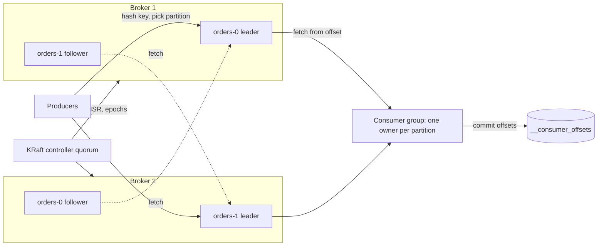
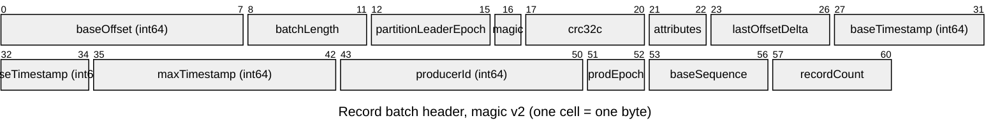
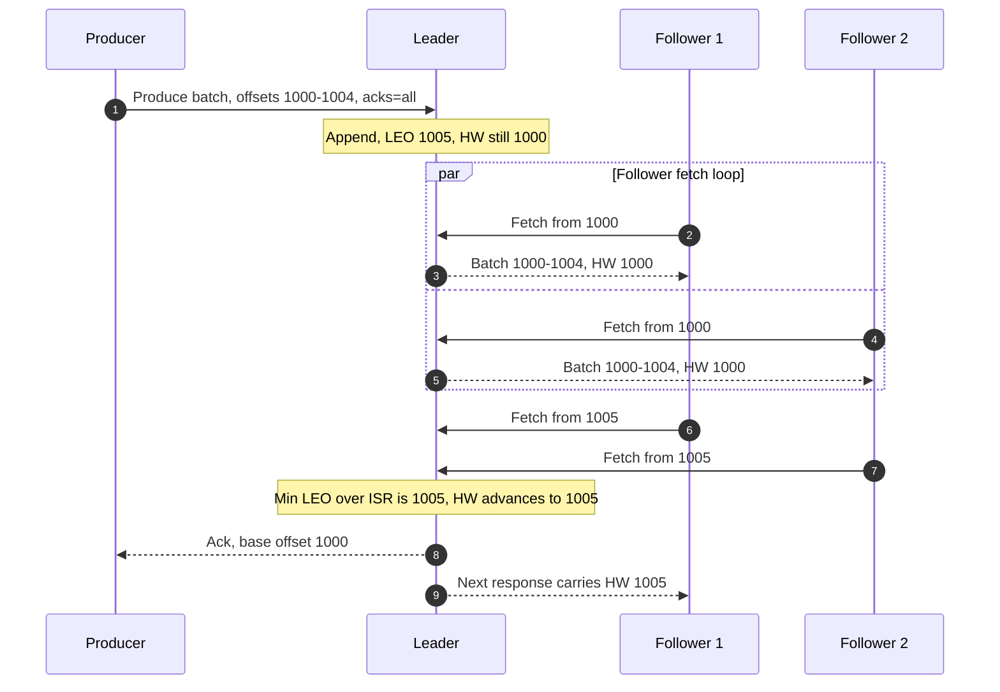
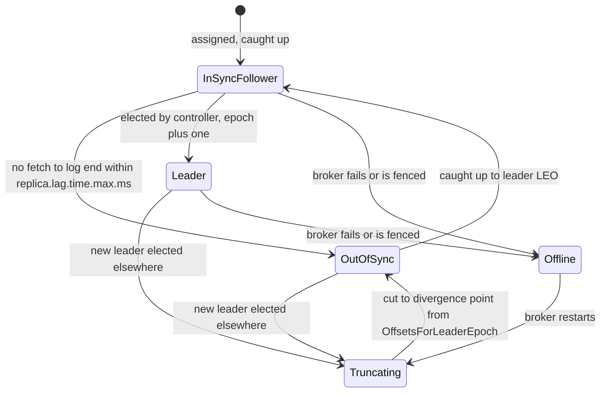
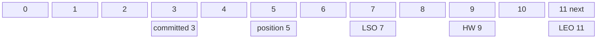

Apache Kafka stores every topic as a fixed set of partitions, and every partition is an append-only log replicated to a small number of brokers. One replica of each partition is the leader: it accepts all writes, assigns each record the next offset, and decides when a record is committed. The other replicas copy the leader by fetching from it. Consumers read partitions sequentially and record their progress as one integer per partition, the offset of the next record they intend to process. Topic, partition, consumer group, and offset are not four independent features; they are four views of one decision, which is that the partition is the only unit of ordering, replication, placement, and consumer parallelism in the system.

That decision is the source of Kafka's strengths and of most of its operational difficulty. Because a partition is one ordered sequence owned by one leader, the broker does almost no per-record work, ordering per key is free, and any number of consumer groups can read the same bytes. Because the partition is also the unit of parallelism and placement, the partition count must be chosen before the load arrives, a key's throughput is bounded by one partition on one broker, and changing the count remaps keys. The second trade-off is inside each partition: how many replicas must hold a record before the producer is told it is safe. Kafka lets each topic and producer choose between lower write latency and higher write availability on one side, and surviving broker failures without losing acknowledged data on the other, through three settings (`acks`, `min.insync.replicas`, and the replication factor) whose interaction is the most commonly misconfigured part of a Kafka deployment.

This page covers the logical architecture: partitions and keys, replication and commitment, consumer groups and offsets, and how they fail. The comparison between a log and a queue is in [Message Queue vs. Event Streaming](/distributed-systems/en/communication/async-messaging/message-queue-vs-event-streaming/). Four Kafka mechanisms have their own canonical pages and are only summarized here: the storage path and zero-copy transfer in [Disk-Based Persistence and Zero-Copy Optimization](/distributed-systems/en/case-studies/apache-kafka/disk-persistence-zero-copy/), the metadata quorum in [KRaft Mode](/distributed-systems/en/case-studies/apache-kafka/kraft-mode/), partition assignment and its failures in [Consumer Group Rebalancing](/distributed-systems/en/case-studies/apache-kafka/consumer-group-rebalancing/), and idempotent and transactional writes in [Exactly-Once Semantics](/distributed-systems/en/case-studies/apache-kafka/exactly-once-semantics/).


*Logical architecture of one topic with two partitions and replication factor 2. Solid arrows carry records; dotted arrows are follower replication, which uses the same fetch protocol as consumers.*

Three properties of this picture carry through the rest of the page. First, the producer, not the broker, decides which partition a record goes to, so the key-to-partition mapping lives in client code. Second, replication is pull-based: followers send fetch requests to the leader exactly as consumers do, and the leader learns how far each follower has copied from the offset each fetch asks for. Third, the controller quorum never touches records; it stores which broker leads each partition, which replicas are in sync, and the leader epoch, and it changes those only when brokers join, fail, or fall behind. Consumer progress is itself stored as records in an internal topic, so the consumer side uses the same replicated log as the data it tracks.

## Topics and Partitions: Placement, Keys, and the Record Batch

A topic is a name and a configuration: partition count, replication factor, retention, compaction, and a handful of durability settings. The partition is where data lives. On a broker, each partition replica is a directory of segment files. The active segment receives appends; when it reaches `segment.bytes` (1 GiB by default) or `segment.ms` (7 days by default), it is closed and a new one opened. Each segment has a sparse offset index and a time index beside it, so a fetch for offset `n` or for "the first record after 06:00" becomes a binary search over a small index followed by a sequential scan. Retention deletes whole closed segments; it never rewrites a segment in place, except for compaction, which is covered in [Log Compaction](/distributed-systems/en/data-processing/hybrid-architectures/log-compaction/). Since Kafka 3.9, tiered storage (KIP-405) is production-ready and lets closed segments move to object storage, so a broker's local disk holds only the recent part of each partition while consumers can still fetch older offsets.

### The Record Batch Is the Unit of Work

Producers never send single records to the broker. They group records for the same partition into a record batch, compress the batch as a whole, and send several batches per request. The broker validates the batch, assigns offsets, and appends it to the segment without decompressing and re-encoding it in the common case. Consumers receive the same batches. The batch header is what lets one write serve replication, idempotence, transactions, and offset assignment without per-record bookkeeping.


*The 61-byte header that precedes the records of every batch in the current message format. The CRC covers everything from attributes to the end of the batch.*

Each field corresponds to a mechanism described elsewhere on this page or on a linked one. `baseOffset` and `lastOffsetDelta` let the leader assign a whole range of offsets with one write: records inside the batch store only a delta from the base. `partitionLeaderEpoch` stamps the batch with the leadership generation that appended it, which is how replicas later find the exact point at which their logs diverge after a leader change. `producerId`, `producerEpoch`, and `baseSequence` let the leader reject a duplicate or out-of-order retry from the same producer session, the mechanism behind idempotent writes. `attributes` carries the compression codec, whether the batch is transactional, and whether it is a control record such as a transaction marker. Because the CRC covers the records but not the base offset, the leader can stamp offsets into a batch without recomputing its checksum.

### How a Record Chooses Its Partition

For a record with a key, the default partitioner computes a 32-bit murmur2 hash of the serialized key bytes, clears the sign bit, and takes the result modulo the number of partitions. The function is deterministic and depends on nothing but the key bytes and the partition count, which is why every producer in every language that uses a compatible partitioner sends the same key to the same partition, and why the per-key ordering guarantee holds across producer instances. Two producers written in different client libraries that hash keys differently, or that serialize the same logical key into different bytes, silently break that guarantee.

For a record without a key, the producer has no ordering obligation and optimizes for batching. Since Kafka 2.4 (KIP-480) the default is sticky partitioning: the producer fills a batch for one partition, then switches to another, instead of spreading consecutive records round-robin into many tiny batches. Kafka 3.3 (KIP-794) refined this so the switch happens after a fixed number of bytes rather than at batch creation, and so that partitions on slow brokers receive less traffic instead of more. The earlier behavior had a feedback loop: a slow broker's batches stayed open longer, collected more records, and so received a growing share of the load.

The mapping has an uncomfortable consequence. Because the partition is `hash mod N`, increasing `N` remaps most keys. Kafka allows the partition count of a topic to grow but never to shrink, and the moment it grows, new records for a key may land in a different partition from the key's older records. Consumers processing the two partitions are independent, so for a period the newer records for a key can be processed before the older ones. Kafka does not migrate existing data to match the new mapping.

:::caution[Adding partitions breaks per-key order]
Raising a topic's partition count is an online operation and looks harmless, but it changes `hash(key) mod N` for most keys. Records already in the log stay where they are, new records for the same key go to a new partition, and two consumers process the old and new records concurrently. For any topic whose consumers rely on per-key order (state machines, upserts, change data capture), choose the partition count for the planning horizon at creation time, or migrate to a new topic with a controlled cutover (stop producers, drain consumers, switch) instead of adding partitions in place.
:::

## Replication: Leader, In-Sync Replicas, and the High Watermark

Each partition has a replication factor, usually 3, and a replica assignment that places its replicas on different brokers and, with rack awareness (`broker.rack`), in different availability zones. Exactly one replica is the leader at any time, identified by a leader epoch that the controller increments on every leadership change. All produce requests go to the leader. Followers run a fetch loop against the leader, appending what they receive to their own logs.

Two positions per replica define everything else. The log end offset (LEO) is the offset the replica would assign to its next record; it advances as soon as a record is appended. The high watermark (HW) is the offset up to which the record is known to be stored by every member of the in-sync replica set (ISR). The ISR is the subset of replicas that the leader considers caught up: a follower stays in the ISR as long as it has fetched up to the leader's log end within the last `replica.lag.time.max.ms` (30 seconds by default since Kafka 2.5). A follower that stops fetching, or fetches but cannot keep up, is removed from the ISR by the leader through a request to the controller, and is added back once it has caught up.

A record below the high watermark is committed. Consumers can read only committed records, so they never see a record that a leader failover could take away. The leader computes the high watermark as the minimum LEO across the ISR, and it learns each follower's LEO from the offset that follower requests in its next fetch: a follower asking for offset 1,005 has necessarily stored everything before 1,005.


*An `acks=all` write with a three-replica ISR. The leader learns that a follower has stored the batch only from that follower's next fetch request.*

The order of steps explains Kafka's commit latency. The batch is appended at step 1, but the leader cannot advance the high watermark until steps 6 and 7, when both followers ask for offset 1,005 and thereby prove they hold 1,000 to 1,004. Only then, at step 8, is the producer acknowledged. A commit therefore costs one round of follower fetch requests after the data reaches the followers, and its latency is set by the slowest ISR member, not the median one. Step 9 also shows that followers learn the high watermark one fetch late; this lag is harmless for consumers, who read from the leader's view, but it is the reason the old truncation rule described below was unsafe.

The producer's `acks` setting decides at which step the producer hears back. With `acks=0` it does not wait at all. With `acks=1` the leader replies after step 1, before any follower has the data. With `acks=all` (the default since Kafka 3.0) the leader replies only after the record is below the high watermark, that is, stored by every replica currently in the ISR.

### What a Committed Write Survives

The guarantee Kafka gives is precise: a record acknowledged with `acks=all` is not lost as long as at least one replica that was in the ISR when it was committed remains available and is elected leader. The argument has three parts. Commitment requires every ISR member to have the record. A clean leader election chooses the new leader only from the ISR. So any new leader already holds every committed record, and followers that are behind simply copy it.

That argument has a hole that `acks=all` alone does not close: the ISR can shrink. If both followers fall behind and are removed, the ISR is just the leader, and "every ISR member has the record" is satisfied by the leader alone. An `acks=all` write then has exactly the durability of `acks=1`. The setting `min.insync.replicas` closes the hole: when the ISR is smaller than this value, the leader rejects `acks=all` writes with `NOT_ENOUGH_REPLICAS` instead of committing them on fewer copies. With replication factor 3 and `min.insync.replicas=2`, every acknowledged write is on at least two brokers, any one broker can fail without loss, and the partition stays writable after one failure. The default `min.insync.replicas` is 1, so this protection is off unless configured.

Two things are explicitly not guaranteed. Kafka acknowledges a write once it is in the page cache of the ISR members, not once it is flushed to disk; it relies on replication across independent machines rather than on `fsync`. A correlated event that takes down every ISR member before their page caches are written back, such as a power loss across a whole zone holding all replicas, can lose acknowledged writes. Rack-aware placement across zones turns this into a requirement that several zones fail together; the trade-off between flushing and replicating is discussed in the [disk persistence](/distributed-systems/en/case-studies/apache-kafka/disk-persistence-zero-copy/) page. Second, ordering and deduplication across producer retries are not part of replication: without the idempotent producer, a retried batch can be written twice or, with several requests in flight, after a later batch. The idempotent producer, on by default since Kafka 3.0, removes both effects per partition and producer session.

### Leader Epochs and Log Truncation

When a leader fails, its followers may hold logs of different lengths, and records above the old high watermark were never committed. The new leader's log is the truth; every other replica must discard any suffix that the new leader does not have, then copy forward. The question is where each replica should cut.

Before Kafka 0.11, a restarting replica truncated its log to its own high watermark and fetched from there. Because followers learn the high watermark one fetch late, this rule could discard records that were in fact committed, and in a sequence of two quick failures it could leave two replicas with different records at the same offset. KIP-101 replaced the rule with leader epochs. Every batch carries the epoch of the leader that appended it, and every replica keeps a small file mapping each epoch to the first offset written in it. A replica that becomes a follower asks the new leader, "where did my last epoch end in your log?" through the `OffsetsForLeaderEpoch` request, and truncates exactly to that offset. Divergence is detected at the precise point where the two histories split rather than inferred from a lagging watermark. The same epoch information is stored with consumer offset commits since Kafka 2.1, so a consumer can also detect that the log it was reading was truncated under it.


*States of one partition replica. Only an in-sync follower is eligible for a clean election; every former leader passes through truncation before it can rejoin.*

The diagram makes two operational facts visible. Leadership can move only along the `InSyncFollower` to `Leader` edge in a clean election, which is why the ISR, not the replica list, is the set that matters for durability. And a former leader never returns directly to the ISR: it truncates whatever it appended but never committed, copies forward from the new leader, and rejoins only after catching up. The records it discards are exactly the records that an `acks=1` producer may already have been told were written.

### Leadership When the ISR Is Empty

If every ISR member is unavailable, the controller has two options: wait for one of them to return, keeping the partition offline, or elect an out-of-sync replica, which brings the partition back immediately with whatever that replica has and permanently loses every committed record it lacks. The second option is unclean leader election, controlled by `unclean.leader.election.enable`, which defaults to `false` since Kafka 0.11. Choosing it is a choice of availability over durability for that topic.

A subtler gap existed even with unclean election disabled. If replicas left the ISR one by one until only the leader remained, and the leader then failed and lost its disk, the controller's only "clean" candidate was a replica with no data. Eligible Leader Replicas (KIP-966), available since Kafka 4.0 and enabled by default on new clusters since 4.1, tightens the rules: while the ISR is below `min.insync.replicas` the high watermark does not advance, and replicas that left the ISR in that state but still hold every committed record are tracked by the controller as eligible leaders. Elections then prefer the ISR, then an eligible replica, and only then the last known leader. The ISR and leadership state live in the controller quorum described in [KRaft Mode](/distributed-systems/en/case-studies/apache-kafka/kraft-mode/); the general problem of electing a leader without losing writes is covered in [Failover and Leader Election](/distributed-systems/en/data-management/replication/failover-leader-election/).

:::note[ISR replication is not a majority quorum]
Raft and similar protocols commit when a majority of a fixed membership has the entry, so a three-replica group tolerates one failure and stops at two. Kafka's ISR commits when every member of a dynamic set has the record, and that set shrinks around slow members. The result tolerates up to `RF - 1` failures for reads of committed data, and with `min.insync.replicas` set, trades write availability for durability at an explicit threshold. Kafka's metadata itself is replicated with a Raft-based quorum; the data path is not. See [Leader-Based Replication](/distributed-systems/en/data-management/replication/leader-based-replication/) and [Raft](/distributed-systems/en/coordination/consensus-algorithms/raft/) for the general models.
:::

## Consumer Groups and the Meaning of an Offset

A consumer group is a set of consumers sharing one `group.id` and one goal: process every record of the subscribed topics once between them. The group divides partitions among its members so that each partition has at most one owner at a time. One broker acts as group coordinator: it is the leader of the partition of the internal `__consumer_offsets` topic to which the group ID hashes (50 partitions by default, set by `offsets.topic.num.partitions`). The coordinator tracks membership through heartbeats, runs the assignment protocol, and stores the group's offset commits as records in that partition.

Kafka has two assignment protocols. In the classic protocol, members send `JoinGroup` and `SyncGroup` requests, one member is chosen to compute the assignment on the client side, and in its original eager form every member gives up all partitions during a rebalance. The consumer protocol of KIP-848, generally available since Kafka 4.0 and enabled on the client with `group.protocol=consumer`, moves assignment to the coordinator, which computes a target assignment and moves partitions incrementally through heartbeats so that members keep the partitions that are not moving. How rebalances are triggered and how they fail is the subject of [Consumer Group Rebalancing](/distributed-systems/en/case-studies/apache-kafka/consumer-group-rebalancing/); for this page the only fact needed is that ownership of a partition moves between members and that the new owner resumes from the last committed offset.

### Five Positions in One Partition

Several offsets coexist in a partition at any moment, and confusing them causes misread dashboards and wrong recovery decisions.


*Positions in one partition as seen by one consumer group. Records 9 and 10 are on the leader but not yet on every ISR member; records 7 and 8 belong to an open transaction.*

The log end offset, 11, is where the leader will write next. The high watermark, 9, bounds what any consumer can read; records 9 and 10 exist on the leader but are not yet committed. The last stable offset (LSO), 7, is the bound for consumers with `isolation.level=read_committed`: records 7 and 8 belong to a transaction that has not yet been committed or aborted, and a read-committed consumer stops before them; the default `read_uncommitted` reads up to the high watermark. The position, 5, is in the consumer's memory: the offset of the next record it will receive from `poll`. The committed offset, 3, is in `__consumer_offsets`: the offset the group will resume from if this consumer fails now. Records 3 and 4 have been handed to the application but their completion has not been recorded.

The committed offset is the offset of the next record to process, not of the last one processed. A consumer that has finished record 4 commits 5. Consumer lag, the number most dashboards show, is the high watermark minus the committed offset (6 here). That number says how many records are uncommitted, not how long they have waited; the time-based view, and the danger of lag exceeding retention, are covered in [Message Queue vs. Event Streaming](/distributed-systems/en/communication/async-messaging/message-queue-vs-event-streaming/).

### What a Commit Guarantees

A commit asserts that every record before the committed offset is done, for that group and partition. Its effect on delivery depends entirely on when it happens relative to processing. Committing after processing gives at-least-once behavior: a crash between processing and commit replays the records since the last commit. Committing before processing gives at-most-once: a crash after the commit skips the records not yet processed. The default `enable.auto.commit=true` commits, every `auto.commit.interval.ms` (5 seconds by default), the position returned by the previous `poll`; with synchronous processing inside the poll loop this is at-least-once, but an application that hands records to other threads and polls again can have offsets committed for records that are still in flight, which is at-most-once in disguise. The full analysis of the three delivery guarantees is in [Delivery Semantics](/distributed-systems/en/communication/async-messaging/delivery-semantics/), and the transactional mechanism that commits offsets and output atomically is in [Exactly-Once Semantics](/distributed-systems/en/case-studies/apache-kafka/exactly-once-semantics/).

Committed offsets do not live forever. When a group has no active members, its offsets are deleted after `offsets.retention.minutes`, 7 days by default since Kafka 2.0. A group that is stopped for longer, such as a monthly batch job or a consumer disabled during a long incident, comes back with no committed offsets, and the client falls back to `auto.offset.reset` (`latest` by default), skipping everything produced while it was gone. This expiry is independent of the topic's retention, so a topic retaining 30 days does not protect a group that has been empty for 8.

### Parallelism Is Bounded by Partitions

Within a group, a partition has one owner, so the number of consumers that can do useful work is at most the number of partitions; additional members receive no assignment and sit idle. This is the cost of per-partition order, and the reason partition count is a capacity decision. Kafka 4.2's share groups lift the bound for workloads that do not need order by acknowledging records individually, as described in [Message Queue vs. Event Streaming](/distributed-systems/en/communication/async-messaging/message-queue-vs-event-streaming/). A consumer can also read from a follower in its own rack instead of the leader (KIP-392, Kafka 2.4) when the broker sets a rack-aware `replica.selector.class` and the client sets `client.rack`; followers serve only up to the high watermark they know, which lags the leader's slightly.

:::tip[Read lag per partition, never as a topic total]
A topic-wide lag of 40,000 can be 500 records on each of 80 partitions, which is a busy but healthy group, or 40,000 on one partition and zero elsewhere, which is a stuck consumer, a poison record, or a hot key. Alert on the maximum lag across partitions (the consumer's `records-lag-max` metric, or per-partition lag from an external exporter) and on lag that grows monotonically on any single partition.
:::

## Production Settings and a Worked Sizing Example

### Durability Profiles Compared

The three durability settings combine into a small number of meaningful profiles. The table states what each one survives and what it costs, assuming clean leader election.

| Profile | Acknowledged write is on | Survives without loss | Write availability after one broker loss | Commit latency | When to prefer |
|---|---|---|---|---|---|
| `acks=0` | Possibly nowhere | Nothing guaranteed | Writable | None waited | Metrics or logs where loss is acceptable and producer throughput is the constraint |
| `acks=1` | Leader only | Nothing if the leader fails before followers fetch | Writable | Leader append | Pre-3.0 behavior; rarely justified now that `acks=all` is the default |
| `acks=all`, RF 3, `min.insync.replicas=1` | All current ISR members, possibly one | One failure only while the ISR is full | Writable even with one replica left | Slowest ISR follower | Topics that must stay writable at any cost and accept loss when the ISR has shrunk |
| `acks=all`, RF 3, `min.insync.replicas=2` | At least two brokers | Any single broker failure | Writable; a second loss in the same partition rejects writes | Slowest ISR follower | Default choice for business events, change data capture, and anything replayed as a source of truth |
| `acks=all`, RF 5, `min.insync.replicas=3` | At least three brokers | Any two broker failures | Writable after two losses | Slowest of four followers | Small, critical topics where losing two brokers or zones at once is a planned scenario |
| Unclean election enabled | As above until the ISR is empty | Not committed data once an out-of-sync replica is elected | Restored immediately, with loss | As above | Telemetry where an offline partition costs more than missing records |

The first three rows look similar on a healthy cluster and diverge only during failures, which is why misconfiguration survives testing. The fourth row is the standard production configuration; its cost is that the partition becomes unwritable, rather than less durable, when two of its three replicas are unavailable.

### Worked Example: Sizing an Orders Topic

Assume an `orders` topic that must carry 50,000 records per second at peak with an average record size of 1 KB after compression, so 50 MB/s of produce traffic, and an average over the day of 20 MB/s. The cluster has 9 brokers, three in each of three availability zones; replication factor is 3 with one replica per zone, and `min.insync.replicas=2`. Three consumer groups read the topic: fulfillment, search indexing, and analytics. All numbers are illustrative.

**Partition count.** The fulfillment consumer processes one partition sequentially at 1,500 records per second per partition (measured, in this example, against its downstream API). Peak demand is `50,000 / 1,500 = 33.3`, so at least 34 partitions. Because adding partitions later breaks per-order ordering, the count must also cover growth: assuming traffic doubles over the topic's planning horizon, 67 partitions are needed. Choosing 72 gives a number divisible by 9 brokers and by 12, 18, 24, and 36 consumers, so both leadership and consumer assignment stay even. At peak each partition carries `50,000 / 72 = 694` records per second.

**Disk and retention.** Each byte is written three times, so the cluster writes 150 MB/s at peak, about 16.7 MB/s per broker. With 3 days of retention at the 20 MB/s daily average, the topic holds `20 MB/s * 86,400 * 3 = 5.18 TB` of unique data and 15.6 TB with replicas, about 1.7 TB per broker before headroom for rebalancing and for consumers that need to replay.

**Cross-zone traffic.** Every follower is in a different zone from its leader, so all replication crosses zones: `2 * 50 = 100 MB/s` at peak. Producers are spread evenly across zones and write to the leader, so two thirds of produce traffic crosses zones: 33 MB/s. Three consumer groups reading from leaders pull 150 MB/s, of which two thirds, 100 MB/s, crosses zones. The total is about 233 MB/s. With follower fetching enabled and each consumer reading from the replica in its own zone, the consumer share drops to near zero and the total to about 133 MB/s, a 43% reduction in a cost that cloud providers bill per gigabyte.

**Batching.** Assume 20 producer instances share the load equally and key records by order ID, so each instance sends `50,000 / 20 = 2,500` records per second spread over 72 partitions, about 35 records per second per partition. With the Kafka 4.0 default `linger.ms=5`, a batch for one partition accumulates for at most 5 ms, which is about `35 * 0.005 = 0.17` records: almost every batch holds one record. Each produce request then carries many single-record batches, compression works on 1 KB inputs, and the per-batch header and broker validation cost are paid per record. Raising `linger.ms` to 50 ms gives about 1.7 records per batch; reducing the number of producer instances, or routing each instance's traffic to a subset of partitions, helps more than raising `batch.size`, which only matters when batches fill before the linger expires.

**Failure arithmetic.** Each broker leads `72 / 9 = 8` partitions and hosts 24 replicas. When one broker fails, its 8 leaderships move to followers in the other two zones, and 24 partitions run with an ISR of 2; all remain writable. If a second broker in a different zone fails before the first returns, a partition loses write availability only if both brokers hold one of its replicas. With one replica per zone and replicas spread uniformly over the three brokers of each zone, a given partition has a replica on a specific broker in zone A with probability 1/3 and on a specific broker in zone B with probability 1/3, so about `72 / 9 = 8` partitions drop to an ISR of 1 and reject writes, while the other 64 continue. Producers for keys hashed to those 8 partitions see `NOT_ENOUGH_REPLICAS` until a broker recovers; no acknowledged record is lost.

### Parameters That Decide Behavior

| Parameter | Scope | Default | Effect and tuning guidance |
|---|---|---|---|
| `acks` | Producer | `all` (since 3.0) | When the producer is acknowledged; keep `all` for anything not disposable |
| `enable.idempotence` | Producer | `true` (since 3.0) | Removes duplicates and reordering from retries per partition; disabled implicitly if incompatible settings are forced |
| `linger.ms` | Producer | 5 ms (since 4.0, previously 0) | Maximum wait to fill a batch; raise for many partitions with low per-partition rate |
| `min.insync.replicas` | Topic or broker | 1 | Minimum ISR size for `acks=all` writes; set to 2 with RF 3 |
| `replica.lag.time.max.ms` | Broker | 30 s (since 2.5) | How long a follower may fail to catch up before leaving the ISR |
| `unclean.leader.election.enable` | Topic or broker | `false` | Whether an out-of-sync replica may become leader |
| `offsets.retention.minutes` | Broker | 7 days (since 2.0) | How long an empty group's committed offsets are kept |
| `auto.offset.reset` | Consumer | `latest` | Where a group starts without a valid committed offset; `none` makes the absence an error |
| `isolation.level` | Consumer | `read_uncommitted` | `read_committed` reads only up to the last stable offset |

These are set at topic creation and verified with the same tool during operations:

```shell
# RF 3 across racks, two copies required for every acknowledged write
kafka-topics.sh --bootstrap-server kafka:9092 --create --topic orders \
  --partitions 72 --replication-factor 3 \
  --config min.insync.replicas=2 \
  --config unclean.leader.election.enable=false \
  --config retention.ms=259200000
# Partitions currently below min.insync.replicas (writes with acks=all fail)
kafka-topics.sh --bootstrap-server kafka:9092 --describe --under-min-isr-partitions
# Partitions exactly at the threshold: one more failure makes them unwritable
kafka-topics.sh --bootstrap-server kafka:9092 --describe --at-min-isr-partitions
```

The second and third commands are the fastest way to answer the first question of a Kafka incident, which partitions are at risk, without a metrics system.

## Failure Modes and Their Signatures

Kafka's failures cluster around the three layers on this page: replication (lost or rejected writes), partitioning (skew and reordering), and consumer offsets (skipped or repeated records).

### Acknowledged Writes Lost After a Leader Change

Trigger: a producer uses `acks=1`, or `acks=all` on a topic with `min.insync.replicas=1` whose ISR has shrunk to the leader, and the leader fails before followers copy its latest records. Symptoms: none at the producer, which received acknowledgements; consumers never see the records; downstream reconciliation later finds gaps. The mechanism is visible in the replica state machine: the former leader passes through truncation and discards its uncommitted suffix.

```mermaid
sequenceDiagram
    autonumber
    participant Pr as Producer acks=1
    participant A as Broker A leader
    participant B as Broker B follower
    participant C as Controller
    Note over B: Follower behind by GC pause, still in ISR
    Pr->>A: Produce offsets 500-509
    A-->>Pr: Ack after local append
    rect rgb(70, 40, 40)
    Note over A: Broker A crashes before B fetches 500-509
    C->>B: Elect B leader, epoch 8
    Pr->>B: Produce offsets 500-504, new records
    B-->>Pr: Ack
    end
    A->>B: Restart, OffsetsForLeaderEpoch for epoch 7
    B-->>A: Epoch 7 ended at offset 500
    Note over A: Truncate 500-509, ten acknowledged records gone
```


*Loss of acknowledged records under `acks=1`. The same sequence applies to `acks=all` when `min.insync.replicas=1` and the ISR has shrunk to the leader.*

Steps 1 and 2 are where the guarantee was given up: the producer was told the write succeeded when one broker held it. Step 3 is a correct clean election, because broker B was still in the ISR; Kafka did nothing wrong by its own rules. Steps 6 and 7 show why leader epochs matter: broker A learns precisely where its history diverged and discards 500 to 509, and the new records at offsets 500 to 504 on broker B are the only records that will ever exist at those offsets. Detection: producer configuration audits, topics whose `min.insync.replicas` is 1, and the `IsrShrinksPerSec` and `UnderReplicatedPartitions` broker metrics around the time of a leader change. Mitigation and recovery: `acks=all` with `min.insync.replicas=2`; the lost records exist only at the producer's source of truth, which is why [outbox](/distributed-systems/en/coordination/distributed-transactions/outbox-pattern/) or change data capture is used for events that must not be lost.

:::danger[min.insync.replicas=1 makes acks=all equivalent to acks=1 under stress]
The broker default is 1, so an `acks=all` producer on an untuned topic is acknowledged by the leader alone whenever the followers have fallen out of the ISR, which happens precisely during the GC pauses, disk stalls, and network partitions that precede broker failures. The cluster reports no error; the loss appears only after the next leader change. Set `min.insync.replicas=2` on every topic with replication factor 3 that carries data you cannot regenerate, and alert on `UnderMinIsrPartitionCount` above zero.
:::

### Writes Rejected With NOT_ENOUGH_REPLICAS

Trigger: the ISR of a partition drops below `min.insync.replicas` through broker failures, a rolling restart that takes down a second replica before the first has caught up, or followers that cannot keep up with a write burst. Symptoms: producers for the affected partitions fail with `NOT_ENOUGH_REPLICAS` after their delivery timeout; other partitions of the same topic work normally, so the error rate is proportional to the share of keys hashing to affected partitions. Detection: `UnderMinIsrPartitionCount` and `AtMinIsrPartitionCount` on brokers, `--under-min-isr-partitions` from the command line, producer `record-error-rate`. Mitigation: restore the missing replicas; during rolling restarts, wait until `UnderReplicatedPartitions` returns to zero before restarting the next broker. Lowering `min.insync.replicas` to restore writes is a conscious decision to accept loss for the duration, not a fix. This failure is the designed behavior of the fourth table row: durability was preserved by giving up availability.

### Offline Partition and Unclean Election

Trigger: every ISR member of a partition is unavailable. Symptoms: both producers and consumers fail for that partition; the controller metric `OfflinePartitionsCount` is above zero. With unclean election disabled, the partition stays offline until an ISR member returns. With it enabled, the controller elects an out-of-sync replica, the partition comes back, and `UncleanLeaderElectionsPerSec` records the event; every record that replica lacked is gone, and consumers whose committed offset was above the new log end are reset according to `auto.offset.reset`. Recovery from an unclean election is a data reconciliation project, not a broker operation.

### Hot Partition

Trigger: a key that receives a disproportionate share of traffic, such as one large tenant or a default key like `"unknown"` used for records missing their real key. Symptoms: one partition's leader broker has much higher bytes-in and request latency than the others, one consumer in each group lags while the rest are idle, and adding consumers does not help because the hot partition still has one owner. Detection: per-partition bytes-in and per-partition consumer lag, rather than topic totals. Mitigation: a better key, splitting a hot key into sub-keys where the consumer can tolerate partial order, or isolating the heavy tenant in its own topic. Adding partitions does not move a single hot key, because the key still hashes to one partition. The general problem is covered in [Skew and Hot-Spot Problems](/distributed-systems/en/data-management/data-partitioning/skew-hot-spots/).

### Offset Expiry and Silent Reset

Trigger: a consumer group is empty for longer than `offsets.retention.minutes`, or its committed offset falls below the partition's log start after retention or an unclean election. Symptoms: when the group restarts, it starts at the log end (with `auto.offset.reset=latest`) and lag immediately reads zero, or at the oldest retained record (with `earliest`) and reprocesses days of data. Detection: consumer client logs reporting that no committed offset was found or that the offset is out of range, and a group's lag dropping to zero without processing. Mitigation: `auto.offset.reset=none` for consumers that must not skip, so the client fails loudly and an operator chooses the starting point; for periodic jobs, a longer `offsets.retention.minutes` or offsets stored externally with the job's output.

### Too Many Partitions

Trigger: a cluster accumulates partitions faster than brokers, often because each team creates topics with large partition counts "for future scale". Symptoms: longer recovery after a broker failure because more leaderships must move and more replicas must catch up, more open file handles and memory for indexes per broker, smaller producer batches as in the worked example, and slower controller operations. Detection: partition and leader counts per broker, time for `UnderReplicatedPartitions` to return to zero after a restart. Mitigation: size partition counts from measured consumer throughput and a stated growth horizon, and consolidate low-volume topics. KRaft raised the number of partitions a cluster can manage compared with ZooKeeper-based clusters, but it did not change the per-broker cost of replicas and batches.

### Summary of Failure Signatures

| Failure | Layer | Symptom from outside | Detection signal | Mitigation |
|---|---|---|---|---|
| Acknowledged write lost | Replication | Gaps found later, no errors at the time | Topics with `min.insync.replicas=1`, `IsrShrinksPerSec` before a leader change | `acks=all` with `min.insync.replicas=2` |
| Writes rejected | Replication | Errors on a subset of keys | `UnderMinIsrPartitionCount`, producer error rate | Restore replicas, careful rolling restarts |
| Offline partition | Replication | Partition unreadable and unwritable | `OfflinePartitionsCount` | Recover an ISR member; unclean election only by decision |
| Hot partition | Partitioning | One consumer lags, others idle | Per-partition bytes-in and lag | Better key, key splitting, separate topic |
| Reordering after partition increase | Partitioning | Old state overwrites new for some keys | Partition count change in audit log, version conflicts downstream | Fixed count from creation, migration to a new topic |
| Offset expiry or reset | Consumer | Lag drops to zero without processing, or mass replay | Offset reset log lines | `auto.offset.reset=none`, longer offset retention |
| Rebalance storm | Consumer | Repeated processing, no progress | Rebalance rate | See [Consumer Group Rebalancing](/distributed-systems/en/case-studies/apache-kafka/consumer-group-rebalancing/) |
| Too many partitions | Cluster | Slow recovery, small batches | Partitions per broker, catch-up time | Size from throughput, consolidate topics |

## When Kafka's Partition Model Fits

Use Kafka when the workload is a stream of facts that several independent consumers read, when per-key order matters and a key with a stable hash exists, when consumers need to replay history, and when sustained throughput is high enough that a broker doing per-message bookkeeping would be the bottleneck. Change data capture, event-driven integration between services, stream processing inputs, and log and metric pipelines fit this shape. Kafka is also a good fit when the durability requirement can be stated as "survive the loss of any one broker or zone without losing an acknowledged event", which maps directly onto replication factor 3 and `min.insync.replicas=2`.

Do not use Kafka as a task queue for work with long or highly variable processing times, because one slow record stalls its partition and partition count caps the worker pool; share groups address this on recent versions, at the cost of order. Do not use it when global ordering across all keys is required at more than one partition's throughput, because Kafka orders only within a partition. Do not use it for request-response interactions that need a reply within milliseconds, because batching, `acks=all`, and consumer polling each add latency. Do not run it for a handful of low-volume topics with one consumer each, where the operational cost of brokers, partition planning, and offset management buys nothing a managed queue would not provide. And do not choose a partition count by guessing: the count is the one parameter that cannot be lowered and cannot be raised without breaking order, so it should come from measured consumer throughput and an explicit growth assumption, as in the worked example.

How Kafka's design compares with a system that separates serving from storage is in [Pulsar vs. Kafka](/distributed-systems/en/communication/async-messaging/pulsar-vs-kafka/); the log as a general data-infrastructure abstraction is in [The Commit Log Abstraction](/distributed-systems/en/data-processing/hybrid-architectures/commit-log-abstraction/); and how record schemas evolve without breaking consumers is in [Schema Evolution and Schema Registry](/distributed-systems/en/communication/async-messaging/schema-evolution-registry/).

## Further Reading

- Jay Kreps, Neha Narkhede, and Jun Rao, *Kafka: A Distributed Messaging System for Log Processing*, NetDB Workshop, 2011.
- Guozhang Wang, Joel Koshy, Sriram Subramanian, Kartik Paramasivam, Mammad Zadeh, Neha Narkhede, Jun Rao, Jay Kreps, and Joe Stein, *Building a Replicated Logging System with Apache Kafka*, Proceedings of the VLDB Endowment, 2015.
- Apache Kafka, *Documentation: Design* (replication, ISR, and message delivery semantics), Apache Software Foundation.
- Apache Kafka, *KIP-101: Alter Replication Protocol to use Leader Epoch rather than High Watermark for Truncation*, Apache Software Foundation Kafka Improvement Proposals.
- Apache Kafka, *KIP-966: Eligible Leader Replicas*, Apache Software Foundation Kafka Improvement Proposals.
- Gwen Shapira, Todd Palino, Rajini Sivaram, and Krit Petty, *Kafka: The Definitive Guide*, 2nd edition, O'Reilly, 2021.
