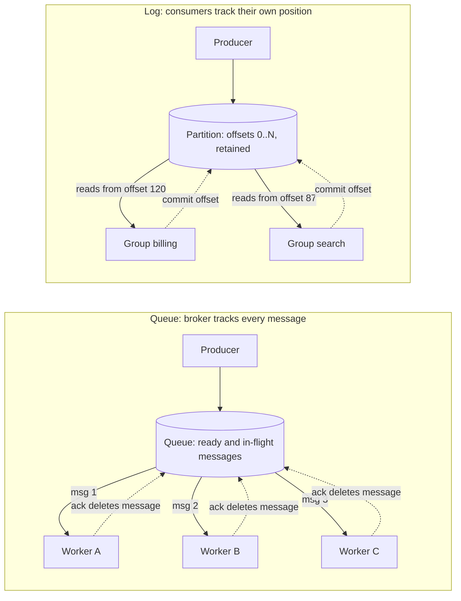
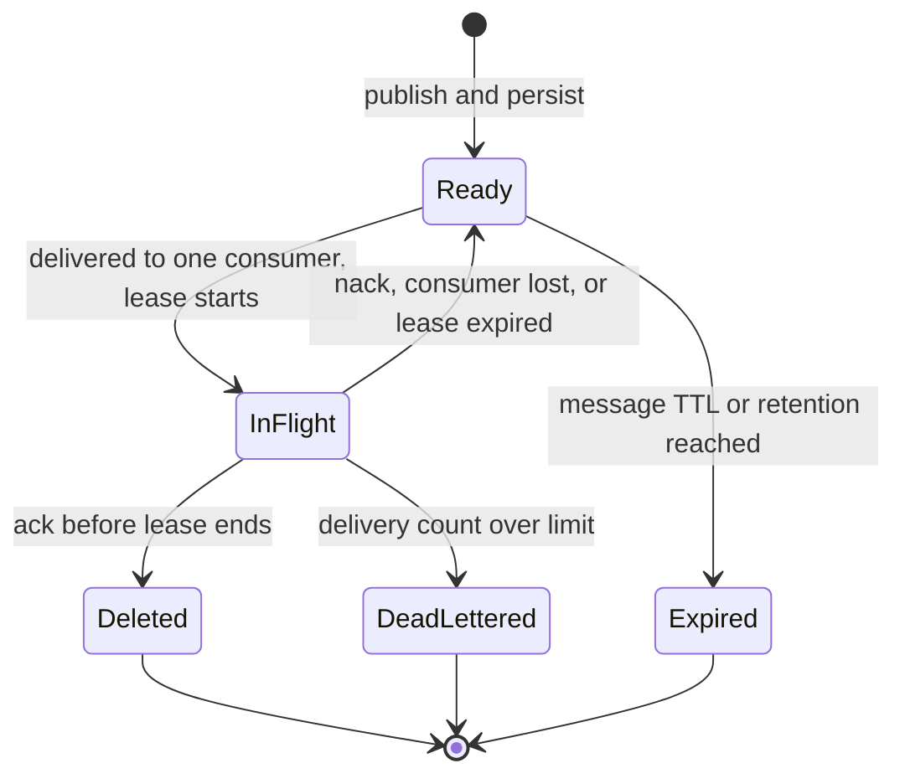
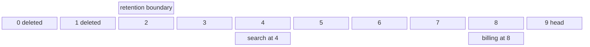
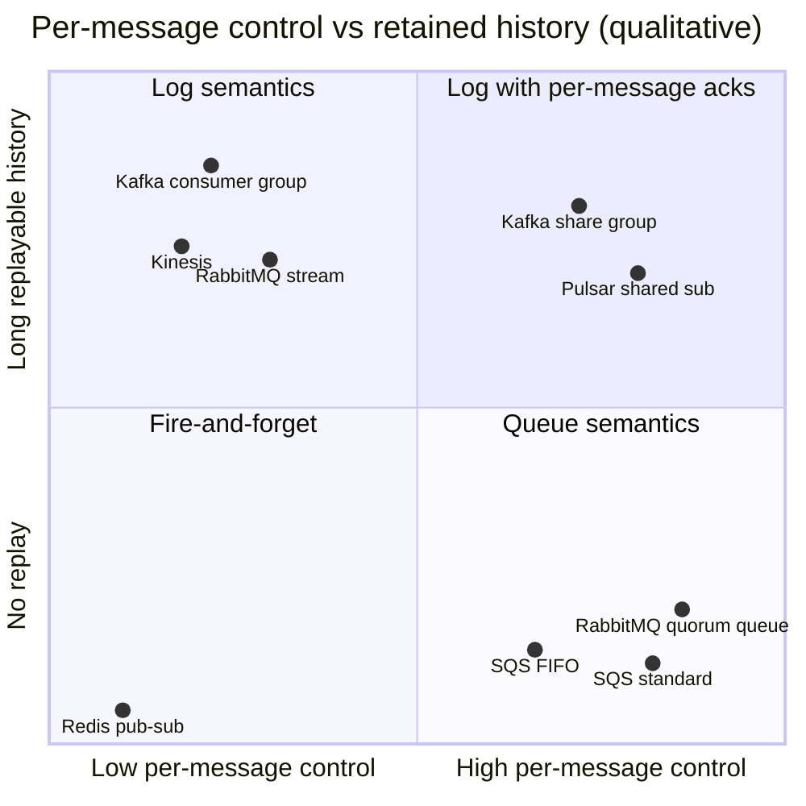
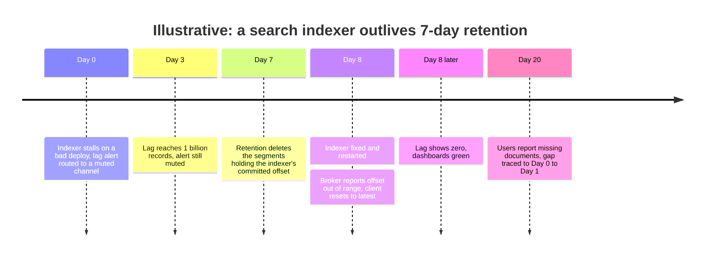

A message queue and an event stream both let a producer hand work or facts to a broker and continue without waiting for the consumer. They differ in who remembers what has been consumed. A queue keeps delivery state for every message: the broker knows which messages are waiting, which are leased to a consumer, and which have been acknowledged, and an acknowledged message is deleted. A log (the storage structure behind event streaming) keeps an append-only, ordered sequence of records that reading does not modify; each consumer remembers its own position as an integer offset, and records disappear only when a retention policy removes them, regardless of whether anyone has read them.

Every other difference follows from that choice. Per-message state lets a queue hand any message to any idle consumer, retry one message without touching its neighbors, and add consumers freely, at the price of ordering, history, and broker work proportional to message count. A single cursor per partition lets a log serve many independent readers from one copy, preserve order within a partition, and replay history on demand, at the price of parallelism bounded by partition count and head-of-line blocking: a consumer cannot acknowledge record 45 while record 43 is still unresolved. The core trade-off is per-message control and elastic parallelism against ordered, replayable, cheaply shared history.

Both exist for the same underlying reason. A synchronous call couples the caller's availability and latency to the callee's; putting a durable broker in between lets the producer succeed while the consumer is slow, down, or being deployed. The [synchronous protocols](/distributed-systems/en/communication/synchronous-protocols/) chapter covers the call-based alternative. This page compares the two broker models; the internals of specific systems belong to [Kafka Architecture](/distributed-systems/en/communication/async-messaging/kafka-architecture/), [RabbitMQ](/distributed-systems/en/communication/async-messaging/rabbitmq/), and [Pulsar vs. Kafka](/distributed-systems/en/communication/async-messaging/pulsar-vs-kafka/), and the log as a general data-infrastructure idea to [The Commit Log Abstraction](/distributed-systems/en/data-processing/hybrid-architectures/commit-log-abstraction/).


*The two broker models. In the queue, messages are distributed among workers and removed on acknowledgement; in the log, every group reads the same records and stores only a position.*

In the queue, three workers receive three different messages; adding a fourth worker immediately adds capacity, and no worker ever sees a message another worker acknowledged. In the log, the two groups read the same records at different positions, and neither affects the other: the search group is 33 records behind billing, and that lag costs the broker nothing except the retained bytes it already had to store. The dotted arrows are the essential asymmetry. A queue acknowledgement refers to one message and mutates broker state for that message; a log commit refers to a position and asserts that everything before it is done.

## The Queue Model: Leases, Acknowledgements, and Competing Consumers

A queue broker accepts a message, persists it, and places it in a ready set. When a consumer asks for work, the broker selects a ready message, moves it to an in-flight state bound to that consumer, and starts a lease. If the consumer acknowledges before the lease ends, the broker deletes the message. If the consumer rejects it, disconnects, or lets the lease expire, the broker returns it to the ready set, possibly to a different consumer. This pattern, several consumers taking work from one channel so that each message goes to exactly one of them, is called competing consumers.


*Lifecycle of one message in a queue broker. The lease is a visibility timeout in SQS, an open channel plus an acknowledgement timeout in RabbitMQ.*

Two details of this machine determine its guarantees. First, the transition from `InFlight` back to `Ready` is triggered by the broker's inability to hear from the consumer, and the broker cannot tell a slow consumer from a dead one; this is the general impossibility of distinguishing crash from delay described in [Failure Models](/distributed-systems/en/foundations/system-models/failure-models/). A consumer that has done the work but not yet acknowledged it when the lease ends will see its message processed a second time by someone else. Second, the transition into `DeadLettered` is the only exit for a message that fails on every attempt; without it, a message that crashes its consumer cycles through `InFlight` forever.

### What the Queue Guarantees and What It Does Not

The invariant a durable queue maintains is: every accepted message is either acknowledged by some consumer, moved to a dead-letter destination, or expired by an explicit policy. Nothing is silently dropped while consumers are merely absent. The argument is short. A message leaves the broker only through the three terminal transitions; deletion requires an acknowledgement; and every non-terminal state either waits for a consumer (`Ready`) or reverts on timeout (`InFlight`). As long as the broker's own storage is durable and replicated, a message cannot be lost by consumer failure, only delayed. The trade for that invariant is at-least-once delivery, because lease expiry re-delivers work that may have been completed. How applications turn this into effectively-once processing is the subject of [Delivery Semantics](/distributed-systems/en/communication/async-messaging/delivery-semantics/).

A queue does not guarantee processing order, even when it stores messages in order. With one consumer, order is lost at the first redelivery: message 7 times out, message 8 is acknowledged, and message 7 is processed after it. With N consumers, order is lost immediately: messages 7 and 8 go to two workers, and whichever finishes first commits its effect first. A FIFO queue constrains the order of delivery, not the order of completion. Systems that provide ordered processing over a queue do it by restricting concurrency per ordering key: in an SQS FIFO queue, messages with the same message group ID are handed out one at a time, and the next message in the group becomes available only after the in-flight one is deleted or its visibility timeout expires. That restores order per group and turns each group into a serial lane, which is exactly the constraint a log imposes per partition.

A queue does not keep history. Once acknowledged, a message is gone; a new consumer, a fixed bug, or an audit cannot see it again. And a queue does not share messages: if three services need the same message, the broker must route a copy into three queues, each with its own per-message state.

:::caution[A FIFO queue with ten consumers is not ordered processing]
Storing messages in order and delivering them in order says nothing about the order in which ten parallel workers finish them. If the consumer applies state changes (set price, update status), two updates for the same entity can be applied in reverse and the older value wins. Either route all messages for an entity through one serial lane (message group, consistent-hash routing to a single consumer, or a log partition), or make each update carry a version and reject stale ones at the write.
:::

### Flow Control and the Broker's Cost Profile

Consumers do not take one message, process it, and ask again; the round trip would dominate. Brokers let a consumer hold a bounded number of unacknowledged deliveries: RabbitMQ's prefetch count set through `basic.qos`, or the batch size of an SQS receive. That bound is the queue's built-in backpressure. A prefetch too high piles messages onto one slow consumer while others sit idle; a prefetch too low leaves consumers waiting on network round trips.

Every message costs the broker work: an index entry when it arrives, a state change at delivery, another at acknowledgement, and a deletion, each of which must be persisted and, for replicated queues, agreed by a quorum. Broker throughput therefore scales with acknowledgements per second, not just bytes per second, and a queue that holds a large backlog keeps all that per-message state live. Classic queue brokers are designed for queues that are usually near empty; a deep backlog shifts them from a memory-resident fast path to paging, and eventually to resource alarms that throttle producers, a failure mode covered below.

## The Log Model: Offsets, Retention, and Partitioned Order

A log broker appends each record to the end of a partition and assigns it the next offset, a monotonically increasing integer. Records are immutable once written. A topic is split into partitions so that writes and reads scale across machines; a producer chooses a partition by hashing a key, so all records with the same key land in the same partition, in the order the producer sent them. Retention is set per topic by time or size, and segments older than the boundary are deleted whole, whether or not anyone read them. Compacted topics keep the latest record per key instead, described in [Log Compaction](/distributed-systems/en/data-processing/hybrid-architectures/log-compaction/).

Consumers are organized in groups. Within a group, each partition is assigned to exactly one consumer, which reads records in offset order and periodically commits the offset of the next record it will process. The group's entire consumption state is one integer per partition. A second group reading the same topic has its own integers and is invisible to the first.


*One partition as a sequence of offsets. Segments before the retention boundary are gone; each consumer group is only a pointer into the retained range.*

Three properties are visible in this layout. Consumption is non-destructive: billing at offset 8 and search at offset 4 read the same bytes, and search can be moved back to offset 2 to reprocess. The cost of a consumer is a pointer plus the read bandwidth it uses, so a tenth group costs the broker no write amplification. And the retention boundary moves independently of both pointers: if search falls behind far enough that the boundary passes offset 4, the records it has not processed are deleted, a failure examined in the failure section.

### Why Partitioned Logs Preserve Order and Bound Parallelism

The log's ordering guarantee is per partition: if record A was appended before record B in the same partition, every consumer that processes both sees A before B. The reasoning rests on three facts. The partition leader assigns offsets in append order, so the offset sequence is the order. Each partition has at most one active consumer in a group, so there is no concurrent processing of two records from one partition. And a consumer commits a position rather than individual records, so after a crash it resumes from the last committed offset and re-reads everything after it in order. Order within a key holds because the key maps to one partition; order across partitions is not defined, and a design that needs it has either chosen the wrong key or needs a single partition.

The same three facts cap parallelism. A group can have at most as many active consumers as the topic has partitions; extra consumers sit idle. Partition count is therefore a capacity decision made in advance, and raising it later remaps keys to new partitions, which breaks per-key order during the transition. The cumulative commit also produces head-of-line blocking: the committed offset can only advance past records that are all done. If record 43 is slow or failing, records 44 and 45 can be processed but not committed, and after a crash they will be processed again.

```mermaid
sequenceDiagram
    autonumber
    participant B as Broker
    participant C as Consumer
    participant D as Downstream
    rect rgb(40, 60, 40)
    Note over B,D: Queue: per-message acknowledgement
    B->>C: Deliver m43, m44, m45
    C->>D: Process m44 and m45, ok
    C->>B: Ack m44, ack m45
    C->>D: Process m43, fails
    C->>B: Nack m43, it returns to the ready set alone
    end
    rect rgb(70, 40, 40)
    Note over B,D: Log: cumulative offset commit
    B->>C: Fetch offsets 43 to 45
    C->>D: Process 43, fails
    Note over C: Cannot commit past 42 while 43 is unresolved
    alt Retry 43 in place
        C->>D: Retry 43 until it succeeds, partition stalls
    else Skip 43
        C->>B: Commit 46, record 43 is lost unless copied elsewhere
    end
    end
```


*The same failed message under per-message acknowledgement and under a cumulative offset. Only the log forces a choice between stalling the partition and abandoning the record.*

Steps 1 to 5 show why a queue handles a bad message cheaply: the failure is isolated to message 43, which is redelivered on its own while its neighbors are already gone. Steps 6 to 9 show the log's dilemma. The consumer can retry record 43 in place, which stalls every key in the partition for as long as the retry takes, or commit past it, which abandons it unless the consumer first copies it to a retry topic or dead-letter topic. Production log consumers implement that copy explicitly; the patterns are covered in [Dead Letter Queues and Poison Message Handling](/distributed-systems/en/communication/async-messaging/dlq-poison-messages/). The broker offers no third option because a single integer cannot represent "everything up to 45 except 43".

### Why the Log Is Cheap to Run at High Volume

A log broker does almost no per-message work. Appends are sequential writes to the tail of a segment file, reads are sequential reads of contiguous byte ranges that the operating system's page cache serves for consumers near the head, and the broker never updates or deletes an individual record. Retention deletes whole segment files. The broker's mutable state per consumer group is one offset per partition, committed every few seconds rather than once per record. This is why a log can retain days of data and serve many groups without per-message bookkeeping; the storage-level mechanics are covered in [Disk-Based Persistence and Zero-Copy Optimization](/distributed-systems/en/case-studies/apache-kafka/disk-persistence-zero-copy/).

## Worked Example: One Order Stream, Two Designs

Assume an order service publishes order events at 4,000 per second on average and 12,000 per second at peak, with an average record size of 2 KB. Three consumers need them: a fulfillment worker that calls a warehouse API and takes 25 ms per message on average, a search indexer, and an analytics loader. All numbers are illustrative.

**Concurrency for fulfillment.** By [Little's Law](/distributed-systems/en/resilience/flow-control/queueing-theory-littles-law/), the number of messages in processing at once equals arrival rate times processing time: `12,000 * 0.025 = 300` concurrent messages at peak, before any headroom. With a queue, that is 300 worker slots (for example 30 instances with 10 concurrent handlers each), and the autoscaler can add slots in seconds because any slot can take any message. With a log and one in-flight record per partition, fulfillment needs at least 300 partitions, chosen before the peak arrives; at a replication factor of 3 that is 900 partition replicas for one topic. Processing several keys concurrently inside one partition reduces the partition count, but then the consumer must track per-record completion itself and commit only the lowest unfinished offset, rebuilding a queue on the client.

**One slow message.** Suppose one warehouse call in 100,000 hangs for 30 seconds before timing out. With the queue, one of 300 slots is occupied for 30 seconds, a 0.3% capacity loss with no effect on other orders. With the log, that record's partition stops advancing for 30 seconds. At peak each of 300 partitions receives `12,000 / 300 = 40` records per second, so 1,200 records queue behind the hung one, and every order hashed to that partition is delayed by up to 30 seconds. At one hang per 100,000 messages and 12,000 messages per second, a hang starts about every 8 seconds, so at any moment roughly four partitions are stalled. The log's tail latency for fulfillment is dominated by its slowest record per partition, not by its average.

**Fan-out to three consumers.** With queues, the broker routes each event into three queues and performs three deliveries and three acknowledgements per event: at peak, 36,000 acknowledgements per second and three copies of every backlog. With a log, the event is written once and read three times: `12,000 * 2 KB * 3 = 72 MB/s` of read bandwidth, mostly from page cache, and three offsets per partition of consumer state.

**Retention and replay.** A log retaining 7 days stores `4,000 * 2 KB * 86,400 * 7`, about 4.8 TB, or about 14.5 TB with three replicas. A queue in steady state stores almost nothing, but if the analytics loader is down for two hours, its queue accumulates `4,000 * 7,200 = 28.8 million` messages, about 58 GB of per-message state that a classic broker must index and page. Now suppose a bug in the search indexer corrupted documents for the last 6 hours. With the log, the indexer's offsets are reset to 6 hours ago and it reprocesses `4,000 * 21,600 = 86.4 million` records; at a catch-up rate of 20,000 records per second, that takes 72 minutes and requires no cooperation from the order service. With queues, those messages were deleted on acknowledgement, and recovery needs a bulk re-export from the order database.

The example does not pick a winner. Fulfillment is per-message work with no ordering requirement beyond per-order and a long-tailed latency distribution, which is the queue's shape. Search and analytics are independent readers of a shared history that benefit from replay, which is the log's shape. A common production answer is to write the events once to a log and give fulfillment queue semantics on top of it, either through a broker feature that offers per-record acknowledgement on a log (covered next) or through a small dispatcher that consumes the log and enqueues work.

## Where Real Systems Sit Between the Two Models

The two models are endpoints, and most current brokers offer some of both. The useful question about any system is which state it keeps per message and which per consumer.

Amazon SQS is a pure queue. A standard queue offers at-least-once delivery with no ordering, and its documentation states that a message may be delivered more than once even within the visibility timeout. The visibility timeout defaults to 30 seconds and can be extended by the consumer, but a message cannot stay invisible beyond 12 hours from its first receipt; a standard queue allows roughly 120,000 in-flight messages, after which receives return no new messages. FIFO queues add ordered, one-at-a-time delivery per message group ID, as described above.

RabbitMQ classic and quorum queues are queues; quorum queues replicate per-message state through Raft. Since RabbitMQ 4.0, quorum queues apply a default delivery limit of 20 attempts, after which a message is dead-lettered if a dead-letter exchange is configured and dropped otherwise, a breaking change for applications that relied on infinite redelivery. The broker also enforces an acknowledgement timeout, `consumer_timeout`, whose default has been 30 minutes since 3.8.17; a delivery held longer than that causes the broker to close the channel with a precondition-failed error. RabbitMQ streams, added in 3.9, are a separate append-only log type with offset-based, non-destructive reads inside the same broker.

Apache Kafka is a partitioned log with consumer groups that commit offsets. Share groups (KIP-932, "Queues for Kafka"), declared production-ready in Kafka 4.2, add queue semantics on top of the same partitions: records from a partition can be handed to several consumers at once, each record is acquired under a time-limited lock, and consumers acknowledge records individually (accept, release for redelivery, or reject), with a bounded number of delivery attempts. Share groups give up per-partition ordering in exchange for consumer counts that are not limited by partition count. The log underneath is unchanged, so a topic can serve ordinary consumer groups and share groups simultaneously.

Apache Pulsar stores each topic as a log and implements the consumption model per subscription. Exclusive and Failover subscriptions behave like a log consumer, one active reader per partition in order; Shared subscriptions distribute messages across consumers with individual acknowledgement, like a queue; Key_Shared distributes across consumers while keeping each key on one consumer. Because Pulsar tracks individual acknowledgements in each subscription's cursor, data acknowledged by every subscription becomes eligible for deletion unless a retention policy keeps it longer, while unacknowledged data stays until a backlog quota or message TTL intervenes. The architectural consequences are compared in [Pulsar vs. Kafka](/distributed-systems/en/communication/async-messaging/pulsar-vs-kafka/).

Amazon Kinesis Data Streams is a log with shards in place of partitions. In provisioned mode each shard accepts up to 1 MB per second or 1,000 records per second of writes and serves up to 2 MB per second of reads, and retention is configurable from 24 hours up to 365 days. The per-shard read cap means that adding consumers of a shard divides its read bandwidth unless they use dedicated-throughput (enhanced fan-out) consumers, a direct cost of fan-out that Kafka does not impose per partition.


*Qualitative positions, not measurements. Horizontal: whether one message can be acknowledged, retried, or dead-lettered independently. Vertical: whether consumed data can be read again.*

The chart separates what is often merged into one "queue or Kafka" decision. Moving right buys independent handling of each message; moving up buys replay and cheap fan-out. Plain publish-subscribe without storage, such as Redis pub/sub, has neither: a subscriber that is disconnected misses messages, which is why it appears only as a notification channel and never as a system of record. The upper-right quadrant is where brokers have been converging, but a system there still pays the costs of whichever model it is built on: share groups inherit Kafka's retention and partition model, and Pulsar Shared subscriptions inherit per-message acknowledgement tracking.

| Property | Message queue | Partitioned log | Log with per-message acks (share group, Pulsar Shared) |
|---|---|---|---|
| Consumption state | Per message, in the broker | One offset per partition per group | Offset range plus per-record acquisition state |
| Effect of reading | Ack deletes the message | None; retention deletes by time or size | None for the log; ack ends the record's delivery state |
| Ordering | None under parallel consumers; per group with FIFO groups | Per partition, hence per key | Not preserved |
| Max parallelism | Number of consumers | Number of partitions | Not bound by partitions |
| Failed message | Retried alone, then dead-lettered | Stalls partition or must be copied aside | Released or rejected individually |
| Replay | Not possible after ack | Reset offset within retention | Possible through the underlying log |
| Fan-out cost | One queue and full per-message state per consumer | One offset per consumer group | Per-group delivery state |
| Broker cost driver | Messages and acks per second, backlog size | Bytes per second, retained bytes | Both |
| When to prefer | Independent tasks with uneven processing time, elastic workers, no shared history | Ordered facts consumed by several services, replay, stream processing | Event log already exists and one consumer needs task-style dispatch |

## Configuration That Decides the Behavior

A small number of settings determine whether each model behaves as designed. They are worth reviewing on every new queue, topic, and consumer.

| Setting | System | Default | Effect and tuning |
|---|---|---|---|
| Visibility timeout | SQS | 30 s; at most 12 h from first receipt | Must exceed the processing time at the tail, not the mean; extend it from a long-running handler instead of setting it to hours |
| Message retention period | SQS | 4 days; maximum 14 days | How long a backlog survives a consumer outage |
| Prefetch count (`basic.qos`) | RabbitMQ | Unlimited unless set by the client | Bounds unacknowledged deliveries per consumer; set it near handler concurrency |
| `consumer_timeout` | RabbitMQ | 30 min | Maximum time a delivery may stay unacknowledged before the channel is closed |
| Delivery limit | RabbitMQ quorum queue | 20 (since 4.0) | Attempts before dead-lettering or dropping; always pair with a dead-letter exchange |
| `retention.ms` | Kafka topic | 7 days | Upper bound on how far any consumer may lag and how far back replay can go |
| `max.poll.interval.ms` | Kafka consumer | 300,000 ms | Longest gap between polls before the consumer is removed from its group and its partitions are reassigned |
| `auto.offset.reset` | Kafka consumer | `latest` | Where a group starts when it has no valid committed offset; `latest` skips everything older |

Replay in a log is an operational action on committed offsets, not a feature of the producer. For the search-indexer bug in the worked example, the reset is done with the group stopped:

```shell
# Inspect per-partition lag (LOG-END-OFFSET minus CURRENT-OFFSET) for the group
kafka-consumer-groups.sh --bootstrap-server kafka:9092 --describe --group search-indexer
# Move the group's offsets back to a point in time; omit --execute to preview
kafka-consumer-groups.sh --bootstrap-server kafka:9092 --group search-indexer \
  --topic orders --reset-offsets --to-datetime 2026-11-05T06:00:00.000 --execute
```

The reset fails while members of the group are active, which is a safety feature: changing offsets under a running consumer would be overwritten by its next commit. Replay also re-sends every side effect the consumer performs, so it is safe only for consumers whose writes are idempotent or that write to a store being rebuilt.

:::tip[Measure lag in time, not in messages]
A lag of 50,000 records is harmless on a topic receiving 20,000 per second and alarming on one receiving 50 per second. Alert on the age of the oldest unprocessed message (SQS exposes `ApproximateAgeOfOldestMessage`; for Kafka, compute the timestamp gap between the committed offset and the log end) and compare it with the processing objective for queues and with the retention period for logs. Lag in messages is a capacity signal; lag in time is the one that predicts missed deadlines and data loss.
:::

## Failure Modes and Their Signatures

The two models fail differently because they keep different state. Queue failures tend to be duplicates and broker overload; log failures tend to be stalled partitions and silently skipped data.

### Lease Shorter Than Processing Time

Trigger: a queue consumer's processing time exceeds the visibility timeout or acknowledgement window, typically after a downstream dependency slows down. Symptoms: messages are processed two or more times, throughput appears healthy while useful work falls, and the downstream receives more load exactly when it is slowest. Detection: receive count per message (SQS `ApproximateReceiveCount`, RabbitMQ's redelivered flag) rising above 1, in-flight count near its limit, duplicate-key errors downstream. Mitigation: extend the lease from inside long handlers, set the timeout from tail processing time, and make handlers idempotent. The amplification loop, where slowness causes redelivery that causes more slowness, is a form of [retry storm](/distributed-systems/en/resilience/flow-control/retry-storms-metastable-failures/).

### Poison Message

Trigger: a message that fails deterministically, such as a malformed payload or one that triggers a consumer bug. In a queue, it is redelivered until the delivery limit dead-letters it; without a limit, it consumes a worker indefinitely, and without a dead-letter destination on RabbitMQ 4.0 quorum queues, it is dropped after 20 attempts. In a log, it stops its partition: lag grows on one partition while all others stay at zero, and every key in that partition stalls. Detection: per-partition lag rather than topic-wide lag, consumer error logs repeating the same offset. Mitigation: bounded retries followed by copying the record to a dead-letter topic and committing past it. The handling patterns are covered in [Dead Letter Queues and Poison Message Handling](/distributed-systems/en/communication/async-messaging/dlq-poison-messages/).

### Retention Overtakes a Lagging Consumer

Trigger: a log consumer falls behind by more than the retention period, through a long outage, a stalled partition, or a slow backfill. Symptoms: none at first. When the consumer resumes, its committed offset points to a deleted segment, the broker reports the offset as out of range, and the client applies `auto.offset.reset`: with `latest` it jumps to the head and the unprocessed records are skipped; with `earliest` it starts from the oldest retained record.


*A hypothetical timeline, not a real incident. The loss happens on Day 7 and becomes visible on Day 20.*

The dangerous property of this failure is that the recovery step looks like success. After the reset, lag is zero and the consumer is healthy, because the records it never processed no longer exist in the topic. Nothing in the broker records that a group skipped data; the only evidence is a client log line about the offset reset. A queue cannot fail this way while its retention covers the backlog, because unconsumed messages are not deleted by age until the queue's own retention limit, which is short (14 days at most on SQS) and therefore has to be monitored the same way.

:::danger[Silent loss when lag exceeds retention]
If a consumer group's lag in time can exceed the topic's retention, data loss is possible with no error at the broker. Alert on lag age as a fraction of retention (for example at 25% and 50%), alert on any offset-out-of-range reset in consumer logs, and for consumers whose data must not be skipped, set `auto.offset.reset` to `none` so that the consumer fails loudly instead of choosing a position. Recovery requires the producer's source of truth; the log no longer has the records.
:::

### Backlog Pressure on a Queue Broker

Trigger: consumers stop or slow down while producers continue, and a queue broker holds a backlog much larger than it was sized for. Symptoms: broker memory and disk grow, latency of all queues on the broker rises, and when RabbitMQ crosses its memory or disk alarm threshold it blocks publishing connections, so producers on unrelated queues stall. Detection: queue depth and its growth rate, broker memory against the alarm threshold, blocked-connection notifications in producers. Mitigation: per-queue length limits with an explicit overflow policy, separate brokers or virtual hosts for unrelated workloads, and producer-side handling of blocked publishes. A broker throttling producers is [backpressure](/distributed-systems/en/resilience/flow-control/backpressure/) reaching the source, which is correct behavior; the failure is when it reaches producers that had nothing to do with the stuck consumer, the shared-resource pattern of a [cascading failure](/distributed-systems/en/foundations/system-models/cascading-failure/). Logs tolerate the same backlog without degradation because a lagging consumer is only an older read position.

### Consumer Evicted Mid-Batch

Trigger: a log consumer spends longer than `max.poll.interval.ms` processing one batch of records. Symptoms: the group coordinator removes it, its partitions are reassigned, the batch is reprocessed by another member from the last committed offset, and if that member also exceeds the interval, the group cycles through rebalances without making progress. Detection: rebalance rate, repeated processing of the same offsets, consumer logs reporting a failed commit after leaving the group. Mitigation: smaller batches, bounded per-record processing time, or moving long work out of the poll loop. The rebalance protocols and their failure scenarios are covered in [Consumer Group Rebalancing](/distributed-systems/en/case-studies/apache-kafka/consumer-group-rebalancing/).

### Summary of Failure Signatures

| Failure | Model | Symptom from outside | Detection signal | Mitigation |
|---|---|---|---|---|
| Lease shorter than processing | Queue | Duplicate effects, rising downstream load | Receive count above 1, in-flight near limit | Lease extension, idempotent handlers |
| Poison message | Both | Queue: worker loops; log: one partition stalls | Per-partition lag, same offset in errors | Bounded retries, dead-letter destination |
| Retention overtakes lag | Log | Missing data discovered much later | Lag age vs retention, offset-reset log lines | Lag-age alerts, `auto.offset.reset` `none` |
| Backlog pressure | Queue | Unrelated producers blocked | Queue depth, broker memory alarm | Length limits, workload isolation |
| Consumer evicted mid-batch | Log | Rebalance loop, no progress | Rebalance rate, repeated offsets | Smaller batches, bounded processing |
| Ordering assumed where none exists | Queue | Stale values overwrite newer ones | Version conflicts, out-of-order audit trail | Per-key serial lanes or versioned writes |
| Hot key | Log | One partition far behind, others idle | Per-partition throughput and lag | Better key, key splitting; see [Skew and Hot Spots](/distributed-systems/en/data-management/data-partitioning/skew-hot-spots/) |

## Choosing Between the Models

Use a queue when messages are independent units of work, when processing time varies widely between messages, when the worker pool must grow and shrink with load, and when a failed message should be retried or set aside without affecting any other message. Background jobs, email and notification sending, image or document processing, and calls to slow third-party APIs fit this shape. A queue is also the simpler system to operate when there is one consumer per message type and no requirement to read the data again.

Do not use a queue when several services need the same messages, because each needs its own copy and its own per-message state; when new consumers will need history that predates them; when per-entity order matters and the design has not explicitly created a serial lane per entity; or as a buffer that is expected to hold a large backlog for long periods, which classic queue brokers handle poorly.

Use a log when the messages are facts that several independent consumers read (an order was placed, a row changed), when per-key order matters, when consumers must be able to replay after a bug or bootstrap a new read model from history, and when throughput is high enough that per-message broker bookkeeping becomes the bottleneck. Feeding stream processors, [change data capture](/distributed-systems/en/data-processing/hybrid-architectures/change-data-capture/), and building derived stores all fit this shape; the events usually reach the log through an [outbox](/distributed-systems/en/coordination/distributed-transactions/outbox-pattern/) or CDC so that the database write and the event cannot diverge.

Do not use a plain log consumer group for task dispatch with long or highly variable processing times, because head-of-line blocking turns each slow record into a stalled partition and partition count caps the worker pool; for workloads that need per-message retry and delay without building a dead-letter path; or for low-volume, single-consumer work where the partitioning, retention, and offset-management decisions add operational cost without a matching benefit. Do not choose a log because replay "might be useful" when no consumer is idempotent enough to survive one.

When both shapes exist in one flow, write once to the log and derive the queue semantics, rather than dual-writing to two brokers: use per-record acknowledgement on the log where the broker offers it, or a dispatcher that consumes the log in order and enqueues tasks, so the log remains the single record of what happened.

:::note[Boundaries with adjacent concepts]
Publish-subscribe describes fan-out, not storage: both models can fan out, a queue by copying into several queues, a log by having several groups. Event streaming is not event sourcing: a stream carries events between services, while [event sourcing](/distributed-systems/en/microservice-patterns/event-sourcing-cqrs/event-sourcing/) makes an entity's event history its source of truth, which may or may not live in a log broker. Delivery guarantees (at-least-once, exactly-once) are properties of producer, broker, and consumer together and are covered in [Delivery Semantics](/distributed-systems/en/communication/async-messaging/delivery-semantics/); neither model provides exactly-once processing by itself.
:::

## Further Reading

- Jay Kreps, Neha Narkhede, and Jun Rao, *Kafka: A Distributed Messaging System for Log Processing*, NetDB Workshop, 2011.
- Jay Kreps, *The Log: What Every Software Engineer Should Know About Real-Time Data's Unifying Abstraction*, LinkedIn Engineering blog, 2013.
- Gregor Hohpe and Bobby Woolf, *Enterprise Integration Patterns*, Addison-Wesley, 2003 (Competing Consumers, Message Channel, Dead Letter Channel).
- Martin Kleppmann, *Designing Data-Intensive Applications*, O'Reilly, 2017 (Chapter 11, Stream Processing).
- Apache Kafka, *KIP-932: Queues for Kafka*, Apache Software Foundation Kafka Improvement Proposals.
- Amazon Web Services, *Amazon SQS Developer Guide*: visibility timeout and FIFO message groups.
