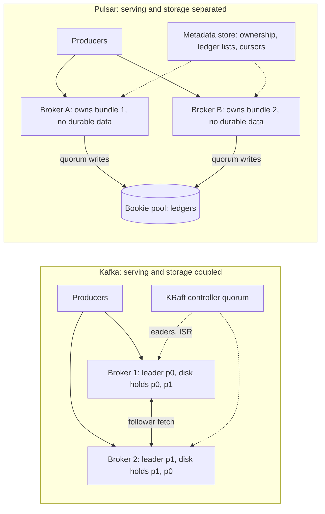
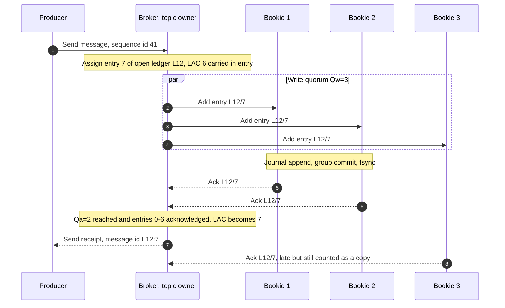
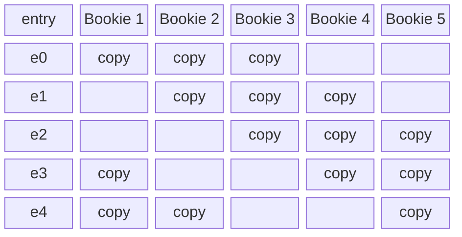
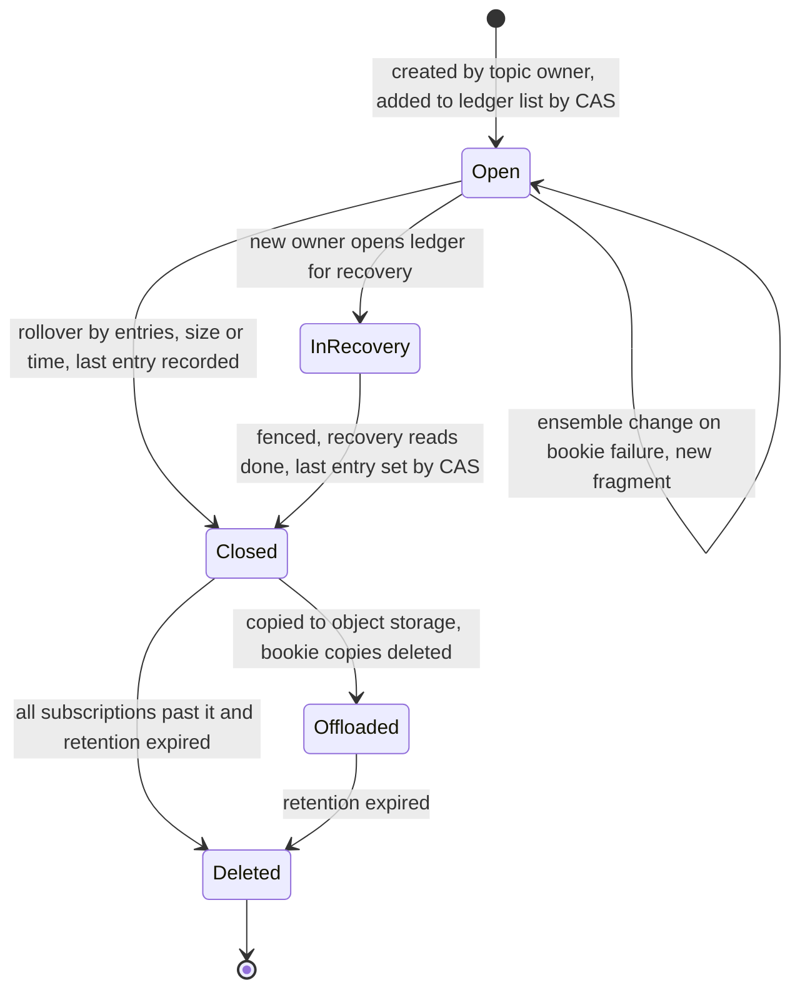

Apache Kafka and Apache Pulsar both expose an ordered, replicated, partitioned log, and both deliver per-key ordering, replay, and fan-out to many consumer groups. They differ in where a partition's bytes live and who owns them. In Kafka, a partition is a directory of segment files on the disks of a few brokers, and the broker that leads it both serves clients and stores data. In Pulsar, the broker that serves a topic stores nothing durable: it appends the topic's messages to ledgers in Apache BookKeeper, a separate cluster of storage nodes called bookies, and any broker can take over the topic by reading the ledger list from a metadata store.

The core trade-off is data locality against mobility. Kafka's coupling means that the bytes a consumer reads are on the disk of the broker it talks to, the write path involves only brokers, and there is one cluster to run; in exchange, moving a partition means copying its data, and a lost broker is replaced by streaming its full share of the log to a new machine. Pulsar's separation means topic ownership moves in seconds without copying data, storage and serving scale independently, and a failed storage node is repaired by many peers in parallel; in exchange, every write and every cold read crosses an extra network hop, consumers cannot read from a replica in their own zone, and the deployment has three distributed systems (brokers, bookies, and a metadata store) whose failure modes interact.

A second difference is the consumption model. Kafka tracks one committed offset per partition per consumer group. Pulsar tracks a cursor per subscription that records individual acknowledgements, which is what lets one topic serve both log-style and queue-style consumers, and also what lets a single unacknowledged message pin storage. Kafka's internals (ISR replication, high watermark, consumer offsets) are covered in [Kafka Architecture](/distributed-systems/en/communication/async-messaging/kafka-architecture/) and only referenced here; the general queue-versus-log distinction is in [Message Queue vs. Event Streaming](/distributed-systems/en/communication/async-messaging/message-queue-vs-event-streaming/). Pulsar's mechanisms have no other canonical page in this handbook and are explained in full below.


*Where the bytes of a partition live in each system. Solid arrows carry data; dotted arrows carry metadata.*

In the Kafka half, data and serving responsibility for a partition sit on the same machines: the leader of p0 serves p0 because it holds p0's log, and changing that requires the new leader to already hold a replica. In the Pulsar half, a broker holds only a claim of ownership recorded in the metadata store and a memory cache; the durable log is spread across the bookie pool. Everything else on this page follows from that split: where ownership can move, what a write waits for, how failures are repaired, and which component becomes the bottleneck.

## Two Ownership Models: Brokers That Store vs. Brokers That Serve

A Kafka partition has a fixed replica set chosen at creation or by an explicit reassignment, and its leader is always one of those replicas. Reassigning a partition to new brokers copies its retained data to them, throttled to protect live traffic; until the copy finishes, the partition runs with its old replicas. Kafka does not re-replicate automatically when a broker is lost: leadership fails over to an in-sync follower within seconds, but the partition stays under-replicated until the broker returns or an operator (or an external tool such as Cruise Control) reassigns it. Since Kafka 3.9, tiered storage moves closed segments to object storage, which shrinks the local data a reassignment must copy to the recent tail of each partition.

A Pulsar topic is a managed ledger: an ordered list of BookKeeper ledgers, each an append-only sequence of entries, stored as metadata alongside the topic's cursors. Only the last ledger in the list is open for writes; the earlier ones are closed and immutable. The broker that owns the topic is its only writer. To serve a topic it has just acquired, a broker reads the ledger list, recovers and closes the last ledger left by the previous owner, creates a new ledger, appends it to the list with a compare-and-swap (CAS) on the metadata, and starts accepting writes. No message bytes move.

### Topic Ownership Through Namespace Bundles

Pulsar organizes topics into tenants and namespaces, and a namespace's topic-name hash space is divided into a number of bundles, each covering a hash range. Brokers own whole bundles, not individual topics; a topic belongs to the bundle its name hashes into, and each partition of a partitioned topic is a separate internal topic hashed independently. A client connects to any broker, issues a lookup for a topic, and is told which broker owns the topic's bundle, assigning an owner if none exists.

The load manager moves bundles between brokers. It periodically compares broker load (CPU, memory, network, message rate), unloads bundles from overloaded brokers so that they are reassigned, and splits bundles that exceed thresholds on topic count, sessions, message rate, or bandwidth; splits are permanent, and bundles are not merged back. Unloading closes the topics, which causes producers and consumers to reconnect and look the topic up again. Pulsar ships two load manager implementations, the modular one that has long been the default and the extensible one introduced in Pulsar 3.0, which pre-assigns the destination broker so clients that support redirection can reconnect without a fresh lookup.

The unit of placement is therefore coarser than in Kafka and cheaper to move. Kafka places each partition replica explicitly and moves it by copying bytes; Pulsar places hash ranges of topic names and moves them by transferring a claim. The cost of this coarseness is that a single hot topic cannot be moved independently of its bundle neighbors without a split, and a topic's throughput is still bounded by the one broker that owns it, because that broker is its only writer and the only server for its consumers.

## The Storage Path: Ledgers, Quorums, and Fencing

### Ensemble, Write Quorum, and Ack Quorum

Every ledger is created with three parameters that must satisfy `E >= Qw >= Qa`. The ensemble size `E` is the number of bookies the ledger writes to. The write quorum `Qw` is the number of bookies each entry is written to. The ack quorum `Qa` is the number of those bookies that must confirm an entry before it counts as written. The broker sends each entry to its `Qw` bookies in parallel and acknowledges the producer once `Qa` of them have confirmed it and every earlier entry of the ledger has also been confirmed.


*One write with `E=3`, `Qw=3`, `Qa=2`. The last add confirmed (LAC) is the highest entry known to be acknowledged; each new entry carries the current LAC to the bookies.*

Steps 2 to 4 are the only network round trip between the producer's request and its acknowledgement, and the broker waits for the faster `Qa` of the `Qw` bookies, so one slow bookie does not set the commit latency the way the slowest in-sync follower does in Kafka. Step 7 is the condition that makes the log ordered: entry 7 is not acknowledged while entry 6 is still outstanding, even if entry 7 already has `Qa` confirmations. Step 9 shows the price of `Qa < Qw`: the third copy arrives after the producer was told the write succeeded, so for a short window an acknowledged entry exists on exactly `Qa` bookies. The BookKeeper protocol states the resulting guarantee as tolerating `Qa - 1` bookie failures without losing an acknowledged entry.

When a bookie in the write quorum stops responding, the broker does not stall the ledger. It replaces the failed bookie in the ensemble, starting a new fragment of the ledger at the first unacknowledged entry, records the change with a CAS on the ledger's metadata, and resends the pending entries to the replacement. New entries get the full `Qw` copies immediately. This is a material availability difference from Kafka, where a failed follower shrinks the in-sync replica set and new writes have fewer copies until it returns, and where `min.insync.replicas` turns further shrinkage into rejected writes.

### Striping and Placement

When `E > Qw`, entries are striped: the write quorum of entry `n` is the `Qw` consecutive ensemble members starting at index `n mod E`. Striping spreads one topic's write load and storage across more bookies than it has copies.


*Entry placement in one fragment with `E=5`, `Qw=3`. Each bookie stores three of every five entries.*

The pattern has two consequences. Each bookie stores and writes 60% of the ledger's entries instead of all of them, so a single hot topic can use more disk bandwidth than three bookies provide. But no bookie holds a contiguous range, so a sequential catch-up read must fetch from several bookies and reassemble the order, which loses most of the sequential-read advantage of a log. For that reason many deployments set `E` equal to `Qw` and get spreading across topics from the fact that each ledger picks its own ensemble. Placement policies choose ensembles: the rack-aware and region-aware policies put the members of each write quorum in different racks or zones, which is what turns `Qa - 1` bookie failures into zone failures.

### Inside a Bookie: The Journal Comes First

A bookie acknowledges an entry only after it is durable on its own disk. In the common DbLedgerStorage configuration, an incoming entry is placed in an in-memory write cache and appended to the journal, a sequential write-ahead log usually on a dedicated device. A journal thread batches entries (a group commit, flushed after at most a couple of milliseconds or a size threshold), and a separate thread calls `fsync` on the journal file; only after that `fsync` completes are the acknowledgements sent. Later, the write cache is sorted by ledger and entry and flushed to entry log files on the ledger disks, with an entry-location index (stored in RocksDB) recording where each entry landed; a periodic checkpoint records how much of the journal is safely reflected in the entry logs, and older journal files are deleted. The same separation applies to reads: a catch-up read is served from the ledger disks through the index and a read cache, never from the journal device, so a consumer replaying days of history does not compete with the journal for the device that sets write latency.

This differs from Kafka at the exact point that matters for correlated failures. Kafka acknowledges an `acks=all` write once it is in the page cache of every in-sync replica and relies on replication rather than `fsync` for durability, as discussed in [Disk-Based Persistence and Zero-Copy Optimization](/distributed-systems/en/case-studies/apache-kafka/disk-persistence-zero-copy/). A bookie's acknowledgement means the entry survives a power loss of that machine. Pulsar pays for this with an `fsync` on every group commit, which is why bookie journals are placed on low-latency devices; Kafka pays nothing per write but loses acknowledged data if every replica loses power before write-back.

The broker side has a matching cache. The topic owner keeps recently written entries in its managed-ledger cache, so consumers reading at the tail are served from broker memory without touching bookies. Consumers that fall behind the cache cause catch-up reads to the bookies, an extra network hop that Kafka avoids when the data is in the leader's page cache.

### Ledger Lifecycle and the Single-Writer Guarantee

BookKeeper does no leader election. It guarantees that a ledger has at most one writer and that every reader sees the same entries in the same order, and it enforces the first property with fencing rather than by trusting that only one broker believes it owns the topic.


*States of one ledger in a managed ledger. Only the newest ledger of a topic can be open.*

A managed ledger rolls over to a new ledger when the current one reaches an entry count, a size limit, or a maximum age, subject to a minimum age; the configuration reference lists defaults of 50,000 entries, a 10-minute minimum, and a 240-minute maximum. Rollover is what makes retention possible, because storage is reclaimed only by deleting whole ledgers, and it is also a metadata write, so a topic cannot roll over while the metadata store is unavailable. Closed ledgers can be offloaded to object storage by Pulsar's tiered storage, after which reads of that range are served from the object store.

The InRecovery path is how ownership changes safely. The new owner sets the ledger's metadata to IN_RECOVERY, sends a fence request to the bookies of the last fragment, and waits for enough of them to persist the fenced state; a fenced bookie rejects any further add from the old writer with a LedgerFenced error. It then asks the bookies for their highest LAC, reads forward from there entry by entry, re-replicates each entry it finds to a full write quorum, and when no further entry can be read, closes the ledger by writing the last entry ID to the metadata with a CAS. Only then does it create a new ledger and accept writes.

### Why Fencing Is Correct

The guarantee that needs proof is that a broker which has lost ownership but does not know it, for example one emerging from a long garbage-collection pause, cannot get a new entry acknowledged after the new owner has decided where the ledger ends. An entry is acknowledged only with `Qa` confirmations from its write quorum of `Qw` bookies. The new owner waits for fence confirmations from `Qw - Qa + 1` bookies of every write quorum. At most `Qa - 1` bookies of any write quorum remain unfenced, so the old writer can collect at most `Qa - 1` confirmations for any new entry: never enough. Its attempts to route around the fenced bookies with an ensemble change also fail, because the CAS on the ledger metadata finds the state IN_RECOVERY instead of OPEN.

The recovery read gives the second half. Every entry that was acknowledged to a producer is on `Qa` bookies of its quorum, and the new owner has heard from `Qw - Qa + 1` bookies of that quorum, so at least one of them holds the entry. Reading forward until nothing more can be read therefore finds every acknowledged entry and possibly some unacknowledged ones, which are re-replicated and become part of the log; a producer that timed out on such an entry and retries it will create a duplicate unless broker-side deduplication on producer sequence IDs is enabled. Concurrent recoveries converge because only one CAS to CLOSED can succeed. The same structure applies at the managed-ledger level: the ledger list is updated only by CAS, so two brokers cannot both append a new ledger to a topic.

:::note[Ownership is advisory; fencing is the enforcement]
Bundle ownership in the metadata store tells clients which broker to talk to, but a stale owner can still hold open connections to bookies. Correctness does not depend on the stale owner noticing; it depends on the bookies refusing it. This is the fencing-token idea from [Split Brain and Fencing](/distributed-systems/en/data-management/replication/failover-leader-election/), implemented in the storage layer itself. Kafka achieves the same effect with leader epochs checked by followers and the controller, as described in [Kafka Architecture](/distributed-systems/en/communication/async-messaging/kafka-architecture/).
:::

## Consumption: Offsets vs. Cursors and Subscriptions

A Kafka consumer group's state is one committed offset per partition, the next record to process, and nothing per record. Pulsar stores a cursor per subscription per topic. The cursor has a mark-delete position, below which every message is acknowledged, and above it a set of individually acknowledged ranges, the holes left by out-of-order acknowledgement. The cursor is persisted in its own ledger in BookKeeper and referenced from the metadata store.

The subscription type decides how a subscription dispatches messages. Exclusive and Failover allow one active consumer and deliver in order, which is Kafka's consumer-group model per partition. Shared delivers round-robin to any number of consumers with individual acknowledgement, a queue on top of the log. Key_Shared delivers to many consumers while keeping each key on one consumer at a time; when consumers join or leave, it must hold back messages for keys whose ownership is moving until earlier messages for those keys are acknowledged. Pulsar 4.0 reworked this mechanism (PIP-379) to remove unnecessary blocking during consumer changes, but the underlying constraint remains: a consumer that never acknowledges a message for a key blocks later messages for that key. How these types compare with queues and with Kafka share groups is covered in [Message Queue vs. Event Streaming](/distributed-systems/en/communication/async-messaging/message-queue-vs-event-streaming/).

Per-message acknowledgement couples consumption to storage in a way Kafka's model does not. Kafka deletes segments by time or size regardless of whether any group has read them. Pulsar, without a retention policy, deletes a ledger once every subscription's mark-delete position is past its last entry; a retention policy keeps acknowledged data longer, a backlog quota limits how much unacknowledged data a topic may hold, and a message TTL acknowledges messages automatically after a time. A ledger can be deleted only when it is entirely below the oldest mark-delete position of any subscription, so the oldest unacknowledged message of the slowest subscription determines how much storage the topic uses, independent of how much has been acknowledged above it.

The individually acknowledged ranges also have a size limit. The broker persists at most `managedLedgerMaxUnackedRangesToPersist` ranges (10,000 by default) per cursor; holes beyond that are tracked only in memory, and if the broker crashes, the messages in them are redelivered. Workloads that acknowledge widely out of order, typically Shared or Key_Shared subscriptions with a few stuck messages, reach this limit and turn a broker restart into a burst of duplicates. PIP-381 proposes splitting large cursor state across multiple entries to raise the effective limit.

:::tip[Alert on the oldest unacknowledged message, not on backlog count]
A Pulsar subscription with a backlog of 20 messages can pin a week of ledgers if one of those 20 is a poison message sitting at the mark-delete position. Topic storage (`pulsar_storage_size`) climbing while `pulsar_subscription_back_log` stays small is the signature. Monitor the age of each subscription's mark-delete position, and route messages that repeatedly fail to a dead-letter topic as described in [Dead Letter Queues and Poison Message Handling](/distributed-systems/en/communication/async-messaging/dlq-poison-messages/).
:::

## Worked Example: One Workload on Both Architectures

Take the workload from the sizing example in [Kafka Architecture](/distributed-systems/en/communication/async-messaging/kafka-architecture/): 50 MB/s of produce traffic at peak, 20 MB/s on average, three days of retention, three consumer groups, three availability zones, and three copies of every byte with one copy per zone. The unique retained data is 5.18 TB, 15.6 TB with copies. The Kafka cluster has 9 brokers. The Pulsar cluster has 6 brokers and 9 bookies (three per zone), with `E=3`, `Qw=3`, `Qa=2` and zone-aware placement. All numbers are illustrative.

**Cross-zone traffic.** For Kafka, the earlier example derived 233 MB/s at peak when consumers read from leaders and 133 MB/s when consumers fetch from a follower in their own zone. For Pulsar, producers reach the owning broker from a random zone, so two thirds of 50 MB/s, 33 MB/s, crosses zones. The broker writes three copies, at most one in its own zone, so at least 100 MB/s crosses zones. The three consumer groups read 150 MB/s from the owning broker, of which two thirds, 100 MB/s, crosses zones. The total is about 233 MB/s, and there is no equivalent of follower fetching, because only the topic owner serves consumers. Pulsar's design costs about 75% more cross-zone traffic than a Kafka cluster with follower fetching enabled, for this read-heavy shape.

**Losing a broker.** A Kafka broker holds 15.6 / 9 = 1.73 TB. When it fails, leadership of its partitions moves within seconds and the partitions run with two in-sync replicas. If the machine is lost for good, a replacement broker must fetch 1.73 TB; at a replication throttle of 150 MB/s that takes about 11,500 seconds, a little over three hours, during which those partitions are at `min.insync.replicas=2` and one more failure among them blocks writes. A Pulsar broker failure involves no data at all: its bundles are reassigned, and each topic pays one ledger recovery and one ledger creation. The cost moves to the metadata store and to clients: with, say, 4,000 topics on the failed broker and three metadata writes per topic (ledger state to recovery, ledger closed, new ledger added to the list), the store absorbs 12,000 writes plus the lookups of every reconnecting client in a short burst.

**Losing a bookie.** A bookie also holds 1.73 TB, but its ledgers' other copies are spread over the other bookies, so BookKeeper's autorecovery copies the missing fragments from many sources at once. Zone-aware placement narrows the destinations: to keep one copy per zone, replacements must be the two surviving bookies in the failed bookie's zone. If each ingests at 100 MB/s, recovery runs at 200 MB/s and takes about 8,650 seconds, 2.4 hours. The many-to-many advantage is real but bounded by the number of nodes per zone. With 30 bookies, 10 per zone, each holds 0.52 TB and nine destinations at 100 MB/s finish in under 10 minutes; a 30-broker Kafka cluster still rebuilds 0.52 TB onto one replacement broker, about an hour at 150 MB/s.

```mermaid
gantt
    title Illustrative recovery after permanently losing one of nine storage nodes
    dateFormat HH:mm
    axisFormat %H:%M
    section Kafka broker lost
    Leaders move to followers : k1, 00:00, 1m
    Under-replicated, waiting for operator : k2, after k1, 30m
    Replacement copies 1.73 TB at 150 MB/s : k3, after k2, 192m
    section Pulsar bookie lost
    New writes switch ensembles : p1, 00:00, 1m
    Autorecovery to two bookies in zone : p2, after p1, 144m
    section Pulsar broker lost
    Bundles reassigned, ledgers recovered : b1, 00:00, 2m
```


*Recovery windows for the nine-node example. Rates, the 30-minute operator delay, and durations are illustrative assumptions.*

The chart shows three different shapes rather than a winner. Kafka's window is the longest because it includes a human step and a single-destination copy, and during all of it the affected partitions have no spare replica. Pulsar's bookie recovery starts without an operator and new writes regain three copies immediately, but in a small, zone-aware cluster the copy itself is not much faster. Pulsar's broker failure is the shortest window, because there is nothing to copy; its risk is the metadata and reconnection burst, examined below. Note also that Kafka's tiered storage, by keeping only recent segments local, shrinks Kafka's copy step in proportion to how much of the retention lives in the object store.

## Production Trade-offs

| Dimension | Kafka | Pulsar | When to prefer |
|---|---|---|---|
| Unit of storage | Partition directory on each replica broker | Ledgers striped or spread across a bookie pool | Kafka for fewer moving parts; Pulsar when storage and serving must scale separately |
| Commit rule | Every ISR member has the record, page cache, no `fsync` | `Qa` of `Qw` bookies acknowledged after journal `fsync` | Pulsar when correlated power loss is in the threat model; Kafka when per-write `fsync` cost matters more |
| Moving load | Reassignment copies retained data | Bundle unload transfers ownership, no copy | Pulsar for frequent rebalancing and elastic broker counts |
| Storage node loss | Under-replicated until operator or tool reassigns | Ensemble change for new writes, automatic re-replication | Pulsar for large clusters with many nodes per zone |
| Reads from local zone | Follower fetching for consumers | Only the topic owner serves consumers | Kafka when cross-zone read traffic dominates cost |
| Consumer state | Offset per partition per group | Cursor with mark-delete position and ack ranges | Pulsar for mixed queue and stream consumption on one topic |
| Retention coupling | Time or size, independent of consumers | Unacknowledged data retained until quota or TTL | Kafka when slow consumers must never affect storage |
| Multi-tenancy | Quotas and ACLs on a flat topic namespace | Tenants, namespaces, per-namespace policies and isolation | Pulsar for many teams on one cluster |
| Geo-replication | MirrorMaker 2 or vendor tools, offset translation | Built in per namespace, asynchronous | Pulsar when replication must be a namespace policy |
| Ecosystem | Kafka protocol is the de facto standard | Own protocol; Kafka-protocol adapters exist | Kafka when clients, connectors, and stream processors are already Kafka-native |

The rows interact. Pulsar's cheaper load movement and automatic repair are worth most in large, multi-tenant clusters where the operator would otherwise be reassigning partitions constantly. Kafka's simpler deployment and zone-local reads are worth most for a few high-volume pipelines owned by one team. The commit rule row is often overstated in both directions: Pulsar's `fsync` matters only for failures that take down all copies at once, and Kafka's page-cache acknowledgement is safe exactly as long as zones fail independently.

The two designs are converging. Kafka's tiered storage moved most retained bytes off broker disks, and KIP-1150, accepted in March 2026, defines diskless topics that write directly to object storage; as of this writing its implementation proposals (KIP-1163 and KIP-1164) were still under discussion and it is not part of an Apache Kafka release. Pulsar 5.0, the LTS line released in October 2026, recommends Oxia as the metadata store for new clusters and adds scalable topics, a new topic type that splits and merges key ranges at runtime while preserving per-key order, available through a new Java client API. Both changes target the same weakness each design had: Kafka's cost of moving data, and Pulsar's fixed partition count and metadata-store scaling.

### Configuration That Decides Durability and Retention

| Parameter | Scope | Default | Effect and tuning |
|---|---|---|---|
| Ensemble, write quorum, ack quorum | Namespace persistence policy or broker defaults | Differ between shipped config files; the Helm chart has used 1 | `E=3`, `Qw=3`, `Qa=2` with zone-aware placement for data that must survive a zone |
| `managedLedgerMaxEntriesPerLedger` | Broker | 50,000 | Rollover by entries; smaller ledgers make retention finer-grained but add metadata writes |
| Min and max ledger rollover time | Broker | 10 and 240 minutes | Bounds ledger age; low-traffic topics roll over by time |
| `managedLedgerMaxUnackedRangesToPersist` | Broker | 10,000 | Ack holes beyond this are lost on broker crash and redelivered |
| `backlogQuotaDefaultRetentionPolicy` | Broker or namespace | `producer_request_hold` | What happens at the quota: hold producers, fail them, or evict the oldest backlog |
| `maxUnackedMessagesPerConsumer` | Broker | 50,000 | Stops dispatch to a consumer holding this many unacknowledged messages |
| Retention policy | Namespace | No retention of acknowledged data | Size and time to keep acknowledged data for replay |
| Message TTL | Namespace | Disabled | Auto-acknowledges old messages; bounds storage, silently drops work |

Persistence and quota policies are set per namespace, which is where Pulsar's multi-tenancy model puts them:

```shell
# Three copies across zones; producer acknowledged after two journal fsyncs
pulsar-admin namespaces set-persistence \
    --bookkeeper-ensemble 3 --bookkeeper-write-quorum 3 \
    --bookkeeper-ack-quorum 2 --ml-mark-delete-max-rate 0 \
    payments/orders
# Keep 7 days of acknowledged data for replay
pulsar-admin namespaces set-retention --size 2T --time 7d payments/orders
# Cap unacknowledged backlog; hold producers instead of dropping data
pulsar-admin namespaces set-backlog-quota --limit 500G \
    --policy producer_request_hold payments/orders
```

:::caution[Check the quorum defaults of your deployment method]
Pulsar's standalone configuration and, at least until a 2025 change proposal, the official Helm chart default the ensemble, write quorum, and ack quorum to 1. A cluster deployed this way acknowledges every write from one bookie, and losing that bookie's disk loses data, while every dashboard shows a healthy multi-bookie cluster. Set the persistence policy explicitly on every namespace that carries data you cannot regenerate, and verify it with `pulsar-admin namespaces get-persistence`.
:::

## Failure Modes and Their Signatures

Kafka's own failure modes, including lost writes under `acks=1`, rejected writes below `min.insync.replicas`, hot partitions, and offset expiry, are covered in [Kafka Architecture](/distributed-systems/en/communication/async-messaging/kafka-architecture/). The failures below are specific to Pulsar's separated design or are where the two systems fail differently.

### Zombie Broker After a Pause

Trigger: the owner of a topic stalls long enough, through a garbage-collection pause, a network partition from the metadata store, or a frozen VM, for its metadata session to expire and the bundle to be assigned to another broker. Symptoms: producers connected to the old owner see send timeouts and then reconnect; the old owner's logs show LedgerFenced errors and topic closures. No acknowledged message is lost and no two writers interleave entries.

```mermaid
sequenceDiagram
    autonumber
    participant A as Broker A, old owner
    participant M as Metadata store
    participant B as Broker B, new owner
    participant K as Bookies of ledger L12
    Note over A: GC pause, session to metadata store expires
    M->>B: Bundle assigned to B
    B->>M: Set L12 to IN_RECOVERY by CAS
    B->>K: Fence L12
    K-->>B: Fenced, from Qw - Qa + 1 bookies per quorum
    B->>K: Read LAC, recover entries forward
    B->>M: Close L12 at last entry, add L13 by CAS
    rect rgb(70, 40, 40)
    Note over A: Pause ends, A still believes it owns the topic
    A->>K: Add entry L12/90
    K-->>A: LedgerFenced
    A->>M: Ensemble change for L12
    M-->>A: CAS fails, ledger not OPEN
    end
    Note over A: A closes the topic, clients reconnect to B
```


*A stale owner resuming after its bundle moved. The fenced bookies, not the old owner's awareness, prevent split-brain writes.*

Steps 3 to 7 are the recovery protocol from the previous section, and they complete before broker A wakes up. In steps 8 to 11, broker A tries both ways to write: directly, which the fenced bookies refuse, and around the fenced bookies by an ensemble change, which the metadata CAS refuses. Without fencing, steps 8 and 9 would append entry 90 to a ledger that broker B had already declared closed at an earlier entry, and readers would disagree about the log's contents. Detection: LedgerFenced and topic-fenced messages in broker logs, bundle ownership changes in load-manager logs, and metadata session expirations. Mitigation: size the broker heap and garbage collector so pauses stay well below the metadata session timeout, and treat repeated fencing on one broker as a sign that it is unhealthy rather than unlucky. A producer that timed out at step 8 retries against broker B; broker-side deduplication keyed on producer name and sequence ID prevents a duplicate if the first attempt was in fact recovered in step 6.

### Metadata Store Degradation

Trigger: the metadata store (ZooKeeper, or Oxia on newer clusters) becomes slow or unavailable, through disk latency on its log device, a session storm, or loss of its quorum. Symptoms: existing topics keep producing and consuming on their open ledgers, which can hide the problem; ledger rollovers, topic loads, bundle reassignments, cursor ledger switches, and new subscriptions fail or hang; any broker failure during the episode leaves its topics unavailable, because no other broker can acquire them. Detection: metadata store request latency and session expiration counts, broker errors on ledger creation, topics stuck in a loading state. Mitigation: dedicated low-latency storage for the metadata store, limits on the rate of bundle unloads, and capacity planning for the burst of a broker failure, which in the worked example is about 12,000 writes. Kafka has the analogous dependency on its KRaft controller quorum, covered in [KRaft Mode](/distributed-systems/en/case-studies/apache-kafka/kraft-mode/), but its controllers are not on the path of segment rolls or consumer progress.

### Storage Pinned by One Unacknowledged Message

Trigger: a subscription with individual acknowledgement leaves one message unacknowledged, typically a poison message that crashes its handler or a Key_Shared key held by a stuck consumer. Symptoms: topic storage grows steadily although the backlog count stays small; bookie disks fill on the bookies holding that topic's ledgers; eventually the backlog quota acts, holding producers or evicting backlog by policy. Detection: `pulsar_storage_size` rising with flat `pulsar_subscription_back_log`, a mark-delete position that does not advance, `pulsar_subscription_blocked_on_unacked_messages` at 1, rising `pulsar_subscription_msg_rate_redeliver`. Mitigation: negative acknowledgement with a bounded redelivery count and a dead-letter topic, an acknowledgement timeout for consumers that may hang, and a backlog quota sized to the alert rather than to the disk. Removing an inactive subscription is the immediate fix when it belongs to a decommissioned consumer, a common cause in multi-team clusters.

### Bookies Read-Only or Too Few for an Ensemble

Trigger: bookie disks cross the usage threshold, which turns a bookie read-only, or several bookies fail so that the placement policy cannot find `E` writable bookies satisfying the zone constraint. Symptoms: ledger creation and ensemble changes fail, so topics cannot roll over or recover from a bookie failure; producers see send failures across many topics at once, not on one partition. Detection: `bookie_SERVER_STATUS` at 0 for read-only bookies, count of writable bookies per zone, broker errors about not enough bookies. Mitigation: alert on writable-bookie headroom per zone, keep at least one spare writable bookie per zone beyond `E` divided by the zone count, and add bookies before disks fill, since new bookies receive new ledgers immediately without any rebalancing of old data.

:::danger[Qa=1 acknowledges data that exists on one disk]
With `Qa=1`, a producer is acknowledged after one bookie has the entry, even if `Qw` is 3. If that bookie's disk fails before the other copies are written, or if the other writes were never delivered because the broker crashed at the same moment, the acknowledged entry is gone, and recovery reads will silently close the ledger before it. Use `Qa >= 2` for any data whose loss is not acceptable; with zone-aware placement, this is what makes an acknowledged write survive the loss of a zone.
:::

### Geo-Replication Lag and Failover Duplicates

Trigger: inter-region bandwidth drops or a remote cluster is unavailable. Pulsar geo-replication is asynchronous: each remote cluster has a replicator on every local topic, a cursor plus a producer to the remote topic, and messages are acknowledged to the local producer before replication. Symptoms: a growing replication backlog, which also pins local storage like any slow subscription; after failing consumers over to the other region, reprocessing of up to the last snapshot interval and of every message acknowledged out of order. Replicated subscriptions synchronize only the mark-delete position, using periodic snapshot markers (about one second by default per PIP-33), and they stop taking new snapshots while any participating cluster is unreachable. Detection: `pulsar_replication_backlog` per topic and remote cluster. Mitigation: idempotent consumers, as described in [Delivery Semantics](/distributed-systems/en/communication/async-messaging/delivery-semantics/), and a backlog quota that accounts for replication cursors. Kafka with MirrorMaker 2 has the same asynchronous loss window and its own offset-translation lag; neither system offers a cross-region acknowledged write without a synchronous, stretched deployment.

### Summary of Failure Signatures

| Failure | System | Symptom from outside | Detection signal | Mitigation |
|---|---|---|---|---|
| Zombie owner | Pulsar | Send timeouts, reconnects, no loss | LedgerFenced in broker logs, ownership changes | Pause-free broker tuning, deduplication |
| Metadata store degraded | Pulsar | Healthy traffic, but no rollovers or failovers | Metadata latency, ledger creation errors | Dedicated storage, unload rate limits |
| Storage pinned | Pulsar | Storage grows, small backlog | `pulsar_storage_size` vs. `pulsar_subscription_back_log` | Dead-letter topic, ack timeout, quota |
| Ack holes lost on crash | Pulsar | Duplicate burst after broker restart | Unacked ranges near 10,000 | Fix stuck messages, larger cursor state |
| Too few writable bookies | Pulsar | Failures across many topics | `bookie_SERVER_STATUS`, writable bookies per zone | Spare bookies per zone, disk alerts |
| Replication lag | Both | Remote region behind, duplicates on failover | `pulsar_replication_backlog`, MirrorMaker 2 lag | Idempotent consumers, bandwidth headroom |
| Slow re-replication | Kafka | Long under-replicated window after broker loss | `UnderReplicatedPartitions` over time | Throttled reassignment, tiered storage |

## Choosing Between Them

Choose Pulsar when the cluster serves many tenants or teams whose topics must be isolated by policy, when broker capacity must change frequently and moving load cannot mean moving data, when the same events must be consumed both as an ordered stream and as a work queue with per-message retry, when geo-replication should be a namespace setting rather than a separate system, or when the durability requirement includes correlated power loss and an `fsync` per write is acceptable. These conditions favor Pulsar more strongly as the cluster grows: the many-to-many recovery and ownership mobility of the worked example pay off with many nodes per zone, not with nine.

Do not choose Pulsar for a small number of high-throughput pipelines owned by one team, where the extra metadata store and bookie tier add operational surface without buying mobility that is needed. Do not choose it when cross-zone read traffic is the dominant cost and consumers outnumber producers, because only the topic owner serves reads. Do not choose it when the surrounding ecosystem (connectors, stream processors, client libraries, managed offerings the organization already uses) speaks the Kafka protocol, because protocol adapters add a translation layer with its own compatibility limits. And do not adopt Shared or Key_Shared subscriptions without a dead-letter policy, since their per-message acknowledgement turns a single stuck message into unbounded storage.

Choose Kafka when the workload is a stream of facts with stable partition keys, read by several consumer groups at the tail, where per-partition offsets are the right unit of progress; when the team prefers one distributed system to three; and when follower fetching and zone-aware placement make cross-zone cost the deciding factor. Do not choose Kafka when partitions must move often, for example in a shared platform with constantly changing tenant load, unless tiered storage keeps local data small enough that reassignment is cheap. Do not rely on it for task-queue semantics on versions without share groups. And whichever system is chosen, the operational knowledge that matters is in its failure paths: ISR and `min.insync.replicas` in Kafka, fencing, quorums, and cursor retention in Pulsar.

Stream processing on top of either system is covered in [Stream Processing](/distributed-systems/en/data-processing/stream-processing/), and the log as a general integration abstraction in [The Commit Log Abstraction](/distributed-systems/en/data-processing/hybrid-architectures/commit-log-abstraction/).

## Further Reading

- Flavio P. Junqueira, Ivan Kelly, and Benjamin Reed, *Durability with BookKeeper*, ACM SIGOPS Operating Systems Review, 2013.
- Apache BookKeeper, *The BookKeeper Protocol*, Apache Software Foundation documentation.
- Apache Pulsar, *Architecture Overview* and *Load Balance across Brokers*, Apache Software Foundation documentation.
- Apache Pulsar, *PIP-33: Replicated Subscriptions*, Apache Software Foundation Pulsar Improvement Proposals.
- Jack Vanlightly, *Apache BookKeeper Internals* (series), Splunk MaaS engineering blog, 2021.
- Apache Kafka, *KIP-1150: Diskless Topics*, Apache Software Foundation Kafka Improvement Proposals.
