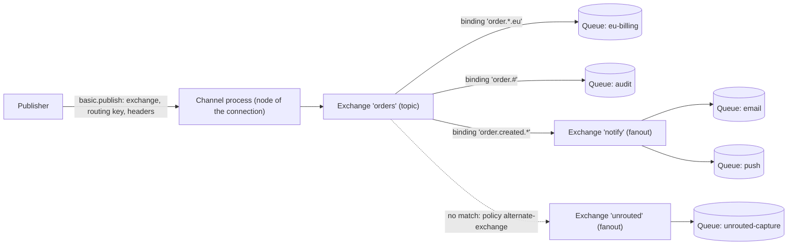
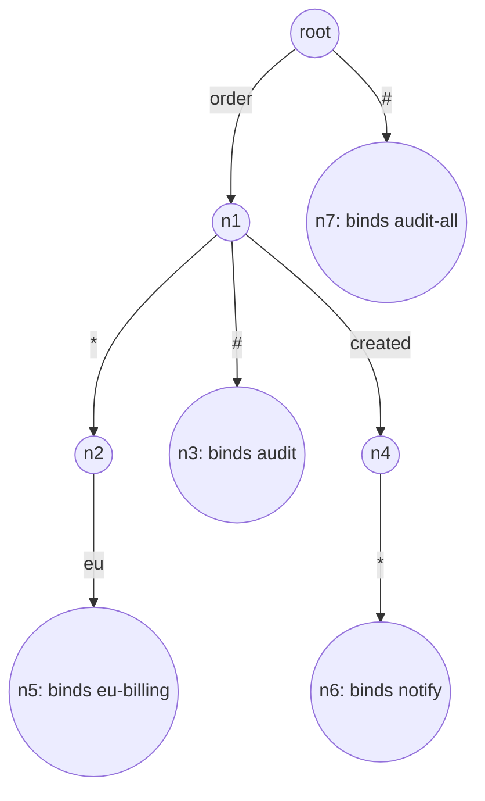
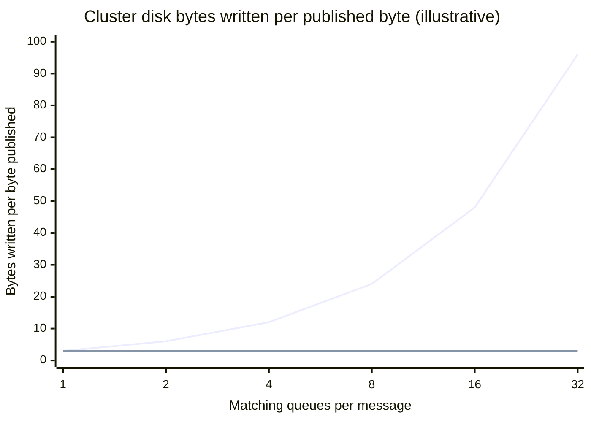
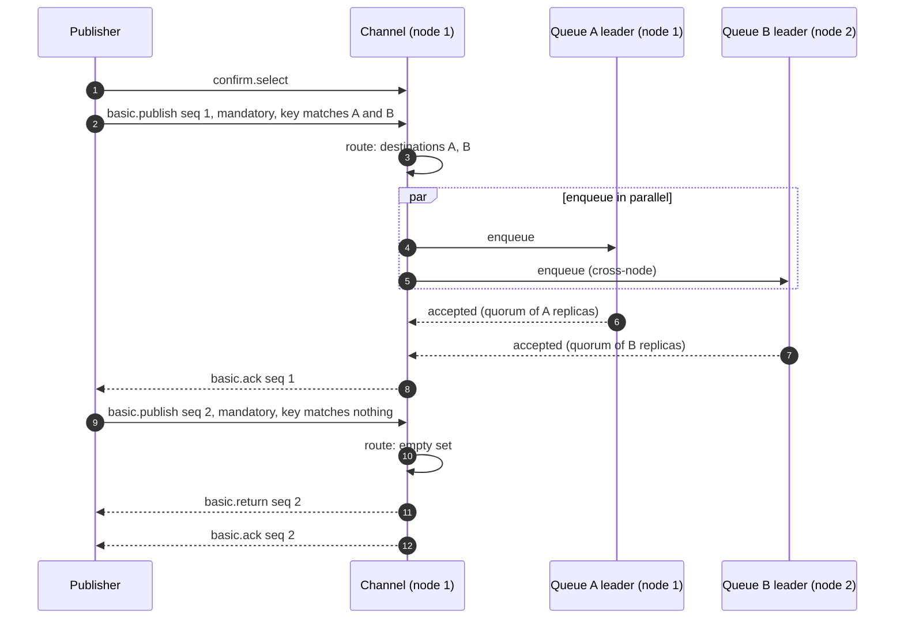
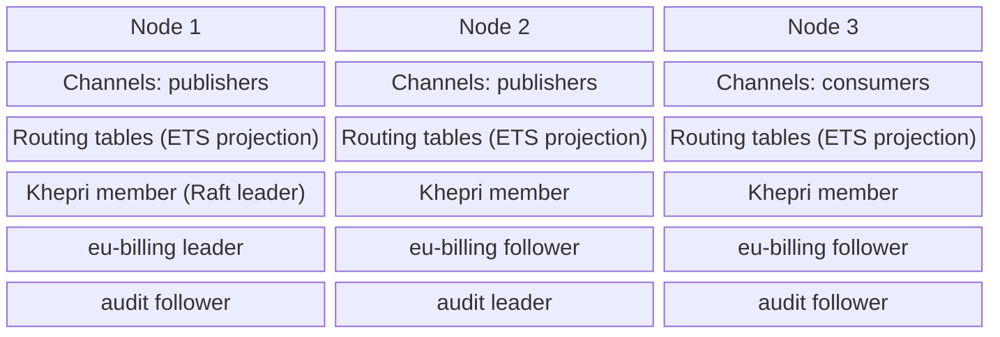
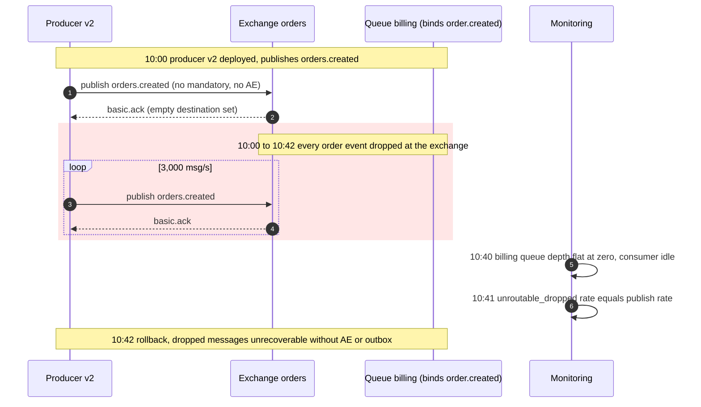

In RabbitMQ a publisher never writes to a queue. It hands a message, a routing key, and optional headers to an exchange, and the exchange decides which queues receive a copy by evaluating bindings: rules that connect the exchange to queues (or to other exchanges) and that the consuming side declares. The exchange stores nothing; routing is a function evaluated once per published message that maps the message's routing key and headers to a set of destinations. That indirection is the model's whole point: producers name a business event (`order.created.eu`), consumers subscribe to the subset they care about by binding their own queue, and neither side knows how many of the other exist. This page covers that routing layer, the AMQP 0-9-1 model that RabbitMQ implements and extends; the lease and acknowledgement behaviour of queues is covered in [Message Queue vs. Event Streaming](/distributed-systems/en/communication/async-messaging/message-queue-vs-event-streaming/).

The core trade-off is that routing happens at write time, inside the broker, per destination. Every queue a message matches receives its own copy, persisted and replicated independently, so fan-out multiplies disk writes, replication traffic, and memory by the number of matching queues. In exchange, each consumer receives only what it subscribed to, each subscription has its own backlog and its own failure isolation, and filtering logic lives in the broker's topology rather than in every consumer. A partitioned log such as Kafka makes the opposite choice: one copy is written and every consumer reads and filters the full stream, paying at read time instead. The second cost is that topology is shared mutable state in a cluster-wide metadata store, and a message whose routing key matches no binding is, by default, discarded without any error reaching the publisher.

The rest of the page builds from the model to its edges: how one message travels from channel to queues and why the destination set is computed the way it is, how each exchange type matches internally and what that costs, what the publisher can learn about the outcome, how topology behaves in a cluster, and which failures the routing layer produces.

## The Routing Path: Channel, Exchange, Bindings, Queues

A client opens a TCP connection to one node and multiplexes channels over it; each channel is a separate Erlang process on that node. When the client calls `basic.publish` with an exchange name, a routing key of up to 255 bytes, and message properties, the channel process does the routing itself: it looks up the exchange, asks the exchange type's routing function for destinations, and then hands the message to the queue type of each destination. The exchange is not a process and has no mailbox; it is a record in the metadata store plus a routing function. This is why an exchange cannot be "overloaded" in the way a queue can, and why routing cost shows up as CPU on the nodes where publishers are connected rather than on any particular exchange.


*A topic exchange with queue bindings, an exchange-to-exchange binding to a fanout exchange, and an alternate exchange that receives only messages matching nothing.*

A message published to `orders` with routing key `order.created.eu` matches all three bindings of the topic exchange. The destination set is computed as a whole before any queue is touched: `eu-billing` and `audit` directly, and `email` and `push` through the exchange-to-exchange binding. The alternate exchange is consulted only when the source exchange produced no destinations at all, so this message never reaches `unrouted-capture`. A message with routing key `invoice.paid` matches nothing in `orders` and goes to the alternate exchange, where the fanout delivers it to the capture queue. Exchange-to-exchange bindings are a RabbitMQ extension to AMQP 0-9-1, and they do not republish: the message is routed once, using the combined bindings of the source and every exchange reachable from it.

### Computing the Destination Set

The routing algorithm is a worklist traversal over exchanges. It starts with the exchange the publisher named, asks its type for destinations, and splits the result: queues go into the destination set, exchanges go back onto the worklist unless they have already been visited. If an exchange produced nothing and has an alternate exchange configured, the alternate exchange is added to the worklist. The traversal ends when the worklist is empty.

```text
route(exchange X, message M):
  work = [X]; seen = {X}; queues = {}          # queues is a set
  while work not empty:
    E = pop(work)
    dests = E.type.route(E, M)                 # type-specific match
    if dests is empty and E has alternate-exchange A:
      dests = [A]
    for d in dests:
      if d is a queue:     queues.add(d)       # duplicates collapse
      elif d not in seen:  seen.add(d); work.push(d)
  return queues                                # empty set = unroutable
```

Three properties follow from this structure, and each one is a guarantee that applications rely on, often without knowing it. First, a message is enqueued at most once per queue per publish, no matter how many bindings or paths lead to that queue: a queue bound to a topic exchange with both `order.*` and `order.#` receives one copy of `order.created`, not two, because the destination is a set. Second, cycles in exchange-to-exchange bindings and chains of alternate exchanges terminate, because an exchange that has been visited is never expanded again. Third, the outcome "unroutable" is defined precisely as an empty destination set after the whole traversal, which is what the `mandatory` flag and the unroutable metrics report.

What routing does not guarantee is equally important. It is not atomic across queues: the destination set is computed atomically from one snapshot of the routing tables, but the enqueue into each queue is a separate operation by a separate queue process, and one queue can reject the message (for example because its length limit uses `reject-publish` overflow) while the others accept it. It does not order messages across queues: two messages published on one channel and routed to the same queue arrive in publish order, but nothing relates the order in which `audit` and `eu-billing` see them. And it does not retain anything: a message that matched no binding at the moment of publication is not stored for a binding that appears a second later.

### Routing Keys, CC, and BCC

The routing key is a single short string chosen by the publisher, but RabbitMQ accepts additional routing keys per message through the `CC` and `BCC` headers in AMQP 0-9-1, an extension called sender-selected distribution. Routing runs once for every key and merges the results into the same destination set, so overlapping keys still produce at most one copy per queue. The `BCC` header is removed before delivery so consumers do not see the other recipients. Over AMQP 1.0 the same effect uses the `x-cc` message annotation.

## Exchange Types and How Each One Matches

The exchange type is the matching function. The choice matters for semantics (what a binding means), for routing cost (how the work grows with the number of bindings), and for which mistakes are easy to make. RabbitMQ 4.x ships the four AMQP types (direct, fanout, topic, headers), the default exchange, and several extension types; plugins can add more.

### Direct and the Default Exchange

A direct exchange delivers to every queue whose binding key equals the routing key exactly. Internally this is a keyed lookup on the pair (exchange, routing key) in the node-local routing tables, so its cost does not grow with the number of bindings on the exchange. Several queues may bind with the same key, in which case each gets a copy; one queue may bind with several keys to receive several message classes.

The default exchange is a special case that clients see as a nameless direct exchange. Every queue is reachable through it with its own name as the routing key, which is what lets tutorials "publish to a queue". It is not a real exchange in current versions: routing resolves the routing key directly to a queue name without consulting any binding table, it cannot be bound or unbound explicitly, and it does not support alternate exchanges. Publishing to the default exchange with the name of a queue that does not exist is an unroutable publish, silently dropped unless `mandatory` is set. Using it couples the publisher to queue names, which is precisely the coupling exchanges exist to remove.

### Fanout

A fanout exchange ignores the routing key and delivers to every bound destination. Routing reads the full binding list for the exchange, so the work is proportional to the number of destinations, which is also the number of copies created, so the routing cost never dominates the enqueue cost. RabbitMQ 4.2's release notes report an optimization of fanout routing with end-to-end throughput gains of up to 42% for fanout-published messages; the improvement is to the routing step, not to the per-copy storage cost discussed below.

### Topic: Segment Matching Through a Trie

A topic exchange treats the routing key as a sequence of segments separated by dots. A binding key is a pattern over segments in which `*` matches exactly one segment and `#` matches zero or more. `order.*.eu` matches `order.created.eu` but not `order.eu` or `order.created.eu.retry`; `order.#` matches `order`, `order.created`, and `order.created.eu.retry`; a binding of `#` alone matches everything and turns that binding into a fanout. Segments are compared as exact strings, so there is no prefix or regular-expression matching inside a segment.

Evaluating every binding pattern against every message would make routing cost linear in the number of bindings. RabbitMQ instead stores all binding patterns of a topic exchange as a trie whose edges are segments, with `*` and `#` as ordinary edge labels, and matches by walking it. In 4.x with the Khepri metadata store, the trie is held in two in-memory ETS (Erlang Term Storage) tables projected from the metadata store on every node: one for edges, keyed by (exchange, parent node, segment), and one for the bindings attached at each node.


*Topic trie for the bindings `order.*.eu`, `order.#`, `order.created.*`, and `#`. Matching `order.created.eu` follows the literal, `*`, and `#` edges at each level in parallel.*

Matching `order.created.eu` starts at the root with three candidate edges: the literal `order`, `*` (absent here), and `#`. The `#` edge leads to `n7`, which matches immediately because `#` may absorb all remaining segments. The literal edge leads to `n1`, where the next segment `created` again has three candidates: the literal edge to `n4`, the `*` edge to `n2`, and the `#` edge to `n3`, which matches because it can absorb `created.eu`. From `n4`, the `*` edge consumes `eu` and reaches `n6`; from `n2`, the literal `eu` edge reaches `n5`. The result is four destinations, gathered in one walk whose cost depends on the routing key's depth and the trie's branching, not on how many bindings exist elsewhere in the exchange. Ten thousand bindings under `invoice.` cost nothing when routing `order.created.eu`, because the walk never enters that subtree.

The `#` edge is where the cost hides. A `#` can absorb zero, one, or many segments, so the walk must try every split point. With one `#` on a path the number of attempts is linear in the routing key's length; with two or more, the same (trie node, remaining segments) state can be reached through many different splits, and the number of repeats grows combinatorially with key length. The RabbitMQ source handles this by memoizing visited states once a walk has taken two `#` edges, and RabbitMQ 4.4.0 additionally rejects topic binding keys that contain more than two `#` wildcards. A binding key like `#.error.#.payment.#` that was accepted on 4.3 fails to bind on 4.4, which is a compatibility check worth running before an upgrade.

### Headers

A headers exchange ignores the routing key and matches on message headers. Each binding carries a table of header names and values plus an `x-match` argument: `all` (the default) requires every listed header to be present with the given value, `any` requires at least one. Headers whose names start with `x-` are ignored by these two modes; the variants `all-with-x` and `any-with-x` include them. A binding entry with a void value matches on presence alone.

There is no index for this. Routing evaluates the match function against every binding on the exchange, so the cost per message is linear in the number of bindings. A headers exchange with five bindings is cheap; one with thousands, used as a general content-based router, spends channel-process CPU on every publish proportional to the binding count. Headers exchanges also invite schema drift: a header renamed by one producer silently stops matching, and nothing in the broker distinguishes "no subscriber wants this" from "the header is misspelled".

### Hash and Locality Exchanges

Three extension types route to exactly one of the bound queues instead of to all matches, which turns a set of queues into partitions of one logical stream.

The consistent hash exchange (`x-consistent-hash`, from the `rabbitmq_consistent_hash_exchange` plugin that ships with RabbitMQ and must be enabled) hashes the routing key, or a nominated header or message property, onto a ring on which each bound queue owns a number of buckets equal to its binding weight, given as a number in the binding key. Messages with the same key always reach the same queue while the topology is unchanged, and adding or removing a queue moves only the keys in the affected buckets; the ring construction is the subject of [Consistent Hashing](/distributed-systems/en/data-management/data-partitioning/consistent-hashing/). Two caveats are documented: the ring is held in memory and rebuilt from bindings when a node boots, and relative queue positions are not guaranteed to survive a restart, so a given key may route to a different queue afterwards; and the distribution is over keys, not messages, so a small set of keys can leave some queues empty.

The modulus hash exchange (`x-modulus-hash`) computes the hash of the routing key modulo the number of bindings. It moved from the sharding plugin into the core in 4.4.0, which also made its routing stable across restarts for an unchanged topology. Changing the number of bindings remaps almost every key, so it suits a fixed partition count where stable placement matters more than resizing.

The local random exchange (`x-local-random`, added in 4.0) delivers to one randomly chosen bound queue on the same node as the publisher's connection, ignoring routing keys entirely. It exists for request-reply workloads where low publish latency matters: the request never crosses the cluster. Its failure mode follows directly from the definition: a message published on a node that has no bound local queue is dropped, so every node needs at least one consumer, and load balancers in front of the cluster make it hard to use correctly.

### Worked Example: The Cost of Write-Time Fan-Out

Assume an order service publishes 3,000 messages per second of 2 KB each to a topic exchange on a three-node cluster. Twenty-five consumer services bind their own quorum queues, and the average message matches six of them (illustrative numbers). Assume quorum queues with three replicas each; every queue appends its own copy of every message it receives, so the per-message cost is six queues times three replicas.

Disk writes cluster-wide are 3,000 × 6 × 3 × 2 KB, about 108 MB/s, or roughly 36 MB/s per node if queue leaders are spread evenly. Replication traffic between nodes is the leader-to-follower share, 3,000 × 6 × 2 × 2 KB, about 72 MB/s. The publisher's own network traffic is only 6 MB/s. The broker writes eighteen bytes for every byte the publisher sends.

Compare a single replicated log stream with all twenty-five services reading it and discarding what they do not need. Disk writes become 3,000 × 3 × 2 KB, about 18 MB/s, but read egress becomes 25 × 6 MB/s, 150 MB/s, of which roughly three quarters is data the reader immediately throws away. Neither design is cheaper in general: the routed design pays per matching subscription at write time, the log pays per consumer at read time. Fan-out degree and consumer count decide which bill is smaller.


*Upper line: routed copies into quorum queues with three replicas each. Lower line: one log written once with three replicas, independent of how many consumers read it.*

The upper line is linear because nothing is shared between quorum queues: each has its own Raft log, its own replication, and its own snapshot schedule. The flat line hides its cost on the read side, which this chart does not show. Classic queues sit between the two only for large messages: messages at or above the embedding threshold (4,096 bytes by default, including headers) go to a per-virtual-host shared message store and are referenced by every classic queue that received them, while smaller ones are embedded in each queue's own store. A 2 KB message fanned out to six classic queues is still written six times.

Fan-out also changes latency. A publisher confirm for a routed message is sent only after every destination queue has accepted it, so the confirm waits for the slowest of the six. If each queue independently has a 1% chance of a slow acceptance on a given message, a six-way message hits at least one slow queue with probability 1 − 0.99⁶, about 5.9%: the publisher's p99 confirm latency is set by roughly the p99.8 of a single queue.

## What the Publisher Learns: Mandatory, Alternate Exchanges, and Confirms

Routing has three possible outcomes for the publisher to care about: the message reached every destination, the message reached no destination, or it reached some destinations and was rejected by others. AMQP 0-9-1 provides three independent mechanisms to observe them, and a publisher that uses none of them learns nothing at all.

The `mandatory` flag on `basic.publish` asks the broker to return the message with `basic.return` when the destination set is empty. A message delivered through an alternate exchange counts as routed, so it is not returned. Alternate exchanges move the decision into topology: an exchange with an `alternate-exchange` policy or argument forwards every message it cannot route to that exchange, which typically fans out to a capture queue. Publisher confirms, enabled per channel with `confirm.select`, make the broker acknowledge every publish with `basic.ack` or `basic.nack`, carrying a sequence number and optionally covering several messages at once.


*Publisher confirms and mandatory together. A routed message is acknowledged only after every destination queue accepts it; an unroutable mandatory message is returned and then acknowledged.*

Steps 4 to 8 show why confirms on routed messages cost a round trip to every destination: the channel waits for each queue's acceptance, which for a quorum queue means a majority of its replicas have the entry, and for a persistent message in a durable classic queue means the message has been written to disk. Queue B's leader lives on node 2, so that enqueue crosses the network even though the publisher is connected to node 1. Steps 10 to 12 are the trap: an unroutable message is still acknowledged, because the broker has finished with it, and the acknowledgement means only "the broker is done with this message", not "the message is stored". Only the `basic.return` that precedes it tells the publisher that nothing was stored. A publisher that enables confirms but not `mandatory`, and has no alternate exchange, receives a clean `basic.ack` for every message it publishes into a topology with no matching binding.

The third outcome, partial routing, surfaces as `basic.nack`. A queue whose length limit uses `reject-publish` overflow refuses the message, and a target classic queue whose node is unavailable cannot accept it; either produces a negative acknowledgement for the whole publish even though the other destination queues may already hold the message. A publisher that responds to a nack by republishing creates duplicates in every queue that accepted the first attempt. This is one of the concrete reasons RabbitMQ consumers must be idempotent; the general argument is in [At-Least-Once, At-Most-Once, and Exactly-Once Semantics](/distributed-systems/en/communication/async-messaging/delivery-semantics/), and deduplication by key in [Idempotency and Safe HTTP Methods](/distributed-systems/en/communication/api-gateway/idempotency/).

| Situation | No flags | `mandatory` | Alternate exchange | Confirms |
|---|---|---|---|---|
| Routed to all destinations | Silent success | Silent success | Not consulted | `basic.ack` after all queues accept |
| No binding matches | Dropped silently, counted as unroutable dropped | `basic.return` | Delivered to the alternate exchange's queues; counts as routed | `basic.ack` (after the return, if mandatory) |
| Exchange does not exist | Channel closed with 404 NOT_FOUND | Same | Same | Same; unconfirmed publishes on that channel must be treated as failed |
| One destination rejects (`reject-publish`, classic queue unavailable) | Silent; other queues keep their copy | Not returned (it was routed) | Not consulted | `basic.nack`; other queues may hold the message |

:::danger[Unroutable messages are discarded, and confirms do not reveal it]
With default flags, a message whose routing key matches no binding is deleted at the exchange with no error, no log line, and a positive publisher confirm. This is data loss during every deploy in which a consumer has not yet declared its binding, every routing-key rename, and every environment whose topology was created by hand. Publish with `mandatory` and handle returns, or give every business exchange an alternate exchange that captures to a durable queue, and alert on the unroutable counters in both cases.
:::

Over AMQP 1.0, supported natively since RabbitMQ 4.0, the same outcomes map to delivery states: a message that could not be routed to any queue is settled with the `released` outcome, and a rejection by a queue produces `rejected` with the queue name and a reason in the error information, which is more precise than the single `basic.nack` of AMQP 0-9-1.

## Topology in a Cluster: Metadata, Placement, and Locality

Exchanges, bindings, queue definitions, policies, and users are cluster metadata, replicated to every node. Until RabbitMQ 4.2 the default store was Mnesia, Erlang's built-in distributed database; Khepri, a Raft-based store, became fully supported in 4.0 and the default for new deployments in 4.2, with the RabbitMQ team signalling that the `khepri_db` feature flag is expected to become required in a following release. Khepri applies every topology change as a command committed by a majority of nodes, the same agreement mechanism described in [Raft](/distributed-systems/en/coordination/consensus-algorithms/raft/), and each node projects the committed state into the local ETS tables that routing reads.


*Every node holds a full copy of the routing tables; each queue has one leader and replicas spread across nodes. Routing is local, enqueue is not.*

The diagram separates two kinds of state that behave differently under failure. Routing tables are on every node, so a channel on node 3 routes a message without asking any other node; the cost of routing is CPU on the publisher's node and no network round trip. Queues have placement: each quorum queue has a leader on one node, and a channel on node 1 that routes to `audit` must send the message to node 2. With publishers spread over all nodes by a load balancer, roughly two thirds of enqueues cross the network in a three-node cluster, which adds to the replication traffic computed in the worked example. Topology changes take the opposite path: every `queue.declare`, `queue.bind`, and `queue.unbind` is a write to the metadata store that must be committed by a majority before it is acknowledged, so binding changes are orders of magnitude more expensive than publishes and are limited by the metadata store's commit rate, not by message throughput.

Two consequences matter during failures. If a node loses contact with the majority, it can no longer change topology, and clients that declare queues or bindings on connect fail on that node even though routing with the existing tables continues. And the system has two separate replication domains: a quorum queue can be available while topology is frozen, or topology can be writable while a particular queue has lost its quorum. Queue replication is covered on the [Raft](/distributed-systems/en/coordination/consensus-algorithms/raft/) page and RabbitMQ's partition handling in the context of [split-brain and fencing](/distributed-systems/en/coordination/consensus-algorithms/split-brain-fencing/); classic mirrored queues, the older leader-follower replication for classic queues, were removed in 4.0.

### Routing Across Clusters

Bindings route only inside one cluster. Two plugins extend routing across clusters or data centres, both asynchronous. Exchange federation creates, in the upstream cluster, a queue bound to the upstream exchange with the downstream exchange's bindings, propagated over the link; messages flow only for routing keys someone downstream is bound to, and a `max-hops` setting bounds how many times a message may be copied across links in rings or meshes. The shovel plugin is a configured consumer-publisher pair that moves messages from a source queue to a destination exchange or queue. Both inherit at-least-once delivery across the link and can duplicate messages on reconnection; neither makes two clusters one routing domain, and neither provides the cross-region ordering or failover semantics of a replicated log.

## Production Trade-offs Between Exchange Types and Alternatives

The choice of exchange type is a choice about where knowledge lives. A direct or topic exchange requires the publisher to encode meaning into the routing key and consumers to bind on it; a headers exchange moves that meaning into headers and pays for it at routing time; hash exchanges trade subscription semantics for partitioning; a log moves all filtering to the consumer.

| Mechanism | Match cost per message | Semantics | Main risk | When to prefer |
|---|---|---|---|---|
| Direct exchange | Keyed lookup, independent of binding count | Exact key equality, any number of queues per key | Keys proliferate into a parallel enum that must stay in sync | Work queues and command routing with a closed set of message classes |
| Fanout exchange | Proportional to bound destinations | Every bound queue gets every message | Write amplification equals subscriber count | Broadcast to a small, known set of subscribers, cache invalidation, per-instance notifications |
| Topic exchange | Trie walk bounded by key depth and branching | Segment patterns with `*` and `#` | Key structure becomes a public contract; `#` patterns over long keys cost more | Event distribution where consumers select by entity, action, and region |
| Headers exchange | Linear in binding count | Equality or presence on header sets | CPU at scale; silent mismatch on renamed headers | Few bindings needing multi-attribute matching that a key cannot encode |
| Consistent hash / modulus hash | Hash plus ring or modulo lookup | Exactly one queue per key | Hot keys; key remapping on restart (consistent hash) or resize (modulus) | Per-key ordering with parallel consumers when a stream is not an option |
| Local random | Random choice among local bindings | One local queue, no key | Drops on a node with no local queue | RPC request distribution with consumers on every node |
| Stream or log with consumer-side filtering | None in the broker | Every consumer reads everything | Read amplification, filtering in every client | High fan-out, replay, many consumers reading most of the data ([Kafka Architecture](/distributed-systems/en/communication/async-messaging/kafka-architecture/)) |

RabbitMQ streams and super streams deserve a note here because they reuse the routing model. A stream is a queue type, so it can be bound to any exchange; a super stream is a direct exchange with partition streams bound under distinct keys, with the stream client hashing the message key to choose the partition. The exchange still routes, but each message lands in one partition log instead of many queues, which turns the fan-out cost from per-subscriber to per-partition. Pulsar's subscription types, which give queue and log semantics on one topic, are compared in [Pulsar vs. Kafka](/distributed-systems/en/communication/async-messaging/pulsar-vs-kafka/).

### Configuration That Decides Routing Behavior

Most routing behaviour is set by declaration arguments or by policies. Policies are named, pattern-matched settings applied by the broker, changeable at runtime without redeclaring anything; arguments are fixed at declaration and cannot be changed without deleting and recreating the entity. When both set the same key, the argument wins, which is why RabbitMQ recommends policies for alternate exchanges, dead-letter targets, and length limits.

| Setting | Where | Effect | Guidance |
|---|---|---|---|
| `alternate-exchange` | Exchange policy or argument | Receives messages the exchange cannot route; chains until routed or a loop is detected | Set on every business exchange via policy; bind a durable capture queue |
| `mandatory` | Per publish | `basic.return` when the destination set is empty | Use with a return handler in publishers that cannot tolerate silent loss |
| `confirm.select` | Per channel | Ack or nack per publish after all destinations accept | Always on for business data; track outstanding confirms with a bounded window |
| `x-overflow` / `overflow` | Queue argument or policy | `drop-head` (default) discards oldest; `reject-publish` nacks new publishes | `reject-publish` turns a full queue into partial routing for fan-out publishers |
| `dead-letter-exchange` | Queue policy or argument | Republishes rejected, expired, or over-limit messages to an exchange | Pair with the 4.0 quorum-queue delivery limit; patterns in [DLQ handling](/distributed-systems/en/communication/async-messaging/dlq-poison-messages/) |
| Binding weight | Consistent hash binding key | Buckets on the ring per queue | Keep equal weights of 1 unless queues have unequal consumer capacity |
| Durable vs. transient | Exchange and queue declaration | Transient entities do not survive restart | Use durable; support for transient entities is planned for removal in the 4.x series |

```shell
# Alternate exchange for every exchange whose name starts with "biz."
rabbitmqctl set_policy --apply-to exchanges --priority 10 \
  biz-ae '^biz\.' '{"alternate-exchange":"biz.unrouted"}'
rabbitmqctl set_policy --apply-to queues --priority 10 \
  biz-dlx '^biz\.' '{"dead-letter-exchange":"biz.dlx"}'
# Inspect bindings and spot exchanges with no destinations at all
rabbitmqctl list_bindings source_name destination_name routing_key
rabbitmqctl list_exchanges name type policy
```

Only one policy applies to an entity at a time, the matching one with the highest priority, so two overlapping policies do not merge their keys: a queue matched by both a dead-letter policy and a length-limit policy gets only one of them unless a single policy carries both keys. Policy changes apply to existing entities without redeclaration, which is what makes them the safe place for routing behaviour that may need to change during an incident.

:::caution[Topology declared by applications drifts]
Letting every consumer declare its own queue and bindings on startup is convenient and makes the binding set a function of which versions of which services happen to be running. A rolled-back consumer can leave a binding behind that keeps a dead queue growing, and a new consumer that has not started yet means its messages are dropped. Declare business exchanges, alternate exchanges, and long-lived queues from version-controlled definitions or infrastructure code, and let applications declare only what they own and remove.
:::

## Failure Modes of the Routing Layer

Routing failures are quiet. The broker is healthy, queues are draining, and messages that should exist do not. Each failure below has a distinct trigger and a signature that can be alerted on.

### Silent Drop During a Deploy or Key Rename

Trigger: a producer starts publishing a routing key that no binding matches, typically because the producer was deployed before the consumer that binds the new key, or because a key was renamed (`order.created` to `orders.created`) without updating bindings. Symptoms: downstream data is missing while every component reports success; publisher confirms are positive. Detection: `rabbitmq_global_messages_unroutable_dropped_total` and `rabbitmq_global_messages_unroutable_returned_total` from the Prometheus plugin, the unroutable rates in the management UI, and a per-exchange comparison of publish-in and routed-out rates. Mitigation: alternate exchanges on every business exchange, `mandatory` with a return handler, and deploy ordering that creates bindings before producers emit new keys. Recovery: replay from the alternate exchange's capture queue with a shovel into the correct exchange, or from the producer's [transactional outbox](/distributed-systems/en/coordination/distributed-transactions/outbox-pattern/) if one exists; without either, the messages are gone.


*Illustrative timeline of a routing-key rename. The publisher sees a positive confirm for every message; only the unroutable counter and an idle consumer reveal the loss.*

Step 2 is the moment the failure becomes invisible: the broker acknowledges a message it did not store, and the producer's retry and alerting logic treats it as success. The shaded window lasts until someone notices an absence, which is why the useful alert is not on errors but on the unroutable rate being non-zero for a business exchange. With an alternate exchange the same 42 minutes would have produced a capture queue holding every message, replayable into the right binding after the fix.

### Topology Churn Overloading the Metadata Store

Trigger: many clients declare and bind queues at the same time, typically auto-delete or exclusive queues per consumer instance for fanout notifications, and a network blip or broker restart disconnects them all. Every reconnect performs a `queue.declare` and one or more `queue.bind` calls, each a majority-committed metadata write. Symptoms: declarations time out, clients retry and reconnect, connection and channel churn rates spike, and publishing on otherwise healthy queues slows because nodes are busy applying metadata changes. Detection: connection and channel churn rates, queue declaration and deletion rates, and metadata store command latency. Mitigation: jittered reconnect backoff ([retry with exponential backoff](/distributed-systems/en/resilience/protection-patterns/retry-exponential-backoff/)), long-lived named queues instead of per-connection queues for anything with more than a few hundred instances, and a stream with per-consumer offsets in place of per-instance fanout queues. The feedback loop where slow declarations cause timeouts that cause more declarations is a [retry storm](/distributed-systems/en/resilience/flow-control/retry-storms-metastable-failures/).

### Write Amplification Triggering Resource Alarms

Trigger: a fanout or broad topic binding (`#`) added to a high-volume exchange, or one subscriber's consumer stopping while its queue keeps receiving copies. Symptoms: disk and memory grow on the nodes hosting that queue's replicas; when a node crosses its memory or free-disk alarm threshold, RabbitMQ blocks every publishing connection in the cluster, not just the one feeding the backlog. Detection: per-queue depth and growth rate, publish-in versus deliver rates per queue, alarm state and blocked connection counts. Mitigation: length limits with an explicit overflow policy on queues whose consumers may disappear, review of any new `#` or fanout binding against the exchange's publish rate, and separating high-fan-out traffic onto its own virtual host or cluster. A backlog stopping unrelated producers is the shared-resource pattern of a [cascading failure](/distributed-systems/en/foundations/system-models/cascading-failure/); the broker's blocking of publishers itself is correct [backpressure](/distributed-systems/en/resilience/flow-control/backpressure/), reaching the wrong producers.

### Partial Routing and Duplicates on Retry

Trigger: one destination of a multi-queue route rejects the publish, because its length limit uses `reject-publish` or because its node is unavailable. Symptoms: the publisher receives `basic.nack`, retries, and the queues that accepted the first attempt receive the message twice; with persistent retries the healthy queues accumulate many duplicates while the full queue keeps rejecting. Detection: nack rate on publisher channels, a mismatch between messages published and messages per destination, duplicate-key errors in consumers. Mitigation: idempotent consumers keyed by a message ID set by the producer, and `drop-head` or dead-lettering on queues whose overflow should not affect other subscribers. A queue that must never block other subscribers should not use `reject-publish` on a shared exchange.

### Hot Queue Behind a Hash Exchange

Trigger: key skew on a consistent hash or modulus hash exchange, such as one tenant producing a large share of traffic. Symptoms: one queue's depth and its consumer's lag grow while the others are idle; adding queues does not help because the hot key still maps to one queue. Detection: per-queue publish rates under one hash exchange, the ratio between the largest and median queue. Mitigation: hash on a finer-grained key where ordering permits, or split the hot key explicitly; the general treatment is [Skew and Hot-Spot Problems](/distributed-systems/en/data-management/data-partitioning/skew-hot-spots/). Illustratively, a tenant producing 30% of 3,000 messages per second sends 900 messages per second to one queue regardless of whether there are 10 or 100 queues.

### Routing CPU on the Publisher Nodes

Trigger: headers exchanges with hundreds or thousands of bindings, or topic patterns with multiple `#` wildcards against long routing keys. Symptoms: high CPU on nodes hosting publisher connections, rising publish latency, and channel processes appearing as top reductions in the Erlang runtime, while queues are healthy. Detection: per-node CPU split by connection placement, publish latency, `rabbitmq-diagnostics observer` or runtime profiling showing channel processes as hot. Mitigation: replace large headers exchanges with topic keys or multiple exchanges, collapse redundant `#` patterns, and check 4.4's two-`#` limit before upgrading.

| Failure | Primary signal | First action |
|---|---|---|
| Silent drop | Unroutable dropped or returned rate above zero | Capture via alternate exchange, fix binding or key, replay |
| Topology churn | Declaration and channel churn spikes, declare timeouts | Jittered reconnects; replace per-instance queues |
| Write amplification | One queue's depth growth, memory or disk alarm | Length limit, remove broad binding, isolate vhost |
| Partial routing | Publisher nack rate, duplicates downstream | Idempotent consumers, change overflow policy |
| Hot queue | Largest-to-median queue rate ratio | Finer hash key, split hot key |
| Routing CPU | Channel CPU on publisher nodes, publish latency | Reduce headers bindings and `#` patterns |

:::tip[Test topology like code]
The cheapest guard against silent drops is a test that publishes one message of every routing key a producer emits, with `mandatory` set, against the real definitions, and fails on any `basic.return`. Run it in CI against a broker started from the version-controlled definitions and again as a smoke test after every deploy. It catches renamed keys, missing bindings, and typos in header names before production does; broader techniques are in [Testing Event-Driven Systems](/distributed-systems/en/deployment/distributed-testing/testing-event-driven/).
:::

## When Exchange Routing Is the Right Tool

Exchange routing fits when subscribers want different subsets of a message flow and the subsets can be described by a routing key structure the organisation is willing to treat as a contract. It is at its best for task distribution and command routing (direct exchanges feeding competing consumers), for event distribution to a moderate number of subscriber services that each want a filtered view with their own backlog and failure isolation (topic exchanges), and for broadcast to a small set of known consumers (fanout). It is also a good fit when per-message acknowledgement, dead-lettering, and priority are needed downstream of the routing step, which are queue features that logs do not offer in the same form.

It is the wrong tool in several clearly identifiable cases. When the same data must reach many consumers that each read most of it, write-time fan-out multiplies storage and replication by the subscriber count and a log with consumer-side filtering is cheaper. When consumers need replay, adding a new subscriber that must see past events is impossible with routing alone, because the exchange stores nothing; a stream or a log is required. When filtering depends on message content beyond a few header fields, a headers exchange with many bindings becomes a slow content router; filter in the consumer or in a stream processor instead. When strict per-key ordering across scaled consumers is the requirement and the partition count will change, consistent hash exchanges remap keys on restart and modulus hash remaps on resize, so a partitioned log or super stream is a better foundation. When routing must span regions as one logical domain, federation and shovels give asynchronous copies with duplicates on reconnection, not a global topology.

Two negative cases are about discipline rather than mechanism. Do not route business messages through the default exchange: it couples publishers to queue names and cannot have an alternate exchange. And do not rely on the publisher confirm alone to know that a message was stored; without `mandatory` or an alternate exchange, an acknowledged message may have reached no queue.

:::note[What this page does not cover]
Queue leases, prefetch, and acknowledgement timeouts are on [Message Queue vs. Event Streaming](/distributed-systems/en/communication/async-messaging/message-queue-vs-event-streaming/). Retry and parking strategies built on dead-letter exchanges are on [Dead Letter Queues and Poison Message Handling](/distributed-systems/en/communication/async-messaging/dlq-poison-messages/). Priority queues as a scheduling mechanism are on [Priority Queues](/distributed-systems/en/resilience/flow-control/priority-queues/).
:::

## Further Reading

- Broadcom / RabbitMQ team, *Exchanges*, *Alternate Exchanges*, and *Publishers* guides, RabbitMQ documentation, 4.x series.
- Broadcom / RabbitMQ team, *Consistent Hash Exchange Type* (plugin README) and *Modulus Hash Exchange* and *Local Random Exchange* guides, RabbitMQ documentation, 4.x series.
- Broadcom / RabbitMQ team, *RabbitMQ 4.4.0 Release Notes*, rabbitmq-server repository, 2026.
- Broadcom / RabbitMQ team, *The Roadmap for Making Khepri the Default Metadata Store in RabbitMQ*, RabbitMQ blog, 2025.
- AMQP Working Group, *AMQP 0-9-1 Specification*, 2008.
- Alvaro Videla and Jason J. W. Williams, *RabbitMQ in Action*, Manning, 2012.
