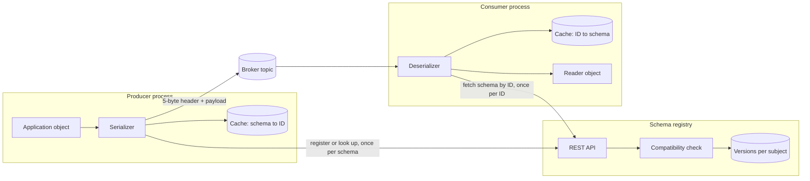
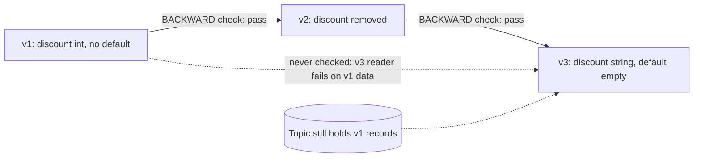
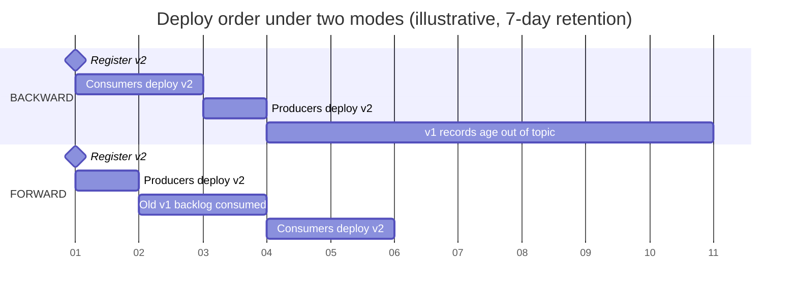
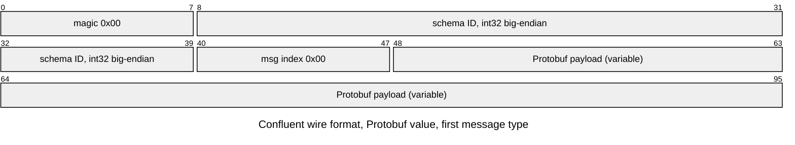
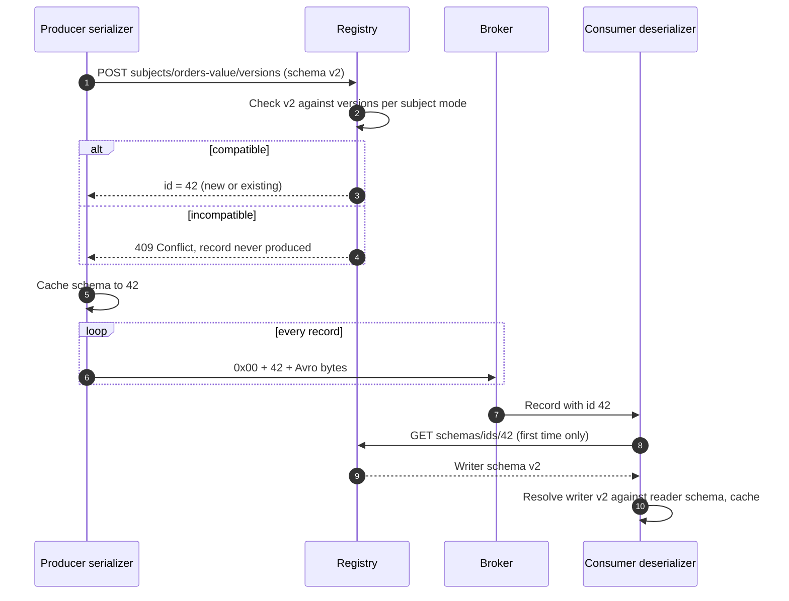

Schema evolution is the discipline of changing the structure of serialized data while data written under the old structure still exists and programs built against the old structure are still running. In a messaging system both conditions hold permanently: a topic retains records for days or forever, producers and consumers deploy on independent schedules, and a consumer that rewinds to the start of a topic will read every structure the topic has ever carried. A schema registry is a service that stores every version of every message schema, assigns each version a compact identifier that producers embed in each record, and refuses to accept a new version that violates a declared compatibility rule against the versions before it.

Without that machinery, a binary format is a time bomb and a text format is a slow leak. A compact binary encoding such as Avro carries no field names, so a reader that does not know exactly which schema produced a record cannot decode it at all; a self-describing format such as JSON decodes everywhere but lets a renamed field or a changed unit pass silently into consumers that the producer has never heard of. In a request-response API a break fails the caller's request at once; on a broker the record is accepted, stored and replicated, and fails later inside a consumer, repeatedly, every time it is redelivered.

The core trade-off is freedom of change against independence of deployment. Every compatibility mode is a promise about which reader can read which writer, and the stronger the promise, the fewer changes are allowed: the mode that lets producers and consumers deploy in any order and replay any history permits little more than adding and removing optional fields. A registry converts those rules from convention into a gate that every producer passes at serialization time, at the price of a new runtime dependency on the data path and a central store whose loss can make every historical record unreadable. Wire-level encoding rules of Protocol Buffers are covered in [gRPC and Protocol Buffers](/distributed-systems/en/communication/synchronous-protocols/grpc-protocol-buffers/), the general taxonomy of breaking changes in [API Versioning Strategies](/distributed-systems/en/communication/synchronous-protocols/api-versioning/), and versioning of events stored as a system of record in [Event Versioning and Schema Evolution](/distributed-systems/en/microservice-patterns/event-sourcing-cqrs/event-versioning/).


*A registry sits beside the data path, not on it. Records carry only a schema ID; schemas travel once per process, and both caches make the steady state independent of the registry.*

Two properties of this topology drive most of the operational behavior on this page. The broker never sees a schema: it stores opaque bytes whose first five bytes happen to name a schema, so compatibility is enforced by clients, and a client that bypasses the serializer bypasses the rule. And the registry is consulted per schema, not per record: once a producer knows the ID of the schema it writes and a consumer knows the schemas behind the IDs it has seen, both keep working through a registry outage, which is why registry failures surface at deploys and restarts rather than under load.

## The Compatibility Relation: Who Must Be Able to Read Whom

Compatibility is a relation between two schemas in a particular role: one schema wrote the bytes (the writer's schema) and another is used to interpret them (the reader's schema). The question is always whether a reader built against schema `R` can decode, without error and without losing information it needs, data written with schema `W`. Every mode a registry offers is a statement about which pairs `(R, W)` must satisfy this relation, and every deploy-ordering rule follows from which pairs will actually meet in production.

### Backward, Forward, and Full as Reader-Writer Pairs

Backward compatibility means the new schema can read data written with the old one: `R = new, W = old`. It is the property a consumer needs when it is upgraded while old records are still in the topic, and it is the default mode in Confluent Schema Registry. Backward-compatible changes are those a new reader can absorb when the field it expects is absent or an old field is present: deleting a field (the new reader skips it) and adding a field that has a default (the new reader fills the default in for old records). Adding a field without a default is not backward compatible, because the new reader has nothing to put there.

Forward compatibility is the mirror: the old schema can read data written with the new one, `R = old, W = new`. It is the property a consumer that has not been upgraded needs when a producer starts writing the new structure. Forward-compatible changes are adding a field (the old reader skips it) and deleting a field that had a default in the old schema (the old reader fills it in). Full compatibility requires both directions, which leaves essentially two operations: adding a field with a default and deleting a field that had one.

The deploy order follows directly. Under backward compatibility only `new reads old` is guaranteed, so every consumer must run the new schema before any producer writes it: consumers first, producers second. Under forward compatibility only `old reads new` is guaranteed, so producers may switch first, and consumers move later; but a consumer that upgrades while records written by the old producer are still unread is not covered, since `new reads old` was never checked. Under full compatibility either order works. The same reasoning appears for synchronous APIs as "readers first, then writers"; on a broker the reader set includes every consumer group, including ones whose owners the producer team has never met.

### Transitivity and the Retention Window

A registry checks a new version against previous versions, and the plain modes check it only against the latest one. That would be harmless if compatibility were transitive, but it is not. Consider an Avro record whose version 1 has a field `discount` of type `int` with no default. Version 2 deletes it, which is backward compatible: a version 2 reader skips the field in old data. Version 3 adds `discount` back as a `string` with default `""`, which is backward compatible against version 2, because version 2 data lacks the field and the default applies. Every check passed, yet a version 3 reader meeting version 1 data finds a field named `discount` in both schemas with types `int` and `string`, which Avro cannot promote, and fails.


*Two compatible steps do not compose into a compatible pair. Only a transitive mode checks the dotted edge.*

The dotted edge is the one that bites, and it only matters if version 1 data is still readable by somebody. That is the precise condition for needing a transitive mode: the oldest schema whose data a current reader can still encounter. On a topic with seven days of retention and schema changes every few weeks, the topic rarely holds more than two versions and the plain mode is usually enough, though not guaranteed. On a compacted topic, a topic with infinite retention, an event store, or a data lake that ingests the topic into long-lived files, every version ever registered is still readable, and only `BACKWARD_TRANSITIVE` or `FULL_TRANSITIVE` make a replay from offset zero safe. The transitive modes check the candidate against every registered version, which also closes the hole above.

The correctness argument for the common configuration is short. Let the subject use `BACKWARD_TRANSITIVE`, and let teams follow the consumers-first rule. A producer begins writing version `n` only after every consumer reads with a version of at least `n`. Every record in the topic was written with some version `k` no greater than the newest producer version, hence no greater than every live reader's version `m`. The transitive check guaranteed, when version `m` was registered, that `m` reads every `k` below it. So every live reader can decode every retained record, whatever its offset, as long as nothing bypasses the registry, which is the assumption the failure modes below violate.

| Mode | New version checked against | Allowed changes (Avro terms) | Deploy order | When to prefer |
|---|---|---|---|---|
| `BACKWARD` | Latest version | Delete fields; add fields with defaults | Consumers, then producers | Short retention, consumers owned by teams that deploy promptly |
| `BACKWARD_TRANSITIVE` | All versions | Same, against every version | Consumers, then producers | Compacted or long-retention topics, replays, Protobuf subjects |
| `FORWARD` | Latest version | Add fields; delete fields that had defaults | Producers, then consumers after old data is consumed | One producer, many slow consumers that cannot upgrade first |
| `FORWARD_TRANSITIVE` | All versions | Same, against every version | Producers, then consumers | Archived data read by old readers that never upgrade |
| `FULL` | Latest version | Add or delete fields that have defaults | Any order | Independently deployed teams with short retention |
| `FULL_TRANSITIVE` | All versions | Same, against every version | Any order | Shared, long-lived topics read by unknown consumers |
| `NONE` | Nothing | Anything | Coordinated cut-over | Development subjects only; or a deliberate new-topic migration |

The table hides one asymmetry. Forward modes require the producer team to anticipate change: a field can later be removed only if it was given a default when it was introduced. Backward modes require nothing in advance from the writer and put the burden on the reader's schema. That is why most estates settle on a backward family mode and push the ordering rule into release process, and why Kafka Streams applications, which read their own changelog and repartition topics with the newest schema, are documented as supporting only the backward and full families.


*The same change rolled out under two modes. The window in which mixed versions coexist is set by retention and lag, not by deploy duration.*

Read the two sections as two different obligations. Under `BACKWARD` the producer's switch is blocked on the slowest consumer team, and the risk ends only when the last version 1 record ages out seven days later; a consumer that rewinds inside that window still meets version 1 data and is still covered. Under `FORWARD` producers move immediately, but a consumer must not adopt version 2 while unconsumed version 1 records remain, because nothing checked that version 2 reads version 1. With consumer lag measured in minutes this constraint is invisible; with a consumer group that is a day behind or replays from the beginning, it is the whole problem.

## How Each Format Resolves a Schema Mismatch

A registry's compatibility checker is a static simulation of what the format's decoder will do at runtime, so the modes mean different things for different formats. The decisive difference is whether the decoder has the writer's schema in hand when it reads.

### Avro: Resolution With Both Schemas

Avro's binary encoding contains no field names, no tags and no type markers. A record is the concatenation of its fields' values in schema order: a `long` is a ZigZag varint, a `string` is a length followed by UTF-8 bytes, a union is a varint branch index followed by the branch's value. The bytes cannot be parsed at all without the exact schema that wrote them, and this is why Avro is inseparable from some way of shipping the writer's schema: in a container file header, as a fingerprint in single-object encoding, or as a registry ID.

Given both schemas, Avro's specification defines a resolution procedure. The decoder walks the writer's schema to consume bytes and the reader's schema to produce values. Fields are matched by name, or by an alias the reader's schema declares. A writer field absent from the reader is decoded and discarded. A reader field absent from the writer takes its declared default, and resolution fails if there is none. Numeric types may be promoted along `int` to `long` to `float` to `double`, and `string` and `bytes` are interchangeable. A writer enum symbol unknown to the reader resolves to the reader enum's declared default symbol, a feature added in Avro 1.9, and fails without one. Unions resolve branch by branch against the reader's schema.

Because resolution is by name, field order is irrelevant to compatibility, renaming a field is a delete plus an add unless an alias bridges the two names, and the default value is a property of the reader's schema used only when the writer lacked the field. Optional fields have no keyword; they are a union with `null`, conventionally listed first so that `null` can be the default, since an Avro union's default must match its first branch.

```json
{
  "type": "record", "name": "OrderPlaced", "namespace": "shop.events",
  "fields": [
    {"name": "order_id", "type": "string"},
    {"name": "amount_cents", "type": "long"},
    {"name": "currency", "type": "string", "default": "EUR"},
    {"name": "coupon", "type": ["null", "string"], "default": null},
    {"name": "total", "aliases": ["grand_total"], "type": "long", "default": 0},
    {"name": "channel", "default": "UNKNOWN",
     "type": {"type": "enum", "name": "Channel",
              "symbols": ["UNKNOWN", "WEB", "APP"], "default": "UNKNOWN"}}
  ]
}
```

Each added field in this version two carries a default, so the schema stays backward compatible: `currency` falls back to a real value, `coupon` to `null`, `total` matches old data written as `grand_total` through its alias, and `channel` has two defaults that do different jobs. The field default applies when the writer had no `channel` field at all; the enum default applies when the writer had the field but wrote a symbol, such as a future `KIOSK`, that this reader does not know. Without the enum default, adding a symbol on the producer side would be forward incompatible for every reader still on this version.

### Protobuf: Resolution by Field Number Without the Writer's Schema

Protobuf decoders never use the writer's schema. Each record on the wire carries a field number and a wire type, so a reader skips numbers it does not know and fills defaults for numbers it expects but does not find; the encoding and its compatibility contract are explained in [gRPC and Protocol Buffers](/distributed-systems/en/communication/synchronous-protocols/grpc-protocol-buffers/). Three consequences matter for a registry. Renaming a field is wire-compatible, because names are not on the wire, while reusing a number is silently corrupting. In proto3 there are no required fields, so adding and removing fields are compatible in both directions at the wire level. And the registry's checker therefore focuses on what the decoder cannot detect: changed field numbers, incompatible type changes, fields moved into or out of a `oneof`, and removed message types.

The last item is where Protobuf departs from Avro in the registry. A `.proto` schema registered as one version may define several message types, and a record names the one it carries through a message index in its header. A consumer on an older schema version that receives a record indexed to a message type added later cannot decode it at all. Confluent documents this as the reason that adding message types is not forward compatible, why forward modes forbid it, and why the recommended mode for Protobuf subjects is `BACKWARD_TRANSITIVE`. Breaking-change linters such as Buf's `buf breaking`, which offers rule sets at file, package, wire-plus-JSON and wire-only strictness, apply the same analysis in continuous integration before a schema reaches the registry.

### JSON Schema: Open and Closed Content Models

JSON payloads are self-describing, so a reader can always parse the bytes; the question is whether the payload still satisfies the reader's validation schema. That depends on the content model. A schema with `additionalProperties` allowed (the JSON Schema default) is open: unknown properties validate. A schema that forbids them is closed. Adding a property to a closed producer schema breaks every reader whose closed schema does not list it; removing a property from an open schema can make an old writer's payload fail a new reader's type check on a property name that the new schema no longer defines but some future version might reuse with another type. Confluent's checker therefore distinguishes open and closed models and exposes a lenient and a strict policy, and the effective rules for JSON Schema are less intuitive than Avro's. Teams that choose JSON Schema for its readability should expect to pin down the content model explicitly in every schema rather than inherit the default.

## The Registry on the Data Path

The registry's job splits into a storage problem (every version, forever, with stable identifiers), a gating problem (refuse incompatible versions before any record uses them), and a distribution problem (let millions of records per second reference a schema without carrying it).

### Wire Format and Schema Identity

The Confluent wire format, which most Kafka-ecosystem registries and serializers also speak, prefixes each serialized key or value with one magic byte of value zero and a four-byte big-endian schema ID. For Protobuf, a message-index array follows, identifying which message type in the `.proto` file the payload uses; then comes the payload in the format's normal binary encoding.


*Six bytes of framing before a Protobuf payload. Avro and JSON Schema payloads omit the message-index field and start at byte 5.*

The message-index array is a count followed by indexes, each a ZigZag varint, so the path `[1]` encodes as `02 02`; the overwhelmingly common case `[0]`, the first top-level message in the file, is special-cased to a single `00` byte. The schema ID is assigned by the registry when a schema is first registered and identifies the schema text, not the subject: registering an identical schema under a second subject returns the existing ID. IDs are therefore meaningful only relative to one registry, which is the root of the most destructive failure mode below. AWS Glue Schema Registry uses a different header that carries a schema version ID (a UUID) and a compression flag; Avro's own single-object encoding uses a two-byte marker `C3 01` followed by an eight-byte CRC-64-AVRO fingerprint of the schema, which identifies the schema by content and needs a lookup table but no ID allocator.

### Registration, Lookup, and Caching

A serializer configured with defaults derives a schema from the application's class, asks the registry for its ID under the target subject, and registers it if it is new; the registry runs the compatibility check during registration. Consumers resolve IDs on first sight. Both sides cache indefinitely, because a schema ID's content never changes.


*Registration and resolution. The registry participates in steps 1 to 4 and 9 to 10 once per schema per process; the loop in step 6 never touches it.*

Step 3 is the whole gate: an incompatible schema is refused before a single record carrying it exists, so the producer fails its first send, loudly and early, instead of producing poison for consumers. Step 11 is where the reader's schema matters. The consumer resolves the writer's schema from the record's ID against its own compiled reader schema, following the format's resolution rules; a consumer configured to deserialize into a generic record instead of a generated class uses the writer's schema as its reader schema and never exercises resolution at all, which hides compatibility problems until a typed consumer meets the same data.

The default of registering on first send (`auto.register.schemas=true` in Confluent's serializers) is convenient in development and dangerous in production. It lets any producer build, including a developer's laptop pointed at the wrong cluster, create a subject or append a version, and it means the compatibility check runs at deploy time rather than in the pull request. The production shape disables auto-registration, registers schemas from continuous integration after the compatibility endpoint approves them, and configures serializers with `use.latest.version=true` so that they look up and use the registered latest version rather than a schema derived from the class, which avoids a mismatch when two builds derive slightly different schema text from the same logical structure. Schema normalization (`normalize.schemas`) canonicalizes cosmetic differences for Avro and Protobuf before lookup, preventing new IDs for whitespace or ordering changes.

### Subjects and Naming Strategies

Compatibility is checked within a subject, the named sequence of versions that the registry treats as one evolving schema. The default `TopicNameStrategy` derives the subject from the topic: `orders-value` and `orders-key`. That binds one record type to one topic, which is exactly right for a topic carrying one entity's changes and wrong for a topic that deliberately carries several event types in order, such as all events of an order aggregate whose relative order matters. `RecordNameStrategy` uses the record's fully qualified name as the subject, so `shop.events.OrderPlaced` evolves as a unit across every topic that carries it; `TopicRecordNameStrategy` combines both, letting several types share a topic while each evolves independently within it. The strategy is a client-side setting, so a producer and consumer configured differently consult different subjects, and a producer whose strategy changes starts a fresh subject with no history to check against.

:::tip[Gate schema changes in the pull request, not at the first send]
Run the registry's compatibility endpoint, or an equivalent offline checker, against the production registry in the producer's pipeline, and give runtime credentials read-only access to the registry. A rejected schema then fails a build that a human is watching instead of a deploy that is already serving traffic, and no runtime process can append a version that bypassed review.
:::

### Storage, Election, and the Registry's Own Availability

Confluent Schema Registry stores its state in a compacted Kafka topic, `_schemas` by default, and every instance replays that topic into memory at startup and serves reads from memory. Writes go through a single primary elected with Kafka's group protocol; secondaries forward registration requests to it. ZooKeeper-based election was removed in Confluent Platform 7.0. The consequence is a clean availability split: reads by ID and lookups of already-registered schemas survive as long as any instance is up, while new registrations need the primary. In the documented multi-datacenter layout, instances in a passive site are configured with `leader.eligibility=false` and forward writes across sites, so losing the active site freezes schema registration until an operator promotes the passive side.

Other registries make different storage choices with the same client-visible contract. Apicurio Registry can store artifacts in a SQL database or in Kafka and exposes a Confluent-compatible API alongside its own. Redpanda embeds a Confluent-compatible registry in the broker. AWS Glue Schema Registry is a managed regional service with its own compatibility names (`BACKWARD_ALL` for backward transitive, plus a `DISABLED` mode that blocks new versions) and a documented hard limit of 10,000 schema versions per account per Region. Apache Pulsar has the most structurally different design: schemas are stored by the broker with the topic, and the broker itself runs the compatibility check when a producer or consumer connects with a schema, so enforcement does not depend on client cooperation. Pulsar's defaults also differ, `FULL` for Avro and JSON and `ALWAYS_INCOMPATIBLE` for other types, which surprises teams that run a Kafka-style registry next to it with the `BACKWARD` default.

### Worked Example: Overhead, Registry Load, and the Replay Horizon

Assume an orders topic carrying 50,000 records per second with an average Avro payload of 400 bytes, a writer schema of 2 KB as JSON text, and a fleet of 1,200 consumer pods across 30 services. All numbers are illustrative.

Shipping the schema in every record would add 2,048 bytes to each 400-byte payload, multiplying the topic's volume by about 6.1: `50,000 * 2,448` is roughly 122 MB/s instead of 20 MB/s, before replication. The registry header costs 5 bytes, or 250 KB/s, 1.25% of payload. That ratio, not elegance, is why binary formats are used with a registry: self-describing schemas cost more than the data for small records.

Registry load scales with processes and schemas, not with records. If each consumer pod reads topics that together have seen 15 distinct schema IDs, a cold restart of the entire fleet issues at most `1,200 * 15 = 18,000` lookups by ID, each served from the registry's memory; the topic produces 18,000 records in about a third of a second. Producers add one lookup per schema per instance. Even a full simultaneous restart is a burst of tens of thousands of small reads, which a three-instance registry absorbs; the failure scenario is not throughput but the registry being unreachable during that burst, analyzed below.

The replay horizon decides the mode. Suppose the team ships a schema change about every three weeks. With seven days of retention, the probability that two changes fall inside one retention window is small, so a reader rarely meets data older than its previous version, and `BACKWARD` usually suffices. Now suppose the topic is also sunk into an object-store data lake that keeps three years of files, and an analytics job reads the whole history with the current schema. Three years at one change per three weeks is about 52 versions, and that job needs version 52 to read all 51 predecessors, a guarantee only `BACKWARD_TRANSITIVE` gives. A transitive check against 52 versions costs 52 schema comparisons at registration time, milliseconds of CPU; the alternative is a pipeline that fails at the first file written before the incompatible step.

## Registries and Encodings Compared

Format choice and registry choice are separate decisions with coupled consequences: the format decides what the decoder can tolerate, and the registry decides who enforces it and when.

| Format | Field identity on the wire | Needs writer schema to decode | Rename | Typical evolution hazard | When to prefer |
|---|---|---|---|---|---|
| Avro | Position in writer schema | Yes, always | Alias in reader schema | Added field without default; enum symbol without enum default | Kafka-centric data pipelines, data lakes, analytics that read generic records |
| Protobuf | Field number | No | Free on the wire | Reused field number; message type added under a forward mode | Services already using gRPC; polyglot code generation; nested types |
| JSON Schema | Field name in text | No | Breaking | Closed content model; type change on a reused property name | Low-volume topics, external consumers, human-inspected payloads |
| Plain JSON, no schema | Field name in text | No | Breaking | Anything, silently | Prototypes; never shared topics |

| Registry | Where the check runs | Enforcement point | Notable behavior | When to prefer |
|---|---|---|---|---|
| Confluent Schema Registry | Registry, on registration | Client serializer; optional broker-side ID validation on Confluent Server | Single primary over a Kafka topic; `BACKWARD` default; per-subject modes | Kafka estates that want the reference implementation and tooling |
| Apicurio Registry | Registry, via configured rules | Client serializer | SQL or Kafka storage; Confluent-compatible API | Self-hosted, open-source estates; mixed artifact types |
| AWS Glue Schema Registry | Managed service | Client SerDe library | UUID version IDs; regional quotas | AWS-native streams (MSK, Kinesis) |
| Pulsar built-in schema | Broker, on connect | Broker | Schema stored with the topic; type-dependent defaults | Pulsar topics, where enforcement must not rely on clients |

Confluent Server can additionally validate on the broker that each record's embedded schema ID is registered for the topic's subject, rejecting records from clients that skipped the serializer. The check confirms the ID, not the payload: a record whose bytes do not match the schema the ID names still passes, so broker-side validation narrows the bypass path rather than closing it.

The configuration that matters is small. Each subject should carry an explicit mode rather than inheriting the global default, and the pipeline should test a candidate schema before anything registers it:

```shell
# Pin the mode on the subject instead of relying on the global default
curl -s -X PUT -H "Content-Type: application/vnd.schemaregistry.v1+json" \
  --data '{"compatibility": "BACKWARD_TRANSITIVE"}' \
  https://registry.internal/config/orders-value
# CI: test a candidate against the subject before registering it
jq -n --rawfile s order_placed.avsc '{schema: $s}' |
  curl -s -X POST -H "Content-Type: application/vnd.schemaregistry.v1+json" \
    --data @- "https://registry.internal/compatibility/subjects/orders-value/versions/latest?verbose=true"
# -> {"is_compatible": false, "messages": ["...reader field discount has no default..."]}
```

The endpoint named `versions/latest` checks against the latest version only; under a transitive subject mode, test against all versions (the `versions` endpoint in recent releases, or an offline checker loaded with every version) so the pipeline evaluates the same relation the registry will enforce. The other settings with production effect are the serializer flags discussed earlier: auto-registration off, use of the latest registered version on, normalization on for Avro and Protobuf, and the subject naming strategy set identically on every producer and consumer of a topic.

## Failure Modes and Their Signatures

Schema failures have a characteristic shape: they are deterministic, they hit every record written after a point in time, and redelivery cannot fix them. On a queue they fill the dead letter queue; on a partitioned log a consumer that stops on error stalls its partition behind the first unreadable record.

### Incompatible Schema Registered Through a Side Door

Trigger: a subject in `NONE` mode, a producer whose subject naming strategy changed (creating a new subject with no history), a subject soft-deleted and recreated, or an operator temporarily relaxing the mode to push an urgent change. The registry accepts a schema that existing consumers cannot resolve. Symptoms: deserialization exceptions on every consumer of the topic starting at the producer's deploy, with the same schema ID in every failing record. Detection: per-consumer deserialization error counters, dead-letter ingress, consumer lag rising on all partitions at once, registry audit logs showing a mode change or a new subject. Mitigation: roll back the producer; the records already written stay in the topic, so consumers need either a reader schema that handles them or a skip-and-dead-letter path for the affected ID range. Prevention: per-subject modes enforced by policy, alerts on any mode change to `NONE`, and a registry permission model in which only the pipeline can write.

### Replay Through a Non-Transitive Hole

Trigger: the plain `BACKWARD` mode on a topic whose retention or downstream copies outlive more than one schema change, followed by a replay. Symptoms: the live consumer is healthy; a new consumer group, a reprocessing job, or a recovered service starting from an old offset fails at a specific historical point.

```mermaid
sequenceDiagram
    autonumber
    participant CI as Producer CI
    participant R as Registry (BACKWARD)
    participant T as Compacted topic
    participant L as Live consumer v3
    participant J as Rebuild job v3
    CI->>R: Register v2 (drops discount), checked vs v1
    R-->>CI: Compatible
    CI->>R: Register v3 (discount as string), checked vs v2 only
    R-->>CI: Compatible
    T->>L: New records written with v3, decode fine
    Note over T: Compaction keeps latest record per key, many still v1
    J->>T: Rebuild read model from offset 0
    T->>J: Record written with v1, discount int
    rect rgb(70, 40, 40)
    J->>J: Resolve v1 against v3: int vs string, error
    Note over J,T: Every retry fails at the same offset, rebuild blocked
    end
```


*A replay failure that no check reported. Steps 1 to 4 passed honestly; the incompatible pair in step 8 was never compared.*

The live consumer in step 5 proves nothing about history, which is why this failure surfaces during disaster recovery and read-model rebuilds, precisely when a consumer cannot afford to be blocked. Detection beforehand: a periodic job that runs a transitive compatibility check over every subject whose topic is compacted or archived, and alerts on any pair that fails. Mitigation: a reader schema that resolves both versions (in the example, a version 4 that removes `discount` again and introduces a new field name), or a one-off upcasting job that rewrites the old records; switching the subject to `BACKWARD_TRANSITIVE` afterwards will itself fail until the incompatible version is superseded, which is the registry correctly reporting the hole.

:::caution[The default mode does not cover replay]
`BACKWARD` checks each new version only against the one before it. A topic that is compacted, has long retention, or feeds a data lake can hold data that no recent check compared with the current reader. Set `BACKWARD_TRANSITIVE` or `FULL_TRANSITIVE` on such subjects from the start; adopting it later forces you to repair whatever holes already exist.
:::

### Registry Unreachable at Startup or Deploy

Trigger: a registry outage, expired credentials, a network policy change, or a DNS failure during a rolling deploy or autoscaling event. Running processes keep working on their caches. Symptoms: newly started producers fail their first send, newly started consumers fail on the first record of each schema ID they have not cached, and a consumer that hits an ID it cannot resolve either stops the partition or, if its error handler is permissive, dead-letters perfectly valid records. Detection: registry request error rate and latency from the client side, serializer exception counts by type, pods failing readiness right after start. Mitigation: treat the registry as a tier-zero dependency with several instances across zones, make readiness depend on resolving the schemas a service needs, configure consumers to stop rather than dead-letter on a transient lookup failure, and stage deploys so a registry outage halts a rollout rather than half-completing it.

### Schema IDs That Mean Something Else

Trigger: records are copied between clusters whose registries assigned IDs independently, a registry is rebuilt from schema files instead of from its storage topic, or two environments share a topic mirror but not a registry. ID 42 in the source cluster names one schema; in the target it names another, or nothing.

:::danger[A record is unreadable without the registry that numbered it]
The four bytes in each record are an index into one registry's history. If that history is lost, or replaced by a registry that numbered the same schemas differently, every stored record is either undecodable or, worse, decoded with the wrong schema. Avro is especially exposed because its bytes carry no field identity, so a wrong schema of a similar shape can produce plausible garbage. Back up the storage topic, replicate it with the data it describes, and use import mode with preserved IDs when migrating between registries.
:::

Symptoms range from deserialization errors to silently wrong values in consumers after a cluster migration or failover. Detection: compare schema ID sets referenced by records in the target topic against the target registry, and fingerprint the schema behind each ID in both registries. Recovery: restore the original registry state, or rewrite the record headers through a mapping job; there is no consumer-side fix.

### Semantic Breaks That Pass Every Check

A change of unit, time zone, or meaning keeps the type and passes every compatibility mode; the AsyncAPI page treats this in [AsyncAPI: Documenting Asynchronous Contracts](/distributed-systems/en/communication/async-messaging/asyncapi/), and the registry cannot help with it. The structural tool against it is the same as against an incompatible change: add a new field or a new event type, populate both during migration, and remove the old one only after consumers move.

### Summary of Failure Signatures

| Failure | Symptom from outside | Detection signal | Mitigation |
|---|---|---|---|
| Side-door registration | All consumers fail from one deploy onward | Deserialization errors by schema ID; mode-change audit | Roll back producer, reader schema or skip path, lock modes |
| Non-transitive hole | Live consumers fine, replay fails at an old offset | Periodic transitive check over compacted subjects | Bridging reader version or upcasting job, transitive mode |
| Registry unreachable | New pods fail, running pods fine | Client-side registry errors, readiness failures after start | HA registry, readiness on schema resolution, halt rollouts |
| ID mismatch across registries | Errors or wrong values after migration or failover | ID set and fingerprint comparison between registries | Replicate the storage topic, import with preserved IDs |
| Naming strategy mismatch | Producer registers fine, consumer resolves nothing or checks the wrong history | Unexpected new subjects; subjects without consumers | One strategy per topic, enforced in shared client config |
| Semantic break | Plausible but wrong values | Business-metric anomalies | New field or event type, dual-write migration |

Poison records produced by any of these modes are handled by the mechanisms in [Dead Letter Queues and Poison Message Handling](/distributed-systems/en/communication/async-messaging/dlq-poison-messages/); the registry's role is to keep them from being produced.

## Choosing a Mode, a Format, and Whether to Run a Registry

Use a schema registry whenever a topic is shared across teams or services and carries a binary format, and treat it as mandatory for Avro, which cannot be decoded without the writer's schema. Default every subject to `BACKWARD_TRANSITIVE` with consumers deployed first; it is the mode whose guarantee survives replay, it requires no foresight from writers, and its main cost, the ordering rule, maps onto how release trains already work. Choose `FULL_TRANSITIVE` for topics consumed by teams you cannot coordinate with, such as a platform's public event stream, accepting that schemas can then only grow and shrink by optional fields. Choose a forward family mode only when a single producer must move ahead of consumers that cannot upgrade first, and only with defaults on every field that might ever be removed.

Pick Avro when the main consumers are data pipelines and analytics engines that read generic records and benefit from schema-carrying files; pick Protobuf when the same types already flow through gRPC services and code generation across languages matters more than generic processing; pick JSON Schema for low-volume or externally consumed topics where readability outweighs size, and specify the content model explicitly.

Do not rely on a registry for topics that live entirely inside one deployable unit, such as an internal changelog that one service writes and reads with the same build; versioned code is enough there. Do not use `NONE` as an escape hatch for breaking changes on a shared topic: a breaking change belongs on a new topic or a new subject, with producers writing both until consumers move, as the migration patterns in [Zero-Downtime Database Migrations](/distributed-systems/en/deployment/deployment-patterns/zero-downtime-db-migrations/) apply equally to streams. Do not treat a registry as a substitute for contract visibility: it knows subjects and versions, not who consumes them, which is the gap [AsyncAPI](/distributed-systems/en/communication/async-messaging/asyncapi/) and [Consumer-Driven Contract Testing](/distributed-systems/en/communication/api-gateway/contract-testing/) fill. And do not apply stream compatibility modes to an event-sourced store whose events are the system of record; upcasting and versioned event types are the tools there, covered in [Event Versioning and Schema Evolution](/distributed-systems/en/microservice-patterns/event-sourcing-cqrs/event-versioning/).

:::note[Delivery guarantees and schemas are independent]
A registry does not change what is delivered, only what can be read. Duplicates, ordering, and exactly-once processing are covered in [At-Least-Once, At-Most-Once, and Exactly-Once Semantics](/distributed-systems/en/communication/async-messaging/delivery-semantics/); a schema change interacts with them only when a consumer that cannot decode a record blocks or dead-letters it.
:::

## Further Reading

- Apache Software Foundation, *Apache Avro Specification* (sections on schema resolution and single-object encoding), Apache Avro project documentation.
- Confluent, *Schema Evolution and Compatibility for Schema Registry on Confluent Platform*, Confluent documentation.
- Martin Kleppmann, *Designing Data-Intensive Applications*, O'Reilly Media, 2017 (chapter 4, Encoding and Evolution).
- Martin Kleppmann, *Schema evolution in Avro, Protocol Buffers and Thrift*, blog post, 2012.
- Google, *Protocol Buffers Language Guide* and *Proto Best Practices*, protobuf.dev.
- Apache Software Foundation, *Pulsar Schema: Schema Evolution and Compatibility*, Apache Pulsar documentation.
