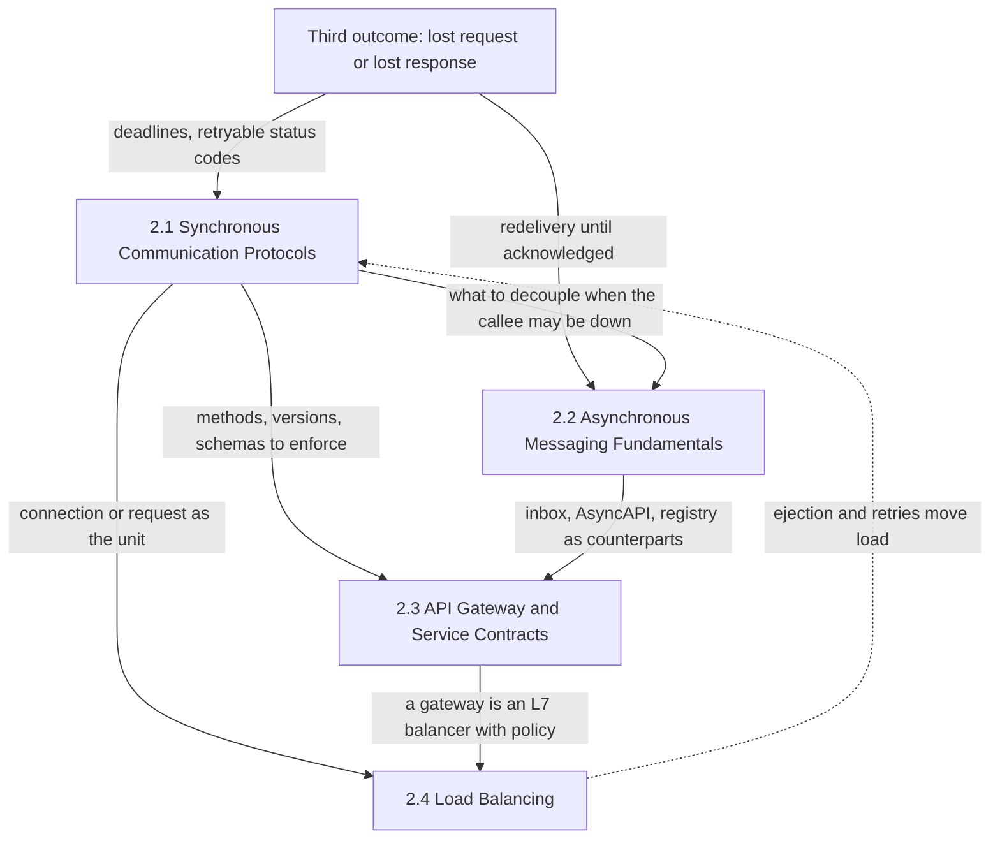
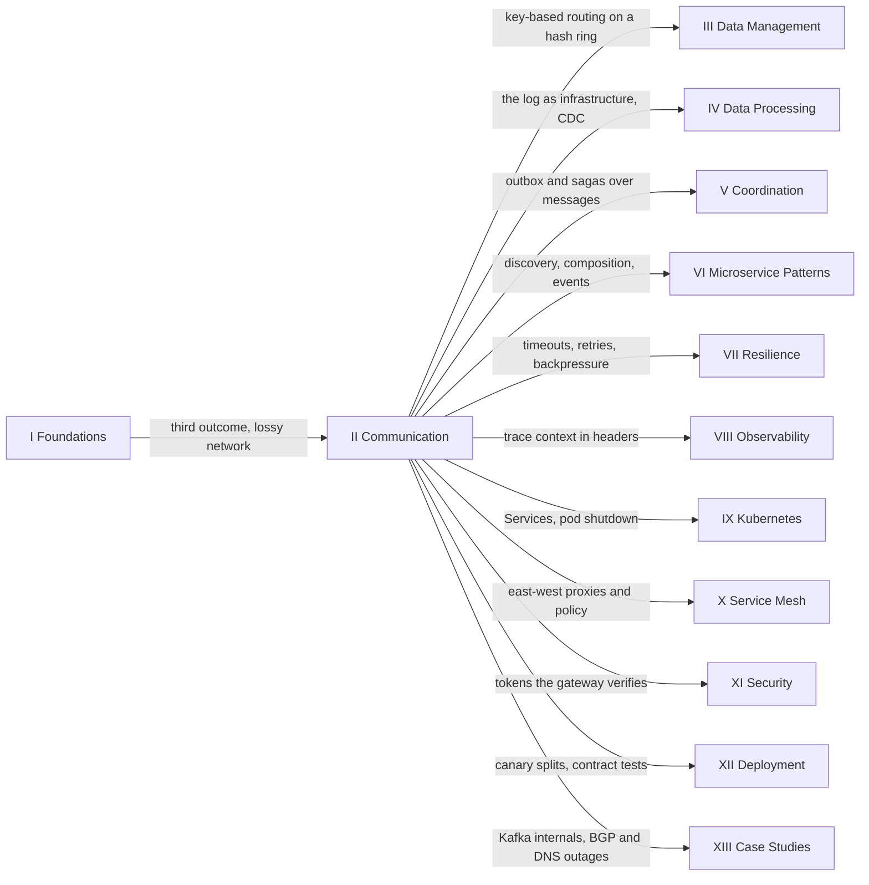

Every interaction between two services is a message on a network that can lose it, delay it, reorder it, or deliver it after the sender has stopped waiting. This part of the handbook covers how those messages are shaped and carried: request-response calls in which the caller waits, messages handed to a broker so that nobody waits, the contracts and policies that govern a request as it crosses a team boundary, and the choice of which replica receives each unit of work. It follows the foundations because it is where their constraints first become decisions with a wire format, a status code, and a configuration file.

The constraint that shapes the whole part is the third outcome of a remote call that the foundations define: when no answer arrives, the caller cannot tell whether the request was lost, executed with its response lost, or is still running. Each chapter answers that ambiguity in its own vocabulary. A synchronous protocol carries a deadline and a status code that says whether a retry is safe. A broker redelivers until a consumer acknowledges, which converts loss into duplication. A gateway contract makes a retried write return the original outcome instead of executing again. A balancer that ejects a failing backend decides where the retry lands. Much of the part is therefore one argument made four times: retries cannot be avoided, so effects must be safe to repeat, and the guarantee of that safety has to live where the effect is committed.

The tension that runs through the part is coupling against visibility. When a caller waits, the callee's latency and failures become the caller's at once: if failures are independent, a request that passes through five services, each available 99.9% of the time (illustrative figures), succeeds at most about 99.5% of the time, and one slow dependency holds threads and connections all the way up the chain. In exchange, every failure is immediate, attributable, and visible to the engineer who caused it. Each mechanism that loosens the coupling hides something: a broker turns a crashed consumer into a backlog nobody sees until it is hours deep, a shared gateway runs a cheap check that is easy to mistake for the authoritative one, and a balancer acts on health and load information that is always partial and late. The four chapters supply the vocabulary for deciding how much coupling to remove and what visibility must be rebuilt in return.

## Four Chapters Around One Remote Interaction

The part is ordered from the interaction outward. The first two chapters are the two shapes an interaction can take; the third puts a boundary around request-response interfaces so that they can be exposed to clients and other teams; the fourth decides which of many interchangeable replicas serves each request or connection. The dependencies between them are not a strict chain, and the diagram shows where one chapter's output becomes another's input.

*How the part's four chapters depend on each other. The unnumbered box is the constraint from the foundations that the first two chapters answer in opposite ways; the dashed arrow shows that balancing decisions feed back into the latency and failure behavior of the calls they route.*

The diagram makes the first two chapters siblings rather than steps. Both answer the third outcome: synchronous protocols keep the caller waiting and make the failure legible in the response, while messaging ends the wait and makes the failure durable as redelivery. The edge between them is the most frequent design decision in the part: which work must not depend on the callee being up. The gateway chapter consumes both. It enforces the methods, versioning rules, and schemas of the synchronous chapter, and its idempotency key and API descriptions are the request-response counterparts of the messaging chapter's deduplicating consumer and AsyncAPI documents. Load balancing depends on the synchronous chapter because multiplexed and long-lived connections change what a balancer can observe, and on the gateway chapter because a gateway is itself an L7 balancer. The dashed edge closes the loop: a balancer that ejects backends or retries on failure changes the load and latency of the very calls it routes, which is how a routing decision turns into a cascading failure.

## What Each Chapter Establishes

[Synchronous Communication Protocols](/distributed-systems/en/communication/synchronous-protocols/) establishes how a request-response contract is carried over a network and who along the path may act on it. Its seven topics run from REST and HTTP semantics, through the HTTP/2 and HTTP/3 transports, gRPC and its streaming modes, GraphQL, and push to browsers over WebSocket and Server-Sent Events, to versioning a contract whose consumers cannot be forced to upgrade. Its main axis is visibility against efficiency: a message in HTTP's uniform vocabulary can be cached, retried, and balanced by intermediaries that have never seen the service, while a binary, multiplexed, schema-first message is cheaper and stricter and hands those jobs back to the endpoints. A second axis, how long a call lives, separates millisecond requests from streams that hold per-client state.

[Asynchronous Messaging Fundamentals](/distributed-systems/en/communication/async-messaging/) establishes how work and facts move between programs that run, fail, and deploy on independent schedules. Its eight topics cover the two broker models (queues that track every message, logs that let each consumer keep its own position), three real brokers, the end-to-end delivery semantics no broker provides on its own, the contracts a message carries over time, and the poison message no retry can save. Its recurring conclusion is that exactly-once delivery is impossible over a lossy network while exactly-once effects are not: they are built from at-least-once delivery plus deduplication committed in the same transaction as the effect.

[API Gateway and Service Contracts](/distributed-systems/en/communication/api-gateway/) establishes how a request-response API is made safe to expose across team and organizational boundaries. Its six topics divide into the entry layer (the gateway and the Backend for Frontend, BFF), the contract (OpenAPI descriptions and consumer-driven contract tests), and the safety rules (idempotency and rate limiting). Its rule is that every policy is cheapest to enforce at the shared edge and authoritative only inside the service that owns the data, and most of its failure modes begin when the edge check is treated as the guarantee.

[Load Balancing](/distributed-systems/en/communication/load-balancing/) establishes how a set of replicas is made to behave like one service. Its five topics split the choice into the unit of decision (per connection at L4 or per request at L7), the selection function, the placement of the balancer (a dedicated tier or every caller), the site a client reaches first (DNS-based global steering or anycast), and eligibility (which backends may be chosen while some fail and others drain). Its tension is information against its cost and staleness, and its characteristic failure is a balancer that amplifies the failure it reacts to.

| Chapter | Decision it owns | What later parts inherit from it |
|---|---|---|
| [2.1 Synchronous Communication Protocols](/distributed-systems/en/communication/synchronous-protocols/) | How a call is framed, who may act on it, how long it lives, how its contract changes | Deadlines and status codes that timeout and retry policies act on, connection lifetimes that proxies manage, headers that carry trace context |
| [2.2 Asynchronous Messaging Fundamentals](/distributed-systems/en/communication/async-messaging/) | Who remembers what was consumed, how many times an effect happens, what a message may contain | The log as data infrastructure, messaging beneath outbox and sagas, events as the system of record, backlogs that flow control drains |
| [2.3 API Gateway and Service Contracts](/distributed-systems/en/communication/api-gateway/) | Who may call, how often, against which contract, and what a repeated request does | Token verification and authorization, rate-limiting algorithms and load shedding, contract checks in deployment pipelines |
| [2.4 Load Balancing](/distributed-systems/en/communication/load-balancing/) | Which site, replica, or backend receives each unit of work | Endpoint lists from service discovery, Kubernetes Services and pod shutdown, mesh traffic policy, weighted traffic shifting for releases |

## What the Part Assumes and Where Its Ideas Return

The part assumes only the foundations. [The 8 Fallacies of Distributed Computing](/distributed-systems/en/foundations/monoliths-to-distributed/eight-fallacies/) and [Network Reliability, Bandwidth Limitations, and Topology Changes](/distributed-systems/en/foundations/monoliths-to-distributed/network-reliability/) supply the network facts every protocol reacts to: latency is not zero, bandwidth is finite, packets are lost, and routes change under live connections. [Stateful vs. Stateless Services](/distributed-systems/en/foundations/monoliths-to-distributed/stateful-vs-stateless/) explains why balancing is free only when replicas are interchangeable, and why a tier of long-lived connections is stateful even when its code is not. [Failure Models](/distributed-systems/en/foundations/system-models/failure-models/) defines the crash-recovery processes and lossy links behind every acknowledgement and redelivery decision, [Cascading Failure Analysis](/distributed-systems/en/foundations/system-models/cascading-failure/) shows what synchronous coupling and retries become under overload, and [Distributed ID Generation](/distributed-systems/en/foundations/time-and-ordering/distributed-id-generation/) is the usual source of the identifiers that idempotency keys and message deduplication depend on.

Nearly every later part sends messages, exposes an API, or routes traffic; the map shows the main consumers.

*Where the part sits in the handbook. The single incoming arrow is its prerequisite; each outgoing arrow names what a later part takes from it.*

Some arrows mark mechanisms this part relies on but does not own, so its pages summarize and link instead of explaining them: the hash ring behind consistent-hashing balancers belongs to data management, the counting algorithms behind gateway quotas to resilience, the Kafka internals to the case studies, and the registries that produce endpoint lists to the microservice patterns.

[Resilience & Production Engineering](/distributed-systems/en/resilience/) is the heaviest consumer, because it turns the part's failure signals into policy. [Timeouts](/distributed-systems/en/resilience/protection-patterns/timeouts/) and [Retry with Exponential Backoff](/distributed-systems/en/resilience/protection-patterns/retry-exponential-backoff/) decide what a caller does with a deadline and a retryable status; [Backpressure](/distributed-systems/en/resilience/flow-control/backpressure/) generalizes both the flow-control windows of HTTP/2 streams and a broker's backlog; [Rate Limiting](/distributed-systems/en/resilience/flow-control/rate-limiting/) owns the algorithms behind gateway quotas; and [Retry Storms and Metastable Failures](/distributed-systems/en/resilience/flow-control/retry-storms-metastable-failures/) is the incident most pages in this part warn about. [Microservice Architecture Patterns](/distributed-systems/en/microservice-patterns/) applies the part at the level of service boundaries: [Service Discovery](/distributed-systems/en/microservice-patterns/service-discovery/) feeds the endpoint lists balancers consume, [API Composition](/distributed-systems/en/microservice-patterns/data-management-patterns/api-composition/) owns the joins a BFF performs for one client, [Event Sourcing and CQRS](/distributed-systems/en/microservice-patterns/event-sourcing-cqrs/) turns messages into the system of record, and [The Distributed Monolith](/distributed-systems/en/microservice-patterns/service-decomposition/distributed-monolith/) describes what unbudgeted synchronous coupling between services produces.

The data-oriented parts build on the messaging chapter in particular. In [Coordination & Consensus](/distributed-systems/en/coordination/), [the Outbox Pattern](/distributed-systems/en/coordination/distributed-transactions/outbox-pattern/) solves the producer-side dual write that delivery semantics solves on the consumer side, and [the Saga Pattern](/distributed-systems/en/coordination/distributed-transactions/saga-pattern/) coordinates multi-service work over messages. [Data Processing Architectures](/distributed-systems/en/data-processing/) treats the same logs as data infrastructure in [The Commit Log Abstraction](/distributed-systems/en/data-processing/hybrid-architectures/commit-log-abstraction/) and [Change Data Capture](/distributed-systems/en/data-processing/hybrid-architectures/change-data-capture/), and [Data Management & Consistency](/distributed-systems/en/data-management/) owns [Consistent Hashing and Virtual Nodes](/distributed-systems/en/data-management/data-partitioning/consistent-hashing/).

The platform parts are where these mechanisms are configured and run. [Why Service Mesh Exists](/distributed-systems/en/service-mesh/service-mesh-architecture/why-service-mesh/) and [Envoy Proxy](/distributed-systems/en/service-mesh/service-mesh-architecture/envoy-proxy/) move timeouts, retries, and balancing of east-west traffic into proxies; the gateway chapter governs north-south traffic. [Kubernetes Networking](/distributed-systems/en/kubernetes/runtime-and-operations/kubernetes-networking/) and [Graceful Termination and PodDisruptionBudgets](/distributed-systems/en/kubernetes/runtime-and-operations/graceful-termination-pdb/) are the platform side of eligibility and draining, [JWT](/distributed-systems/en/security/authentication-authorization/jwt/) and [OAuth 2.0 and OpenID Connect](/distributed-systems/en/security/authentication-authorization/oauth2-oidc/) define the tokens a gateway verifies, and [Distributed Tracing](/distributed-systems/en/observability/logs-metrics-traces/distributed-tracing/) depends on context carried in this part's headers. [Canary Release](/distributed-systems/en/deployment/deployment-patterns/canary-release/) relies on L7 weighted splits. Among the case studies, [Messaging Platform: Apache Kafka](/distributed-systems/en/case-studies/apache-kafka/) goes below the messaging chapter's broker model, and [Meta 2021: BGP, DNS, and Control Plane Centralization](/distributed-systems/en/case-studies/famous-outages/meta-2021-bgp-dns/) is the public case in which DNS servers withdrew their own anycast announcements.

## How to Read the Part

Read the four chapters in sidebar order on a first pass. The synchronous chapter comes first because every later chapter uses its HTTP methods, status codes, and multiplexed connections without re-explaining them. Messaging must precede the gateway chapter, whose idempotency and contract pages are written as counterparts of the deduplicating consumer, AsyncAPI, and schema registry. Load balancing comes last because it assumes both the long-lived connections of the first chapter and the gateway of the third. Each chapter overview gives its own reading order and shortcuts.

Three paths through the part fit common situations. An engineer designing the interfaces of a new service should read REST and gRPC in the synchronous chapter, then the queue-versus-streaming and delivery-semantics topics to decide which interactions should not wait, then idempotency and OpenAPI in the gateway chapter. A platform engineer responsible for edge and service-to-service traffic should read HTTP/2 and HTTP/3, the gateway pattern, then L4 versus L7, client-side versus server-side balancing, and health-aware routing, since connection lifetime and the placement of decisions run through all of them. An engineer in the middle of an incident should start from the symptom: duplicate effects lead to idempotency and delivery semantics, a partition stuck behind one record leads to the dead-letter topic, consumers failing after a producer deploy lead to schema evolution, load pinned on a few backends leads to L4 versus L7, and errors on every rollout lead to health-aware routing and connection draining.

The incident paths cross chapter boundaries for a reason. A duplicated payment typically combines a timeout set by a protocol, a retry added by a proxy, and a second backend chosen by a balancer, and the fix belongs to none of those layers: it belongs where the payment commits.
