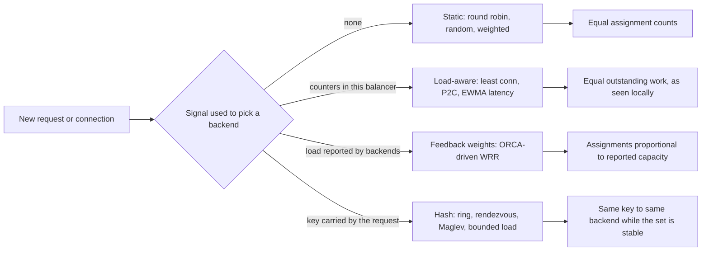
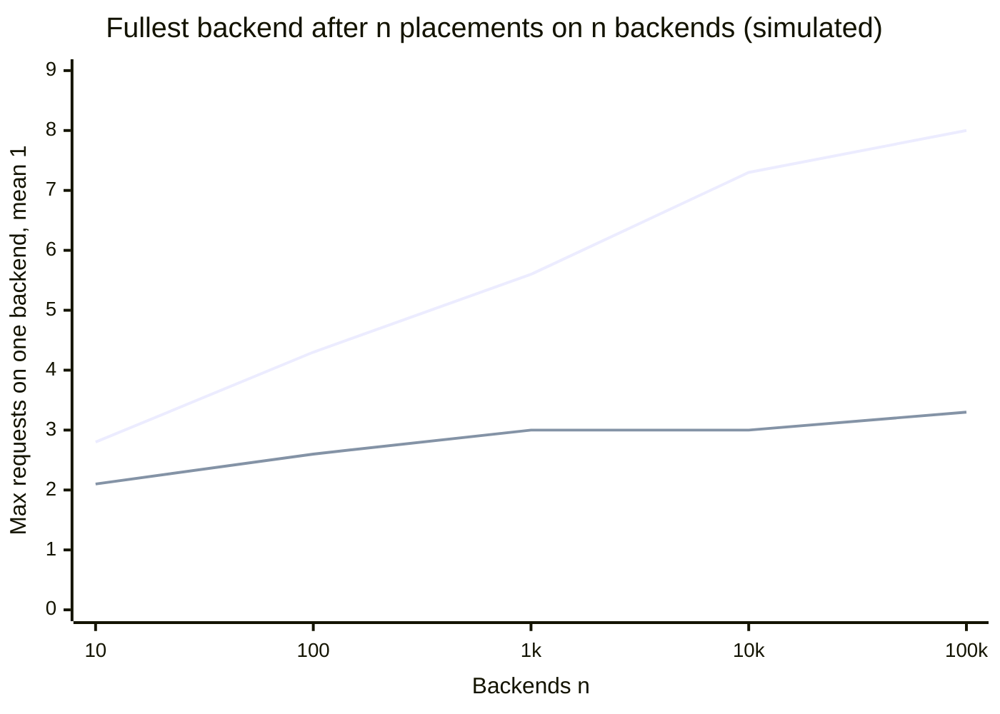
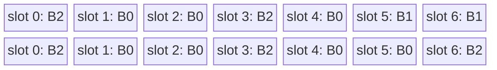
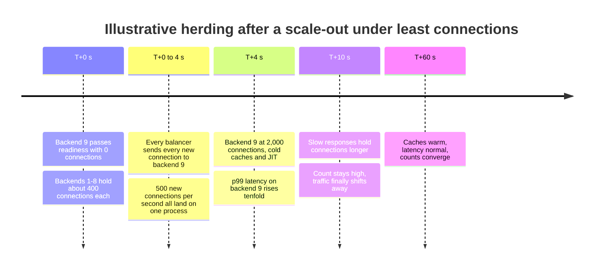
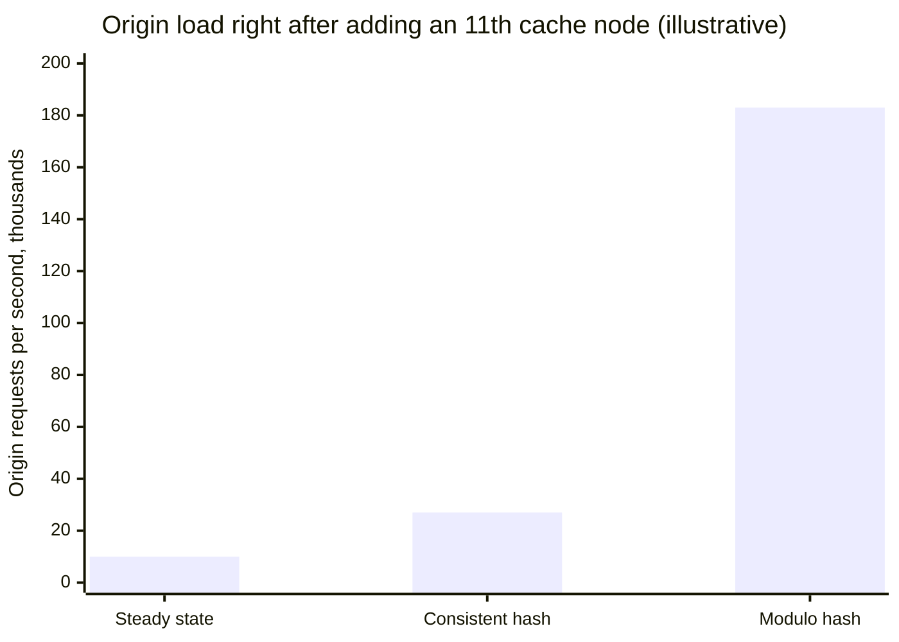

A load-balancing algorithm is the function that, given a set of interchangeable backends and one unit of work (a new connection or a new request), returns the backend that receives it. Without one, a fleet of replicas is only as useful as the share of traffic that happens to land on each replica, and the fleet's capacity is set by its most loaded member rather than by the sum of its members. Every algorithm answers the same question with different information: round robin uses none, least connections uses counters kept by the balancer itself, feedback-weighted schemes use load reported by the backends, and hash-based schemes use a key carried by the request.

The core trade-off is information against cost and correctness of that information. A balancer that uses no signal is cheap, stateless, identical across any number of balancer instances, and blind to a backend that has become slow. A balancer that reacts to load must measure it, and what it measures is local (one balancer sees only the requests it sent), delayed (a counter changes only after work arrives), and gameable by failure (a backend that fails instantly looks idle). A balancer that hashes a key gives up balance on purpose to obtain locality: the same user, cache key, or flow lands on the same backend, which keeps caches warm and sessions in place but sends every request for a hot key to one machine.

The unit being balanced matters as much as the algorithm. An L4 balancer picks once per connection, an L7 proxy once per request, and the same algorithm produces very different load in the two cases when connections are long-lived; that distinction is covered in [L4 vs. L7 Load Balancing](/distributed-systems/en/communication/load-balancing/l4-vs-l7/). Where the selection logic runs, in a central proxy or inside every client, is covered in [Client-Side vs. Server-Side Load Balancing](/distributed-systems/en/communication/load-balancing/client-vs-server-side/), and how unhealthy backends are removed from the candidate set before any algorithm runs is covered in [Health-Aware Routing and Connection Draining](/distributed-systems/en/communication/load-balancing/health-aware-routing/). This page covers the selection function itself.


*Four families of selection function, classified by the signal they consume, and the one property each family actually equalizes.*

The right-hand column is the guarantee, and none of the four entries says "equal load". Round robin equalizes how many units each backend receives, which equals load only when every unit costs the same. Load-aware algorithms equalize outstanding work as one balancer observes it, which approximates global balance only when that balancer sends a large share of the traffic. Feedback weights equalize relative to what backends report, which is only as fresh and honest as the reports. Hashing equalizes nothing by itself; balance under hashing is a statistical side effect of a uniform key distribution and disappears as soon as keys are skewed. Choosing an algorithm is choosing which of these approximations fails most gracefully for a given workload.

## Static Selection: Rotation, Randomness, and Weights

Round robin keeps one index per backend list and advances it on every selection: backend `i`, then `i + 1`, wrapping at the end. Its guarantee is exact and narrow: over any window of `N` consecutive selections on one balancer, each of `N` healthy backends is chosen exactly once. It needs no knowledge of the backends, makes the same decision whether the backend list is ten long or ten thousand, and is the default in NGINX, HAProxy, Envoy, and the gRPC `round_robin` policy. Uniform random selection gives the same expected share with no shared index and no ordering, at the price of variance: over 100 selections among 10 backends, round robin gives each exactly 10, while random gives each a binomial count with a standard deviation of 3.

Neither guarantees anything about load once requests differ in cost. If one request in a hundred is an export costing 200 times an ordinary request, round robin spreads exports evenly in expectation but not in time, and a backend that receives three in one second saturates while its neighbors idle. The same blindness covers heterogeneous hardware, a long garbage-collection pause, and a failing local disk: each backend receives the same share until a health check removes it.

Round robin also fails in a way that random does not when many balancers run it independently. Each balancer keeps its own index, and if all of them start at index 0 (every client reconnects after a deployment, or a configuration push rebuilds every proxy's list in the same order), their first selections all hit backend 0, their second all hit backend 1, and the fleet sees a wave of synchronized load moving along the list. Mature client libraries randomize the starting position for this reason (grpc-go's `round_robin`, for example, starts at a random index); a home-grown balancer that does not is a common source of a "hot first backend" after restarts.

### Weighted Rotation and the Smoothness Problem

Weights express unequal capacity: a backend with weight 5 should receive five times the traffic of one with weight 1. The naive implementation repeats each backend `w` times in the rotation, so weights `{5, 1, 1}` for backends `a`, `b`, `c` produce `a a a a a b c`. The long-run share is right, but backend `a` receives five consecutive requests, and when weights are large (100 and 1), the heavy backend receives a burst of a hundred before the light one gets anything. For short requests the burst is harmless; for requests that open connections or warm caches it is a load spike.

NGINX replaced this in 2012 with an algorithm its commit message calls smooth weighted round robin. Each backend keeps a `current` value starting at zero. On every selection, each backend's `current` is increased by its weight, the backend with the largest `current` is chosen, and the chosen backend's `current` is decreased by the total weight. The table traces weights `{5, 1, 1}`, total 7.

| Step | `current` before pick (a, b, c) | Chosen | `current` after (a, b, c) |
|---|---|---|---|
| 1 | 5, 1, 1 | a | -2, 1, 1 |
| 2 | 3, 2, 2 | a | -4, 2, 2 |
| 3 | 1, 3, 3 | b | 1, -4, 3 |
| 4 | 6, -3, 4 | a | -1, -3, 4 |
| 5 | 4, -2, 5 | c | 4, -2, -2 |
| 6 | 9, -1, -1 | a | 2, -1, -1 |
| 7 | 7, 0, 0 | a | 0, 0, 0 |

The output is `a a b a c a a`, the sequence quoted in the NGINX commit, and after seven steps every `current` is back at zero. The correctness intuition is a conservation argument: each step adds the total weight `W` across all backends and subtracts `W` from one, so the sum of all `current` values is always zero, and a backend whose `current` drifts high is chosen and pushed back down. Over any cycle of `W` selections each backend is chosen exactly its weight in times, and no backend can be chosen many times in a row while another's `current` keeps rising. Envoy reaches the same goal with a different structure: it schedules weighted hosts by a deadline per host (the next time it is due, spaced by the inverse of its weight) and always picks the earliest deadline, which also interleaves rather than bursts.

### Weights That Change: Slow Start and Backend-Reported Load

Static weights encode a belief about capacity at configuration time. Two mechanisms make them dynamic. The first is slow start: a backend that has just joined or just passed its health check starts with a fraction of its weight that grows over a window, because a fresh process has cold caches, an unwarmed JIT compiler, and empty connection pools. Envoy computes the effective weight as `weight * max(min_weight_percent, time_factor ^ (1 / aggression))`, where `time_factor` is the elapsed fraction of `slow_start_window` and `min_weight_percent` defaults to 10%. It supports this for round robin, least request, and client-side weighted round robin. NGINX Plus offers `slow_start` on a server, which ramps the weight from zero; the open-source module has no equivalent.

The second mechanism is to let backends report their load and derive weights from it. gRPC's `weighted_round_robin` policy and Envoy's client-side weighted round robin consume ORCA (Open Request Cost Aggregation) reports, in which each backend returns its utilization, queries per second, and errors per second either per response or on a side stream. The weight is `qps / (utilization + (eps / qps) * error_utilization_penalty)`: a backend that serves many requests per unit of CPU gets more traffic, and a backend whose errors are rising is penalized even if it looks efficient. Envoy's defaults are worth knowing because each one is a stability decision: a backend's reported weight is ignored for the first 10 seconds (`blackout_period`) so that a burst of optimistic early reports does not attract a flood, weights older than 3 minutes (`weight_expiration_period`) are discarded, and a backend with no valid weight is given the median weight of the others rather than zero or infinity.

## Load-Aware Selection: Least Connections, Two Choices, and Latency

Least connections keeps, for each backend, the number of connections (L4) or requests (L7) this balancer currently has open to it, and sends the next unit to the backend with the smallest count. Ties are broken by rotation or at random. The counter rises when work is dispatched and falls when the response completes, so it is a direct measurement of outstanding work from this balancer's point of view.

Why that is the right quantity follows from [Little's Law](/distributed-systems/en/resilience/flow-control/queueing-theory-littles-law/): the average number of requests in a system equals the arrival rate times the average time each request spends inside it, `L = lambda * W`. A backend that slows down holds each request longer, so at the same arrival rate its outstanding count rises, and least connections sends it less until the counts equalize again. The algorithm needs no knowledge of capacity, weights, or request cost; a slow backend, an expensive request, and a garbage-collection pause all show up through the same counter. This is why least connections is the standard choice for long or variable-length work: HAProxy recommends `leastconn` where very long sessions are expected, such as LDAP or SQL, and Envoy's default load-aware policy is called `LEAST_REQUEST` because at L7 the unit is the request.

:::tip[Equal outstanding work equals equal utilization]
If each backend behaves roughly like a single-server queue with exponential service times (M/M/1, an approximation), the expected number in system is `rho / (1 - rho)` for utilization `rho`. Equalizing outstanding requests therefore equalizes utilization, which is exactly the allocation correct weights would produce. Least-request balancing discovers capacity differences between hardware generations without being told the weights, and keeps discovering them when a backend degrades. The approximation breaks for backends with many parallel workers, which hide queueing until they saturate.
:::

Least connections has three structural weaknesses. The first is that its view is local. A balancer counts only the requests it sent; with many independent balancers, each sees a small and noisy slice of each backend's real load, a problem quantified in the worked example below. The second is herding: when every balancer picks the global minimum, they all pick the same backend at the same moment, typically a backend that has just joined with zero connections. The third is that the counter measures how long a backend holds requests, not whether it serves them correctly: a backend that fails every request in a millisecond has the smallest count in the fleet. These two failure modes are traced in the failure section.

### The Power of Two Random Choices

Power of two choices (P2C) samples two backends uniformly at random and sends the request to the one with fewer outstanding requests. It looks like a cheap approximation of least connections and is, in an important sense, better. The theory comes from the balls-into-bins problem: placing `n` balls into `n` bins uniformly at random leaves the fullest bin with about `ln n / ln ln n` balls, while choosing the less loaded of `d` random bins leaves it with about `ln ln n / ln d` plus a constant, an exponential improvement established by Azar, Broder, Karlin, and Upfal and developed for load balancing by Mitzenmacher. The second sample does almost all the work: going from one choice to two changes the growth from nearly logarithmic to doubly logarithmic, while going from two to three only changes the constant.


*Upper line: uniform random choice. Lower line: power of two choices. Each point is the mean maximum over repeated simulated runs (from 2,000 runs at 10 backends down to 3 at 100,000); the average load is always 1.*

The shape of the two curves is the argument for P2C. At ten backends the difference is small, but the random curve keeps climbing as the fleet grows, so the most loaded backend in a 10,000-node fleet receives seven times the average, while under two choices it stays at about three. Least connections over the whole set would do better still in a single balancer with perfect information, but it is the second property of P2C that matters in production: it degrades gracefully when information is stale or local. Mitzenmacher's analysis of old information showed that when many dispatchers act on a delayed load snapshot, always choosing the least loaded server is the worst strategy, because every dispatcher sends to the same server until the snapshot refreshes, while choosing among two random candidates spreads those decisions and stays close to optimal. A random pair rarely contains the newly joined, zero-load backend for every balancer at once, so P2C does not herd.

P2C is now the default load-aware algorithm in most modern proxies. Envoy's `LEAST_REQUEST` samples `choice_count` hosts, 2 by default, and picks the one with fewest active requests when all weights are equal. When weights differ it switches to a weighted schedule whose weights are recomputed at selection time as `weight / (active_requests + 1) ^ active_request_bias`, with `active_request_bias` defaulting to 1.0; a bias of 0 turns it back into weighted round robin, and the documentation warns that in this mode a busy host never stops receiving requests, it only receives fewer. NGINX gained `random two least_conn` in version 1.15.1, explicitly aimed at deployments where several balancers share the same backends. HAProxy offers a `random` algorithm with a configurable number of draws, and Finagle exposes P2C as its standard least-loaded balancer.

### Latency as the Load Signal

Outstanding requests capture queueing but not a backend that is slow for every request without queueing, for example one running on a degraded host. Latency-aware balancers score backends by observed response time. Finagle's Peak EWMA keeps an exponentially weighted moving average of round-trip time per backend that jumps up immediately on a slow response and decays slowly, multiplies it by the number of outstanding requests plus one, and picks the lower cost of two random candidates. Linkerd adopted the same design. In Linkerd's published experiment (11 backends with a 167 ms median latency, one of them slowed to 2 seconds for 30 seconds, under 1,000 requests per second) round robin degraded above the 95th percentile, least loaded stayed fast to the 99th, and Peak EWMA to the 99.9th. NGINX's `least_time` (NGINX Plus, and open source since 1.31.0) combines average response time with active connections, measured to the first byte or to the last byte.

Latency is a stronger signal and a more dangerous one. It is noisy, it depends on request mix (a backend that happened to receive the heavy requests looks slow), and it rewards backends that answer quickly regardless of what they answer. A latency-aware balancer must treat errors as expensive responses, or it inherits the black-hole failure below in an even stronger form.

### Worked Example: Twelve Backends, Two Hardware Generations

Assume a service with 12 backends: 9 on a newer instance type that sustains 1,000 requests per second each and 3 on an older type that sustains 600. Peak load is 9,000 requests per second. Total capacity is `9 * 1,000 + 3 * 600 = 10,800`, so the fleet as a whole runs at 83% utilization. All numbers in this example are illustrative.

Round robin sends 750 requests per second to every backend. The new backends run at 75% utilization; the old ones receive 750 against a capacity of 600, a utilization of 125%, and their queues grow without bound until timeouts and retries take over. The fleet fails at 83% average utilization because three of its members are at 125%.

Static weights of 5 and 3 fix this if they are right. The total weight is `9 * 5 + 3 * 3 = 54`, so each weight unit carries `9,000 / 54 = 166.7` requests per second: 833 to each new backend and 500 to each old one, 83% utilization everywhere. The weights are correct only while the capacity ratio is 5 to 3. If one old backend loses a third of its throughput to a noisy neighbor, it is overloaded again, and nothing in the balancer notices.

Least-request balancing reaches the same allocation without being told the ratio. Using the M/M/1 approximation from the tip above, equal outstanding counts imply equal utilization, so the fleet settles at 83% on every backend with about `0.83 / 0.17 = 5` requests outstanding on each. Latency differs: the expected time in system `1 / (mu - lambda)` is `1 / (1,000 - 833)`, about 6 ms, on a new backend and `1 / (600 - 500)` = 10 ms on an old one. The balancer equalizes load, not latency, which is the correct objective when the goal is not to overload anything.

Now place the balancing logic in 20 client-side balancers, each sending 450 requests per second. Each backend still has about 5 requests outstanding in total, but each balancer sees only its own share, about `5 / 20 = 0.25`. Most of the time a given balancer's counter for a given backend is 0, sometimes 1, rarely 2, and that counter no longer distinguishes an old backend at 83% from one at 125%. Full least connections over 12 backends collapses into a tie-break among the many zeros, which is round robin or random in disguise. P2C does slightly better, because a counter of 1 against 0 still tips the decision, but its signal is equally thin. This is the regime most service meshes and gRPC clients operate in, and it is why backend-reported load (the ORCA-driven weights above) and subsetting, where each client talks to only a few backends so that it sends a large share of each one's traffic, exist. The first replaces local counters with the backend's own view; the second makes the local view large enough to mean something.

## Hash-Based Affinity: Modulo, Ring, Rendezvous, and Maglev

Hashing chooses the backend from a key in the request (a user ID, a cache key, a URL, the connection 5-tuple) so that the same key always reaches the same backend. The reasons are locality and continuity: a cache tier holds each object once instead of on every node, a backend keeps per-user state in memory, and an L4 balancer fleet sends every packet of a flow to the same backend even when a packet arrives at a different balancer instance. The guarantee is conditional: same key, same backend, while the backend set does not change. Hashing guarantees nothing about balance and, in its naive form, nothing about what happens when the set changes.

The naive form is `hash(key) mod N`. It balances well for uniform keys and fails at the first change in `N`. A key keeps its backend when `N` grows from 10 to 11 only if `hash mod 10` equals `hash mod 11`, which holds for 10 residues out of every 110, so 91% of keys move. For a cache tier that is a near-total cold start; for an L4 balancer it resets almost every connection. Consistent hashing reduces the movement to about `1 / N` of keys, the theoretical minimum, by making each backend own regions of a hash space whose boundaries do not depend on how many other backends exist. The ring construction, virtual nodes, and the variance analysis that sets how many virtual nodes are needed are covered canonically in [Consistent Hashing and Virtual Nodes](/distributed-systems/en/data-management/data-partitioning/consistent-hashing/); what matters for balancing is how the implementations differ in lookup cost, balance, and disruption.

Ring hashing in a proxy places each backend at many points on a ring and maps a request to the first backend point clockwise from the request's hash. Envoy's `RING_HASH` builds a ring of between `minimum_ring_size` (default 1,024 entries) and `maximum_ring_size` (default and limit 8M), uses xxHash by default, and places each host in proportion to its weight; the documentation recommends setting both sizes explicitly and watching the per-host minimum and maximum hash gauges, because a small ring with many hosts gives some hosts visibly more of the space than others. NGINX's `hash $key consistent` uses the ketama scheme from memcached clients. Lookup is a binary search over the ring, and memory grows with the number of points.

Rendezvous hashing, also called highest random weight (HRW), needs no ring. For each request it computes `score = hash(key, backend)` for every backend and picks the highest score. When a backend is removed, only the keys for which it had the top score move, and each moves to its second-highest backend, so disruption is exactly minimal and no virtual nodes are needed for balance. The cost is `O(N)` hashing per lookup, acceptable for tens of backends and too slow for an L4 data plane forwarding millions of packets per second across hundreds.

### Maglev: Fixed-Size Lookup Table

Google's Maglev balancer needed hash lookups at line rate with near-perfect balance, and accepted slightly more disruption to get them. It replaces the ring with a lookup table of fixed prime size `M` (65,537 in Envoy's implementation) in which every entry names one backend; a request's hash modulo `M` indexes the table in constant time. The construction gives each backend its own preference order over the table slots and fills the table by letting backends claim slots in turn.

```text
for each backend i:
    offset[i] = h1(name[i]) mod M
    skip[i]   = h2(name[i]) mod (M - 1) + 1      # never 0, coprime with prime M
    # preference list: (offset + j * skip) mod M, for j = 0 .. M-1
next[i] = 0 for all i;  table[*] = empty;  filled = 0
loop:
    for each backend i in turn:
        repeat: c = (offset[i] + next[i] * skip[i]) mod M;  next[i] += 1
        until table[c] is empty
        table[c] = i;  filled += 1
        if filled == M: done
```

Because `M` is prime and `skip` is between 1 and `M - 1`, each preference list visits every slot exactly once, so a backend can always find an empty slot. Because backends claim slots in strict rotation, each backend ends up with either `floor(M / N)` or `ceil(M / N)` entries: balance across backends is nearly perfect regardless of how the hash values fall, which ring hashing achieves only statistically with many virtual nodes. Weights are implemented by letting a heavier backend claim more often per round.

A small example makes the procedure concrete. Take `M = 7` and three backends with illustrative values: B0 with offset 2 and skip 3 (preferences 2, 5, 1, 4, 0, 3, 6), B1 with offset 5 and skip 1 (5, 6, 0, 1, 2, 3, 4), and B2 with offset 2 and skip 5 (2, 0, 5, 3, 1, 6, 4). In round one, B0 claims slot 2, B1 claims slot 5, and B2 finds its first choice taken and claims slot 0. In round two, B0 finds 5 taken and claims 1, B1 claims 6, and B2 skips 5 and claims 3. In round three, B0 claims 4 and the table is full.


*Top row: the Maglev table for three backends with M = 7. Bottom row: the table rebuilt after B1 is removed. Only B1's two slots change owner.*

When B1 is removed and the table is rebuilt, B0 and B2 replay their preference lists without competition from B1, and in this example every slot they owned before stays theirs while B1's two slots go to B0 and B2. That is the intended behavior, but it is not guaranteed in general: removing a backend changes the order in which the survivors reach contested slots, so a few slots owned by surviving backends can change hands too. Envoy's documentation quantifies the trade-off against its ring hash: Maglev builds its table about 10 times faster and selects about 5 times faster (compared with a 256K-entry ring), and moves roughly twice as many keys when hosts are removed. It also warns of a hard limit: with more hosts than table entries, some hosts get no entry at all, whatever their weight. For an L4 fleet, the extra disruption is covered by the connection table described in [L4 vs. L7 Load Balancing](/distributed-systems/en/communication/load-balancing/l4-vs-l7/); for a cache tier it is a few extra misses per change.

### Bounded Loads: Giving Up a Little Affinity for Balance

Hashing balances keys, not traffic. If one key carries 5% of all requests, the backend that owns it carries at least 5% plus its share of everything else, and adding backends does not help because that key still has one owner. Consistent hashing with bounded loads, introduced by Mirrokni, Thorup, and Zadimoghaddam, sets a capacity of `ceil(c * average load)` for each backend, where `c` is a balance factor greater than 1. A request goes to its hashed backend unless that backend is at capacity, in which case it moves to the next backend along the ring that has room. The guarantee is that no backend exceeds `c` times the average, while the expected number of keys that move per backend change stays bounded by a function of `c`, so the scheme retains most of the stability of consistent hashing.

Vimeo's implementation in HAProxy, released in HAProxy 1.7.0 as the `hash-balance-factor` option, is the best-known production use. Vimeo reported that its memcached tier, where individual servers had been peaking at 400 to 500 Mbit/s of outbound traffic, stayed comfortably below 100 Mbit/s per server after the change, with response times unchanged; the author suggested factors between 1.25 and 2. Envoy exposes the same idea as `hash_balance_factor` in its consistent-hashing configuration (minimum 100, meaning 1.0 times average; typical values 120 to 200), with the caveat that it finds a backend with room by linear probing, an `O(N)` step under heavy skew. The trade-off is explicit: bounded load turns a hot key from an overloaded backend into a key whose requests are spread across two or three backends, which is exactly what is wanted for a cache and exactly what is not wanted when affinity is required for correctness.

:::caution[Source IP is a poor hash key]
Hashing on the client IP (NGINX `ip_hash`, HAProxy `balance source`) assumes one IP per client. Behind a corporate NAT, a mobile carrier's carrier-grade NAT, or another proxy tier, thousands of users share one address and land on one backend, while IPv6 privacy addresses split one user across many. NGINX's `ip_hash` hashes only the first three octets of an IPv4 address, so a whole /24 shares a backend. Hash on an application identifier (a cookie, a user or tenant header) when affinity matters, and accept that affinity based on network identity is approximate.
:::

## Comparing the Algorithms in Production

The table compares the families by what they need, what they equalize, and how they behave in the two conditions that decide most production outcomes: many independent balancers, and a change in the backend set.

| Algorithm | Per-selection cost | State needed | Equalizes | With many balancers | On backend set change | When to prefer |
|---|---|---|---|---|---|---|
| Round robin | `O(1)` | One index | Assignment count | Unaffected if starts are randomized | No affinity to lose | Uniform request cost, homogeneous backends, or a front tier whose backends balance further |
| Weighted RR (smooth or deadline) | `O(1)` to `O(log N)` | Weights, schedule | Count proportional to weight | Unaffected | No affinity to lose | Known, stable capacity differences |
| Least connections (full scan) | `O(N)` or a heap | Counter per backend | Local outstanding work | Herds on the minimum; signal thins | No affinity to lose | One or few balancers, long or variable-cost work |
| P2C least request | `O(1)` | Counter per backend | Local outstanding work, approximately | Degrades gracefully, no herding | No affinity to lose | Default for L7 request balancing, especially client-side |
| Peak EWMA latency with P2C | `O(1)` | Latency average and counter | Expected completion time | Signal is local but responsive | No affinity to lose | Backends that slow down without queueing; tail-latency objectives |
| ORCA-weighted RR | `O(1)` after weight updates | Reported utilization, qps, errors | Reported cost | Works: signal comes from the backend | No affinity to lose | Many client-side balancers, heterogeneous or noisy backends |
| Ring hash | `O(log V)` for `V` ring points | Ring | Keys, statistically | Identical everywhere if config matches | About `1 / N` of keys move | Caches and affinity at L7 with moderate backend counts |
| Rendezvous (HRW) | `O(N)` | Backend list | Keys, statistically | Identical everywhere | Exactly minimal movement | Small sets where minimal movement matters more than lookup cost |
| Maglev | `O(1)` | Table of `M` entries | Table slots, nearly exactly | Identical everywhere | Slightly more than minimal | L4 data planes and high-rate L7 hashing |
| Bounded-load hash | Hash plus probing | Ring or table, load counts | Load, capped at `c` times average | Counts are local per balancer | Hot keys spill to neighbors | Caches with skewed keys where affinity is an optimization |

The "With many balancers" column hides one discipline and one subtlety. Hash-based schemes stay identical across balancers only if every balancer has the same backend list, order, and weights. Bounded-load hashing bounds each balancer's own counts, so with 20 balancers each enforcing `c = 1.25`, the global bound holds only if each sees the same key distribution.

### Defaults and Configuration in Common Implementations

Defaults matter because most deployments never change them. NGINX, HAProxy, Envoy, and gRPC's `round_robin` policy all default to round robin when a balancing policy is chosen at all, but gRPC's channel default is `pick_first`, which connects to one address and sends everything there. A gRPC client pointed at a DNS name with several addresses therefore balances nothing unless a policy is configured, a frequent surprise when moving from HTTP/1.1 to gRPC. Linux IPVS, behind kube-proxy's IPVS mode, offers round robin, weighted and plain least connection, source and destination hashing, and a Maglev-style scheduler, with round robin as kube-proxy's default.

In NGINX the two most useful non-default configurations look like this.

```text
upstream api {
    zone api 64k;              # shared counters across worker processes
    random two least_conn;     # P2C on active connections (since 1.15.1)
    server 10.0.1.10:8080 weight=5;
    server 10.0.1.11:8080 weight=5;
    server 10.0.2.20:8080 weight=3;   # older instance type
}
upstream object_cache {
    hash $request_uri consistent;     # ketama ring, about 1/N keys move on change
    server 10.0.3.10:11211;
    server 10.0.3.11:11211;
}
```

The `zone` line matters more than it looks. Without it, each NGINX worker process keeps its own connection counters and its own round-robin position, so a server with eight workers is eight independent balancers; NGINX's own guide warns that least connections then behaves unexpectedly at low load. The same multiplication applies to any multi-threaded proxy with per-thread state, and it is the local-view problem from the worked example appearing inside a single machine.

## Failure Modes of Selection Algorithms

Each algorithm fails along the signal it trusts. Round robin fails by trusting nothing, load-aware algorithms by trusting counters that failure can distort, and hashing by trusting that keys and backend lists are stable.

### The Fast-Failure Black Hole

Trigger: one backend starts failing every request quickly, for example returning 503 because its database connection pool is broken, while still passing its liveness check. Symptoms: the error rate seen by clients is much higher than one backend's fair share would explain, and per-backend request counts show the broken backend receiving more traffic than its peers.

```mermaid
sequenceDiagram
    autonumber
    participant C as Clients
    participant LB as Least-request balancer
    participant B1 as B1 to B9 healthy
    participant BX as B10 broken
    C->>LB: 1,000 req/s
    LB->>B1: Requests, 50 ms each
    LB->>BX: Requests, fail in 1 ms with 503
    Note over LB: Outstanding on B1-B9 about 5 each, on B10 about 0
    LB->>BX: Every pick that sees B10 chooses it
    BX-->>LB: 503 in 1 ms
    LB-->>C: Errors returned or retried
    C->>LB: Retries add load, B10 still looks idle
    rect rgb(70, 40, 40)
    Note over LB,BX: Full least-conn sends most traffic to B10, P2C about doubles its share
    end
```


*A backend that fails quickly looks like the least loaded backend. Counts and latencies are illustrative.*

The note after step 3 is the whole problem: requests to healthy backends take 50 ms, so each holds several outstanding, while requests to the broken backend complete in a millisecond, so its counter is almost always zero. In step 4 a full least-connections scan picks it whenever its count is strictly lowest, which is nearly always. P2C limits the damage without removing it: the broken backend appears in a random pair with probability `1 - (9/10)^2 = 19%` among 10 backends and wins almost every pair it appears in, so it receives about 19% of requests instead of 10%. Errors and retries in steps 6 and 7 feed the loop, as described in [Retry Storms and Metastable Failures](/distributed-systems/en/resilience/flow-control/retry-storms-metastable-failures/). A latency-aware balancer that ignores errors is worse, because the broken backend also has the best latency.

Detection: per-backend error rate together with per-backend share of requests; a backend whose share rises as its error rate rises is the signature. In Envoy, per-host response-code statistics and outlier-detection ejection events; in NGINX and HAProxy, per-server response-code counters. Mitigation: outlier detection that ejects a backend on consecutive errors or on error-rate deviation, covered in [Health-Aware Routing and Connection Draining](/distributed-systems/en/communication/load-balancing/health-aware-routing/); error-aware weighting such as ORCA's error penalty; and counting a failed response as a slow one in latency-based scoring. Recovery is immediate once the backend is ejected; the root cause is a readiness check that does not exercise the dependency that broke.

:::caution[A health check is part of the balancing algorithm]
Every algorithm on this page chooses among the backends the health-checking layer says are eligible. Load-aware algorithms actively prefer a backend that is fast because it is broken, so a weak readiness check costs more under least connections or EWMA than under round robin. When switching from round robin to a load-aware policy, review outlier detection in the same change.
:::

### Cold-Start Herding on a New Backend

Trigger: a new backend joins a pool of long-lived connections (WebSockets, database proxies, gRPC streams) balanced by full least connections, especially by several balancers at once. Every existing backend holds hundreds of connections and the newcomer holds zero, so every new connection on every balancer goes to the newcomer until its count catches up.


*A hypothetical timeline showing the shape of least-connections herding; not a real incident.*

The newcomer receives the fleet's entire new-connection rate during the window when it is least able to serve it. Because the counter is a proxy for load rather than load itself, the balancer cannot see that 2,000 new sessions on a cold process cost far more than 400 established ones on a warm process. Detection: connection-establishment rate per backend, and latency per backend relative to its age. Mitigation: P2C instead of a full scan, which caps the newcomer's share of new connections at about `2 / N` instead of all of it; slow start, which ramps the newcomer's effective weight over a window; and for long-lived connections, accepting that existing connections do not rebalance and periodically recycling them with a maximum connection age.

### Remap Storms in Hashed Cache Tiers

Trigger: the backend set of a hash-balanced cache tier changes, by scale-out, replacement, or a health check flapping one node in and out. Assume a tier serving 200,000 requests per second at a 95% hit ratio, so the origin sees 10,000 (illustrative). Under modulo hashing, growing from 10 to 11 nodes moves 91% of keys; those keys now miss, and the origin briefly sees about `200,000 * 0.95 * 0.91 + 10,000`, roughly 183,000 requests per second, 18 times its normal load. Under consistent hashing about 9% of keys move, and the origin sees about `200,000 * 0.95 * 0.09 + 10,000`, roughly 27,000, a 2.7-fold spike that decays as the new node fills.


*Origin traffic immediately after the change, before the new placement warms. Traffic and hit ratio are assumed.*

The chart shows why the hash function, not the cache size, decides whether a routine scale-out is an incident. Even the consistent-hash bar is a real spike, and a flapping node repeats it on every transition, because each time the node leaves its keys move to neighbors and each time it returns they move back cold. Detection: cache hit ratio per node and in aggregate, origin request rate, and backend-set change events on the same timeline. Mitigation: consistent or Maglev hashing, never modulo, for any stateful tier; health-check hysteresis so that a node must fail or pass several checks before its membership changes; adding nodes one at a time; and, for the origin, request coalescing and the protections in [Cache Stampede](/distributed-systems/en/data-management/distributed-caching/cache-stampede/).

### Hot Keys Under Hashing

Trigger: a key (a celebrity profile, a viral video, one tenant) receives a disproportionate share of traffic. Symptoms: one backend saturated while the fleet average is healthy, and scale-out does not help. Detection: per-backend utilization spread (maximum over median) and per-key request rates from sampling. Mitigation: bounded-load hashing where affinity is an optimization; replicating hot keys to several backends or caching them in front of the tier; and, where affinity is required, splitting the key itself. The partitioning side of this problem, for data that must have one owner, is covered in [Skew and Hot-Spot Problems](/distributed-systems/en/data-management/data-partitioning/skew-hot-spots/).

### Inconsistent Views Across Balancers

Trigger: a configuration rollout or service-discovery update reaches balancers at different times, so they disagree about the backend list, order, or weights. Under round robin or P2C the effect is mild unevenness. Under hashing it silently breaks affinity: a user's requests alternate between backends depending on which balancer handles them, in-memory sessions appear lost, and hit ratios fall. Under ORCA weights, a broken reporting path leaves every backend at the median weight, which turns a load-aware system back into round robin without any alarm. Detection: compare backend lists and configuration versions across balancers, and alert on the share of backends without fresh load reports. Mitigation: version-stamped configuration, convergence checks in the control plane, and treating "weights missing" as a monitored state.

### Summary of Failure Signatures

| Failure | Algorithms affected | Symptom from outside | Detection signal | Mitigation |
|---|---|---|---|---|
| Fast-failure black hole | Least conn, P2C, EWMA | Error rate above one backend's fair share | Request share rising with error rate on one backend | Outlier ejection, error-aware weights |
| Cold-start herding | Full least conn | New backend slow right after scale-out | Connection rate per backend vs. age | P2C, slow start, max connection age |
| Synchronized rotation | Round robin across many balancers | One backend hot after restarts or pushes | Per-backend load spikes aligned with config changes | Randomized start index |
| Remap storm | Modulo, any hash with flapping members | Hit ratio collapse, origin overload | Hit ratio and origin rate vs. membership events | Consistent or Maglev hash, hysteresis |
| Hot key | All hash-based | One backend saturated, average healthy | Max-to-median utilization, key sampling | Bounded load, replication, caching |
| Divergent views | Hash and weighted | Lost affinity, uneven load without cause | Config version skew, stale weight reports | Versioned config, convergence alerts |
| Thin local signal | Least conn, P2C with many clients | Load-aware policy behaves like random | Outstanding per balancer per backend near 0 | Backend-reported load, subsetting |

## Choosing an Algorithm

The decision follows from three properties of the workload: whether requests vary in cost, whether something on the backend makes the same key cheaper to serve twice, and how many independent balancers share each backend.

Use round robin or random when requests are short and uniform, backends are homogeneous, and a downstream tier does the real balancing; this describes most L4 front tiers spreading traffic across L7 proxies. Use weighted round robin when capacity differs in known, stable ratios, and add slow start whenever backends have cold caches or JIT warm-up. Do not use either for work with heavy-tailed cost or for backends that degrade independently, because neither will ever notice.

Use P2C on outstanding requests as the default for L7 request balancing, in proxies and in clients, because it reacts to slowness, does not herd, and costs `O(1)`. Prefer Peak EWMA or another latency-aware variant when the objective is tail latency and backends can be slow without queueing, and only with errors counted as expensive. Use backend-reported weights (ORCA) when hundreds of client-side balancers share each backend and local counters carry no information, or when backends differ in ways that only they can measure. Do not use full least connections across many independent balancers, and do not deploy any load-aware algorithm without outlier detection.

Use hashing only when same-key-same-backend buys something real: a cache hit, in-memory session state, or flow continuity at L4. Use Maglev in high-rate data planes, ring hash or rendezvous at L7, and bounded loads whenever keys can be skewed and affinity is an optimization rather than a requirement. Do not use modulo hashing for anything stateful, do not use source IP as the key when clients sit behind NAT, and do not use hashing to implement correctness-critical ownership, such as a single writer per key; balancers can disagree during membership changes, and ownership needs the leases and fencing described in [Lease-Based Locking](/distributed-systems/en/coordination/distributed-locking/lease-based-locking/) and [Fencing Tokens](/distributed-systems/en/coordination/distributed-locking/fencing-tokens/) rather than a hash in a proxy. Session affinity in general weakens failover and scale-in, and the alternative of keeping state out of the service tier is discussed in [Stateful vs. Stateless Services](/distributed-systems/en/foundations/monoliths-to-distributed/stateful-vs-stateless/).

:::note[Algorithm, placement, and eligibility are separate decisions]
The selection function is one of three layers. Which backends are eligible is decided by health checks and outlier detection; where the function runs, and therefore how much of each backend's traffic it sees, is decided by the client-side or server-side architecture; and the function itself only ranks the eligible set. Most balancing incidents trace to an interaction between two layers, such as a load-aware function trusting an eligibility check that missed a failure.
:::

## Further Reading

- Michael Mitzenmacher, *The Power of Two Choices in Randomized Load Balancing*, IEEE Transactions on Parallel and Distributed Systems, 2001.
- Michael Mitzenmacher, *How Useful Is Old Information?*, IEEE Transactions on Parallel and Distributed Systems, 2000.
- David Karger, Eric Lehman, Tom Leighton, Rina Panigrahy, Matthew Levine, and Daniel Lewin, *Consistent Hashing and Random Trees: Distributed Caching Protocols for Relieving Hot Spots on the World Wide Web*, ACM STOC, 1997.
- David G. Thaler and Chinya V. Ravishankar, *Using Name-Based Mappings to Increase Hit Rates*, IEEE/ACM Transactions on Networking, 1998.
- Daniel E. Eisenbud et al., *Maglev: A Fast and Reliable Software Network Load Balancer*, USENIX NSDI, 2016.
- Vahab Mirrokni, Mikkel Thorup, and Morteza Zadimoghaddam, *Consistent Hashing with Bounded Loads*, ACM-SIAM SODA, 2018.
