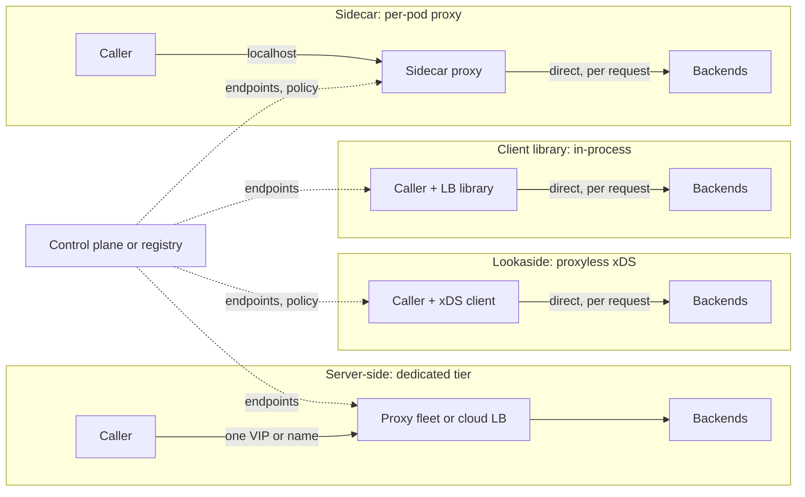
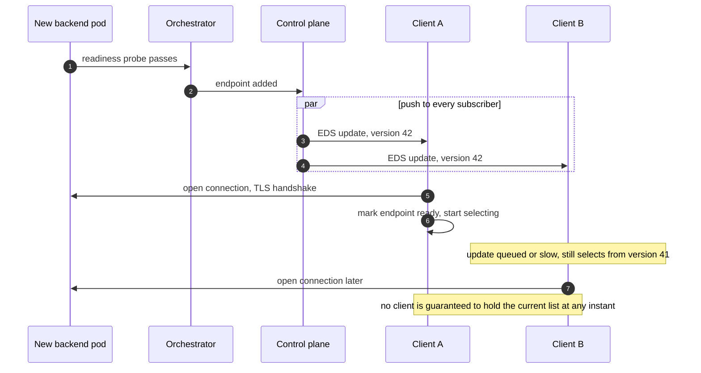
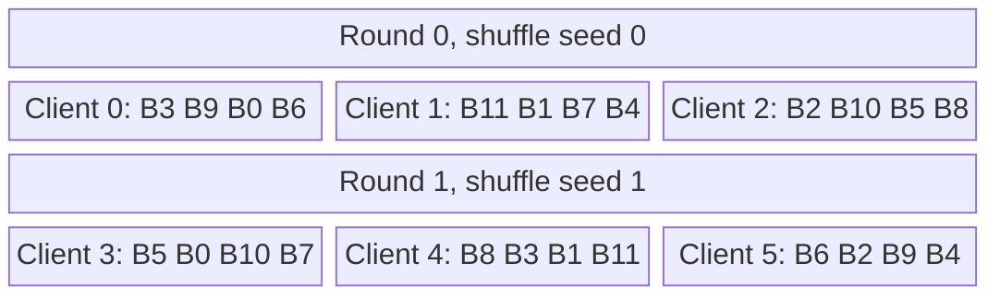
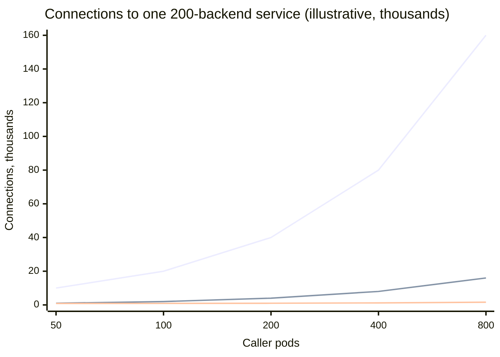
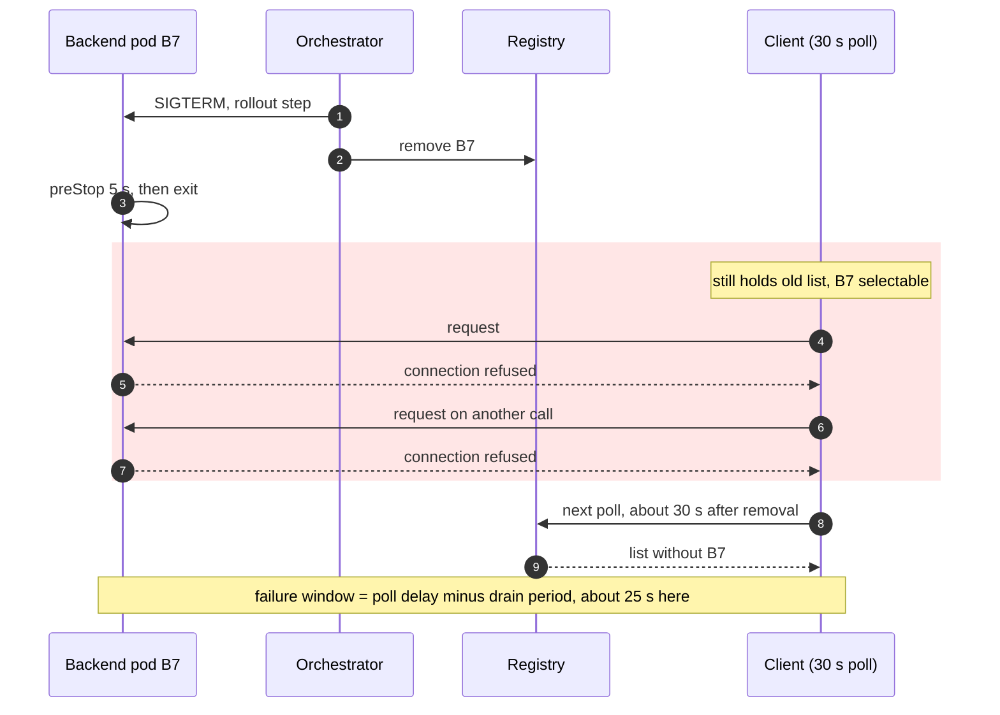

Server-side load balancing puts the balancing decision in a dedicated tier that sits between callers and backends: a hardware appliance, a cloud load balancer, or a fleet of proxies such as Envoy, HAProxy, or NGINX. Callers address one stable name or virtual IP and know nothing about the backends behind it. Client-side load balancing moves the decision into the caller: a library inside the calling process, or a proxy co-located with it, holds the full list of backend endpoints and picks one for each request itself. Both perform the same three jobs, keeping an up-to-date set of endpoints, tracking which of them are healthy and how loaded they are, and running a selection function over that set. They differ in where those jobs run and how many copies of the resulting state exist.

The problem the choice settles is ownership of state that changes every second. A fleet of backends grows, shrinks, deploys, and fails; somebody must know the current membership and the current health, and somebody must apply that knowledge to every request. In the server-side model that knowledge lives in a few balancer instances, which see a large share of all traffic and can be upgraded by one team. In the client-side model it is replicated into every caller, hundreds or thousands of copies, each seeing only its own traffic and each updated asynchronously.

The core trade-off is a hop and a shared failure domain against replicated state and per-client blindness. A server-side tier adds a network hop and its latency, a capacity tier to provision, and a component whose failure affects every caller at once; in return it keeps callers simple, sees enough traffic to make load-aware decisions meaningful, and changes behavior with one deployment. Client-side balancing removes the hop and lets every request be balanced individually with the caller's own view of latency and errors; in return every client needs a current endpoint list delivered by a control plane, every client opens connections to many backends, every client must independently discover each failure, and the balancing logic ships inside every caller's release cycle.

The placement decision is separate from three neighbors that are often confused with it. The selection function itself (round robin, least request, power of two choices, hashing) is covered in [Algorithms](/distributed-systems/en/communication/load-balancing/algorithms/); whether the balancer sees connections or requests is covered in [L4 vs. L7 Load Balancing](/distributed-systems/en/communication/load-balancing/l4-vs-l7/); and how a caller learns that a service exists and where it runs, the registry and its query protocol, is covered in [Client-Side Discovery](/distributed-systems/en/microservice-patterns/service-discovery/client-side-discovery/) and [Server-Side Discovery](/distributed-systems/en/microservice-patterns/service-discovery/server-side-discovery/). This page covers where the decision runs and what that placement costs.

## Five Places the Decision Can Run

The binary name hides a spectrum. What varies along it is the process that runs the selection function, and the source from which that process gets its endpoint list.


*Four of the placements and where their endpoint lists come from. Solid arrows carry requests; dashed arrows carry membership state. The fifth placement, a node-local L4 forwarder, is described below.*

The diagram makes the main asymmetry visible. In the server-side group the control plane feeds a handful of balancer instances, and the caller's only dependency is one address. In each of the other three groups the dashed arrow fans out to every caller process or every caller pod, so the number of endpoint-list subscribers equals the number of clients, and every one of them is a place where the list can be stale. The request path is the reverse: the server-side group has two network legs per request, the others have one.

**Dedicated tier (server-side).** A cloud load balancer, an appliance, or a proxy fleet terminates the caller's connection and forwards to a backend. The caller resolves one name, typically to a few addresses of the tier itself. This is the only placement possible for callers you do not control: browsers, mobile apps, partner systems. It is also the natural placement at the edge, where TLS termination and policy live, as described in [API Gateway Pattern](/distributed-systems/en/communication/api-gateway/api-gateway-pattern/).

**Client library (in-process).** The caller links a balancing library that resolves the service to all of its endpoints, opens connections to them, and picks per request. Netflix's Ribbon with Eureka, Twitter's Finagle, and gRPC's built-in policies are the canonical examples. The library sees each request's latency and outcome directly, with no extra hop, but it exists once per language and its behavior changes only when the caller is rebuilt and redeployed.

**Sidecar proxy (client-side placement, out of process).** A proxy runs next to each caller, usually in the same pod, and the caller sends plaintext to localhost. The proxy holds the endpoint list and balances per request, so the decision is still made on the caller's machine with the caller's traffic, but the logic is language-independent and upgraded separately from the application. Linkerd and Istio's Envoy sidecars work this way; the general pattern and its costs are covered in [Sidecar Pattern](/distributed-systems/en/microservice-patterns/structural-patterns/sidecar-pattern/) and [Shared Library vs. Sidecar](/distributed-systems/en/microservice-patterns/structural-patterns/shared-library-vs-sidecar/). The localhost hop costs memory and CPU per pod rather than a network round trip.

**Lookaside or proxyless (client-side placement, centrally configured).** The client library speaks a control-plane protocol and receives not only endpoints but also policy: weights, locality priorities, outlier settings. gRPC's original lookaside design, `grpclb`, has a separate balancer server hand the client its server list; gRPC's documentation now marks it deprecated and recommends xDS instead, the protocol family Envoy uses for configuration, which gRPC clients consume directly when the target uses the `xds:///` scheme. Istio added experimental proxyless gRPC support in version 1.11 (2021). This placement keeps the single hop of a library while moving policy decisions back to a central owner.

**Node-local L4 forwarder.** Kubernetes `kube-proxy` programs iptables, IPVS, or nftables rules on every node so that connections to a ClusterIP are translated to a pod address on the caller's node. Its placement is client-side, since the decision runs on the caller's machine without a network hop, but its semantics are those of an L4 balancer: one decision per connection, made by the kernel, with no visibility into requests. This is why the HTTP/2 and gRPC pages describe ClusterIP as balancing almost nothing for long-lived multiplexed connections.

### What Moves When the Decision Moves

Three properties follow from placement and do not depend on the algorithm.

The first is the share of each backend's traffic one balancer sees. A tier of four proxies serving a fleet sees a quarter of each backend's requests per proxy; a client library in one of 400 callers sees one four-hundredth. Load-aware algorithms depend on that share, because the signal they use (outstanding requests, recent latency, recent errors) is computed from the balancer's own traffic. The [algorithms page](/distributed-systems/en/communication/load-balancing/algorithms/) works through how least-request degrades into random choice when each balancer's share becomes small.

The second is the number of copies of the membership state. One copy per balancer instance is the right number for consistency and the wrong number for availability, because those few instances are a shared failure domain. One copy per client removes the shared failure domain from the request path but makes "the current endpoint list" a property of a control plane's push, not of any single process.

The third is who can change behavior and how fast. A proxy tier is reconfigured by its owner, often without a deployment. A sidecar fleet is upgraded by rolling every pod. A library changes when every calling service releases, which in an organization with hundreds of services can take months and never completes for services that are rarely deployed.

## The Client-Side Mechanism: Endpoints, Health, and Connections

Moving the decision into every client creates three mechanisms the server-side model does not need at the same scale: distributing the endpoint list to every client, detecting failure from each client's own observations, and controlling the number of connections when every client talks to every backend.

### Endpoint Propagation and the Safety Window

A client-side balancer is correct only if it never selects an endpoint that cannot serve the request, and it can never guarantee that from its own list, because the list is a copy that arrived some time after the change it describes. The guarantee is therefore built from two sides: the control plane delivers changes eventually, and backends behave so that a stale choice is still harmless during the propagation delay.


*Addition of a backend under a push-based control plane such as xDS. Removal follows the same path, which is where staleness becomes dangerous.*

Steps 1 to 4 are the part a registry designer controls: readiness gates admission, and the control plane pushes a versioned update. Steps 5 and 6 show that receiving an update does not make an endpoint usable; the client still has to connect, complete a TLS handshake, and in gRPC's terms move the subchannel to READY before the selection function considers it. Step 7 is the general case: clients apply updates at different times, so for a window the fleet of clients disagrees about membership. For an addition this is harmless; the new backend simply ramps up as clients discover it. For a removal it is not. If a backend stops serving at the moment it is removed from the registry, every client that has not yet applied the removal keeps sending it requests, which fail with connection refused or resets.

The rule that makes removal safe follows directly: a departing backend must keep serving, or reject requests in a way the client is guaranteed to retry elsewhere, for longer than the longest propagation delay to any client. Google's SRE book calls the state in which a task still serves but asks clients to stop sending it work "lame duck"; Kubernetes implements the same idea with readiness removal followed by a termination grace period. The mechanics of draining are covered in [Health-Aware Routing and Connection Draining](/distributed-systems/en/communication/load-balancing/health-aware-routing/); what matters here is that client-side placement makes the propagation delay longer and more variable, because it is the delay to the slowest of N clients rather than to a few proxies.

The size of that delay depends on whether the path is pushed or polled, and how many caches lie on it. In the Spring Cloud Netflix stack, the Eureka client fetches the registry every 30 seconds by default, the Eureka server serves reads from a response cache refreshed every 30 seconds, and Ribbon refreshed its server list from the Eureka client every 30 seconds; maintainers discussing the defaults estimate up to about two minutes before a new instance receives traffic, and the same chain delays a removal; that stack is described in [Client-Side Discovery](/distributed-systems/en/microservice-patterns/service-discovery/client-side-discovery/). A crashed instance that never deregisters stays in the registry until its lease expires, 90 seconds by default. xDS is push-based and typically converges in seconds, but its delay grows with the number of subscribers and the size of each push; Istio exposes the distribution as the `pilot_proxy_convergence_time` metric. DNS-based client balancing has its own variant: gRPC resolvers re-resolve mainly when a connection fails or closes, so a scale-out can stay invisible to existing clients until something closes a connection.

:::tip[Size the shutdown delay from measured propagation, not from habit]
The usual `preStop` sleep of a few seconds is correct only if the slowest client applies removals within that time. Measure the propagation tail (control-plane convergence plus client-side refresh and cache intervals), set the lame-duck period above its high percentile, and alert when the tail grows. Polled registries with stacked caches need a lame-duck period measured in minutes, which then dominates rollout duration.
:::

### Passive Health from Each Client's Vantage Point

A central proxy can probe backends actively and also see every response it forwards. A client-side balancer usually relies on passive detection, ejecting an endpoint after it observes errors or timeouts on its own requests, a mechanism Envoy calls outlier detection. Passive detection from the client has one real strength: it measures the path the client actually uses. A backend reachable from one availability zone and not from another, or a network path that drops one flow in a thousand, is invisible to a central health check and visible to the clients that suffer from it.

Its weakness is that every client must rediscover every failure on its own. If the ejection rule is five consecutive errors, each of N clients must send five requests to a broken backend before it stops, so the fleet pays at least `5 * N` failed requests, and pays them at the rate at which each client happens to send that backend traffic. A client that sends a backend one request every two seconds needs ten seconds to eject it. Twitter's engineers cite this as one motivation for their redesign of Finagle's balancer: in a full mesh, every client must independently detect the same failures, and health checking and circuit breaking become expensive and slow. The worked example below puts numbers on it.

Active health checking from every client has the opposite problem. Probing every backend from every client every few seconds is `N * M / interval` probes per second, which at a few hundred clients and backends becomes a measurable share of backend load. This is the second reason, after connection count, why large client-side deployments limit the number of backends each client talks to.

### Connection Fan-Out and Deterministic Subsetting

A client that balances per request needs an open connection to every backend it may select. With N clients and M backends, a full mesh holds `N * M` connections. Each costs memory for socket buffers and TLS state at both ends, file descriptors, keepalive traffic, and, if health is checked per connection, periodic probes. The SRE book's reasoning for limiting this is that every connection costs some memory and CPU at both ends; the cost per connection is small, and the product across a large fleet is not.

Subsetting gives each client a subset of k backends and balances only within it. The subset must satisfy three conditions: every backend should receive roughly the same number of clients, the subsets should differ enough that a failure in one backend spreads its load across many others, and a client's subset should not change unless membership changes. Choosing subsets at random fails the first condition. In the SRE book's example of 300 clients and 300 backends, random subsets of 30 leave the least loaded backend with 50% of the average number of connections and the most loaded with 150%; with subsets of 90 the spread narrows only to 63% and 121%. The variance comes from the binomial distribution of independent choices, and it shrinks only slowly with subset size.

Deterministic subsetting, described in the SRE book, removes the variance by construction. Clients receive dense integer identifiers 0, 1, 2, and so on. With `subset_count = M / k` subsets per round, clients are grouped into rounds of `subset_count` consecutive identifiers. Every client in a round shuffles the same sorted backend list with the same seed, the round number, so all of them compute the identical permutation without communicating. The permutation is cut into `subset_count` disjoint slices of k backends, and each client in the round takes the slice at position `client_id % subset_count`.


*Deterministic subsetting with 12 backends, subset size 4, and 6 clients. Each round's permutation is illustrative; what matters is that every round partitions all 12 backends.*

The correctness argument is a counting argument. Within one round, the slices are disjoint and together cover all M backends, so a complete round adds exactly one client to every backend. With C clients forming complete rounds, every backend receives exactly `C / subset_count` clients, which equals `C * k / M`, the average. An incomplete final round can add at most one extra client to some backends, so the imbalance is bounded by one connection regardless of fleet size. In the diagram, each of the 12 backends appears exactly twice.

The per-round reshuffle is what satisfies the second condition. If every round used the same permutation, clients 0 and 3 would hold the same four backends; when B6 failed, its load would land on B3, B9, and B0 alone, and a second failure in that group would compound. With a different permutation per round, B6's clients are client 0 (whose remaining backends are B3, B9, B0) and client 5 (B2, B9, B4), so the displaced load spreads across five survivors instead of three, and across nearly all backends in a large fleet.

Deterministic subsetting has three structural costs. First, it requires every client to know a stable, dense identifier and the total client count, which an orchestrator does not provide by default; a draft gRPC proposal for a deterministic subsetting policy (gRFC A68) drew exactly this objection in review, that assigning and maintaining client indexes through a control plane is hard at scale. Second, it requires every client to hold the identical sorted backend list, or the slices of different clients overlap and leave gaps; propagation skew from the previous section therefore turns directly into load skew. Third, a change in M changes `subset_count`, which reassigns the round and slice of almost every client, so a resize triggers a fleet-wide reconnect. Google's later paper on Rocksteadier subsetting describes this churn becoming a serious problem once autoscaling resized backends frequently, and replaces the per-round shuffle with placement on a ring using a low-discrepancy sequence, so that adding a backend moves few subsets.

Twitter arrived at a related design. Finagle's random aperture balancer gave each client a random subset sized by a feedback controller and produced the banded load that the binomial argument predicts. Deterministic aperture places clients and backends at equal intervals on two rings, gives each client a contiguous arc of backends, allows fractional overlaps so that a backend shared by two clients counts partially toward each, and runs power of two choices within the arc. Twitter reported a 78% reduction in the relative standard deviation of load for a representative service and a 91% reduction in connections, from about 280,000 to about 25,000, and made it the default balancer.

:::note[Envoy's "subset load balancer" is a different mechanism]
Envoy's subset load balancer partitions endpoints by metadata (version, zone, canary label) so that a route can select, for example, only `version=v2` hosts. It is a routing feature, covered under [Traffic Management](/distributed-systems/en/service-mesh/service-mesh-architecture/traffic-management/), and it does not reduce connection fan-out. The subsetting on this page limits how many backends each client connects to.
:::

### Worked Example: 400 Callers, 200 Backends

Assume 400 caller pods and 200 backend pods for one gRPC service. Each caller sends 100 requests per second, so the backends receive 40,000 requests per second in total, 200 each, with a mean service time of 20 ms. All numbers in this example are illustrative.

**Full mesh, client-side.** Each caller holds 200 connections and each backend 400, for 80,000 connections in total. Each caller sends each backend `100 / 200 = 0.5` requests per second, and by Little's Law its average outstanding count toward that backend is `0.5 * 0.02 = 0.01`. The backend's real load is 4 outstanding requests; every individual client sees almost none of it. If each client also probes every endpoint every 5 seconds, the fleet sends `80,000 / 5 = 16,000` probes per second, 80 per backend per second. When a backend starts failing every request, each client needs five requests to eject it under a five-consecutive-errors rule, which at 0.5 requests per second takes about 10 seconds. During those 10 seconds the backend receives its usual 200 requests per second, so about 2,000 requests fail, 0.5% of all traffic in that window.

**Deterministic subsets of 20.** Here `subset_count = 200 / 20 = 10` and the 400 callers form 40 complete rounds, so every backend receives exactly 40 clients. Connections fall to `400 * 20 = 8,000`, probes to 1,600 per second, 8 per backend. Each client now sends each of its backends 5 requests per second, with 0.1 outstanding on average: still thin, but ten times stronger. Ejection takes about one second, and about 200 requests fail. Subsetting has made each client's view of each backend ten times larger by making it see ten times fewer backends.

**Server-side tier.** Assume four proxy instances, each forwarding 10,000 requests per second and holding a connection to every backend. Each proxy sends each backend 50 requests per second with 1 outstanding on average, a usable signal. Ejection after five errors takes about 0.1 seconds per proxy, and about 20 requests fail fleet-wide. Upstream connections number `4 * 200 = 800` per worker thread (Envoy pools connections per worker, so multiply by the thread count), plus one or a few connections per caller to the tier. The cost is the hop: assume 0.3 ms added per request at the median, 1.5% of a 20 ms call, more at the tail, and a tier provisioned for 40,000 requests per second plus the loss of one instance.


*Top line: full-mesh client-side balancing, `N * 200`. Middle line: deterministic subsets of 20, `N * 20`. Bottom line: four proxies, one connection per caller plus 800 upstream.*

The three lines grow at different rates for the same reason the ejection times differ. Full mesh grows with the product of the two fleets, subsetting with the caller count times a constant, and the proxy tier almost not at all. The proxy tier wins on connections and on signal strength because it concentrates traffic; client-side balancing wins on latency and on failure isolation because it does not. Subsetting is a deliberate move partway back toward concentration while keeping the request path direct.

## Trade-offs Across the Placements

The comparison below is about placement; each row can run any of the selection functions from the algorithms page.

| Placement | Extra network hop | Signal per balancer | Endpoint-list copies | Change and upgrade path | Main shared failure | When to prefer |
|---|---|---|---|---|---|---|
| Dedicated tier (cloud LB, proxy fleet) | Yes | Strong: large share of each backend | Few | Reconfigure or redeploy one tier | Tier outage or saturation affects all callers | Untrusted or external callers, edge policy, heterogeneous callers, small client counts |
| Client library | No | Weak without subsetting | One per caller process | Rebuild and redeploy every caller, per language | Library bug or bad config shipped to all callers | Few languages, latency-critical calls, organizations that control all callers |
| Sidecar proxy | Localhost only | Weak without subsetting | One per pod | Roll every pod, independent of application release | Bad proxy version or config pushed fleet-wide | Many languages, uniform policy, mTLS needed anyway |
| Proxyless xDS | No | Weak without subsetting | One per caller process | Policy central, mechanism in library | Control-plane misconfiguration pushed to all | gRPC-heavy fleets wanting mesh policy without per-pod proxies |
| Node-local L4 (kube-proxy) | No | None (kernel, per connection) | One per node | Cluster networking upgrade | Rule sync lag after endpoint changes | Short-lived connections, protocols with no L7 support |

The table's "main shared failure" column contains the point most often lost in this debate. Client-side placement removes the balancer tier as a shared failure on the request path, but it does not remove shared failure; it moves it into the control plane and into the release artifact. A bad endpoint push, a library regression, or a sidecar version with a connection-pool bug reaches every client, and the result is a correlated failure as wide as any proxy outage, harder to roll back because the faulty component is distributed across every caller.

### Latency and Capacity

The server-side hop costs one extra network round trip within the data center, CPU in the proxy for parsing and, usually, for a second TLS session, and the proxy's own queueing at high utilization. For a service whose calls take tens of milliseconds the median cost is small; for a chain of fine-grained calls each crossing its own proxy tier it accumulates, and the proxy's tail latency adds to every hop's tail. The sidecar replaces the network hop with two localhost traversals and puts proxy CPU and memory on every pod. Istio's 2021 measurements of its experimental proxyless mode, under one benchmark load, show the scale of that per-pod cost: the Envoy sidecar used about 320 millicores and 67 MiB on the client side, the proxyless agent under 1 millicore and about 25 MiB, with gRPC's own work moved into the application container. These figures depend on the benchmark's request rate and are useful only as an order of magnitude.

### Trust and Policy Enforcement

A client-side balancer is cooperative: it enforces routing, weights, and retry budgets only because the client runs the code that does so. That is acceptable for services inside one trust domain and unacceptable for any caller that may be malicious or simply misconfigured. Rate limits, authentication, and admission control for external traffic belong in a server-side tier, as described in [Gateway-Level Throttling and Rate Limiting](/distributed-systems/en/communication/api-gateway/throttling-rate-limiting/). A related constraint is that a server-side tier can retry a failed request on another backend without the caller knowing, while a client-side balancer can do so only if the caller's library implements retries, with the amplification risks covered in [Retry Storms and Metastable Failures](/distributed-systems/en/resilience/flow-control/retry-storms-metastable-failures/).

### How Real Systems Draw the Line

Most large deployments combine placements by tier. External traffic arrives through an L4 tier and an L7 edge, both server-side, because clients are untrusted and unknown. Inside, service-to-service traffic uses client-side placement: Google with subsetting in its RPC stack, Twitter with deterministic aperture in Finagle, meshes with sidecars, gRPC fleets with xDS. Netflix's original stack paired Eureka with the Ribbon library; Spring Cloud removed Ribbon in its 2020.0 release train in favor of Spring Cloud LoadBalancer, a sign of how much a client-side library ties a balancing mechanism to one framework's lifecycle. Sidecarless designs move part of the decision back toward a shared component: Istio's ambient mode uses per-node and per-service proxies, discussed in [Sidecarless Mesh](/distributed-systems/en/service-mesh/service-mesh-architecture/sidecarless-ambient-mesh/).

## Configuring a Client-Side Balancer

The parameters that decide behavior in production are the same across libraries, sidecars, and proxyless clients, even where their names differ.

| Parameter | Where it lives | Effect | Guidance |
|---|---|---|---|
| Endpoint source and refresh | Resolver, registry client, xDS | Propagation delay for additions and removals | Prefer push (xDS, watch APIs); with polling, add every cache interval on the path |
| Balancing policy | Client config or service config | Which selection function runs | gRPC defaults to `pick_first`, which does not balance; set a policy explicitly |
| Subset size | Library or control plane | Connections, per-backend signal, failure spread | Large enough for redundancy and concurrency, small enough that each client sees each backend often |
| Outlier ejection thresholds | Client or sidecar | Time and failed requests before a bad endpoint stops receiving traffic | Tune against per-client request rate to each backend, not against fleet rate |
| Maximum connection age on server | Backend | Forces reconnects so clients re-resolve and rebalance | Set with jitter so reconnects spread over minutes |
| Lame-duck or drain period | Backend shutdown path | Window in which stale clients still succeed | Above the high percentile of propagation delay |
| Fail-static behavior | Client and control-plane client | What happens when the control plane is unreachable or returns an empty set | Keep the last known good set; never apply an empty set without a guard |

The most common gRPC misconfiguration is the default itself: a channel created on a name with several addresses uses `pick_first`, connects to one address, and sends everything there. Enabling client-side balancing is a service-config change.

```json
{
  "loadBalancingConfig": [
    { "round_robin": {} }
  ]
}
```

With a `dns:///` target that resolves to all pod addresses, for example a Kubernetes headless Service, this makes the channel open a subchannel per address and rotate requests across the READY ones. It does not make the client notice new pods until it re-resolves, which is why the server-side maximum connection age in the table above belongs to the same change.

## Failure Modes of Each Placement

Client-side and server-side placement fail in different shapes. Server-side failures are concentrated and loud; client-side failures are distributed, correlated through shared artifacts, and often visible only in aggregate.

### Stale Endpoints During Scale-In and Rollouts

Trigger: backends terminate faster than removals reach every client, typically during a rolling deployment or a scale-in. Symptoms: bursts of connection refused, resets, or gRPC `UNAVAILABLE` aligned with deployment steps, spread thinly across many callers so that no single caller looks broken; error rate per deployment correlates with how fast pods terminate.


*Hypothetical rollout step with a polled registry: the backend's drain period is shorter than the client's refresh interval.*

The shaded block is the window between step 3, when the pod stops listening, and step 8, when the client finally learns of the removal. Every request the client routes to B7 in that window fails, and with outlier detection the client may eject B7 earlier, but only after spending its ejection budget of failures. Multiplied over every client and every pod in a rollout, this produces an error rate that rises and falls with each rollout step. Detection: errors per deployment step, the control plane's convergence time (`pilot_proxy_convergence_time` in Istio), and in Envoy the per-cluster `membership_total` and `membership_healthy` gauges compared across clients against the orchestrator's endpoint count. Mitigation: lame-duck periods longer than the propagation tail, push-based endpoint delivery, and client retries for requests that were never sent, which are safe to retry under any idempotency rule. Recovery is automatic once propagation completes; the fix is configuration, not intervention.

### Control-Plane Outage and the Empty-List Hazard

Trigger: the registry or control plane becomes unreachable, restarts with empty state, or publishes an empty or truncated endpoint set because of a bug or a partial outage of the system that feeds it. Symptoms: if clients keep their last known set, nothing visible happens until membership changes and goes unpropagated. If clients apply the empty set, every caller of the service fails at once with "no healthy upstream" or `UNAVAILABLE` errors.

The correct client behavior is fail-static: keep using the last known good set when the source is unreachable, and treat a sudden collapse of the set with suspicion. Envoy keeps its last accepted configuration when it loses its xDS connection. Eureka's server-side self-preservation mode stops expiring leases when renewals fall below a threshold of expected renewals, on the theory that a network problem is more likely than a mass death. gRPC added a bootstrap option (gRFC A53) that lets a client ignore resource deletions from the xDS server, specifically so that a control-plane mistake does not remove working configuration. Detection: alerts on endpoint-count drops in the control plane's output, not only in its input, and on control-plane connection errors from clients.

:::caution[An empty endpoint set is almost never true]
A service rarely loses every instance at once; a registry or control plane that reports zero instances is far more likely to be wrong than right. Clients and control planes should refuse to replace a non-empty endpoint set with an empty one, or with one that shrinks by more than a set fraction, without a confirmation path. The Envoy panic threshold, which routes to all hosts when too few appear healthy, is the same principle applied to health rather than membership.
:::

### Reconnect Storms

Trigger: many clients reconnect at the same moment, after a control-plane push that recreates a cluster, after a backend restart, after a network blip that resets connections, or when a server-side maximum connection age has no jitter. Symptoms: CPU spikes on backends from TLS handshakes, connection timeouts while handshakes queue, and in the worst case a backend that is overloaded by reconnects and then restarted, which triggers the next wave. In a full mesh the storm size is the number of clients times the number of affected backends. Detection: new connections per second per backend, TLS handshake rate, and the correlation of both with control-plane pushes. Mitigation: jitter on every client reconnect and connection age, exponential backoff on reconnect, subsetting to bound how many clients any backend has, and control planes that update endpoints incrementally rather than recreating clusters.

### Correlated Library or Sidecar Regression

Trigger: a new version of the balancing library or sidecar, or a new policy pushed through the control plane, contains a defect: a connection-pool leak, a policy that ignores weights, a parser that rejects a valid update. Symptoms: degradation that appears across many unrelated services at once, tracking the rollout of the shared artifact rather than any one service's deployment. Detection requires labeling metrics with the library or proxy version so that error and latency can be grouped by it. Mitigation: canary the balancing component itself, separately from applications; keep the version distribution visible; for libraries, accept that the long tail of rarely deployed services will run old versions for a long time and test the control plane against all versions still in use. Recovery for a sidecar or control-plane change is a rollback by its owner; for a library it is a redeploy of every affected caller, which is why organizations with many services move balancing logic out of the application binary.

### Saturation and Shared Fate of a Central Tier

Trigger: the server-side tier runs out of capacity or loses instances, or a configuration push breaks it. Symptoms: latency and errors rise for every service behind the tier, including those whose backends are healthy. Detection: the tier's own CPU, active connections, and queueing, compared with backend latency; a gap between latency measured at the tier and at the backend points to the tier. Mitigation: capacity for the loss of an instance at peak, per-route limits so that one hot route cannot saturate the tier for all, and sharding the tier by service group so that its failure domain is smaller than the whole platform. The L7-specific behavior under overload is covered in [L4 vs. L7 Load Balancing](/distributed-systems/en/communication/load-balancing/l4-vs-l7/).

### Failure Signatures by Placement

| Failure | Placement | Symptom from outside | Detection signal | Mitigation |
|---|---|---|---|---|
| Stale endpoints | Client-side, any | Error bursts aligned with rollout steps | Convergence time, endpoint count skew across clients | Lame duck above propagation tail, push delivery |
| Empty endpoint set | Client-side, any | All callers fail at once | Endpoint-count drop at control-plane output | Fail-static, deletion guards |
| Reconnect storm | Full mesh client-side | Handshake CPU spike, connect timeouts | New connections per second per backend | Jitter, backoff, subsetting |
| Subset skew | Subsetting | Some backends hotter with no traffic change | Clients per backend, max-to-median load | Dense stable client IDs, consistent lists |
| Shared-artifact regression | Library, sidecar, proxyless | Many services degrade together | Metrics grouped by library or proxy version | Canary the balancer, version visibility |
| Tier saturation | Server-side | All services behind the tier slow | Tier CPU and queueing vs. backend latency | Headroom, per-route limits, tier sharding |

## Choosing Where the Decision Runs

The decision follows from four questions: who controls the callers, how many callers and backends there are, how many languages the callers are written in, and how much an extra hop costs relative to the call.

Use a server-side tier when callers are external, untrusted, or not under your release control; when policy such as authentication, rate limiting, or request transformation must be enforced rather than requested; when callers are few and heterogeneous, so that client-side machinery would be built for each of them; and when the call is expensive enough that a fraction of a millisecond is irrelevant. Use it also when you need the strong load signal of a concentrated balancer and the client fleet is large enough that each client would see each backend only rarely.

Use client-side placement for high-rate, latency-sensitive traffic between services you own, when callers can receive endpoint updates from a control plane you operate. Prefer a sidecar or node-level proxy when the fleet spans many languages or when mutual TLS and telemetry are needed anyway; prefer a library or proxyless xDS when the fleet is mostly one RPC framework and per-pod proxy cost matters. Add subsetting once the product of callers and backends makes connection count, health-check load, or ejection time a problem, which the worked example shows happens at a few hundred of each.

Do not use client-side balancing when the endpoint source is a polled registry with stacked caches and backends cannot drain for minutes; the stale-endpoint window will dominate your error budget. Do not use it to enforce limits on callers that could ignore them. Do not adopt deterministic subsetting without a source of stable, dense client identifiers and a way to ensure all clients hold the same backend list, and do not use it on backend fleets that autoscale frequently unless the subsetting scheme limits churn on resize. Do not put a server-side tier between two services solely to get balancing when both are under your control and the call chain is deep; each tier adds a hop, a capacity plan, and a shared failure domain to every call in the chain.

:::caution[Two balancers on one path]
A client-side balancer that sends to a ClusterIP or to a load balancer address is balancing across one endpoint, and the real decision is made by whatever is behind that address. The reverse also happens: a sidecar balancing per request in front of a server-side tier makes the tier's view of load meaningless. Decide which layer owns the decision for each hop, give it the real endpoint list, and make the other layers pass traffic through.
:::

## Further Reading

- Betsy Beyer, Chris Jones, Jennifer Petoff, and Niall Richard Murphy (eds.), *Site Reliability Engineering: How Google Runs Production Systems*, O'Reilly, 2016, chapter 20, "Load Balancing in the Datacenter".
- Peter Ward, Paul Wankadia, and Kavita Guliani, *Reinventing Backend Subsetting at Google*, ACM Queue 20(5), 2022.
- Twitter Engineering, *Deterministic Aperture: A Distributed, Load Balancing Algorithm*, blog.twitter.com, 2019.
- Mark D. Roth, *gRFC A27: xDS-Based Global Load Balancing*, gRPC proposals repository.
- Envoy Project, *xDS REST and gRPC Protocol*, Envoy documentation (continuously revised).
- Istio Project, *gRPC Proxyless Service Mesh*, istio.io blog, 2021.
