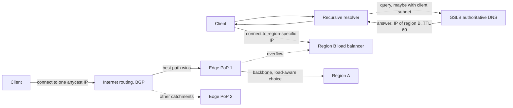
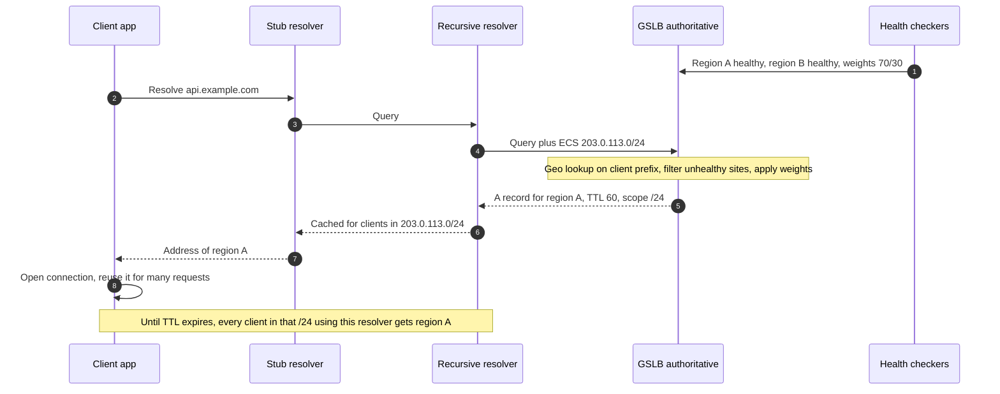
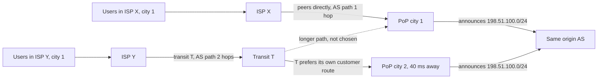
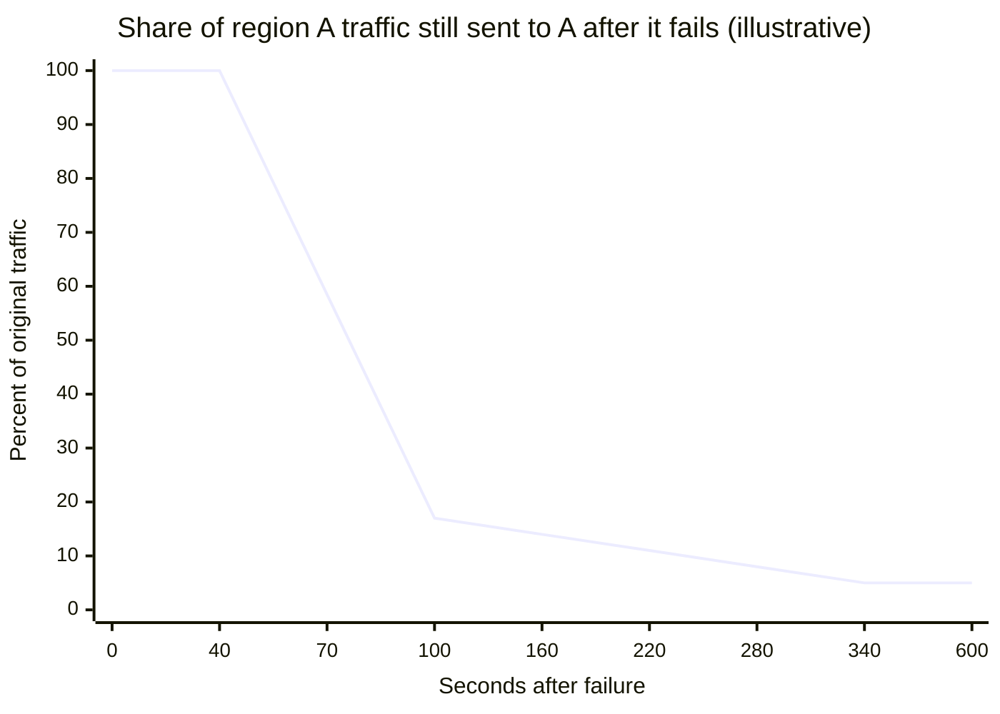
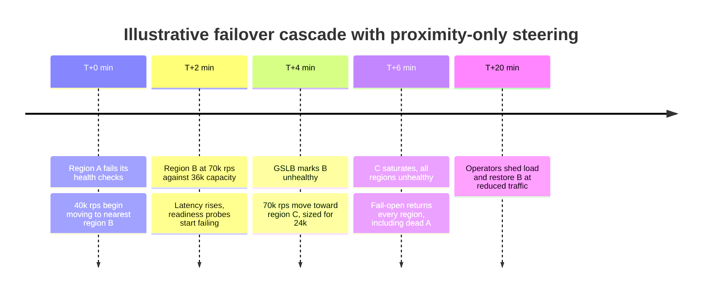
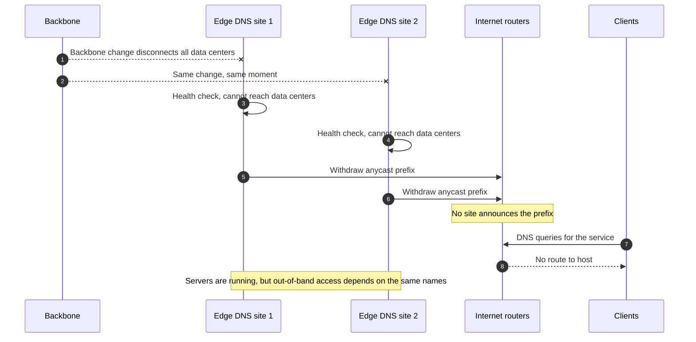

Global server load balancing (GSLB) chooses which site, meaning a region, data center, or point of presence (PoP), receives a client's traffic when the same service runs in several places. Load balancing inside one site picks a backend among machines that share a network and a failure domain; GSLB picks among sites separated by tens of milliseconds, independent power and network, and often different data. Two mechanisms dominate. DNS-based GSLB has the authoritative name server return a different address to each query, according to where the query seems to come from, which sites are healthy, and how much load each should take. Anycast announces the same IP prefix from every site through BGP (Border Gateway Protocol), and lets the internet's routing system deliver each packet to whichever site its path selection prefers.

Without either, a multi-region deployment is a set of single-region services with a hand-edited DNS record in front. Users in Singapore pay a trans-Pacific round trip on every TCP and TLS handshake to a service hosted in Virginia, and a regional outage lasts until an operator changes the record and resolver caches expire. The problem GSLB solves is therefore twofold: proximity, sending each client to a site that is close in network terms, and survival, removing a failed or overloaded site from every client's path quickly enough to matter for the availability objective.

The core trade-off is control against reaction speed and transparency. DNS-based GSLB makes an explicit decision for every resolution: it can weigh capacity, shift exactly 5% of new resolutions to a canary region, and keep a jurisdiction's users in that jurisdiction. But it decides for a resolver rather than for a client, its answer is cached for a TTL (time to live) that some caches do not honor, and it never touches a connection that is already open, so a failover takes minutes to complete and leaves a long tail. Anycast reacts in the network itself: withdrawing a route moves traffic away within seconds to a few minutes, with no client cooperation, and a flood is absorbed by every site in proportion to its catchment. But the site a client reaches is chosen by BGP policy, which knows nothing about latency or load, and the operator can steer traffic only coarsely, by changing what it announces to whom. Production edges usually combine the two: anycast to reach the nearest edge, and an explicit, load-aware decision behind it.


*Two ways to choose a site. Top: DNS-based GSLB decides per resolution and returns a unicast address. Bottom: anycast lets BGP pick the edge, which then chooses the region with full knowledge of load.*

In the upper path, the decision happens once, before the client opens any connection, and its unit is the resolver: everything the client does until its cached answer expires goes to region B, whatever happens to region B in the meantime. In the lower path, nothing about the client's choice is fixed in advance. Every packet to the anycast address follows the current BGP best path to some edge PoP, and the edge, which terminates the connection, can send each request to whichever region is healthy and has capacity. That second hop is where most of the control lost to anycast is regained, and it is why global cloud load balancers are built in that shape.

## DNS-Based GSLB: Deciding per Resolution

DNS-based GSLB turns the authoritative name server for a service's hostname into a decision engine. Its inputs are a map from source address to location, health state for each site, administrative weights or capacity, and, in more sophisticated systems, latency measurements from real clients. Its output is one or more A or AAAA records with a TTL, and the whole mechanism rests on what the server can know at query time and on how long its answer lives afterwards.

### From Stub to Authoritative Answer

A client application does not query the GSLB directly. Its operating system's stub resolver forwards the name to a recursive resolver, usually run by the client's ISP, enterprise, or a public service, and the recursive resolver walks the delegation chain to the authoritative servers for the zone. The authoritative server therefore sees the recursive resolver's address, not the client's. When client and resolver are close, as with an ISP resolver in the same metro, the resolver's location is a good proxy. When they are not, the GSLB optimizes for the wrong place.

EDNS Client Subnet (ECS), specified in RFC 7871 in 2016, closes part of that gap. A resolver that supports it includes a truncated prefix of the client's address in the query, and the RFC recommends truncating to 24 bits for IPv4 and 56 bits for IPv6 to limit what is revealed. The authoritative server decides on the client's prefix and returns a scope prefix length telling the resolver for which range of client addresses the answer may be reused. A resolver honoring ECS must then cache the answer per scope rather than per name, which multiplies its cache entries and the query load it sends upstream.


*One DNS-based GSLB decision. The answer is computed once and then reused by every client the resolver serves from that scope until the TTL expires.*

Step 1 runs independently of any query: health and weights are state inside the GSLB, refreshed on the health checkers' schedule. Steps 4 and 5 are the only moment at which the operator's policy is applied; from step 6 on, the answer belongs to the resolver's cache. Step 8 is the part DNS cannot reach at all: the application opens a connection, and HTTP/2 or gRPC clients may keep it for minutes or hours, sending every request to region A regardless of what the GSLB would answer now. Lowering the TTL shortens the period between step 5 and the resolver's next query; it does nothing to the connection opened in step 8.

### What the Answer Guarantees, and What It Does Not

The invariant DNS-based GSLB provides is narrow: each resolution that reaches the authoritative server is answered with a site that was eligible according to the GSLB's view of health and policy at that moment. It does not guarantee that the client is near the chosen site, because the location used is the resolver's or a truncated prefix. It does not guarantee that a client uses a healthy site, because the answer outlives the health state on which it was based. It does not guarantee a load split, because one answer to a large resolver is shared by thousands of clients, and weights apply to resolutions rather than to users or requests. And it does not guarantee the TTL: the TTL is an instruction to caches, and some caches lengthen it.

The correctness argument is a bound rather than a promise. Once a site is marked unhealthy and that state reaches every authoritative server, no new resolution returns it. Any cache that honors TTLs stops returning it within one TTL. The set of clients still sending traffic to the failed site after that is exactly the union of three groups: caches that clamp or ignore TTLs, applications that cache addresses themselves, and connections opened before the change that have not yet closed. The first two are outside the operator's control; the third is controlled by the server, which can close or limit connection lifetimes. The guarantee is sound only if the health signal is right, which is the subject of the failure modes below.

### Resolver Granularity and Public Resolvers

The cost of deciding per resolver is largest for clients whose resolver is far away. Chen, Sitaraman, and Torres measured this at Akamai and reported, for public resolvers, a median client-to-resolver distance of 1,028 miles, against 162 miles across all clients, with public resolvers carrying about 8% of client demand worldwide. Rolling out mapping based on client subnets instead of resolver addresses gave clients of public resolvers an eight-fold decrease in mapping distance, roughly a halving of round-trip time and download time, and a 30% improvement in time to first byte, at the price of about eight times more DNS queries to Akamai's authoritative servers.

Public resolvers differ in what they send. Google Public DNS sends ECS to authoritative servers that support it; Cloudflare's 1.1.1.1 does not send ECS, as a privacy choice. A GSLB serving clients of a resolver without ECS sees the address of the resolver's anycast site, which is usually near the client, but not always and not at the granularity of the client's ISP. The decision is therefore only as good as the population of resolvers in front of the service, which is a property of the user base, not of the GSLB.

Granularity also limits how finely a weight can be applied. Suppose, illustratively, that the ten largest resolvers serving a consumer service account for 40% of its traffic. A 1% weight toward a canary region is then applied per resolution, and one resolution to one of those large resolvers can move a much larger share of users than 1% for the length of a TTL. Weighted DNS is accurate in aggregate over many resolutions and many resolvers, and noisy for small percentages over short windows; precise canaries belong behind a layer 7 proxy, as described in [Canary Release](/distributed-systems/en/deployment/deployment-patterns/canary-release/).

## Anycast: Letting BGP Choose the Site

Anycast assigns one address to many sites. Each site runs a BGP speaker that announces the same prefix, say a `/24`, from the same origin AS (autonomous system). Every router on the internet that learns several paths to the prefix keeps one best path, chosen by the BGP decision process: local preference set by the router's operator (customers before peers before transit providers, typically for commercial reasons), then shorter AS path, then origin type and MED (multi-exit discriminator), then the nearest exit in the router's own network, often called hot-potato routing. The set of clients whose packets end up at a given site is that site's catchment.

Nothing in that process measures latency or load. A site is reached because a chain of operators' preferences ranks its path best, which correlates with proximity because nearby networks tend to have shorter, cheaper paths, but the correlation can break in both directions. An ISP in Frankfurt that buys transit from a carrier whose best path to the prefix enters in Amsterdam sends its users to Amsterdam even if a Frankfurt PoP exists, and a peering arrangement on another continent can make a distant site look closer than a near one.


*Anycast catchments are decided by path selection, not distance. Users of ISP Y reach the distant PoP because their transit provider's policy prefers that path. Topology is illustrative.*

Both ISPs serve the same city, yet their users land 40 ms apart. ISP X peers directly with the operator in city 1 and gets a one-hop path. ISP Y depends on transit provider T, and T applies its own local preference, for example preferring a route learned from a paying customer in city 2 over a peering route in city 1, before AS-path length is even considered. The operator cannot see this from inside its network; it sees only that the city 2 PoP receives traffic it did not expect. Calder and colleagues measured the effect on Microsoft's Bing CDN and found that anycast usually performed well, but that about 20% of clients were directed to a suboptimal front end, with a history-based prediction scheme able to improve their performance.

### Withdrawal as the Failover Primitive

A site leaves the anycast set by withdrawing its announcement. Routers that had selected the withdrawn path fall back to their next-best path, which points at another site, and propagate the change. Health is connected to routing by making the BGP speaker conditional: a local health checker announces the prefix only while the site's service is healthy, and withdraws it when the check fails, through tools such as ExaBGP or BIRD driven by a script, or a routing daemon integrated with the balancer.

The guarantee is that, once the network converges, no packet to the prefix reaches a site that is not announcing it. The time to converge is the sum of local detection, the withdrawal's propagation through each AS (routers apply advertisement timers and may explore several alternative paths before settling, a behavior called path hunting), and the forwarding table update in each router. Convergence is typically seconds to a small number of minutes and is not under the operator's control beyond its own edge. During it, some packets still follow stale paths to the withdrawn site and are dropped, or briefly loop.

Withdrawal is also blunt. It removes the whole site for every client, so a site that is merely overloaded can shed load only by withdrawing from some neighbors, prepending its own AS to the path several times to make it less attractive, or tagging announcements with BGP communities that ask neighbors to lower preference or limit propagation. Each of these acts on whole catchments of other networks, with effects the operator can measure only after the fact. Moving 10% of a site's traffic precisely is not possible with routing alone.

### Stateful Protocols over Anycast

Anycast's original home is DNS. A DNS query over UDP is one packet each way, so if routing changes between two queries, the second simply goes to another site, which answers just as well. The DNS root uses this: 13 root server identities are served by well over a thousand anycast instances. TCP and QUIC are different, because a connection's state exists only at the site that accepted it. If the catchment changes mid-connection, the next packets arrive at a site with no record of the connection and receive a reset (TCP) or a stateless reset or silence (QUIC, depending on configuration), which is the same failure that an ECMP rehash causes inside a site, described in [Network Reliability, Bandwidth Limitations, and Topology Changes](/distributed-systems/en/foundations/monoliths-to-distributed/network-reliability/).

Large CDNs and cloud edges run TCP and TLS over anycast in production, which is evidence that internet routes change rarely compared with the lifetime of a typical web connection. The exposure scales with connection lifetime: a 200 ms request is almost never affected, a WebSocket held for six hours sees every routing event during those six hours. Long-lived connection workloads over anycast therefore need the reconnection logic they need anyway, or a unicast address handed out after the first anycast contact.

:::note[Anycast between sites, ECMP within a site]
Inside one site, many balancer instances also announce the same virtual IP, and routers spread flows across them by hashing. That is ECMP, a forwarding choice among equal-cost paths inside one routing domain, and it is covered with its flow-affinity problem in [L4 vs. L7 Load Balancing](/distributed-systems/en/communication/load-balancing/l4-vs-l7/). Anycast in the sense of this page is the choice among different sites made by inter-domain BGP policy; the two often appear together, ECMP behind each anycast site.
:::

### Anycast Front, Explicit Choice Behind

Because anycast picks an edge well and a region poorly, cloud global load balancers terminate the client at the anycast edge and make the regional choice there, where load and health are known exactly. Google Cloud's global external Application Load Balancer exposes one IP address announced at Google's edge; connections terminate at the nearest Google Front End (GFE), and a global control plane feeds every GFE the capacity and health of each backend. Requests go to the closest region that has capacity, closeness being measured as round-trip time from the GFE, and overflow to the next-closest region when a region reaches the serving capacity configured on its backends, a behavior Google's documentation calls waterfall by region. When more than half of a region's backends are unhealthy, GFEs start overflowing some traffic preemptively. AWS Global Accelerator provides two static anycast IPv4 addresses, announced from AWS edge locations; traffic enters the AWS network near the client and is carried to endpoint groups in regions chosen by proximity and health, and a traffic dial per endpoint group, defaulting to 100%, reduces the share of the traffic that would otherwise go to that region.

Microsoft's FastRoute, described by Flavel and colleagues at NSDI 2015, shows a different way to add load awareness without touching BGP. Proxies and DNS servers are co-located, and nodes are arranged in layers, each layer with its own anycast address. An overloaded node's co-located DNS server answers a fraction of queries with a CNAME (canonical name alias) pointing to the parent layer's anycast address, a layer placed where capacity is cheaper to over-provision. The design assumes that a client's DNS query and its subsequent traffic usually land at the same node, so the only decision a node needs to make is "not me", and it shifts only new resolutions, so existing sessions are not disturbed. The paper reports that the scheme had run for over two years and handled overloads that occurred a few times a week without manual routing or DNS changes.

## Worked Example: Losing a Region Under Each Mechanism

Assume a service running in three regions with a peak of 90,000 requests per second: 40,000 in region A, 30,000 in B, and 20,000 in C. Every number in this section is illustrative and chosen to show the shape of the arithmetic, not the behavior of a specific product.

### DNS Failover: Where the Minutes Go

Region A fails hard at time zero. The GSLB probes each region every 10 seconds and marks a region unhealthy after three consecutive failures, so detection takes up to 30 seconds; assume another 10 seconds for the new state to reach all authoritative servers. Until 40 seconds, every new resolution still returns region A. The record's TTL is 60 seconds. Assume the resolver population behaves as follows: 80% of region A's traffic comes through resolvers that honor the TTL, 15% through resolvers that clamp TTLs to a minimum of 300 seconds, and 5% from clients that cache the address in the application or hold a connection that keeps retrying the same IP for 30 minutes.

For caches that honor the TTL, the remaining lifetime of an entry at the moment of the change is uniformly spread between 0 and 60 seconds, so their traffic falls linearly to zero between 40 and 100 seconds. The clamped caches drain linearly between 40 and 340 seconds. The sticky 5% stays.


*Detection and propagation take the first 40 seconds; TTL-honoring caches drain in the next 60; clamped caches and sticky clients form the tail.*

The curve has three regions, and each has a different owner. The flat top is the GSLB's detection and publication time, controlled by probe interval and failure threshold. The steep drop is the TTL, controlled by the operator but paid for in query volume. The tail is the client population, controlled by nobody. Integrating the curve gives the failed request volume: 40 seconds at 100%, plus 24 fraction-seconds from the TTL-honoring caches (0.8 times half of 60), plus 22.5 from the clamped caches (0.15 times half of 300), plus 15 from the sticky clients between 40 and 340 seconds, or about 101.5 seconds of region A's full traffic. At 40,000 requests per second, that is roughly 4 million failed requests before client retries, and the sticky clients keep failing at 2,000 requests per second beyond the chart.

Halving the TTL to 30 seconds removes 12 of those 101.5 seconds, about 12%, and doubles the query rate from TTL-honoring resolvers. Halving detection to 15 seconds by probing every 5 seconds removes 15 seconds. The tail, 37.5 seconds, is untouched by either. The cost side of a short TTL is easy to estimate: if, illustratively, 200,000 resolver caches hold the name, a 60-second TTL produces about 3,300 queries per second at the authoritative servers, and ECS multiplies the number of caches by the number of distinct client prefixes each resolver serves, the effect Akamai measured as an eight-fold query increase.

### Anycast Failover

Under anycast, region A's edge withdraws its route when its local health checker fails three probes one second apart, about 3 seconds. Assume 90% of affected traffic converges to another site within 15 seconds of the withdrawal, roughly uniformly, and the remaining 10% within 90 seconds, delayed by path hunting in some networks. The failed volume is about 3 seconds plus 6.75 (0.9 times half of 15) plus 4.5 (0.1 times half of 90), roughly 14 seconds of region A's traffic or 570,000 requests: about one seventh of the DNS case, with no tail from client caches. Existing TCP connections to region A are lost either way; anycast adds no recovery for them, but it lets the reconnect reach a live site immediately.

### Where the Traffic Goes

Both mechanisms move region A's 40,000 requests per second somewhere. If proximity sends all of it to the next-nearest region B, B receives 70,000 requests per second. If B was provisioned for 36,000, its own peak plus 20% headroom, it is now nearly at twice its capacity and fails, and the next shift moves 110,000 requests per second toward C. Surviving the loss of any one region with proximity-only steering requires each region to be provisioned for its own load plus the full load of every region that falls back to it. With capacity-aware spillover across both survivors, the requirement drops to the even split: 90,000 over two regions, 45,000 each, which for equal regions is a headroom of `1 / (n - 1)` of normal load, 50% for three regions and 25% for five. The routing mechanism, not only the capacity plan, decides which of these numbers applies.

## Comparing Global Steering Mechanisms

| Mechanism | Decides | Sees | Reaction to a site failure | Load control | When to prefer |
|---|---|---|---|---|---|
| DNS GSLB, resolver-based | Authoritative DNS, per resolution | Resolver address, site health, weights | Detection plus TTL plus a client-controlled tail, minutes | Fine in aggregate, coarse per resolver | Multi-region services that need geo or jurisdiction rules and can tolerate minutes of failover |
| DNS GSLB with ECS or RUM maps | Authoritative DNS, per resolution and client prefix | Client prefix, measured latency | Same as above | Same, finer geography | Content or media services whose clients sit far from their resolvers |
| Pure anycast | BGP path selection in other networks | Nothing about latency or load | Withdrawal plus convergence, seconds to minutes | Coarse: prepending, communities, selective announcement | DNS, stateless UDP services, DDoS absorption |
| Anycast edge plus load-aware backbone | Edge proxy, per request | Exact backend health and capacity | Fast at the edge, per request behind it | Fine, capacity-based spillover | HTTP services that want one global address and do not run their own edge network |
| Layered anycast with DNS shedding | Co-located DNS, per resolution | Local load only | Fast for new resolutions | Probabilistic, toward a parent layer | Operators of their own anycast CDN who need overload control without BGP changes |
| Client-side steering | Client application | Its own measurements, a server-provided list | As fast as the client retries | Per client, needs app control | Mobile and desktop apps, and internal clients that can carry region lists |

Two rows in the table answer different questions from the others. Client-side steering, where an application receives a list of regional endpoints and measures or fails over among them itself, bypasses both DNS caches and BGP and is the fastest option when the operator ships the client; its mechanics are those of [Client-Side vs. Server-Side Load Balancing](/distributed-systems/en/communication/load-balancing/client-vs-server-side/) applied to regions. The anycast-edge row moves the problem rather than solving it: the edge provider's routing still decides which PoP the client reaches, and the regional choice behind it depends on the provider's control plane being correct.

### Latency, Cost, and Blast Radius

DNS-based GSLB adds no hop to the data path; the first connection costs a DNS resolution, often already cached. An anycast edge with a backbone behind it adds a proxy hop but usually reduces total latency, because TCP and TLS handshakes complete at a nearby PoP and the long leg runs over a warm, managed connection. The cost of the edge is that it becomes a shared dependency of every region: a configuration error at the edge reaches every user at once, and the regional isolation bought by running several regions is partly given back. A DNS GSLB has the same property one layer down, since a broken authoritative configuration also reaches every user, but it fails stale rather than fast: resolvers keep returning the last good answer until it expires.

## Configuring the Decision and the Health Signal

For DNS-based GSLB, the probe interval and failure threshold set detection time. AWS Route 53, for example, offers health check intervals of 10 or 30 seconds, uses health checkers in several locations whose results are not coordinated, and considers an endpoint healthy when more than 18% of the checkers report it healthy, a threshold its documentation says was chosen to require agreement from checkers in several regions. The TTL sets the drain time of honoring caches and the query load. Routing policy sets what is optimized: geography, measured latency, weights, or ordered failover. The record type matters too: a GSLB that returns several addresses lets clients fail over between them without a new resolution, at the cost of spreading load less precisely.

The behavior when every candidate is unhealthy deserves deliberate attention. Route 53 documents that if no record in a group is healthy, it considers all of them healthy and selects one by the routing policy, since it must return something. This fail-open rule is correct for the common case, where a total outage of the health signal is more likely than a total outage of every region, and dangerous when the checks are right and the fallback target cannot serve.

:::caution[Fail-open and zero-weight records]
A GSLB that returns all records when all look unhealthy will send traffic to a region you deliberately drained if that region is in the same record set. Route 53 additionally considers zero-weight records only when all nonzero-weight records are unhealthy, so a drained region left at weight zero becomes the target of a failover. Remove drained regions from the record set, or make sure every record that can be returned can actually serve.
:::

For anycast, the parameters are routing ones. The announced prefix must be long enough to be accepted everywhere, which in practice means no more specific than `/24` for IPv4 and `/48` for IPv6, because many networks filter longer prefixes. The prefix should be covered by a Route Origin Authorization (ROA) in RPKI (Resource Public Key Infrastructure) that names the origin AS and a maximum length matching what is announced, so that networks performing origin validation reject leaked more-specifics. The health-to-route coupling needs hysteresis: a site should withdraw after several consecutive failures and re-announce only after a longer period of success, because every flap is propagated across the internet and may be penalized by route flap damping in other networks. And the health check must test what the site needs to serve, not merely that the local process is alive, which is the lesson of the correlated withdrawal described below.

Diagnosing which site serves a given client is half of operating either mechanism. The commands below inspect what a GSLB answers for a given client prefix and which anycast instance answers a query.

```shell
# What does the GSLB answer for clients in a given /24? (ECS query, needs server support)
dig +subnet=203.0.113.0/24 api.example.com @ns1.example-gslb.net
# Which resolver address and ECS prefix does Google Public DNS forward on your behalf?
dig +short TXT o-o.myaddr.l.google.com @8.8.8.8
# Which anycast instance of a resolver or server answered (if it supports the query)?
dig +short CH TXT id.server @1.1.1.1
# Remaining TTL in a resolver's cache: run twice and watch the TTL column decrease
dig +noall +answer api.example.com @192.0.2.53
```

The first command reproduces what one client population is told, the only way to debug "users in this ISP go to the wrong region" from outside that ISP. The second and third reveal the hidden intermediaries. The last shows whether a resolver's TTL counts down from the configured value or starts above it, which is how TTL clamping is detected.

:::tip[Measure catchments from real clients]
Neither the GSLB's geo database nor the anycast routing table tells you where users actually land or how long it takes. Have clients report, in a sampled beacon, the site that served them (a response header) and the connection setup time, and aggregate by client network (ASN) and region. A shift in that map is often the first signal of a route leak, a peering change, or a resolver migration, hours before any aggregate latency metric moves.
:::

## Failure Modes of Global Steering

### The Long Tail After DNS Failover

Trigger: a region fails and the GSLB removes it, but some clients keep using its addresses. Symptoms: errors continue for minutes after the GSLB shows the region as unhealthy, concentrated in particular ISPs, enterprise networks, or application versions. Detection: requests or connection attempts still arriving at the failed region's addresses (if any part of it still accepts packets), client-side error reports grouped by ASN and resolver, and the GSLB's query log showing that affected networks have not re-queried. Mitigation: keep the TTL within the failover objective, cap server-side connection lifetime so that persistent connections re-resolve, make clients re-resolve on connection failure rather than retrying the same address, and fix application-level DNS caching, such as the JVM's address cache discussed in [The 8 Fallacies of Distributed Computing](/distributed-systems/en/foundations/monoliths-to-distributed/eight-fallacies/). Recovery is passive: the tail drains as caches expire.

### Failover Cascade Across Regions

Trigger: a region fails or is drained and steering sends its traffic to the nearest surviving region, which lacks the capacity to absorb it. Symptoms: the second region's latency and error rate rise within minutes of the first failure, then its health checks fail, and the GSLB moves the combined load to a third region. Detection: per-region request rate against provisioned capacity, plotted together with the GSLB's health state; a region whose traffic doubles at the moment another is marked unhealthy is the signature.


*A hypothetical cascade; not a real incident. Each step is the steering system working as configured.*

Every arrow in this timeline is a correct local decision: A is unhealthy, B is nearest, B becomes unhealthy, C is next. The global result is that a single-region failure becomes a global outage, the multi-region form of [Cascading Failures](/distributed-systems/en/foundations/system-models/cascading-failure/). The fail-open rule at T+6 makes it worse by returning the dead region again. Mitigation: provision for the capacity math in the worked example, steer by capacity rather than proximity alone (capacity-based spillover at an edge, or weights recomputed from capacity in the GSLB), and let overloaded regions reject excess requests early through [Load Shedding](/distributed-systems/en/resilience/flow-control/load-shedding/) rather than fail health checks. Health checks should report "alive but full" differently from "dead", so that steering spreads load instead of moving it all.

### Correlated Withdrawal: Every Site Decides It Is Unhealthy

Trigger: every anycast site uses the same health signal, and that signal fails for a reason common to all sites. Symptoms: the prefix disappears from the internet, and the service becomes unreachable even though most of its servers are running. Detection: external BGP monitoring showing the prefix withdrawn from all vantage points, and a simultaneous drop of traffic to zero at every site.


*Correlated withdrawal. Each site's rule is locally correct; together they remove the service from the internet.*

This is the mechanism of the Facebook outage on October 4, 2021. A command during backbone maintenance disconnected Facebook's data centers, and Facebook's engineering postmortem explains that its DNS servers disable their BGP advertisements when they cannot reach the data centers, because that is an indication of an unhealthy network connection. Every DNS site applied the rule at once (steps 5 and 6), and the names became unresolvable worldwide; the full incident, including how recovery was slowed, is covered in [Meta 2021: BGP, DNS, and Control Plane Centralization](/distributed-systems/en/case-studies/famous-outages/meta-2021-bgp-dns/). Mitigation: a withdrawal rule needs a global guard, for example a site may withdraw only if enough other sites are still announcing, or a fallback set of sites that announce a covering route unconditionally; and out-of-band access must not depend on the names being served.

### Route Leaks and Hijacks

Trigger: another network announces the operator's prefix or more-specific parts of it, by mistake or by intent, and others accept the announcement. Because routers prefer the most specific matching prefix before any other criterion, a leaked more-specific overrides the legitimate anycast announcement everywhere it propagates. Symptoms: a share of users, grouped by network, loses connectivity or sees high latency, while every site looks healthy and simply receives less traffic. On June 24, 2019, a BGP optimizer at DQE Communications produced more-specific routes for prefixes including Cloudflare's, the routes leaked to Allegheny Technologies and were propagated by Verizon, and Cloudflare reported losing about 15% of its global traffic at the worst point. Detection: external BGP monitoring for unexpected origins or more-specifics of your prefixes, and the per-ASN catchment map described in the tip above. Mitigation: RPKI ROAs with a maximum length equal to the announced length so that origin-validating networks reject the more-specifics, prefix filters and max-prefix limits on sessions, and announcing the most specific acceptable prefix yourself so that a leak cannot be more specific than your announcement.

### Misleading Health Signals

Trigger: the GSLB's checks test something other than what users need: a static health endpoint while the database behind the region is down, or a path from the checkers' locations that differs from users' paths. Symptoms: either users fail while the region stays in rotation (false healthy), or a region is removed because the checkers' own network has a problem (false unhealthy), sometimes flapping in and out. Detection: disagreement between health state and user-side success rate per region. Mitigation: checks that exercise the region's critical dependencies, as discussed in [Health Check Endpoint Pattern](/distributed-systems/en/microservice-patterns/service-discovery/health-check-endpoint/), quorum across checker locations, and hysteresis on state changes. How a site's balancer uses health to remove individual backends is the subject of [Health-Aware Routing and Connection Draining](/distributed-systems/en/communication/load-balancing/health-aware-routing/).

### Divergent Writes After Steering Moves a Client

Trigger: steering moves clients to another region, and both regions accept writes for the same data. Symptoms: lost updates, duplicated orders, and conflicting state after the move, discovered later by reconciliation.

:::danger[Steering traffic does not move the data primary]
A GSLB failover moves requests, not database leadership. If region B starts accepting writes for data whose primary is in region A, and A is partitioned rather than dead, both regions write the same records: split brain at the data layer. Before allowing a region to take writes for data it does not own, the data layer must have failed over with fencing, as described in [Failover and Leader Election](/distributed-systems/en/data-management/replication/failover-leader-election/), or the data must be designed for concurrent writers as in [Multi-Leader Replication](/distributed-systems/en/data-management/replication/multi-leader-replication/).
:::

The same move also breaks request-level deduplication that is stored per region: a client's retry, sent after a timeout, can land in another region whose idempotency records never saw the first attempt, a case analyzed in [Idempotency](/distributed-systems/en/communication/api-gateway/idempotency/).

### Summary of Failure Signatures

| Failure | Mechanism | Symptom from outside | Detection signal | Mitigation |
|---|---|---|---|---|
| Failover tail | DNS | Errors continue after region removed | Errors by ASN and resolver, no re-queries | Shorter TTL, connection max age, re-resolve on failure |
| Failover cascade | Both | One region's outage becomes global | Traffic per region vs. capacity at failover time | Capacity-based spillover, headroom, load shedding |
| Correlated withdrawal | Anycast | Prefix gone everywhere, servers running | External BGP view, traffic zero at all sites | Global guard on withdrawal, covering route |
| Route leak or hijack | Anycast | Users in some networks unreachable | Unexpected origins or more-specifics | RPKI ROAs with max length, filtering |
| Misleading health | Both | Healthy region removed or dead region kept | Health state vs. user success rate | Dependency-aware checks, checker quorum, hysteresis |
| Catchment drift | Anycast | Latency rises for some ISPs, no errors | Per-ASN site map from client beacons | Peering changes, prepending, communities |
| Divergent writes | Both | Conflicting or duplicated records | Reconciliation, conflict counters | Fenced data failover, multi-leader design |

## Choosing a Global Steering Design

Use DNS-based GSLB when the service runs in a few regions, needs rules that depend on the client's location (data residency, licensing, regional pricing), and its availability objective tolerates failovers measured in minutes with a tail. It is the right default for services that do not control their clients and do not operate an edge network. Make it more precise with ECS-aware authoritative servers and real-user latency maps when a meaningful share of clients use distant resolvers.

Use anycast when the service is DNS or another short, stateless UDP exchange; when it must absorb volumetric attacks, since anycast spreads a flood across every site's catchment instead of concentrating it on one; or when the operator runs its own edge network and wants failover in seconds. Use anycast for TCP services when connections are short or clients reconnect cleanly.

Use an anycast edge with load-aware backbone routing, built or bought, when the service is HTTP-based, wants one stable global address, and needs both fast failover and capacity-aware spillover. This is the default for public HTTP services on the major clouds, and its cost is a shared edge whose configuration errors reach every region at once.

Do not use DNS GSLB as a fast failover mechanism for an objective measured in seconds; the client-controlled tail cannot be engineered away. Do not use DNS weights for precise traffic splitting such as a 1% canary; use a layer 7 split. Do not use anycast for long-lived stateful sessions without reconnection logic, for workloads that need precise per-site load control without an edge proxy, or when you cannot obtain a `/24` or `/48` and the routing expertise to operate it, since anycast misconfigurations fail in other people's networks where you cannot see them. And do not introduce global steering at all before the data layer can serve from more than one region: steering requests to a region that cannot serve them correctly converts a regional outage into data corruption.

## Further Reading

- C. Contavalli, W. van der Gaast, D. Lawrence, and W. Kumari, *Client Subnet in DNS Queries*, RFC 7871, IETF, 2016.
- J. Abley and K. Lindqvist, *Operation of Anycast Services*, RFC 4786, IETF, 2006.
- Fangfei Chen, Ramesh K. Sitaraman, and Marcelo Torres, *End-User Mapping: Next Generation Request Routing for Content Delivery*, ACM SIGCOMM, 2015.
- Matt Calder, Ashley Flavel, Ethan Katz-Bassett, Ratul Mahajan, and Jitendra Padhye, *Analyzing the Performance of an Anycast CDN*, ACM Internet Measurement Conference (IMC), 2015.
- Ashley Flavel et al., *FastRoute: A Scalable Load-Aware Anycast Routing Architecture for Modern CDNs*, USENIX NSDI, 2015.
- Santosh Janardhan, *More details about the October 4 outage*, Engineering at Meta, 2021.
