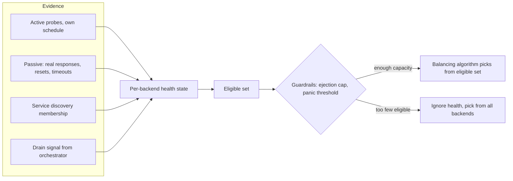
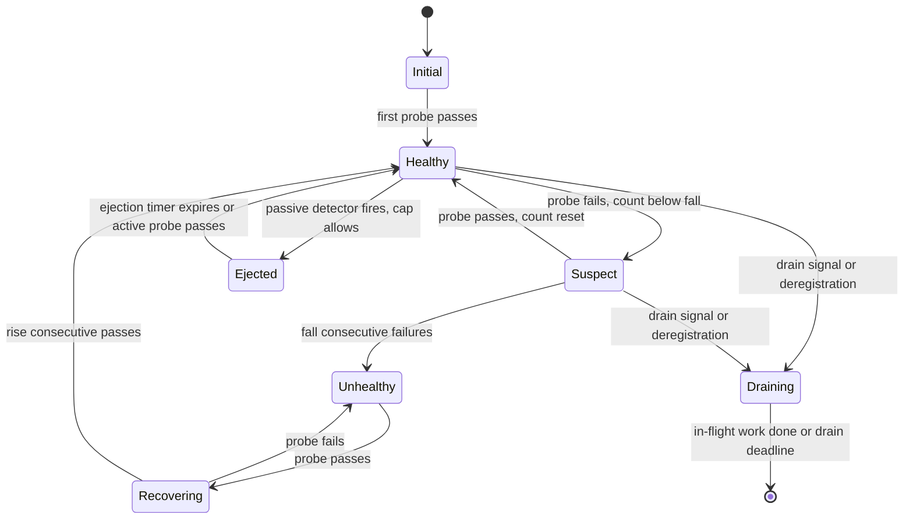
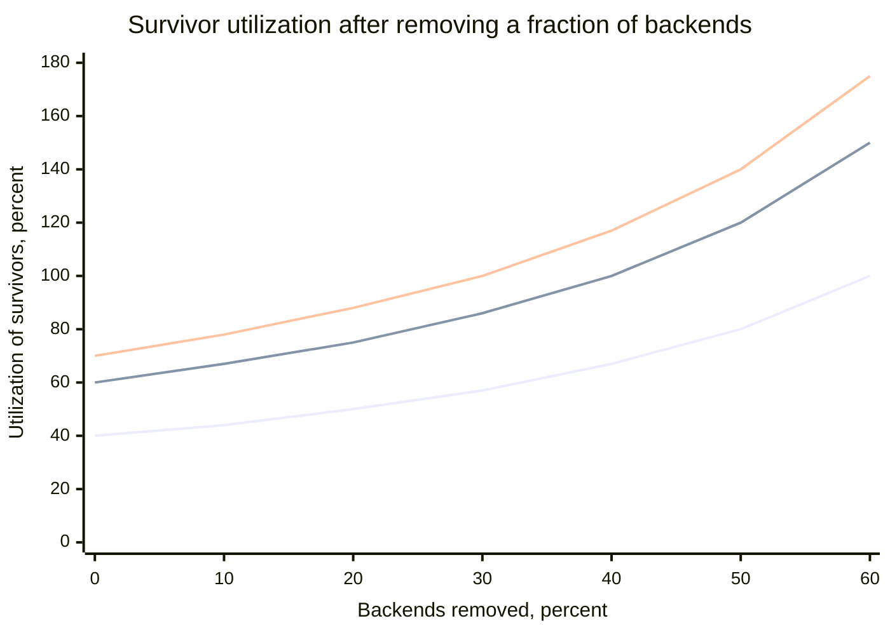
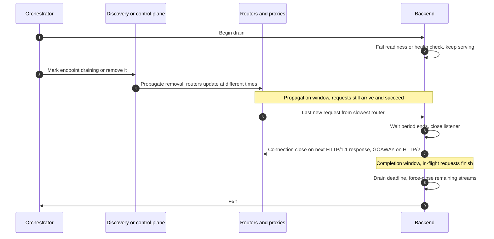
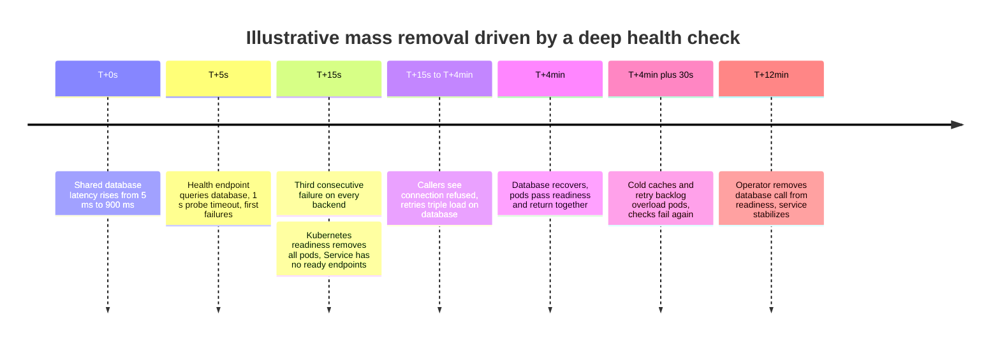

Health-aware routing is the part of a load balancer that decides which backends are eligible before any balancing algorithm runs. It keeps a health state per backend, fed by two kinds of evidence: active probes, which the balancer sends on its own schedule, and passive observation of the real requests it forwards. Connection draining is its counterpart for planned removal: a protocol that takes a backend out of rotation without failing the requests it is already serving or the ones still on their way to it because some router has not yet heard the news. Together they answer one question, which backend may receive the next request, under two very different conditions: a backend that broke without warning, and a backend that is leaving on purpose.

The core trade-off of health checking is detection speed against false removal. A balancer that ejects a backend after one failed probe or one 5xx response routes away from a crash within milliseconds, and it also removes healthy backends whenever a garbage-collection pause, a dropped probe packet, or a brief overload produces one bad sample. Thresholds and hysteresis suppress false removals at the price of slower detection. Every removal, true or false, moves the backend's load onto the survivors, so a health system that is too eager can convert a partial failure into a total one. That is why every mature implementation carries a second layer of guardrails, an ejection cap and a panic or fail-open threshold, that deliberately routes to backends believed to be unhealthy when trusting the health view would remove too much capacity.

The core trade-off of draining is completeness against speed. A drain that waits for every client to learn about the removal and for every in-flight request and long-lived connection to finish never fails a request, but it can hold a deploy for minutes per batch; a drain that is too short turns every rollout into a burst of resets and 502 errors that looks exactly like an outage.

This page owns the balancer's side of both mechanisms. What a health endpoint should check is covered in [Health Check Endpoint Pattern](/distributed-systems/en/microservice-patterns/service-discovery/health-check-endpoint/), the Kubernetes probe semantics in [Liveness vs. Readiness](/distributed-systems/en/resilience/failure-detection/liveness-vs-readiness/), the pod shutdown lifecycle in [Graceful Termination and PodDisruptionBudgets](/distributed-systems/en/kubernetes/runtime-and-operations/graceful-termination-pdb/), and failure detection for cluster membership, where the question is whether a node is alive rather than whether to send it the next request, in [Heartbeats and Timeout Configuration](/distributed-systems/en/resilience/failure-detection/heartbeats-timeouts/).


*The health layer sits in front of the balancing algorithm. Four kinds of evidence feed one state per backend; guardrails decide whether that state is trusted.*

The flowchart separates three things that are often conflated. The evidence on the left differs in what it can see: probes exist without traffic, passive observation sees the real request path only when traffic flows, discovery says whether a backend should exist, and the drain signal says it is leaving. The health state is a summary with memory, where thresholds and ejection timers live. The guardrail is a policy decision over the whole set, not per backend, and its right branch is the counterintuitive one: when too many backends look unhealthy, the balancer stops believing its own health view. The selection function that runs at the end is covered in [Load Balancing Algorithms](/distributed-systems/en/communication/load-balancing/algorithms/), including slow start for backends that have just become eligible.

## Building the Health View: Active Probes and Passive Outlier Detection

A balancer cannot observe health directly. It observes samples: a probe that succeeded or timed out, a response that carried a 503, a connection that was refused. Health state is an estimate built from those samples, and the design choices are which samples to take, how many bad ones to require before acting, and how to come back.

### Active Probing: Intervals, Thresholds, and Hysteresis

An active health checker sends a probe to each backend every `interval`. The probe may be a TCP connect (proving only that something accepts connections on the port), an HTTP request to a health path with an expected status code, a gRPC call to the standard `grpc.health.v1.Health` service, which returns `SERVING` or `NOT_SERVING` for a named service, or a protocol-specific exchange such as a Redis `PING`. A probe that does not complete within `timeout` counts as a failure. The checker keeps two counters per backend: a healthy backend becomes unhealthy after `unhealthy_threshold` consecutive failures (HAProxy calls this `fall`), and an unhealthy backend becomes healthy again after `healthy_threshold` consecutive successes (`rise`).

The asymmetry between the two thresholds is hysteresis, and it exists because the costs are asymmetric. Readmitting a backend that is still broken sends it a full share of traffic and fails requests; keeping a recovered backend out for a few extra intervals costs only a little capacity. Most implementations therefore require more successes to come back than failures to leave. AWS Application Load Balancer target groups default to 2 failures and 5 successes at a 30-second interval with a 5-second timeout; HAProxy defaults to `fall 3`, `rise 2` and `inter 2s`. Envoy requires both thresholds to be set explicitly and documents two shortcuts: at startup a single passing check is enough to mark a host healthy, and an HTTP check that receives a 503 marks the host unhealthy immediately, ignoring the threshold, which gives a backend a way to fail its own checks on purpose when it starts to drain.

Two properties follow. Detection time for a backend that crashes is bounded by the time to the next probe plus the remaining failures: between `(unhealthy_threshold - 1) * interval` and `unhealthy_threshold * interval`, plus `timeout` if the failure is a black hole rather than a refused connection. The second property is the mirror image and is the one that prevents false removal: a backend that stalls (a long garbage-collection pause, a saturated disk) is removed only if the stall outlasts roughly `(unhealthy_threshold - 1) * interval + timeout`, because shorter stalls fail fewer consecutive probes than the threshold. Choosing thresholds is choosing the longest stall you are willing to treat as noise.

Probe load is the cost that scales badly. Every checker probes every backend, so `N` checkers and `M` backends produce `N * M / interval` probes per second fleet-wide and `N / interval` probes per second on each backend. Four central proxies probing every five seconds add 0.8 probes per second to each backend, which is nothing. Five hundred sidecars doing the same add 100 probes per second to each backend, and if the health endpoint touches a database, the health system becomes a meaningful share of database load. Large meshes therefore centralize active checks: the control plane or a dedicated checker probes once and distributes the result as part of service discovery, and Envoy's health check filter can cache a backend's own health response so that many callers' probes do not each reach the application. Jitter on the probe schedule (Envoy's `interval_jitter` and `initial_jitter`) prevents all checkers from probing in lockstep after a restart.

Active checks have one structural blind spot: they test the probe's path, not the request's path. A backend whose health endpoint returns 200 while its real endpoints fail because a connection pool is exhausted, or whose probe arrives over a network path that works while client traffic arrives over one that drops packets, passes every check. This gap between the observer's view and the user's view is what Huang et al. call gray failure, and it is the reason active probing alone is insufficient for request routing.

### Passive Detection: Outlier Ejection from Live Traffic

Passive health checking uses the responses the balancer is already forwarding. Envoy calls the mechanism outlier detection, and its documented detectors illustrate the design space well.

The consecutive-errors detector counts consecutive failures per host and ejects a host when the count reaches a threshold: `consecutive_5xx` (default 5) counts any 5xx response and locally generated failures such as connection resets and timeouts; `consecutive_gateway_failure` counts only 502, 503, and 504 and is not enforced by default. With `split_external_local_origin_errors` enabled, failures the proxy itself observed (connect failures, resets, timeouts) are counted separately from errors the upstream returned, so a backend that correctly returns 500 for bad input is not confused with one that refuses connections. The success-rate detector runs every `interval` (default 10 seconds), computes each host's success rate over the interval for hosts with at least `success_rate_request_volume` requests (default 100), and ejects hosts whose rate falls below `mean - (success_rate_stdev_factor / 1000) * stdev` across the cluster (the default factor is 1900, so 1.9 standard deviations), provided at least `success_rate_minimum_hosts` hosts (default 5) qualified. The failure-percentage detector ejects hosts whose failure rate exceeds an absolute threshold (default 85%) but is not enforced unless `enforcing_failure_percentage` is raised from its default of 0.

The relative detector has a property that the absolute ones lack: it ejects outliers, not failures. If every host's success rate drops together, because a shared dependency failed or the whole cluster is overloaded, the mean drops with them, the standard deviation stays small, and nothing is ejected. That is exactly the right behavior, since ejecting hosts in a uniform failure only concentrates load. The consecutive-errors detector has no such protection: under uniform overload every host produces runs of 5xx responses and every host becomes eligible for ejection, which is why the cap described in the next section exists.

An ejected host stays out for `base_ejection_time` (default 30 seconds) multiplied by the number of times it has been ejected, capped at `max_ejection_time` (default 300 seconds). After the timer expires the host returns to rotation with no probation: passive detection has no positive signal to wait for, so it readmits on time and re-ejects if errors continue, with the multiplier growing on each repetition. When active checks also run, a passing active check unejects the host early by default (`successful_active_health_check_uneject_host`).

Other implementations make different choices. Open-source NGINX has only passive checking: `max_fails` failures (default 1) within `fail_timeout` (default 10 seconds) mark a server unavailable for `fail_timeout`, and what counts as a failure is defined by `proxy_next_upstream`, so a backend's 500 responses are not failures unless configured; active `health_check` is an NGINX Plus feature. HAProxy can feed live traffic into its active-check state with `observe layer4` or `observe layer7`: after `error-limit` errors (default 10), the `on-error` action, by default `fail-check`, counts as a failed check and switches the server to its faster check interval. Client-side balancers such as gRPC with xDS run outlier detection inside every client, which changes its cost profile; the arithmetic of `N` clients rediscovering each failure is worked through in [Client-Side vs. Server-Side Load Balancing](/distributed-systems/en/communication/load-balancing/client-vs-server-side/).

:::note[Outlier detection is not a circuit breaker]
Both react to errors, but at different granularity. Outlier detection removes one host from one balancer's eligible set and keeps sending the service's traffic to the others. A [circuit breaker](/distributed-systems/en/resilience/protection-patterns/circuit-breaker/) stops a caller from calling a whole dependency and fails or falls back immediately. Envoy's per-cluster `circuit_breakers` settings are a third thing again: concurrency limits on connections, pending requests, and retries, closer to a [bulkhead](/distributed-systems/en/resilience/protection-patterns/bulkhead-pattern/) than to either.
:::

### One State Machine for Both Signals

The two evidence sources are complementary rather than redundant. Active probes produce a signal when there is no traffic, which matters for backends that have just joined, for low-traffic services, and for readmission after a failure; passive detection sees the real request path and reacts within a few requests when traffic is high. Combining them means a backend can leave rotation for several reasons, each with its own way back.


*Per-backend health state combining active probing, passive ejection, and planned removal. Only Healthy and Suspect receive new requests.*

The diagram makes three design decisions visible. First, Suspect still receives traffic: one failed probe is evidence, not a verdict, and removing the backend at that point would make the threshold meaningless. Second, the two ways back are different. Unhealthy returns through Recovering and must pass `rise` consecutive probes, which is evidence-based readmission; Ejected returns on a timer, which is time-based readmission, because a backend with no traffic produces no passive evidence. If the cause of the ejection persists, the backend fails again on its first requests and is ejected for longer. Third, Draining is a separate state, not a flavor of Unhealthy: a draining backend must keep completing in-flight work and, for a window, must keep accepting requests from routers that have not yet seen the drain. Envoy's discovery API encodes this distinction as a separate `DRAINING` health status, although its load balancer then treats it like `UNHEALTHY` for new requests.

Discovery adds a fourth dimension. Envoy documents an eventually consistent rule for combining it with health checks: a host that discovery still lists but that fails checks is not routed to, because health data is assumed to be more accurate; a host that disappears from discovery but still passes checks keeps receiving traffic, because the discovery service may be wrong; and a host is deleted only when it is both absent from discovery and failing checks. The rule protects against a broken control plane emptying a cluster, and it has a draining consequence: removing a backend from discovery is not enough to stop traffic to it while its health checks pass, unless the cluster sets `ignore_health_on_host_removal`; Envoy's admin interface shows such hosts as `pending_dynamic_removal`. A backend that wants to leave must fail its checks or be marked draining explicitly.

## Guardrails: Ejection Caps, Panic Mode, and Fail-Open

The health state answers whether one backend should receive traffic. It does not answer whether the remaining backends can absorb the traffic it would have received, and every removal shifts load onto them. If backends run at utilization `u` and a fraction `f` of them is removed, the survivors run at `u / (1 - f)`. When the cause of the removals is overload itself, the shift is a positive feedback loop: overload causes errors, errors cause ejections, ejections raise the survivors' load, which causes more errors. The loop is one of the propagation mechanisms analyzed in [Cascading Failure Analysis](/distributed-systems/en/foundations/system-models/cascading-failure/).


*Survivor utilization `u / (1 - f)` for starting utilizations of 40%, 60%, and 70% (bottom to top). Pure arithmetic, assuming load spreads evenly over survivors.*

The curves are hyperbolas, so the margin disappears faster than intuition suggests. A fleet at 60% utilization saturates after losing 40% of its backends but crosses a safe ceiling of 85% after losing 30%; a fleet at 70% saturates at 30% removed. The right guardrail therefore depends on the fleet's headroom, not on a universal constant.

Two guardrails act on this curve. An ejection cap limits how much of the cluster passive detection may remove: Envoy's `max_ejection_percent` defaults to 10%, so outlier detection alone can never remove more than a tenth of the hosts, and further hosts that trip a detector stay in rotation. The cap applies only to passive ejection; active health check failures are not capped. A panic threshold acts on the total: Envoy normally routes only to available hosts, but when the share of available hosts in a priority level falls below `healthy_panic_threshold` (default 50%), it ignores health and balances across all hosts. Setting the threshold to 0 disables panic mode, and when every host is then unhealthy Envoy fails host selection and returns 503 "no healthy upstream". AWS load balancers express the same idea in two forms: an ALB fails open when every target in all enabled zones is unhealthy, and the target group attribute `target_group_health.unhealthy_state_routing.minimum_healthy_targets` (count, default 1, or percentage, default off) moves the fail-open point higher, turning it into a configurable panic threshold.

Why routing to known-bad backends can be correct is a capacity argument. Suppose 40% of backends are failing their checks because a shared dependency is slow, and they still answer some requests successfully. Routing only to the 60% that pass pushes the survivors past saturation, where every request on them slows down and many fail. Routing to all of them returns errors from some fraction of the bad backends but keeps the good ones below saturation. Panic mode trades a bounded error rate for not destroying the remaining capacity, and when the health signal itself is wrong (a check that fails for a reason that does not affect real requests), panic mode is also what keeps the service up despite the bad signal. The guardrails can be wrong in the other direction too: if the failing backends are black holes, panic mode sends real traffic to them. That is why panic mode should be visible as an alert, not as a silent fallback.

Not every routing layer has a panic mode. A Kubernetes Service built from EndpointSlices sends traffic only to ready endpoints; if all pods fail readiness at once, the Service has no ready endpoints and connections fail. Since Kubernetes 1.28, kube-proxy routes to terminating pods that are still ready when every endpoint is terminating, which protects rollouts, but there is no fallback to not-ready pods. A dependency check placed in a readiness probe therefore fails closed across the entire Service.

:::caution[Load shedding plus consecutive-5xx ejection removes the backends that are protecting themselves]
A backend that sheds load correctly answers excess requests quickly with 503. A consecutive-5xx detector reads that as failure and ejects the backend, which moves its traffic to the others, which then shed and get ejected in turn until the cap is reached. Use the relative success-rate detector for overload-prone services, keep the ejection cap below the headroom the fleet actually carries, and if the shedding signal must be distinguishable, have backends shed with a status or header the detector is configured to ignore. See [Load Shedding](/distributed-systems/en/resilience/flow-control/load-shedding/) for the server side.
:::

### Worked Example: Detection Time, False Ejections, and Survivor Load

Assume a service of 20 backends behind 4 central L7 proxies, serving 8,000 requests per second, so 400 requests per second per backend and 100 per second from each proxy to each backend. Backends run at 60% utilization and the operator treats 85% as the safe ceiling. Active checks run every 5 seconds with a 1-second timeout and `unhealthy_threshold` 3. All numbers are illustrative.

A backend process crashes and its port refuses connections. The first failing probe from a given proxy arrives between 0 and 5 seconds later, and two more intervals must pass before the third failure, so active detection takes 10 to 15 seconds, 12.5 on average. Passive detection is far faster here: with `consecutive_5xx` at 5, each proxy sees five refused connections in 50 milliseconds at 100 requests per second, and consecutive-error ejection fires as soon as the count is reached rather than at the analysis interval. The fleet sends about 20 requests to the dead backend (5 per proxy), and a retry policy that retries refused connections on another host makes even those invisible to clients. Without passive detection, the 12.5-second active window would send about 5,000 requests to it.

Now the backend becomes a black hole: packets are dropped, so each request fails only when its 1-second timeout expires. In the first second each proxy sends 100 requests that all hang; the fifth timeout arrives at about 1.05 seconds, by which time roughly 105 requests per proxy, about 420 in total, are stuck, each occupying a slot in the proxy's pending-request limit for a full second. Passive detection of slow failures costs one timeout's worth of traffic, which is why the request timeout, not the ejection threshold, dominates the blast radius of a black hole; [Timeouts](/distributed-systems/en/resilience/protection-patterns/timeouts/) covers how to set it.

False ejection is the other side. Suppose a single probe fails spuriously with probability 0.001 (a dropped packet, a brief scheduling delay) and failures are independent. Each backend receives 4 probes every 5 seconds, 0.8 per second, so with a threshold of 1 the fleet's 20 backends would see a false removal by some proxy about every 62 seconds. With a threshold of 3 the probability of three independent spurious failures in a row is `10^-9`, and false removals effectively disappear. Independence is the assumption that breaks: a 12-second garbage-collection pause fails three consecutive probes from every proxy at once. The stall formula gives the boundary, `(3 - 1) * 5 + 1 = 11` seconds, so pauses shorter than 11 seconds are absorbed and longer ones remove the backend from all four proxies simultaneously, which is arguably correct, since requests to it would have waited just as long.

Finally, the guardrails. Removing `k` backends puts survivors at `0.6 * 20 / (20 - k)`. The ceiling of 85% allows `20 - k >= 14.1`, so at most 5 backends, or 25% of the fleet. Envoy's default ejection cap of 10% (2 backends) is conservative for this fleet, and its default panic threshold of 50% is far too permissive: at 10 healthy backends, survivors would be at 120%, so the fleet is overloaded long before panic mode engages. For this fleet a panic threshold near `0.6 / 0.85`, about 71%, matches the capacity argument, and it must be revisited whenever utilization targets change.

## Connection Draining: Removing a Backend Without Failing Requests

Planned removal differs from failure because the backend knows it is leaving and can cooperate. The guarantee a correct drain provides is: no request that reaches the backend is refused, and no request the backend accepted is abandoned before a stated deadline. It does not guarantee that long-lived connections survive; they are closed in an orderly way and the client reconnects. It does not help with crashes, where the backend has no time to cooperate and only retries and fast detection limit the damage.

Two delays make the problem non-trivial. The first is propagation: when a backend is marked for removal, every router that may send it traffic, central proxies, sidecars, client libraries, kube-proxy rules on every node, learns about it at a different moment, and until the last one does, new requests keep arriving. The second is completion: requests already in progress, and connections with requests that will arrive on them later, must be allowed to finish.


*A correct drain. The backend keeps accepting new connections through the propagation window and stops only after the slowest router has updated.*

Steps 1 to 5 are the propagation window, and the decisive detail is in step 2: the backend fails its health signal but does not stop serving. Any router that has not processed step 4 still sends it requests, and they succeed. Step 6 is the moment this window must outlast: the backend can close its listening socket only after the last router has stopped selecting it. Steps 7 and 8 are the completion window. Closing the listener is not enough, because routers and clients hold persistent connections on which new requests may still arrive; the backend must tell them to stop, then wait for what is in flight. Step 9 bounds the whole procedure, since some connections (streams, WebSockets, a stuck request) will never finish on their own.

### Why the Two Windows Are Sufficient

The correctness argument has two parts that correspond to the two windows. A request can fail during removal in only three ways: it arrives after the listener is closed, it arrives on a persistent connection that the backend closes while the request is in transit, or it is in progress when the process exits. The first is excluded if the wait before closing the listener exceeds the maximum propagation delay to any router, because by then no router selects the backend for new connections. The second is excluded by closing persistent connections cooperatively instead of unilaterally: on HTTP/1.1 the backend adds `Connection: close` to the next response on each connection, so the client sends nothing further on it; on HTTP/2 the backend sends GOAWAY, whose last-stream-id tells the client exactly which streams were not processed and are safe to retry elsewhere, a mechanism explained in [HTTP/2, HTTP/3, and QUIC](/distributed-systems/en/communication/synchronous-protocols/http2-http3-quic/). The third is excluded if the drain deadline exceeds the longest request the service allows, which only works when there is such a limit.

The argument makes the dependencies explicit. Draining is correct only relative to a measured propagation tail and a bounded request duration. A fixed sleep chosen by habit encodes a guess about both. A polled registry with stacked caches can have a propagation tail of minutes, as measured in [Client-Side vs. Server-Side Load Balancing](/distributed-systems/en/communication/load-balancing/client-vs-server-side/), and a service with unbounded streaming RPCs has no completion bound at all, so its drain must end with forced closure and a client that reconnects gracefully.

An idle HTTP/1.1 connection has no next response on which to send `Connection: close`. If the backend simply closes it, a request the client sends at that moment arrives at a closed socket and the client cannot tell whether it was processed, the same race that produces 502s when idle timeouts are misordered, discussed in [L4 vs. L7 Load Balancing](/distributed-systems/en/communication/load-balancing/l4-vs-l7/). Idempotent requests can be retried safely; others cannot. Servers mitigate it by closing idle connections first, during the window when routers have already stopped sending new requests, which shrinks but does not eliminate the race. HTTP/2 removes it, which is a practical argument for HTTP/2 between proxies and backends.

The shutdown handler that implements the sequence is short; the order of the steps is the content.

```text
on SIGTERM:
  health.set(NOT_SERVING)          # fail checks, keep serving traffic
  sleep(propagation_tail)          # measured, not guessed
  listener.stop_accepting()
  for conn in open_connections:
    conn.close_after_current()     # Connection: close or GOAWAY
  wait_until(all_requests_done or now() > drain_deadline)
  force_close_remaining()          # streams, websockets, stuck requests
  flush_telemetry_and_exit()
```

In Kubernetes the orchestrator signals both sides at once: deleting a pod triggers removal from EndpointSlices and the pod's shutdown in parallel, so the propagation wait must be in the pod, typically as a `preStop` hook that sleeps before SIGTERM is delivered, and the whole sequence must fit in `terminationGracePeriodSeconds` (default 30 seconds). The mechanics are covered in [Graceful Termination and PodDisruptionBudgets](/distributed-systems/en/kubernetes/runtime-and-operations/graceful-termination-pdb/).

### Draining at the Balancer and in the Proxy

Balancers implement the same two windows from the other side, and their defaults differ by an order of magnitude. An AWS target group moves a deregistered target to the `draining` state and waits `deregistration_delay.timeout_seconds`, range 0 to 3,600 and default 300 seconds, before moving it to `unused`; during that time an ALB lets in-flight requests complete and sends no new requests to the target. A Network Load Balancer by default lets existing connections continue through the delay and leaves them open afterwards; the attribute `deregistration_delay.connection_termination.enabled` makes it close them at the end of the delay (it defaults to true only for new UDP target groups). Because the 300-second default applies even to services whose longest request takes two seconds, it is the most common reason a rolling deploy behind an ALB is slow.

HAProxy distinguishes `drain` from `maint`. A server set to drain (through the runtime API with `set server ... state drain`, or by an agent check reporting drain) receives no new connections except from clients bound to it by persistence, and its existing connections continue; `maint` takes it fully out of service. Envoy treats an endpoint whose discovery status is `DRAINING` as unavailable for new requests, and when Envoy itself is the instance being removed, its listener drain sends `Connection: close` on HTTP/1 responses and GOAWAY on HTTP/2 connections. With the default gradual strategy, the probability that a response closes its connection rises linearly from 0 to 1 over the first half of the drain time (`--drain-time-s`), and connections still open after two thirds of it are closed at a random point in the remaining time. The point of the spreading is the reconnect load: closing every connection at once would make every client reconnect at once, the storm described for long-lived connections in [WebSocket and Server-Sent Events](/distributed-systems/en/communication/synchronous-protocols/websocket-sse/).

A drain also needs the inverse: a backend that has just finished draining in and been readmitted should not receive a full share immediately. That ramp, slow start, belongs to the selection function and is covered in [Load Balancing Algorithms](/distributed-systems/en/communication/load-balancing/algorithms/).

### Worked Example: Sizing a Drain

Continue with the 20-backend service, now deployed on Kubernetes behind an ALB in IP mode. Assume measured values: endpoint removal reaches the ALB and the in-cluster proxies within 4 seconds at the 99.9th percentile, normal requests finish within 2 seconds, and a file-upload endpoint allows up to 25 seconds. The illustrative numbers below follow from those assumptions.

The `preStop` sleep must exceed the propagation tail with margin, say 8 seconds. The completion window must cover the longest allowed request, 25 seconds, plus a few seconds of margin, so the drain deadline is about 30 seconds after the sleep and `terminationGracePeriodSeconds` should be at least 40. The target group's deregistration delay should match the application's drain, about 40 seconds, not 300. With 5 pods replaced per batch and 4 batches, the drain contributes about 2.7 minutes to the rollout instead of 20 minutes with the default delay. If the upload endpoint were allowed 10 minutes, the right answer would not be a 10-minute drain on every pod in every deploy; it would be resumable uploads, so that forced closure at a short deadline costs a client one retry rather than ten minutes of work.

## Implementations Compared and the Settings That Matter

The mechanisms are the same everywhere; the defaults, the passive signal, and the fail-open behavior are not.

| Implementation | Active checks | Passive detection | When too many are unhealthy | Drain mechanism | When to prefer |
|---|---|---|---|---|---|
| Envoy | HTTP, gRPC, TCP, Redis, Thrift; thresholds explicit | Outlier detection: consecutive, success rate, failure percentage | Panic threshold, default 50%; ejection cap 10% | `DRAINING` status from discovery; listener drain with GOAWAY and `Connection: close` | Mesh or edge where health policy must be tuned per cluster |
| HAProxy | TCP, HTTP, agent check; `inter 2s`, `rise 2`, `fall 3` | `observe` with `error-limit` feeding check state | No automatic panic; backup servers if configured | `drain` and `maint` states through runtime API or agent | Central proxy tier with operator control over each server |
| NGINX open source | None (NGINX Plus only) | `max_fails` and `fail_timeout`, failures defined by `proxy_next_upstream` | No panic mode; requests fail with a "no live upstreams" error when every server is marked failed | Graceful reload of workers; per-server drain is NGINX Plus | Simple tiers where passive marking is enough |
| AWS ALB / NLB | HTTP, HTTPS, gRPC, TCP; ALB 30 s, 2 down, 5 up | ALB anomaly mitigation with weighted random (opt-in) | Fail-open when all unhealthy; configurable minimum healthy targets | Deregistration delay, default 300 s | Managed edge; tune delay and thresholds per target group |
| Kubernetes Service | Kubelet readiness probes per pod | None in kube-proxy | No fallback to not-ready pods; terminating-but-ready used when all terminate | EndpointSlice `terminating` and `serving` conditions | In-cluster L4; pair with a proxy for passive detection |

The table hides a choice of signal ownership. In Envoy, HAProxy, and the ALB, the balancer decides health from its own vantage point, so two balancers can disagree about the same backend; in Kubernetes, the kubelet on the backend's node decides readiness and every kube-proxy follows that one verdict, which avoids disagreement but tests the pod from its own node, not from the callers' network path.

An Envoy cluster that combines both signal types, separates unambiguous local-origin failures from application 5xx that may be load shedding, and sizes its guardrails from the worked example's headroom:

```yaml
health_checks:
- timeout: 1s
  interval: 5s
  interval_jitter: 1s
  unhealthy_threshold: 3        # absorbs stalls shorter than ~11 s
  healthy_threshold: 2
  http_health_check: { path: /healthz/ready }
outlier_detection:
  split_external_local_origin_errors: true
  consecutive_local_origin_failure: 5   # resets, refused, timeouts
  consecutive_5xx: 0                    # do not eject on app 5xx (shedding)
  enforcing_success_rate: 100           # relative detector for app errors
  success_rate_stdev_factor: 1900
  base_ejection_time: 30s
  max_ejection_percent: 25              # from headroom: 1 - 0.6 / 0.85
common_lb_config:
  healthy_panic_threshold: { value: 70.0 }
```

:::tip[Alert on the guardrails, not only on the errors]
Ejection counts, ejections suppressed by the cap, and time spent in panic mode are the leading indicators of a fleet-wide problem. In Envoy they are the `outlier_detection.ejections_active` and `outlier_detection.ejections_overflow` cluster statistics and the `lb_healthy_panic` counter. A cluster that enters panic mode is serving through its health system's disagreement, and that should page someone even while the error rate still looks acceptable.
:::

## Failure Modes in Production

### Mass Removal from Correlated Health Signals

Trigger: a health check that depends on something shared, such as a database query in the health endpoint, a check with a timeout shorter than latency under load, or a check that fails when a downstream service is slow. When the shared thing degrades, every backend fails its checks at once. Symptoms: the service goes from partially degraded to fully down in one check interval; logs show "no healthy upstream" or connection refusals while the backends' own request logs show they were serving. Detection: the fraction of backends marked unhealthy over time, and a correlation between health-check failures and a dependency's latency. Mitigation: health checks that test only what the instance itself can fix, panic thresholds sized from headroom, and fail-open defaults where the routing layer supports them. Recovery is often blocked by the health system itself: backends come back, receive the whole load at once, and fail again.


*A hypothetical incident; times are illustrative. The failure is in the health system, not in the backends.*

The timeline shows why the routing layer matters as much as the check. Behind a balancer with a panic threshold, the step at T+15s would have kept routing to all backends and the database slowness would have produced slow responses rather than refusals. Behind a Kubernetes Service, which has no panic mode, the same check produces a total outage. The second failure at T+4min plus 30 seconds is the metastable pattern from [Retry Storms and Metastable Failures](/distributed-systems/en/resilience/flow-control/retry-storms-metastable-failures/): the trigger is gone, but synchronized readmission and the retry backlog keep the system down.

### Flapping

Trigger: thresholds of 1, no hysteresis, or a backend running near its limit so that probes fail intermittently. Symptoms: a backend alternates between in and out of rotation every few intervals; each readmission sends it a full share of load that pushes it back over the edge. Detection: health state transitions per backend per hour (HAProxy logs each UP and DOWN transition; Envoy emits health-check failure and ejection events), and load oscillation on the other backends with the same period. Mitigation: `healthy_threshold` larger than `unhealthy_threshold`, slow start on readmission, and growing ejection times, which Envoy applies automatically through its ejection multiplier. A backend that flaps under load is usually undersized, and capacity, not health tuning, is the fix.

### Gray Failure: Probes Pass, Requests Fail

Trigger: the probe and the request take different paths. The health endpoint is served by a separate thread pool, a separate port, or a code path that skips the broken dependency; or the network path from the checker differs from the client's path. Symptoms: elevated errors from one backend, which still shows healthy. Detection: per-backend error rate from the callers' side compared with health state; any backend with a high error rate and a healthy state is a gray failure. Mitigation: passive detection, which measures the request path by construction, and health endpoints that run on the same pools and listeners as real traffic. Under load-aware algorithms the failure is amplified, because a backend that fails quickly looks idle and attracts more traffic, the black hole effect analyzed in [Load Balancing Algorithms](/distributed-systems/en/communication/load-balancing/algorithms/).

### Drain Race: Errors on Every Deploy

Trigger: the backend stops accepting connections before every router has removed it, most often a pod that handles SIGTERM by exiting immediately while endpoint removal is still propagating. Symptoms: a burst of 502, 503, or connection-reset errors aligned with each deploy batch, lasting a few seconds, invisible in the backend's own logs because the requests never reached a live process.

```mermaid
sequenceDiagram
    autonumber
    participant API as Kubernetes API
    participant K as Kubelet
    participant P as Pod
    participant EC as Endpoint controller
    participant LB as Proxy or kube-proxy
    participant C as Caller
    API->>K: Pod deleted
    API->>EC: Pod deleted
    par Shutdown and removal race
        K->>P: SIGTERM, no preStop hook
        P->>P: Server stops, listener closed in 50 ms
    and
        EC->>LB: EndpointSlice update, arrives after 2 s
    end
    rect rgb(70, 40, 40)
    C->>LB: Request
    LB->>P: Forward to removed pod
    P-->>LB: Connection refused
    LB-->>C: 502 or 503
    end
    Note over LB,C: Window lasts until the slowest proxy applies the update
```


*A deploy without a propagation wait. The pod's shutdown wins the race against endpoint removal. Timings are illustrative.*

Steps 3 and 5 run in parallel, and nothing orders them. The pod exits in tens of milliseconds; the update in step 5 reaches the last proxy after however long the control plane takes. Every request in the shaded block, steps 6 to 9, fails, and a retry policy only helps if the retry lands on a different pod and the request is safe to retry. Detection: error rate per deploy batch, broken out by upstream response flag (Envoy's `UF` for upstream connection failure and `UC` for upstream connection termination). Mitigation: a `preStop` sleep longer than the measured propagation tail, a shutdown handler that follows the order in the drain sequence above, and retries on connection failure for idempotent requests. Recovery is automatic after each batch, which is why this failure often goes unfixed: each deploy causes a small, self-healing error spike.

### Drains That Never End, or End All at Once

Trigger: long-lived connections (WebSockets, gRPC streams, database proxies) with no maximum age, or a balancer delay much longer than the service needs. Symptoms: in the first case, old pods stay in Terminating until the grace period expires and are then killed, closing every remaining connection at once, so clients reconnect simultaneously; in the second, rolling deploys take tens of minutes and capacity is reduced for the duration because draining instances count against it. Detection: time from drain start to exit per instance, connections remaining at forced closure, and reconnect rate after each batch. Mitigation: a bounded maximum connection age with jitter so long-lived connections rebalance continuously, gradual closing during the drain window, and deregistration delays sized from measured request durations.

### Checker Overload

Trigger: active checks from every caller against every backend, or a health endpoint that does real work, the `N / interval` load computed earlier. Symptoms: adding callers raises backend CPU without adding traffic, and health requests dominate request logs. Detection: probe rate per backend against real traffic. Mitigation: central checking distributed through discovery, health check caching on the backend side, and subsetting.

| Failure | Symptom | Detection | Mitigation |
|---|---|---|---|
| Mass removal | Partial degradation becomes total outage in one interval | Share of backends unhealthy; correlation with dependency latency | Shallow checks, panic threshold from headroom, fail-open routing |
| Flapping | Backend in and out of rotation, oscillating load | Health transitions per hour | Hysteresis, slow start, growing ejection times |
| Gray failure | One backend errors while showing healthy | Caller-side error rate vs. health state | Passive detection, probes on the request path |
| Drain race | Error burst on every deploy batch | Errors per batch, upstream connection-failure flags | Propagation wait before closing, ordered shutdown |
| Endless or abrupt drains | Slow deploys or reconnect storms | Drain duration, connections at forced close | Max connection age with jitter, sized deregistration delay |
| Ejection of shedding backends | Ejections spread across the fleet under load | Ejection count vs. 503 rate | Success-rate detector, ignore shedding status, cap from headroom |
| Checker overload | Health traffic rivals real traffic | Probe rate per backend | Central checks, caching, subsetting |

## When Health-Aware Routing Helps and When It Hurts

Use active health checks wherever a balancer must decide about backends that may receive no traffic: newly added backends, low-traffic services, readmission after failure, and L4 tiers that cannot see application responses. Keep checks shallow, testing what the instance itself controls, and set thresholds from the longest stall you are willing to treat as noise, using `(unhealthy_threshold - 1) * interval + timeout`. Do not run active checks from every client in a large mesh; centralize them and distribute the result. Do not make a health check depend on a shared downstream dependency unless the routing layer will fail open when that dependency fails for everyone.

Use passive outlier detection on every L7 proxy and client-side balancer with enough traffic per backend to produce a signal within seconds; it is the only mechanism that sees gray failures on the request path. Prefer local-origin failures and the relative success-rate detector over raw consecutive 5xx counts for services that shed load or return errors for bad input. Do not rely on passive detection when each balancer sends a backend only a few requests per minute: the detector cannot reach its minimum volume, and every caller pays separately for the same failure. Do not leave the ejection cap and panic threshold at defaults without comparing them with the fleet's headroom: the right values are `1 - u / u_safe` for the cap and about `u / u_safe` for the panic threshold, recomputed when utilization targets change.

Use connection draining for every planned removal: deploys, scale-in, node maintenance, and balancer instance replacement. Size the propagation wait from the measured tail of discovery convergence, the completion window from the longest request the service allows, and the balancer's deregistration delay from the same numbers, not from its default. Do not try to make draining cover crashes; a crashed process cannot cooperate, and the defenses there are fast passive detection, retries of idempotent requests, and enough capacity to absorb the lost instance. Do not use an unbounded drain for long-lived connections; bound connection age, close gradually, and make clients reconnect with jitter.

## Further Reading

- Envoy Project, *Health checking*, *Outlier detection*, *Panic threshold*, and *Draining*, Envoy architecture overview documentation, current version.
- Peng Huang, Chuanxiong Guo, Lidong Zhou, Jacob R. Lorch, Yingnong Dang, Murali Chintalapati, and Randolph Yao, *Gray Failure: The Achilles' Heel of Cloud-Scale Systems*, USENIX HotOS, 2017.
- Betsy Beyer, Chris Jones, Jennifer Petoff, and Niall Richard Murphy (eds.), *Site Reliability Engineering*, O'Reilly, 2016, chapters "Load Balancing in the Datacenter" and "Addressing Cascading Failures".
- Martin Thomson and Cory Benfield (eds.), *HTTP/2*, RFC 9113, IETF, 2022, section 6.8 on GOAWAY and graceful shutdown.
- Amazon Web Services, *Health checks for Application Load Balancer target groups* and *Target group attributes*, Elastic Load Balancing documentation.
- Kubernetes Project, *KEP-1669: Proxy Terminating Endpoints*, Kubernetes Enhancement Proposals, stable in 1.28.
