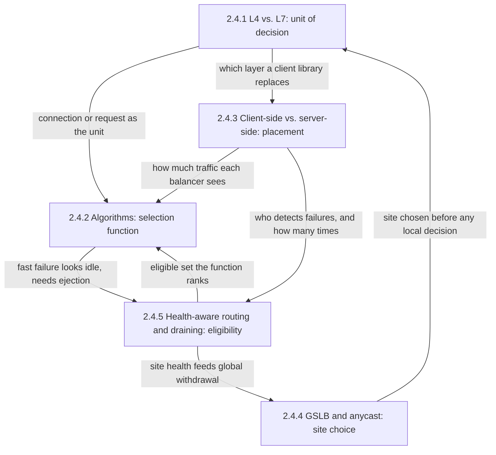
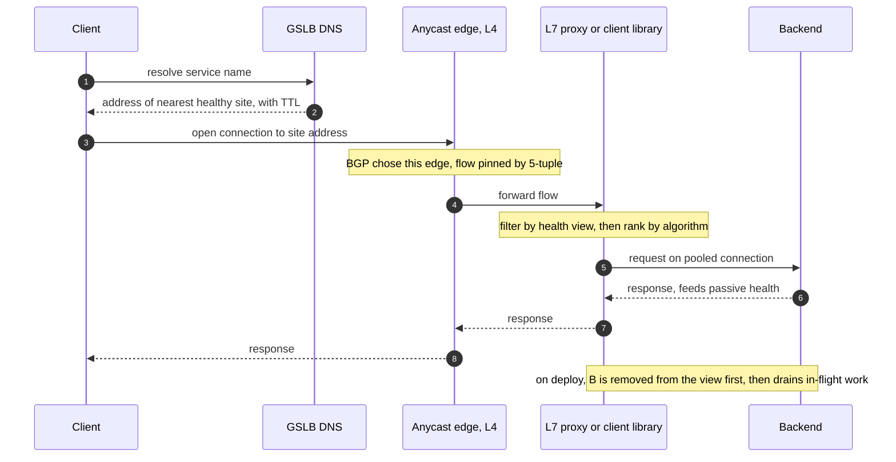
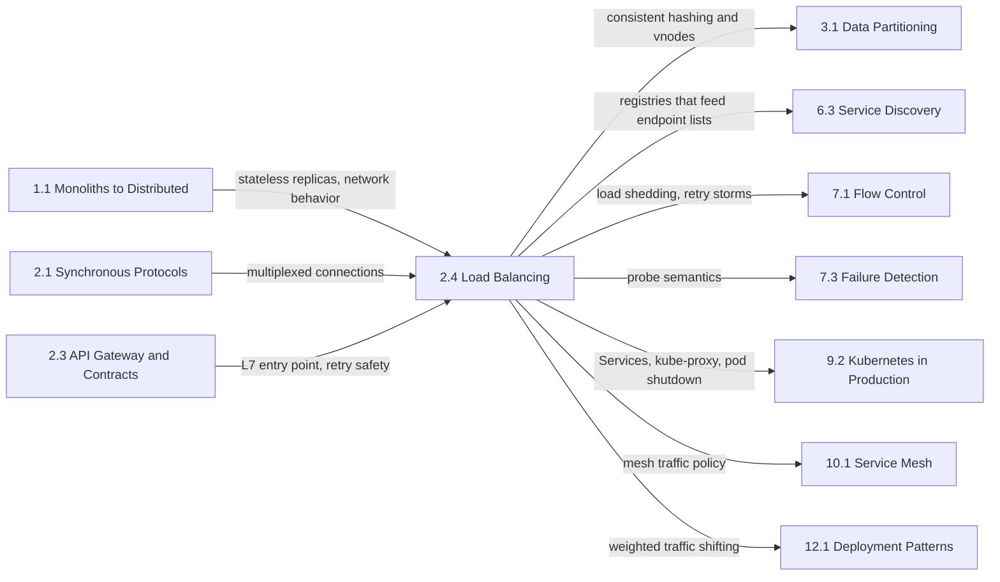

A load balancer makes many replicas look like one service. Callers address a single name or virtual IP, work spreads across the members behind it, and members that fail or leave stop receiving work. Without it, a fleet's capacity is set by its most loaded replica rather than by the sum of its replicas, and every horizontally scaled design from [The Scaling Dilemma](/distributed-systems/en/foundations/monoliths-to-distributed/scaling-dilemma/) onward assumes that something performs this job.

The single problem this chapter addresses is how to choose, for each unit of work, which replica receives it. That choice is five separate decisions, each with its own page: the unit (once per connection from packet headers, or once per request after parsing the protocol), the function that ranks candidates (rotation, load-aware selection, or hashing a key), the placement (a dedicated tier or every caller), the site (which region or point of presence a client reaches first), and eligibility (which backends may be chosen at all, given that some are failing and some are leaving on purpose).

The tension that runs through all five is information against its cost and staleness. A decision that uses more information is better in the steady state: an L7 proxy that sees each request can spread one HTTP/2 connection's streams, a balancer that tracks outstanding requests notices a slow backend, a client that balances for itself sees its own latency, and a DNS server that knows the client's subnet sends it to a nearby region. But every piece of information is paid for, in a parsing hop, an endpoint list replicated into a thousand callers, or a DNS answer cached for a TTL the operator does not control, and it is always partial and late: each balancer sees only its own traffic, and every health signal describes the past.

A second tension follows from the first and produces most of the chapter's failure modes: a balancer that reacts to its information can amplify the failure it reacts to. A backend that fails instantly looks idle to a load-aware algorithm and attracts more traffic. A health checker that ejects backends moves their load onto survivors, which may then fail their own checks. A region that is withdrawn from global steering sends its traffic to neighbors sized for their own peak. Each page pairs its mechanism with the guardrail that stops this feedback.

## Five Decisions Behind One Address: How the Topics Fit Together

The layer page is the root, because the unit of decision constrains everything else: nothing that assumes per-request visibility exists at L4. The edges show where one page's output becomes another's input.

*Dependencies between the chapter's topics. Each arrow names what one page hands to, or requires from, the page it points to.*

Three edges carry most of the chapter's reasoning. The edge from placement to algorithms explains why the same function behaves differently in a proxy tier and in a client library: spreading the decision across hundreds of callers thins each one's load signal until least connections degrades to random choice. The edge from algorithms back to health-aware routing is the black-hole failure: a backend that answers every request with an immediate error has the fewest outstanding requests and the lowest latency, so a load-aware function sends it more traffic until outlier detection removes it. The edge from health-aware routing to GSLB shows that site steering is the same eligibility decision one level up, with the same hazard: when every site fails a check on a shared dependency, global steering removes all of them at once.

## The Question Each Topic Answers

[L4 vs. L7 Load Balancing: Transport vs. Application Layer](/distributed-systems/en/communication/load-balancing/l4-vs-l7/) answers whether the balancer decides per connection from transport headers or per request after terminating and parsing the protocol, and what each choice costs in CPU, bandwidth, client identity, timeouts, and security. Open it when HTTP/2 or gRPC load piles onto a few backends or 502 errors appear at idle-timeout boundaries.

[Algorithms: Round Robin, Least Connections, Weighted, Consistent Hashing](/distributed-systems/en/communication/load-balancing/algorithms/) answers how a backend is chosen from the eligible set, what each family of algorithms actually equalizes, and why the signal each relies on decays when many balancers share each backend. Open it when backends with equal capacity run at unequal utilization, when a newly added backend is overrun, or when a cache tier loses its hit rate after a membership change.

[Client-Side vs. Server-Side Load Balancing](/distributed-systems/en/communication/load-balancing/client-vs-server-side/) answers where the decision runs, in a dedicated tier, a library, a sidecar, a proxyless client fed by a control plane, or a node-local forwarder, and how that placement decides who holds the endpoint list, how quickly failures are noticed, and how many connections exist. Open it when deciding whether service-to-service traffic needs a proxy tier, when connection counts grow with the product of callers and backends, or when errors follow every scale-in because callers still hold removed endpoints.

[Global Server Load Balancing (GSLB) and Anycast](/distributed-systems/en/communication/load-balancing/gslb-anycast/) answers how a client is steered to one of several regions or points of presence, what DNS-based steering and BGP anycast each guarantee about where a request lands, and how fast each moves traffic after a site fails. Open it when a service runs in several regions or traffic keeps arriving at a region removed from DNS.

[Health-Aware Routing and Connection Draining](/distributed-systems/en/communication/load-balancing/health-aware-routing/) answers which backends are eligible before any algorithm runs, how active probes and passive outlier detection build that view, how ejection caps and panic thresholds stop it from removing too much capacity, and how a backend leaves without failing the requests it holds or is about to receive. Open it when deploys produce bursts of resets or 502 errors, when one slow dependency causes a fleet to eject itself, or when sizing deregistration delays and termination grace periods.

| Topic | Question it answers | Open it when |
|---|---|---|
| [L4 vs. L7](/distributed-systems/en/communication/load-balancing/l4-vs-l7/) | Is the decision made per connection or per request? | Load pinned on long-lived connections, idle-timeout 502s, choosing the edge tier |
| [Algorithms](/distributed-systems/en/communication/load-balancing/algorithms/) | Which eligible backend receives this unit of work? | Uneven utilization, overrun new backends, cache remaps on membership change |
| [Client-side vs. server-side](/distributed-systems/en/communication/load-balancing/client-vs-server-side/) | Where does the decision run, and who holds the endpoint list? | Choosing a proxy tier or library, connection fan-out, stale endpoints after scale-in |
| [GSLB and anycast](/distributed-systems/en/communication/load-balancing/gslb-anycast/) | Which site does the client reach? | Multi-region deployment, regional failover objectives, traffic tails after DNS changes |
| [Health-aware routing and draining](/distributed-systems/en/communication/load-balancing/health-aware-routing/) | Which backends may be chosen, and how does one leave safely? | Errors on every deploy, mass ejection, sizing drain and grace periods |

The chapter can also be read along one request, asking which page owns each decision and where its information comes from.

*One request through the five decisions. GSLB owns steps 1 and 2 and the edge selection, the layer page the flow pinning and the re-originated request in step 5, the placement page whether the proxy is a central tier or code inside the client, the algorithms page the ranking before step 5, and the health page the filter before step 5, the passive signal in step 6, and the drain.*

Two features of the sequence explain how the pages divide the work. Every decision uses information collected earlier, by someone else, about a different moment: the DNS answer in step 2 may be minutes old by the time step 3 uses it, the health view applied before step 5 describes failures already observed, and the passive signal produced in step 6 improves only the next request. And each decision is made by a different component, often owned by a different team, which is why the chapter's most common misconfiguration is two balancers on one path: a client library that balances across a single virtual IP, or a sidecar that balances per request in front of a tier that therefore sees meaningless load.

## Reading Order and Why

Read the chapter in sidebar order on a first pass. The layer page comes first because it defines the unit of decision and introduces vocabulary every later page uses without re-explaining it: flows, connection pinning, two-connection timeouts, and why HTTP/2 defeats connection-level balancing. Algorithms follow because the placement and health pages both describe their effect on a selection function they assume the reader already knows. Placement comes third, since it explains why an algorithm that works in a proxy tier can fail inside a thousand clients, and why each client must detect failures on its own. GSLB and anycast move the same questions up to the level of sites. Health-aware routing comes last because its guardrails draw on all four: the unit decides what can be observed, the algorithm what an undetected failure attracts, and placement how many detectors exist.

Three shortcuts are reasonable. An engineer putting a balancer in front of a new service should read the layer page, then algorithms, then health-aware routing. An engineer running service-to-service traffic inside a mesh or a gRPC fleet should start with placement, then read algorithms for the thin-signal analysis and the health page for passive detection. An engineer whose rollouts or regional failovers produce errors should go directly to health-aware routing for the drain race and mass-ejection failures, then to GSLB and anycast for the long tail after a DNS change and the failover cascade across regions.

## Where the Chapter Sits in the Handbook

The prerequisites come from two earlier chapters. [Stateful vs. Stateless Services](/distributed-systems/en/foundations/monoliths-to-distributed/stateful-vs-stateless/) explains why balancing is only free when replicas are interchangeable. [Network Reliability, Bandwidth Limitations, and Topology Changes](/distributed-systems/en/foundations/monoliths-to-distributed/network-reliability/) covers the network behavior, including ECMP rehashing, that L4 flow affinity and anycast depend on. [HTTP/2 and HTTP/3](/distributed-systems/en/communication/synchronous-protocols/http2-http3-quic/) and [gRPC and Protocol Buffers](/distributed-systems/en/communication/synchronous-protocols/grpc-protocol-buffers/) describe the multiplexed, long-lived connections that make the L4 versus L7 decision matter. The preceding chapter, [API Gateway and Service Contracts](/distributed-systems/en/communication/api-gateway/), sits in front of this one: a gateway is an L7 balancer with policy attached, and its retries are safe only under the rules of [Idempotency and Safe HTTP Methods](/distributed-systems/en/communication/api-gateway/idempotency/).

*Prerequisites on the left and the chapters that own mechanisms this chapter relies on, on the right. Each arrow names what is handed over.*

Several mechanisms the chapter uses have their canonical pages elsewhere. [Consistent Hashing and Virtual Nodes](/distributed-systems/en/data-management/data-partitioning/consistent-hashing/) owns the ring and virtual-node mechanics that the algorithms page applies to request routing. [Client-Side Discovery](/distributed-systems/en/microservice-patterns/service-discovery/client-side-discovery/) and [Server-Side Discovery](/distributed-systems/en/microservice-patterns/service-discovery/server-side-discovery/) own the registries and query protocols that produce the endpoint lists a balancer consumes, and [Health Check Endpoint Pattern](/distributed-systems/en/microservice-patterns/service-discovery/health-check-endpoint/) owns what a health endpoint should test. [Liveness vs. Readiness](/distributed-systems/en/resilience/failure-detection/liveness-vs-readiness/), [Kubernetes Networking](/distributed-systems/en/kubernetes/runtime-and-operations/kubernetes-networking/), and [Graceful Termination and PodDisruptionBudgets](/distributed-systems/en/kubernetes/runtime-and-operations/graceful-termination-pdb/) describe the platform side of eligibility and draining. [Traffic Management](/distributed-systems/en/service-mesh/service-mesh-architecture/traffic-management/) shows how a mesh configures the balancing, retry, and outlier settings this chapter explains, and [Canary Release](/distributed-systems/en/deployment/deployment-patterns/canary-release/) uses L7 weighted splits for the precise traffic shifting that DNS weights cannot provide.

Two boundaries are commonly blurred. A balancer spreads load but does not protect a fleet whose total demand exceeds its capacity; that is the job of [Load Shedding](/distributed-systems/en/resilience/flow-control/load-shedding/), and the retries that balancers and proxies add under failure are analyzed in [Retry Storms and Metastable Failures](/distributed-systems/en/resilience/flow-control/retry-storms-metastable-failures/). And moving traffic between sites is not moving data: steering clients to a region whose database cannot accept their writes turns a failover into a consistency problem owned by [Failover and Leader Election](/distributed-systems/en/data-management/replication/failover-leader-election/). How ejection and withdrawal turn a partial failure into a total one is analyzed generally in [Cascading Failure Analysis](/distributed-systems/en/foundations/system-models/cascading-failure/), and [Meta 2021: BGP, DNS, and Control Plane Centralization](/distributed-systems/en/case-studies/famous-outages/meta-2021-bgp-dns/) is the public case in which DNS servers withdrew their own anycast announcements.
