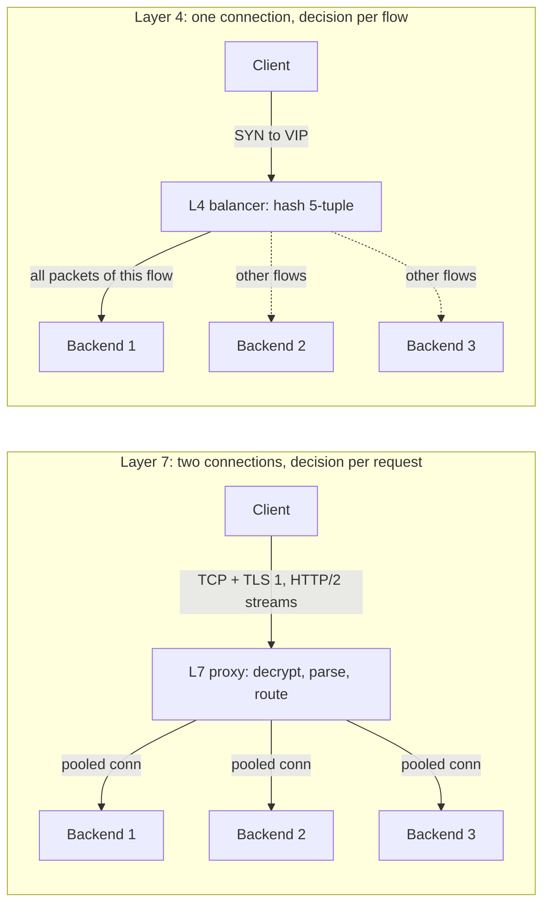
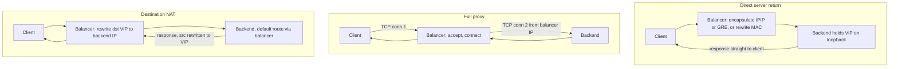
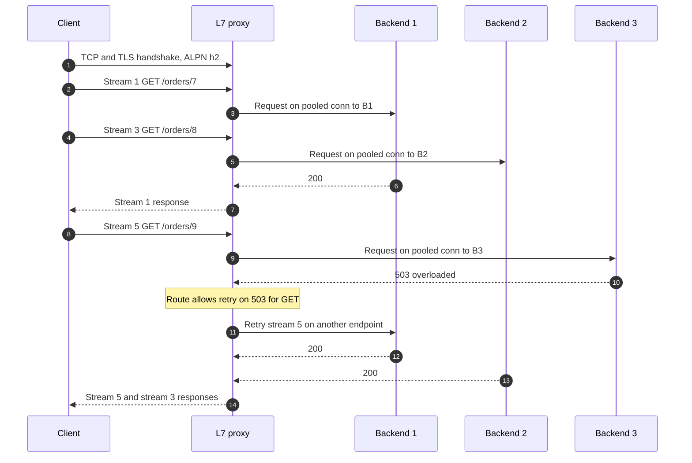
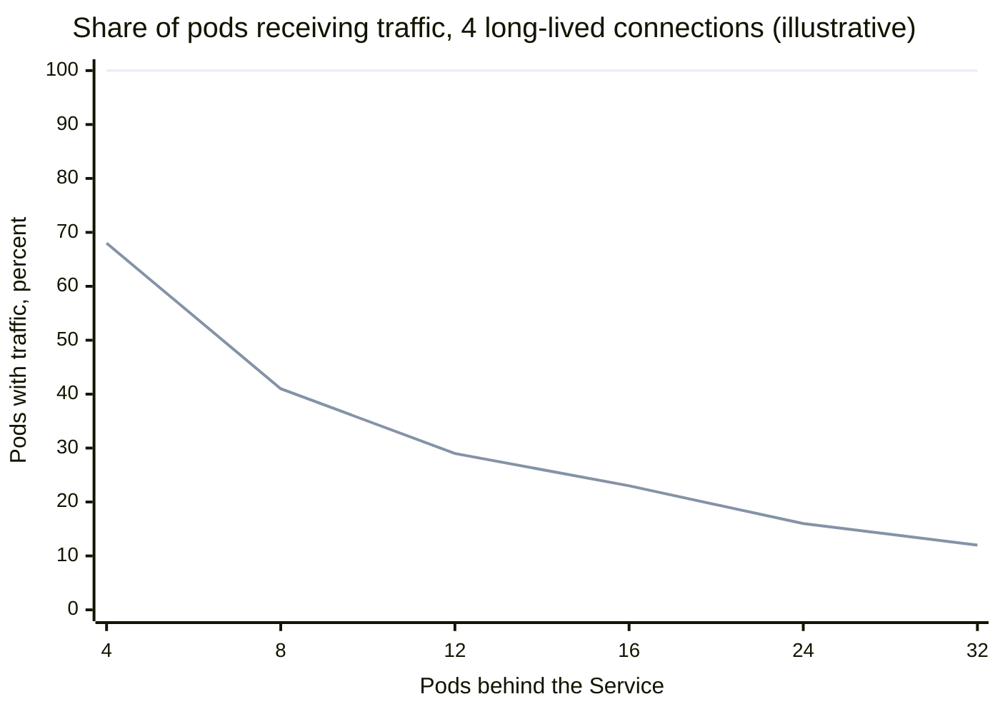
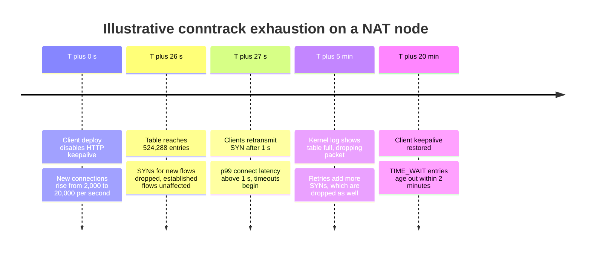

A layer 4 (L4) load balancer chooses a backend from transport-level information: source and destination IP addresses, ports, and protocol, the 5-tuple. It makes that choice once, when the first packet of a flow arrives, and then sends every later packet of the flow to the same backend without reading the payload. A layer 7 (L7) load balancer terminates the client's transport connection, usually terminates TLS as well, parses the application protocol, and chooses a backend for each request, sending it over a connection that the proxy itself opened. "Layer" refers to the OSI model's transport layer (4) and application layer (7); in practice it describes which information the decision uses and how often the decision is made, not only where packets are copied.

The problem both solve is the same: a fleet of interchangeable backends must look like one address, traffic must spread across them, and failed members must stop receiving work. They solve it at different granularities. L4 balances connections; L7 balances requests. Everything else on this page follows from that difference. A protocol that sends thousands of requests over one long-lived connection, as HTTP/2 and gRPC do, gets almost no balancing from an L4 device. A protocol the proxy cannot parse, such as a database wire protocol or a proprietary binary stream, gets nothing from an L7 device except overhead.

The core trade-off is visibility against cost and transparency. An L4 balancer forwards packets: its work per byte is small, it can run at line rate in the kernel or in a kernel-bypass data plane, it works for any protocol over TCP or UDP, and it leaves end-to-end encryption intact. In exchange it is blind: it cannot route by path, retry a failed request, see a 503, or spread one connection's requests. An L7 proxy sees every request and can route, retry, rewrite, authenticate, and measure each one, but it becomes a full protocol endpoint: it holds TLS keys, keeps two connections per client path, spends CPU on parsing and encryption for every request, adds a hop of latency, and must parse the protocol exactly as the backend does or open a security hole. Balancing algorithms are covered in [Algorithms](/distributed-systems/en/communication/load-balancing/algorithms/), where the balancing logic runs in [Client-Side vs. Server-Side Load Balancing](/distributed-systems/en/communication/load-balancing/client-vs-server-side/), and how backends enter and leave the pool in [Health-Aware Routing and Connection Draining](/distributed-systems/en/communication/load-balancing/health-aware-routing/).


*The same three backends behind each kind of balancer. Solid arrows carry one client's traffic; dashed arrows carry other clients' flows.*

On the L4 side the client's TCP connection reaches a backend unchanged; the balancer chose that backend when the SYN arrived and the client's whole session, every request on it, lands there. On the L7 side the client's connection ends at the proxy. The proxy reads each HTTP/2 stream as a separate request and can send three consecutive requests from one client to three backends over connections it keeps open. The cost is visible in the picture: the L7 proxy is in the middle of every byte in both directions and holds two independent connections whose lifetimes, timeouts, and failures no longer coincide.

## What Each Layer Guarantees and What It Cannot See

The L4 invariant is flow affinity: every packet of one transport flow reaches the same backend for the flow's lifetime. Breaking it is fatal for TCP, because a backend that receives a mid-stream segment for a connection it never accepted answers with a reset. Everything inside an L4 balancer exists to uphold this invariant under change: connection tables, consistent hashing, and state replication. L4 does not guarantee that load is balanced in any unit other than flows, that a backend that accepts connections is healthy at the application level, or that a request failing on one backend is tried on another. Once the TCP handshake has been forwarded, the balancer has no idea whether the backend answered with a 200 or a 500.

The L7 invariant is per-request routing with response pairing: each request is matched against routing rules, sent to exactly one backend at a time, and its response returns to the client on the connection and stream it came from. Because the proxy owns both connections, it can add things L4 cannot: retries on another backend, per-route timeouts, header-based routing for canaries, outlier ejection driven by response codes, and request-level metrics and traces. L7 does not guarantee that two requests from the same client reach the same backend unless affinity is configured, that a retried request was not already executed once (a timeout after the backend committed is still a duplicate, the subject of [Idempotency](/distributed-systems/en/communication/api-gateway/idempotency/)), or that the backend interprets the request bytes exactly as the proxy did.

Between the two sits a useful middle case. A proxy can read the TLS ClientHello, which carries the requested host name in the Server Name Indication (SNI) extension and the offered application protocols in the Application-Layer Protocol Negotiation (ALPN) extension, choose a backend from that, and then forward the encrypted bytes untouched. This is TLS passthrough with SNI routing: the decision uses one piece of application-adjacent information, but the proxy never decrypts, so it still balances whole connections.

:::note[Terminating TCP does not make a balancer layer 7]
HAProxy in `mode tcp`, Envoy's TCP proxy filter, and NGINX's `stream` module all terminate the client's TCP connection and open a new one to the backend, yet they decide once per connection from addresses and ports, so they are L4 balancers by decision granularity. The distinction that matters operationally is whether the device understands request boundaries. A full-proxy L4 balancer still pins every request on a connection to one backend.
:::

## Layer 4 Data Path: Flows, Tables, and the Return Path

An L4 balancer advertises a virtual IP address (VIP). When a packet arrives for the VIP, the balancer looks up the packet's 5-tuple in a connection table. A hit gives the backend chosen earlier; a miss, which for TCP should only happen on a SYN, triggers backend selection through the configured algorithm, and the choice is inserted into the table. The packet is then delivered to the backend by one of three forwarding methods, and the method decides almost every operational property of the device: who carries the response bytes, whether the backend sees the client's address, whether the balancer must sit on the return path, and what the MTU becomes.


*Three L4 forwarding methods. Only direct server return keeps the balancer off the response path.*

In destination NAT (DNAT), the balancer rewrites the destination address from the VIP to the chosen backend, adjusts checksums, and forwards. The response must come back through the balancer so that it can rewrite the source address back to the VIP; otherwise the client would receive a SYN-ACK from an address it never contacted and discard it. That forces the balancer to be the backend's route to the client, or forces source NAT (SNAT) as well, in which case the backend sees the balancer's address instead of the client's. Linux Virtual Server (IPVS) in NAT mode and Kubernetes kube-proxy implementing a ClusterIP Service with iptables or nftables rules are DNAT balancers; kube-proxy runs on every node, so the balancer is distributed and the return path is the node itself.

In the full-proxy method, the balancer completes the TCP handshake with the client, opens its own connection to the backend, and copies bytes between the two sockets. It costs more per byte than rewriting headers, since data crosses the kernel's socket layer twice, but it isolates the backend from client-side TCP behavior: retransmissions, small windows, and slow readers are absorbed by the balancer's buffers. The backend always sees the balancer's address.

In direct server return (DSR), the balancer does not change the inner packet at all. It either rewrites only the destination MAC address, which requires the backend on the same layer 2 segment, or encapsulates the packet in an outer IP header addressed to the backend (IP-in-IP or GRE). The backend has the VIP configured on a loopback interface, so it accepts the inner packet as addressed to itself, and it sends the response directly to the client with the VIP as source. Only the request direction passes through the balancer. For typical web and video traffic, where responses are many times larger than requests, this removes most of the balancer's bandwidth. Google's Maglev encapsulates in GRE and returns traffic directly from the service endpoints; Facebook's Katran forwards with IP-in-IP from an XDP (eXpress Data Path) program that runs in the network driver before the kernel's networking stack, and its backends return traffic directly as well. IPVS supports both DSR variants as its direct-routing and tunneling modes.

### Keeping a Flow on One Backend Across a Balancer Fleet

A single balancer machine is a single point of failure and a bandwidth ceiling, so production L4 tiers run several identical instances behind the same VIP. Routers spread packets across them with equal-cost multipath (ECMP): every instance announces the VIP over BGP (Border Gateway Protocol) at the same cost, and the router hashes each packet's header to choose one. As long as the set of instances is stable, every packet of a flow hashes to the same instance, and that instance's connection table upholds flow affinity.

The difficulty is change. When an instance is added, removed, or fails, the router's hash moves some flows to a different instance, whose table has no entry for them. If that instance selected a backend with an ordinary algorithm such as round robin, it would pick a different backend for a mid-stream packet and the connection would be reset; the sequence is drawn in [Network Reliability, Bandwidth Limitations, and Topology Changes](/distributed-systems/en/foundations/monoliths-to-distributed/network-reliability/). Maglev and Katran therefore choose the backend for a new flow with a consistent hash of the 5-tuple rather than a stateful algorithm. Every instance, given the same backend list, computes the same answer for the same flow, so a flow that moves between instances still lands on its original backend. The connection table is then needed only for the remaining case, a change in the backend set: when a backend is added, the hash maps a small share of existing flows to it, and the table on the instance that already carries those flows keeps them on their original backend. Katran's description makes the division explicit: its LRU connection table is a performance optimization that can be bypassed under memory pressure, while the consistent hash carries correctness for most flows.

The correctness argument has one gap, and it is worth naming. A flow survives either a balancer-set change (the hash agrees) or a backend-set change (the table remembers), but not both at once: a flow that moves to a new instance during the same window in which its backend's hash slot moved finds neither a table entry nor a hash agreeing with the old choice. Such flows are rare because both events must overlap and the hash moves only a small fraction of slots, but they are not zero, which is why Maglev's paper presents its guarantee as minimal disruption rather than none. The hashing scheme itself, including how Maglev builds its lookup table, belongs to [Algorithms](/distributed-systems/en/communication/load-balancing/algorithms/) and [Consistent Hashing](/distributed-systems/en/data-management/data-partitioning/consistent-hashing/).

### What Happens to the Client's Address

Backends need the client's address for access control, rate limiting, logging, and abuse handling. DSR and pure DNAT preserve it, since the inner packet still carries it. SNAT and full proxies replace it with the balancer's address. Kubernetes shows the trade-off directly: a LoadBalancer or NodePort Service with `externalTrafficPolicy: Cluster` may forward a packet arriving on one node to a pod on another node, and SNATs it so that the response returns through the first node; `externalTrafficPolicy: Local` delivers only to pods on the receiving node and keeps the client's address, at the cost of uneven load when pods are unevenly spread across nodes.

When an L4 proxy must hide the address at the IP layer, it can pass it in band with the PROXY protocol, defined by HAProxy: version 1 prepends one human-readable text line, version 2 a binary header with optional type-length-value fields, before the first byte of the proxied stream. The backend must be configured to expect it, and the expectation must be symmetric. A backend expecting the header that receives a connection without it, for example a health check sent directly, rejects or misparses the connection; a backend not expecting it treats the header as the start of application data. An L7 proxy carries the same information in HTTP headers such as `X-Forwarded-For` or the standardized `Forwarded` header (RFC 7239), and the backend must trust those headers only when they were set by its own proxy, never when they arrive from the client.

## Layer 7 Data Path: Terminate, Parse, Route, Re-Originate

An L7 proxy processes each request through a fixed pipeline. It accepts the TCP connection, completes the TLS handshake with a certificate it holds, and negotiates the application protocol through ALPN. A codec frames the byte stream into requests: for HTTP/1.1 by reading headers and then a body delimited by `Content-Length` or chunked encoding; for HTTP/2 and HTTP/3 by demultiplexing frames into streams. The proxy matches the request against routes (host, path, headers, method), which select a group of backends, called a cluster in Envoy and a backend in HAProxy. A balancing algorithm picks one endpoint of that group for this request. The proxy takes an idle upstream connection to that endpoint from its pool, or opens one, rewrites headers (adding `X-Forwarded-For`, a request ID, removing hop-by-hop headers), and forwards the request, streaming the body or buffering it according to configuration. When the response arrives, the proxy records status and timing and writes the response back onto the client's stream. Route precedence and edge policy such as authentication are the concern of the [API Gateway Pattern](/distributed-systems/en/communication/api-gateway/api-gateway-pattern/); this page is concerned with what the pipeline does to balancing.


*One client connection carrying three requests. The proxy picks an endpoint per stream and retries one on a different endpoint.*

Steps 2 to 5 show the property L4 cannot provide: two requests on the same client connection go to different backends, so a client that opens one HTTP/2 connection still spreads its load. Steps 10 to 12 show the second property: the proxy saw the 503, which an L4 device never does, and moved the request elsewhere before the client noticed. Responses return in completion order, not request order: stream 1's response goes back in step 7 while streams 3 and 5 are still in flight, because HTTP/2 streams are independent. The retry in step 11 is safe only because the route restricts it to GET; a proxy that retries POSTs on a 503 or a reset can execute a write twice, and a fleet of proxies retrying at every layer multiplies load during an overload, which is described in [Retry Storms and Metastable Failures](/distributed-systems/en/resilience/flow-control/retry-storms-metastable-failures/).

Per-request balancing is correct only when requests are independent, meaning any backend can serve any request. When a backend holds per-client state, such as an in-memory session or a local cache that must stay warm, the proxy needs affinity by cookie or by a hash of a header, which reintroduces the coarse granularity L7 was meant to remove; the trade-off is covered in [Stateful vs. Stateless Services](/distributed-systems/en/foundations/monoliths-to-distributed/stateful-vs-stateless/). Long-lived streams have a similar limit: the proxy chooses a backend when a stream opens and never again, so a gRPC stream that lasts hours is balanced exactly as coarsely as a TCP connection; see [gRPC Streaming](/distributed-systems/en/communication/synchronous-protocols/grpc-streaming/). A WebSocket upgrade turns an L7 proxy into an L4 tunnel for the rest of that connection.

### Two Connections, Two Lifetimes

The proxy owns a downstream connection to the client and a pool of upstream connections to each endpoint, and they are independent. The client may close while the upstream request is still running, the backend may close an idle pooled connection while the proxy is about to reuse it, and each side has its own idle timeout, keepalive, and maximum lifetime. Connection pooling is what makes L7 affordable: reusing upstream connections removes a TCP and often a TLS handshake from every request. For HTTP/1.1 upstreams, each pooled connection carries one request at a time, so the pool size bounds upstream concurrency per endpoint; for HTTP/2 upstreams, one connection carries many streams, and the endpoint's stream limit becomes the bound.

The ordering rule that follows is the most frequently violated setting in L7 deployments: along a request path, each hop must keep idle connections open longer than the hop in front of it. The proxy should close an idle upstream connection before the backend does, so that the proxy never sends a request on a connection the backend is closing. The client should close before the proxy for the same reason. When the order is reversed, the failure is a low, steady rate of 502 responses that no load test reproduces; it is examined under failure modes below.

### Two Parsers That Must Agree

A request crossing an L7 proxy is parsed twice, once by the proxy and once by the backend. If they disagree on where one request ends and the next begins, an attacker can place a second, hidden request inside the body of the first. The classic case is HTTP/1.1 with both `Content-Length` and `Transfer-Encoding: chunked`, or with malformed variants of either: the proxy uses one to delimit the request, the backend uses the other, and the leftover bytes on a pooled upstream connection are read by the backend as the start of the next request, which may then be attributed to another user's connection. This is HTTP request smuggling, also called desync. RFC 9112 requires that a message carrying both headers be handled with `Transfer-Encoding` taking precedence and treated as a potential attack, but every parser in the chain must enforce it identically. AWS Application Load Balancer (ALB) classifies non-compliant requests and, in its default `defensive` desync mitigation mode, blocks those it considers severe; mature proxies such as Envoy and HAProxy reject or normalize many ambiguous framings, though the exact behavior depends on version and settings and is worth confirming for the release in use. HTTP/2 end to end removes the ambiguity, because frames carry explicit lengths, but downgrading HTTP/2 from the client to HTTP/1.1 toward the backend reintroduces it.

:::caution[Upstream connection reuse is what turns a parser quirk into a cross-user attack]
Smuggling needs a shared upstream connection to poison: the hidden request is read as the next request on a pooled connection that later carries other clients' traffic. Keep proxy and backend HTTP parsers strict, prefer HTTP/2 to the backend where it is supported, reject requests with both framing headers at the edge, and treat a proxy upgrade that relaxes parsing as a security change, not a performance one.
:::

## Cost, Capacity, and Configuration in Production

The two layers differ less in correctness than in where costs land. The table compares the common forms.

| Form | Decision unit | Sees | Bytes through balancer | Client address at backend | When to prefer |
|---|---|---|---|---|---|
| L4 DNAT (IPVS NAT, kube-proxy) | Flow | 5-tuple | Both directions | Preserved if balancer is return route, else SNAT | In-cluster service VIPs, non-HTTP protocols, simple topologies |
| L4 DSR (Maglev, Katran, IPVS DR or tunnel) | Flow | 5-tuple | Requests only | Preserved | Front tier for very high bandwidth, response-heavy traffic |
| L4 full proxy (HAProxy `mode tcp`, Envoy TCP proxy, NGINX `stream`) | Connection | 5-tuple, bytes uninterpreted | Both directions, through sockets | Lost; PROXY protocol to restore | Databases, message brokers, TLS passthrough, protocol-agnostic edges |
| TLS passthrough with SNI routing | Connection | 5-tuple, SNI, ALPN | Both directions, still encrypted | Lost unless PROXY protocol | Multi-tenant TLS where the backend must hold the key |
| L7 proxy (Envoy, NGINX `http`, HAProxy `mode http`, ALB) | Request or stream | Full request and response | Both directions, decrypted and re-encrypted | Via `X-Forwarded-For` or `Forwarded` | HTTP and gRPC routing, per-request balancing, retries, request metrics |

Large deployments do not choose one; they stack them. Maglev sits in front of Google's L7 front-end proxies, and Facebook's Katran announcement describes traffic flowing from its L4 tier to L7 balancers. The L4 tier does what only it can do cheaply: absorb packets at line rate, spread them across many L7 instances with ECMP and consistent hashing, and let L7 instances be added or drained without changing the VIP. The L7 tier does what only it can do: terminate TLS, route per request, and measure per request. Inside a cluster the same composition appears as kube-proxy's L4 Service in front of an L7 ingress proxy or gateway, compared in [Ingress vs. Gateway API](/distributed-systems/en/service-mesh/network-policies-mtls/ingress-vs-gateway-api/), and service meshes move the L7 proxy next to every workload, as described in [Why Service Mesh Exists](/distributed-systems/en/service-mesh/service-mesh-architecture/why-service-mesh/).

### Worked Example: One gRPC Service, Three Constraints

Assume an internal gRPC service with 12 pods, called by 4 gateway instances that each keep a single HTTP/2 channel to the service's ClusterIP. Together the gateways send 40,000 requests per second, 10,000 per channel. All numbers in this example are illustrative.

Behind kube-proxy, an L4 DNAT balancer, each channel is one TCP connection and lands on one pod chosen at connect time. With 4 connections assigned uniformly at random to 12 pods, the expected number of pods that receive any traffic is `12 * (1 - (11/12)^4)`, about 3.5. Roughly 8.5 pods sit idle, and each busy pod handles at least 10,000 requests per second against an intended 3,333. The probability that some pod receives two connections, and therefore 20,000 requests per second, is `1 - (12 * 11 * 10 * 9) / 12^4`, about 43%. Autoscaling does not help: at 24 pods the expected number of busy pods is 3.76, because no existing connection moves.


*Top line: per-request L7 balancing reaches every pod. Bottom line: L4 balancing of four connections, expected share `(1 - (1 - 1/n)^4)` of n pods.*

The bottom curve is the one that surprises teams: adding pods lowers utilization of the fleet without lowering the load on the pods that are busy. The [HTTP/2 page](/distributed-systems/en/communication/synchronous-protocols/http2-http3-quic/) describes the general mechanism as connection concentration and the [gRPC page](/distributed-systems/en/communication/synchronous-protocols/grpc-protocol-buffers/) lists the ways out. Here the question is what moving to L7 costs.

An L7 proxy in the path must parse and re-encrypt 40,000 requests per second. Assume a measured capacity of 15,000 proxied HTTP/2 requests per second per core with TLS on both sides; the tier then needs about 2.7 cores of steady work, so 6 cores across three instances leaves headroom for losing one instance at peak. Assume each proxy hop adds 0.3 ms at the median with pooled upstream connections. For a call whose server time is 5 ms, that is 6%; for a call chain of five services each behind its own L7 hop, the cost is paid five times. Those are the numbers to measure before choosing; the alternative without a proxy hop is client-side balancing.

Bandwidth changes the answer for a different service. Assume a download front end receiving 100,000 requests per second with 800-byte requests and 50 KB responses. Requests amount to 80 MB/s, about 0.64 Gbit/s; responses to 5 GB/s, about 40 Gbit/s. A DNAT or full-proxy L4 balancer carries 40.6 Gbit/s. A DSR balancer carries 0.64 Gbit/s, about 1.6% of that, because responses bypass it. An L7 proxy carries the full 40.6 Gbit/s and also encrypts the 40 Gbit/s of responses. This asymmetry is why the outermost tier of large edges is DSR L4 even when every request is ultimately handled by L7 proxies: the L7 tier is sized for request work, the L4 tier only for request packets.

### Configuration That Decides Behavior

The same proxy software can run as either layer, which makes the configuration the place where the choice is made. HAProxy shows both in a few lines.

```text
frontend db_in
    mode tcp                       # L4: one decision per connection
    bind :5432
    default_backend pg
backend pg
    mode tcp
    server pg1 10.0.0.11:5432 check send-proxy-v2   # pass client address in band
frontend web_in
    mode http                      # L7: one decision per request
    bind :443 ssl crt /etc/haproxy/site.pem alpn h2,http/1.1
    timeout client 30s             # must exceed the client's idle close
    default_backend api
backend api
    mode http
    balance leastconn
    option forwardfor              # adds X-Forwarded-For
    http-reuse safe                # reuse idle upstream connections
    timeout server 30s
    server api1 10.0.1.11:8080 check
```

The parameters that matter most in production are fewer than the configuration surface suggests.

| Parameter | Layer | Effect | Guidance |
|---|---|---|---|
| Idle timeout per hop | Both | Closes connections without traffic | Each hop longer than the hop in front of it; backend longest |
| Connection table size and timeouts | L4 (conntrack, IPVS, Katran LRU) | Bounds tracked flows | Size for new connections per second times the longest per-entry timeout |
| Maximum connection age | L7 and backends | Forces long-lived clients to reconnect and rebalance | Set with jitter so reconnects do not synchronize; close through GOAWAY |
| Upstream pool size and stream limit | L7 | Bounds concurrency per endpoint | Derive from backend concurrency limit, not from client count |
| MSS clamping or backend MTU | L4 DSR and tunnels | Prevents oversize encapsulated packets | Lower MTU by the encapsulation overhead or clamp MSS on SYN |
| PROXY protocol or forwarding headers | Both | Restores client address | Enable on both sides together; trust only your own proxy |

Cloud services fix some of these for you. AWS documents the ALB connection idle timeout as 60 seconds by default, configurable from 1 to 4,000, and recommends that the application's idle timeout be larger than the balancer's; the Network Load Balancer's TCP idle timeout is 350 seconds by default, configurable from 60 to 6,000 seconds since September 2024, after which the NLB drops the flow and answers later packets with a reset. On Linux, kube-proxy sizes the node's conntrack table at 32,768 entries per core with a minimum of 131,072, and sets the established-connection timeout to 24 hours rather than the kernel's default of five days.

## Failure Modes in Both Layers

L4 failures look like network faults: resets, timeouts, and stuck handshakes at the transport level, with application logs showing nothing. L7 failures look like application faults: 502s and 503s that the application never returned, generated by the proxy on its behalf.

### Load Pinning on Long-Lived Connections

Trigger: multiplexed or persistent connections behind an L4 balancer, or a scale-out with no reconnect. Symptoms: a few backends at high CPU, others idle, new pods taking no traffic, latency rising while the autoscaler adds capacity. Detection: requests per second per backend against active connections per backend; a skew in the first that tracks the second exactly identifies pinning. Mitigation: per-request balancing at L7 or in the client, or a server-side maximum connection age with jitter so that clients reconnect over minutes. Recovery: a rolling restart of callers rebalances immediately, at the cost of a reconnect burst; spread it out.

### Idle-Timeout Race Producing 502s

Trigger: a backend closes idle keepalive connections sooner than the L7 proxy in front of it. Node.js, for example, defaults `server.keepAliveTimeout` to 5 seconds, while an ALB keeps upstream connections idle for up to 60 seconds. The proxy considers a pooled connection usable at the same moment the backend is closing it.

```mermaid
sequenceDiagram
    autonumber
    participant C as Client
    participant P as L7 proxy, idle 60s
    participant B as Backend, keepalive 5s
    C->>P: Request A
    P->>B: Request A on pooled conn
    B-->>P: 200
    P-->>C: 200
    Note over P,B: Connection idle for 5 s
    rect rgb(70, 40, 40)
    B->>P: FIN, backend closes idle conn
    C->>P: Request B arrives at the same moment
    P->>B: Request B sent on the closing conn
    B-->>P: RST, socket already closed
    end
    P-->>C: 502 Bad Gateway
```


*A pooled connection closed by the backend while the proxy reuses it. The window is the FIN's travel time, so the error rate is low and proportional to traffic after idle gaps.*

The race window in steps 5 to 7 lasts only as long as the FIN takes to reach the proxy and be processed, so the 502 rate is small, often a fraction of a percent, concentrated on low-traffic endpoints where connections actually go idle, and absent from load tests that never let connections sit idle. Detection: 502s generated by the proxy rather than the backend (ALB `HTTPCode_ELB_502_Count` rather than target 5xx; Envoy access logs with the `UC` response flag, upstream connection termination), occurring on reused connections, with no matching error in backend logs. Mitigation: make the backend's keepalive timeout longer than the proxy's idle timeout, or set the proxy's upstream idle timeout below the backend's, which Envoy supports per cluster; allow the proxy to retry idempotent requests on a reset before any response byte. Recovery is immediate once the order is corrected.

### Connection Table Exhaustion

Trigger: an L4 balancer or a node doing NAT tracks more flows than its table holds, typically because many short-lived connections leave entries behind. A closed TCP connection stays in Linux conntrack in TIME_WAIT for 120 seconds by default. Assume a 16-core node with kube-proxy defaults, a table limit of 524,288, receiving 20,000 new short connections per second (illustrative): steady state needs about 2.4 million entries for TIME_WAIT alone, and the table fills from empty in about 26 seconds. Symptoms: new connections time out at the SYN while established ones keep working; latency for new connections jumps by the client's SYN retransmission interval. Detection: the kernel log line `nf_conntrack: table full, dropping packet`, and the node exporter metrics `node_nf_conntrack_entries` approaching `node_nf_conntrack_entries_limit`.


*A hypothetical sequence, not a real incident. The trigger is a change in client behavior, not in the balancer.*

The timeline shows why the fault is misread: the balancer's configuration did not change, CPU is low, and established connections are healthy. The cause is the rate of new connections times the time each entry lingers. Mitigation: restore connection reuse at the clients, raise the table limit (memory per entry is small), shorten the TIME_WAIT tracking timeout where the network allows, or exclude traffic that needs no NAT from tracking. Purpose-built balancers bound the problem differently: Katran's LRU table evicts old entries and falls back to the consistent hash, which degrades affinity for a few flows instead of dropping new ones.

### Source Port Exhaustion on Proxies

Trigger: a full proxy or L7 proxy opens upstream connections without reuse, from one source address to one backend address and port. A TCP connection is identified by its 4-tuple, so with the source address and the destination fixed, only the ephemeral port varies: Linux's default range of 32768 to 60999 gives 28,232 ports. If the proxy closes first, each port is held in TIME_WAIT for 60 seconds, so the sustainable rate of new connections to that one backend is about 470 per second. Symptoms: `EADDRNOTAVAIL` or "cannot assign requested address" errors in proxy logs and upstream connect failures that rise with traffic to a few backends. Detection: sockets in TIME_WAIT per destination (`ss -tan state time-wait`), upstream connection-open rate. Mitigation: upstream connection pooling, which is the fix rather than a tuning; more source addresses or more backend ports; enabling kernel TIME_WAIT reuse for outgoing connections where the kernel and path support it.

### Encapsulation MTU Black Holes

Trigger: DSR or tunnel-mode L4 balancing adds an outer header (20 bytes for IP-in-IP, 24 for basic GRE) to packets that already use the full path MTU. Oversize encapsulated packets are fragmented or dropped; if the ICMP "fragmentation needed" message is filtered or routed to the wrong place, the sender never learns to shrink. Symptoms: small requests succeed, large ones hang. TLS handshakes with large certificate chains stall, uploads stop at a fixed size. Detection: packet captures showing retransmissions of full-size segments only, and failures that correlate with request size rather than load. Mitigation: clamp the TCP maximum segment size (MSS) on SYN, lower the MTU on tunnel interfaces, or raise the fabric MTU so encapsulated packets fit.

:::tip[Classify a 5xx by who generated it before debugging the application]
At L7, most incident time is lost debugging an application that never returned the error. Every serious proxy distinguishes its own responses from the backend's: ALB reports `ELB` and `Target` metrics separately, and Envoy access logs carry response flags such as `UH` (no healthy upstream), `UF` (upstream connection failure), `UC` (upstream connection termination), and `UT` (upstream timeout). Put the generator of the error on the dashboard next to the status code.
:::

### Summary of Failure Signatures

| Failure | Layer | Symptom from outside | Detection signal | Mitigation |
|---|---|---|---|---|
| Load pinning | L4 | Skewed backend load, idle new pods | Requests vs. connections per backend | L7 or client-side balancing, max connection age |
| Idle-timeout race | L7 | Low steady 502 rate after idle gaps | Proxy-generated 502s, `UC` flag, no backend error | Backend idle longer than proxy idle; retry idempotent on reset |
| Conntrack exhaustion | L4 NAT | New connections time out, old ones fine | `table full` log, entries near limit | Connection reuse, larger table, shorter TIME_WAIT tracking |
| Source port exhaustion | L4 full proxy, L7 | Connect errors to a few backends | TIME_WAIT sockets per destination | Upstream pooling, more source addresses |
| MTU black hole | L4 DSR, tunnels | Large requests hang, small succeed | Retransmitted full-size segments | MSS clamping, tunnel MTU |
| Request smuggling | L7 | Responses or actions attributed to the wrong user | Parser rejections, desync classification metrics | Strict parsing, HTTP/2 upstream, reject dual framing |
| Balancer fleet rehash | L4 | Reset bursts during balancer changes | RSTs correlated with ECMP changes | Consistent hashing plus connection tables |

Removing an L4 or L7 instance without first stopping new flows to it, and waiting for existing ones to finish, produces the same reset bursts as an unplanned failure; the procedure is covered in [Health-Aware Routing and Connection Draining](/distributed-systems/en/communication/load-balancing/health-aware-routing/).

## Choosing the Layer

The decision follows from three questions: how many requests travel on one connection, whether the balancer may see plaintext, and how many bytes the balancer must carry.

Choose L4 when the protocol is not HTTP or the balancer cannot parse it (PostgreSQL, MySQL, MQTT, SMTP, raw TCP or UDP services); when encryption must stay end to end between client and backend, for example when the backend authenticates clients with mutual TLS and no proxy may hold the keys; when traffic is bandwidth-heavy and response-dominated, where DSR removes most of the balancer's load; when connections are many, short, and roughly equal in cost, so that balancing connections approximates balancing work; and as the outermost tier in front of an L7 fleet, where its job is to spread packets across proxies and survive their scaling.

Do not choose L4 alone for HTTP/2 or gRPC traffic from a small number of long-lived clients, because it will pin load; when you need routing by path, header, or method; when failed requests should be retried on another backend; or when request-level metrics are required to meet a service level objective. Do not use L4 to hide backends whose application health differs from their TCP health: a backend that accepts connections and answers every request with 500 stays in an L4 pool unless an application-level health check removes it.

Choose L7 when traffic is HTTP, HTTP/2, HTTP/3, or gRPC and requests are independent; when canary, header-based, or weighted routing is needed, described in [Traffic Management](/distributed-systems/en/service-mesh/service-mesh-architecture/traffic-management/); when the edge must terminate TLS and apply policy; and when per-request latency and error metrics are the basis of alerting.

Do not choose L7 when the added hop's latency or CPU dominates the service's own cost, as with very small and very frequent calls; when the proxy would have to decrypt traffic that compliance requires to stay encrypted end to end; when an L7 hop already exists on the path and a second one would only add another set of timeouts and retries; or when the clients are under your control and can balance per request themselves, which removes the hop entirely, as discussed in [Client-Side vs. Server-Side Load Balancing](/distributed-systems/en/communication/load-balancing/client-vs-server-side/). Global distribution across regions is a separate decision made above both layers, in [GSLB and Anycast](/distributed-systems/en/communication/load-balancing/gslb-anycast/).

:::caution[Size the L7 tier for its worst hop, not for average traffic]
An L7 proxy fails differently from an L4 forwarder under overload: it buffers requests, holds upstream connections, and queues work, so when it saturates, latency climbs for every route it serves, not only the hot one. Capacity-plan it per request with TLS on both sides at peak, leave room for losing an instance, and give it its own limits; an L4 tier in front cannot shed L7 overload because it cannot see requests.
:::

## Further Reading

- Daniel E. Eisenbud et al., *Maglev: A Fast and Reliable Software Network Load Balancer*, USENIX NSDI, 2016.
- Facebook Engineering, *Open-sourcing Katran, a scalable network load balancer*, engineering.fb.com, 2018.
- Willy Tarreau, *The PROXY protocol, Versions 1 and 2*, HAProxy Technologies (specification, continuously revised).
- Roy T. Fielding, Mark Nottingham, and Julian Reschke (eds.), *RFC 9112: HTTP/1.1*, IETF, 2022 (message framing and request smuggling considerations).
- Envoy Project, *Life of a Request*, Envoy documentation (continuously revised).
- Wensong Zhang, *Linux Virtual Server for Scalable Network Services*, Ottawa Linux Symposium, 2000.
