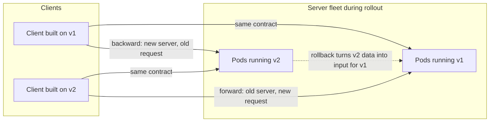
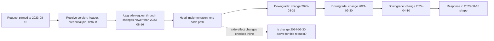
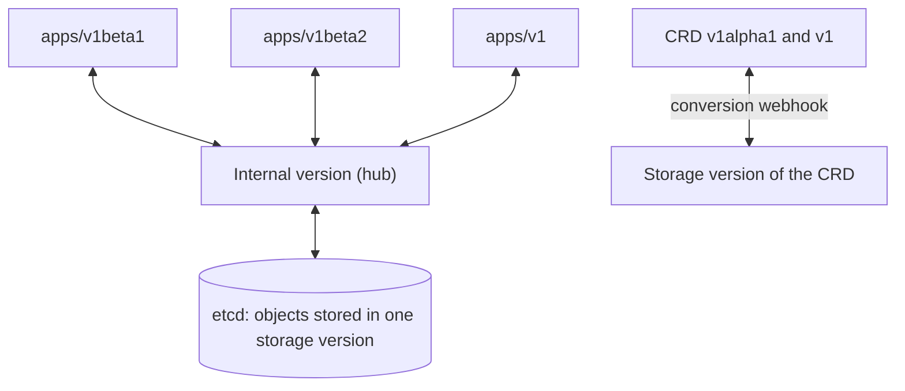
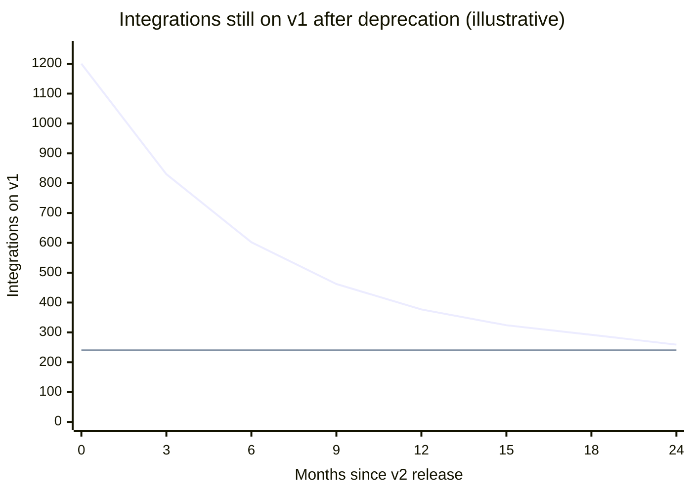
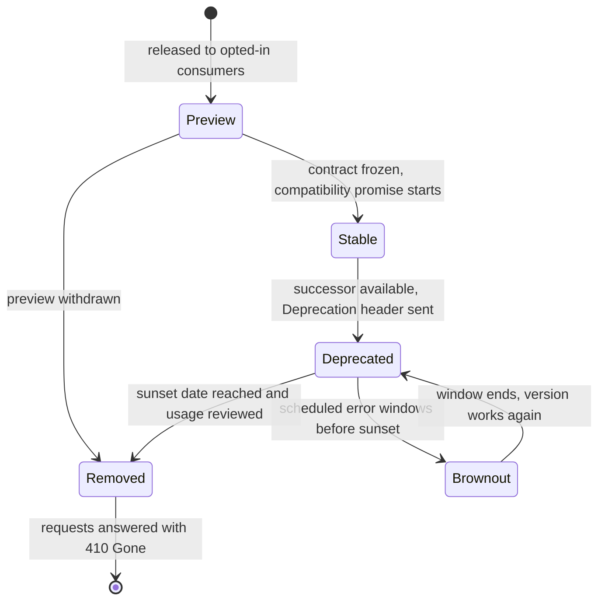

An API version is a name for one contract between a provider and consumers it does not control. Versioning is the set of rules that decides when a change to that contract needs a new name, how a request selects the contract it was written against, how long the provider keeps answering under old names, and how the old names are retired. The mechanism exists because a provider and its consumers deploy on different schedules: a mobile binary installed two years ago, a partner's nightly batch job, and a service owned by another team all keep sending requests shaped by the contract they were built against, and nothing on the provider's side can upgrade them.

The core trade-off is who pays for change and when. Every breaking change costs consumers migration work; every version kept alive costs the provider code paths, tests, documentation, security fixes and cache capacity, multiplied by how long it lives. A provider that never breaks anything pays continuously in accumulated compatibility code; a provider that breaks often pushes the cost onto consumers and loses the ones who cannot keep up. Versioning does not remove this cost; it makes it explicit and schedulable. The cheapest version is the one never created, because most changes can be made compatible, and the version identifier is the escape hatch for the changes that cannot.

This page covers synchronous request-response APIs over HTTP and gRPC. Wire-level compatibility rules of protobuf are explained in [gRPC and Protocol Buffers](/distributed-systems/en/communication/synchronous-protocols/grpc-protocol-buffers/), registry-enforced compatibility modes for serialized schemas in [Schema Evolution and Schema Registry](/distributed-systems/en/communication/async-messaging/schema-evolution-registry/), versioning of stored events in [Event Versioning and Schema Evolution](/distributed-systems/en/microservice-patterns/event-sourcing-cqrs/event-versioning/), and the database side of a compatible rollout in [Zero-Downtime Database Migrations](/distributed-systems/en/deployment/deployment-patterns/zero-downtime-db-migrations/).

## What Makes a Change Breaking

A change is breaking when some consumer that worked before the change fails or misbehaves after it, without the consumer having changed. "Fails" includes the obvious case, a request that used to succeed now returning an error, and the dangerous case, a request that still succeeds but now means something different. The definition is relative to consumers, not to the schema: the same change can be harmless for a consumer that ignores unknown fields and fatal for one that rejects them. A versioning policy therefore starts with a model of what consumers are allowed to assume.

### Backward and Forward Compatibility

Two directions matter, and confusing them is the root of most rollout incidents. Backward compatibility means a new provider still serves old consumers: requests written against the previous contract are accepted and their responses are understood. Forward compatibility means an old provider survives requests or data produced by new consumers: it accepts fields it does not know, ignores or preserves them, and does not crash on a value it has never seen. Public API policies usually promise only the first. Inside a system, the second is needed every time two versions run at once, which is every rolling deploy, every canary, every rollback and every multi-region release.


*The four client-server pairings that exist while a fleet runs two versions. A load balancer that does not route by version produces all four.*

The two straight edges are the cases teams test. The diagonal edges are the ones production creates: during a rolling deploy, a client that has already seen a v2 response (and learned a new field or enum value from it) can have its next request routed to a v1 pod, and after a rollback every v2 pod is gone while the data it wrote remains. The dashed edge is the subtle one. A v2 server may have stored a new field in a shared database or returned it to a client that will echo it back; once v1 code reads that data, forward compatibility decides whether the field survives or is silently dropped. This is why a compatible rollout is ordered as "readers first, then writers": deploy code that tolerates the new shape everywhere, and only then deploy code that produces it, so that a rollback of the writer never leaves data that no remaining reader understands.

### A Taxonomy of Changes

Most changes fall into a small number of classes, and the class decides whether a new version is needed. The table assumes consumers follow the tolerant-reader rule discussed below; the right-hand column names the assumption that makes the change break anyway.

| Change | Backward compatible? | Breaks consumers that... |
|---|---|---|
| Add an optional request field | Yes | Old servers reject unknown fields (forward direction) |
| Add a response field | Yes | Deserialize strictly and reject unknown fields |
| Add an enum value in a response | On the wire, yes | Switch exhaustively over the enum or map it to a closed type |
| Make an optional request field required | No | Never sent it |
| Remove or rename a field | No | Read or send it |
| Change a field's type or unit | No | Parse or interpret it, often silently |
| Tighten validation (shorter max length, stricter format) | No | Send values that used to be accepted |
| Change a default value | No | Relied on the old default without sending the field |
| Change error codes, pagination size, ordering, rate limits | Contract-dependent | Observed and depended on the old behavior |

The enum row deserves attention because public policies disagree on it. GitHub's REST API documentation lists new enum values among additive, non-breaking changes; protobuf's guidance warns that open enums push unknown numeric values into application code that may not handle them; and a TypeScript client generated with an exhaustive union type turns every new value into a runtime path the compiler never saw. The honest position is that a new enum value is compatible only if the contract told consumers in advance to expect unknown values and gave them a defined fallback, such as treating an unknown payment status as "pending, check later".

### Hyrum's Law and the Tolerant Reader

The documented contract is not the contract consumers depend on. Hyrum's Law, named after Hyrum Wright at Google, states that with enough users every observable behavior of an interface will be depended on by somebody: the order of keys in a JSON object, the fact that IDs were always numeric strings, the latency that let a client use a 2-second timeout, the exact text of an error message parsed by a regular expression. A provider can declare these out of contract, and Stripe's documentation does exactly that, listing property order and the length and prefix of opaque ID strings as things that may change without a new version. A declaration lowers the provider's obligation; it does not stop consumers from breaking.

The consumer-side discipline that makes additive change safe is the tolerant reader: read only the fields you use, ignore everything else, and treat unknown enum values as a defined fallback. It is the API form of the robustness principle, and it has a known cost. RFC 9413 argues that unbounded tolerance lets deviations accumulate until every implementation must accept every historical mistake. The workable middle is to be tolerant of what the contract declares extensible (new fields, new enum values, new event types) and strict about everything else (types, required fields, value ranges), so that errors surface at the boundary instead of deep in business logic.

Serializer defaults decide which side of that line a consumer starts on. Jackson's `ObjectMapper` fails on unknown properties by default, Spring Boot's auto-configured mapper turns that off, and Go's `encoding/json` ignores unknown fields unless the decoder is told otherwise. Two clients written against the same OpenAPI document can therefore react oppositely to the same additive change, which is why the contract should state the tolerance rule explicitly and [contract tests](/distributed-systems/en/communication/api-gateway/contract-testing/) should verify that consumers follow it.

## Where the Version Lives

Once a change cannot be made compatible, the request must carry an identifier that tells the provider which contract to apply. Where that identifier lives decides who can see it: routers, caches, logs, browsers and humans reading a URL. Each placement makes a different set of intermediaries version-aware.

### Path, Query, Header and Media Type

A version in the URI path (`/v1/orders`, `/v2/orders`) is visible to every component that sees the URL. A reverse proxy or [API gateway](/distributed-systems/en/communication/api-gateway/api-gateway-pattern/) can route `/v2/` to a different backend with a prefix match, CDNs and browser caches key on it without configuration, access logs record it, and a developer can try it in a browser. The cost is conceptual: REST treats a URI as the name of a resource, and `/v1/orders/42` and `/v2/orders/42` name the same order twice, so links stored by consumers carry a version they may outlive. Path versions also tend to be coarse, one number for the whole API, because nobody wants to mix `/v1/` and `/v3/` endpoints in one integration. Google's API Improvement Proposals put the major version in the first path segment and at the end of the protobuf package, and forbid exposing minor versions at all.

A version in a query parameter (`?api-version=2024-10-21`) keeps the path stable and is equally visible to caches and logs. Azure's REST APIs use this form with date-valued versions and require the parameter on every call, which removes the question of what an unversioned request means. Query parameters are easy to drop accidentally when URLs are rebuilt, and some routers match on paths more cheaply than on query strings.

A version in a custom request header (`X-GitHub-Api-Version: 2022-11-28`, `Stripe-Version: 2024-09-30.acacia`) keeps URLs clean and lets a client move one call at a time, but it hides the version from everything that does not parse headers deliberately. Media-type versioning puts the version inside the `Accept` header (`application/vnd.example.v2+json`), which is the form closest to HTTP content negotiation: the resource keeps one URI and the client asks for a representation. It is also the least tooling-friendly, because many clients, proxies and documentation generators treat `Accept` as an afterthought.

Date-pinned versions are a policy layered on top of a header. Stripe pins each account to the newest version at its first API request; later requests without a `Stripe-Version` header run against the pinned version, and the account owner upgrades explicitly. Since the `2024-09-30.acacia` release, Stripe ships a version every month without breaking changes and starts a named major line, such as Basil, twice a year with the breaking ones. GitHub's REST API uses date-named versions in a header, answers unversioned requests with `2022-11-28`, supports a version for 24 months after its successor is released, and returns `410 Gone` for a version no longer supported.

### Version Resolution and the Cache Key

Every request goes through a resolution step that is easy to leave implicit and dangerous to get wrong: explicit version in the request, otherwise a version bound to the credential (Stripe's account pin, a version stored with an OAuth application), otherwise a default. The default is a policy decision with failure consequences. "Latest" as the default means every release silently breaks every unversioned client. "Oldest supported" means new consumers start on a contract scheduled for removal. Pinning to the credential at first use, or requiring an explicit version as Azure does, removes the ambiguity at the price of a mandatory parameter or per-credential state.

A header-based version changes the response for the same URL, so any shared cache between client and provider must include the header in its cache key. HTTP's mechanism for that is the `Vary` response header: a response carrying `Vary: X-API-Version` may only be reused for requests with the same value of that header. A response without it may be stored once and returned to clients of every version.

:::caution[A header version without Vary mixes versions in caches]
If the version selects the response body but responses do not list the version header in `Vary`, a CDN or shared proxy stores whichever representation it fetched first and serves it to all clients. The symptom is intermittent: a v1 client receives a v2 body only when the cached copy came from a v2 request, so errors follow cache fill order, differ by edge location and disappear after purges. Add the header to `Vary`, normalize it at the edge (absent and default must map to the same key), or put the version in the path.
:::

The same effect has a capacity side. Each version multiplies the number of cache entries for a popular object, so a cache that held one copy now holds one per version in use, and the origin sees one miss per version per expiry.

### gRPC Packages and Versionless GraphQL

gRPC carries the version in the protobuf package, which becomes part of the method path: `/shop.v1.OrderService/GetOrder` and `/shop.v2.OrderService/GetOrder` are different methods to every router, so one server process can register both services and a proxy can route them independently. Within a package, change is additive and governed by protobuf's field rules: new fields get new numbers, removed numbers are reserved, and a breaking-change checker such as `buf breaking` runs in CI against the last released schema.

```proto
// file shop/v1/order_service.proto; v1 handlers delegate to v2 logic
package shop.v1;
service OrderService {
  rpc GetOrder(GetOrderRequest) returns (Order);  // /shop.v1.OrderService/GetOrder
}

// file shop/v2/order_service.proto; new major only for incompatible redesign
package shop.v2;
service OrderService {
  rpc GetOrder(GetOrderRequest) returns (Order);  // /shop.v2.OrderService/GetOrder
  rpc ListOrderEvents(ListOrderEventsRequest) returns (stream OrderEvent);
}
```

The comment on the first service is the operational point: a new package should not be a copy of the old implementation but a new contract over the same domain logic, with the old package translated at its edge.

[GraphQL](/distributed-systems/en/communication/synchronous-protocols/graphql/) takes the opposite position and publishes one graph without version numbers. Because each client names the exact fields it reads, the provider can observe per-field usage, mark fields with `@deprecated(reason: "...")`, and remove them when usage reaches zero. This is versioning at field granularity rather than at API granularity. It works when the provider can see every operation, ideally through registered trusted documents; it fails for public graphs whose clients are unknown, where a removal is as breaking as in REST and "versionless" means only that there is no name to pin to.

### Comparing the Placements

| Strategy | Visible to caches and routers | Granularity | Main cost | When to prefer |
|---|---|---|---|---|
| URI path major version | Yes, without configuration | Whole API | Duplicate resource names; coarse, infrequent jumps | Public HTTP APIs with rare breaking releases and simple gateway routing |
| Query parameter | Yes | Whole API or per call | Easy to drop; must be required to avoid ambiguous defaults | APIs that want stable paths and explicit dates, as in Azure |
| Custom header, date-valued | Only with `Vary` | Per request | Cache keys, invisible in URLs and many logs | Public APIs with many small breaking changes and a translation layer |
| Media type in `Accept` | Only with `Vary: Accept` | Per representation | Weak tooling support, header complexity | Hypermedia APIs that already negotiate representations |
| Credential-pinned version | No, resolved at origin | Per consumer | Per-account state, upgrade tooling | Large public APIs that must never break silent integrations |
| Protobuf package version | Yes, part of the method path | Per service | Generated code per package | gRPC services; majors only for redesigns |
| Versionless with field deprecation | Not applicable | Per field | Requires usage visibility | GraphQL or internal APIs whose consumers are all known |

## Serving Many Versions From One Codebase

A version identifier only selects a contract; something has to implement every contract still in service. The implementation strategy decides how cost grows with the number of live versions, and it is where most of the long-term expense of versioning sits.

### Parallel Stacks Versus a Translation Layer

The simplest implementation copies the code: v2 is a branch or a new deployment, v1 keeps running. It isolates versions completely and costs nothing at first, but every security fix, data-model change and bug fix must now be made once per live version, and the copies drift. When versions share a database, they also share its schema, so the "isolated" v1 stack still breaks when v2 migrates a column. Parallel stacks are reasonable for a short overlap during a rewrite; as a standing strategy their cost grows linearly with versions in service.

The alternative is one current implementation, called the head, and a translation layer at the edge that converts between each old contract and the head. Stripe described its implementation in 2017: responses are always built in the current version, then passed backwards through a list of version change modules, one per breaking change, each a self-contained transformation from the shape after the change to the shape before it, until the shape matches the version the request resolved to. In a layer of this kind, requests travel the opposite way, upgraded to the head shape before business logic sees them.


*A translation layer serving an old pinned version. Version dates are illustrative.*

The order in the diagram is not arbitrary. Downgrades are applied newest first, because each module was written against the shape that existed when its change shipped: the 2024-04-10 module expects a response that the two later modules have already restored to its 2024-04-10 form. Applying them in any other order hands a module a shape it was never written for. The dotted edge is the escape hatch for changes that are not about shape at all. If a change altered behavior, for example whether a call charges immediately or only authorizes, no response rewrite can undo it; the business logic must ask whether that change is active for the current request. Stripe's article describes these as modules flagged as having side effects and notes that they break the encapsulation the scheme depends on, so they are avoided where possible.

### Why the Chain Preserves the Old Contract

The translation layer is correct when two properties hold for every module. The first is that the downgrade is total over the head's output: every response the head can produce maps to some valid old-version response, including responses containing values that did not exist in the old version. A new enum value needs a defined old-version representation, chosen when the change is designed, not discovered when an old client crashes. The second is that writes round-trip: an old client that reads an object, modifies one field and writes it back must not erase information the old version cannot represent. Upgrade of the written object, followed by merge with the stored head object, must leave fields the old client never saw untouched.

Kubernetes states the second property as a rule. Its deprecation policy requires that API objects round-trip between API versions in a release without information loss: an object written as v1, read as v2 and converted back to v1 must be identical to the original, and a field added in v2 must survive the trip through v1, which may mean storing it in an annotation when v1 has no field for it. The rule exists because any version may be the one a client uses for a read-modify-write.

With both properties, a request at any old version sees exactly the contract it was written against, because the composition of total, order-respecting downgrades maps head output into the old shape, and the round-trip property guarantees that the old client's writes cannot destroy the newer state. Without them, the layer fails in the two ways described under failure modes: a crash or nonsense value for a head output the downgrade did not anticipate, and silent loss of newer fields on write.

### Hub-and-Spoke Conversion

Chains of adjacent changes suit APIs with many small dated versions. APIs with a few coarse versions often convert through a hub instead: one internal representation that every external version converts to and from.


*Hub-and-spoke conversion in Kubernetes, shown with the historical versions of the apps group: built-in resources convert through an internal version; custom resources convert through a webhook to and from their storage version.*

With `N` external versions, a hub needs `2N` conversion functions instead of up to `N * (N - 1)` direct pairs, and adding a version touches only its own pair. The persistent store holds one version, the storage version, and Kubernetes only allows the preferred and storage versions to advance after a release that supports both old and new, so that a cluster can upgrade and roll back without rewriting stored objects. Removing a version from the API is not the same as removing it from storage: objects written long ago remain encoded in the old storage version until they are rewritten, which is why the deprecation policy notes that versions persisted to storage cannot simply be dropped and why storage migration is a separate step. Custom resources apply the same idea with a conversion webhook, and an unavailable webhook makes reads of non-storage versions fail, an outage mode that a chain inside the API process does not have.

### Worked Example: Retiring a Public v1

Assume a public REST API with 1,200 consumer integrations on v1 when v2 is announced, and a policy of a breaking major release every 6 months with 24 months of support after a successor ships. All numbers are illustrative.

The support policy fixes the number of live majors: a version stays for 24 months after its successor, so at steady state `1 + 24 / 6 = 5` versions are served at once. With parallel stacks, each security patch is applied five times; with a translation layer, it is applied once to the head, and the five versions cost a chain of at most four version transitions per request.

Migration is not a deadline but a decay process. Assume 80% of integrations (960) are maintained and each month 15% of the remaining maintained ones migrate, and 20% (240) are dormant: running in production with nobody watching the deprecation notices. The maintained population after `m` months is `960 * 0.85^m`.


*Top: all integrations still on v1. Bottom: the dormant floor that announcements do not reach. Migration rate and dormant share are illustrative.*

After 6 months half the integrations remain; after 12, 377 (31%); after 24, the maintained ones are nearly gone (19), but the total is still 259, because the curve converges to the dormant floor, not to zero. Extending the deadline does almost nothing beyond month 18: each additional month moves fewer than 10 integrations. What moves the floor is reaching the owners of dormant integrations, and the only channels that reach a system nobody watches are its own errors. Scheduled brownouts, deliberate short windows in which v1 returns errors, convert a dormant integration into a visible incident on the consumer's side while there is still time to fix it. If brownouts reach the owners of half the dormant integrations, the floor at sunset drops from 240 to 120; the rest will break at sunset no matter what, which is why sunset should be a decision taken with per-consumer data in hand rather than a date taken from the policy.

Caching adds a second cost of overlap. Take an object requested 2 times per second, cached with a 60-second TTL. With one version, a cache sees 120 requests per TTL and misses once, a 99.2% hit ratio. If requests split evenly across five versions, each key sees 24 requests per TTL and the hit ratio drops to 95.8%: origin traffic for that object rises five-fold while client traffic is unchanged. Real version mixes are skewed toward the newest version, which softens the effect, but the long tail of old versions always costs origin capacity proportional to the number of versions, not to their traffic.

## Deprecation, Sunset and Removal

Deprecation is a statement about the future, not a change in behavior. A deprecated version works exactly as before; what changes is that its consumers are told when it will stop working and what to move to. Removal is the only step that changes behavior, and everything before it exists to make removal uneventful.


*Lifecycle of an API version. Every transition is announced in advance except the return from a brownout window.*

The preview state is where breaking changes are cheap, because consumers opted in knowing the contract could change; Kubernetes alpha APIs may be removed in any release, and Google's guidance recommends about 180 days of notice before removing beta functionality. The stable state carries the full compatibility promise. Kubernetes, for example, never removes a GA API version within a major version of Kubernetes, and stops serving deprecated beta versions 9 months or 3 minor releases (whichever is longer) after deprecation. The brownout loop is the only cycle in the diagram, and it is there because deprecation notices are read by humans while deprecated versions are called by machines.

Signaling happens in band, on every response from a deprecated version. RFC 9745 (2025) defines the `Deprecation` response header as a structured-field date, in the past or the future, and the `deprecation` link relation for human-readable migration documentation; RFC 8594 (2019) defines `Sunset`, the time after which the resource is expected to stop responding, which must not be earlier than the deprecation date. Kubernetes, since v1.19, returns a `Warning` header on requests to deprecated APIs, annotates their audit events, and sets the `apiserver_requested_deprecated_apis` metric with a `removed_release` label, which turns "who still uses v1beta1" into a query.

```text
HTTP/1.1 200 OK
Deprecation: @1767225599
Sunset: Thu, 31 Dec 2026 23:59:59 GMT
Link: <https://developer.example.com/migrate-v1-v2>; rel="deprecation"; type="text/html"
Warning: 299 - "v1 is deprecated; migrate to v2 before 2026-12-31"
```

The `Deprecation` value is a Unix timestamp in structured-field form (here 31 December 2025 23:59:59 UTC), while `Sunset` uses the older HTTP-date format; the mismatch is historical and both are defined that way. Headers reach only consumers whose code or tooling reads them, so they complement, rather than replace, per-consumer usage reports and direct contact.

:::tip[Record version and consumer identity on every request]
Retiring a version is a per-consumer question: which credentials, applications or user agents still call it, how often, and on which endpoints. Emit the resolved version (after defaulting and pinning, not the raw header) and a stable consumer ID as dimensions on request metrics and access logs from the first day a version ships. Reconstructing this during a sunset, from logs that recorded neither, is the most common reason deadlines slip.
:::

## Failure Modes in Versioned APIs

Versioning failures are rarely loud. Most return `200 OK` with a body that is subtly wrong for the client reading it, or delete data that no request explicitly touched.

### Lost Fields Through Old-Version Writes

Trigger: v2 adds a field to a resource; a client still on v1 reads the resource, changes another field and writes the whole representation back with `PUT`. Symptoms: values set through v2 disappear without any error, intermittently and only for resources also touched by old clients. The same mechanism appears inside a fleet when a v2 deploy is rolled back: v1 code that deserializes into a closed type and re-serializes on update drops what v2 wrote.

```mermaid
sequenceDiagram
    autonumber
    participant N as Client on v2
    participant O as Client on v1
    participant A as API (head is v2)
    participant DB as Database
    N->>A: PUT /orders/42 with gift_note set
    A->>DB: Store order including gift_note
    O->>A: GET /orders/42 (v1 shape)
    A-->>O: Order without gift_note, which v1 cannot show
    O->>A: PUT /orders/42 full v1 body with new address
    rect rgb(70, 40, 40)
    Note over A,DB: Upgrade of the v1 body has no gift_note, treated as unset
    A->>DB: Replace order, gift_note erased
    end
    A-->>O: 200 OK
    N->>A: GET /orders/42
    A-->>N: gift_note is empty, no error was ever returned
```


*An old-version full replacement erasing a field introduced by a newer version.*

Step 6 is the defect: the translation layer upgraded a v1 body into the head shape and interpreted "field absent because v1 cannot express it" as "field explicitly cleared". Detection is hard after the fact; look for writes from old-version consumers on resources that carry new-version fields, and for user reports of settings that "do not stick". Mitigation: on old-version writes, merge the upgraded body into the stored object for every field the old version cannot represent, as the Kubernetes round-trip rule requires; prefer `PATCH` with explicit field semantics over full replacement; and require preconditions as described in [REST](/distributed-systems/en/communication/synchronous-protocols/rest/), which detects concurrent overwrites but not this one, since the v1 client read the latest state. Recovery means restoring the field from audit logs or change data capture.

:::danger[Absent is not the same as cleared]
A translation layer that maps "field missing in an old-version request" to "set field to null" deletes data on every old-client write, returns success, and leaves no trace in error metrics. Every upgrade function must distinguish fields the old version cannot express (preserve the stored value) from fields the old version can express and omitted (apply that version's own semantics).
:::

### Silent Breakage Under an Unchanged Version

Trigger: a change classified as compatible breaks consumers anyway: a new enum value, a tightened validation rule, a changed sort order, a field that used to be present but is now omitted when empty. Symptoms: one client population fails right after a provider deploy, with errors on their side (deserialization failures, unhandled switch cases) and nothing unusual on the provider's. Detection: client error rates segmented by provider deploy, unknown-value counters in client SDKs, and consumer-driven [contract tests](/distributed-systems/en/communication/api-gateway/contract-testing/) that run against the provider before release. Mitigation: classify changes against the declared tolerance rules, gate risky additive changes behind a new version or a consumer opt-in, and release them through a [canary](/distributed-systems/en/deployment/deployment-patterns/canary-release/) that can be segmented by consumer.

### Version Skew During Rollout and Rollback

Trigger: a client or upstream service starts sending a new field or calling a new endpoint before every provider instance supports it, or a provider rollback removes support that clients have already started using. Symptoms: a fraction of requests roughly equal to the share of old instances fails with `400` or `404`, or new fields are silently ignored; after a rollback, data written by the new version is misread. Detection: error rate broken down by server build and by client version, and spikes in unknown-field logs. Mitigation: deploy readers before writers, ship the producing side behind a [feature flag](/distributed-systems/en/deployment/deployment-patterns/feature-flags/) turned on only after the consuming side is fully rolled out, and treat "the previous build can read everything this build writes" as a release gate.

### Wrong Default Version

Trigger: unversioned requests resolve to "latest", and a new version becomes latest. Symptoms: every client that omitted the version breaks at the same moment, typically scripts, quick integrations and SDKs that forgot to pin. Detection: share of requests with no explicit version, tracked before every release. Mitigation: pin unversioned requests to a fixed version as GitHub does, pin per credential as Stripe does, or reject unversioned requests.

### Summary of Failure Signatures

| Failure | Symptom from outside | Detection signal | Mitigation |
|---|---|---|---|
| Old-version write erases new field | Values "do not stick"; no errors | Old-version writes on resources with new fields | Merge on upgrade; `PATCH`; round-trip tests |
| Silent breakage, same version | Client-side errors after provider deploy | Client errors by provider deploy; unknown-value counters | Contract tests, consumer-segmented canary |
| Rollout or rollback skew | Errors proportional to old instance share | Errors by server build and client version | Readers before writers; flags on writers |
| Cache mixing versions | Intermittent wrong-shape bodies by edge | Responses lacking `Vary` for version header | `Vary`, edge normalization, path versions |
| Wrong default version | Mass breakage at a release | Share of unversioned requests | Fixed or per-credential default |
| Translation chain gap | Errors or nonsense only on old versions | Error rate per resolved version | Total downgrades; tests per pinned version |
| Sunset outage | Critical consumer down on sunset date | Per-consumer usage of the version | Brownouts, usage-gated removal |

The sunset outage row is usually a planning failure rather than a technical one: the removal happened on the published date with the remaining consumers unknown. The usage-by-consumer tip above is its only reliable prevention.

## Choosing a Strategy

Start from who the consumers are and whether the provider can see and reach them.

For internal services whose consumers are all known and deployable by the same organization, prefer not to version at all. Evolve contracts additively, enforce compatibility with schema checks and consumer-driven contract tests, order rollouts readers-first, and remove fields only after observed usage reaches zero. Introduce a new major version (a new protobuf package, a new path prefix) only for a redesign whose semantics cannot be expressed as an addition, and run it alongside the old one through a translation at the edge, not as a forked service.

For public or partner APIs with consumers you cannot upgrade, version explicitly and plan for a long tail. A path major version with rare breaking releases is the lowest-cost option and the right default for most teams. Date-pinned versions with a translation layer suit providers whose domain keeps forcing small breaking changes and whose consumers are businesses that cannot tolerate surprise; they require investment in transformation infrastructure, per-version testing and upgrade tooling, and pay off only at scale. For GraphQL, keep one graph and deprecate per field, but only where operations are observable.

For APIs consumed by mobile apps, assume old binaries will call for years: a version must outlive the oldest app build the business still supports, and server-driven features are safer than client-side assumptions. A [Backend for Frontend](/distributed-systems/en/communication/api-gateway/bff-pattern/) owned by the app team can absorb much of this by translating between app versions and stable internal APIs.

Do not version for additive changes; a new version for every release multiplies the support matrix without giving consumers anything they could not have received compatibly. Do not version individual endpoints independently with major numbers, because consumers then integrate against a matrix of endpoint versions with no coherent contract. Do not use a new version to avoid compatibility discipline inside one organization; two versions of an internal API are two contracts to test, secure and retire. Do not put a version only in a header if responses are cached by intermediaries you do not control and cannot rely on `Vary`. And do not set a sunset date without per-consumer usage data, because the date will be either too early for the consumers who matter or meaningless for those who never read it.

:::note[Adjacent topics]
Versioning decides which contract a request is served under; it does not by itself define that contract, test it, or evolve stored data. Contract definitions are covered in [OpenAPI and Contract-First Development](/distributed-systems/en/communication/api-gateway/openapi-swagger/), verification against real consumers in [Consumer-Driven Contract Testing](/distributed-systems/en/communication/api-gateway/contract-testing/), compatibility of messages on topics in [Schema Evolution and Schema Registry](/distributed-systems/en/communication/async-messaging/schema-evolution-registry/), and the expand-and-contract sequence for database schemas in [Zero-Downtime Database Migrations](/distributed-systems/en/deployment/deployment-patterns/zero-downtime-db-migrations/).
:::

## Further Reading

- Brandur Leach, *APIs as infrastructure: future-proofing Stripe with versioning*, Stripe Engineering Blog, 2017.
- Kubernetes Authors, *Kubernetes Deprecation Policy*, kubernetes.io (continuously revised). Rules on removal, round-tripping, storage versions and deprecation warnings.
- Google, *AIP-180: Backwards compatibility* and *AIP-185: API Versioning*, google.aip.dev.
- Sanjay Dalal and Erik Wilde, *The Deprecation HTTP Response Header Field*, RFC 9745, IETF, 2025; Erik Wilde, *The Sunset HTTP Header Field*, RFC 8594, IETF, 2019.
- Martin Thomson and David Schinazi, *Maintaining Robust Protocols*, RFC 9413, IETF, 2023.
- Titus Winters, Tom Manshreck, and Hyrum Wright, *Software Engineering at Google*, O'Reilly, 2020. Hyrum's Law and the cost of change at scale.
