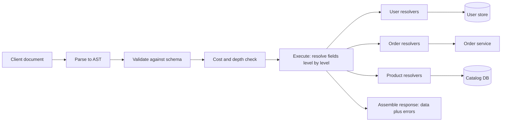
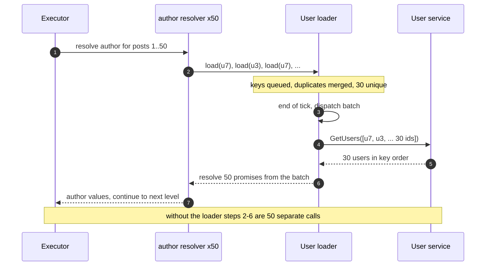
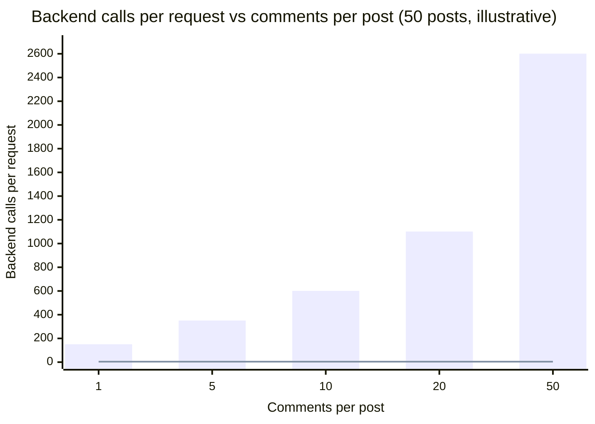
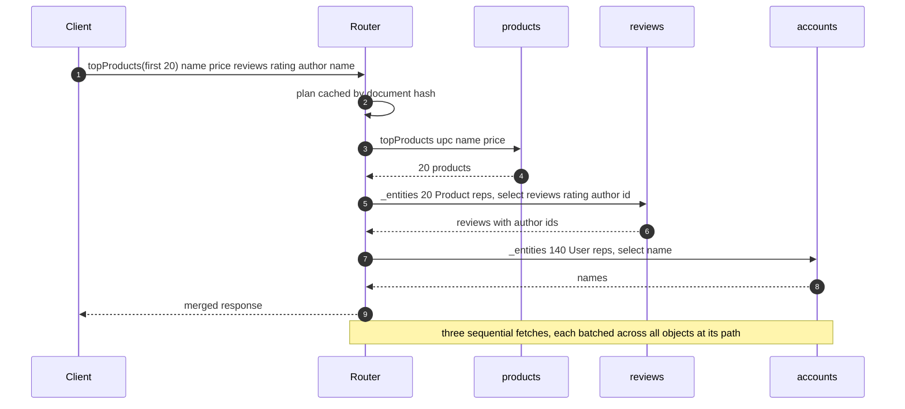
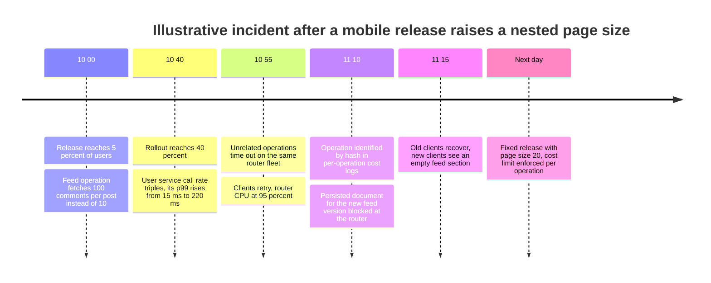

GraphQL is a query language and execution model for APIs, specified by the GraphQL Foundation (the current edition is September 2025). A server publishes a typed schema describing the objects it can return and how they connect; a client sends a document naming exactly the fields it wants, nested to any depth the schema allows, and receives a JSON response with the same shape. One request to one endpoint replaces the sequence of resource fetches a REST client would issue to assemble a screen, and the client never receives fields it did not ask for.

The problem GraphQL solves is a mismatch between who knows what data is needed and who decides what is returned. In a resource API the server designer fixes each response in advance, so a mobile client gets too much on one endpoint and too little on another, and teams answer by adding bespoke endpoints per screen. GraphQL inverts this: the server fixes only what is possible, and each client decides what is actual. With many client types and many backend services, that removes a whole category of coordination between frontend and backend teams.

The core trade-off is that the server no longer knows its workload in advance. Every property that a resource API gets from a fixed set of URLs, namely a cache key per resource, a known cost per endpoint, a per-endpoint error rate, and a rate limit per call, must be rebuilt for a workload chosen by the client at request time. GraphQL buys client flexibility and fewer round trips; it pays with query cost control, caching, batching discipline in the resolver layer, and, once the graph spans services, a distributed query planner in the path of every request. Federation, the architecture that lets many teams each own part of one graph, adds organizational independence on top and charges for it in latency, partial failure, and schema governance.


*The request path of a single GraphQL server. Parse, validation and cost checks depend only on the document and the schema; execution is where backends are called.*

The diagram separates two phases with different properties. Everything left of execution is pure computation over the document and the schema: it can be cached by document hash, it rejects malformed or invalid requests before any backend sees them, and it is where an operator can bound the work a request may cause. Execution is the only phase that talks to backends, and its shape follows the query rather than any fixed code path, so a single change in a client's document can change which services are called and how many times. Most GraphQL production problems are a failure to move enough control into the left half.

## Execution Model: From Document to Response

### Schema, Operations, and What Validation Guarantees

A schema defines object types with typed fields, input types for arguments, enums, interfaces and unions, and three root types: `Query` for reads, `Mutation` for writes, and `Subscription` for event streams. A field's type can be wrapped as a list (`[Order]`) and as non-null (`Order!`); non-null is a promise to the client that the field will never be `null` in a successful response. An operation document selects fields from a root type, may pass variables, may give fields aliases so the same field can be requested twice with different arguments, and may reuse selection sets through fragments.

Validation checks the document against the schema before execution: every selected field exists on its type, arguments have the right types, variables are used consistently, fragments are used and do not form cycles, and leaf fields are scalars or enums. A document that passes validation is guaranteed to produce a response whose shape matches the query, which is what lets clients generate types from their documents and trust them. Validation does not bound cost. A valid document can nest connections ten levels deep, alias one expensive field a thousand times, or request lists of unbounded size; nothing in the specification's validation rules limits depth, breadth, or total work. That gap is closed by implementation-level controls covered below.

### Resolver Execution and Field-Level Errors

Execution walks the selection set. For each field the server calls a resolver, a function that receives the parent object, the field's arguments and a per-request context, and returns a value or a promise of one. When the value is an object, execution continues into that field's sub-selection with the value as the new parent; when it is a list, execution continues once per element. Resolution therefore proceeds level by level: all root fields, then the fields of their results, and so on. For queries, the specification allows sibling fields to be resolved in any order, including concurrently; for mutations, top-level fields are executed serially in document order, so `createOrder` finishes before `chargeOrder` starts.

Errors are per field, not per request. If a resolver throws, the server records an error with a message, the `path` to the field (for example `["user", "orders", 3, "total"]`) and the source location in the document, sets that field to `null`, and keeps resolving the rest. The response carries `data` and an `errors` list side by side. This is partial success by design: one failing backend degrades one part of a screen instead of the whole screen.

Non-null types change where that `null` lands. If a field declared `Money!` fails, it cannot be `null`, so the error propagates to its parent, which becomes `null` instead; if the parent is also non-null, propagation continues upward until it reaches a nullable field or the root, where `data` itself becomes `null`. The correctness argument is that the client's type contract is never violated: a client that reads `order.total` as non-null will never see `null` there, because the order object it would be reading is removed instead. The cost is that one failure deep in a tree can erase every sibling of every ancestor up to the nearest nullable boundary. Nullability is therefore a failure-isolation decision, not a data-modeling detail.

GraphQL also does not guarantee what a single SQL query would. Fields resolved by different resolvers read at different moments and often from different services, so a response is not a consistent snapshot: a `balance` and the `transactions` that explain it may disagree if a write landed between the two reads. Nothing in the execution model provides isolation across fields.

:::caution[Serial mutations are not a transaction]
Two top-level mutation fields in one document run in order, but if the second fails the first stays committed, and the response reports one success and one error. GraphQL has no rollback across fields. A multi-step write that must be atomic belongs in a single mutation field whose resolver owns the transaction or the [saga](/distributed-systems/en/coordination/distributed-transactions/saga-pattern/), and a mutation that may be retried after a timeout needs an [idempotency key](/distributed-systems/en/communication/api-gateway/idempotency/) like any other non-idempotent call.
:::

### Transport: One Endpoint, One Status Code

GraphQL is transport-independent, but nearly all deployments use HTTP: a `POST` with a JSON body carrying `query`, `operationName` and `variables`, or a `GET` with the same values in the query string, which the GraphQL over HTTP draft specification permits only for queries, never for mutations. Historically servers answered `200 OK` for anything that produced a GraphQL response, including validation failures. The GraphQL over HTTP draft introduces the `application/graphql-response+json` media type with stricter semantics: `200` when the document was valid and execution was attempted, even if field errors occurred, and `4xx` when the request was malformed or failed validation. Shopify, for example, announced this behavior for its Admin API from version 2025-01. Under either media type, a backend outage that turns half the fields into errors is still a `200`.

That has two consequences outside the server. Every generic tool that judges health by HTTP status, from load balancer health checks to an API gateway's error-rate dashboard, sees success during a partial outage; error accounting has to read the `errors` array. And because every request goes to one path, per-endpoint metrics collapse into one series: the unit of observation must become the operation, identified by `operationName` or a document hash. Subscriptions usually travel over WebSocket using the `graphql-transport-ws` subprotocol of the graphql-ws library, which replaced the unmaintained `subscriptions-transport-ws`, or over Server-Sent Events; the connection-level behavior is that of [WebSocket and SSE](/distributed-systems/en/communication/synchronous-protocols/websocket-sse/), with a GraphQL selection applied to each event.

## The N+1 Problem and Batched Resolution

Field-by-field execution has a cost that the client does not see. Consider a query for 50 posts, each with its author. The `posts` resolver issues one query; then the `author` resolver runs 50 times, once per post, and if each call fetches one user, the server makes 51 backend calls where a hand-written endpoint would make two. Add the comments of each post and the author of each comment, and the count grows with the product of the list sizes at each level. This is the N+1 problem, and GraphQL makes it the default: resolvers are written to be independent of each other, so none of them knows that 49 siblings are about to ask the same service the same kind of question.

The standard fix is a batching loader, popularized by Facebook's DataLoader library for JavaScript and reimplemented in most server ecosystems (Java's java-dataloader used by Netflix DGS, Hot Chocolate's batch resolvers in .NET, graphql-batch in Ruby). Instead of calling the backend, a resolver calls `load(key)` and receives a promise. The loader collects every key requested during the current execution step, and when the step yields (in JavaScript, after the current tick of the event loop has drained its promise jobs), it calls a single batch function with all collected keys, for example `SELECT ... WHERE id IN (...)` or one `GetUsers` RPC, then resolves each pending promise with its result.


*One execution level with a batching loader. The loader turns 50 resolver calls into one backend call and deduplicates repeated keys.*

The diagram shows why the loader must be scoped to one request. In step 2 the loader also memoizes keys, so `u7` requested twice is fetched once and every later `load(u7)` in the same request returns the cached value. That cache is correct only inside one request: shared across requests it would serve one user's authorization-filtered view to another and would hold values long after they changed. A loader is created per request in the context object and discarded with it; it is a batching and deduplication device, not a cache in the sense of [Cache Strategies](/distributed-systems/en/data-management/distributed-caching/cache-strategies/).

Two contract details decide whether batching is correct. The batch function must return one result per key in the same order as the keys, with an explicit error or empty marker for missing keys; a backend that returns rows in arbitrary order or silently drops missing IDs will attach the wrong author to a post. And batching works only for keys requested in the same step: authors of posts and authors of comments are at different levels, so they form two batches. Batching collapses breadth, not depth: a query five levels deep still costs five sequential rounds.

### Worked Example: A Feed Query With and Without Batching

Assume a feed query that returns 50 posts, each with its author and its first 10 comments, each comment with its author. Assume each backend call takes 4 ms, each request may hold at most 16 concurrent backend calls, and the API serves 300 such queries per second. All numbers are illustrative.

Without batching, the server makes 1 call for posts, 50 for post authors, 50 for comment lists, and 500 for comment authors: 601 calls per request. Execution has three sequential levels. Level one is one call (4 ms). Level two is 100 calls in waves of 16, seven waves or 28 ms. Level three is 500 calls, 32 waves or 128 ms. The query takes about 160 ms of backend time, and at 300 queries per second the user service receives 550 × 300 = 165,000 calls per second.

With batching, each level issues one call per distinct loader: posts (1), then authors and comment lists in parallel (2), then comment authors (1), four calls in total. The batch calls are larger, say 6 ms for 50 keys and 8 ms for 500, so the query takes about 4 + 6 + 8 = 18 ms. The user service receives 2 × 300 = 600 calls per second, each carrying more keys. Batching does not remove the work of fetching 500 author records; it removes 549 per-call overheads (connection checkout, request parsing, network round trip, query planning on the backend), which at these rates is the difference between a service that needs hundreds of instances and one that needs a few.


*Bars: unbatched resolvers, 1 + 50 + 50 + 50k calls. Line: batched resolvers, one call per loader per level regardless of list size.*

The unbatched count grows linearly with the inner list size and multiplicatively with each additional nested list, while the batched count depends only on the number of levels and loaders. That is why N+1 regressions are invisible in development, where lists have three elements, and appear in production as a sudden step in backend call rate when a client raises a page size or adds one nested field.

## Bounding a Client-Chosen Workload

Because the client chooses the query, the server must decide before execution whether the query is affordable. Four mechanisms are used, usually in combination, and they bound different things.

Depth limits reject documents nested beyond a fixed number of levels. They are cheap and stop the crudest recursive queries (`user { friends { friends { friends ... } } }`), but they say nothing about breadth: a query of depth three that requests 100 elements at each level touches a million nodes.

Static cost analysis estimates the work from the document and the schema. Each field has a weight, and each list multiplies its sub-selection's cost by the requested page size or an assumed size. GitHub's public API states its rule precisely: every connection must have a `first` or `last` argument between 1 and 100, one call may not request more than 500,000 nodes, and the rate-limit cost of a query is the number of backend requests needed to fill every connection to its limit, divided by 100. GitHub's own example, 100 repositories with 50 issues each and 60 labels per issue, needs 1 + 100 + 5,000 = 5,101 requests and costs 51 points against a budget of 5,000 points per hour for a user. Shopify's Admin API weighs objects at 1, scalars and enums at 0 and mutations at 10, rejects any single query whose requested cost exceeds 1,000 points, and refills each app's leaky bucket at a rate that depends on the store's plan (100 points per second on the standard plan); the response's `extensions.cost` reports requested and actual cost, and the difference is refunded after execution. Apollo Router's demand control follows the IBM GraphQL Cost Directive specification with similar defaults and lets schema authors override weights with `@cost` and list sizes with `@listSize`.

Rate limiting by cost rather than by request count is the consequence. A gateway that counts HTTP requests, as described in [Throttling and Rate Limiting at the Gateway Level](/distributed-systems/en/communication/api-gateway/throttling-rate-limiting/), sees one request where a document with 500 aliased `login` mutations attempts 500 password guesses, or where a nested query does the work of 5,000 REST calls. The bucket must be denominated in cost units, with the algorithm itself unchanged from the token bucket covered in [Rate Limiting](/distributed-systems/en/resilience/flow-control/rate-limiting/).

Execution timeouts are the backstop for whatever the estimate misses: GitHub terminates queries that take longer than 10 seconds and charges extra points for them. A timeout bounds damage per request but not per client, which is why it complements cost limits rather than replacing them.

Trusted documents, also called persisted queries or an operation allowlist, remove the problem for first-party clients. At build time, every operation in the client's code is extracted, hashed and registered with the server; at run time the client sends only the hash, and the server executes only registered documents. Arbitrary queries are rejected outright, so the workload is a known, finite set of operations whose cost can be measured in advance. Automatic Persisted Queries (APQ), Apollo's protocol in which the client sends a SHA-256 hash first and the full text only after a `PersistedQueryNotFound` error, look similar but register any document on first use: APQ saves request bytes and enables `GET` caching, and provides no protection at all.

| Control | What it bounds | What it misses | When to prefer |
|---|---|---|---|
| Depth limit | Recursive nesting | Breadth, aliases, list sizes | Always, as a cheap first filter |
| Mandatory pagination plus node limit | Total nodes per request | Expensive individual fields | Public APIs with connection-based schemas |
| Static cost analysis | Estimated work before execution | Real list sizes and per-field latency | Public or partner APIs; rate limiting by cost |
| Actual cost accounting | Work actually done | Nothing before the fact | Refunds and billing on top of static estimates |
| Execution timeout | Worst-case time per request | Cumulative cost per client | Always, as the backstop |
| Trusted documents | The set of operations that can run | Third-party clients | First-party web and mobile clients |

The table's rows are layers rather than alternatives. A public API needs static cost limits because it cannot allowlist unknown clients; a first-party API should allowlist because no cost model is as precise as a fixed set of measured operations.

```yaml
# Apollo Router: estimate cost before subgraph calls, start in measure mode
demand_control:
  enabled: true
  mode: measure          # log cost.estimated / cost.actual, reject nothing yet
  strategy:
    static_estimated:
      list_size: 10      # assumed size of lists without @listSize
      max: 1000          # reject estimated cost above this once mode: enforce
```

Under these defaults the feed query above costs 50 × (1 + 1 + 10 × (1 + 1)) = 1,100 if the schema declares the page-size arguments with `@listSize`: each post is an object (1), its author another (1), and each of its 10 comments contributes itself and its author. It would be rejected at `max: 1000` in enforce mode. Running in `measure` mode first, and comparing the `cost.estimated` and `cost.actual` instruments the router emits, shows how far the model's assumed list sizes are from real ones before any client is refused.

:::tip[Allowlist first-party clients, cost-limit the rest]
For an API consumed only by your own web and mobile apps, trusted documents turn GraphQL's open workload into a closed set of operations that can be load-tested, cost-measured and cached individually. Keep a separate endpoint or token class for third-party clients that are allowed arbitrary documents, and put the cost model only in front of that one.
:::

### Caching When Every Request Is a POST

HTTP caching, as described in [REST: Constraints, Resources, and HTTP Contracts](/distributed-systems/en/communication/synchronous-protocols/rest/), keys stored responses by method and URI; a `POST` to `/graphql` is not cacheable by shared caches at all. Three layers recover parts of it. Sending queries as `GET`, with a persisted-document hash instead of the full text to keep URLs short, makes responses cacheable by CDNs again, and the server can compute `Cache-Control` for a response as the minimum `max-age` across the fields it contains, marking the whole response `private` if any field is user-specific (Apollo Server's cache-control hints work this way). Inside the server, resolvers can cache backend results by entity key with ordinary [invalidation](/distributed-systems/en/data-management/distributed-caching/cache-invalidation/) rules. On the client, normalized caches in Apollo Client and Relay split responses into entities keyed by `__typename` and `id`, so a mutation that returns an updated object updates every screen that displays it.

The CDN layer has the sharpest edge. A query whose selection mixes a public product with the viewer's cart, sent as `GET` and cached with a public directive, serves one user's cart to the next user who sends the same hash. The cache key must include whatever identifies the viewer, or the response must be `private`, and the safe default is that a response is shared-cacheable only if every field in it is explicitly declared public.

## Federation: One Graph Across Many Services

A single GraphQL server in front of many backends works until the schema becomes the integration point for dozens of teams. Every field change goes through one codebase, one deploy pipeline and one owning team, and the GraphQL layer turns into the monolith that the backends were split to avoid. Netflix described this situation with its Studio API in 2020: the aggregation layer had effectively become a monolith, and the response was to federate it so that each domain team owns its part of the graph behind a gateway written in Kotlin.

Two architectures split a graph. Schema stitching, popularized by The Guild's graphql-tools, lets a gateway import several independent schemas and declare in gateway configuration how their types merge; the merge logic lives with the gateway team. Federation, introduced by Apollo and now implemented by several vendors, moves that knowledge into the services: each service publishes a subgraph schema that declares which types it contributes to and how they are identified, and a composition step merges the subgraphs into a supergraph schema that a router serves. The difference is ownership of the joins. In stitching, the gateway team writes them; in federation, each subgraph team declares its own, and composition checks them all at once.

### Entities, Keys, and Composition

The unit of federation is the entity: an object type that more than one subgraph contributes fields to, identified by a key. A subgraph marks a type with `@key(fields: "id")`, meaning that given an `id` it can produce its fields of that type. Another subgraph that wants to add fields to the same type declares the same type with the same key and its own fields, and implements a reference resolver that turns a key into an object.

```text
# products subgraph: owns Product and its catalog fields
type Product @key(fields: "upc") {
  upc: ID!
  name: String!
  price: Money
}

# reviews subgraph: adds reviews to Product without owning it
type Product @key(fields: "upc") {
  upc: ID!
  reviews(first: Int = 10): [Review!]!
}

type Review {
  rating: Int!
  author: User          # User is an entity owned by the accounts subgraph
}
```

Composition takes these subgraph schemas and produces the supergraph: one schema in which `Product` has `upc`, `name`, `price` and `reviews`, annotated with which subgraph can resolve each field and by which key. It fails if a field is defined by two subgraphs without being marked `@shareable` in Federation 2, if a key references a field the subgraph does not have, or if types disagree in ways no query plan could reconcile. Composition is the correctness argument of federation: if it succeeds, every field in the supergraph is reachable from a root field through a chain of entities whose keys at least one subgraph can produce, so the router can always build a plan. Further directives tune the joins: `@external` and `@requires` let a subgraph's resolver depend on fields owned by another subgraph, `@provides` declares that a subgraph can return some of another subgraph's fields along a specific path to save a fetch, and `@override` moves ownership of a field from one subgraph to another.

### Query Planning and Entity Fetches

For each incoming operation, the router builds a query plan, a tree of fetches against subgraphs combined with sequence and parallel nodes, and caches it by document. Each fetch is an ordinary GraphQL operation sent to one subgraph. When the plan crosses from one subgraph to another, the router collects the keys of every object found at that path in earlier results and sends them in a single `_entities(representations: [_Any!]!)` query, where each representation is a small object such as `__typename: "Product"` with `upc: "p1"`. The receiving subgraph resolves each representation through its reference resolver and returns the requested fields, and the router merges them back into the response at the right paths.


*Execution of a federated query plan. Each cross-subgraph hop is one batched entity fetch, so plan depth rather than list size sets the number of round trips.*

The plan in the diagram has three sequential steps because each depends on keys returned by the previous one: reviews need product keys, and author names need user keys from reviews. The router already batches at the plan level, so step 5 sends all 20 products in one request rather than 20. The subgraph must still batch inside its reference resolver: if the reviews subgraph resolves 20 representations by issuing 20 database queries, the N+1 problem has moved one layer down, and Apollo's own documentation recommends data loaders in reference resolvers for exactly this reason.

The plan's depth sets its latency floor. Assume each router-to-subgraph hop costs 1 ms of network time and each subgraph answers in 8 ms; the three-step plan costs about 27 ms before the router's own work, where a single server resolving the same fields in-process would pay one set of backend calls without the hops. Fan-out sets the tail. If each subgraph fetch independently exceeds 100 ms with probability 1%, a plan with six fetches meets at least one slow fetch with probability `1 - 0.99^6`, about 5.9%, so the router's 95th percentile approaches the subgraphs' 99th. Both numbers are illustrative; the shape is general, and it is the same tail amplification that [API Composition](/distributed-systems/en/microservice-patterns/data-management-patterns/api-composition/) analyzes for hand-written aggregators. Federation automates the join; it does not make it cheaper.

### Implementations and Where They Differ

Apollo's Federation 2 is the de facto standard: its subgraph protocol (the `_entities` and `_service` fields and the directives above) is implemented by subgraph libraries in most languages, and its router is written in Rust, with demand control, persisted documents and `@defer` support. Netflix runs federation with its open-sourced DGS framework for Java and Kotlin subgraphs. Other routers, such as The Guild's Hive Gateway, WunderGraph Cosmo, Grafbase and ChilliCream's Hot Chocolate Fusion, accept Apollo-style subgraphs to varying degrees and differ in planning strategy, supported directives and how they report subgraph errors, so a supergraph moved between routers needs its plans and error behavior retested. The GraphQL Foundation's Composite Schemas specification, which aims to standardize this model across vendors, is in its proposal stage, so the directive set is still vendor-defined.

Federation does not give cross-subgraph consistency. Each fetch reads one subgraph at one moment, a mutation field executes in exactly one subgraph, and there is no protocol for atomic writes across subgraphs. Incremental delivery with `@defer` and `@stream`, which lets a response stream slow fields after fast ones, is implemented by some servers and routers but is not part of the September 2025 edition of the specification, so client and server must agree on the implementation's wire format.

:::note[Where GraphQL ends and adjacent patterns begin]
A GraphQL server per client type is a [Backend for Frontend](/distributed-systems/en/communication/api-gateway/bff-pattern/) with a query language; a federated router is an [API gateway](/distributed-systems/en/communication/api-gateway/api-gateway-pattern/) whose routing table is the supergraph. Authentication, TLS termination and coarse rate limiting still belong at the edge; field-level authorization belongs in the subgraph that owns the field, because the router cannot know the domain rules behind it.
:::

## Failure Modes in GraphQL Systems

GraphQL failures share one property: they hide behind a `200` and a single endpoint, so detection depends on telemetry keyed by operation and by field. OpenTelemetry's semantic conventions name the span attributes for this (`graphql.operation.name`, `graphql.operation.type`, `graphql.document`), and routers emit per-subgraph fetch metrics; without them, every mode below appears only as a vague rise in latency on `/graphql`.

### Expensive Queries and Load Amplification

Trigger: a client release ships a document whose cost was never measured, such as a page size raised from 10 to 100 inside a nested connection, or an attacker sends deeply nested or heavily aliased documents. Symptoms: CPU and memory rise on GraphQL servers or the router, one backend receives a step change in call rate, and latency degrades for every operation sharing the fleet. Detection: cost histograms per operation (`cost.estimated`, `cost.actual`, or `extensions.cost` logs), backend calls per GraphQL request, the top operations by total backend time, and response size per operation.


*A hypothetical timeline showing the shape of a load-amplification incident; not a real incident.*

The timeline shows why per-operation identity is the recovery lever. The failing workload is one document among hundreds of healthy ones, and only a hash or operation name lets the operator block it without blocking the endpoint. With trusted documents, the block is a registry change; without them, it is a pattern match on query text that attackers and clients can vary at will. The retries at 10:55 are the familiar amplification of [retry storms](/distributed-systems/en/resilience/flow-control/retry-storms-metastable-failures/), and they hit unrelated operations because they share the router and backends, which is the case for per-operation concurrency limits or separate router pools for high-cost traffic in the spirit of the [bulkhead pattern](/distributed-systems/en/resilience/protection-patterns/bulkhead-pattern/). Mitigation: enforce cost limits, roll out client releases with their documents' measured cost reviewed, and block or degrade by operation. Recovery: once the document is blocked or the client rolled back, load falls immediately because nothing is queued in GraphQL itself; any backend that entered a metastable state needs load shed before it recovers.

### N+1 Regressions

Trigger: a new field is added with a resolver that calls a backend directly instead of through a loader, or a loader is accidentally created per resolver call instead of per request, which disables both batching and deduplication. Symptoms: backend call rate rises in proportion to list sizes, latency grows with page size, and the backend's per-call overhead dominates its CPU. Detection: the ratio of backend calls to GraphQL requests per operation, and traces in which one GraphQL span has hundreds of identical child spans, visible in any [distributed tracing](/distributed-systems/en/observability/logs-metrics-traces/distributed-tracing/) backend. Mitigation: route all entity access through request-scoped loaders, and add a test that executes representative operations against a counting backend and fails when the call count grows with list size.

### Null Propagation Erasing a Response

Trigger: a field backed by a separate service or subgraph is declared non-null, and that service fails. Symptoms: instead of one missing price, the whole product disappears; if products are in a `[Product!]!` list, the list's parent becomes `null`, and with non-null all the way up, `data` is `null` and the client shows an error page while every other backend is healthy. Detection: the share of responses with `data: null` per operation, and error paths that point to a single field across many responses. Mitigation: make fields nullable at every service or subgraph boundary and at any field whose resolver performs I/O that can fail independently, keep non-null for fields that are produced together with their parent from the same read, and let clients render partial data.

:::caution[Non-null is a promise across failure domains]
`price: Money!` on a type assembled from three subgraphs promises that the pricing service is never down. When it is, propagation turns a single-field failure into a missing parent, and possibly a missing page. Declare fields non-null only when they come from the same read as the object that contains them.
:::

### Federated Fan-Out and Plan Regressions

Trigger: a schema change moves a field to another subgraph or adds a `@requires` dependency, and the router's plan for a popular operation gains a sequential step or several parallel fetches. Symptoms: latency rises for operations whose documents did not change; one subgraph sees its entity call rate rise. Detection: plan depth and fetch count per operation, which routers can log, and per-subgraph fetch latency. Mitigation: review query plans of the most frequent operations as part of schema changes, co-locate fields that are always requested together in one subgraph, and use `@provides` where a subgraph can return a field along a known path.

### Breaking Changes Through Composition

Trigger: a subgraph removes a field, makes a nullable field non-null, narrows an argument type, or changes a key; composition may still succeed, but clients that select the field fail validation. Symptoms: one client version starts receiving validation errors (a `400` under the new media type, a `200` with errors under the legacy one) immediately after a subgraph deploy. Detection: validation error rate per client and operation, and field usage reports. Mitigation: run composition and breaking-change checks in each subgraph's CI against the operations observed in recent production traffic, deprecate with `@deprecated` and remove only after usage reaches zero, and treat the evolution strategy as part of [API versioning](/distributed-systems/en/communication/synchronous-protocols/api-versioning/): GraphQL's convention is a single evolving graph without version numbers, which works only if removals are gated on measured usage.

### Summary of Failure Signatures

| Failure | Symptom from outside | Detection signal | Mitigation |
|---|---|---|---|
| Expensive query | One operation degrades the whole fleet | Cost per operation; backend calls per request | Cost limits, trusted documents, block by hash |
| N+1 regression | Backend call rate scales with page size | Calls per GraphQL request; repeated child spans | Request-scoped loaders, call-count tests |
| Null propagation | Whole sections or pages empty on a single backend failure | Share of `data: null`; one error path dominating | Nullable fields at service boundaries |
| Plan regression | Latency rises for unchanged operations | Plan depth and fetch count per operation | Plan review in schema CI, field co-location |
| Composition break | Validation errors for one client version | Validation errors per client; field usage | Usage-gated removal, schema checks in CI |
| Shared-cache leak | Users see each other's data | Cache key review; private fields in public responses | `private` unless every field is public |
| Monitoring blind spot | Outage invisible on status-code dashboards | `errors` array rate vs HTTP error rate | Error metrics from response bodies, per operation |

The shared-cache leak is the only entry that exposes data rather than degrading service; it arises only when `GET` caching is enabled and a response mixes viewer-specific and public fields, and its prevention is the cache-scope rule from the caching section.

## Choosing GraphQL and Its Alternatives

| Approach | Who shapes the response | Caching | Cost control | When to prefer |
|---|---|---|---|---|
| GraphQL, single server | Client, within one schema | Client-normalized; HTTP only with `GET` and persisted documents | Cost analysis or allowlist required | Many client types reading overlapping data from a moderate number of backends owned by one or two teams |
| Federated GraphQL | Client, across subgraphs owned by many teams | Same, plus per-subgraph entity caching | Router-level cost limits; plan review | Many teams contributing to one product graph, with a platform team to run the router and schema governance |
| [REST](/distributed-systems/en/communication/synchronous-protocols/rest/) resources | Server designer, per resource | Full HTTP caching and conditional requests | Fixed per endpoint | Public and partner APIs, cacheable reads, clients that upgrade independently |
| REST or gRPC behind a [BFF](/distributed-systems/en/communication/api-gateway/bff-pattern/) | BFF team, per screen | HTTP caching at the BFF edge | Fixed per BFF endpoint | Few client types with distinct needs, where a team per client can own its aggregation |
| [gRPC](/distributed-systems/en/communication/synchronous-protocols/grpc-protocol-buffers/) | Service designer, per method | None from HTTP intermediaries | Fixed per method, deadlines built in | Internal service-to-service calls with strict latency budgets |

Use GraphQL when the dominant consumers are user interfaces that combine many entities per screen, when there are several client types whose needs diverge and change faster than backend teams can add endpoints, and when the organization can afford the controls: request-scoped batching in every resolver, cost limits or trusted documents, per-operation telemetry, and schema checks against real usage. Use federation on top of it only when the graph has outgrown one team's ability to own it and there is a platform team to operate the router, run composition in CI, and review plans for the operations that matter.

Do not use GraphQL for service-to-service calls inside the backend, where the caller's needs are known at design time and gRPC's fixed methods, deadlines and compact encoding fit better; for public APIs whose main value is cacheability at the edge, such as catalog or content APIs served through a CDN; for bulk export or streaming of large datasets, where pagination through a cost-limited graph is slower than a file or a stream (Shopify routes such work to separate bulk operations exempt from its query cost limits); for writes that need atomicity across entities, which GraphQL's mutation model does not provide; or as a substitute for service boundaries, since a graph laid over a [shared database](/distributed-systems/en/microservice-patterns/data-management-patterns/shared-database-antipattern/) inherits the coupling it hides. Do not adopt federation for a graph two teams could share in one repository: the router, the composition pipeline and the extra network hop per plan step are permanent costs, and the organizational problem they solve has to exist first.

## Further Reading

- GraphQL Foundation, *GraphQL Specification, September 2025 Edition*, spec.graphql.org, 2025.
- GraphQL Foundation, *GraphQL over HTTP*, working draft, graphql.github.io.
- Lee Byron et al., *DataLoader*, GitHub repository graphql/dataloader.
- Apollo Graph Inc., *Apollo Federation documentation: Entities, Composition, and Query Plans*, apollographql.com/docs.
- GitHub, *Rate limits and node limits for the GraphQL API*, docs.github.com.
- Netflix Technology Blog, *How Netflix Scales its API with GraphQL Federation*, Parts 1 and 2, 2020.
