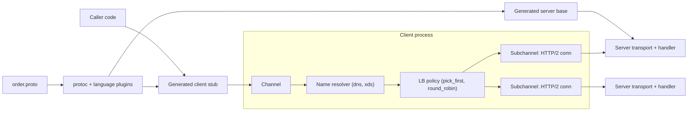
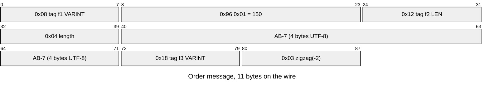
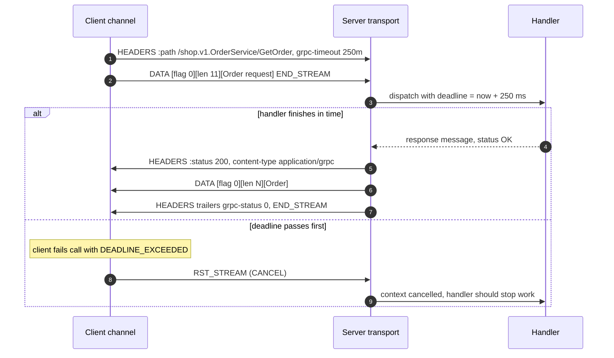
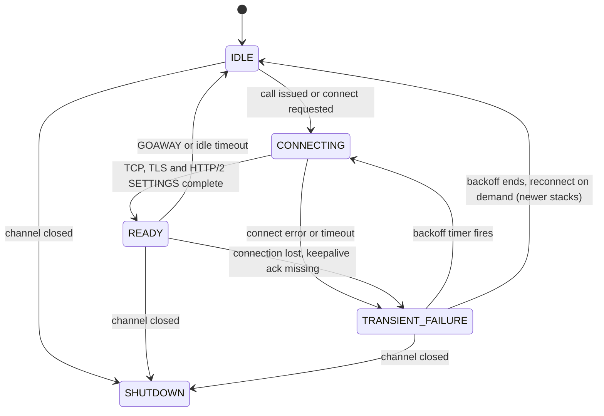
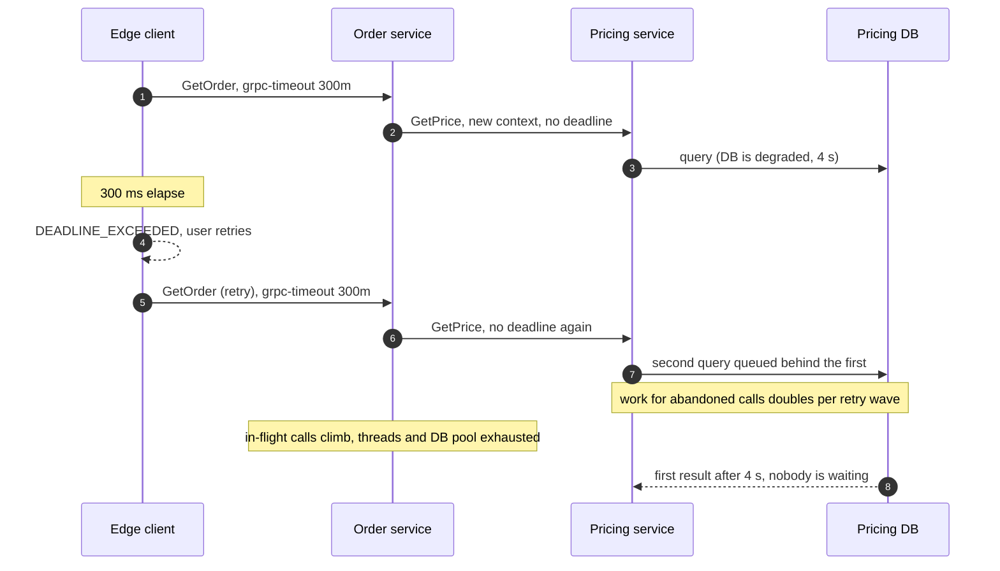

gRPC is a remote procedure call (RPC) framework: a service is described once as a set of typed methods in an interface definition language (IDL), a compiler generates client stubs and server skeletons for each language, and every call travels as one HTTP/2 stream carrying length-prefixed binary messages. Protocol Buffers (protobuf) is the IDL and the serialization format most gRPC services use. The pair exists because internal service-to-service traffic has different needs from public web APIs: calls are frequent, payloads are structured, both ends are owned by the same organization, and latency budgets are tight enough that the cost of text encoding, hand-written clients and ad hoc timeout handling becomes visible.

What the stack buys is a compact encoding with a precise compatibility contract, generated clients whose types cannot drift from the server's, and call semantics that HTTP alone does not define: a deadline that travels with the call, cancellation that propagates down a call tree, a closed set of status codes with retry meaning, and a client-side channel that resolves names, balances load and reconnects. What it costs is visibility. Payloads are opaque binary without the schema, every response carries HTTP status 200 with the real outcome in a trailer, HTTP caches and most web tooling cannot interpret the traffic, browsers cannot speak the protocol natively, and long-lived multiplexed connections defeat connection-level load balancers. The core trade-off is efficiency and contract strictness against interoperability with the generic HTTP ecosystem.

There is also a conceptual cost that predates gRPC. An RPC framework makes a remote call look like a local function call, and the resemblance is exactly where bugs come from: a local call cannot time out halfway, cannot execute twice, and cannot fail while its result is unknown. gRPC does not hide these facts; it encodes them in deadlines, status codes and retry rules, and the rest of this page is largely about reading them correctly. The HTTP/2 framing gRPC runs on (streams, flow control, GOAWAY) is covered in [HTTP/2 and HTTP/3](/distributed-systems/en/communication/synchronous-protocols/http2-http3-quic/) and is only referenced here; long-lived streaming calls are covered in [gRPC Streaming](/distributed-systems/en/communication/synchronous-protocols/grpc-streaming/).


*The gRPC stack. Code generation produces both ends from one schema; at runtime the channel, not the caller, decides which connection carries each call.*

Two separations in the diagram matter operationally. The schema is the single source of truth for both sides, so a type mismatch between client and server is a build error rather than a runtime surprise, provided both sides were built from compatible versions of the file; the rules for "compatible" are the subject of the next section. And the stub does not own a connection: it hands each call to a channel, which resolves the target name into addresses, keeps one HTTP/2 connection (a subchannel) per chosen address, and lets a load-balancing policy pick a subchannel per call. Almost every gRPC load-balancing and reconnection behavior described later lives in that channel.

## Protocol Buffers: Encoding and the Compatibility Contract

A protobuf message is encoded as a flat sequence of records, and each record is a key followed by a value. The key is called the tag and is computed as `(field_number << 3) | wire_type`: the low three bits say how to find the end of the value, the remaining bits say which field it is. Field names never appear on the wire. That single choice explains both the format's compactness and its main operational hazard: a decoder knows what a record means only through the schema it was compiled with.

Integers and tags use variable-length integers (varints). Each byte carries seven payload bits and uses its most significant bit as a continuation flag, with the least significant group first. The value 150 becomes `96 01`: the first byte has its continuation bit set and contributes the low seven bits, the second contributes the rest. Values below 128 take one byte, values below 16,384 take two, and a full 64-bit value takes up to ten. Tags are varints too, so fields numbered 1 to 15 have a one-byte tag and fields 16 to 2,047 a two-byte tag, which is why the most frequently set fields should get the lowest numbers.

The wire type is what lets any decoder skip any record. There are four live wire types: `VARINT` (0) for `int32`, `int64`, `uint32`, `uint64`, `sint32`, `sint64`, `bool` and `enum`; `I64` (1) for `fixed64`, `sfixed64` and `double`; `LEN` (2) for strings, bytes, embedded messages and packed repeated fields, followed by a varint length; and `I32` (5) for `fixed32`, `sfixed32` and `float`. Types 3 and 4 delimited the deprecated proto2 groups. Given the wire type, the end of the value is always computable without the schema: read a varint, read eight bytes, read a length and skip that many bytes, or read four bytes.


*A message with `order_id = 150` (field 1, int64), `sku = "AB-7"` (field 2, string) and `qty_delta = -2` (field 3, sint32), byte by byte.*

Three details in the layout are worth reading closely. The tag `0x12` is field 2 shifted left by three (`0x10`) with wire type 2, and the length byte that follows tells any decoder, including one that has never heard of field 2, exactly how many bytes to skip. The field `qty_delta` is declared `sint32`, which applies ZigZag encoding before the varint: 0, -1, 1, -2 map to 0, 1, 2, 3, so small negative numbers stay small. Had it been declared `int32`, the value -2 would be sign-extended to 64 bits and occupy ten bytes, making that one field larger than the rest of the message. And nothing in the bytes says "Order": the message type is known only from context, in gRPC from the method being called.

### Why Old and New Readers Can Coexist

The compatibility contract follows from the encoding. A reader built from an older schema that meets a tag it does not know uses the wire type to skip the value, and modern implementations keep the skipped bytes as unknown fields and write them back when the message is re-serialized, so a service that reads, modifies and forwards a message does not destroy fields added by a newer producer. A reader built from a newer schema that does not find a field it expects sees the field's default value. Together these give the two properties distributed deployments rely on: new fields can be added without coordinating every reader, and old fields can be removed if no reader still requires them. Neither property holds if a field number is reused, because the old reader will then interpret the new field's bytes with the old field's meaning.

Parsing has two further rules that matter in practice. For scalar and string fields, if the same field appears twice, the last value wins; for embedded messages, repeated occurrences are merged. Consequently, concatenating two serialized messages and parsing the result is equivalent to parsing both and merging them, which is what makes field-level overrides by appending possible, and also why a message cannot be validated by checking for duplicate tags. Field order on the wire is not guaranteed, and serialized bytes are not canonical: two equal messages can encode differently across languages or versions, so never hash or sign serialized protobuf and expect another implementation to reproduce the bytes.

Some type changes are wire-compatible because they share a wire type. `int32`, `uint32`, `int64`, `uint64` and `bool` are mutually readable, with truncation when a wide value is read into a narrow type; `sint32` and `sint64` are compatible with each other but not with the plain integer types, because ZigZag changes the bit pattern; `string` and `bytes` are compatible as long as the bytes are valid UTF-8; an embedded message is compatible with `bytes` holding its encoding. "Wire-compatible" means the bytes parse, not that the meaning is preserved: widening `int32` to `int64` is safe for new writers only after every reader has been upgraded, since an old reader truncates silently. How to enforce these rules across teams, including registry compatibility modes and breaking-change checks in CI, is covered in [Schema Evolution and Schema Registry](/distributed-systems/en/communication/async-messaging/schema-evolution-registry/).

```proto
syntax = "proto3";
package shop.v1;

message Order {
  int64 order_id = 1;                // 1-byte tag: hot fields get numbers 1-15
  string sku = 2;
  sint32 qty_delta = 3;              // ZigZag: -2 costs 1 byte, not 10
  optional uint32 discount_pct = 5;  // explicit presence: 0 differs from unset
  reserved 4;                        // deleted field: number may never be reused
  reserved "legacy_price";           // also block the name (JSON mapping uses it)
}

service OrderService {
  rpc GetOrder(GetOrderRequest) returns (Order);  // path /shop.v1.OrderService/GetOrder
}
```

### Presence, Defaults, and Enums

Proto3 originally gave scalar fields implicit presence: a field holding its default value (0, empty string, false) is not serialized at all, and a reader cannot tell "set to zero" from "not set". For a discount percentage, a balance or a boolean flag that defaults to true in the business sense, that ambiguity turns into bugs where a deliberate zero is treated as "keep the old value" by a partial-update handler. The `optional` keyword restores explicit presence and generates a has-method; it was available behind an experimental flag from protobuf 3.12 and enabled by default from 3.15. Protobuf Editions, generally available from `protoc` 27.0 in 2024, replace the proto2/proto3 split with per-file and per-field features; Edition 2023 defaults to explicit presence, packed repeated scalars and open enums. Message-typed fields always had presence.

Enums carry a similar trap. Proto3 requires the first value to be zero and uses it as the default, so it should be an explicit `..._UNSPECIFIED` value rather than a meaningful state; otherwise every message from a producer that never set the field reads as that state. Proto3 enums are open: a reader that receives a numeric value it does not know keeps the number, and application code must handle a value outside its switch statement. Proto2 enums are closed and move unknown values into the unknown-field set, which means the field reads as unset. Adding an enum value is therefore a compatible change on the wire and a potentially incompatible one in the business logic of every consumer.

:::danger[Reusing a field number corrupts data silently]
If field 4 was `int64 price_cents` and is later reused as `int64 warehouse_id`, old binaries keep reading warehouse IDs as prices. Both use wire type 0, so nothing fails to parse: no error, no log line, just wrong values written into databases and forwarded to other services. Mark deleted fields with `reserved` for both the number and the name, and run a breaking-change checker on every schema change. Renumbering fields "to tidy up" is the same bug.
:::

### Worked Example: What the Encoding Saves

Assume an illustrative cart response with 100 line items, each holding a product ID around 1.2 million, a small quantity, a price in cents around 2,000, and a 10-character SKU. In protobuf each item costs 4 bytes for the product ID (1-byte tag plus 3-byte varint), 2 for the quantity, 3 for the price and 12 for the SKU (tag, length, 10 bytes), 21 bytes in total; wrapped as a repeated embedded message it adds a tag and a length byte, so the response is 100 x 23 = 2,300 bytes. The equivalent compact JSON under protobuf's canonical JSON mapping, which encodes 64-bit integers as strings so JavaScript clients do not lose precision, is 8,011 bytes, about 3.5 times larger, because every item repeats four field names and spells numbers in decimal.

At an assumed 20,000 responses per second, that is roughly 1.28 Gbit/s of JSON payload against 0.37 Gbit/s of protobuf before compression and framing. gRPC then adds 5 bytes of message prefix and 9 bytes of HTTP/2 DATA frame header per frame, and HPACK reduces repeated headers to a few bytes per call. Compression narrows the size gap substantially, since JSON field names compress well, but it moves the cost into CPU on both ends. The size is the visible half; the less visible half is parsing: a JSON parser scans every byte, handles escapes and converts decimal text to integers, whereas a protobuf parser reads a tag, dispatches on the field number and copies or decodes the value. The real ratio depends on language and library, so measure your own payloads rather than adopting someone else's benchmark; what the arithmetic establishes is that for small, number-heavy messages the field names, not the data, dominate JSON's size.

## gRPC on the Wire: One Call, One HTTP/2 Stream

A gRPC call is an HTTP/2 request with a fixed shape. The request headers are `:method POST`, a `:path` of `/package.Service/Method`, `content-type: application/grpc` (optionally `+proto` or `+json`), and `te: trailers`, which exists so that a proxy that cannot forward trailers is detected rather than silently breaking calls. Optional headers carry the timeout (`grpc-timeout`), the message compression codec (`grpc-encoding`, with `grpc-accept-encoding` listing what the sender accepts), and application metadata. Metadata keys ending in `-bin` carry binary values in base64; all other values must be printable ASCII; names beginning with `grpc-` are reserved. Implementations commonly cap header and trailer size, with 8 KiB suggested by the specification, which is why large tokens in metadata eventually fail calls with `RESOURCE_EXHAUSTED` or `INTERNAL`.

The body is a sequence of length-prefixed messages: one byte flagging whether this message is compressed, four bytes of big-endian length, then the serialized message. The prefix is what decouples gRPC messages from HTTP/2 frames: a message can span several DATA frames and a frame can contain parts of two messages, and the receiver reassembles by the declared length. A unary request is exactly one message followed by END_STREAM; streaming calls send many messages on the same stream, which is why gRPC's four method kinds (unary, server streaming, client streaming, bidirectional) need no protocol changes, only different numbers of messages in each direction.


*A unary call. The outcome travels in trailers after the body; on deadline expiry the client cancels the stream and the server's handler learns of it through its call context.*

The response follows the same pattern in reverse: initial headers with `:status 200`, zero or more messages, then a trailing HEADERS frame with END_STREAM carrying `grpc-status`, an optional percent-encoded `grpc-message`, and optionally `grpc-status-details-bin`, a serialized `google.rpc.Status` with structured error details. A call that fails before producing any message uses a Trailers-Only response, a single HEADERS frame containing both the HTTP status and the gRPC status. Status goes in trailers because a streaming server does not know the outcome when it starts sending; the price is that intermediaries looking only at `:status` see 200 for every failed call. In step 7, END_STREAM on the trailers frame is what closes the call: a stream that ends without `grpc-status` is a protocol error, and the client synthesizes a status for it, as described in the failure section.

In the cancellation branch, the client sends RST_STREAM with code CANCEL. The server's transport marks the call cancelled and the handler's context or cancellation token fires, but the handler code must check it: a handler that is blocked in a database query without passing the context along keeps running to completion and throws the result away. HTTP/2 error codes map to gRPC statuses in a defined way. `REFUSED_STREAM` maps to `UNAVAILABLE` and guarantees the server did not process the stream, so it is safe to retry; GOAWAY tells the client which streams above the last accepted identifier were never processed, which the [HTTP/2 page](/distributed-systems/en/communication/synchronous-protocols/http2-http3-quic/) explains; `ENHANCE_YOUR_CALM` maps to `RESOURCE_EXHAUSTED`.

The default protocol requires HTTP/2 end to end with trailers, which browsers' fetch APIs do not expose. gRPC-Web is a variant that encodes trailers inside the response body and works over HTTP/1.1 or HTTP/2; it needs a translating proxy such as Envoy's gRPC-Web filter or a server that implements it natively, and it does not support client or bidirectional streaming from browsers. The Connect protocol, from Buf, defines a simpler HTTP mapping alongside support for gRPC and gRPC-Web in the same server. Transcoding, where a proxy or library maps annotated methods to REST-style JSON endpoints (the `google.api.http` annotation), is a third route for exposing the same service to clients that cannot speak gRPC.

## Deadlines, Cancellation, and Status Codes

### Deadline Propagation

A deadline is an absolute point in time by which the caller no longer wants the answer. gRPC converts it to a relative timeout for the wire: `grpc-timeout` carries a positive integer of at most eight digits followed by a unit (`H`, `M`, `S`, `m`, `u`, `n`), so `250m` means 250 milliseconds. The server adds the timeout to its own clock on receipt and gets a local deadline. Sending a duration rather than a timestamp makes propagation immune to clock skew between hosts; the price is that the network transit time is not subtracted, so each hop's deadline is later than the true one by one-way latency, typically well under a millisecond inside a region and irrelevant at the precision deadlines are set.

When a server handler makes an outgoing call using the context of the incoming call, the outgoing call inherits the remaining time. Java and Go propagate this automatically when the context is passed; C++ requires enabling it explicitly. The invariant that propagation provides is that no downstream call is given more time than the original caller is still willing to wait, so a tree of calls cannot outlive the request that started it, provided every hop passes the context and every handler honors cancellation. Without a deadline, gRPC waits indefinitely: the default is no deadline at all.

Assume a client at the edge sets 300 ms. The gateway spends 10 ms on authentication and calls the order service with roughly 290 ms remaining; the order service spends 40 ms on a database read and calls the pricing service with roughly 250 ms remaining. If pricing is overloaded and slow, its handler sees its own context expire at about the same instant the edge client gives up, and every hop in the tree is cancelled within a millisecond of each other instead of continuing to do work for a response nobody will read. Contrast this with fixed per-hop timeouts of 300 ms each: pricing could still be working 600 ms after the client gave up, holding a database connection and a worker thread. How to choose the numbers themselves, including per-attempt versus end-to-end budgets, is covered in [Timeouts](/distributed-systems/en/resilience/protection-patterns/timeouts/).

:::caution[No deadline is the default]
A gRPC call without a deadline can wait forever, and every hung call holds a stream, a goroutine or thread, buffers and often a database connection on each hop. Set a deadline on every outgoing call, including calls made inside handlers, and pass the incoming context so the remaining budget propagates. A server can enforce a ceiling with an interceptor that rejects or caps calls arriving without `grpc-timeout`.
:::

### Status Codes as a Retry Contract

gRPC has seventeen status codes, from `OK` (0) to `UNAUTHENTICATED` (16). The library itself generates only a subset; codes such as `INVALID_ARGUMENT`, `NOT_FOUND`, `ALREADY_EXISTS`, `FAILED_PRECONDITION`, `ABORTED`, `OUT_OF_RANGE` and `DATA_LOSS` are produced only by application code. Their value is that clients, proxies and retry policies can act on them without parsing messages, but only if services use them precisely: a service that returns `UNKNOWN` for validation errors, or `INTERNAL` for overload, sabotages every retry policy and dashboard downstream.

| Code | Typical origin | Meaning for the caller | Retry? |
|---|---|---|---|
| `UNAVAILABLE` (14) | Library: connection failure, GOAWAY, no ready subchannel; server: overload | Not processed, or transiently unable | Yes, with backoff; the default retryable code |
| `DEADLINE_EXCEEDED` (4) | Library: deadline expired | Outcome unknown; the server may have completed the work | Only if idempotent and budget remains |
| `CANCELLED` (1) | Library: caller cancelled | Caller no longer wants the result | No |
| `RESOURCE_EXHAUSTED` (8) | Library: message too large, header limits; server: quota | Request rejected for size or quota | Not for size; for quota only after pushback |
| `UNIMPLEMENTED` (12) | Library: unknown method or service | Client and server schemas disagree | No |
| `INTERNAL` (13) | Library: protocol or parse error; server: bug | Something is broken | No |
| `ABORTED` (10) | Application: concurrency conflict | Retry the whole read-modify-write cycle | At a higher level |
| `FAILED_PRECONDITION` (9) | Application: state forbids the operation | Do not retry until state changes | No |

The table encodes the most frequent misreading: `DEADLINE_EXCEEDED` does not mean the server failed. It means the client stopped waiting, and the server may have committed the write a microsecond later. Automatic retry is safe for `UNAVAILABLE` because the library uses it for cases where the request was not processed or the server declared itself unable to start; for anything else, retry safety depends on the method being idempotent, which is the subject of [Idempotency and Safe HTTP Methods](/distributed-systems/en/communication/api-gateway/idempotency/).

### Built-in Retries and Hedging

gRPC distinguishes three kinds of retry. Transparent retries happen without any configuration when the library is certain the server application never saw the call: unlimited times if the call never left the client, once if it reached the server library but not the handler. Configured retries follow a per-method policy in the service config with `maxAttempts`, an exponential backoff (`initialBackoff`, `maxBackoff`, `backoffMultiplier`, with plus or minus 20% jitter) and a list of `retryableStatusCodes`. Hedging sends additional copies of a call after a `hedgingDelay` without waiting for the first to fail, and takes the first successful response. Both retry and hedging policies treat values of `maxAttempts` above 5 as 5, and the attempt count includes the original call.

A call is committed once the client receives response headers: from then on it will not be retried, because a partial response may already have reached the application. The overall deadline bounds all attempts together, and a server can send `grpc-retry-pushback-ms` in its trailers to ask for a specific delay or, with a negative value, for no retry. Retry throttling is a per-server token bucket: each failed call with a retryable status subtracts one token, each success adds `tokenRatio`, and when the bucket falls below half of `maxTokens` retries stop until it recovers. This is the mechanism that keeps a failing backend from receiving a multiplied load, and it is off unless configured.

```json
{
  "methodConfig": [{
    "name": [{ "service": "shop.v1.OrderService", "method": "GetOrder" }],
    "timeout": "0.3s",
    "waitForReady": false,
    "retryPolicy": {
      "maxAttempts": 3,
      "initialBackoff": "0.05s",
      "maxBackoff": "0.5s",
      "backoffMultiplier": 2,
      "retryableStatusCodes": ["UNAVAILABLE"]
    }
  }],
  "retryThrottling": { "maxTokens": 10, "tokenRatio": 0.1 },
  "loadBalancingConfig": [{ "round_robin": {} }]
}
```

The service config can be supplied by the client application or delivered through name resolution, which lets the service owner rather than every caller decide timeouts, retries and balancing. The snippet shows all three knobs together: a default deadline for callers that set none, at most two retries on `UNAVAILABLE` only, a throttle that cuts retries off when more than roughly one call in ten fails, and per-call balancing across all resolved addresses. `waitForReady: false` is the default "fail fast" behavior: a call made while the channel has no ready connection fails immediately with `UNAVAILABLE` instead of queueing until the deadline. The general theory of backoff and jitter is covered in [Retry with Exponential Backoff](/distributed-systems/en/resilience/protection-patterns/retry-exponential-backoff/).

## Channels: Connections, Keepalive, and Load Balancing

### Subchannel Connectivity

Each subchannel is a state machine over one transport connection, and the channel's own state aggregates its subchannels'. The states decide whether a call is sent, queued or failed.


*Connectivity states of a gRPC subchannel. Calls are sent only on READY; in TRANSIENT_FAILURE, fail-fast calls fail with UNAVAILABLE and wait-for-ready calls queue.*

The loop between `TRANSIENT_FAILURE` and `CONNECTING` is governed by gRPC's connection backoff: the first retry comes after 1 second, each failure multiplies the delay by 1.6 up to 120 seconds, a jitter of plus or minus 20% spreads clients apart, and each attempt gets at least 20 seconds to connect. The backoff resets only when the server's SETTINGS frame arrives, that is, when a connection actually succeeds at the HTTP/2 level, not when TCP connects. Two consequences follow. A backend that comes back after a two-minute outage is not used by every client immediately; some clients are in the middle of a 60- to 120-second wait. And a server that accepts TCP but fails during TLS keeps clients in growing backoff, which looks like "the service is up but nobody connects to it".

A transition from READY to IDLE on GOAWAY is the mechanism that makes graceful server shutdown and connection recycling work: the subchannel stops sending new calls on the draining connection, lets in-flight calls finish, and reconnects on the next call, which also triggers name re-resolution in most implementations. This is where server-side `MAX_CONNECTION_AGE` (in grpc-go, `MaxConnectionAge` with plus or minus 10% jitter and a separate grace period) comes in: by ending each connection after a bounded age, a server forces clients to re-resolve and reconnect periodically, so newly added backends receive traffic without any client-side change.

### Keepalive and Its Enforcement

gRPC uses HTTP/2 PING frames to detect dead connections that TCP would not report for minutes, for example after a NAT or a load balancer silently dropped idle state. A client with keepalive enabled sends a PING after `KEEPALIVE_TIME` of inactivity and closes the transport if no acknowledgement arrives within `KEEPALIVE_TIMEOUT` (20 seconds by default); client keepalive is disabled by default in gRPC core. Servers defend themselves against clients that ping too often: by default a server expects at least 5 minutes between pings when there is no data, and refuses pings on connections with no active calls. After two "ping strikes", the server sends GOAWAY with `ENHANCE_YOUR_CALM` and the debug data `too_many_pings` and closes the connection. A client keepalive of 30 seconds against a server with default enforcement is therefore a configuration that destroys connections every few minutes; the client and server settings must be chosen together, and on intermediaries such as cloud load balancers the client keepalive must be shorter than the intermediary's idle timeout.

:::tip[Configure keepalive from the server's side first]
Decide the server's enforcement policy (`MIN_RECV_PING_INTERVAL_WITHOUT_DATA` and whether pings without calls are permitted), then set every client's keepalive time above that minimum. When the path has an intermediary with an idle timeout, the client keepalive must sit between the server minimum and that timeout; if no such window exists, relax the server enforcement rather than the client. Logs showing `too_many_pings` or GOAWAY with `ENHANCE_YOUR_CALM` mean these settings disagree.
:::

### Where Balancing Happens

An HTTP/2 connection carries thousands of calls, so a connection-level (layer 4) balancer that distributes connections, such as a Kubernetes ClusterIP Service, distributes almost nothing: each client pins all its calls to the one backend it connected to, and new backends receive traffic only from new clients. The general mechanism and its symptoms are described on the HTTP/2 page under connection concentration; gRPC offers three ways out. A layer 7 proxy (Envoy, Linkerd, a gRPC-aware cloud load balancer) terminates the client's connection and balances per call, at the cost of an extra hop. Client-side balancing uses a resolver that returns all backend addresses, such as DNS for a Kubernetes headless Service, and the `round_robin` or weighted policies inside the channel; the default `pick_first` policy connects to a single address and is unsuitable for this. Lookaside balancing has the client fetch endpoints and policy from a control plane over the xDS protocols, which is how proxyless gRPC service meshes work. The trade-offs among these, including who owns the endpoint list and health state, are covered in [Client-Side vs. Server-Side Load Balancing](/distributed-systems/en/communication/load-balancing/client-vs-server-side/) and [Envoy Proxy](/distributed-systems/en/service-mesh/service-mesh-architecture/envoy-proxy/).

DNS-based client balancing has its own lag: gRPC resolvers re-resolve mainly when a connection fails or is closed, not on a timer that follows DNS TTLs, so a scale-out is invisible to existing clients until something closes a connection. `MAX_CONNECTION_AGE` on the server is the usual answer, and it is safe for in-flight calls only because closure goes through GOAWAY.

## Production Trade-offs Against Other Contracts

gRPC competes with other ways of defining service contracts, and the right choice depends on who the clients are and what sits between them and the server.

| Approach | Contract and encoding | Strengths | Costs | When to prefer |
|---|---|---|---|---|
| gRPC + protobuf | IDL with codegen; binary length-prefixed messages over HTTP/2 | Compact encoding, typed clients, deadlines, status codes, streaming, built-in retries and balancing | Opaque to HTTP caches and generic tools; needs HTTP/2 with trailers end to end; L4 balancing breaks | Internal, high-rate, latency-sensitive calls between services owned by teams that share a schema repository |
| [REST](/distributed-systems/en/communication/synchronous-protocols/rest/) + JSON | Resources and HTTP semantics; text payloads; optional OpenAPI | Universal clients, HTTP caching, readable traffic, mature edge tooling | Larger payloads, hand-maintained or generated clients, no standard deadline propagation | Public and partner APIs, cacheable reads, browser clients |
| gRPC-Web / Connect | Same protobuf contract; HTTP mapping that browsers and HTTP/1.1 can carry | One schema for backend and web clients | Translation proxy or special server; limited streaming from browsers | Web frontends of a gRPC backend without a separate REST layer |
| [GraphQL](/distributed-systems/en/communication/synchronous-protocols/graphql/) | Typed schema; client-chosen query shape; JSON | Client-shaped aggregation, fewer round trips for UI | Query cost control, caching and N+1 resolution are hard | Product UIs aggregating many backend entities |
| Apache Thrift | IDL with codegen; binary or compact protocols over several transports | Similar efficiency, older ecosystems | Smaller ecosystem, no HTTP/2 semantics by default | Existing Thrift estates; rarely chosen for new systems |

The table hides one decisive question: does the call path contain components that do not understand gRPC? Every gRPC failure is an HTTP 200, so an API gateway's error-rate dashboard, a CDN, or a WAF that judges health by HTTP status sees perfect success during an outage unless it reads `grpc-status`. Tooling closes much of the gap (server reflection lets `grpcurl` call services without local `.proto` files, and gRPC's OpenTelemetry metrics such as `grpc.client.attempt.duration` and `grpc.server.call.duration` carry `grpc.method` and `grpc.status` attributes), but each tool in the path has to be gRPC-aware, and that is a real operating cost.

The second hidden question is schema governance. Generated clients make the schema a shared artifact across teams and repositories. Organizations that adopt gRPC without a schema registry or a central repository, a breaking-change check and a versioning convention end up with diverging copies of the same `.proto` file, which removes the contract strictness that motivated the choice. Package-level versioning (`shop.v1`, `shop.v2`) and its alternatives are discussed in [API Versioning Strategies](/distributed-systems/en/communication/synchronous-protocols/api-versioning/).

## Failure Modes in gRPC Systems

### Calls Without Deadlines and Unpropagated Cancellation

The most damaging gRPC failure is not a protocol error but a missing deadline. When a dependency becomes slow, callers without deadlines accumulate in-flight calls without bound; each one holds memory, a thread or goroutine, and frequently a pooled database connection, until the caller's own resources are exhausted and it stops serving unrelated requests. Unpropagated cancellation produces a quieter variant: the edge has given up, but downstream services keep working on the abandoned request.


*A failure timeline. Because the order service created a fresh context in step 2, the edge's deadline and cancellation never reached pricing, and each user retry adds a new full-cost query behind the old ones.*

The symptom is a service whose latency and in-flight call count climb while its own CPU is low, followed by unrelated endpoints failing as pools empty. Detection relies on in-flight RPC gauges per method, the share of server calls that end `CANCELLED` (high values mean clients give up before servers finish), and comparing `grpc.server.call.duration` with the deadlines clients set. Mitigation is an interceptor that enforces a maximum deadline on all incoming and outgoing calls, passing the incoming context to every outgoing call, and handler code that checks cancellation in loops and passes the context into database drivers. Recovery from an episode usually requires load shedding at the stressed service, since the backlog of abandoned work has to drain before new work can be served; see [Load Shedding](/distributed-systems/en/resilience/flow-control/load-shedding/).

### Retry Amplification Across Layers

Built-in retries make it easy to configure `maxAttempts: 3` at every hop. In a three-deep call chain where the deepest service fails, the edge's three attempts each produce three attempts at the middle tier, each of which produces three at the bottom: up to 27 calls against the failing service for one user request. Transparent retries do not count, but configured retries and hedges do. Detection is the ratio of `grpc.client.attempt.started` to calls at each tier, which should stay near 1.0 in a healthy system and rises sharply during incidents. Mitigation is to retry at one layer only (usually the one closest to the failing dependency), enable retry throttling everywhere, honor `grpc-retry-pushback-ms`, and keep end-to-end deadlines so that retries consume a shrinking budget. The broader dynamics, including why such systems stay down after the trigger is removed, are covered in [Retry Storms and Metastable Failures](/distributed-systems/en/resilience/flow-control/retry-storms-metastable-failures/).

### Load Pinned to a Few Backends

A deployment behind a layer 4 Service, or with client-side `pick_first`, shows persistent skew: a few backends at high CPU, others idle, and newly scaled-out pods receiving nothing. Autoscaling then adds capacity that does not help. Detection compares calls per second per backend with active connections per backend, and checks the configured LB policy. Mitigation is per-call balancing through one of the three routes above, plus `MAX_CONNECTION_AGE` with jitter so that existing clients rebalance gradually rather than all at once.

### Keepalive Mismatch

Clients configured with aggressive keepalive against servers with default enforcement lose their connections every few minutes. Calls in flight on such a connection complete if the server drained gracefully, but new calls hit a reconnect, and with TLS each reconnect costs handshake latency, so the symptom is periodic latency spikes and `UNAVAILABLE` bursts that correlate with connection counts rather than load. The signals are GOAWAY counters and server logs containing `too_many_pings`. Fixing requires aligning the settings as described in the keepalive section; grpc-go clients double their keepalive time after such a disconnect, which hides the problem partially rather than fixing it.

### Message Size Limits

Most gRPC implementations limit received messages to 4 MiB by default and do not limit sent messages. A list method that returns all rows works in testing and fails in production once a tenant's data grows past the limit, with `RESOURCE_EXHAUSTED` on the receiving side; the sender has already done the full work of building and serializing the response. Detection is that status code concentrated on specific methods and tenants, and the compressed-message-size metrics. Raising the limit is a short-term fix that moves the problem to memory: a message is fully buffered before the handler sees it. The durable fix is pagination or a server-streaming method, which bounds each message.

### Intermediaries That Do Not Speak gRPC

When an HTTP/1.1 proxy, a misconfigured ingress or a load balancer returns its own error page, the client receives a response with a non-200 status or an HTML body and no `grpc-status`. gRPC clients then synthesize a status from the HTTP code: 401 becomes `UNAUTHENTICATED`, 403 `PERMISSION_DENIED`, 404 `UNIMPLEMENTED`, 429, 502, 503 and 504 become `UNAVAILABLE`, 400 becomes `INTERNAL`, and anything else `UNKNOWN`. A spike of `UNIMPLEMENTED` after a routing change usually means a proxy returned 404 rather than that the method disappeared, and a spike of `UNAVAILABLE` with messages mentioning an unexpected content type points at the proxy, not the backend. Detection is grouping errors by status message, not only by code; mitigation is to make every hop HTTP/2-capable and trailer-preserving, and to test the full path with a real gRPC client after every ingress change.

### Silent Schema Breakage

Reused field numbers, an `int32` changed to `sint32`, a field changed between singular and repeated for a numeric type, or an enum value treated as impossible by old consumers all pass parsing and produce wrong data instead of errors, as the danger aside above explains. Detection after the fact is hard: anomalies in business metrics, values out of range, unknown-enum counters if consumers count them. Prevention is mechanical: breaking-change checks against the last released schema in CI, `reserved` for every deleted field, and staged rollouts in which readers are upgraded before writers start producing a new field or value.

| Failure | Symptom | Detection | Mitigation |
|---|---|---|---|
| Missing deadline or lost cancellation | In-flight calls and latency climb, pools exhausted, low CPU | In-flight gauges per method, server `CANCELLED` share | Enforced deadlines, pass incoming context, cancellation checks |
| Retry amplification | Failing tier receives multiples of normal load | Attempts per call at each tier | Retry at one layer, throttling, pushback, end-to-end deadlines |
| Pinned load | Backend skew, new pods idle | Calls and connections per backend | L7 or client-side balancing, max connection age with jitter |
| Keepalive mismatch | Periodic reconnects and `UNAVAILABLE` bursts | `too_many_pings`, GOAWAY counters | Align client keepalive with server enforcement |
| Message too large | `RESOURCE_EXHAUSTED` on specific methods and tenants | Status by method, message-size metrics | Pagination or streaming, then limits |
| Non-gRPC intermediary | `UNIMPLEMENTED` or `UNAVAILABLE` with odd messages | Errors grouped by status message | HTTP/2 with trailers end to end, path tests |
| Schema breakage | Wrong values, no errors | Business anomalies, unknown-enum counts | Breaking-change CI, `reserved`, readers before writers |

## Choosing gRPC

Use gRPC with protobuf when both ends of the call are services you control, call rates are high enough that encoding and connection reuse matter, latency budgets require deadline propagation across several hops, and the organization can run schema governance: a shared schema repository or registry, breaking-change checks and generated clients published per language. It is the natural fit for internal east-west traffic in a region, for polyglot service estates where hand-written clients drift, and for calls that need streaming in either direction. It also fits where the path is fully under your control or behind a gRPC-aware proxy or service mesh, so that per-call balancing, status-aware metrics and trailers work end to end.

Do not use gRPC as the primary interface for public APIs consumed by third parties who expect curl, browsers and HTTP caching; offer REST or transcoded JSON there, even if gRPC remains the internal contract. Do not choose it when the call path includes infrastructure you cannot make HTTP/2- and trailer-aware, such as legacy proxies, some WAFs or corporate egress proxies, since every error will be reported as success or synthesized into misleading codes. Do not adopt it to make remote calls look local: a team that treats stubs as local functions, without deadlines, idempotency analysis and status handling, gets the failure modes above at higher throughput. And do not use protobuf for data whose readers you cannot enumerate and whose schema you cannot distribute, such as long-term archives read by unknown future tools, unless the schema is stored next to the data; the format is not self-describing.

Two boundaries recur in design discussions. gRPC is not a messaging system: a unary call with retries is still synchronous and couples the caller's availability to the callee's, and work that should survive the callee being down belongs on a queue or log, compared in [Message Queue vs. Event Streaming](/distributed-systems/en/communication/async-messaging/message-queue-vs-event-streaming/). And protobuf is not tied to gRPC: it is equally used for messages on Kafka topics and in storage, where the compatibility rules above apply with the same force and the schema-registry practices become mandatory rather than optional.

## Further Reading

- gRPC Authors, *gRPC over HTTP2* (PROTOCOL-HTTP2.md), grpc/grpc repository documentation. The normative wire mapping: headers, length-prefixed messages, trailers and error-code mapping.
- Google, *Protocol Buffers Encoding* and *Language Guide (proto 3)*, protobuf.dev. Wire types, varints, ZigZag, merging rules, field-number and type-compatibility rules.
- Noah Eisen and Eric Gribkoff, *gRFC A6: gRPC Retry Design*, grpc/proposal design document. Retry and hedging policies, commit point, throttling and pushback.
- gRPC Authors, *Keepalive User Guide for gRPC Core* and *gRPC Connection Backoff Protocol*, grpc/grpc repository documentation.
- William Morgan, *gRPC Load Balancing on Kubernetes without Tears*, Kubernetes Blog, 2018.
- Betsy Beyer, Chris Jones, Jennifer Petoff and Niall Richard Murphy (eds.), *Site Reliability Engineering*, O'Reilly, 2016, chapter "Addressing Cascading Failures" (deadline propagation and retry amplification).
