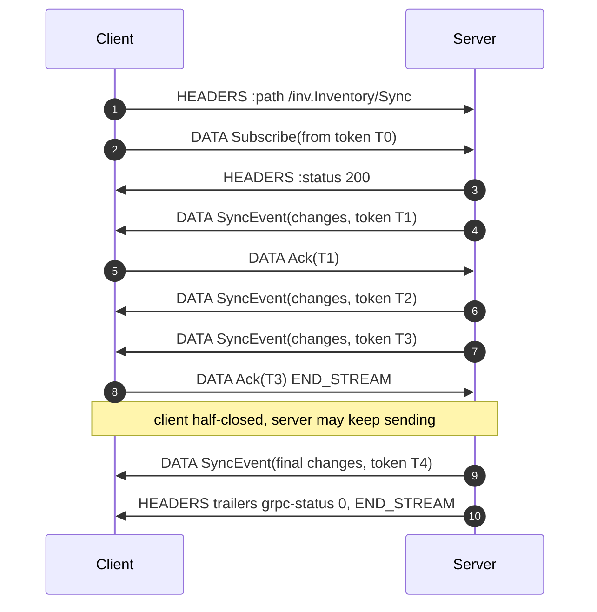
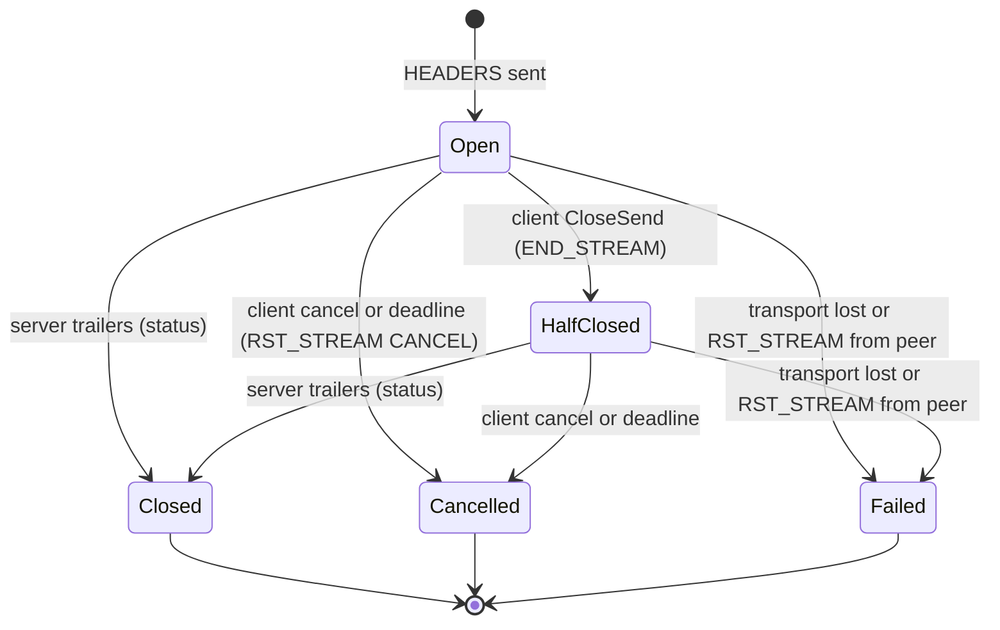
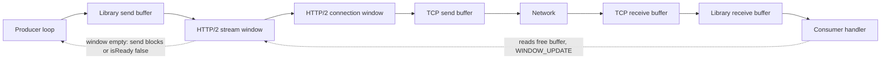
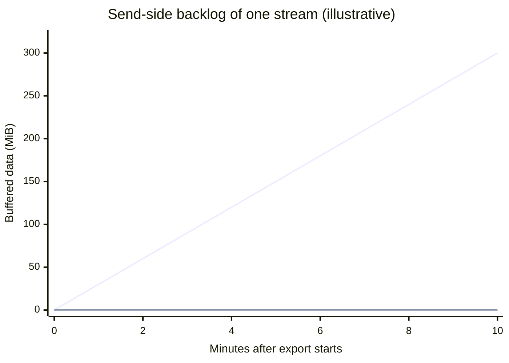
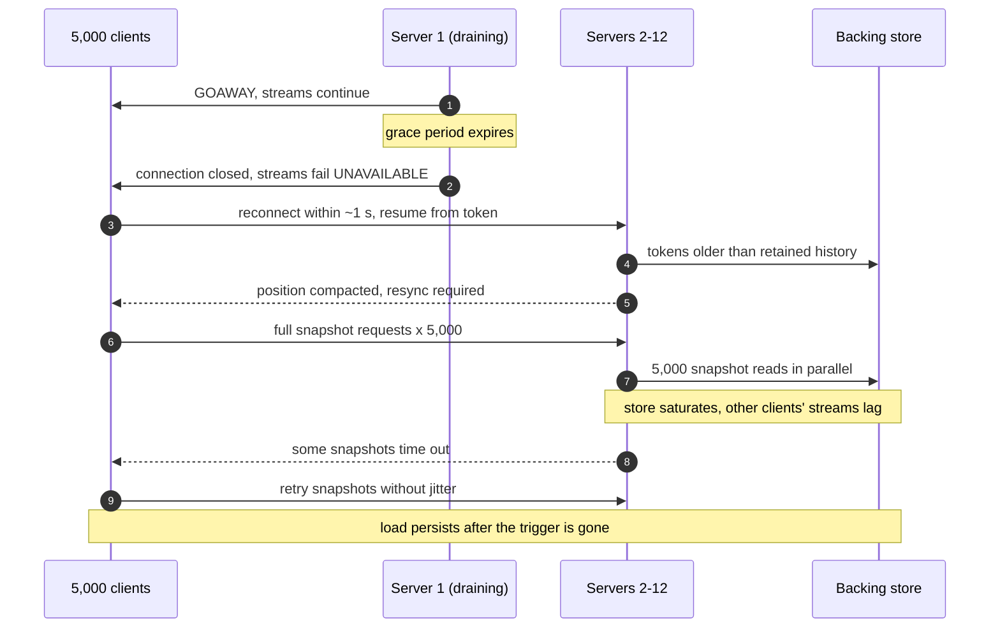

A gRPC streaming call is one HTTP/2 stream that carries more than one message in at least one direction. gRPC defines four call shapes by message cardinality: unary (one request, one response), server streaming (one request, many responses), client streaming (many requests, one response) and bidirectional streaming (many in both directions, independently). The wire format does not change between them: every message is the same five-byte length prefix plus payload described in [gRPC & Protocol Buffers](/distributed-systems/en/communication/synchronous-protocols/grpc-protocol-buffers/), and every call ends with a trailer carrying `grpc-status`. What changes is how long the call lives and how much state both ends hold while it does.

Streams exist because some interactions do not fit a request that completes in milliseconds. A result set too large for one message, a client that wants every change to a key range as it happens, a sensor uploading readings for an hour, or a control plane pushing configuration to thousands of proxies all have one of two shapes: data whose size is unbounded, or data whose arrival time is unknown. Unary calls handle them by paging or polling, which costs a round trip and a full call setup per batch and turns "as soon as it changes" into "within one polling interval".

The core trade-off is that a stream converts many short, independent, retryable calls into one long-lived piece of shared state. In exchange for lower per-message overhead, push delivery and transport-level backpressure, the application gives up most of what the gRPC channel does for unary calls: a deadline that bounds the work, automatic retries, per-call load balancing, and the property that a failed call can be repeated without knowing what happened inside it. A stream that breaks after delivering 40,000 messages leaves the client knowing only which messages it received, not which the server sent or which of its own sends the server processed. Recovering from that is the application's job, and designing it is most of the work of using streams correctly.

## Four Call Shapes on One HTTP/2 Stream

Every call starts the same way: the client sends a HEADERS frame with `:path` naming the method, and both sides then exchange DATA frames containing length-prefixed messages. The call shapes differ only in when each side signals that it has finished sending. The client signals it with END_STREAM on its last DATA frame, which HTTP/2 calls half-closing the stream and gRPC APIs expose as `CloseSend` (Go), `onCompleted` on the request observer (Java) or `WritesDone` (C++). The server signals it by sending trailers, and the trailers are also the end of the whole call. That asymmetry is the central rule of the lifecycle: the client can stop sending and keep receiving, but the server cannot stop sending without ending the call.

```proto
service Inventory {
  rpc GetItem(GetItemRequest) returns (Item);                        // unary
  rpc ExportItems(ExportRequest) returns (stream Item);              // server streaming
  rpc UploadCounts(stream CountRecord) returns (UploadSummary);      // client streaming
  rpc Sync(stream SyncRequest) returns (stream SyncEvent);           // bidirectional
}

message SyncRequest {
  oneof kind {
    Subscribe subscribe = 1;   // first message: what to watch, from where
    Ack ack = 2;               // later messages: progress acknowledgements
  }
}

message SyncEvent {
  repeated Change changes = 1;
  string resume_token = 2;     // opaque position; client stores it for reconnects
}
```

The four methods compile to four different stub signatures, but the server sees the same transport object in each case. In server streaming, the client sends one message and half-closes immediately, then reads until the trailers arrive. In client streaming, the client sends many messages, half-closes, and the server sends one response followed by trailers; nothing stops a server from responding before the client half-closes, for example to reject the upload after the first malformed record, and once it does, the client's further sends fail and the call's status is available from the receive side. In bidirectional streaming, each direction runs at its own pace. The `oneof` in `SyncRequest` shows the common design for bidirectional control protocols: the first client message subscribes, and later client messages carry acknowledgements on the same stream.


*A bidirectional call. Requests and responses interleave freely; the client's END_STREAM in step 8 closes only its direction, and the server's trailers in step 10 end the call.*

Two details in the diagram carry most of the semantics. Steps 6 and 7 arrive without any client message between them: there is no pairing between request number n and response number n unless the application protocol defines one, and the Ack in step 8 refers to a token, not to a message count, precisely because the two directions are not synchronized. Step 9 shows that the server keeps sending after the client half-closed; a client that stops reading at its own half-close loses data the server considers delivered. A client that wants to end the call outright cancels instead, which sends RST_STREAM with code CANCEL and makes the server's call context fire, as described for unary calls on the gRPC page.

### What a Stream Guarantees and What It Does Not

Within one stream and one direction, messages are delivered to the receiving application in the order they were sent, each exactly once, with no gaps. The proof is short: HTTP/2 carries a stream's DATA frames in order over one TCP connection, TCP delivers bytes in order without duplication or loss, and the length prefix reassembles message boundaries from the byte sequence regardless of how frames split it. Nothing in the path reorders or retransmits at the message level, so nothing can duplicate a message while the stream is alive.

Everything else is explicitly not guaranteed. A sender's API returning success means the message was handed to the transport, not that the peer received or processed it; grpc-go's documentation states that `SendMsg` does not wait for the message to be received, and the same holds in every implementation. There is no ordering relation between the two directions, and no ordering across different streams, even on the same connection. And none of the in-order, exactly-once property survives the end of the stream. When a stream fails, the receiver knows exactly which messages it got, the sender knows only which ones it wrote into a buffer, and the messages in between (in TCP buffers, in a proxy, in a server handler that had not yet committed them) are in an unknown state. A stream is therefore an exactly-once channel for the duration of its life and an at-most-once channel across failures, unless the application adds positions and acknowledgements, which turns it into at-least-once with deduplication by position. The general vocabulary is covered in [At-Least-Once, At-Most-Once, and Exactly-Once Semantics](/distributed-systems/en/communication/async-messaging/delivery-semantics/).

### The Call Lifecycle

From the client's side, a streaming call moves through a small set of states, and the transitions decide which operations are still valid.


*Client-side lifecycle of a streaming call. Sends are valid only in Open; receives are valid in Open and HalfClosed; every terminal state produces exactly one status.*

The edge from Open directly to Closed is the one that surprises client-streaming code. A server that returns from its handler before reading all input ends the call while the client is still in Open; the client's next send then fails, and in grpc-go it returns `io.EOF` with the real status obtainable only from the receive call. Code that treats a send error as the call's outcome reports a misleading error. The two failure states differ in who decided: Cancelled is the client's own choice and yields `CANCELLED` or `DEADLINE_EXCEEDED`, while Failed comes from the network or the peer and usually yields `UNAVAILABLE` or `INTERNAL`. Only the transitions to Closed carry an application status, and only those tell the client what the server concluded.

## Flow Control as Application Backpressure

A unary call cannot overload its receiver with data, because each side sends one message. A stream can: a server streaming a table export can produce rows faster than the client can write them to disk, and a client uploading telemetry can outrun a server that writes each record to a database. Backpressure is the mechanism that slows the producer to the consumer's pace instead of buffering the difference; the general theory is on [Backpressure](/distributed-systems/en/resilience/flow-control/backpressure/). gRPC streams get it from HTTP/2 flow control, but only if every layer between the producing code and the consuming code propagates it.


*The buffer chain of one streaming direction. Credit flows back only when the consumer reads; whether the producer feels it depends on the library API between the producer and the stream window.*

The dotted arrows are the feedback loop. The receiving library returns HTTP/2 credit with WINDOW_UPDATE as the consumer reads messages out of its receive buffer, so a consumer that stops reading stops returning credit, the sender's stream window drains to zero, and the sending transport stops putting that stream's DATA frames on the wire. The windows themselves, their default of 65,535 bytes and the throughput ceiling of one window per round trip, are explained on the [HTTP/2 and HTTP/3](/distributed-systems/en/communication/synchronous-protocols/http2-http3-quic/) page. What matters here is the last hop: whether a full window reaches the producer as a signal, or is absorbed by a buffer that grows.

That hop differs by language, and the difference decides whether a slow consumer causes slowness or an out-of-memory crash. In grpc-go, `SendMsg` blocks until there is enough flow-control credit to schedule the message, until the stream ends, or until it breaks, so a producer loop written naively is throttled automatically; the cost is a blocked goroutine per stalled stream, and the hazard is a loop that sends to several streams in sequence, where one stalled consumer blocks all of them. In grpc-java, `StreamObserver.onNext` does not block. The observer exposes `isReady()`, which the documentation describes as indicating that more messages can be sent "without requiring excessive buffering internally", and `setOnReadyHandler`, which runs each time `isReady()` changes from false to true. A producer that ignores `isReady()` is allowed to do so, and its messages accumulate in memory without bound. In the inbound direction, grpc-java requests the next message automatically after each `onNext` returns; `disableAutoInboundFlowControl()` lets the application call `request(n)` itself, which is how a consumer that hands messages to another thread keeps the sender from outrunning that thread. Asynchronous APIs in other languages follow one of these two models, and the documentation of the specific library has to be checked, because the model is not visible in the generated stub's signature.

:::caution[A non-blocking send is not backpressure]
In any API where sending a message returns immediately, the stream's flow control stops at the library's buffer, and the buffer grows for as long as the consumer is slower than the producer. Gate every send on the readiness signal (`isReady()` and the on-ready handler in Java, the equivalent write-readiness callback elsewhere), or use the blocking API. A streaming server that passes load tests against fast clients and then runs out of heap when a single client on a slow link starts an export is showing exactly this bug.
:::

### Worked Example: A Slow Consumer and a Fleet Reconnect

Assume an illustrative server-streaming export that produces 2,000 messages per second of 1 KiB each, about 2 MiB/s, to a client that persists 1,500 messages per second. The surplus is 500 messages per second, or 500 KiB/s.

If the server ignores readiness, the surplus accumulates in the library's send buffer: 30 MiB per minute, about 1.76 GiB per hour, for one stream. Two hundred concurrent exports to similar clients add 100 MiB/s of heap growth, and a server with a few gigabytes of headroom dies within a minute of the slow clients connecting. Worse, the failure looks like a memory leak in the server rather than a slow client, because the clients are healthy and the stream metrics show messages being "sent" at 2,000 per second.

If the server honors readiness, the buffer is bounded by the stream window plus whatever the library holds before it reports not-ready, on the order of the window size. The producer is paused for a quarter of each second, its effective rate settles at 1,500 messages per second, and the export takes 33% longer than the server could have produced it, which is the correct outcome: the client's disk is the bottleneck, and the system now runs at the bottleneck's rate with bounded memory.


*Backlog with readiness ignored (rising line, 500 KiB/s of surplus) versus honored (flat line near the size of one window).*

The rising line has a constant slope because it integrates the rate difference; nothing in it ever reverses unless the producer stops. The flat line is not zero: it is the in-flight window, which is the memory the system has agreed to spend per stream. Multiplying that by the number of concurrent streams gives the steady-state memory budget for streaming, a number worth computing before raising window sizes for throughput.

The second half of the example is the cost of streams ending. Assume an illustrative fleet of 60,000 long-lived watch streams spread over 12 servers, 5,000 per server. A rolling deploy restarts one server and its 5,000 clients reconnect to the other 11. If clients can resume from a position the servers still have in history, each reconnect costs one small subscribe message and a replay of the few events published during the gap, and the deploy is invisible. If they cannot resume and must fetch a full snapshot of, say, 400 KiB each, the reconnect wave moves 5,000 x 400 KiB, about 1.9 GiB, and if the clients reconnect within one second the surviving servers and their backing store must serve roughly 16 Gbit/s of snapshot traffic in addition to normal load. Connection recycling has a steady-state cost too: with a maximum connection age of 30 minutes, 60,000 streams produce about 60,000 / 1,800 = 33 reconnects per second continuously, which is cheap with resumption and a constant snapshot load of 33 x 400 KiB, about 13 MiB/s, without it. The design of resumption, not the transport, decides whether these numbers matter.

## Long-Lived Streams: Deadlines, Liveness, and Intermediaries

### A Deadline Bounds the Whole Call

A gRPC deadline applies to the entire call, not to each message. For a server-streaming export of bounded size that is right: the deadline says how long the caller will wait for the complete result. For a watch that is meant to run for hours, it is wrong in both directions. A short deadline copied from unary defaults, such as 300 ms, kills the stream almost immediately with `DEADLINE_EXCEEDED`. No deadline at all, the gRPC default, leaves the stream with no bound on how long it may sit with nothing happening, which is the same hazard the gRPC page describes for unary calls, stretched over hours.

Long-lived streams therefore need two separate limits. The first is a lifetime limit: either a long deadline (hours) after which the client deliberately re-establishes the stream, or a server-side maximum stream age after which the server ends the call with a status the client treats as "reconnect now". Bounding lifetime is not a workaround; it is what makes load rebalancing and server deploys possible, as discussed below. The second is a progress limit: the maximum time the application tolerates without any message, enforced by a timer that is reset by every received message and that cancels the stream when it fires.

### Keepalive Detects Dead Connections, Not Dead Streams

HTTP/2 PING keepalive, configured as described on the gRPC page, detects a connection whose peer has vanished, for example after a NAT dropped its mapping or a host lost power. It does not detect a stream whose server handler is stuck, whose upstream data source stopped producing, or which a proxy is holding open while its own upstream connection is dead. In all three cases PINGs are answered by a transport that is alive, and the stream receives nothing forever. Only an application-level signal closes this gap: the server sends a heartbeat or progress message at a fixed interval when there is nothing else to send, and the client's progress timer from the previous section treats silence beyond a few intervals as failure. etcd's watch API offers this as progress notifications, which carry the current revision even when no watched key changed; Kubernetes watch bookmarks play the same role for API server watches. A progress message that carries a position has a second benefit: it advances the client's resume point during quiet periods, so a later reconnect does not ask for history that has already been discarded.

:::tip[Make heartbeats carry a resume position]
A heartbeat that only says "still alive" detects stuck streams; a heartbeat that says "you are current as of position P" also keeps the client's resume token fresh while nothing changes. Without it, a client watching a rarely changing key range holds a token from hours ago, and the first reconnect after compaction forces a full resynchronization even though the client missed nothing.
:::

### Proxies and Load Balancers Have Their Own Clocks

Every intermediary in the path enforces timeouts designed for request-response traffic. Envoy's route timeout defaults to 15 seconds and its documentation states that it is not compatible with streaming responses that never end, so a gRPC watch through a default Envoy route dies at 15 seconds; the stream idle timeout, 5 minutes by default, ends streams with no activity in either direction; and the connection idle timeout, 1 hour by default for HTTP, closes connections with no active streams. Cloud load balancers have idle timeouts of their own, and their defaults vary by product. The failure signature is periodic stream termination at a fixed age or a fixed quiet interval, which no code change in the client or server explains.

```yaml
# Envoy route for a long-lived gRPC streaming service (fields from RouteAction)
routes:
- match: { prefix: "/inv.Inventory/Sync" }
  route:
    cluster: inventory
    timeout: 0s          # disable the 15 s default request timeout for this route
    idle_timeout: 600s   # end a stream only after 10 min with no frames either way
```

The configuration encodes the two-limit design from above at the proxy: no total lifetime from the proxy's request timeout, and an idle limit that must be longer than the server's heartbeat interval. The ordering of intervals is the part that is easy to get wrong. The application heartbeat must be shorter than every idle timeout on the path (proxy stream idle timeout, load balancer idle timeout, NAT idle mapping), the progress timeout on the client must be a small multiple of the heartbeat, and the maximum stream age chosen by the server should be shorter than any absolute limit an intermediary enforces, so that streams end on the server's schedule with a clean status rather than on the proxy's schedule with a reset.

## Retries, Resumption, and Load Balancing for Streams

### Why the Channel Cannot Retry a Stream

gRPC's retry machinery, covered on the gRPC page, commits a call once the client receives response headers: from then on, a failure is returned to the application rather than retried, because a partial response may already have been consumed. For a server stream, the response headers arrive with the first message, so a stream is retryable only until it has delivered anything. Client streaming adds a second limit: to retry, the library must replay every message sent so far, so it buffers them, and the retry design (gRFC A6) bounds that buffer per call and per channel. When a message would exceed the limit, the call is committed to its current attempt and the buffered messages can be freed. A long upload is therefore retried by the library only during its first few kilobytes or megabytes, depending on the configured limits. Transparent retries, which apply when the server application never saw the call, still work for streams at establishment time.

The consequence is that every long-lived stream needs an application-level reconnect loop: on any non-OK terminal status other than those that mean "do not retry" (`INVALID_ARGUMENT`, `PERMISSION_DENIED`, `UNIMPLEMENTED` and similar), wait with exponential backoff and jitter, as described in [Retry with Exponential Backoff](/distributed-systems/en/resilience/protection-patterns/retry-exponential-backoff/), and open a new stream from the last known position. The loop must reset its backoff only after the new stream has delivered something, not when it opens, or a server that accepts streams and immediately fails them produces a tight reconnect loop.

### Resumption Designs in Real Systems

A resumable stream needs three things: a position that identifies how far the client has received, a server that can replay from a recent position, and a defined answer when the position is too old to replay. Real systems implement these in materially different ways.

etcd's Watch is a bidirectional stream on which a client creates watches by sending requests that name a key range and a start revision; the server multiplexes many watches over one stream by watch ID and sends events tagged with revisions. Because etcd keeps a multi-version history, a client that reconnects can ask for its last seen revision plus one and receive every event since. History is not infinite: compaction discards old revisions, and a watch requested at a compacted revision is cancelled with a response carrying the compaction revision. The recovery is not a retry: the client must read a fresh snapshot of the range, replace its local state wholesale (merging would keep keys deleted during the gap), and watch from the snapshot's revision plus one. Kubernetes builds its list-then-watch pattern on the same idea, with HTTP watches on the API server returning `410 Gone` when the requested resource version is too old and clients relisting in response.

Cloud Spanner's `ExecuteStreamingSql` is a server stream of `PartialResultSet` messages, some of which carry a `resume_token`. If the stream breaks, the client re-sends the original request with the last token it received and the results continue after the message that carried it. Not every message carries a token, so the client discards anything it received after the last token, and a single large value may be split across messages with a `chunked_value` flag, so the client reassembles before exposing a row. Resumption here is exact because the server can recompute the query position from the token, not because it buffers results.

Envoy's xDS protocols, typically run as one bidirectional Aggregated Discovery Service (ADS) stream per proxy, use a different design: the client does not resume an event history but reports the state it has. Each request carries the `version_info` of the configuration the proxy has applied and echoes the `response_nonce` of the response it is acknowledging; accepting an update advances the version (an ACK), rejecting it repeats the old version with `error_detail` set (a NACK). On reconnect, the proxy opens a new stream and sends its current version and resource names, and the management server sends whatever is needed to bring it to the current state. Because each response in the state-of-the-world variant is a complete set for its resource type, there is no history to compact and no "too old" case; the cost is that a reconnect may resend large resource sets. Using one ADS stream also lets the server order updates across resource types, which the protocol documentation recommends to avoid routing to clusters that do not exist yet.

The three designs map onto a choice every streaming API has to make. Event-history resumption (etcd) is cheap per reconnect and exact, but needs retained history and a snapshot fallback. Position-recomputation (Spanner) needs no retained events but works only when the position can be recomputed deterministically. State reconciliation (xDS) needs neither, at the price of sending state instead of deltas.

:::danger[A reconnect without a position silently loses events]
A client that reconnects by sending the same "subscribe from now" request it used initially never sees the events published between the old stream's death and the new stream's start. Nothing reports the gap: both streams are healthy, the client's cache is simply wrong from then on. Every subscription stream that feeds a cache, an index or a downstream system must reconnect from a position, and must fall back to a full resynchronization, not to "from now", when the position is no longer available.
:::

### Load Balancing Happens Once per Stream

Per-call load balancing, whether in a layer 7 proxy or in the client channel, picks a backend when a stream is created and never again. For unary traffic that is fine-grained balancing; for streams that last hours it means the load distribution reflects the backend set at the moment each stream started. New backends receive streams only when existing streams end, and a backend that received a burst of reconnections during a deploy keeps that burst for the streams' lifetime. Streams also consume HTTP/2 concurrency slots: a server's `SETTINGS_MAX_CONCURRENT_STREAMS` (commonly configured around 100) applies per connection, and a client that holds that many long-lived streams on one connection cannot start another call on it until one ends. Implementations generally queue the new call; whether they open an extra connection instead varies by language and version. Multiplexing many logical subscriptions over one stream, as etcd does with watch IDs, avoids the slot problem and is the reason that design exists.

Rebalancing requires ending streams. The server-side maximum connection age (grpc-go's `MaxConnectionAge`, with plus or minus 10% jitter) sends GOAWAY, which stops new streams on the connection but lets existing ones continue; with long-lived streams that continuation is indefinite unless `MaxConnectionAgeGrace` is set, and its default in grpc-go is infinity. Without a finite grace, connection aging rebalances unary traffic and has no effect on streams. A finite grace forcibly closes the connection and terminates the streams with an error; a server-side maximum stream age, implemented by the handler returning a clean status, is gentler because the client sees an orderly end and reconnects without logging a failure. Either way the jitter matters: aging without jitter synchronizes the whole fleet's reconnects. The draining sequence itself is covered in [Health-Aware Routing and Connection Draining](/distributed-systems/en/communication/load-balancing/health-aware-routing/).

## Choosing a Call Shape and Its Alternatives

| Shape or alternative | Per-message overhead | Retry and balancing | State held while open | When to prefer |
|---|---|---|---|---|
| Unary | Full call: headers, trailers, stream setup | Automatic retries, per-call balancing, per-call deadline | None between calls | Request-response work under a second; default choice |
| Unary with paging | Full call per page | Each page retryable; cursor makes resumption explicit | Cursor on the client | Large bounded results where per-page latency is acceptable and simplicity matters |
| Server streaming | 5-byte prefix plus frame header | Retryable only before the first message | Handler, buffers, a stream slot | Large or incremental results, and change feeds where a client subscribes once |
| Client streaming | 5-byte prefix plus frame header | Retryable only within the retry buffer | Handler and buffers on the server | Uploads where per-record calls are too costly and one summary response suffices |
| Bidirectional streaming | 5-byte prefix plus frame header | Application reconnect loop only | Both directions, application protocol state | Control protocols with acknowledgements, interactive sessions, multiplexed subscriptions |
| [WebSocket or SSE](/distributed-systems/en/communication/synchronous-protocols/websocket-sse/) | Small frame header | Application reconnect; SSE has built-in last-event ID | Connection per client | Browser clients, which cannot open native gRPC streams |
| [Message log or queue](/distributed-systems/en/communication/async-messaging/message-queue-vs-event-streaming/) | Broker-dependent | Durable offsets; consumer restarts anywhere | Broker holds the data | Consumers that may be down for minutes, replay beyond a short history, fan-out to many independent groups |

The table's last column hides a recurring mistake: choosing streaming for throughput when the real requirement is decoupling. A server stream from the producing service to each consumer couples the consumer's availability and speed to the producer's memory and connection slots; a log decouples them at the cost of a broker and end-to-end latency. A stream is the right tool when the consumer is online, the history it may need after a disconnect is short enough for the producer to keep, and the producer can afford per-subscriber state. When any of the three fails, put a log in between and keep the stream, if at all, for the last hop.

The overhead column matters less than it looks inside a data center. HPACK compresses repeated unary headers to a few bytes, and a unary call on an existing connection costs no new handshake, so moving a 10,000-calls-per-second workload from unary to a stream saves some framing and CPU but rarely changes capacity planning. Streaming pays off in latency for push delivery, in avoiding per-page round trips for large results over long paths, and in messages small enough that headers and trailers dominate.

## Failure Modes of Streaming Calls

### Unbounded Send Buffers

The trigger is a producer that sends through a non-blocking API without checking readiness, combined with any consumer slower than the producer. The symptom is server memory growth proportional to the number of slow clients and their connection time, ending in garbage-collection pauses and out-of-memory restarts that kill every stream on the instance, including the healthy ones. Detection compares messages sent per stream at the application level with bytes actually written by the transport, and tracks per-stream queued bytes if the library exposes them; heap growth correlated with long-running streaming calls rather than with request rate is the first visible sign. Mitigation is readiness-gated sending or the blocking API, plus a per-stream cap on queued data beyond which the server ends the stream with `RESOURCE_EXHAUSTED`. Recovery after an incident requires the clients to reconnect from a position, which they can do only if resumption was designed in.

### One Slow Subscriber Stalls a Broadcast

A server that fans one event source out to many subscribers often runs one loop that sends each event to each stream in turn. With a blocking send, the first subscriber whose window is full blocks the loop, and every other subscriber stops receiving; with a non-blocking send, the previous failure mode applies instead. The symptom is that all subscribers' latency rises together while only one client is actually slow, which points investigation at the server or the event source rather than at the client. Detection is per-subscriber send latency and lag (the gap between the newest event position and the last position sent to that subscriber). Mitigation is a bounded queue per subscriber, filled by the broadcast loop and drained by a per-subscriber sender, with an explicit policy when a queue fills: coalesce updates to the same key, drop the subscriber with a status that tells it to resynchronize, or both. Dropping slow subscribers is the standard choice in systems that must protect everyone else; it makes resynchronization cost, not memory, the price of a slow client.

### Streams Killed by Intermediary Timeouts

The trigger is a proxy, ingress or load balancer with request or idle timeouts sized for unary traffic. The symptom is streams ending at a constant age (for example, every 15 seconds behind a default Envoy route) or after a constant quiet interval, with `UNAVAILABLE` or `CANCELLED` on the client and often no matching error in the server's logs, because from the server's side the peer simply reset the stream. Detection is a histogram of stream durations: a sharp spike at one value is an intermediary timeout, while organic failures spread out. Mitigation is the interval ordering from the intermediaries section: disable request timeouts on streaming routes, set idle timeouts above the heartbeat interval, and keep the server's maximum stream age below any absolute intermediary limit.

### Reconnect and Resynchronization Storms

Reconnect storms are where the worked example's numbers turn into an incident. They are triggered by anything that ends many streams at once: a server restart, a deploy without jitter, a proxy fleet reload, or the forced close at the end of a connection grace period.


*A resynchronization storm. The restart itself is harmless; stale resume positions (step 5) turn 5,000 cheap reconnects into 5,000 snapshot reads, and unjittered retries (step 9) keep the store saturated.*

The decisive step is 5. Had the clients held recent positions, kept current by progress heartbeats during quiet periods, step 3 would have been the end of the incident. Instead, positions older than the retained history force snapshots, the snapshots saturate the store, the timeouts trigger retries, and the retries keep the store saturated after the original trigger is gone, which is the metastable pattern analyzed in [Retry Storms and Metastable Failures](/distributed-systems/en/resilience/flow-control/retry-storms-metastable-failures/). Detection is the rate of stream establishments and of resynchronizations per second, both of which should be near their steady-state values (the 33 per second of the example) and spike in a storm. Mitigation is layered: jittered reconnect backoff on clients, progress heartbeats that keep positions fresh, retained history long enough to cover a deploy, server-side admission limits on concurrent snapshots so excess clients wait rather than all fail, and connection aging with jitter rather than synchronized restarts.

### Silent Stalls

The trigger is a stream that is open at the transport level but receives nothing: a stuck handler, a dead upstream behind a proxy, or a server-side subscription that was dropped by a bug while the stream stayed open. Keepalive succeeds, no status ever arrives, and the client's view of the data silently ages. Detection is an application-level staleness metric (time since the last message or heartbeat per stream) and, for systems with positions, the gap between the client's last position and the source's current position. Mitigation is the heartbeat-plus-progress-timeout pair described above; without it, this failure is found by users.

### Stream Slot Exhaustion and Load Skew

Long-lived streams that occupy all of a connection's concurrent-stream slots block new calls on that connection, including unary calls that share the channel, which shows up as latency on unrelated methods with no server-side cause. Separately, streams created during a burst stay on the backends that received the burst, so load skew persists long after the event that caused it. Detection is active streams per connection against the advertised limit, and active streams per backend. Mitigation is separate channels for long-lived streams and unary traffic, multiplexing many subscriptions over one stream, and bounded stream lifetimes with jitter so the distribution converges.

| Failure | Symptom | Detection | Mitigation |
|---|---|---|---|
| Unbounded send buffer | Heap growth, OOM restarts killing all streams | Sent vs written per stream, queued bytes, heap vs active streams | Readiness-gated or blocking sends, per-stream queue cap |
| Broadcast stall | All subscribers lag together, one client slow | Per-subscriber send latency and position lag | Per-subscriber bounded queue, coalesce or drop |
| Intermediary timeout | Streams end at a fixed age or quiet interval | Stream duration histogram spike | Disable route timeouts, idle above heartbeat, server-owned max age |
| Resync storm | Store saturated after restart, lag everywhere | Stream establishments and resyncs per second | Jittered backoff, fresh positions, longer history, snapshot admission limits |
| Silent stall | No messages, no error, stale data | Time since last message, position gap | Heartbeats with positions, client progress timeout |
| Slot exhaustion and skew | Unrelated calls slow, persistent backend imbalance | Active streams per connection and per backend | Separate channels, multiplexed subscriptions, jittered max age |

## When to Stream and When Not To

Use server streaming when a result is too large for one message or its size is unknown, and consuming it incrementally lets the client start work earlier or bound its memory; when the consumer is online and wants push delivery of changes with latency below any reasonable polling interval; and when the server can either keep a short history or recompute a position, so that streams can resume. Use client streaming for uploads where per-record unary calls would dominate cost and a single summary response is enough, and design the summary to report how far the server committed, since that is the only way the client learns what to resend after a failure. Use bidirectional streaming when the protocol is genuinely conversational: acknowledgements that drive what the server sends next, flow-controlled work distribution, or many logical subscriptions multiplexed over one stream to avoid slot exhaustion.

Do not stream to avoid the cost of unary calls inside a data center unless measurement shows that headers and call setup dominate; the reliability machinery you give up is worth more than the bytes. Do not use a stream as a durable delivery mechanism: if consumers may be offline for longer than the producer's retained history, or more than a few independent consumer groups need the same data at their own pace, a log or queue is the correct design and a stream reimplements it badly. Do not stream through infrastructure whose timeouts you cannot configure. Do not use bidirectional streaming where request-response pairs would do; a bidirectional stream used as a pipe for request and response messages reintroduces correlation IDs, per-message timeouts and per-message errors, all of which unary calls provide already. And do not open a stream without deciding, before writing the first handler, what the position is, how long the server keeps history for it, and what the client does when it is too old.

## Further Reading

- gRPC Authors, *Core concepts, architecture and lifecycle*, grpc.io documentation. The four call shapes, half-close, deadlines and cancellation as defined by the project.
- gRPC Authors, *gRPC over HTTP2* (PROTOCOL-HTTP2.md), grpc/grpc repository documentation. How streams, messages and trailers map onto HTTP/2.
- Noah Eisen and Eric Gribkoff, *gRFC A6: gRPC Retry Design*, grpc/proposal design document. Commit points, the retry buffer and why long streams are not retried.
- Envoy Project, *xDS REST and gRPC protocol* and *How do I configure timeouts?*, Envoy documentation. ACK/NACK semantics on ADS streams, and proxy timeouts for streaming routes.
- etcd Authors, *etcd API: Watch API*, etcd documentation. Revision-based watch resumption, progress notifications and compaction.
- Google Cloud, *PartialResultSet* (Cloud Spanner API reference). Resume tokens and chunked values for resumable server streams.
