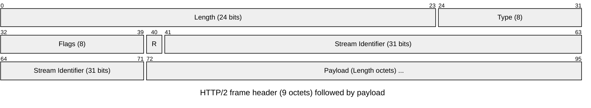
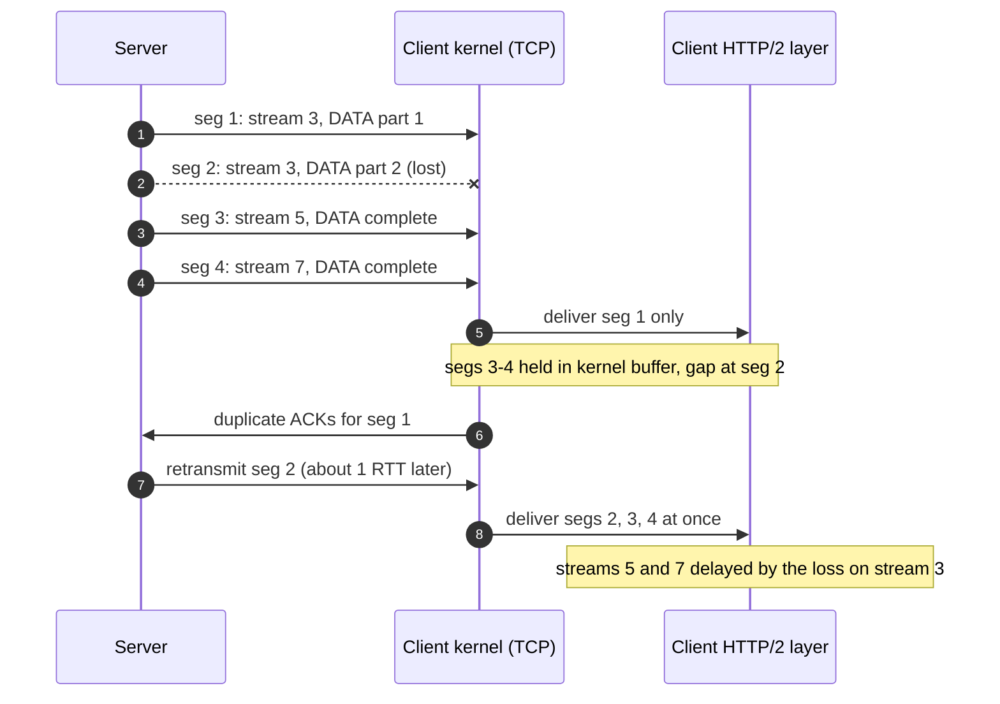
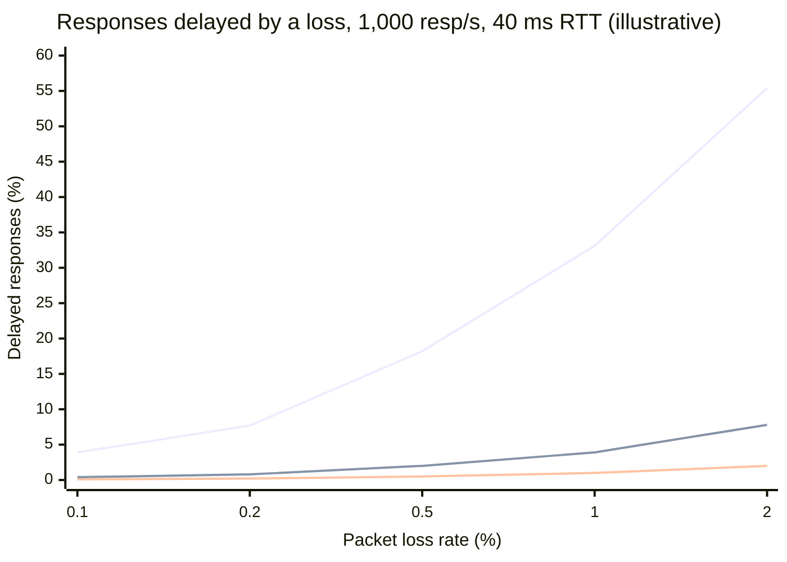
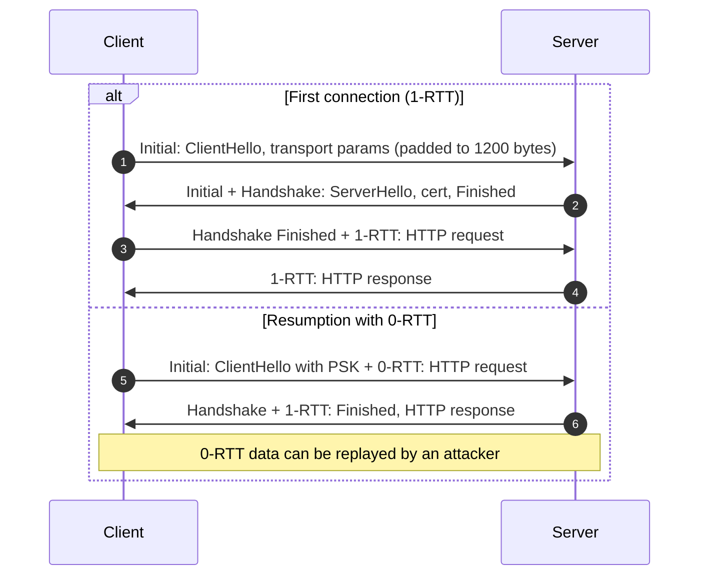
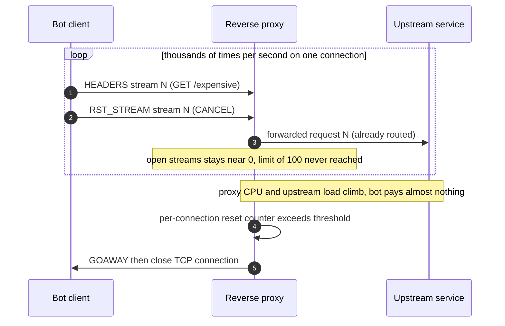

HTTP/2 (RFC 9113) and HTTP/3 (RFC 9114) carry exactly the same HTTP semantics as HTTP/1.1: the same methods, status codes, headers and caching rules described in [REST: Constraints, Resources, and HTTP Contracts](/distributed-systems/en/communication/synchronous-protocols/rest/). What they change is how messages are laid out on the wire. HTTP/2 cuts every request and response into binary frames tagged with a stream identifier and interleaves many streams over a single TCP connection. HTTP/3 does the same over QUIC (RFC 9000), a transport that runs on UDP and implements reliability, ordering and congestion control per stream inside the application process instead of the kernel.

The problem both solve is head-of-line (HOL) blocking: an item at the front of an ordered queue that cannot proceed stalls every item behind it, even items that do not depend on it. HTTP/1.1 allows one outstanding response per connection, so a slow response blocks the connection, and clients compensate by opening several connections per origin, each paying its own handshake, its own slow start and its own share of server memory. HTTP/2 removes HOL blocking at the HTTP layer but keeps all streams in one TCP byte stream, so a single lost packet still stalls every stream until it is retransmitted. HTTP/3 removes that last layer by giving each stream independent delivery.

The core trade-off is shared fate against cost. Putting every request on one connection makes connections cheap, header compression effective and congestion control coherent, but it also means one loss, one flow-control window, one load-balancer decision and one abusive client affect everything on that connection. QUIC breaks the transport-level coupling and adds a faster handshake and connection migration, and pays for it with roughly twice the server CPU of TCP with TLS in Google's published deployment, UDP paths that some networks block or throttle, and a congestion controller and loss detector that now ship in your binary instead of the kernel. Inside a data center, where loss is rare and round trips are short, HTTP/2 is usually the right answer; on lossy, high-latency or mobile paths, HTTP/3 earns its cost.

```mermaid
flowchart TB
    subgraph H3["HTTP/3"]
        A3["HTTP semantics"] --> B3["HTTP/3 frames, QPACK"]
        B3 --> C3["QUIC: streams, loss recovery, TLS 1.3"]
        C3 --> D3["UDP"]
    end
    subgraph H2["HTTP/2"]
        A2["HTTP semantics"] --> B2["HTTP/2 frames, HPACK, streams"]
        B2 --> C2["TLS"]
        C2 --> D2["TCP: one ordered byte stream"]
    end
    subgraph H1["HTTP/1.1"]
        A1["HTTP semantics"] --> B1["Text messages, one at a time"]
        B1 --> C1["TLS"]
        C1 --> D1["TCP"]
    end
```


*Protocol stacks of the three versions. The HTTP semantics layer is identical; what moves is where multiplexing, ordering and encryption live.*

The diagram shows where each version puts the unit of ordering. In HTTP/1.1 the ordered unit is the whole connection, so multiplexing requires several connections. In HTTP/2 multiplexing moves up into the HTTP framing layer, but ordering stays in TCP below it, and TCP knows nothing about streams. In HTTP/3 the stream abstraction moves down into the transport, and encryption moves into the transport too: QUIC integrates the TLS 1.3 handshake and encrypts almost all of its own headers, which is why middleboxes cannot inspect or rewrite QUIC the way they rewrite TCP.

## HTTP/2: Frames, Streams, and Flow Control on One Connection

An HTTP/2 connection starts with a fixed 24-octet client preface, followed by a SETTINGS frame from each side that declares limits: how many concurrent streams the peer may open, the initial flow-control window, the maximum frame size, the size of the header compression table. Over TLS the version is chosen during the handshake through Application-Layer Protocol Negotiation (ALPN) with the token `h2`; clear-text HTTP/2 (`h2c`) is used mostly inside data centers, with the client assuming support ("prior knowledge").

### Framing and Stream Multiplexing

Everything after the preface is a frame. Every frame begins with the same nine-octet header, and that header is what makes interleaving possible: the receiver reads the length, knows exactly where the frame ends, and uses the stream identifier to hand the payload to the right request.


*The HTTP/2 frame header. Stream 0 is reserved for connection-level frames such as SETTINGS, PING and GOAWAY.*

The frame types that matter operationally are few. HEADERS opens a stream and carries the compressed request or response header block; CONTINUATION carries the rest of a header block that did not fit in one frame; DATA carries body bytes; RST_STREAM cancels one stream without touching the others; WINDOW_UPDATE grants flow-control credit; PING measures round-trip time and keeps idle connections alive; GOAWAY tells the peer that the connection is being shut down. Client-initiated streams use odd identifiers and server-initiated streams use even ones, and identifiers only increase, so a stream number is never reused on a connection. When a client exhausts the 31-bit space it must open a new connection.

Correctness of the multiplexing rests on two rules. First, a frame belongs entirely to one stream, so a receiver can interleave DATA frames of different streams at frame boundaries without any ambiguity about which bytes belong to which response. Second, the header block of a stream must arrive as one contiguous sequence of HEADERS and CONTINUATION frames with nothing interleaved. The reason is header compression: decoding a header block changes the shared compression state, so the decoder must process header blocks one at a time and in order. That second rule is a deliberate HOL point inside HTTP/2, and the CONTINUATION flood attack described below exploits it.

Each stream moves through a small state machine. It is idle until a HEADERS frame opens it, open while both sides may send, half-closed once one side sets the END_STREAM flag, and closed when both have, or as soon as either side sends RST_STREAM. The advertised `SETTINGS_MAX_CONCURRENT_STREAMS` limit counts only streams that are open or half-closed. The RFC recommends that this value be no smaller than 100, and common servers advertise values in the low hundreds; nginx's `http2_max_concurrent_streams` defaults to 128, Go's `net/http` server to 250. A reset stream stops counting immediately, which is the property Rapid Reset abused.

### Flow Control: Why HTTP/2 Has Windows on Top of TCP's

TCP already has flow control, but it is one window for the whole connection. If one stream's consumer stops reading, for example a proxy whose upstream is slow, TCP's window cannot express "stop sending stream 7 but keep sending stream 9": either the receiver buffers stream 7 without limit or it stops reading the socket and stalls every stream. HTTP/2 therefore adds credit-based flow control at two levels. Each stream and the connection as a whole have a send window; DATA frames consume it, and the receiver returns credit with WINDOW_UPDATE frames as its application consumes data. A sender may transmit only while both the stream window and the connection window are positive. Only DATA frames are flow-controlled; control frames and headers are not, so a stalled window never blocks the frames needed to unblock it.

Both windows start at 65,535 octets. The stream window can be raised with `SETTINGS_INITIAL_WINDOW_SIZE`, but the connection window can only be raised by sending WINDOW_UPDATE on stream 0, and the maximum window is `2^31 - 1` octets. The defaults are small, and a window is a cap on throughput per round trip: a stream can move at most one window per RTT. With the default 64 KiB window, one stream is limited to about 10.5 Mbit/s on a 50 ms path regardless of link speed, and to about 260 Mbit/s on a 2 ms intra-region path. A proxy that keeps defaults on its upstream side turns a fast backend into a slow upload, and the symptom looks like a bandwidth problem rather than a configuration one. Most production servers and proxies auto-tune or raise windows; the right size is the bandwidth-delay product of the slowest path you serve, bounded by how much memory per stream you can afford to buffer.

### HPACK, Priorities, and Push

HTTP headers are repetitive: the same cookie, user agent, authority and authorization token on every request. HPACK (RFC 7541) compresses them with a static table of 61 common header fields, a per-connection dynamic table of recently sent fields (4,096 octets by default), and a Huffman code for literal strings. A repeated header costs one or two bytes after the first request. HPACK deliberately avoids general-purpose compression such as DEFLATE, which SPDY used, because the CRIME attack showed that an attacker who can inject text into a compressed stream can recover secrets like cookies by observing compressed length. The price of the dynamic table is that encoder and decoder must apply updates in exactly the same order, which is the ordering requirement described above.

Prioritization is the part of HTTP/2 that did not work as designed. RFC 7540 defined a dependency tree with weights, and few servers implemented it consistently; RFC 9113 deprecated it, and RFC 9218 replaced it with a simpler scheme: a `priority` header with an urgency from 0 to 7 and an incremental flag, usable by both HTTP/2 and HTTP/3. Server push, where the server sends responses the client has not asked for yet, fared worse. Measured usage was around 1% of HTTP/2 sites, pushed resources often duplicated what the browser already had cached, and Chrome disabled push by default in version 106 in 2022, recommending the `103 Early Hints` status and preload instead. Treat push as obsolete.

### Connection Shutdown and Retry Safety

GOAWAY carries the identifier of the last stream the sender has processed or might still process. Every stream with a higher identifier is guaranteed not to have been acted on, so the client can retry it on a new connection even if the request was a non-idempotent `POST`. Similarly, RST_STREAM with the error code `REFUSED_STREAM` guarantees that the stream was not processed. HTTP/1.1 has no equivalent: when a server closes a keep-alive connection at the moment a request is in flight, the client cannot tell whether the request was executed, which is the keep-alive race described on the REST page. Graceful shutdown in HTTP/2 is therefore a two-step exchange: the server first sends GOAWAY with the maximum stream identifier to stop new streams, waits at least one round trip for streams already in flight, then sends a final GOAWAY with the true last identifier and closes.

:::tip[Use GOAWAY's last-stream-id to decide what is safe to retry]
A client or proxy that receives GOAWAY should retry only streams above the advertised last-stream-id automatically; streams at or below it may have executed and need the normal idempotency rules from [Idempotency and Safe HTTP Methods](/distributed-systems/en/communication/api-gateway/idempotency/). Servers that close connections during deploys without sending GOAWAY first throw away this guarantee and turn every in-flight request into an ambiguous failure. The same applies to `MAX_CONNECTION_AGE`-style recycling in gRPC servers: it is safe only because it goes through GOAWAY.
:::

## Where TCP Head-of-Line Blocking Survives

TCP delivers bytes to the application strictly in order. When a segment is lost, the receiving kernel holds every later segment in its buffer until the retransmission fills the gap, even though those later segments are intact and belong to streams that have nothing to do with the lost one. HTTP/2 multiplexes streams inside that byte stream, so the HTTP/2 layer cannot read stream 5's complete frames while stream 3's segment is missing. The stall lasts at least one round trip with fast retransmit and much longer if the loss triggers a retransmission timeout; the mechanics of both recovery paths are covered in [Network Reliability, Bandwidth Limitations, and Topology Changes](/distributed-systems/en/foundations/monoliths-to-distributed/network-reliability/).


*TCP head-of-line blocking under HTTP/2. The kernel holds complete frames for streams 5 and 7 because an earlier segment of stream 3 is missing.*

Steps 3 and 4 are the whole problem: two complete responses sit in the client kernel for a full recovery period, and the HTTP/2 layer cannot see them. In QUIC the same scenario plays out differently. Each QUIC packet carries frames tagged with stream identifiers and offsets, and the QUIC library reassembles each stream separately, so the packets carrying streams 5 and 7 are delivered to their streams at once and only stream 3 waits for its retransmission. What QUIC does not remove is the shared congestion controller: a loss still reduces the sending rate of the whole connection, so QUIC fixes delivery HOL blocking, not the throughput penalty of loss.

### Worked Example: Loss on a Multiplexed Connection

Assume a client receives 1,000 small responses per second from one origin, each response fitting in one packet, over a path with a 40 ms round trip. Assume losses are independent, every loss is repaired by fast retransmit in about one RTT, and there are no retransmission timeouts. All numbers are illustrative.

With HTTP/2 on one connection, each loss blocks every response that arrives behind it during the next RTT, about `1,000 * 0.040 = 40` packets. A response is delayed if any of the roughly 40 packets ahead of it in its window was lost, so the fraction of delayed responses is `1 - (1 - p)^40`. At 0.5% loss this is 18.2%: nearly one response in five pays an extra 40 ms or more, although only one in 200 packets was lost.

With HTTP/1.1 and a pool of 10 connections, each connection carries 100 responses per second, so a loss blocks about 4 packets: `1 - (1 - p)^4`, or 2.0% at 0.5% loss. HTTP/1.1 suffers its own HOL blocking (a slow response blocks its connection), but on a lossy path its separate byte streams contain the damage. With HTTP/3, only the response whose own packet was lost waits: 0.5%.


*Top: HTTP/2 on one TCP connection. Middle: HTTP/1.1 spread over 10 TCP connections. Bottom: HTTP/3, where only the stream that lost a packet waits.*

The curves explain two observations that seem to contradict each other. Inside a data center, where loss is typically far below 0.1% and the RTT is a fraction of a millisecond, the stall window holds almost no packets and HTTP/2's single connection is strictly better than a pool. On a mobile network with 1% loss and 100 ms RTT, HTTP/2 can deliver a worse tail than HTTP/1.1 with six connections, which is the regime QUIC was designed for. The model is conservative on one side and generous on the other: real losses cluster, which reduces the number of distinct stall windows, but a lost tail segment that triggers a retransmission timeout stalls the connection for hundreds of milliseconds instead of one RTT.

## HTTP/3 and QUIC: Moving Reliability Above UDP

QUIC is a general-purpose, connection-oriented, encrypted transport implemented in user space on top of UDP. UDP provides only port numbers and a checksum; everything else, including handshake, reliability, flow control, congestion control and stream multiplexing, is QUIC's job. Running in user space was a design choice, not an accident: TCP changes take years to reach every kernel and middlebox, while a QUIC library ships with the application and can be updated weekly.

### Streams, Packet Numbers, and Loss Recovery

A QUIC connection carries any number of streams, each identified by a 62-bit integer whose two low bits encode who opened it and whether it is bidirectional or unidirectional. Stream data travels in STREAM frames that carry an offset, so the receiver can place bytes of each stream independently. Packets carry frames from several streams, and a packet number that is never reused, even for retransmissions: lost frames are re-sent in a new packet with a new number. This removes TCP's retransmission ambiguity, where the sender cannot tell whether an ACK refers to the original segment or its retransmission, and it gives QUIC cleaner RTT samples than TCP. ACK frames report multiple ranges of received packet numbers and the delay the receiver added before acknowledging.

Loss detection (RFC 9002) declares a packet lost when a packet sent at least three packet numbers later has been acknowledged, or when it was sent more than nine eighths of an RTT (the larger of the smoothed and latest samples) before a packet that has been acknowledged. When nothing is acknowledged at all, a probe timeout (PTO) sends probe packets instead of collapsing the congestion window the way a TCP retransmission timeout does. Flow control works as in HTTP/2 with credits per stream (`MAX_STREAM_DATA`) and per connection (`MAX_DATA`), plus one difference that matters for abuse: the stream limit `MAX_STREAMS` is a cumulative count of streams the peer may ever open, raised explicitly by the receiver, not a count of currently open streams. A peer cannot open and cancel streams faster than the server grants new stream credit.

HTTP/3 maps each request to one client-initiated bidirectional stream. Connection-level control (SETTINGS, GOAWAY) goes on a dedicated unidirectional control stream, so HTTP/3 has no stream 0. Because streams are now delivered independently, HPACK's requirement that header blocks be decoded in arrival order would reintroduce HOL blocking, so HTTP/3 uses QPACK (RFC 9204): dynamic table updates travel on a separate encoder stream, the decoder acknowledges them on a decoder stream, and a header block that references an entry the decoder has not yet received is blocked only on that stream. The receiver bounds this with `SETTINGS_QPACK_BLOCKED_STREAMS`; both it and the dynamic table capacity default to 0, in which case QPACK uses only the static table and literals and never blocks.

### Handshake, 0-RTT, and Address Validation

A TLS 1.3 connection over TCP needs one round trip for the TCP handshake and another for TLS before the client can send a request, so the first response byte arrives after three round trips; with TLS 1.2 it takes four. QUIC carries the TLS 1.3 handshake messages inside its own packets, so transport and cryptographic setup happen in the same round trip.


*QUIC connection establishment. A new connection sends the request after one round trip; a resumed connection sends it in the first flight.*

In the first branch the request leaves in step 3, after one round trip, and the response arrives after two. In the resumption branch the client reuses a pre-shared key from an earlier session and sends the request with its first packet. At an illustrative 100 ms RTT, the first response byte arrives after about 400 ms with TCP and TLS 1.2, 300 ms with TCP and TLS 1.3, 200 ms with a new QUIC connection, and 100 ms with QUIC 0-RTT. Google reported that about 88% of desktop QUIC connections achieved 0-RTT in its 2017 deployment (with its pre-standard crypto handshake), but only 65-68% on mobile apps, because mobile clients change networks and lose cached state.

0-RTT has a price that TLS cannot remove: the first flight is not protected against replay. An attacker who captures it can send it again, and the server will see the same request twice. RFC 9114 and RFC 8470 therefore expect servers to accept only safe, idempotent requests in early data, or to answer `425 Too Early`. Separately, because UDP has no handshake that proves the source address, a QUIC server must not send more than three times the bytes it has received to an unvalidated address. This anti-amplification limit is why the client's first datagram is padded to at least 1,200 bytes and why a server under attack can respond with a Retry packet carrying a token that the client must echo, costing one extra round trip but proving the address.

:::caution[0-RTT turns a non-idempotent request into a replayable one]
Enabling 0-RTT on a load balancer or CDN applies to every route behind it. A `POST /payments` accepted in early data can be replayed by anyone who captured the packet, and neither the application nor its logs can distinguish the replay from a client retry. Accept early data only for safe methods, or require an idempotency key on every state-changing route before turning it on. Check whether the proxy forwards an indication of early data (for example the `Early-Data: 1` header from RFC 8470) and whether the backend honors it.
:::

### Connection IDs, Migration, and Discovery

TCP identifies a connection by its 4-tuple of addresses and ports, so a phone moving from Wi-Fi to cellular, or a NAT that rebinds the client to a new port after an idle period, ends the connection. QUIC identifies a connection by connection IDs chosen by each endpoint, so when packets arrive from a new address with a known connection ID, the server validates the new path with a PATH_CHALLENGE and PATH_RESPONSE exchange and continues the same connection with its streams intact. Endpoints rotate connection IDs on migration so that an observer cannot link the old and new paths.

Migration has a direct consequence for load balancing. A layer 4 load balancer that hashes the UDP 4-tuple will send a migrated connection to a different server, which has no state for it. Large deployments therefore encode routing information in the server-chosen connection ID so that any balancer can route by connection ID; the IETF QUIC-LB work describes such encodings, and each provider's scheme is specific to its own infrastructure. Where routing by connection ID is not available, migration silently degrades into a new connection.

Clients do not know in advance whether an origin speaks HTTP/3. The usual discovery is an `Alt-Svc` response header sent over HTTP/2 or HTTP/1.1, advertising `h3` on a UDP port, or an HTTPS DNS record (RFC 9460) that advertises ALPN values before the first connection. Because some networks block or rate-limit UDP, browsers race QUIC against TCP or fall back to TCP when QUIC fails, and remember failures. In Google's 2017 measurements 4.4% of clients could not use QUIC because QUIC or UDP was blocked or the path MTU was too small.

## Production Trade-offs Across HTTP/1.1, HTTP/2, and HTTP/3

The versions differ less in peak throughput than in what they share and where their costs land. HTTP/2 concentrates many requests on few connections, which helps header compression and congestion control but hurts connection-level load balancing and widens the blast radius of a single loss or a single misbehaving client. HTTP/3 removes transport HOL blocking and speeds up setup, but moves the transport into user space: no TCP segmentation offload in the usual sense, more system calls per byte unless the stack uses UDP generic segmentation offload (GSO) and batching, and a dependency on UDP being allowed end to end. Google's SIGCOMM 2017 paper reported QUIC reducing Google Search latency by 8.0% on desktop and 3.6% on mobile and YouTube rebuffering by 18.0% and 15.3%, at a server CPU cost that started at about 3.5 times TLS over TCP and was optimized to about twice. Those are Google's numbers on Google's traffic mix, not a general benchmark.

| Property | HTTP/1.1 | HTTP/2 | HTTP/3 |
|---|---|---|---|
| Concurrency per connection | One response at a time | Many streams | Many streams |
| HOL blocking | Per connection | Transport (TCP), plus header block ordering | Per stream only; QPACK can block a stream |
| Setup before first request | TCP + TLS (2-3 RTT) | Same as HTTP/1.1, then amortized | 1 RTT, 0 RTT on resumption |
| Header compression | None | HPACK, ordered | QPACK, out-of-order tolerant |
| Connection survives address change | No | No | Yes, with connection IDs |
| Server CPU per byte | Lowest | Low | Highest; kernel offloads partly unavailable |
| Middlebox and tooling support | Universal | Universal over TLS | UDP may be blocked; fewer debugging tools |
| When to prefer | Simple clients, legacy intermediaries, few long transfers | Service-to-service RPC, gRPC, low-loss data center paths | Mobile and internet clients on lossy or high-RTT paths, edge termination |

The common production shape follows from the table: HTTP/3 terminates at the edge, at a CDN or front load balancer that faces mobile and browser clients, and HTTP/2 runs from the edge inward, where paths are short and clean. [gRPC](/distributed-systems/en/communication/synchronous-protocols/grpc-protocol-buffers/) is built on HTTP/2 framing and inherits all of its multiplexing and flow-control behavior; its streaming modes, which rely on long-lived HTTP/2 streams, are covered in [gRPC Streaming](/distributed-systems/en/communication/synchronous-protocols/grpc-streaming/), and WebSocket's use of HTTP/2 and HTTP/3 extended CONNECT in [WebSocket and Server-Sent Events](/distributed-systems/en/communication/synchronous-protocols/websocket-sse/).

:::caution[Long-lived HTTP/2 connections defeat connection-level load balancing]
A layer 4 load balancer balances connections, not requests. An HTTP/2 client that opens one connection and keeps it for hours sends all of its requests to one backend, and newly added backends receive no traffic until clients reconnect. Use a request-aware balancer, as explained in [L4 vs. L7 Load Balancing](/distributed-systems/en/communication/load-balancing/l4-vs-l7/) and [Client-Side vs. Server-Side Load Balancing](/distributed-systems/en/communication/load-balancing/client-vs-server-side/), or bound connection lifetime on the server so that clients rebalance through GOAWAY.
:::

### The Parameters That Matter

Four limits decide how an HTTP/2 or HTTP/3 server behaves under load and abuse: the concurrent stream limit, the stream and connection flow-control windows, the maximum header list size, and the per-connection rate of stream creation and cancellation. The first three are protocol settings; the last is an implementation policy added after Rapid Reset. Envoy's edge-proxy guidance shows the shape for an internet-facing listener; the defaults it overrides are tuned for service-mesh traffic between trusted peers.

```yaml
# Envoy HttpConnectionManager, downstream (client-facing) side, edge guidance
http2_protocol_options:
  max_concurrent_streams: 100          # streams open at once per connection
  initial_stream_window_size: 65536    # 64 KiB per stream: bounds per-stream buffering
  initial_connection_window_size: 1048576  # 1 MiB for all streams on the connection
common_http_protocol_options:
  max_headers_count: 100               # reject header lists with too many fields
```

The windows are a memory budget as much as a throughput limit: a proxy that advertises a 1 MiB connection window to 10,000 downstream connections has committed to buffering up to 10 GB if every upstream stalls. The same windows cap throughput, so a 1 MiB connection window allows about 168 Mbit/s for all streams of a connection at 50 ms RTT. The trade-off is resolved per side: small windows toward untrusted internet clients, larger windows toward trusted upstreams on short paths where the bandwidth-delay product is small anyway. Defaults change between versions of Envoy, nginx, Go and other stacks, so read the current documentation rather than assuming the values above are defaults anywhere.

## Failure Modes in Production

### Rapid Reset: Stream Creation Without Concurrency

In August 2023, attacks against Google, Cloudflare and AWS used a property of HTTP/2 that had been in the specification since 2015. A client opens a stream with HEADERS and immediately cancels it with RST_STREAM. The cancelled stream no longer counts toward `SETTINGS_MAX_CONCURRENT_STREAMS`, so the client never hits the limit and can send requests as fast as its uplink allows, while the server still allocates stream state, decodes headers, routes the request and, in a reverse proxy, often forwards it upstream before the reset is processed. Google reported a peak above 398 million requests per second and Cloudflare above 201 million, from a botnet Cloudflare estimated at about 20,000 machines. The issue was disclosed on 10 October 2023 as CVE-2023-44487.


*Rapid Reset from the server's view. The concurrency limit bounds open streams, not created streams, so it never triggers; only a per-connection reset counter catches the attack.*

The asymmetry in steps 1-3 is the attack: the client spends two small frames, the proxy and its upstream spend a full request. From the outside, symptoms are request rate and CPU rising sharply on the edge tier while response bytes do not rise in proportion, a high share of requests ending as client cancellations (in Envoy, reset-stream counters such as `downstream_rq_rx_reset`; in access logs, client-closed or reset response flags), and few connections carrying enormous request counts. The fixes shipped by every major implementation in October 2023 track per-connection statistics and close connections whose reset rate or reset share exceeds a threshold, and limit how many handlers a connection can have running even after their streams were reset; Go fixed it in 1.21.3 and 1.20.10 by bounding concurrently executing handlers to the stream limit. Recovery is patching plus a policy that closes connections rather than rejecting single requests, since closing the connection is the only response that costs the attacker anything. QUIC's cumulative `MAX_STREAMS` credit makes the direct variant harder, but Google's guidance still recommends limiting the work one QUIC connection can trigger.

### CONTINUATION Flood and Header-Size Exhaustion

In April 2024, Bartek Nowotarski disclosed a family of vulnerabilities in which a client sends a HEADERS frame without the END_HEADERS flag and then an unbounded sequence of CONTINUATION frames. Because the header block must be contiguous and decoded in order, many implementations kept accumulating it in memory or kept decoding it without a limit, and in several implementations a single TCP connection was enough to exhaust memory or CPU. CERT/CC coordinated fixes across implementations including Apache httpd, nghttp2, Envoy, Node.js and Go. Detection is hard, because a header block that never completes never becomes a request and therefore never appears in access logs; the signal is memory or CPU growth per connection without a matching request rate. Mitigation is an enforced maximum header list size (`SETTINGS_MAX_HEADER_LIST_SIZE` and the implementation's own byte and field-count limits) applied while frames arrive, not after the block completes, plus a timeout on incomplete header blocks.

### Flow-Control Stalls

A stream whose receiver never returns WINDOW_UPDATE stops after one window of data. Two failure shapes are common. The first is the default-window throughput ceiling: uploads through a proxy run at a fixed rate that scales with `window / RTT` and not with link capacity, so cross-region transfers are slow while same-region transfers are fine. The second is a connection-window deadlock in proxies: one slow consumer holds data it has not read, the connection window fills, and every other stream on the connection stops although its own stream window is open. Detection is per-stream throughput flat at a value equal to the window divided by RTT, or streams stuck with zero send window in proxy debug stats. Mitigation is sizing windows to the bandwidth-delay product of the path, letting the proxy buffer and return connection credit independently of slow streams, and timeouts that reset streams which make no progress, as discussed in [Timeouts](/distributed-systems/en/resilience/protection-patterns/timeouts/).

### Connection Concentration and Rebalancing Storms

When a backend set behind a layer 4 balancer scales out, existing HTTP/2 clients keep their connections and the new instances stay idle; when it scales in or deploys, every client on the removed instance reconnects at once. The symptom is persistent per-instance load skew with uniform request routing configuration, followed by load spikes at deploys. Detection compares requests per second per instance with active connections per instance. Mitigation is request-level balancing, a bounded maximum connection age with jitter so that reconnections spread out, and draining through GOAWAY as described in [Health-Aware Routing and Connection Draining](/distributed-systems/en/communication/load-balancing/health-aware-routing/).

### UDP Black Holes and Fallback Latency

QUIC fails in ways TCP does not. Some enterprise firewalls block UDP 443; some networks rate-limit UDP; some paths drop datagrams larger than a smaller-than-expected MTU, which QUIC cannot fragment around because it forbids IP fragmentation and requires a minimum of 1,200 bytes. When the first Initial packets vanish, the client waits for its handshake timeout before falling back to TCP, unless it races both. Google's 2017 paper also documents ossification from the other direction: a one-bit change in a QUIC header field caused heavy packet loss for users behind one firewall brand that had used that field to classify traffic. Detection is the share of connections per network or client population that fall back to TCP, handshake timeout counters, and HTTP/3 traffic share dropping for one autonomous system. Mitigation is to always keep a TCP path available, to race rather than serialize, and to cache negative results per network.

### Summary of Failure Signatures

| Failure | Symptom | Detection | Mitigation |
|---|---|---|---|
| Rapid Reset | Edge CPU and request rate spike, low response bytes | Reset and cancel counters per connection, requests per connection | Patched stack, per-connection reset limits, close connections |
| CONTINUATION flood | Memory or CPU growth, no matching access logs | Memory per connection, incomplete header blocks | Header size limits enforced during receipt, header timeouts |
| Flow-control stall | Throughput flat at window divided by RTT | Per-stream throughput, zero-window streams | Size windows to path BDP, progress timeouts |
| Connection concentration | Load skew across instances, reconnect spikes at deploys | Requests and connections per instance | L7 or client-side balancing, max connection age with jitter |
| TCP HOL on lossy paths | p99 latency far above p50 with low loss | Retransmissions per connection versus tail latency | HTTP/3 at the edge, fewer streams per connection |
| UDP black hole | Slow first loads on some networks | Fallback rate per network, handshake timeouts | Race QUIC and TCP, keep TCP path, cache failures |
| 0-RTT replay | Duplicate state-changing requests | Duplicate idempotency keys, early-data flags | Early data only for safe methods, `425 Too Early` |

## Choosing a Protocol Version

Use HTTP/2 for service-to-service traffic inside a region. Paths are short and nearly lossless, so TCP HOL blocking rarely bites, kernel TCP offloads keep CPU low, and gRPC requires it anyway. Pair it with request-level load balancing, a bounded connection lifetime and the per-connection abuse limits above. Do not use HTTP/2 multiplexing as a substitute for capacity: one connection carrying 500 streams to one backend is still one backend, and a single TCP connection's congestion window is shared by all of them.

Use HTTP/3 where the client is on a path you do not control: browsers and mobile apps reaching an edge, especially on cellular networks, across continents, or where clients switch networks. The gains come from three places that the worked example and handshake arithmetic quantify, namely fewer stalled streams on loss, one fewer round trip on every new connection, and connections that survive address changes. Terminate it at a CDN or edge proxy whose QUIC stack is maintained by someone who tunes it, and keep HTTP/2 and HTTP/1.1 enabled for clients whose networks block UDP.

Do not deploy HTTP/3 inside a data center to fix tail latency without first measuring loss: if retransmissions are negligible, the CPU cost buys nothing, and debugging tools for encrypted user-space transports are weaker than those for TCP. Do not enable 0-RTT on routes that change state unless requests carry idempotency keys. Keep HTTP/1.1 where intermediaries, embedded clients or legacy tooling cannot speak HTTP/2, and for a small number of large, long transfers where multiplexing adds nothing. When the bottleneck is a slow or overloaded server rather than the transport, no protocol version helps; the tools for that problem are [load shedding](/distributed-systems/en/resilience/flow-control/load-shedding/) and [retry budgets](/distributed-systems/en/resilience/flow-control/retry-storms-metastable-failures/).

:::note
Head-of-line blocking also exists above HTTP. A gRPC client that serializes calls through one stream, a message broker partition processed in order, or a connection pool whose slots are held by slow requests all reproduce the same pattern with different queues. Changing the HTTP version removes only the HOL blocking in the HTTP framing and transport layers.
:::

## Further Reading

- Martin Thomson and Cory Benfield (eds.), *RFC 9113: HTTP/2*, IETF, 2022.
- Jana Iyengar and Martin Thomson (eds.), *RFC 9000: QUIC: A UDP-Based Multiplexed and Secure Transport*, IETF, 2021.
- Mike Bishop (ed.), *RFC 9114: HTTP/3*, IETF, 2022.
- Adam Langley et al., *The QUIC Transport Protocol: Design and Internet-Scale Deployment*, ACM SIGCOMM, 2017.
- Juho Snellman and Daniele Iamartino, *How it works: The novel HTTP/2 'Rapid Reset' DDoS attack*, Google Cloud Blog, 2023.
