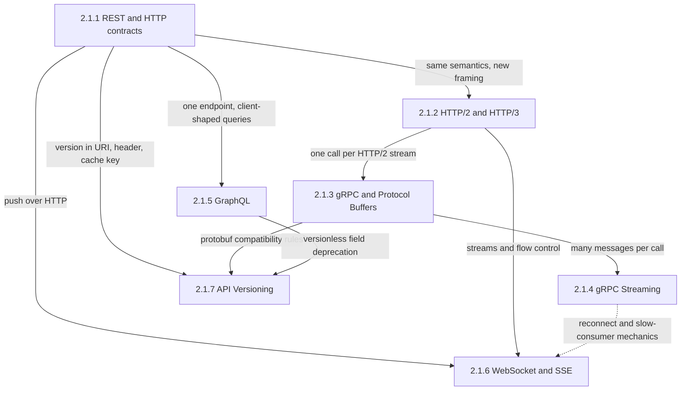
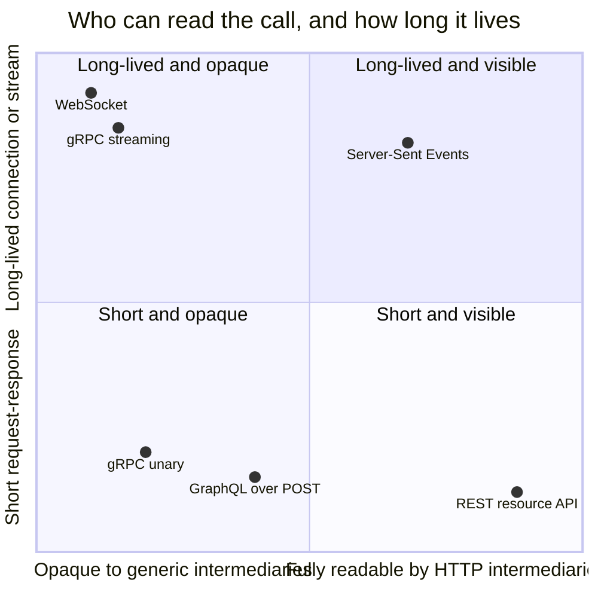
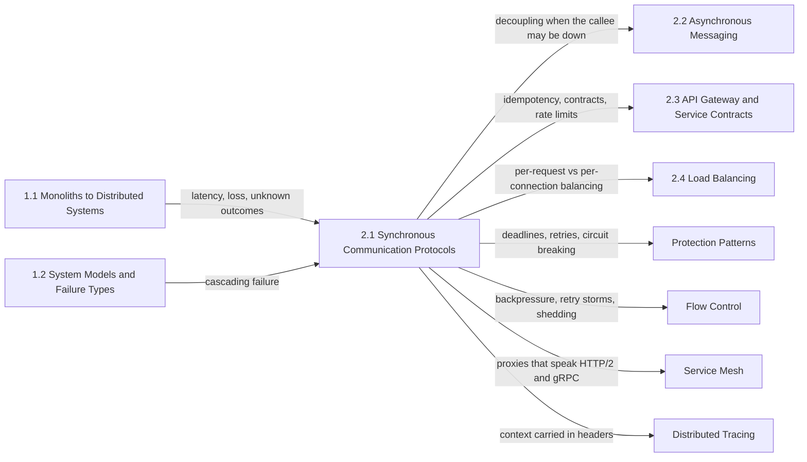

A synchronous call is one in which the caller sends a request and holds resources (a thread or task, a connection slot, a deadline budget, often a user waiting on a screen) until a response or a failure comes back. That shape is the easiest to program against, because the result arrives at the point in the code that asked for it, and the most expensive to operate, because the caller's latency becomes the sum of every hop below it and the caller's availability becomes the product of theirs. Every protocol in this chapter is a different answer to how that wait is carried over a network: what the message looks like on the wire, who along the path may act on it, how long the exchange lives, and how the contract survives when the two sides change on different schedules.

The single problem the chapter addresses is how to make a request-response contract that endpoints can rely on and that the network in between can cache, retry, balance, and observe without breaking. The tension that runs through all seven topics is between visibility and efficiency. A message expressed in HTTP's uniform vocabulary can be understood by any cache, proxy, gateway, or load balancer that has never seen the service; a message optimized for the two endpoints, binary, multiplexed, with its real outcome in a trailer, is cheaper per call and stricter as a contract, but every intermediary that cannot parse it becomes either blind or harmful. A second axis cuts across the first: how long a call lives. Short independent calls are cheap to retry, balance, and drain; long-lived streams deliver data the moment it exists but turn the server tier into a holder of per-client state, where deadlines, retries, balancing, and deploys stop working as they do for millisecond requests.

None of these protocols removes the coupling that makes a call synchronous; they decide how it fails. A propagated deadline, a status code with retry meaning, a precondition that rejects a stale write, and a resume token all make the failure legible to the caller. Work that must survive the callee being down belongs on a queue or a log, the subject of the next chapter.

## From HTTP Semantics to Long-Lived Streams: How the Topics Build on Each Other

The chapter is ordered from the contract outward: HTTP semantics first, then a new transport under the same semantics, a stricter RPC contract on that transport, and extensions of both models from short calls to streams and push. The last topic applies to all of them, because every contract eventually has to change without breaking consumers that cannot be upgraded.

*Dependencies between the chapter's topics. Solid arrows show what each page inherits from the one it builds on; the dashed arrow marks generic streaming failure mechanics that the WebSocket and SSE page reuses instead of re-deriving.*

The REST page is the root because it defines the contract the other pages either keep or give up: methods with agreed meaning, status codes as control signals, validators for optimistic concurrency, and cache directives that intermediaries act on. HTTP/2 and HTTP/3 keep all of it and change only framing and transport. gRPC requires HTTP/2 and maps every call onto one of its streams, so its page reads correctly only once streams, windows, and connection shutdown are understood. GraphQL leaves the resource model while staying on HTTP, and pays for it with one endpoint, one status code, and caching and cost control rebuilt by hand.

The two streaming pages extend the short call in different directions. gRPC streaming keeps the RPC contract and stretches one call over minutes or hours; WebSocket and SSE serve browsers, one by leaving HTTP after a handshake and the other by staying inside a response that never ends. The browser page points to the streaming page for the reconnect-storm and slow-subscriber mechanics they share. Versioning comes last because it depends on three earlier answers: where a version can live in an HTTP request and what that does to the cache key, which protobuf changes are wire compatible, and how a single GraphQL graph deprecates fields instead of versions.

## The Question Each Topic Answers

[REST: Constraints, Resources, and HTTP Contracts](/distributed-systems/en/communication/synchronous-protocols/rest/) answers what an HTTP interface promises to the network between client and server, and how lost updates, duplicate creates, and cached personal data follow when methods, status codes, and cache headers are used loosely. Open it before designing any public or cross-team API, and when a gateway, CDN, or retry layer seems to corrupt traffic.

[HTTP/2 and HTTP/3: Multiplexing, HOL Blocking, and QUIC](/distributed-systems/en/communication/synchronous-protocols/http2-http3-quic/) answers what changes when many requests share one connection, why a lost packet still stalls every stream on TCP, and what QUIC charges in CPU and operability to remove that stall. Open it when choosing a protocol version for an edge or a mesh, or investigating stalls, connection concentration, and stream-reset abuse.

[gRPC & Protocol Buffers: High-Performance RPC](/distributed-systems/en/communication/synchronous-protocols/grpc-protocol-buffers/) answers how a schema-first RPC contract encodes messages, stays compatible as fields change, and carries deadlines, cancellation, and retry-meaningful status codes across a call tree. Open it when building internal service-to-service APIs, and when calls hang without deadlines or load sticks to a few backends.

[gRPC Streaming: Unary, Server-Streaming, Bi-directional](/distributed-systems/en/communication/synchronous-protocols/grpc-streaming/) answers what a stream guarantees while it lives and what is lost when it breaks, how transport flow control becomes application backpressure, and how real systems resume a stream from a position. Open it before replacing polling or paging with a stream, and when streams die at a fixed age, stall silently, or reconnect in storms.

[GraphQL: Query Language and Federation Architecture](/distributed-systems/en/communication/synchronous-protocols/graphql/) answers how a server can execute workloads chosen by clients at request time without losing control of cost, batching, and caching, and what federation adds and charges when one graph spans many services. Open it when many client types need different shapes of the same data, and when resolvers fan out or queries exhaust capacity.

[WebSocket and Server-Sent Events: Real-Time Communication](/distributed-systems/en/communication/synchronous-protocols/websocket-sse/) answers how a server pushes to browsers the moment data exists, what each protocol guarantees about delivery and resumption, and how a tier of millions of long-lived connections is balanced, drained, and debugged. Open it when choosing between polling, SSE, and WebSocket, and when connections drop at proxy timeouts or events sit in a buffering hop.

[API Versioning Strategies](/distributed-systems/en/communication/synchronous-protocols/api-versioning/) answers when a change to a contract needs a new name, where that name lives in a request, how one codebase serves several contracts, and how old versions are retired without outages. Open it before the first breaking change to any API with consumers you cannot upgrade, and when planning a deprecation.

| Topic | Question it answers | Open it when |
|---|---|---|
| [REST](/distributed-systems/en/communication/synchronous-protocols/rest/) | What does an HTTP contract promise to every intermediary? | Designing a public API, choosing status codes and cache headers, fixing lost updates or duplicate creates |
| [HTTP/2 and HTTP/3](/distributed-systems/en/communication/synchronous-protocols/http2-http3-quic/) | What does multiplexing share, and what does QUIC remove? | Picking a protocol version, tuning stream and window limits, diagnosing stalls or reset floods |
| [gRPC and Protocol Buffers](/distributed-systems/en/communication/synchronous-protocols/grpc-protocol-buffers/) | How does a schema-first RPC stay compatible and carry deadlines and status? | Building internal APIs, setting deadlines and retry policy, debugging pinned load or keepalive errors |
| [gRPC Streaming](/distributed-systems/en/communication/synchronous-protocols/grpc-streaming/) | What survives when a long-lived call breaks? | Replacing polling with push, designing resume, investigating streams that die or stall |
| [GraphQL](/distributed-systems/en/communication/synchronous-protocols/graphql/) | How is a client-chosen workload kept bounded and cacheable? | Serving many UI clients, adding cost limits or batching, adopting federation |
| [WebSocket and SSE](/distributed-systems/en/communication/synchronous-protocols/websocket-sse/) | How does a server push to browsers, and how is the connection tier run? | Choosing a push protocol, sizing a gateway fleet, fixing proxy-induced disconnects |
| [API Versioning](/distributed-systems/en/communication/synchronous-protocols/api-versioning/) | When does a change need a new contract, and how is the old one retired? | Planning a breaking change, choosing where the version lives, setting a sunset date |

The protocols can be placed on the two axes the opening named. The chart is qualitative; transport and versioning are not plotted because they apply everywhere on it.

*Qualitative positions of the chapter's protocols. Horizontal: how much of the call's meaning (method, outcome, cacheability) a generic HTTP cache, proxy, or gateway can act on. Vertical: how long one exchange holds state on both ends.*

Moving down and to the right buys what intermediaries do for free: caching, retry decisions from method semantics, status-aware metrics and per-request balancing. Moving up and to the left buys efficiency and push delivery and hands those jobs back to the endpoints. GraphQL sits left of REST although it uses HTTP, because POST requests to one endpoint and a 200 for partial failures hide both cacheability and outcome from intermediaries. SSE is the only long-lived protocol that stays visible, which is why it is the usual answer when the client mostly listens. Many failure modes on the seven pages come from running a protocol from one quadrant behind infrastructure configured for another: a gRPC stream behind a proxy with a 15-second route timeout, a WebSocket behind a 60-second idle timer, a personalized response in a shared cache.

## Reading Order and Why

Read the chapter in sidebar order on a first pass; the dependency diagram above is the reason. Two orderings matter most. HTTP/2 must precede gRPC, because gRPC's trailers, flow control, keepalive interaction, and graceful shutdown are HTTP/2 mechanisms the gRPC page references without re-explaining. gRPC streaming must follow unary gRPC, because it is defined by what it loses relative to the unary call: per-call deadlines, transparent retries, and per-request balancing.

Three shortcuts are reasonable. An engineer designing a public or partner API should read REST, GraphQL, and API versioning, then continue to the API gateway chapter for idempotency keys and rate limits. An engineer building an internal service platform should read HTTP/2 and HTTP/3, gRPC, and gRPC streaming together, because connection lifetime and balancing span all three. An engineer building a real-time browser or mobile product should read HTTP/2 and HTTP/3, then WebSocket and SSE, then the streaming page's failure modes.

## Where the Chapter Sits in the Handbook

The chapter assumes the first part's account of what a network does to a call. [The 8 Fallacies of Distributed Computing](/distributed-systems/en/foundations/monoliths-to-distributed/eight-fallacies/) and [Network Reliability, Bandwidth Limitations, and Topology Changes](/distributed-systems/en/foundations/monoliths-to-distributed/network-reliability/) supply the facts every protocol here reacts to: latency is not zero, loss happens, and a timed-out request may or may not have executed. [Stateful vs. Stateless Services](/distributed-systems/en/foundations/monoliths-to-distributed/stateful-vs-stateless/) explains why a tier of long-lived connections is stateful even when the application code is not, and [Cascading Failure Analysis](/distributed-systems/en/foundations/system-models/cascading-failure/) shows what synchronous coupling becomes under overload.

*Prerequisites on the left and the chapters that consume this one on the right. Each arrow names what is handed over.*

This chapter defines calls; the rest of the handbook protects, routes, and replaces them. [Message Queue vs. Event Streaming](/distributed-systems/en/communication/async-messaging/message-queue-vs-event-streaming/) is where work goes when the caller must not depend on the callee's availability, and [Schema Evolution and Schema Registry](/distributed-systems/en/communication/async-messaging/schema-evolution-registry/) applies protobuf compatibility to stored messages. The API gateway chapter owns the mechanisms several pages here only link to: [Idempotency and Safe HTTP Methods](/distributed-systems/en/communication/api-gateway/idempotency/) for making retries of state-changing calls safe, [Backend for Frontend](/distributed-systems/en/communication/api-gateway/bff-pattern/) for aggregating calls per client type, [Consumer-Driven Contract Testing](/distributed-systems/en/communication/api-gateway/contract-testing/) for verifying contracts against real consumers, and [Throttling and Rate Limiting at the Gateway Level](/distributed-systems/en/communication/api-gateway/throttling-rate-limiting/). Long-lived connections are why [Client-Side vs. Server-Side Load Balancing](/distributed-systems/en/communication/load-balancing/client-vs-server-side/) and [Health-Aware Routing and Connection Draining](/distributed-systems/en/communication/load-balancing/health-aware-routing/) matter.

The resilience part turns the chapter's failure signals into policy. [Timeouts](/distributed-systems/en/resilience/protection-patterns/timeouts/) and [Retry with Exponential Backoff](/distributed-systems/en/resilience/protection-patterns/retry-exponential-backoff/) decide what to do with a deadline and a retryable status, [Backpressure](/distributed-systems/en/resilience/flow-control/backpressure/) generalizes the flow-control windows of HTTP/2 and gRPC streams, and [Retry Storms and Metastable Failures](/distributed-systems/en/resilience/flow-control/retry-storms-metastable-failures/) is the incident most pages here warn about. [Envoy Proxy](/distributed-systems/en/service-mesh/service-mesh-architecture/envoy-proxy/) is where many of these timeouts and stream limits are configured, and [Distributed Tracing](/distributed-systems/en/observability/logs-metrics-traces/distributed-tracing/) depends on context carried in these protocols' headers.
