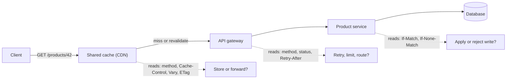
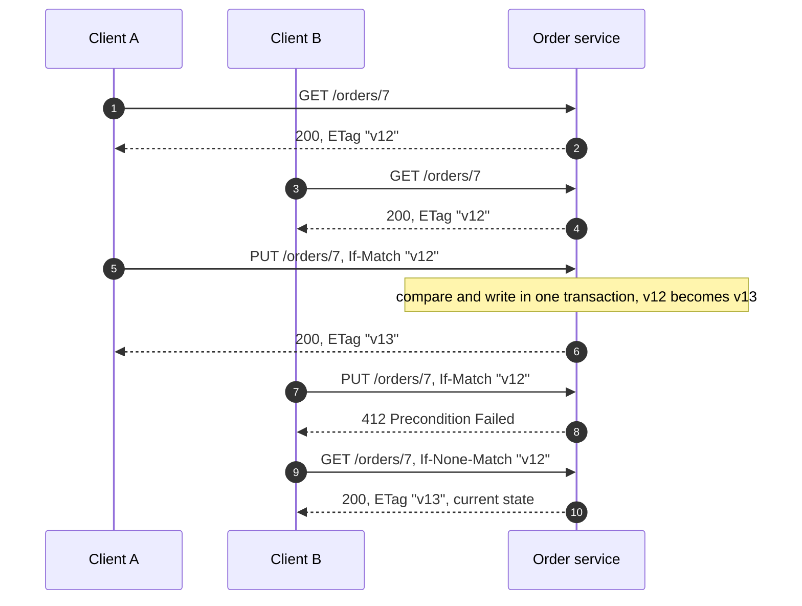
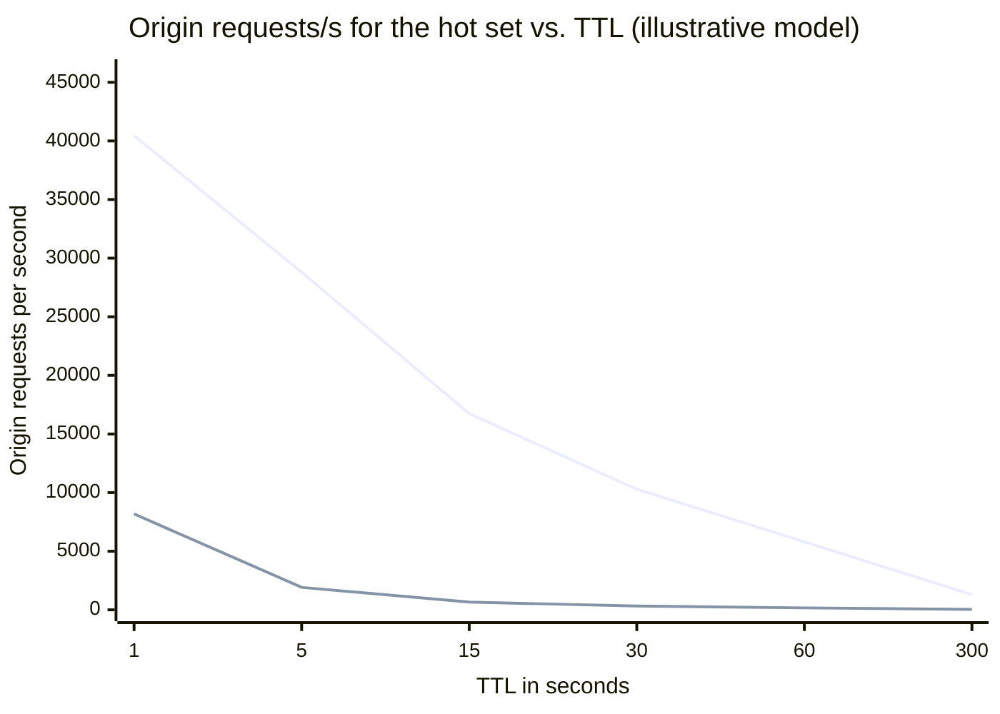
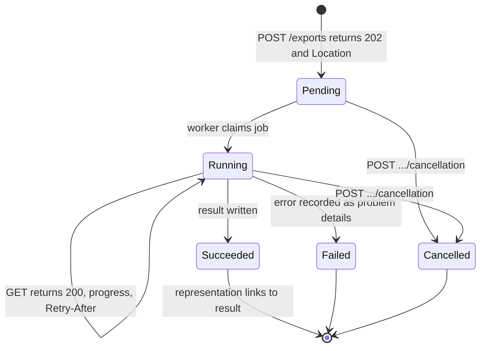

Representational State Transfer (REST) is the architectural style Roy Fielding derived in his 2000 dissertation to describe why the Web scales: a set of constraints on how components interact, chosen so that the network between client and server can understand, cache, retry, and route messages without knowing anything about the application. A REST interface exposes resources, each named by a URI, and lets clients act on them only by transferring representations (a JSON document, an image, an HTML page) through a small, fixed set of methods whose meaning every participant agrees on in advance. HTTP is the protocol that was shaped around those constraints, so in practice "a REST API" means an HTTP API whose methods, status codes, and headers are used with their standardized meaning.

The core trade-off is generality against efficiency. Because every message is self-contained and uses a uniform vocabulary, a cache, proxy, gateway, or load balancer that has never seen your service can still decide whether a response may be stored, whether a failed request may be resent, and whether a client's copy is still current. The price is that application semantics must be squeezed into that generic vocabulary: operations that are not naturally "read or replace this document" become awkward, each request carries its own context in verbose headers, and a client that needs data from several resources pays several round trips. REST optimizes for large-grained, cacheable, long-lived interfaces between parties that evolve independently; it is a poor fit for chatty, low-latency calls between tightly coupled components.

This page concentrates on the parts of the HTTP contract that decide correctness in production: method semantics, preconditions, caching, and status codes as control signals. Idempotency keys are covered in [Idempotency and Safe HTTP Methods](/distributed-systems/en/communication/api-gateway/idempotency/), versioning in [API Versioning Strategies](/distributed-systems/en/communication/synchronous-protocols/api-versioning/), and the transport underneath in [HTTP/2 and HTTP/3](/distributed-systems/en/communication/synchronous-protocols/http2-http3-quic/).


*A layered request path. Each intermediary makes its decision from standardized message fields, not from knowledge of the product service.*

The dotted edges are the point of the style. The CDN decides from the method and cache directives whether it may answer alone, the gateway decides from the method and status whether a failed attempt can be resent, and the origin decides from a precondition header whether a write is based on current state. None of these decisions requires parsing the body or sharing code with the service, and each becomes wrong the moment the service uses a method, status code, or directive against its standardized meaning.

## The Constraints and the Properties They Induce

Fielding defines REST by starting from no constraints and adding six, each inducing a property and each costing something. The useful way to read them is causally: statelessness is what makes messages self-describing, self-describing messages are what make caching and layering safe, and caching is what lets the Web absorb read load that no origin could serve.

Client-server separation splits user-interface concerns from data storage, so each side can evolve and scale on its own. Statelessness requires that every request carry all the information needed to understand it; the server keeps no conversational context between requests. Session state lives in the client or in the request itself (a token, a cursor), the protocol-level version of the instance fungibility analyzed in [Stateful vs. Stateless Services](/distributed-systems/en/foundations/monoliths-to-distributed/stateful-vs-stateless/). The server still stores resource state durably; the constraint forbids only interaction state, the "where are we in this conversation" data that would pin a client to one instance.

The cache constraint requires responses to label themselves as cacheable or not. The uniform interface is the central and most expensive constraint, with four parts: resources are identified by URIs; they are manipulated through representations, never through the server's storage format; messages are self-descriptive, so method, media type, and control headers suffice for any recipient to process them; and hypermedia is the engine of application state (HATEOAS), meaning clients discover next actions from links in representations rather than from out-of-band knowledge. The layered-system constraint restricts each component to seeing only the adjacent layer, so a CDN, gateway, or mesh proxy can be inserted without the client knowing. Code on demand, the optional sixth, is JavaScript on the Web and has no role in service APIs.

| Constraint | Property it induces | What it costs | Common violation in practice |
|---|---|---|---|
| Client-server | Independent evolution of each side | A network hop for every interaction | Server-rendered state machines that assume one client type |
| Stateless | Any instance can serve any request; failures lose only in-flight work | Context resent with every request; larger messages | Server-side sessions keyed by cookie, sticky routing as a correctness requirement |
| Cache | Read load absorbed by intermediaries; lower latency | Bounded staleness; invalidation is not part of the protocol | No cache headers at all, or `no-store` everywhere |
| Uniform interface | Generic intermediaries, independent evolvability | Operations forced into a fixed method set; less efficient than a purpose-built protocol | `POST /doAction` for everything, errors returned as `200` |
| Layered system | Transparent proxies, gateways, CDNs, load balancers | Added latency per layer; each layer has its own timeouts | Clients that depend on reaching a specific backend |
| Code on demand (optional) | Client extensibility | Reduced visibility and security | Not applicable to service APIs |

### Hypermedia: The Constraint Most APIs Drop

Most APIs called RESTful stop at what Leonard Richardson's maturity model calls "level 2": resources plus correct HTTP verbs, without hypermedia. Fielding wrote in 2008 that an API driven by out-of-band documentation of URI templates is not REST, because clients hard-code the server's URI structure and workflow and break when either changes. The counter-position, held by most API designers, is that machine clients do not explore: a service calls the endpoints its developers coded against, and links add bytes without removing the need for documentation.

This handbook's position is that the deciding variable is who controls the client. When one team owns both sides, or clients are generated from an [OpenAPI contract](/distributed-systems/en/communication/api-gateway/openapi-swagger/), full hypermedia buys little. When clients are numerous, external, and long-lived, a narrow form pays for itself in two places: state-dependent actions (a `cancel` link present only while cancellation is allowed, so clients stop encoding the server's state machine) and server-issued URIs for pagination cursors and long-running operations, which let the server change routing and storage without a client release.

## The HTTP Contract: Methods, Preconditions, and Status Codes

HTTP semantics are defined in RFC 9110 (2022), with caching in RFC 9111 and the HTTP/1.1 wire format in RFC 9112. The contract that matters to a distributed system is not what a method "means" in English but what each party is permitted to do with it.

A method is safe if the client does not request any state change by issuing it (`GET`, `HEAD`, `OPTIONS`); a crawler, prefetcher, or monitoring probe may therefore issue it freely. A method is idempotent if repeating it has the same intended effect as sending it once (the safe methods plus `PUT` and `DELETE`); a client or intermediary may therefore resend it after a connection failure without knowing whether the first attempt was processed, and RFC 9112 explicitly permits automatic retry of idempotent requests when a connection closes before the response arrives. `POST` and `PATCH` carry no such guarantee, which is why a timed-out `POST` leaves the client unable to tell success from failure; making it safely retryable needs an idempotency key, covered in [Idempotency and Safe HTTP Methods](/distributed-systems/en/communication/api-gateway/idempotency/). Only responses to `GET` and `HEAD` are cached by general-purpose caches in practice.

`PUT` replaces the target resource's state with the enclosed representation. `PATCH` (RFC 5789) applies a set of changes in a separate media type: JSON Merge Patch (RFC 7396) sends a partial document in which `null` means "delete this member", concise but unable to set a null or modify one array element; JSON Patch (RFC 6902) sends an ordered list of operations, including a `test` operation that fails the whole patch unless a value matches. The `QUERY` method, standardized in RFC 10008 (June 2026), is safe and idempotent but carries a body, removing the old choice between a giant query string and a `POST` that caches and retry logic must treat as unsafe; proxy, CDN, and library support will lag the standard.

### Optimistic Concurrency with Validators

Two clients that each read a resource, modify their copy, and `PUT` the result will silently overwrite one another: the second write wins and the first change disappears with a `200 OK`. This is the lost-update anomaly, the HTTP-level version of the read-modify-write race analyzed in [Weak Isolation and MVCC](/distributed-systems/en/data-management/consistency-models/weak-isolation-mvcc/). HTTP's answer is the conditional request. Every response can carry a validator: an `ETag` (entity tag), an opaque string that the server changes whenever the representation changes, or a `Last-Modified` timestamp. A client that wants to write sends the validator back in `If-Match`, and the server applies the write only if the resource's current validator still matches; otherwise it returns `412 Precondition Failed` and changes nothing.


*Optimistic concurrency with `If-Match`. Client B's stale write is rejected instead of overwriting Client A's change.*

The note before step 6 is where correctness lives. The comparison and the write must be atomic at the origin, typically a `version` column checked in the `UPDATE ... WHERE id = ? AND version = ?` statement, with zero affected rows mapped to `412`. A service that reads the current ETag, compares it in application code, and then writes in a separate statement has reintroduced the race inside itself. Steps 9 and 10 show the recovery path: client B fetches the current state, conditionally, so that if nothing had changed it would receive a bodiless `304 Not Modified`, then reapplies its intent and retries. The retry is a semantic merge, not a blind resend, which is why the decision belongs to the client and not to a generic retry layer.

Three details decide whether this works. `If-Match` uses strong comparison, so weak validators (prefixed `W/`, meaning "semantically equivalent" rather than byte-identical) never match; a framework that emits weak ETags by hashing a compressed body silently disables preconditions. `If-None-Match: *` turns a `PUT` into create-only, failing if any representation already exists, which gives a race-free "create if absent". And a server can refuse unconditional writes altogether with `428 Precondition Required` (RFC 6585), converting a client's forgotten header from silent data loss into an immediate error.

Real systems use this shape. Amazon S3 added `If-None-Match` to `PutObject` in August 2024 and `If-Match` in November 2024, making object storage a compare-and-swap primitive. The Kubernetes API carries the version in the body: an update with a stale `metadata.resourceVersion` is rejected with `409 Conflict`, and controllers re-read and retry. GitHub's REST API does not count an authenticated `304` against the primary rate limit, which makes conditional polling nearly free.

:::danger[Unconditional writes lose data without an error]
A `PUT` or `PATCH` without a precondition on a resource that more than one actor can modify will eventually drop a concurrent change, and every request involved returns success. Nothing in logs or metrics shows it; it surfaces later as a customer report of a change that "did not stick". Require `If-Match` (or a version field) on every mutable resource with concurrent writers, and return `428` when it is missing.
:::

### Status Codes as Control Signals

Status codes are read by machines before people: retry middleware, circuit breakers, gateways, and dashboards classify them by class and act. The classification that matters operationally is not "success or error" but "who should change behavior, and how".

A `4xx` says the request, as sent, will not succeed; resending it unchanged is wasted work, with three deliberate exceptions. `408 Request Timeout` and `429 Too Many Requests` mean "the same request may succeed later", and `429` and `503 Service Unavailable` may carry `Retry-After` to say when; [rate limiting at the gateway](/distributed-systems/en/communication/api-gateway/throttling-rate-limiting/) depends on clients honoring it. `409 Conflict` and `412` mean "re-read and decide", as above. A `5xx` says the server failed, but the subclasses reveal different things about the outcome. `503` returned before processing (load shedding, an open circuit) means nothing happened; `500` may follow a partial state change; `502 Bad Gateway` and `504 Gateway Timeout` come from an intermediary and mean only that it lost contact with the origin, which may still be processing or may have committed. For a non-idempotent request that ambiguity is the root of the duplicate-create failure below.

Error bodies should use a standard format so that clients can branch on a stable type rather than parse messages. RFC 9457 (2023, obsoleting RFC 7807) defines Problem Details, a JSON object with media type `application/problem+json` and members `type` (a URI identifying the problem class), `title`, `status`, `detail`, and `instance`, extensible with problem-specific members.

```text
PUT /orders/7 HTTP/1.1
If-Match: "v12"
Content-Type: application/json

HTTP/1.1 412 Precondition Failed
Content-Type: application/problem+json
ETag: "v13"

{"type": "https://api.example.com/problems/stale-version",
 "title": "Order was modified since it was read",
 "status": 412,
 "detail": "Expected version v12, current version is v13.",
 "instance": "/orders/7"}
```

The response carries the current `ETag`, and the problem `type` stays stable when the message is reworded. Returning `200` with an error object defeats every layer in the opening diagram: caches may store it, retry middleware treats it as success, and dashboards stay green during an outage.

## Caching as a Protocol: Freshness, Validation, and Shared Caches

HTTP caching is a two-step protocol: freshness decides whether a stored response may be used without contacting the origin; validation decides whether a stale one can be reused after a cheap check. `Cache-Control: max-age=60` makes a response fresh for 60 seconds in any cache; `s-maxage` overrides it for shared caches such as CDNs and reverse proxies only; `private` forbids shared caches from storing it; `no-store` forbids storage anywhere. `no-cache` is commonly misread: it permits storage but requires validation before every reuse. RFC 5861 adds `stale-while-revalidate=N`, serving a stale response for up to N seconds while refreshing in the background, and `stale-if-error=N`, serving stale content when the origin fails, a built-in fallback for read paths.

Two rules surprise teams most often. The first is `Vary`: a cache keys a stored response by method and URI only, so if the representation differs by `Accept`, `Accept-Language`, or `Accept-Encoding`, the response must list those headers in `Vary` or a cache will serve one client's variant to another. The second is heuristic freshness: a response with no explicit freshness information but with a `Last-Modified` header and a heuristically cacheable status (`200`, `301`, `404`, and `410` among them) may be cached for a period the cache chooses, and RFC 9111 suggests 10% of the time since last modification. A document last modified 30 days ago may be served for about three days by a cache nobody configured, so every response should carry an explicit `Cache-Control`.

Shared caches add a third rule for authenticated traffic: RFC 9111 forbids a shared cache from reusing a response to a request that carried an `Authorization` header unless the response explicitly allows it with `public`, `s-maxage`, or `must-revalidate`. This protects bearer-token APIs by default, but not cookie-authenticated pages and not responses to which someone added `s-maxage` to "speed things up". Invalidation is outside the protocol entirely: HTTP has no message that tells downstream caches a resource changed, which is why purge APIs are vendor-specific and why choosing TTLs is the real design decision, covered in [Cache Invalidation](/distributed-systems/en/data-management/distributed-caching/cache-invalidation/).

```text
# Product page: shared caches hold 60 s, serve stale while refreshing and during origin errors
Cache-Control: public, max-age=10, s-maxage=60, stale-while-revalidate=30, stale-if-error=300
ETag: "p42-v881"
Vary: Accept-Encoding
---
# Account page: never in a shared cache, browsers must revalidate
Cache-Control: private, no-cache
ETag: "acct-91-v17"
---
# Payment confirmation: no copy anywhere
Cache-Control: no-store
```

The product page gives browsers a short freshness window and CDNs a longer one, because a CDN can be purged and a browser cannot. The account page lives only in the user's browser and only with validation, so a returning user pays a `304` instead of a full body.

### Worked Example: How TTL and Tiering Bound Origin Load

Assume a catalog API serves 50,000 product reads per second through 40 CDN points of presence (PoPs). 10,000 hot products receive 90% of reads, spread evenly across PoPs and products; the remaining 5,000 reads per second are spread over 190,000 cold products and almost always miss. All numbers are illustrative.

Each hot product therefore receives `45,000 / (10,000 * 40) = 0.1125` requests per second at each PoP, one every 8.9 seconds. A cache entry with TTL `T` turns a stream of rate `λ` into one origin fetch per cycle of length `T + 1/λ` (the fresh window, then the wait until the next request finds it stale), so origin requests per entry are `λ / (1 + λT)`. With `T = 60` s that is `0.1125 / 7.75`, and across 400,000 product-PoP pairs about 5,800 origin requests per second for the hot set: an 87% reduction, plus the 5,000 cold misses. The reduction is weaker than intuition suggests because 40 independent caches each fetch every hot key separately.

Adding a shield tier, one regional cache that all PoPs consult on a miss, changes the arithmetic: the shield sees each hot product at 4.5 requests per second, so with the same 60 s TTL the origin receives `10,000 * 4.5 / (1 + 4.5 * 60)`, about 166 requests per second for the hot set. The fan-in collapses from 40 caches to one, and the origin load for popular content is bounded by roughly the number of hot keys divided by the TTL.


*Upper line: 40 independent PoPs. Lower line: the same PoPs behind one shield cache. Hot-set traffic of 45,000 requests/s, evenly spread; model `λ / (1 + λT)` per cache entry.*

The upper curve shows that short TTLs barely help when per-PoP traffic per key is sparse: at 5 seconds, most requests arrive after the entry expired. The lower curve shows why tiering matters more than TTL tuning for read-heavy APIs. Validation reduces cost further: if each origin fetch is a conditional `GET` and the product changed in only 5% of cases, 95% of fetches return a `304` of a few hundred bytes instead of a 20 KB body, so origin egress drops by about 95% even where request count does not. The model ignores the moment of expiry itself; when a very hot key expires at many caches at once, the simultaneous refetch is a stampede, covered in [Cache Stampede](/distributed-systems/en/data-management/distributed-caching/cache-stampede/), and `stale-while-revalidate` is the HTTP-native mitigation.

## Resource Design: Granularity, Long-Running Work, and Pagination

A resource is any concept worth naming, not a database table. Designing them well is mostly about three pressures: round trips, operations that do not complete within one request, and collections too large to return at once.

Granularity sets round-trip count. A client that lists 50 orders and then fetches each order's customer makes 51 requests. With 1 ms network round trip and 2 ms server time (illustrative), that is 153 ms sequentially; with six parallel HTTP/1.1 connections, nine waves take about 30 ms; with HTTP/2 multiplexing, close to one round trip, but the server still executes 51 requests. The fixes are coarser representations, an expansion parameter, or an aggregation layer such as a [Backend for Frontend](/distributed-systems/en/communication/api-gateway/bff-pattern/) or [API composition](/distributed-systems/en/microservice-patterns/data-management-patterns/api-composition/). When every client needs a different shape, that pressure is the problem [GraphQL](/distributed-systems/en/communication/synchronous-protocols/graphql/) was built for. Operations beyond create, read, replace, and delete become resources too: `POST /orders/7/cancellation` creates a cancellation with its own state and audit trail, instead of a `PATCH` that hides a workflow behind a field write.

### Long-Running Operations as Resources

Work that outlasts a sensible request timeout (a report, a bulk import, a provisioning job) should not hold a connection open. The server accepts the request with `202 Accepted` and a `Location` header naming a new operation resource; the client polls it, or subscribes to a callback, and finds the result through a link when it is done. Google's API Improvement Proposals standardize this as a long-running operation resource; the principle is the same everywhere.


*Lifecycle of an operation resource. Each state is visible to the client through `GET` on the URI returned in `Location`.*

The state machine is what makes the pattern robust. Because the operation is a resource with a URI, a client that crashes mid-poll can resume from the stored URI; a timeout no longer means "unknown outcome" but "check again"; and `Retry-After` on each poll lets the server pace clients instead of absorbing a fixed polling rate from all of them. The initial `POST` remains non-idempotent, so it still needs an idempotency key, or two retried submissions create two jobs. Terminal states should be retained for a documented period, because a client that polls after the operation resource has been deleted gets a `404` it cannot distinguish from "never existed".

### Pagination That Survives Concurrent Writes

Offset pagination (`?offset=500000&limit=50`) is simple and wrong at scale in two ways. Cost: the database must produce and discard every skipped row, so page 10,001 of a 50-row listing reads 500,050 rows to return 50, and deep pages degrade linearly. Correctness: if a row is inserted before the current position between two page requests, every later row shifts by one and the client sees one row twice; if a row is deleted, the client skips one. Cursor (keyset) pagination returns an opaque `next` token encoding the sort key of the last row; the next page queries `WHERE (created_at, id) > (?, ?) ORDER BY created_at, id LIMIT 50`, an index seek whose cost is independent of depth and which concurrent writes cannot shift. The sort must end with a unique tiebreaker, or rows with equal keys at a page boundary are lost, and an opaque, ideally signed, token lets the server change its encoding later.

## Failure Modes in HTTP APIs

The failures below share one property: each comes from a party acting correctly on a contract that another party violated or misunderstood.

### Duplicate Creates Behind a Gateway Timeout

Trigger: a non-idempotent `POST` takes longer than an intermediary's timeout, so the intermediary returns `504` while the origin is still working; the client, seeing a `5xx`, retries. Symptoms: duplicate orders, payments, or jobs, clustered during latency spikes, each with a successful origin log entry.

```mermaid
sequenceDiagram
    autonumber
    participant C as Client
    participant G as Gateway, timeout 5 s
    participant S as Order service
    participant D as Database
    C->>G: POST /orders
    G->>S: POST /orders
    S->>D: INSERT order, slow lock wait
    rect rgb(70, 40, 40)
    Note over G: 5 s elapse with no response
    G-->>C: 504 Gateway Timeout
    C->>G: Retry POST /orders
    G->>S: POST /orders
    end
    D-->>S: First insert commits at 6.2 s
    S-->>G: 201 Created, response discarded
    S->>D: Second INSERT commits
    S-->>G: 201 Created
    G-->>C: 201 Created, client believes one order exists
```


*An illustrative duplicate create. The gateway's timeout is shorter than the origin's worst-case latency, and the client treats `504` as "nothing happened".*

Step 4 is the misunderstanding: `504` means the gateway stopped waiting, not that the order was not created. The first insert commits at step 7, after the client has already retried, and its response is discarded at step 8 because the gateway has closed that exchange. Detection: origin `201` counts exceeding client-observed successes, gateway `504` rate correlated with duplicate business keys, and origin request duration exceeding the gateway timeout. Mitigation has two layers. Make the `POST` idempotent with a client-supplied key so the second attempt returns the first result. Align timeouts so each hop's budget is shorter than the one in front of it, with the origin cancelling work when its deadline passes, as described in [Timeouts](/distributed-systems/en/resilience/protection-patterns/timeouts/). Recovery requires deduplicating by business key after the fact, which is only possible if such a key exists.

### Keep-Alive Races on Pooled Connections

HTTP/1.1 clients reuse idle pooled connections. If the server closes an idle connection at the moment the client sends on it, the request is lost and the client sees a reset, or a load balancer returns `502`. The classic configuration is a backend whose keep-alive timeout is shorter than its load balancer's idle timeout: Node.js's HTTP server defaults to 5 seconds of keep-alive, while an AWS Application Load Balancer defaults to a 60-second idle timeout, so the load balancer periodically sends a request on a connection the backend is closing. Symptoms: a low, steady rate of `502` or resets, uncorrelated with load and absent from backend logs. Detection: load balancer `502` counts with no matching backend error, concentrated on the first request after an idle gap. Mitigation: the side that opens connections must have the shorter idle timeout, so it always closes first. Clients may resend idempotent requests on a reset connection, which is why the race is harmless for `GET` and dangerous for `POST`.

### Personalized Responses in a Shared Cache

Trigger: a response that depends on the user is stored by a shared cache because it lacked `private` or `no-store`, carried a directive that overrides the `Authorization` protection, or was keyed without the header that distinguishes users. Symptoms: users see each other's data, usually after a CDN or cache configuration change. The best-documented case is Steam on 25 December 2015: during a denial-of-service attack that raised store traffic by 2,000%, a second caching configuration, deployed with Valve's web caching partner in response to the attack, incorrectly cached web traffic for authenticated users, and Valve later stated that about 34,000 users had pages, including billing addresses and partial payment details, shown to others before the store was shut down. Prevention is mechanical: explicit `Cache-Control` on every response, `private` or `no-store` on anything personalized, and a test that requests one URI with two identities through the real cache path and compares responses.

:::caution[Cache configuration changes deserve the rigor of schema changes]
A CDN rule that caches "everything under `/api/`" for performance turns every missing `Cache-Control` header into a potential data leak. Treat cache rules as code, review them against the endpoints they match, and make the origin's headers, not the CDN's defaults, the source of truth.
:::

### Summary of Failure Signatures

| Failure | Symptom from outside | Detection signal | Mitigation |
|---|---|---|---|
| Lost update | Changes "do not stick"; no errors | Concurrent writes to one resource in access logs; absent `If-Match` | `If-Match` or version field, `428` on unconditional writes |
| Duplicate create | Duplicate business records during latency spikes | Origin `201` count above client successes; `504` correlated with duplicates | Idempotency keys; timeout budgets shrinking toward the origin |
| Keep-alive race | Low steady `502`/reset rate | LB `502` with no backend log entry | Backend idle timeout above LB idle timeout |
| Shared-cache leak | Users see others' data | Same URI, different identities, identical cached body | `private`/`no-store`, correct `Vary`, cache-path tests |
| Heuristic staleness | Old data served with no TTL configured | `Age` header on responses lacking `Cache-Control` | Explicit `Cache-Control` everywhere |
| Pagination drift | Duplicate or missing items across pages | Item counts differ from total; repeated IDs | Keyset cursor with unique tiebreaker |
| Status-code misuse | Retries on `400`; green dashboards during outages | `2xx` bodies containing error objects; retry rate on `4xx` | Correct status classes, RFC 9457 bodies |

Misused status codes turn local errors into load: a client library that retries every non-`2xx` will resend `400` and `401` requests indefinitely, and a service that returns `500` for validation errors invites exactly that, a path into [retry storms](/distributed-systems/en/resilience/flow-control/retry-storms-metastable-failures/). Retry policy itself belongs to [Retry with Exponential Backoff](/distributed-systems/en/resilience/protection-patterns/retry-exponential-backoff/); the API's job is to make the status code tell the truth.

## Choosing REST and Its Alternatives

REST is one of several interface styles for synchronous calls, and each optimizes for a different relationship between client and server.

| Style | Contract and encoding | Strengths | Weaknesses | When to prefer |
|---|---|---|---|---|
| REST over HTTP | Resources, standard methods, media types, usually JSON | Generic intermediaries, HTTP caching, conditional requests, universal tooling | Verbose, chatty for composite reads, no native streaming | Public and partner APIs, read-heavy cacheable data, independently evolving clients |
| [gRPC](/distributed-systems/en/communication/synchronous-protocols/grpc-protocol-buffers/) | Service methods in Protobuf over HTTP/2 | Compact encoding, generated clients, deadlines, streaming | Opaque to HTTP caches, needs HTTP/2 end to end, weak browser support | Internal service-to-service calls with high rate and strict latency budgets |
| [GraphQL](/distributed-systems/en/communication/synchronous-protocols/graphql/) | Typed schema, client-specified queries over one endpoint | One round trip per screen, client-shaped responses | HTTP caching largely lost, query cost control needed | Many client types aggregating data from many backends |
| [WebSocket and SSE](/distributed-systems/en/communication/synchronous-protocols/websocket-sse/) | Long-lived connection, application-defined frames | Server push, low per-message overhead | Stateful connections, harder load balancing | Live updates and bidirectional interaction |
| [Asynchronous messaging](/distributed-systems/en/communication/async-messaging/message-queue-vs-event-streaming/) | Messages or events through a broker | Temporal decoupling, buffering, fan-out | No immediate answer, eventual consistency | Work that need not complete within the caller's request |

Use REST when the interface crosses an organizational boundary, when clients are numerous or external and upgrade on their own schedule, when reads dominate and are cacheable, and when operability with standard tooling (curl, browsers, CDNs, gateways, WAFs) outweighs per-call efficiency. It is also the right default for resources with concurrent writers, because conditional requests give a standard optimistic-concurrency protocol that every client can implement.

Do not use REST, or not only REST, when calls are high-rate and internal with a strict latency budget, where gRPC's encoding and deadline propagation are worth losing HTTP-cache visibility; when the operation is a stream of events rather than a document; when a client needs one aggregated view of many resources and the round trips cannot be hidden behind a BFF; or when the interaction is inherently a procedure call with no resource to name, where a resource model produces `POST /doAction` endpoints that inherit HTTP's cost without its benefits. REST's flexibility is no reason to skip a written contract: a resource API without an OpenAPI description and [consumer-driven contract tests](/distributed-systems/en/communication/api-gateway/contract-testing/) drifts as quickly as any other.

:::tip[Spend design effort on the parts intermediaries read]
URI naming is the most argued and least consequential part of REST design. Correct method choice, explicit `Cache-Control`, strong ETags with `If-Match`, honest status codes, and opaque server-issued URIs for cursors and operations decide whether caches, gateways, and retry layers help the API or corrupt it.
:::

## Further Reading

- Roy T. Fielding, *Architectural Styles and the Design of Network-based Software Architectures*, PhD dissertation, University of California, Irvine, 2000.
- Roy T. Fielding and Richard N. Taylor, *Principled Design of the Modern Web Architecture*, ACM Transactions on Internet Technology, 2002.
- R. Fielding, M. Nottingham, and J. Reschke (eds.), *RFC 9110: HTTP Semantics*, IETF, 2022.
- R. Fielding, M. Nottingham, and J. Reschke (eds.), *RFC 9111: HTTP Caching*, IETF, 2022.
- M. Nottingham, E. Wilde, and S. Dalal, *RFC 9457: Problem Details for HTTP APIs*, IETF, 2023.
- Roy T. Fielding, *REST APIs must be hypertext-driven*, Untangled (blog), 2008.
