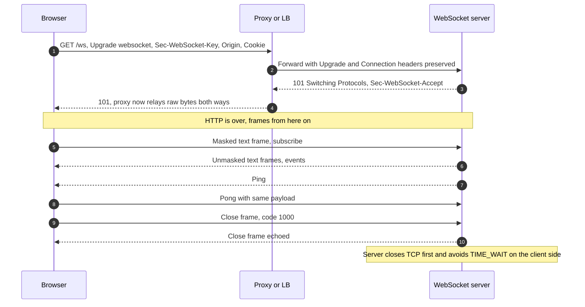
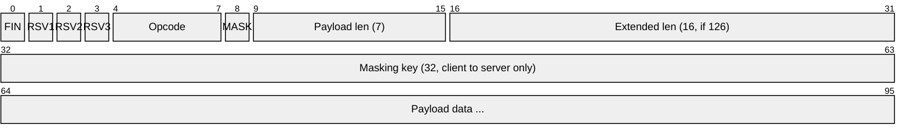
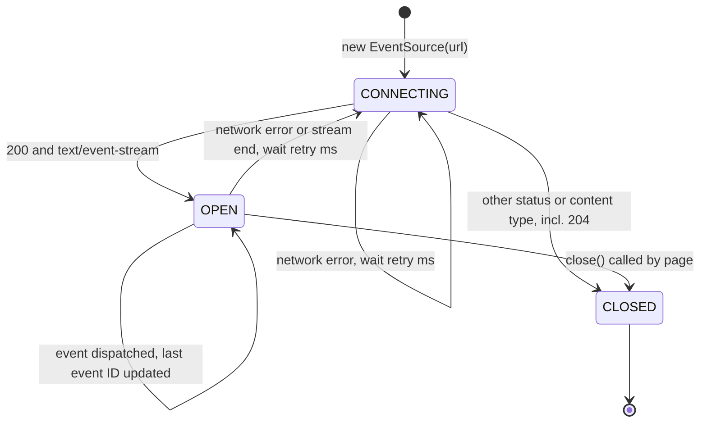
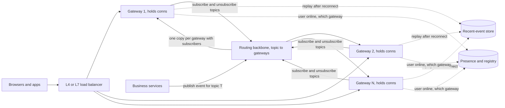
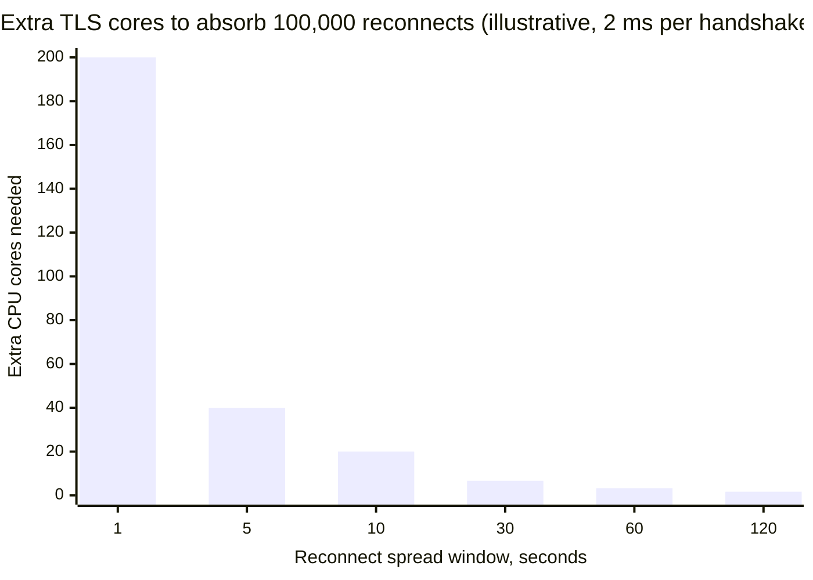

WebSocket and Server-Sent Events (SSE) let a server send data to a browser the moment it exists, without the browser asking first. WebSocket does it by turning an HTTP/1.1 request into a raw, full-duplex message channel over the same TCP connection; after the handshake, HTTP is gone and both sides exchange frames defined by RFC 6455. SSE does it without leaving HTTP: the server answers one GET request with a response whose body never ends, and writes events into that body as lines of text. Both replace polling, where a client asks "anything new?" on a timer and pays one request per interval whether or not anything changed, and long polling, where the server holds each request open until there is news and the client immediately asks again.

The core trade-off is the same for both: push latency drops from half a polling interval to one network transit, and in exchange the server tier stops being stateless. Every connected client is an open socket, a TLS session, buffers, subscriptions, and a timer, pinned to one process until the connection ends. Deploys, autoscaling, load balancing, and failure recovery all have to deal with state that a request-response service never had. The second trade-off separates the two protocols. SSE is one-directional, text-only, and inherits everything HTTP gives (caching proxies aside): authentication headers, HTTP/2 multiplexing, standard logging, and a reconnection and resume protocol built into the browser. WebSocket is bidirectional and binary-capable with a 2-to-14-byte frame header, but it has no message identity, no resumption, and in the classic browser API no backpressure: everything above "bytes arrive in order while the TCP connection lives" is the application's job.

This page owns the two wire protocols, their browser semantics, and the operation of large connection tiers built on them. Streaming between services, where gRPC's HTTP/2 streams are the usual tool, is covered in [gRPC Streaming](/distributed-systems/en/communication/synchronous-protocols/grpc-streaming/), including the generic mechanics of reconnect storms and slow subscribers that apply here as well. The HTTP/2 and HTTP/3 transports underneath are covered in [HTTP/2 and HTTP/3](/distributed-systems/en/communication/synchronous-protocols/http2-http3-quic/).

## WebSocket: An Upgraded TCP Connection With Message Framing

WebSocket was designed to pass through infrastructure that only understood HTTP: port 80 and 443 firewalls, HTTP proxies, and load balancers. Its opening handshake is therefore an ordinary HTTP/1.1 GET with two extra headers, and its framing exists to give messages boundaries on top of TCP's byte stream while making the bytes on the wire useless to an intermediary that misreads them as HTTP.

### The Opening Handshake

The client sends `GET /path HTTP/1.1` with `Upgrade: websocket`, `Connection: Upgrade`, `Sec-WebSocket-Version: 13`, and `Sec-WebSocket-Key`, a random 16-byte value encoded in base64. Optional headers negotiate a subprotocol (`Sec-WebSocket-Protocol`, for example `graphql-transport-ws` or `mqtt`) and extensions (`Sec-WebSocket-Extensions`, in practice only `permessage-deflate`). The browser also sends `Origin` and the cookies for the target host. The server accepts with `101 Switching Protocols` and `Sec-WebSocket-Accept`, computed as the base64 of the SHA-1 hash of the client's key concatenated with the fixed GUID `258EAFA5-E914-47DA-95CA-C5AB0DC85B11`.


*WebSocket lifecycle through one intermediary: the HTTP upgrade, data frames, a liveness exchange, and the two-sided closing handshake.*

The accept hash in step 3 is not security. It proves that the server understood the WebSocket handshake rather than being an HTTP server that echoed headers, so a client cannot be tricked into treating a cached or unrelated HTTP response as an open WebSocket. Authorization is a separate problem, and the browser constrains it: the JavaScript `WebSocket` constructor cannot set arbitrary request headers, so `Authorization: Bearer` is not available. Real deployments authenticate with cookies (which forces an `Origin` check, see the failure section), with a short-lived ticket passed in the URL query (which then appears in proxy and access logs unless redacted), or with a token in the first application message after the upgrade, with the server closing the connection if it does not arrive within a few seconds.

Step 2 is where most deployment problems start. `Upgrade` and `Connection` are hop-by-hop headers, and an HTTP/1.1 proxy strips them unless configured to forward them; a proxy that does so turns the request into a plain GET, and the client sees a 200 or 400 instead of 101. After step 4 the proxy is no longer parsing HTTP. It copies bytes in both directions and applies only its idle timers to the connection, which is why proxy read timeouts, not request timeouts, decide how long an idle WebSocket survives.

### Frames, Masking, and Fragmentation

TCP delivers a byte stream, so WebSocket adds frames to recover message boundaries. Every frame starts with a 2-byte header: a FIN bit marking the last fragment of a message, three reserved bits used by extensions (RSV1 marks a compressed message under `permessage-deflate`), a 4-bit opcode, a MASK bit, and a 7-bit payload length. Values 0 to 125 are the length itself; 126 means a 16-bit length follows, and 127 a 64-bit one. A client-to-server frame then carries a 32-bit masking key.


*WebSocket frame header for a client frame with a 126 to 65,535-byte payload. A 127 length code would replace the 16-bit field with a 64-bit one.*

Header overhead is therefore 2 bytes for a small server-to-client frame, 4 bytes up to 64 KiB, and 10 bytes beyond; client frames add 4 bytes for the mask. Opcodes distinguish text (`0x1`, payload must be valid UTF-8, which the receiver must check and fail the connection with code 1007 if not), binary (`0x2`), continuation (`0x0`), and the control frames close (`0x8`), ping (`0x9`), and pong (`0xA`). A message may be split into fragments: the first frame carries the opcode, later ones carry continuation, and the last sets FIN. Control frames are limited to 125 bytes, are never fragmented, and may be interleaved between fragments of a data message, so a sender streaming a large message can still answer a ping. They cannot jump ahead of a single frame already being written, which is why sending a multi-megabyte message as one frame delays pings, pongs, and close frames behind it.

Masking is a defense for intermediaries, not for the endpoints. Every client frame's payload is XORed with a fresh random 32-bit key chosen by the browser, so script on a page cannot choose the bytes that appear on the wire. The reason is a 2011 study by Huang, Chen, Barth, Rescorla, and Jackson: against transparent proxies that did not understand the Upgrade and kept parsing the connection as HTTP, attacker-controlled bytes formatted as a second HTTP request could poison the proxy's cache for an unrelated host. Masking removes the attacker's control over the bytes; it adds no confidentiality, since the key travels in the clear next to the data. Servers do not mask, and a server must close the connection if it receives an unmasked client frame. The CPU cost of unmasking is a byte-wise XOR, negligible next to TLS.

### Ping, Pong, and the Closing Handshake

A ping is a request for a pong carrying the same payload, and either side may send one. Browsers answer pings automatically but expose no API to send them, so a browser client that wants to detect a dead server must use an application-level heartbeat message. Pings serve two separate purposes that are often confused. Traffic in either direction resets the idle timers of proxies and NAT devices along the path, keeping the connection alive. A pong that does not arrive within a deadline tells the sender that the peer or the path is gone, which TCP alone would discover only when a write times out, potentially many minutes later. The timing rules and failure-detector design behind such deadlines are covered in [Heartbeats and Timeouts](/distributed-systems/en/resilience/failure-detection/heartbeats-timeouts/).

Closing is a two-sided handshake. The side that wants to close sends a close frame with a 2-byte status code and an optional reason, stops sending data, and waits for the peer's close frame; the peer echoes it, and then the server closes the TCP connection. The status codes carry operational meaning. 1000 is normal closure, 1001 means the endpoint is going away (server shutdown or page navigation), 1008 is a policy violation, 1009 a message too large, 1011 an internal server error, and 1012 (service restart) and 1013 (try again later) are registered codes that tell a client how to schedule its reconnect.

:::note[1006 never travels on the wire]
Codes 1005 (no status received), 1006 (abnormal closure), and 1015 (TLS handshake failure) are reserved: endpoints must not send them, and the browser API reports them locally. A client seeing 1006 learns only that the TCP connection ended without a close frame. The cause can be a server crash, a proxy idle timeout, a load balancer reset, a network change on a phone, or a proxy that broke the upgrade. 1006 is a symptom; the cause is found in the logs and timers of every hop.
:::

### WebSocket Over HTTP/2 and HTTP/3

The HTTP/1.1 Upgrade cannot work inside HTTP/2, where one TCP connection carries many streams and there is no connection to hand over. RFC 8441 (2018) defines extended CONNECT instead: the server advertises `SETTINGS_ENABLE_CONNECT_PROTOCOL`, and the client opens a stream with `:method CONNECT` and `:protocol websocket`; WebSocket frames then travel inside that stream's DATA frames, sharing the connection with ordinary requests. RFC 9220 (2022) applies the same mechanism to HTTP/3. Current Chrome and Firefox use extended CONNECT when the origin advertises it over HTTP/2; support for RFC 9220 in browsers was still incomplete at the time of writing. The effect is one TLS handshake per origin instead of one per WebSocket, at the cost of WebSocket traffic sharing HTTP/2 flow-control windows and TCP head-of-line blocking with everything else on the connection, which the HTTP/2 page explains. The operational risk is a proxy that negotiates HTTP/2 with the browser, advertises the setting, and does not relay the extended CONNECT stream correctly; the failure section shows how that looks.

## Server-Sent Events: Push Over One Long HTTP Response

SSE takes the opposite approach to WebSocket: change nothing about HTTP and define only a body format and a client. The browser's `EventSource` object issues `GET` with `Accept: text/event-stream`; the server replies `200` with `Content-Type: text/event-stream` and never finishes the body. Because the exchange is a normal HTTP request, cookies, CORS, HTTP/2 multiplexing, access logs, and standard authentication middleware all apply unchanged, though `EventSource` itself, like the WebSocket constructor, cannot set custom headers; libraries that need `Authorization` use `fetch` with a streamed body and parse the format themselves.

### The Event Stream Format

The body is UTF-8 text, processed line by line. A line `field: value` sets one of four fields: `data` (appended to the event's data buffer with a newline between repeated lines), `event` (the event type, default `message`), `id` (the last event ID), and `retry` (the reconnection delay in milliseconds, accepted only if it consists of digits). A line starting with a colon is a comment and is ignored. A blank line dispatches the accumulated event; data received without a terminating blank line is discarded when the stream ends.

```text
retry: 5000

: keepalive comment, ignored by the client

id: 48211
event: order-status
data: {"order":"A-17","status":"shipped"}

id: 48212
data: first line of a multi-line payload
data: second line

```

The first block sets the client's reconnection delay. The second is a comment, the standard way to keep idle proxies from closing the connection; the HTML standard suggests one every 15 seconds or so. The third is a typed event the page receives through a listener for `order-status`; the fourth is an untyped `message` event whose data is the two lines joined by a newline. Overhead per event is the field names and line breaks, a few dozen bytes. The format cannot carry binary data, so binary payloads must be encoded, base64 adding a third to their size. A server that writes events must also flush after each one: anything between the application and the socket that buffers, including a response compressor waiting to fill a block, turns real-time events into delayed batches.

### Reconnection and Resumption Built Into the Client

The part of SSE that WebSocket lacks is a resume protocol. `EventSource` remembers the most recent `id` it received. When the connection drops because of a network error, the browser waits for the reconnection time (initially implementation-defined, "probably in the region of a few seconds" in the standard, then whatever the last `retry` field set) and reissues the GET with a `Last-Event-ID` header carrying that ID. A server that keeps a replay buffer can then send only what the client missed.


*The `readyState` machine of `EventSource`. Reconnects carry `Last-Event-ID`; any non-200 response or wrong content type ends the stream permanently.*

The asymmetry between the two reconnect edges and the CLOSED edge is the operational rule hidden in this diagram. A network error or a server that ends the response sends the client back to CONNECTING, so a server can shed or rebalance a connection simply by ending the response. A `204 No Content`, or any status other than 200, or a 200 with the wrong content type, moves the client to CLOSED, and the browser never retries on its own. A server that returns `503` during an overload therefore does not cause a retry storm, but it also silently disables every client that receives it, until the page reloads or the application creates a new `EventSource`. Overload handling for SSE should end responses or delay accepting them, not reject them with error statuses, unless the intent is to stop the client.

The resume mechanism is only as good as the server's replay buffer. The browser sends an ID; the server must map it to a position in a retained log, per stream or per topic, and send everything after it. If the ID is older than the buffer, the server must say so in an application-defined way (for example a `reset` event telling the page to refetch state) rather than silently continuing from now. The same design questions, retention windows, positions that heartbeats keep fresh, and snapshot fallbacks, are discussed for gRPC watch streams in [gRPC Streaming](/distributed-systems/en/communication/synchronous-protocols/grpc-streaming/), and they apply here unchanged.

### What the Protocols Guarantee and What They Do Not

Within one connection, both protocols deliver messages in order and without loss or duplication, because TCP (or a QUIC stream) does. Neither guarantees anything across connections. A server's successful write means the bytes reached the local socket buffer, not the client; when a connection dies, every message in the server's socket buffer, in the network, and in the client's receive buffer is lost, and the server learns of it later and without a list of what was lost. WebSocket delivery is therefore at most once across failures unless the application numbers messages, keeps a replay buffer, and has the client acknowledge or request from a position on reconnect. SSE provides the client half of that protocol (it reports the last ID it processed) and leaves the server half to the application. Exactly-once processing requires idempotent handling of replayed messages on the client, as discussed in [Delivery Semantics](/distributed-systems/en/communication/async-messaging/delivery-semantics/).

Neither protocol provides backpressure above TCP. On the server, a write to a slow client fills the TCP send buffer and then whatever queue the server library keeps per connection. In the browser, `WebSocket.send()` never blocks; it appends to an internal buffer whose size is visible only through polling `bufferedAmount`, and incoming messages are delivered to `onmessage` as fast as they arrive, with no way to pause reading. Chrome's `WebSocketStream` API integrates WebSocket with the Streams API so that a slow reader slows the sender through TCP; at the time of writing other browser engines had not implemented it. Bounded queues and an explicit overflow policy are therefore mandatory on the server, as the failure section shows.

## Running Millions of Long-Lived Connections

A request-response service scales by adding stateless instances behind a balancer, as discussed in [Stateful vs. Stateless Services](/distributed-systems/en/foundations/monoliths-to-distributed/stateful-vs-stateless/). A connection tier cannot: each connection is attached to one process, a message for a user must reach the process that holds that user's connection, and losing a process means re-establishing all of its connections somewhere else. The architecture that results is the same across most large deployments.

### A Connection Tier and a Fan-Out Backbone

The standard design separates holding connections from deciding what to send. A gateway tier terminates TLS and WebSocket or SSE, authenticates, keeps per-connection subscription state, and does nothing else. Business services publish events to a routing backbone, which delivers each event to the gateways that have at least one subscriber, and each gateway writes it to its local connections.


*A real-time delivery tier: gateways hold connections; the backbone routes topics to gateways, not to individual connections.*

The key property is that the backbone fans out to gateways, not to connections. An event for a channel with 40,000 subscribers spread over 20 gateways costs the backbone 20 deliveries; each gateway then performs its local fan-out of about 2,000 socket writes. Gateways subscribe to a topic when the first local connection subscribes and unsubscribe when the last one leaves, so the backbone's routing state is proportional to gateways times active topics, not to connections. The backbone itself can be Redis pub/sub, NATS, or a purpose-built service; a durable log such as Kafka is usually used behind it rather than as it, because per-user topics would require millions of partitions or consumer-side filtering of every event, a distinction covered in [Message Queue vs. Event Streaming](/distributed-systems/en/communication/async-messaging/message-queue-vs-event-streaming/). The recent-event store is what makes resumption possible: a reconnecting client asks for events after its last position, and the gateway reads them from there instead of from the backbone, which keeps no history.

Slack described this architecture publicly in 2023. Gateway servers hold WebSocket connections and subscriptions and run in multiple regions so clients connect nearby; channel servers are stateful, in-memory, and own channels by consistent hashing on the channel ID, with ring managers replacing an unhealthy channel server; a message travels from the web API through an admin server to the channel server that owns the channel, which forwards it to every gateway subscribed to that channel worldwide, and each gateway delivers it to its clients. Presence runs as a separate in-memory service, and clients receive presence updates only for users visible on screen, which bounds the most fan-out-heavy event type by what the user can see. Ownership of channels by consistent hashing is the mechanism from [Consistent Hashing](/distributed-systems/en/data-management/data-partitioning/consistent-hashing/).

Discord's public gateway API shows the client half of the same design. On connect, the server's Hello message tells the client its heartbeat interval; the client waits a random fraction of that interval before its first heartbeat, which spreads heartbeats from clients that connected together. A missing heartbeat acknowledgment marks the connection as "zombied", and the client is told to close it with a code other than 1000 or 1001 and reconnect. Reconnecting clients send a Resume message with their session ID and the last sequence number they received, to a resume URL given at session start, and the server replays the missed events; when the session cannot be resumed, the server says so explicitly (Invalid Session) and the client starts a new session. Each piece answers one of the guarantees WebSocket does not provide: liveness, resume position, and an explicit signal for "your position is gone".

:::tip[Heartbeats must be shorter than the shortest idle timer on the path]
Every proxy, load balancer, NAT gateway, and mobile carrier middlebox on the path has its own idle timeout, and the connection dies at the smallest one. nginx closes a proxied connection after 60 seconds without data from the upstream by default, and an AWS Application Load Balancer's idle timeout defaults to 60 seconds. A server heartbeat every 25 to 30 seconds stays under both with margin for one lost heartbeat; a 60-second heartbeat loses a race it should never enter.
:::

### Balancing, Draining, and Connection Lifetime

A load balancer chooses a backend once per connection, so long-lived connections defeat round-robin balancing over time. New gateways added during a scale-out receive only new connections while existing ones stay put, and a restarted gateway refills from the clients that reconnect at that moment. Least-connections routing at connect time, described in [Load Balancing Algorithms](/distributed-systems/en/communication/load-balancing/algorithms/), corrects the placement of new connections but never moves existing ones; the only way to rebalance is to end connections and let clients reconnect. Sticky sessions are not needed for an established WebSocket, which is one connection to one backend, but they are needed for transports that use several HTTP requests per session, such as long-polling fallbacks in libraries like Socket.IO, and for designs that keep resume state only in the gateway's memory.

Ending connections deliberately is called draining. A draining gateway stops accepting new connections (fails its readiness check), sends close frames with 1001 or 1012 (or ends SSE responses) to its clients in batches spread over a window, and exits when the count reaches zero or a deadline expires. Clients reconnect with exponential backoff and jitter, as in [Retry with Exponential Backoff](/distributed-systems/en/resilience/protection-patterns/retry-exponential-backoff/), and resume from their last position. The drain window has to fit inside the platform's termination grace period, the subject of [Graceful Termination and PodDisruptionBudgets](/distributed-systems/en/kubernetes/runtime-and-operations/graceful-termination-pdb/); a Kubernetes default of 30 seconds is too short to drain 100,000 connections gently.

Some platforms impose a maximum connection lifetime whether or not the application wants one. Amazon API Gateway's WebSocket APIs close every connection after 2 hours and after 10 minutes idle, limit frames to 32 KB and messages to 128 KB (closing with 1009 when exceeded), and limit new connections to 500 per second per account and region by default. The documentation notes that it enforces no concurrent-connection quota, so the effective maximum is the connection rate times the lifetime: 500 times 7,200 seconds, 3.6 million. A maximum lifetime is also a deliberate tool: it guarantees that every connection is rebalanced at least once per lifetime and that no client keeps credentials that have since been revoked, at the cost of a steady background reconnect rate equal to the connection count divided by the lifetime.

### Worked Example: Two Million Connections

Assume a real-time notification tier with 2,000,000 concurrent connections at peak, on gateways sized to hold 100,000 connections each, so 20 gateways plus spares. All numbers in this example are illustrative.

Memory comes first. Assume 30 KB per idle connection for kernel socket buffers, TLS state, the library's read and write buffers, and subscription maps; then each gateway holds about 3 GB of connection state, comfortable on a 16 GB node. Compression changes that picture. `permessage-deflate` with context takeover keeps a zlib compressor and decompressor per connection for its lifetime; with zlib's default parameters the compressor alone needs about 256 KB (`2^(windowBits+2) + 2^(memLevel+9)` bytes, 128 KB + 128 KB) and the decompressor about 32 KB. At 100,000 connections that is about 29 GB per gateway, ten times the uncompressed state. The node library ws ships with compression disabled on the server by default and warns that it adds significant memory and performance cost. Reducing the window bits, disabling context takeover (which resets the compressor per message and loses most of the ratio for small messages), or compressing only large messages are the usual remedies.

Liveness traffic is cheap in bandwidth and not free in wakeups. A server ping every 25 seconds on 2,000,000 connections is 80,000 pings per second across the fleet, 4,000 per gateway, each a few dozen bytes on the wire including TCP, IP, and TLS overhead in each direction, so a few megabytes per second in total. The cost that matters more is on the client: each ping wakes a mobile radio, which is why mobile platforms push apps toward push-notification services when the app is in the background.

Ports constrain the proxy-to-gateway hop. A proxy connects to a gateway from one source IP to one destination IP and port, and Linux's default ephemeral port range, 32768 to 60999, gives 28,232 source ports. Without more source IPs, more gateway listening ports, or connection reuse (impossible for WebSocket, where each client connection maps to one upstream connection), one proxy address can hold at most about 28,000 concurrent connections to each gateway endpoint, far below the 100,000 the gateway was sized for.

Reconnect cost dominates deploys. Assume a full TLS handshake costs 2 ms of CPU on the gateway side and session restoration (token validation, subscription registration, a replay read) another 3 ms spread over gateways, the backbone, and the recent-event store. Draining one gateway moves 100,000 clients, which is 200 core-seconds of TLS work and 300 core-seconds of restoration. If all of them reconnect in the same second, the remaining 19 gateways need 200 extra cores for that second, impossible, and handshakes queue, time out, and retry. Spread across a 60-second drain window with jitter, the same work needs about 3.3 extra cores of TLS fleet-wide.


*Required handshake capacity falls in inverse proportion to the window over which reconnects are spread. The cost per reconnect is an assumed figure.*

The curve is the reason drain windows and client jitter are not niceties: the work is fixed, and the window is the only variable that changes peak demand. It also shows why a crash is worse than a deploy. A crashed gateway gives no window at all; its 100,000 clients reconnect as fast as their backoff policies allow, and only the jitter in those policies spreads the load. A rolling deploy of all 20 gateways with 60-second drains and a pause between them takes over 20 minutes, which is the price of keeping reconnect load near the right-hand end of the chart. With a 2-hour maximum lifetime, the steady background rate is 2,000,000 divided by 7,200 seconds, about 280 reconnects per second, roughly 0.6 cores of TLS: small, but it must be provisioned and it rises with the connection count.

## Choosing Between Polling, SSE, WebSocket, and Their Alternatives

Most "real-time" requirements are server-to-client notification with occasional client actions, which plain HTTP requests can carry. WebSocket's distinctive capability, frequent client-to-server messages on the same channel with low overhead, is needed less often than it is chosen.

| Mechanism | Direction | Resume after reconnect | Through HTTP infrastructure | Cost per idle client | When to prefer |
|---|---|---|---|---|---|
| Short polling | Client pulls | Natural, by request | Fully, cacheable | None between polls | Updates tolerate tens of seconds of delay, or clients are very numerous and mostly idle |
| Long polling | Server push, one event per request | Application cursor in each request | Fully, but requests held open | One parked request | Fallback where streaming is blocked; low event rates |
| SSE | Server to client | Built in: `Last-Event-ID`, `retry` | Normal HTTP response; buffering proxies must be disabled | One open response | Feeds, notifications, progress, token streaming; clients send occasional HTTP requests |
| WebSocket | Both, framed | None; application protocol | Upgrade must be forwarded; then opaque bytes | One socket plus state | Chat, collaborative editing, games, trading UIs: frequent messages in both directions |
| [gRPC streaming](/distributed-systems/en/communication/synchronous-protocols/grpc-streaming/) | Both, typed messages | Application resume token | HTTP/2 end to end | One stream | Service-to-service streams; not available natively in browsers |
| WebTransport | Both, multiple streams and datagrams | None; application protocol | HTTP/3 only, QUIC over UDP | One QUIC session | Latency-sensitive media or game state that benefits from unreliable datagrams, where browser support allows |
| Mobile and web push services | Server to device | Platform-managed | Platform-operated | None on the server | Offline or backgrounded clients; not for in-session streams |

The SSE row is the one most often overlooked. Under HTTP/1.1, browsers limit connections per host to about six, and every open `EventSource` occupies one, so a user with several tabs of the same site can exhaust the limit and stall ordinary requests; the HTML standard notes the problem and suggests sharing one connection across tabs through a shared worker. Under HTTP/2, an SSE stream is one stream among the connection's concurrent-stream limit (commonly 100), and the problem largely disappears. A WebSocket carried over HTTP/2 with extended CONNECT is likewise one stream on the shared connection.

A simple rule follows from the table. If the client sends rarely, choose SSE and send client actions as ordinary HTTP requests, which keeps retries, idempotency, authentication, and observability on well-understood paths. If the client sends often and latency matters in both directions, choose WebSocket and budget for designing the application protocol: message IDs, acknowledgments, resume, versioning, and error signaling. Long polling remains a valid fallback, not a primary design, and is the reason libraries that support it need sticky routing.

### Proxy and Gateway Settings That Decide Whether Connections Survive

Many WebSocket and SSE outages are caused by the configuration of the hops in between, not by the endpoints. For nginx, the essentials are forwarding the upgrade, raising the read timeout above the heartbeat interval, and turning off response buffering for SSE.

```text
map $http_upgrade $connection_upgrade {
    default upgrade;
    ''      close;               # plain requests keep normal Connection handling
}
location /ws/ {
    proxy_pass http://gateways;
    proxy_http_version 1.1;      # needed before nginx 1.29.7 (older default: 1.0)
    proxy_set_header Upgrade $http_upgrade;
    proxy_set_header Connection $connection_upgrade;
    proxy_read_timeout 120s;     # default 60s; must exceed server heartbeat interval
}
location /events/ {
    proxy_pass http://gateways;
    proxy_buffering off;         # default on: events would wait for the buffer to fill
    proxy_read_timeout 120s;     # comments or heartbeats must arrive more often than this
}
```

`proxy_read_timeout` is measured between two successive reads from the upstream, not over the whole connection, so any server-sent traffic, a ping or an SSE comment, resets it; client-to-server traffic does not. Buffering can also be disabled per response by sending `X-Accel-Buffering: no` from the application, which is useful when one location serves both ordinary and streaming responses. The equivalent settings exist in every proxy under different names: the idle timeout on a cloud load balancer (60 seconds by default on AWS ALB, configurable up to 4,000 seconds), stream idle and route timeouts on Envoy (which the gRPC streaming page discusses), and the hard limits of managed gateways listed above. Each must be checked against the heartbeat interval, and each one that cannot be raised, such as API Gateway's 10-minute idle and 2-hour lifetime limits, must be designed around.

## Failure Modes of Real-Time Connections

Most failures of real-time connections look identical from the client, a closed connection with code 1006 or a stream that stops delivering, so diagnosis depends on server-side and intermediary signals collected in advance. The useful metrics for a gateway tier are: open connections per gateway, connection establishments and closes per second broken down by close code, connection age distribution, heartbeat round-trip time and missed-heartbeat count, per-connection queued bytes (maximum and high percentiles), messages dropped or connections closed for slowness, replay requests and replay misses, and backbone delivery latency.

### Intermediary Idle Timeouts Shorter Than the Heartbeat

The trigger is a timer on some hop that is shorter than the interval at which traffic crosses it: a load balancer idle timeout, a proxy read timeout, a NAT mapping timeout, or a corporate proxy's limit. The symptom is connections dying at a constant age during quiet periods, not at random, with 1006 on the client and no close frame or error in the server log, because the intermediary reset or simply forgot the connection.

```mermaid
sequenceDiagram
    autonumber
    participant C as Client
    participant L as Load balancer, idle 60s
    participant G as Gateway, ping every 90s
    C->>L: WebSocket established at t=0
    L->>G: Upstream connection
    G-->>C: Events until t=20, then quiet
    rect rgb(70, 40, 40)
    Note over L: t=80, 60s without traffic, LB drops both sides
    L--xC: TCP reset or silent drop
    L--xG: TCP reset or silent drop
    end
    Note over C: close code 1006, reconnect after backoff
    C->>L: New handshake, TLS, auth, resubscribe at t=82
    G->>G: Ping at t=90 fails on the old socket, cleaned up late
    Note over C,G: Repeats every quiet minute for every client
```


*An idle-timeout mismatch. The server's heartbeat interval exceeds the load balancer's idle timeout, so every quiet connection is cut at a fixed age.*

The diagram shows why this failure is expensive even though nothing is down. Every quiet client performs a full handshake once per idle period (step 8), so the reconnect rate scales with the number of idle clients rather than with activity, and the worked example's per-reconnect cost is paid continuously. When the intermediary drops silently rather than sending a reset, the client may not notice at all: its socket looks open, and it waits for events that never come until its own heartbeat deadline fires, if it has one. Detection is the connection age histogram: a sharp spike at one age (60 seconds here) is the signature of a timer. Mitigation is a server heartbeat shorter than the smallest timer with margin, a client-side deadline that treats missed heartbeats as failure, and an inventory of every hop's timer. Recovery is immediate once the interval is fixed.

### SSE Events Held in a Buffering Hop

The trigger is any hop that buffers response bodies: a reverse proxy with buffering on, a compression middleware that waits for a full block, a CDN or API gateway that does not stream, or an application framework that does not flush after each event. The symptom is events arriving in bursts, seconds or minutes late, or only when the buffer fills or the connection closes; on staging, without the proxy, everything works. Detection compares the server's event write timestamps with client receive timestamps, or uses a test client that records inter-arrival gaps; a consistent delay equal to a buffer size divided by event rate points at buffering. Mitigation is disabling buffering for the streaming route (`proxy_buffering off` or `X-Accel-Buffering: no` in nginx), excluding `text/event-stream` from response compression or using a compressor that flushes per event, and flushing explicitly after each event in the application.

### Extended CONNECT Breaking Only in Browsers

The trigger is a proxy or ingress that enables HTTP/2 toward browsers and advertises extended CONNECT but does not relay WebSocket streams correctly to the backend. Browsers that use RFC 8441 then fail to open WebSockets, while command-line clients and test tools that use the HTTP/1.1 Upgrade succeed. A public 2025 issue on Mattermost behind Traefik shows the signature: Chrome and Firefox closing with 1006, Safari and HTTP/1.1 tools working. Detection is a per-protocol breakdown of handshake failures (HTTP/1.1 Upgrade versus HTTP/2 CONNECT) and a browser-based synthetic check rather than a curl-based one. Mitigation is disabling extended CONNECT on that hop or upgrading the proxy until it relays correctly; the general lesson is that a WebSocket health check must use the same protocol path real browsers take.

### Unbounded Send Queues and Slow Clients

A WebSocket server writes to each connection through a per-connection queue, and nothing in the protocol stops that queue from growing when the client reads slowly: a phone on a poor link, a backgrounded tab whose event loop is throttled, or a client that cannot keep up with a busy topic. The symptom is gateway memory that grows with the number of slow clients and their connection age rather than with request rate, ending in garbage-collection pauses or out-of-memory restarts that disconnect every healthy client on the gateway too, and then the reconnect load from the worked example. Detection is the distribution of per-connection queued bytes and the time a write waits in the queue. Mitigation is a hard per-connection bound with an explicit policy when it is reached: conflate updates where only the latest value matters (a price, a cursor position, a presence state), and otherwise close the connection with 1008 or 1013 so the client resumes from a position or refetches. The broadcast-loop variant, in which one slow subscriber stalls everyone, and the general bounded-queue design are covered in [gRPC Streaming](/distributed-systems/en/communication/synchronous-protocols/grpc-streaming/) and [Backpressure](/distributed-systems/en/resilience/flow-control/backpressure/).

### Reconnect Storms After a Gateway Loss

The trigger is a gateway crash, a deploy without draining, a load balancer restart, or a network event that cuts many connections at once. The symptom is a spike of handshakes, authentication calls, and replay reads, CPU saturation on the remaining gateways, and handshake timeouts that cause further retries. The worked example quantifies why the window matters; the mechanics of how retries turn a short trigger into a sustained overload are covered in [Retry Storms and Metastable Failures](/distributed-systems/en/resilience/flow-control/retry-storms-metastable-failures/). Mitigations specific to this tier are server-side drains spread over a window, close code 1012 or 1013 with a server-suggested delay in the application protocol, client backoff with full jitter starting from a random delay rather than zero, admission limits on new handshakes per gateway, and replay from a recent-event store rather than a full state fetch.

### Cross-Site WebSocket Hijacking

The WebSocket handshake is not subject to the browser's same-origin policy: a page on any site can open a WebSocket to any host, and the browser attaches that host's cookies. If the server authenticates by cookie and does not check `Origin`, a malicious page visited by a logged-in user opens an authenticated, bidirectional channel and can read every message, which a cross-site request forgery against a REST endpoint could not do, because CORS would hide the response.

:::caution[Check Origin on every cookie-authenticated upgrade]
A WebSocket server that accepts cookie authentication must compare the `Origin` header against an allowlist before returning 101, and reject the handshake otherwise. CORS does not protect WebSocket, and frameworks differ in whether they check `Origin` by default. Token-in-first-message authentication avoids the cookie problem but must still reject connections that do not authenticate within a short deadline, or idle unauthenticated sockets become a cheap resource-exhaustion attack.
:::

### Summary of Failure Signatures

| Failure | Symptom from outside | Detection signal | Mitigation |
|---|---|---|---|
| Idle timer below heartbeat | 1006 at a fixed connection age in quiet periods | Spike in connection age histogram, reconnect rate tracking idle clients | Heartbeat under the smallest timer, client deadline |
| Buffering hop on SSE | Events arrive late and in bursts | Server write time vs. client receive time | Disable proxy buffering and compression for the route, flush per event |
| Extended CONNECT breakage | Browsers fail, curl works | Handshake failures by protocol, browser synthetic checks | Disable RFC 8441 on the hop or fix the proxy |
| Unbounded send queues | Gateway memory growth, OOM, mass disconnect | Per-connection queued bytes, write wait time | Bounded queue, conflation, close slow clients with 1008 or 1013 |
| Compression memory | Memory per connection several times the plan | Heap or RSS per connection with compression on | Smaller windows, no context takeover, compress large messages only |
| Proxy port exhaustion | New connections fail at a fixed count per proxy | Ephemeral ports in use, connect errors on the proxy | More source IPs or gateway ports, fewer proxy hops |
| Reconnect storm | Handshake spike, timeouts, saturated auth and replay | Establishments per second, handshake latency | Spread drains, jittered client backoff, handshake admission limits |
| Cross-site hijacking | No symptom until exploited | Handshakes with unexpected `Origin` | Origin allowlist, token-based auth |

## When to Use WebSocket or SSE, and When Not To

Use SSE when the server pushes and the client mostly listens: notifications, activity feeds, dashboards, job progress, and token-by-token responses from a model. It requires the least new machinery, works through HTTP/2 without per-tab connection limits, keeps client actions on ordinary HTTP requests with their idempotency and retry semantics, and ships with reconnection and a resume position. Its requirements are a replay buffer on the server if missed events matter, and streaming-friendly proxies.

Use WebSocket when the client sends frequently and both directions need low latency on one ordered channel: chat with typing indicators, collaborative editing, multiplayer state, interactive trading or monitoring consoles. Plan from the start for the application protocol WebSocket does not provide: message IDs or sequence numbers, acknowledgments where loss matters, resume from a position, explicit errors, heartbeats from both sides, and version negotiation through the subprotocol header.

Do not use either for service-to-service streaming inside a data center, where gRPC streams provide typed messages, deadlines, flow control, and status codes; for delivery to clients that may be offline for long periods, which needs a durable queue or a platform push service, because both protocols lose everything not yet delivered when the connection drops; for request-response interactions moved onto a socket to save headers, which gives up HTTP caching, status codes, per-request metrics, and standard retries for a few bytes; or for updates that tolerate a polling interval of tens of seconds across millions of mostly idle clients, where polling against a cache is cheaper than holding millions of connections. Do not build a connection tier at all before checking the managed gateway limits and costs above against the connection count, the maximum lifetime, and the reconnect rate they imply.

## Further Reading

- Ian Fette and Alexey Melnikov, *RFC 6455: The WebSocket Protocol*, IETF, 2011.
- Patrick McManus, *RFC 8441: Bootstrapping WebSockets with HTTP/2*, IETF, 2018.
- Takeshi Yoshino, *RFC 7692: Compression Extensions for WebSocket*, IETF, 2015.
- WHATWG, *HTML Living Standard, section 9.2: Server-sent events*, continuously revised.
- Lin-Shung Huang, Eric Y. Chen, Adam Barth, Eric Rescorla, and Collin Jackson, *Talking to Yourself for Fun and Profit*, IEEE Web 2.0 Security and Privacy Workshop (W2SP), 2011.
- Sameera Thangudu, *Real-time Messaging*, Slack Engineering blog, 2023.
