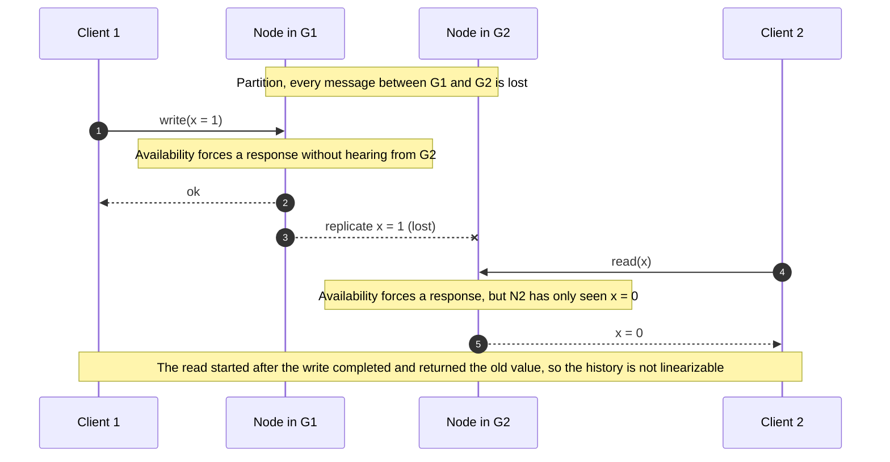
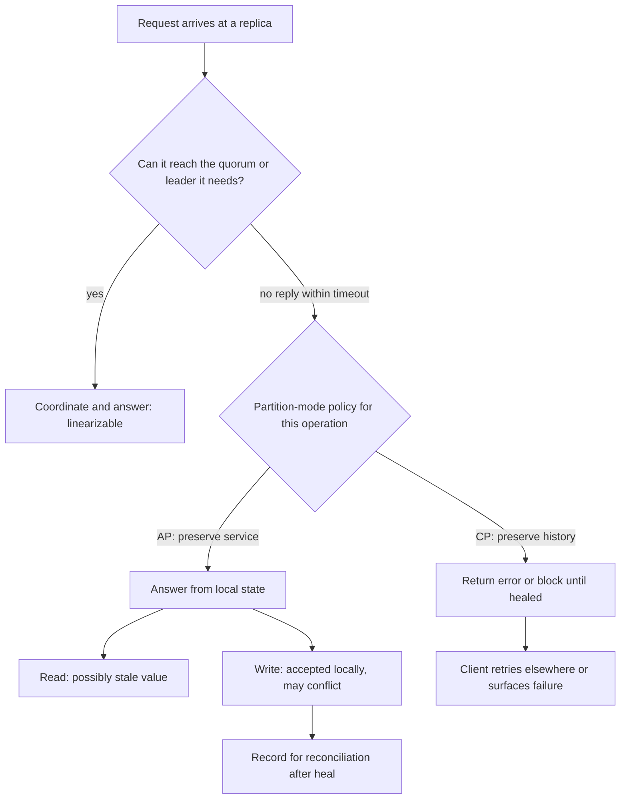
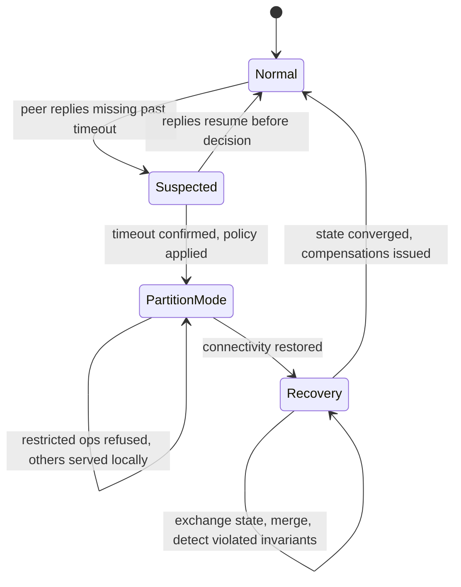
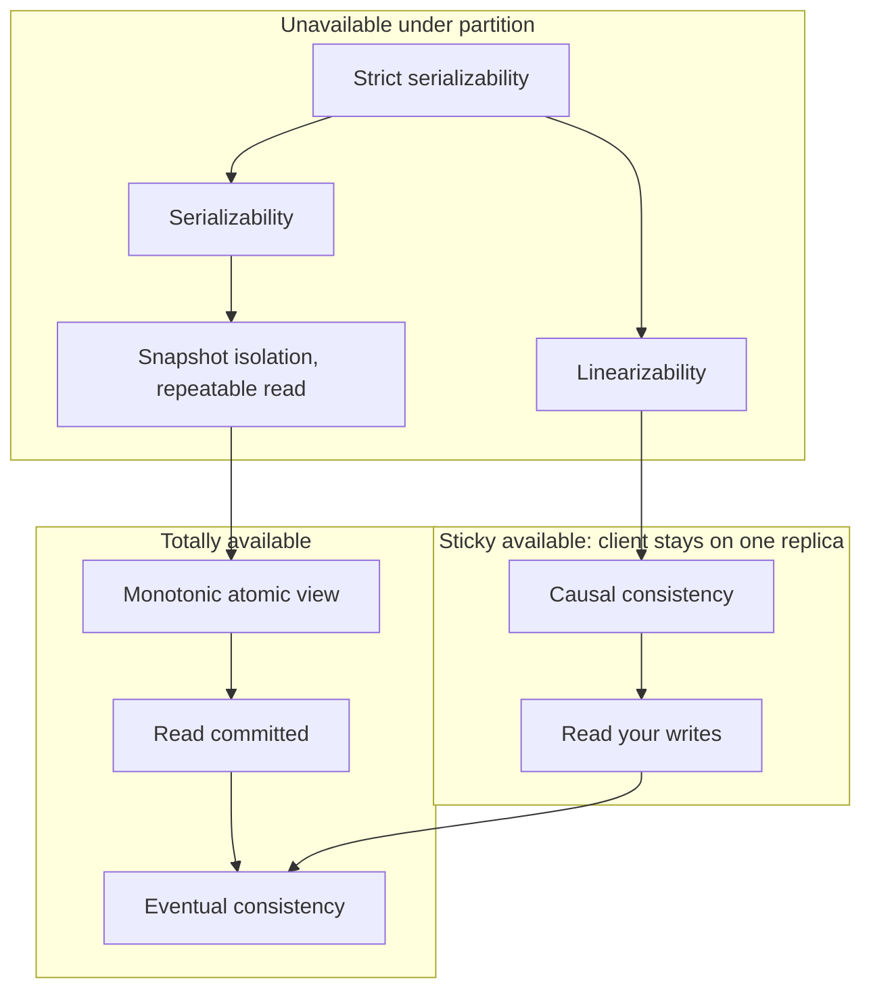
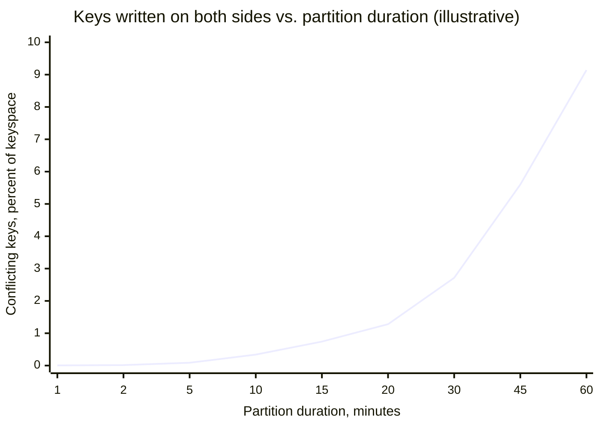
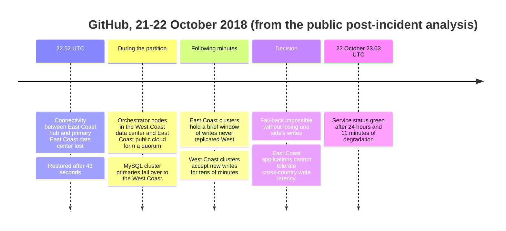

The CAP theorem states that a replicated read-write store cannot guarantee both linearizable operations and a response to every request at every non-failed replica while the network is able to lose messages between groups of replicas. Eric Brewer proposed it as a conjecture in his PODC 2000 keynote; Seth Gilbert and Nancy Lynch proved it in 2002 for a precise model. The theorem is narrow, and almost every popular reading of it is wrong in a way that matters for design: it is not "pick two of three", it does not describe a system's behavior when the network is healthy, and most real databases satisfy neither of the two properties it trades.

The problem it formalizes is the one every replica faces when a request arrives and the other replicas do not answer. The replica cannot tell whether they crashed, are slow, or are unreachable only from where it sits, as described in [Network Models](/distributed-systems/en/foundations/system-models/network-models/). It has two options. It can answer from its own state, which keeps it available but may return a value the rest of the system has already superseded or accept a write that conflicts with one accepted elsewhere. Or it can refuse, or wait indefinitely, until it can coordinate, which keeps the system's history consistent but makes this replica unavailable for as long as the partition lasts. No third option exists for linearizable single-object operations, and that is the whole content of the theorem.

The core trade-off is therefore a decision made per request, at the moment of a partition, on the side of the partition the request lands: refuse and stay correct, or answer and reconcile later. A CP system pays in rejected or blocked requests on the minority side. An AP system pays in divergent state that must be merged after the partition heals, with an application-visible cost that ranges from nothing (commutative counters) to lost updates and violated invariants. Everything else that is usually discussed under the CAP name, notably the latency cost of consistency when there is no partition at all, belongs to [PACELC](/distributed-systems/en/data-management/consistency-models/pacelc-theorem/).

## What the Theorem Actually Says

The proof is short, and its brevity is the best protection against misreadings. It depends entirely on three definitions, each of which is stricter or weaker than its everyday meaning.

### Three Definitions, Taken Literally

Consistency in CAP means [linearizability](/distributed-systems/en/data-management/consistency-models/linearizability/) of a single read-write register: every operation appears to take effect at one instant between its invocation and its response, and a read returns the value of the latest write in that order. It has nothing to do with the C in ACID, which refers to application invariants preserved by transactions, and it says nothing about multi-object transactions, which is the territory of [serializability](/distributed-systems/en/data-management/consistency-models/serializability/).

Availability means that every request received by a non-failing node must eventually result in a response. Two details make this stronger than an operational SLO. It applies to every non-failing node, including a replica that is cut off from all others; a system that keeps the majority side serving and rejects requests on the minority side is not available in the CAP sense, however many nines it reports. And the response must be a real answer, not an error; a timeout or an "unavailable" status does not count. At the same time the definition is weaker than an SLO in one respect: it places no bound on how long the response takes. A system that answers after an hour is available in the proof.

Partition tolerance means that the system keeps its guarantees even when the network loses an arbitrary number of messages sent from one group of nodes to another. In the asynchronous model of the proof there are no clocks and no bounds on message delay, so a lost message and a delayed one are indistinguishable to the receiver. A partition is not a choice the designer makes; it is a property of the environment that the guarantees must survive.

:::note[Two different consistencies]
"Consistency" in CAP is linearizability of one object. "Consistency" in ACID is preservation of application invariants by transactions, and the isolation level determines which concurrent interleavings can break them. A database can be "consistent" in ACID terms while serving stale reads from replicas, and a linearizable key-value store can let a multi-key invariant break. Isolation levels are covered in [Weak Isolation and MVCC](/distributed-systems/en/data-management/consistency-models/weak-isolation-mvcc/).
:::

### The Proof: Two Nodes and a Lost Message

Gilbert and Lynch's argument splits the nodes into two non-empty groups, `G1` and `G2`, and assumes that every message between them is lost. Suppose, for contradiction, that some algorithm is both linearizable and available.


*The Gilbert-Lynch construction. The register starts at 0; nothing that G1 does can reach G2.*

Step 2 must complete because the node in `G1` is non-failing and availability requires a response; it cannot wait for `G2`, because the messages it would wait for are lost (step 4). Client 2's read in step 5 begins after Client 1 has received its acknowledgment, so linearizability requires it to return 1. But the node in `G2` has received nothing from `G1`, its state is indistinguishable from an execution in which the write never happened, and availability forces it to answer in step 7. It answers 0, and the history is not linearizable. The contradiction holds for any algorithm, because the argument uses only what the node in `G2` can know.

The proof also explains why the asynchronous model matters even when no messages are actually lost. If the network can delay messages without bound, the node in `G2` cannot distinguish "the write message is lost" from "the write message is late". An available algorithm must answer at some point without having heard, and from that moment the execution is indistinguishable from one with a partition. Gilbert and Lynch then examined a partially synchronous model, where nodes have local clocks and messages either arrive within a known bound or are lost. The impossibility still holds there, but a weaker guarantee becomes achievable: if no messages are lost for a long enough period, reads eventually reflect all earlier writes, a guarantee they call delayed-t consistency. The structure of the result is the same as for [the FLP impossibility](/distributed-systems/en/coordination/consensus-algorithms/flp-impossibility/): timeouts let a system make progress, and the price is that it may act on wrong beliefs about which nodes are alive.

### What CAP Does Not Say

The theorem is often stated as "choose two of consistency, availability, and partition tolerance", which suggests a menu with three combinations. Brewer himself called this formulation misleading in his 2012 retrospective. Partition tolerance is not an option a distributed system can decline: the network will lose messages, and a system that "chooses CA" is one whose behavior under partition has been left undefined. In practice such a system either blocks (giving up availability) or diverges (giving up consistency) when the partition comes, and its designers find out which in production. A single-node database is "CA" only in the trivial sense that a node cannot be partitioned from itself.

The theorem says nothing about the system when the network is healthy. A CP system may serve every request in normal operation, and an AP system may be linearizable in practice for every read when no partition is in progress; CAP constrains only the partitioned case. The cost that exists all the time, namely that coordinated operations wait for round trips, is real but is not CAP; Daniel Abadi's PACELC formulation was written to name it.

The theorem says nothing about which consistency models weaker than linearizability can be combined with availability, and it is about a single register, not transactions. Both gaps were filled later and are discussed under partition mode below. It also says nothing about latency, durability, or throughput, and it does not imply that a system choosing availability will lose data; it implies only that it may expose non-linearizable histories.

Finally, it does not classify systems. CP and AP describe the behavior of one operation under one partition, and a system with tunable consistency can perform CP and AP operations side by side. Martin Kleppmann's 2015 critique argued that most widely deployed databases fit neither label: they are neither linearizable in normal operation nor available on the minority side of a partition, and the labels hide the guarantees they actually give.

## Living With Partitions: Detection, Partition Mode, and Recovery

Brewer's 2012 paper reframes CAP from a static classification into an operational procedure with three phases: detect the partition, operate in an explicit partition mode that limits some operations, and recover by restoring consistency and compensating for mistakes. The value of the framing is that it turns the decision into something a design can specify in advance rather than something that happens by accident when timeouts fire.

### The Decision Every Request Faces

A replica never sees "a partition". It sees a request it would like to coordinate on and peers that have not replied within its timeout. The timeout is where the CAP choice is made, which is why its value, discussed in [Heartbeats and Timeout Configuration](/distributed-systems/en/resilience/failure-detection/heartbeats-timeouts/), determines how often the system acts as though it is partitioned.


*The CAP choice as a per-operation policy at the replica that cannot coordinate.*

The diagram puts the decision at the right granularity. The same replica can refuse a balance withdrawal and accept an item added to a shopping cart, because the two operations have different consequences when they diverge. The AP branch is not free: the write path must record enough information (version vectors, operation logs, timestamps) for reconciliation to happen later, and the read path must accept that the value may be stale. The CP branch is not free either: the client receives errors or waits, and a client that retries against another replica on the same side of the partition gets the same answer.


*Brewer's three phases as a replica's state machine.*

The transitions are where systems differ. The Suspected state exists because a timeout is only evidence; a replica that enters partition mode on every slow reply refuses more requests than necessary (CP) or creates more divergence than necessary (AP). Recovery is the phase most designs leave unspecified. For a CP system it is usually trivial: the minority side discards uncommitted work and catches up from the majority's log. For an AP system it is the hard part, because each side accepted writes and every conflicting pair must be merged by a deterministic rule, which is analyzed in [Multi-Leader Replication](/distributed-systems/en/data-management/replication/multi-leader-replication/). Recovery also includes compensation for actions that cannot be merged, such as a seat sold twice: the system restores the invariant by issuing an apology, refund, or rebooking, which is a business process rather than a database feature.

### Majority Sides, Minority Sides, and Where Clients Are

A CP system built on majority quorums, such as a [Raft](/distributed-systems/en/coordination/consensus-algorithms/raft/) group, is not unavailable during a partition; its minority side is. If a five-replica group splits three and two, the side with three replicas elects a leader (or keeps the one it has) and continues to commit, while the two replicas on the other side cannot form a quorum and refuse writes and linearizable reads. This is the precise sense in which CP systems are highly available in practice: the cost of the partition falls on whichever clients can reach only the minority.

That makes client placement, not replica count, the quantity that determines what a partition costs a CP system. A partition that isolates a region containing one replica of five and 30% of the clients takes those 30% offline for the duration, unless they can be rerouted through a path that still reaches the majority. A partition that isolates a single replica in a region that serves no clients costs nothing. When a design discussion asks "is it CP or AP?", the more useful question is "which clients, on which side of which plausible partitions, lose service?". The arithmetic of placing replicas in two sites, where every partition between them leaves one side without a majority, is in [Failover and Leader Election](/distributed-systems/en/data-management/replication/failover-leader-election/).

An AP system does not have a minority side in this sense. Every replica that a client can reach keeps answering, and the cost shows up later as reconciliation work whose size grows with the duration of the partition and the overlap of the keys written on each side.

### What Remains Achievable Without Coordination

CAP proves that linearizability is incompatible with availability, but many guarantees weaker than linearizability are not. Two results define the frontier. Mahajan, Alvisi, and Dahlin showed in 2011 that no consistency model stronger than a variant they call real-time causal consistency can be both available and convergent in a model where replicas can be partitioned; causal consistency is therefore close to the strongest guarantee an AP system can offer. Bailis and colleagues' 2014 work on highly available transactions classified isolation levels the same way: Read Committed, Read Uncommitted, and Monotonic Atomic View can be provided with total availability; read-your-writes and causal consistency need sticky availability, meaning the client must keep talking to the same replica (or one that has its writes); Snapshot Isolation, Repeatable Read, serializability, and anything with real-time ordering cannot be available at all.


*Guarantees grouped by the availability they permit under partition, after Bailis et al. (2014). Arrows point from stronger to weaker.*

The grouping is what turns CAP from a binary into a design space. An AP system does not have to settle for "eventual consistency" in its weakest form; it can give sessions [causal consistency and session guarantees](/distributed-systems/en/data-management/consistency-models/causal-consistency-session-guarantees/) as long as a client is routed to a replica that has seen its own history, and it can give atomic visibility of multi-key writes without coordination. The sticky group carries an operational condition that is easy to miss: if a load balancer moves a client to another replica during a partition, read-your-writes breaks even though no individual replica misbehaved. The weakest group, convergence with no ordering, is the subject of [Eventual Consistency](/distributed-systems/en/data-management/consistency-models/eventual-consistency/), and data types that make convergence automatic are the subject of [CRDTs](/distributed-systems/en/data-management/consistency-models/crdts/).

Fox and Brewer's earlier harvest and yield framing, from 1999, gives a second way to degrade gracefully that CAP's binary hides. Yield is the fraction of requests answered; harvest is the fraction of the data reflected in each answer. A search engine missing one index shard can return results from the other shards, keeping yield at 100% with harvest below 100%. For read-heavy, approximate workloads this is often a better partition-mode policy than either refusing or answering from a stale full copy.

## Worked Example: One Region Cut Off for Ten Minutes

Assume a service with 10 million keys, deployed in three regions, `A`, `B`, and `C`, with 2,000 writes per second in total, of which region `C` originates 30%. A routing failure cuts `C` off from `A` and `B` for ten minutes, while clients in each region can still reach their local replicas. All numbers are illustrative.

In the CP design, the data lives in five-replica Raft groups placed two in `A`, two in `B`, and one in `C`. The four replicas in `A` and `B` form a majority. If the leader of a group was in `C`, the majority side elects a new one after its election timeout, which in typical configurations is on the order of a second, and continues. Region `C`'s single replica cannot commit, so every write originating in `C` fails or blocks: `0.3 * 2,000 = 600` writes per second, or `600 * 600 = 360,000` failed write requests over ten minutes, and the same for linearizable reads served in `C`. Clients in `A` and `B` see a pause of at most one election per affected group. After the partition heals, `C`'s replica receives the missing log entries from the leader; there is nothing to reconcile.

If such a region isolation happened, say, three times a year at twenty minutes each, clients in `C` would lose sixty minutes of write availability a year, which caps their availability at about 99.989% from this cause alone, while traffic-weighted availability across all regions would be about `1 - 0.3 * 60 / 525,600`, roughly 99.997%. The CP choice concentrates the entire cost on one region's users.

In the AP design, the data is replicated to all three regions and each region writes to its local replicas with a local quorum, then replicates asynchronously. During the partition, `C` keeps accepting its 600 writes per second, and `A` and `B` keep accepting their 1,400. To keep the arithmetic simple, assume each side's writes are spread uniformly over the 10 million keys, and compare the two sides as 1,000 writes per second each. After `t` minutes, a side has written `60,000 * t` writes, so the probability that a given key was written at least once by that side is `p = 1 - e^(-60,000 * t / 10,000,000)`. A key conflicts if both sides wrote it, with probability `p^2`. At ten minutes, `p = 1 - e^(-0.06) = 0.0582`, so `p^2 = 0.0034`, or about 33,900 conflicting keys.


*Two sides each writing 1,000 uniformly distributed updates per second into 10 million keys. Real workloads with skewed keys conflict far more on hot keys and less on cold ones.*

The curve is quadratic at the start, because a conflict requires a hit on both sides, and the probability of each hit grows roughly linearly with time. Doubling the partition from ten to twenty minutes nearly quadruples the conflicts, from 0.34% to 1.28% of the keyspace. That property is the quantitative reason why AP systems are operationally pleasant for short partitions and painful for long ones, and why partition detection and alerting matter even when the system "stays up". With last-write-wins reconciliation, each of the 33,900 conflicting keys silently loses at least one acknowledged update; with siblings or CRDTs, the application or the data type merges them instead.

The comparison is not 360,000 errors against 33,900 conflicts. The errors are visible, immediate, and confined to `C`; the conflicts are invisible until someone reads a wrong value, and their cost depends entirely on what the keys represent. For counters and sets that a CRDT merges, the AP cost is close to zero. For account balances or inventory, each conflict is a potential invariant violation that needs a compensating action, and the CP cost of 600 rejected writes per second may be the cheaper one.

## CP, AP, and Neither in Production Systems

Real systems implement the partition decision with very different mechanisms, and several popular systems end up in the third category Kleppmann pointed out: they give neither linearizability nor CAP availability.

| System and mode | Behavior on the minority side of a partition | Honest classification | When to prefer |
|---|---|---|---|
| etcd, ZooKeeper writes; Consul with consistent reads | No quorum: writes and quorum reads fail; serializable or stale reads may still be served locally | CP for writes and quorum reads; stale local reads are neither | Coordination data, leases, configuration, leader election |
| ZooKeeper default reads | Followers answer from local state, possibly stale even without a partition; a server cut off from the quorum stops serving clients unless read-only mode is enabled | Sequentially consistent, not linearizable | Read-heavy coordination where per-client order is enough |
| Spanner, CockroachDB | Ranges or splits without a majority become unavailable; others continue | CP; very high measured availability | Transactions across regions with strict serializability |
| Kafka with `unclean.leader.election.enable=false`, `acks=all`, `min.insync.replicas=2` | A partition without enough in-sync replicas rejects produce requests | CP per topic partition | Logs where an acknowledged record must not be lost |
| Cassandra or ScyllaDB at `ONE` or `LOCAL_QUORUM` | Every reachable replica set keeps reading and writing; conflicts resolved by timestamp | AP | Multi-region writes, high write rates, data that tolerates LWW |
| Cassandra at `QUORUM` | Minority side fails; majority side serves, yet reads can still go backwards without LWT | Neither | Rarely the right middle ground; see below |
| DynamoDB global tables (multi-Region eventual consistency) | Each region keeps accepting writes; last writer wins across regions | AP | Global low-latency writes on independent items |
| DynamoDB global tables with multi-Region strong consistency (GA June 2025) | Writes require coordination with other regions | CP | Global data with recovery point objective of zero |
| PostgreSQL or MySQL async replica with automatic failover | Old primary may keep accepting writes that are lost or diverge after promotion | Neither | Single-region OLTP where brief loss on failover is accepted |
| Redis with Sentinel or Redis Cluster | Asynchronous replication: a partitioned primary can accept writes that are discarded after failover | Neither | Caches and data that can be regenerated |

Spanner is the canonical example of how the labels mislead in practice. Eric Brewer's 2017 note states that Spanner is technically a CP system, that it chooses consistency and forfeits availability during partitions, and that Google measured more than five nines of availability for it, with the network contributing less than 10% of its already rare outages. Its "effectively CA" behavior comes from a private, redundant network and operational practice that make partitions rare, not from evading the theorem; how its clocks deliver strict serializability is in [Google TrueTime & Spanner](/distributed-systems/en/foundations/time-and-ordering/truetime-spanner/).

### The Common Third Category: Neither C Nor A

The most common production configuration is a primary with asynchronous replicas and an automated failover controller. Under partition it is not available, because the failover controller makes the side without the controller's quorum stop serving writes, at least eventually. It is not consistent either, because the old primary may acknowledge writes during the window before it is fenced, and those writes either disappear when the new primary takes over or survive on the old primary as a divergent history. The window is the time between the partition and the moment the old primary stops accepting writes, which is bounded only if the old primary demotes itself on a lease, as covered in [Fencing Tokens](/distributed-systems/en/coordination/distributed-locking/fencing-tokens/) and [Failover and Leader Election](/distributed-systems/en/data-management/replication/failover-leader-election/).

Quorum reads and writes in a Dynamo-style store fall into the same category for a different reason. With `R + W > N`, a read overlaps every completed write, but a read concurrent with a write can return the new value and a later read the old one, so the store is not linearizable; and the minority side of a partition cannot assemble a quorum, so it is not available either. The mechanism is analyzed in [Leaderless Replication](/distributed-systems/en/data-management/replication/leaderless-replication/). Cassandra's lightweight transactions, which run a Paxos round per operation, are the CP path in that system; plain quorum operations are not.

:::caution[A CP store does not make the read path CP]
A store that is linearizable at the leader stops being linearizable at the client the moment reads are served from a follower, a local "serializable" read mode, a cache, or a connection that does not request the linearizable read option. etcd's serializable reads, Consul's stale mode, ZooKeeper's default reads, and MongoDB's default `local` read concern all trade the guarantee for availability or latency. Classify each read path separately, not the database.
:::

### Choosing Per Operation

Most systems expose the choice as a per-request or per-topic setting, which means the classification belongs to the caller. Cassandra's consistency level is set per statement; DynamoDB's `ConsistentRead` flag selects a strongly consistent read from the leader replica of an item within one region; MongoDB combines write concern (the implicit default became `majority` in MongoDB 5.0, except in some deployments with arbiters) with read concern (default `local`, which can return data that is later rolled back, and `linearizable` for single-document reads from the primary); Consul offers default, consistent, and stale modes per request. Kafka's choice is made per topic and per producer:

```text
# Topic/broker side: never elect a leader that may lack acknowledged records
unclean.leader.election.enable=false   # default false since Kafka 0.11.0
min.insync.replicas=2                  # with replication.factor=3
# Producer side: an ack means every in-sync replica has the record
acks=all
# Result under partition: produce fails with NotEnoughReplicas when the
# partition leader cannot keep 2 in-sync replicas (the CP choice).
# Setting unclean election to true restores availability by allowing an
# out-of-sync replica to lead, discarding records it never received.
```

The three settings together decide which side of the CAP trade a Kafka topic takes. With `acks=all` but `min.insync.replicas=1`, the in-sync set can shrink to the leader alone, the leader keeps accepting writes, and a subsequent leader failure loses them: a topic that looks CP in its producer configuration behaves AP in its storage. With unclean leader election enabled, a replica that fell out of sync can become leader after the in-sync replicas fail, which keeps the partition writable and silently truncates acknowledged records, the availability-over-durability trade described in KIP-106.

## Failure Modes and How They Present

The failures associated with CAP are rarely "the system picked C" or "the system picked A". They are cases where the system picked one while its operators believed it had picked the other, or where it picked neither.

### Split-Brain in a System Believed to Be CP

Trigger: a leader on the minority side of a partition keeps serving reads, or in a misconfigured system writes, because it relies on a lease or a timeout that is longer than the majority's election timeout, or because its process paused and resumed after a new leader was elected. Symptoms: clients on both sides see successful operations; after healing, the minority side's writes vanish or conflict. Detection: two nodes reporting themselves as leader for the same term or group, `etcd_server_leader_changes_seen_total` rising, writes rejected after heal with term or epoch errors, and application-level audits showing acknowledged writes missing. Mitigation: leader leases shorter than election timeouts with a clock drift margin, `CheckQuorum`-style step-down when a leader stops hearing from a majority, and fencing tokens checked by the storage layer.

:::danger[Acknowledged writes on the minority side]
A minority-side leader that acknowledges writes produces data that the majority's history does not contain. When the partition heals, the minority's writes are discarded (Raft truncates them; an async primary is rolled back) or survive as a second history. Either way, acknowledged data is lost or corrupted without any error at the time of the write. Any system that can acknowledge writes on both sides of a partition and does not merge them deterministically has split-brain, regardless of how it is labeled.
:::

### Divergence and Lost Updates at Heal

Trigger: an AP system accepts writes on both sides of a long partition and resolves conflicts with last-write-wins. Symptoms: after healing, some updates are missing with no error ever returned, counters are lower than the sum of increments, and deleted items reappear or recently added ones disappear. Detection: conflict counters and sibling counts where the system exposes them, the duration of partition mode from replication-lag metrics, hint backlogs in Cassandra, and reconciliation audits. Mitigation: bound the partition-mode duration with alerts, use mergeable data types for data that both sides modify, give each record a home region, and restrict invariant-sensitive operations to the CP path. Recovery for data already merged incorrectly requires an operation log or change stream that preserves the losing writes.

### Asynchronous Failover Across a Partition

GitHub's October 2018 incident is the clearest public example of a "neither" system meeting a partition. During routine maintenance on optical equipment, connectivity between GitHub's US East Coast network hub and its primary US East Coast data center was lost for 43 seconds.


*Timeline condensed from GitHub's published analysis of 30 October 2018.*

The 43-second partition was short, but it was longer than the failover controller's detection window, so a quorum of Orchestrator nodes on one side of it promoted new primaries in the West Coast data center. The East Coast primaries had acknowledged writes that had not yet replicated, and once the West Coast primaries had accepted new writes, both sides held writes that the other did not. The system had acted CP in that it moved writes to one side, and AP-like in that the old side's acknowledged writes were not on the new side. Failing back would have discarded the West Coast's writes, and staying would leave the East Coast's unreplicated writes stranded and East Coast applications paying cross-country latency on every write. Restoring a consistent state took more than a day. Detection signals in such a design are failovers per day, replication lag at the moment of promotion, and binary log positions that exist on the old primary but not the new one; mitigations are synchronous or semi-synchronous replication within the failure domain the controller can fail over across, failover policies that refuse cross-region promotion for short partitions, and runbooks for reconciling divergent histories.

### Quorum Placed Where the Partition Falls

Trigger: a consensus group spans two sites, or three sites where one hosts a majority of the voters, and the partition separates the majority's site from the clients. Symptoms: an apparently "highly available" CP service becomes unavailable to most of its users during a single inter-site link failure. Detection: quorum-loss alerts, `etcd_server_has_leader` at 0 on the affected members, client error rates by region. Mitigation: place voters in at least three independent failure domains so that no single link or site failure removes a majority, and place clients near the majority or give them a routed path to it. This is design arithmetic, not tuning; the two-site trap is covered in [Active-Passive vs. Active-Active Multi-Region](/distributed-systems/en/resilience/multi-region-dr/active-passive-vs-active-active/).

### Partial Partitions and Election Churn

Real partitions are often partial: node X reaches Y, Y reaches Z, but X does not reach Z, or traffic flows in one direction only. Such topologies, described in [Network Reliability](/distributed-systems/en/foundations/monoliths-to-distributed/network-reliability/), break the assumption that a partition divides nodes into two clean groups. A node that cannot hear the leader but can reach other followers starts elections, increments the term, and disrupts a leader that the rest of the cluster can still reach. Cloudflare's November 2020 incident is a public example: a switch in a partially working state forwarded only some traffic, an etcd member reached some peers but not others, the cluster went through repeated leader elections that block writes, and the database cluster management built on etcd was disrupted, degrading Cloudflare's API and dashboard for over six hours. Detection: leader changes per minute far above baseline, failed proposals (`etcd_server_proposals_failed_total`), and term numbers rising without a corresponding node failure. Mitigation: Raft's PreVote extension, under which a candidate first asks whether peers would vote for it before incrementing the term, and CheckQuorum, under which a leader steps down when it loses contact with a majority; both are options in etcd's Raft library. Partial partitions are exactly the kind of fault that [Jepsen-style testing](/distributed-systems/en/deployment/distributed-testing/jepsen-deterministic-simulation/) injects.

### Strong Store, Stale Path

Trigger: a CP database is read through a follower, a cache with time-based expiry, or a client library that defaults to a local read mode. Symptoms: stale reads during partitions and, at lower rates, in normal operation; "linearizability bugs" reported against a store that is in fact behaving as configured. Detection: comparing the read mode in client configuration with the guarantee the application assumes; Jepsen-style histories on the full client path. Mitigation: request the linearizable read option explicitly for operations that need it, and route only those through the leader or a ReadIndex round.

| Failure | Underlying CAP behavior | Outside symptom | Detection signal | Mitigation |
|---|---|---|---|---|
| Minority-side leader | Claimed CP, behaves AP | Writes lost after heal | Two leaders, term errors, audit gaps | Leases below election timeout, CheckQuorum, fencing |
| LWW divergence | AP by design | Silent missing updates | Conflict or sibling counts, partition duration | CRDTs, home regions, CP path for invariants |
| Async failover across partition | Neither | Divergent primaries, long recovery | Promotion with nonzero lag | Semi-sync within failover scope, conservative cross-region policy |
| Quorum on the wrong side | CP by design | Most clients unavailable | Quorum loss by region | Three failure domains, client placement |
| Election churn | CP by design | Writes stall repeatedly | Leader changes per minute, failed proposals | PreVote, CheckQuorum, fix the gray link |
| Stale client path | Store CP, path not | Stale reads | Read-mode audit | Explicit linearizable reads |

:::tip[Test the minority side, not just the majority]
Partition tests usually verify that the majority side keeps working. Run the opposite check too: isolate a replica with clients attached and verify that it refuses writes within the expected time, that its clients receive errors rather than hangs, and that the replica does not serve reads you consider linearizable. Then heal the partition and verify that nothing acknowledged on either side is missing.
:::

## Choosing CP or AP

Choose the CP behavior for an operation when a divergent history has a cost that cannot be undone or merged: allocating unique resources (usernames, seats, inventory units), moving money, acquiring locks and leases, electing leaders, storing configuration that other components act on, and appending to logs whose acknowledged records must never be lost. Choose it also when the clients that would lose service on the minority side can be routed to the majority, which makes the CP cost small in practice. Make sure the full path is CP: quorum writes, linearizable reads, fencing on the storage side, and voters in at least three independent failure domains.

Do not choose CP when the operation must keep working for clients who may be cut off from any majority, such as mobile or edge clients, branch offices, or a region whose availability objective is independent of the others, unless refusing service there is acceptable. Do not choose it for data that is naturally mergeable, such as counters, sets, presence, carts, and telemetry, where the CP cost buys nothing a merge function could not provide. And do not assume CP is safe merely because the store is labeled CP; a stale read path or an async failover gives the cost of CP without its guarantee.

Choose the AP behavior when the data can be merged deterministically, when operations commute or can be made idempotent, when the business can compensate for rare conflicts (an apology is cheaper than an outage), or when write latency in every region matters more than global order. Plan the recovery phase explicitly: what is merged automatically, which invariants are checked after healing, how long a partition can last before the conflict curve becomes unacceptable, and which alerts fire when it does.

Do not choose AP when the application assumes uniqueness, monotonic counters, or "read the latest", because no AP system provides them under partition, however good its reconciliation. And do not settle for the weakest AP guarantee: causal consistency, read-your-writes with sticky routing, and atomic visibility of multi-key writes are all available under partition and remove many of the anomalies that make AP systems hard to program against.

Most real systems mix the two. A booking service can keep search, browsing, and carts AP, and run seat allocation and payment through a CP path whose minority side refuses; a social application can keep timelines AP and usernames CP. The CAP question is answered per operation, by asking what that operation must do when the replica serving it cannot reach the others.

## Further Reading

- Eric A. Brewer, *Towards Robust Distributed Systems*, keynote at the ACM Symposium on Principles of Distributed Computing (PODC), 2000.
- Seth Gilbert and Nancy Lynch, *Brewer's Conjecture and the Feasibility of Consistent, Available, Partition-Tolerant Web Services*, ACM SIGACT News, 2002.
- Eric Brewer, *CAP Twelve Years Later: How the "Rules" Have Changed*, IEEE Computer, 2012.
- Peter Bailis, Aaron Davidson, Alan Fekete, Ali Ghodsi, Joseph M. Hellerstein, and Ion Stoica, *Highly Available Transactions: Virtues and Limitations*, VLDB, 2014.
- Martin Kleppmann, *A Critique of the CAP Theorem*, arXiv, 2015.
- GitHub Engineering, *October 21 post-incident analysis*, GitHub Blog, 2018. https://github.blog/2018/10/30/oct21-post-incident-analysis/
