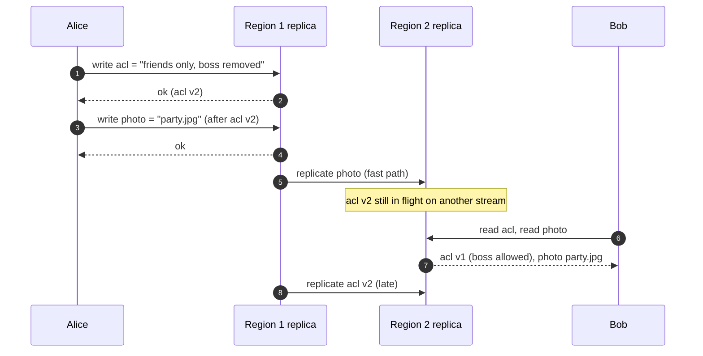
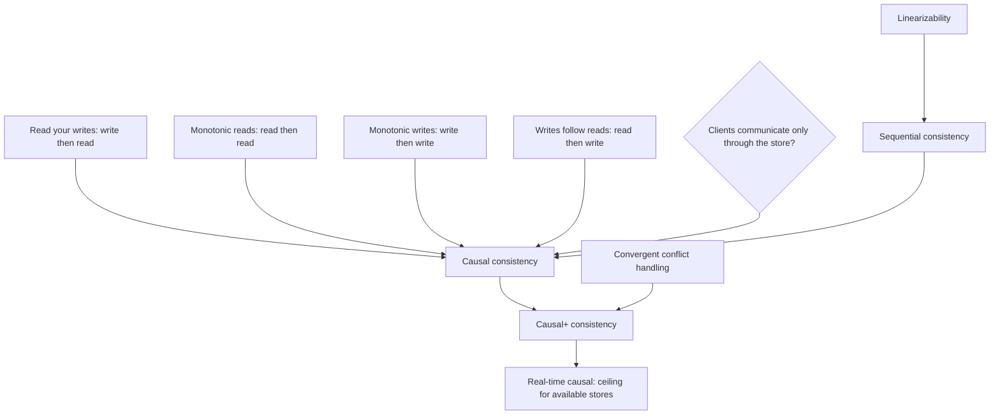
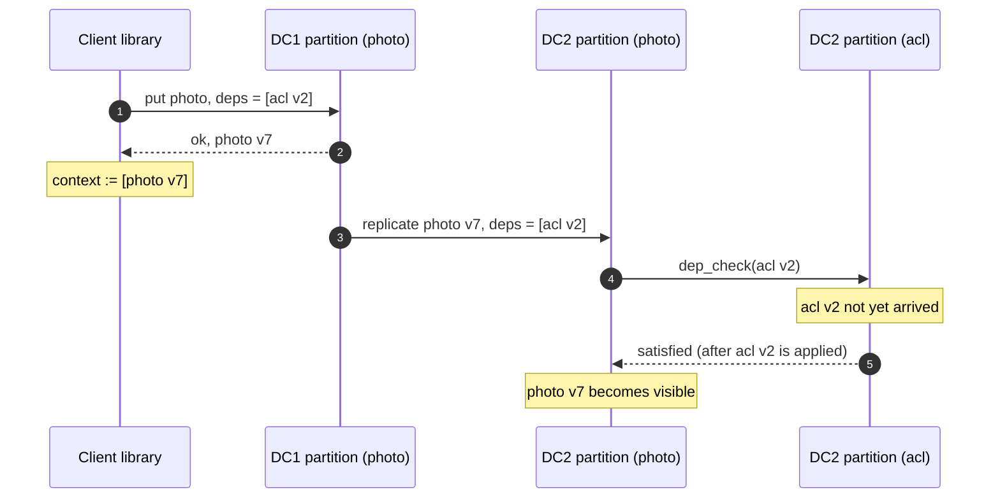
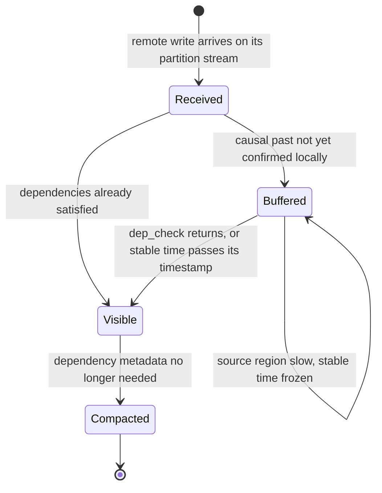
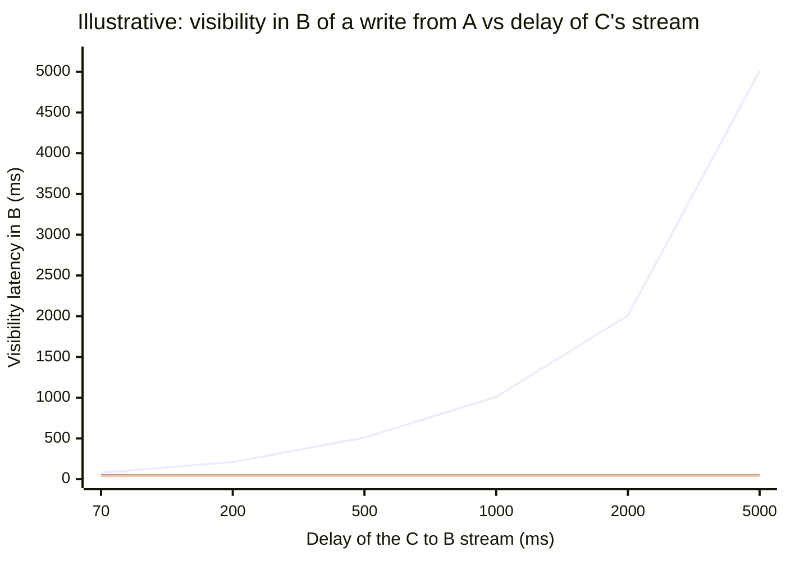

Causal consistency guarantees that if one operation could have influenced another, every process observes them in that order: nobody sees a reply without the post it answers, a photo without the permission change made before uploading it, or a cancelled order revert to "placed". Operations that could not have influenced each other, concurrent operations, may be observed in different orders at different replicas. Session guarantees are the same idea cut down to one client: read-your-writes, monotonic reads, monotonic writes, and writes-follow-reads, defined together by Terry and co-authors for the Bayou system in 1994. Taken together, and under one condition explained below, the four session guarantees are causal consistency.

The problem both solve is the gap between the two ends of the consistency spectrum. A [linearizable](/distributed-systems/en/data-management/consistency-models/linearizability/) store gives every client one current value, but it pays for that with a round trip to a quorum or leader on every operation and, as [CAP](/distributed-systems/en/data-management/consistency-models/cap-theorem/) proves, with unavailability on the minority side of a partition. A store that only promises [eventual consistency](/distributed-systems/en/data-management/consistency-models/eventual-consistency/) answers locally and stays available, but it allows any reordering in the meantime, including the ones users notice as bugs: a comment that appears before the article, a deleted item that comes back on refresh, an access revocation that arrives after the content it was meant to hide. Causal consistency removes exactly the reorderings that break cause and effect and keeps the rest, which is the reason it sits in the middle of the spectrum rather than being one more weak level.

The core trade-off is that causal consistency costs metadata and visibility delay instead of round trips. No operation waits for a remote replica before it is acknowledged, so writes and reads stay local and available through partitions. In exchange, every write carries a description of what it depends on, and every replica must hold back a remote write until its dependencies have arrived. The cost moves from the request path, where linearizability pays it as latency, to the replication path, where it appears as dependency metadata, buffered updates, and remote writes that become visible later than they arrived. When one data center slows down, that hidden cost becomes the dominant failure mode of causally consistent systems.

## The Guarantee: Causal Order Without Real-Time Order

Causality in a store is defined from what clients can observe. Ahamad, Neiger, Burns, Kohli, and Hutto formalized causal memory in 1995 with two kinds of direct links between operations. Program order links two operations of the same process, the earlier one first. The reads-from relation (Ahamad et al. call it writes-into) links a write to every read that returned its value. Causal order is the transitive closure of the two: operation `a` causally precedes `b` if a chain of program-order and reads-from links leads from `a` to `b`. This is the store-level version of the [happened-before relation](/distributed-systems/en/foundations/time-and-ordering/happened-before/), with reads and writes playing the role of receives and sends.

A store is causally consistent if every process can explain what it observed by some ordering of all writes plus its own reads that respects causal order. Each process may use a different ordering. Two writes that are causally ordered must appear in that order to everyone; two concurrent writes may appear in one order to one process and the other order to another. The classic anomaly the definition forbids involves two keys and a third party.



*The permission anomaly. Alice's photo write depends on her ACL write through program order, but the two keys replicate on independent streams, and region 2 exposes the effect before the cause.*

Steps 1 and 3 are linked by program order, so every causally consistent replica must apply the ACL change before the photo. Region 2 violates that in step 7: Bob's read sees the photo and the old ACL, which is exactly the state Alice performed the ACL change to prevent. Neither step 5 nor step 9 is wrong on its own; replication of each key is correct and eventually complete. The violation is in the order of visibility across keys, which is why per-key replication with any amount of retrying cannot fix it. In a single leader-follower log the order would be preserved for free, because the log is total; the anomaly appears as soon as data is partitioned, multi-leader, or leaderless, and it is the consistent-prefix anomaly described for partitioned followers in [Replication Lag Problems](/distributed-systems/en/data-management/replication/replication-lag/).

### What the Guarantee Does Not Promise

Causal consistency has no real-time component. If Alice writes and then phones Bob, Bob may still read the old value; the phone call is outside the store's view, and nothing in the definition relates operations of clients that did not exchange information through the store. This is the gap linearizability closes and the reason a causal store cannot implement a lock, a leader election, or a uniqueness check.

It does not promise freshness. A replica that never receives remote writes satisfies the definition as long as what it does show is causally closed. Real systems bound staleness by replicating continuously, but the bound is an operational property, not part of the guarantee.

It does not promise convergence. Two concurrent writes to the same key may be applied in different orders at two replicas, and plain causal consistency allows both replicas to keep different final values forever. Lloyd, Freedman, Kaminsky, and Andersen named the fix causal+ consistency in the 2011 COPS paper: causal consistency plus convergent conflict handling, meaning every replica resolves concurrent writes to the same key with the same deterministic function, so that replicas that have seen the same writes hold the same value. The function is a last-writer-wins rule, a merge, or a [CRDT](/distributed-systems/en/data-management/consistency-models/crdts/); its weaknesses are covered on the [eventual consistency](/distributed-systems/en/data-management/consistency-models/eventual-consistency/) page. Every production causal store is in fact causal+.

It does not protect invariants across concurrent writers. Two clients that each read a balance of 100 and each withdraw 80 produce concurrent writes; causal order does not relate them, both are accepted, and the merge has to decide what a balance of minus 60 means. Anything that must hold across concurrent writers needs coordination, which is the territory of [serializability](/distributed-systems/en/data-management/consistency-models/serializability/).

### Why the Middle Is a Ceiling

The middle of the spectrum is not an arbitrary compromise. Mahajan, Alvisi, and Dahlin proved in 2011 that no consistency model stronger than real-time causal consistency can be provided by a store that stays available under partitions and converges, a result discussed with the rest of the post-CAP frontier on the [CAP page](/distributed-systems/en/data-management/consistency-models/cap-theorem/). Causal+ is therefore the strongest guarantee an always-available, low-latency store can offer, up to a real-time refinement that excludes some histories only an omniscient observer could detect. The availability comes with a qualifier from Bailis and co-authors' 2014 classification of highly available transactions: session guarantees and causal consistency need sticky availability, meaning a client keeps talking to replicas that hold everything it has already seen, either by staying on one replica or by carrying enough state for a new replica to catch up. A client that moves to a replica missing its causal past must wait or fail, and that waiting is where most of the failure modes below begin.

## Session Guarantees: Causality Decomposed Per Client

Terry, Demers, Petersen, Spreitzer, Theimer, and Welch defined the session guarantees for Bayou, a weakly connected replicated store in which a mobile client might talk to a different server on every operation. Each server holds a set of writes, `DB(S, t)` at server `S` and time `t`, applied in an order called the write order. A session is the sequence of reads and writes one client issues. The four guarantees constrain which servers may serve a session's next operation, given what the session has done so far.

**Read your writes.** If a read follows a write in the session, the server that serves the read includes that write. This is the guarantee users notice first: a saved profile that reverts on refresh is a read-your-writes violation.

**Monotonic reads.** If read R2 follows read R1 in the session, the server that serves R2 includes every write that was relevant to R1, meaning every write whose effect R1 could have reflected. The session's view never goes back in time.

**Writes follow reads.** If a write W follows a read R in the session, then every write relevant to R precedes W in the write order at every server. A reply written after reading a post is ordered after the post everywhere, which is precisely the guarantee that would have prevented the photo anomaly for a third party.

**Monotonic writes.** If write W2 follows write W1 in the session, W1 precedes W2 in the write order at every server, and any server that includes W2 also includes W1. A session that sets a password and then deletes a recovery key cannot have the delete applied somewhere without the password change.

The first two guarantees are read-side: they restrict where a read may be served. The last two are write-side: they restrict how a write is ordered and propagated relative to earlier operations, and they are the ones that protect other clients. A system that implements only read-your-writes and monotonic reads, which is what most "session consistency" products mean in practice, protects the session from itself but still lets other sessions see its writes out of order.



*How the four session guarantees compose. Each covers one kind of causal link inside a session; together with the absence of hidden channels they yield causal consistency, and convergence turns it into causal+.*

The four arrows on top correspond to the four ways two operations of one session can be adjacent: write then read, read then read, write then write, read then write. Each guarantee is labeled by the edge it protects, which is the structure of the correctness argument in the next subsection. The diamond is the condition that most implementations silently assume and most applications silently break. The arrows from linearizability and sequential consistency point into causal consistency because both imply it: every linearizable or sequentially consistent execution is also causally consistent, so the arrows show strength, not mechanism.

### Bayou's Mechanism: Write Sets, Read Sets, and Version Vectors

Bayou implemented the guarantees by having each session record what it depends on and each server check before serving. Every write has a globally unique identifier assigned by the server that accepted it: the server's identifier plus a counter, Bayou's accept stamp. The session keeps two sets: the write set, the identifiers of its own writes, and the read set, the identifiers of the writes relevant to its reads. Before serving a read, a server checks that it contains the write set (read-your-writes) and the read set (monotonic reads). Before accepting a write, it checks that it contains the read set (writes-follow-reads) and the write set (monotonic writes), so that its write order will place the new write after all of them.

Sets of identifiers grow without bound, so Bayou compresses them with [version vectors](/distributed-systems/en/foundations/time-and-ordering/vector-clocks/). Bayou servers propagate writes to each other through anti-entropy in accept-stamp order, which gives the prefix property: a server that holds write number `k` from server `X` holds every earlier write from `X`. A set of writes the server holds is then summarized exactly by a vector with one counter per accepting server, and "the server includes these writes" becomes "the server's vector dominates the session's vector", one comparison per entry.

```text
session:  read_vv, write_vv          # one counter per accepting server
server:   vv                         # writes this server has applied

on read(key) at server S:
    require S.vv >= write_vv         # read your writes
    require S.vv >= read_vv          # monotonic reads
    result = S.read(key)
    read_vv = max(read_vv, S.vv)     # conservative: everything S held is "relevant"

on write(key, value) at server S:
    require S.vv >= read_vv          # writes follow reads
    require S.vv >= write_vv         # monotonic writes
    id = S.accept(key, value)        # S.vv[S] += 1
    write_vv = max(write_vv, S.vv)
# a failed require means: wait for anti-entropy, or try another server
```

Two details in the sketch carry most of the engineering. The read raises `read_vv` to the whole server vector rather than to the writes that actually touched the key, because computing the exact relevant set would cost more than it saves; the price is false dependencies, where the session now depends on writes it never looked at. And a failed check has only two outcomes, waiting or choosing another server, which is the formal statement of sticky availability. The write-side guarantees also need the server's own propagation to preserve order, which the prefix property gives; a store that replicates keys on independent streams loses it, and must carry dependencies per write instead, as the next section shows.

### Why the Four Compose Into Causality

The argument follows the definition of causal order. Causal order has two kinds of direct links, program order within a session and reads-from between sessions, closed under transitivity. Program order between adjacent operations of one session is one of four shapes, and each guarantee forces every server to respect one shape: read-your-writes makes a later read see an earlier write, monotonic reads makes a later read see what an earlier read saw, writes-follow-reads makes a later write follow what an earlier read saw, and monotonic writes makes a later write follow an earlier one. A reads-from link between sessions is respected because the reading session's read set now contains the write, and every later write of that session is ordered after it by writes-follow-reads. Chains of such links are respected because the guarantees are stated in terms of whole sets of relevant writes, which are transitively closed by construction: a server that held a write also held everything that write's issuer had seen.

Brzezinski, Sobaniec, and Wawrzyniak made this precise in 2004, showing that the four session guarantees together provide causal consistency in a model where clients interact with the store only through its operations. That last condition is the diamond in the diagram. If two clients exchange information through any other path, a message queue, a webhook, an email, a phone call, the store never sees the reads-from link, the receiving session's read set does not contain the cause, and the store can legally show the effect first. This is the hidden-channel failure, described in depth on the [happened-before page](/distributed-systems/en/foundations/time-and-ordering/happened-before/); the session-guarantee view adds only the remedy's precise form: the hidden channel must carry the sender's session vector, so that the receiver can merge it into its own read set.

:::note[Same words, narrower meanings]
Product documentation uses these names with smaller scopes than Terry et al. did. "Session consistency" in a managed database usually means the four guarantees for one SDK client instance or one token, not for a user across devices. MongoDB's "causal consistency" holds within one client session and across sessions only when the application transfers cluster and operation times. Before relying on a product's guarantee, establish what carries the session state and what happens when that state is lost.
:::

## Enforcing Causality Across Partitions and Regions

Bayou's single vector per server works because every server replicates the whole database in one ordered stream. A geo-replicated store partitions its keyspace: each data center holds every key, spread over many partitions, and each partition replicates to its peers in other data centers on its own stream. The prefix property now holds per partition, not per data center, and a vector with one entry per partition per data center would be thousands of counters attached to every write. Every causally consistent store of the last fifteen years answers one question differently: how does a receiving data center know that a remote write's causal past is already visible locally? Two families of answers exist, and they fail differently.

### Explicit Dependencies: COPS and Eiger

COPS, the system that introduced causal+ (Lloyd et al., SOSP 2011), tracks dependencies explicitly. The client library keeps a context: the versions of keys the session has read or written. A put sends the value together with the dependencies from the context, the local partition writes it immediately, returns a version number, and the client replaces its context with that single new version, because the new write transitively depends on everything that was in the context. That replacement is what keeps contexts small: the dependencies a write carries are its nearest dependencies, the ones not already implied by another dependency.



*Dependency checking in COPS. The receiving partition asks the partitions that own each nearest dependency to confirm it locally, and holds the write invisible until every check returns.*

The write is acknowledged in step 2 without any remote interaction, which is the latency property that justifies the design. The cost appears in steps 4 to 7, in the remote data center: the partition that receives the photo cannot expose it until the ACL partition confirms in step 7 that version 2 of the ACL is applied, and in the diagram that confirmation waits for the ACL's own replication stream. The check is local to the receiving data center, so it costs an intra-data-center round trip per nearest dependency when the dependency has already arrived, and an unbounded wait when it has not. The correctness intuition is induction on visibility: a write becomes visible only after its nearest dependencies are visible, each of them became visible only after its own dependencies were, so the visible set in each data center is causally closed at every moment.

Eiger (Lloyd et al., NSDI 2013) kept the approach and changed the unit. It tracks dependencies on operations rather than on keys, which is tighter for a column-family model where one row holds many independent values, and it added write-only transactions and read-only transactions with the same dependency machinery. Both systems pay their metadata per write and their checks per nearest dependency, so the cost scales with the write rate and with how much each client reads before writing.

### Stabilization: Visibility by Stable Time

The second family replaces per-write dependency checks with a watermark. GentleRain (Du, Iorgulescu, Roy, and Zwaenepoel, SoCC 2014) stamps every write with a physical timestamp from the accepting partition, larger than any timestamp the client has seen. Each partition tracks, for every remote data center, the latest timestamp it has received on that stream, and partitions in a data center periodically exchange these values to compute the global stable time: the minimum over all streams from all data centers. Every remote write with a timestamp at or below the global stable time is known to have its whole causal past already received, because anything it depends on has a smaller timestamp and every stream has delivered everything up to that point. Visibility becomes a comparison against one scalar, and a write carries one timestamp of metadata instead of a dependency list. Clock skew does not break correctness, because timestamps only need to respect the session's causal order, which the "larger than any seen" rule enforces; skew only makes the stable time lag further behind.

Cure (Akkoorath and co-authors, ICDCS 2016), the protocol behind the AntidoteDB research database, keeps the watermark but makes it a vector with one entry per data center. A write from data center 1 waits only until every local partition has received data center 1's streams up to its timestamp, not until data center 3 has caught up as well. The vector costs a few counters per write, one per data center rather than one per partition, and in exchange it decouples the visibility of one region's writes from the health of another region. Cure also uses the stable vector as the snapshot for causally consistent transactions, which gives multi-key reads for free.



*The life of a remote write in a causally consistent replica. Both families share the Buffered state; they differ in what event releases a write from it.*

The self-loop on Buffered is the state every incident below spends its time in. Under dependency checking, a write stays buffered only if one of its own dependencies is missing; under scalar stabilization, every remote write stays buffered while any stream from any region is behind; under vector stabilization, writes from one region stay buffered while that region's streams are behind. The Compacted transition matters for memory: COPS can drop dependency lists once a write is known to be visible in every data center, which it learns through a separate garbage-collection exchange, and a region that never confirms keeps metadata alive everywhere.

### Reading Several Keys: Causal Snapshots

Per-key causal visibility is not enough for a client that reads two keys. Bob's client can read the ACL first, getting version 1, then read the photo after version 7 has become visible together with ACL version 2: each read is causally consistent with the store at the moment it ran, but the pair shows a state that never existed. COPS-GT answers with a read-only transaction in at most two rounds: the first round fetches the latest visible version of each key along with its dependencies, and if any returned value depends on a newer version of another requested key than the one returned, a second round fetches exactly those versions, which are guaranteed to be visible locally because the dependency was satisfied. Stabilization protocols avoid the second round by reading every key at one snapshot below the stable time or vector, at the price of reading slightly older data. Either way, an application that renders a page from several keys needs the transactional read, not a sequence of single reads.

### Bolt-On Causality Over an Eventually Consistent Store

Bailis, Ghodsi, Hellerstein, and Stoica showed in 2013 that causal consistency can be layered as a client-side shim over an existing eventually consistent store, Cassandra in their prototype. The shim stores dependency metadata with each value and keeps a local causally consistent cache; it exposes a write only once its dependencies are present in the underlying store. Their most useful finding for practitioners was about the metadata, not the mechanism. Tracking potential causality, everything a session read, grows dependency sets with every read and makes writes wait on unrelated data. Tracking explicit causality, only what the application declares, such as a reply depending on the post it answers, keeps metadata small. The catch they named is overwritten histories: a value overwritten in the store can remove the version another write's dependency points to, so the shim must keep enough history to know a dependency was satisfied and later superseded.

### Worked Example: Visibility Latency of the Three Designs

The numbers in this example are illustrative. Assume three data centers, A, B, and C, each with 32 partitions. The one-way replication delay from A to B is 40 ms and from C to B is 70 ms. Every partition in B exchanges its received timestamps with the others every 10 ms, so stable time in B trails the slowest stream it covers by about one exchange interval. Each data center accepts 30,000 writes per second, and a write carries on average three nearest dependencies.

Consider a write accepted in A, observed by clients in B. Under dependency checking, it becomes visible in B after 40 ms of transit plus three intra-data-center dependency checks, which run in parallel and cost well under a millisecond each when the dependencies have arrived; call it 41 ms. Under vector stabilization, it waits until B's entry for A passes its timestamp: 40 ms of transit plus one exchange interval, about 50 ms. Under scalar stabilization, it waits until the minimum over all streams passes its timestamp, and the slowest stream is C's at 70 ms, so the write from A becomes visible after about 80 ms, twice its own transit time, because of a region it has nothing to do with.

The metadata and message costs point the other way. Dependency checking issues `3 * 60,000 = 180,000` dependency checks per second in B for the writes arriving from A and C, a load proportional to the write rate and to how much clients read before writing. Stabilization issues, in B, 32 partitions broadcasting one small message to the other 31 every 10 ms, which is `32 * 31 * 100 = 99,200` messages per second with all-to-all exchange, or around 6,400 per second with a tree aggregation, and both figures are independent of the write rate. Per write, dependency checking carries three 16-byte version references, 48 bytes; scalar stabilization carries one 8-byte timestamp; vector stabilization carries three.

The comparison changes completely when C slows down. Suppose a congested link raises C's delay to B from 70 ms to 2,000 ms.



*Illustrative model: the scalar watermark couples every region's visibility to the slowest stream; the vector watermark and explicit dependencies isolate it, unless a write actually depends on C.*

The flat lines hold only for writes from A that do not depend on anything C wrote. Under both isolating designs, a write from A that does depend on a write from C still waits for C's stream, which is the price of being correct, not a design flaw. The scalar design charges that price to every write, so at 2,000 ms of C delay every write from A, and from B's local clients' point of view every remote update, is 2 s late. Buffering follows from Little's law: at 30,000 writes per second arriving from A, 2 s of extra delay holds about 60,000 additional writes invisible in B's buffers at any moment, and with 1 KB values, 60 MB of memory that the system did not need when C was healthy. That is the arithmetic behind the stall failure below.

## Causal Consistency in Production Systems

Research systems built causal+ geo-replication end to end; production systems mostly ship session guarantees enforced with position tokens, and causal consistency in the full multi-key sense is rarer than marketing suggests. The table compares the approaches a designer actually chooses between.

| Approach | Guarantee obtained | Metadata per write or read | What stalls visibility | When to prefer |
|---|---|---|---|---|
| Single log, follower reads with position token | Session guarantees within the log's scope | One log position per session | Lag of the chosen follower only | One leader per dataset; most OLTP services |
| Per-partition tokens (vector per session) | Session guarantees across partitions | One position per touched partition | The slowest touched partition | Partitioned stores where a session touches few partitions |
| Explicit dependencies (COPS, Eiger) | Causal+ across keys and regions | Nearest dependencies per write | Only writes with missing dependencies | Geo-replicated, write-local data with sparse cross-key dependencies |
| Scalar stable time (GentleRain) | Causal+ across keys and regions | One timestamp per write | Any slow stream from any region | Few regions on uniform links where simplicity wins |
| Vector stable time (Cure) | Causal+ with causal snapshots | One entry per region per write | Slow streams of the writer's region | Multi-region stores needing causal transactions |
| Linearizable reads on the critical path | Linearizability | None beyond the protocol | Leader or quorum availability | Invariants, uniqueness, coordination records |

Position tokens for single-leader and partitioned followers are covered in depth on [Replication Lag Problems](/distributed-systems/en/data-management/replication/replication-lag/); the systems below are the ones whose design is specifically about causality.

**MongoDB** has offered causally consistent client sessions since version 3.6. The server stamps operations with a hybrid cluster time, described on the [hybrid logical clocks page](/distributed-systems/en/foundations/time-and-ordering/hybrid-logical-clocks/), the driver tracks the session's operation time and the highest cluster time it has seen, and each read carries `afterClusterTime` so that a secondary waits until it has applied the oplog up to that point. The guarantees depend on the read and write concerns, and the documentation is precise about it: only read concern `majority` with write concern `majority` provides all four causal guarantees in all situations, including the transient window in which two members both believe they are primary. With read concern `majority` and write concern `w: 1`, it lists monotonic reads and writes-follow-reads but not read-your-writes or monotonic writes; with `local` and `majority` only monotonic writes; with `local` and `w: 1` none of them, although they may hold "in some situations". Jepsen's 2018 analysis of MongoDB 3.6.4 reported that causal sessions did not preserve causal consistency with the default concerns, a point the 2020 analysis of 4.2.6 restates in its background.

```typescript
// mongosh: a causally consistent session that keeps its guarantees through failover
const s = db.getMongo().startSession({ causalConsistency: true });
const orders = s.getDatabase("shop").orders;
orders.insertOne({ _id: 42, state: "placed" },
                 { writeConcern: { w: "majority" } });   // w:1 drops RYW and MW
orders.find({ _id: 42 })
      .readConcern("majority")                           // "local" drops MR and WFR
      .readPref("secondary");                            // waits for afterClusterTime
// hand-off to another process: copy s.getOperationTime() and s.getClusterTime(),
// then call advanceOperationTime / advanceClusterTime on the receiving session
```

The snippet shows the three decisions that matter: the session flag, the two concerns, and the explicit transfer of the session's times when the causal chain leaves the process. Without the last step, a worker that picks up job 42 from a queue starts with an empty session and may read the order from a secondary that has not applied the insert, which is the hidden channel in its most common modern form.

**Azure Cosmos DB** makes session consistency its default level. Each write response carries a session token that encodes, per physical partition, the position the session has reached, and the SDK sends the token on later reads so that a replica serves the read only once it has caught up. Within one client instance the token gives read-your-writes and monotonic reads; across application instances the documentation's advice for a read racing a write from another SDK instance is to pass the session token between instances or to choose a stronger level. When a replica cannot serve a token, the client sees a not-found error described as "the read session isn't available for the input session token", which Microsoft's troubleshooting guide attributes mostly to fixed SDK bugs and resolves by upgrading the SDK.

**Neo4j** clusters implement causal consistency with bookmarks: a driver session records the bookmark of its last committed transaction and sends it with the next one, and a server that has not yet applied the bookmarked transaction waits for it, failing with a `BookmarkTimeout` transient error if it does not catch up in time. Sessions chain bookmarks automatically; a bookmark can be passed to another session explicitly to extend the chain across processes. It is a position token over a Raft-replicated log, so the guarantee is session causality within one database rather than multi-region causal+.

**Facebook** is the best-documented case of a large system deciding not to adopt stronger consistency. Lu and co-authors measured consistency in Facebook's TAO-backed social graph by sampling a trace of requests and checking it against several models, and reported that anomalies relative to linearizability and to per-object sequential consistency were rare. Ajoux, Bronson, Kumar, Lloyd, and Veeraraghavan's HotOS 2015 paper then listed what made causal consistency hard to adopt at that scale: dependencies travel through hidden channels such as caches, asynchronous jobs, and services outside the store; metadata must be carried through every system in the request path; and a slowdown anywhere can delay visibility everywhere. Both papers are worth reading before committing to causal+ across a service graph rather than inside one store.

:::tip[Make the stable-time age a first-class metric]
For any stabilization or dependency-tracking system, export the age of the visibility watermark per source region: current time minus the stable time or vector entry for that region, and the count and bytes of buffered remote writes per region. Replication lag dashboards measure delivery; these measure visibility, and the two diverge exactly in the incidents that matter. An alert on watermark age catches a stall long before users report updates that "never arrived".
:::

## Failure Modes and How They Present

Causal systems rarely return a wrong answer. They return an old one, or they wait, and both look like the system being slow or forgetful rather than broken. Detection therefore depends on measuring visibility and session waits directly.

### Visibility Stall Behind a Slow Region

Trigger: one region's replication streams slow down or stop, through link congestion, a partition, or an overloaded partition server, while the other regions are healthy. Symptoms: under scalar stabilization, every remote update in every region stops appearing, although replication streams from healthy regions are flowing and their bytes are arriving; under vector stabilization or dependency checking, only updates from the slow region and updates that depend on them stop appearing. Memory in the receiving partitions grows with buffered writes, and when buffers are bounded, the replication receivers apply backpressure upstream.

```mermaid
gantt
    title Illustrative stall: region C stream stops at 10:00:05 (scalar stable time)
    dateFormat HH:mm:ss
    axisFormat %H:%M:%S
    section Streams into B
    Stream from A delivering          :a1, 10:00:00, 120s
    Stream from C delivering          :c1, 10:00:00, 5s
    Stream from C stalled             :crit, c2, 10:00:05, 85s
    Stream from C catching up         :c3, 10:01:30, 30s
    section Visibility in B
    Remote writes visible             :v1, 10:00:00, 5s
    All remote writes frozen          :crit, v2, 10:00:05, 85s
    Buffered writes flushed           :v3, 10:01:30, 30s
    section Signals
    Stable time age alert fires       :milestone, m1, 10:00:20, 0s
    Buffer memory alert fires         :milestone, m2, 10:00:50, 0s
```



*An illustrative stall. Writes from A keep arriving in B for the whole interval, but under a scalar watermark none of them becomes visible until C's stream recovers and catches up.*

The timeline separates delivery from visibility. The stream from A never stops, so a replication-lag dashboard for A stays green for the whole incident. The visibility row freezes at 10:00:05 because the global stable time is a minimum, and C's contribution stopped advancing. At 10:01:30 C reconnects, its backlog arrives, the watermark jumps, and 85 seconds of writes from A become visible at once, which downstream consumers see as a burst. Detection is the watermark-age metric from the tip above, which fires 15 seconds into the stall in this example, and buffer size per source region. Mitigation is to stop letting the slow region gate the others: vector stabilization does this structurally; with a scalar watermark, the only escape is to exclude the region from the stable time computation after a timeout, which preserves causality only if writes from that region are also held back until it is readmitted. Recovery is the catch-up burst, which should be rate-limited into downstream consumers.

### Sessions Waiting for State That Will Not Arrive

Trigger: a session's token or bookmark refers to writes the serving replica does not have and may never get: the client failed over to another region, the region that accepted its write lost it in an asynchronous failover, or the token was copied to a process talking to a different cluster. Symptoms: reads hang until a timeout, then fail with a product-specific error such as Neo4j's `BookmarkTimeout` or a Cosmos DB session-not-available response; with an unbounded wait, request threads pile up behind one missing write. Detection: count session waits and their timeouts per replica, and log the token's position against the replica's applied position when a wait times out. Mitigation: bound every wait, then choose deliberately between serving from a replica that has the state, usually the origin region, and resetting the session with an explicit loss of the guarantee. When the cause is a lost write after failover, waiting cannot succeed; the interaction of tokens with failover is covered in [Replication Lag Problems](/distributed-systems/en/data-management/replication/replication-lag/).

### Guarantees Weakened by the Durability Setting

Trigger: a causal session is used with acknowledgments from a single node or with reads of non-majority-committed data, which is MongoDB's default concern combination when an application enables causal sessions without changing concerns. Symptoms: a session reads its own write, the primary fails, the write is rolled back, and the session's next read shows the state before the write: read-your-writes and monotonic reads both broken, with no error. Detection: rollback events on the replica set, and client-side checks that compare returned operation times with the session's. Mitigation: majority concerns on every operation that participates in a causal chain, measured for latency on the paths that need it rather than assumed too expensive.

:::danger[A causal session over unacknowledged durability loses writes it already showed]
Causal consistency is a statement about the order of what clients see, not about whether it survives. If the store acknowledges a write from one node and that node is rolled back, the session has already read the write, may have shown it to a user, and may have issued dependent writes in other services. The rollback is silent from the session's point of view. Any causal guarantee is only as strong as the durability of the writes it orders; in MongoDB that means write concern `majority` together with read concern `majority`.
:::

### Divergence Without Convergence

Trigger: two concurrent writes to the same key, accepted in different regions, are applied in different orders at different replicas, and the store or the application has no deterministic resolution rule, which is legal under causal consistency without the plus. Symptoms: two regions return different values for the same key indefinitely, while each region is internally consistent and replication shows no lag. Detection: periodic cross-region comparison, for example the Merkle-tree comparison of [Anti-Entropy](/distributed-systems/en/data-management/replication/anti-entropy-merkle/), or a sampled read of the same keys in every region. Mitigation: a convergent rule applied identically everywhere: last-writer-wins on a causally consistent timestamp such as an HLC, a merge function, or a CRDT. Recovery requires choosing a winner for every diverged key, which is exactly the decision the missing rule should have made automatically.

:::caution[Causal is not conflict-free]
Causal consistency orders writes that are related and says nothing about writes that are concurrent. Two devices of the same user are two sessions, so a phone and a laptop editing the same note produce concurrent writes even though one person made both. If the product assumes "the user's last edit wins", that assumption needs either a single session state shared across devices or a resolution rule; causal ordering alone provides neither.
:::

### Dependency Metadata Growth and False Dependencies

Trigger: clients read many items before writing, as a feed page, a search result, or a batch job does, and the system tracks potential causality. Symptoms: write requests grow in size, dependency checks per write grow from a handful to hundreds, visibility latency rises with read volume rather than write volume, and writes wait on dependencies they never used. Under Bayou-style vectors, the same mechanism makes a session that once read from a lagging region unable to use any replica that has not caught up with everything it saw. Detection: histograms of context size and dependency count per write, and visibility latency split by dependency count. Mitigation: nearest-dependency compression, resetting the context after a write as COPS does, explicit causality for application-declared relations as bolt-on causality proposes, and scoping sessions to the data that actually needs ordering.

### Hidden Channels Across Services

Trigger: the causal chain leaves the store through a queue, an event, a cache, or a call to another service that reads from a different replica. Symptoms: the downstream consumer reads state older than the event it is processing: an order event whose order is not found, a notification linking to content that does not exist yet. Detection is the comparison of the event's source position or operation time with the position the consumer's read was served at. The mechanism is the hidden channel of the [happened-before page](/distributed-systems/en/foundations/time-and-ordering/happened-before/), and the remedy, carrying the session token in the event, is described for leader-follower stores in [Replication Lag Problems](/distributed-systems/en/data-management/replication/replication-lag/); the causal-store version is identical except that the token is the session's vector or cluster time.

| Failure | Symptom | Detection | Mitigation |
|---|---|---|---|
| Visibility stall | Remote updates frozen while streams flow | Watermark age per region, buffered bytes | Vector watermark, bounded exclusion of slow regions |
| Unreachable session state | Hanging reads, bookmark or session timeouts | Session-wait timeouts, token vs applied position | Bounded wait, route to origin, explicit reset |
| Weak durability | Own write appears then vanishes | Rollback events, client time checks | Majority read and write concerns |
| Divergence | Regions disagree indefinitely | Cross-region digests | Convergent rule: LWW on HLC, merge, CRDT |
| Metadata growth | Large writes, slow visibility under heavy reads | Context size and dependency count histograms | Nearest deps, explicit causality, narrow sessions |
| Hidden channels | Consumer misses the cause of its event | Event position vs served position | Carry the session token through the channel |

## Choosing Causal Consistency or Session Guarantees

Use session guarantees whenever reads are served by replicas that can lag and a user or a job can observe its own earlier actions: profile edits, shopping carts, settings, the job that processes an event about a write. In a single-leader store, position tokens give them cheaply, and nothing more is needed if data that is written together lives in one log. Choose the session's scope from the product: a request chain across services and a user across devices are both common, and both require the state to be carried explicitly.

Use causal+ consistency when writes must be accepted locally in several regions, stay available through partitions, and be related across keys in ways third parties observe: social content with permissions, comments and replies, collaborative documents with access changes, messaging threads. Prefer explicit dependencies or a per-region vector watermark over a scalar watermark when regions differ in distance or reliability, because otherwise the slowest region sets the visibility latency of all of them. Require multi-key causal snapshots whenever a page is rendered from several keys that can change together.

Do not use causal consistency for anything whose correctness depends on concurrent writers being excluded: uniqueness of usernames, account balances, inventory reservations, lock and lease records, leader records. Causality does not relate concurrent writers at all, so these need [linearizable](/distributed-systems/en/data-management/consistency-models/linearizability/) operations or serializable transactions on the critical path. Do not use it where clients must observe each other's writes promptly through channels the store cannot see, such as one service writing and telling another by RPC without passing a token, because the guarantee will silently not apply. And do not build a causal layer across a whole service graph unless every hop can carry the metadata; the Facebook experience is that partial coverage costs most of the complexity and provides little of the guarantee.

Four neighbors are commonly confused with it. Consistent prefix, a level in Cosmos DB, guarantees that reads see a prefix of each partition's write order but not causal order across partitions. Sequential consistency requires one total order that everyone agrees on and is strictly stronger, with a coordination cost that [PACELC](/distributed-systems/en/data-management/consistency-models/pacelc-theorem/) prices. Causal delivery is the messaging-layer rule that a message is delivered after its causal past, covered with [vector clocks](/distributed-systems/en/foundations/time-and-ordering/vector-clocks/); a causal store uses a form of it internally but exposes reads and writes rather than messages. Snapshot isolation is a transactional guarantee about concurrent transactions, covered in [Weak Isolation and MVCC](/distributed-systems/en/data-management/consistency-models/weak-isolation-mvcc/), and a causally consistent snapshot is weaker because it orders only causally related writes.

## Further Reading

- Douglas B. Terry, Alan J. Demers, Karin Petersen, Mike J. Spreitzer, Marvin M. Theimer, and Brent B. Welch, *Session Guarantees for Weakly Consistent Replicated Data*, Parallel and Distributed Information Systems (PDIS), 1994.
- Mustaque Ahamad, Gil Neiger, James E. Burns, Prince Kohli, and Phillip W. Hutto, *Causal Memory: Definitions, Implementation, and Programming*, Distributed Computing, 1995.
- Wyatt Lloyd, Michael J. Freedman, Michael Kaminsky, and David G. Andersen, *Don't Settle for Eventual: Scalable Causal Consistency for Wide-Area Storage with COPS*, ACM SOSP, 2011.
- Jiaqing Du, Calin Iorgulescu, Amitabha Roy, and Willy Zwaenepoel, *GentleRain: Cheap and Scalable Causal Consistency with Physical Clocks*, ACM SoCC, 2014.
- Peter Bailis, Ali Ghodsi, Joseph M. Hellerstein, and Ion Stoica, *Bolt-on Causal Consistency*, ACM SIGMOD, 2013.
- Phillipe Ajoux, Nathan Bronson, Sanjeev Kumar, Wyatt Lloyd, and Kaushik Veeraraghavan, *Challenges to Adopting Stronger Consistency at Scale*, USENIX HotOS, 2015.
