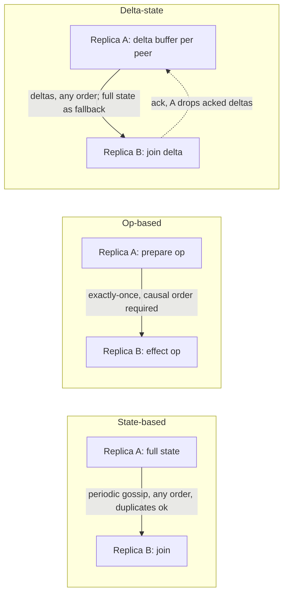
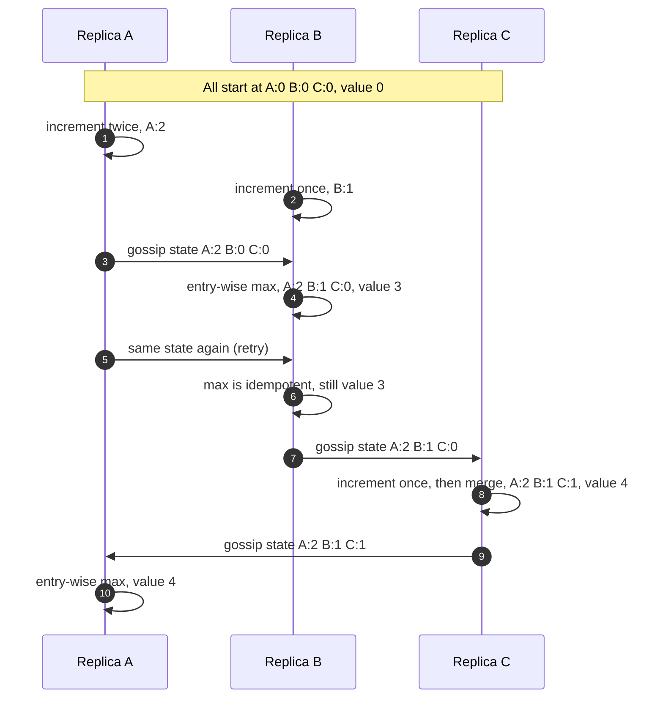
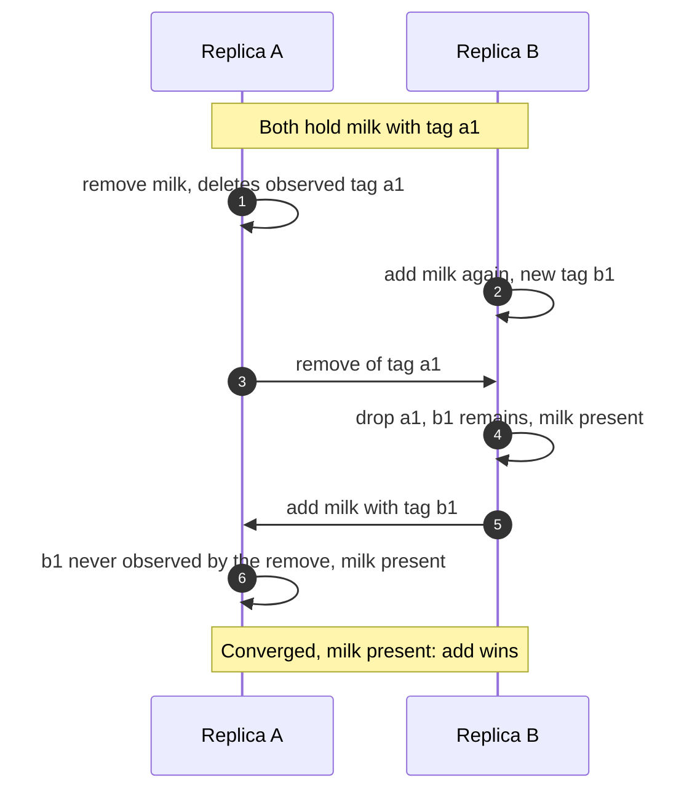
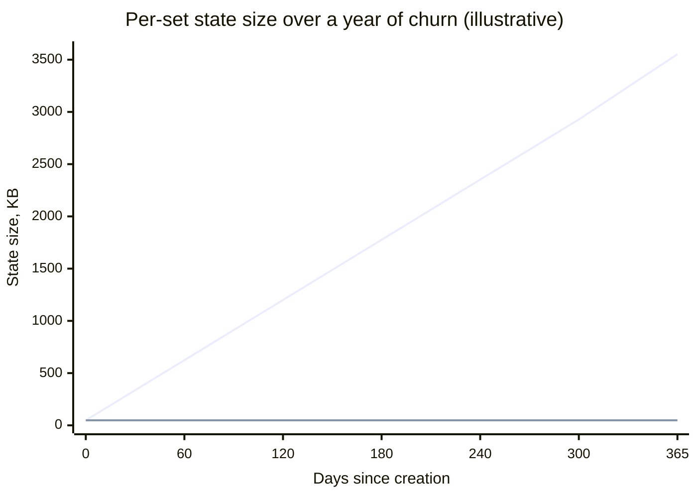
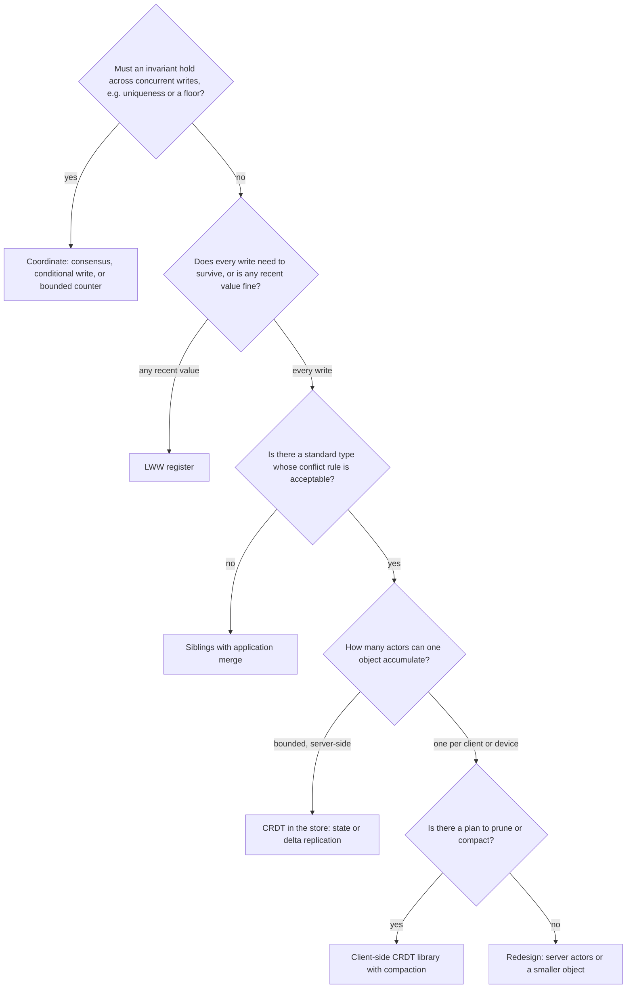

A conflict-free replicated data type (CRDT) is a data type whose replicas can each accept updates locally, with no coordination, and are guaranteed to reach the same state once they have received the same updates, regardless of the order, grouping, or duplication of delivery. The guarantee comes from the type's mathematics rather than from a protocol: either the merge of two states is commutative, associative, and idempotent, or concurrent operations commute. A counter that sums per-replica contributions, a set that tags every addition with a unique identifier, and a text buffer that gives every character a permanent position are all CRDTs.

The problem they solve is the one left open by [last write wins](/distributed-systems/en/data-management/consistency-models/eventual-consistency/). A store that accepts writes on any replica must settle concurrent writes deterministically, and LWW does so by keeping one and discarding the rest. A CRDT settles them by keeping the effect of every write: two concurrent increments both count, an addition and a concurrent addition of another element both survive, two users typing in the same paragraph both see their text. The write path stays local, so a CRDT store keeps the availability and the local-replica latency of an AP system as described on the [CAP theorem](/distributed-systems/en/data-management/consistency-models/cap-theorem/) page, without the silent loss.

The core trade-off is that the merge must be decided at design time and cannot consult anyone. A CRDT pays for coordination-free convergence in three currencies: metadata that grows with the number of writers and, for some types, with the history of deletions; semantics fixed by the type rather than by the application at the moment of conflict (when an addition and a removal of the same element are concurrent, the type, not a human, decides which wins); and the inability to enforce any invariant that needs global knowledge, such as "the balance never goes below zero" or "this username is unique". CRDTs make concurrent updates harmless only for data whose meaning survives every interleaving.

## Convergence by Construction: Semilattices and Delivery Contracts

Every replica of a CRDT holds a state, applies local updates to it immediately, and exchanges information with other replicas in the background. Two designs differ in what they exchange, and each places a different requirement on the network between replicas. That requirement is the most important operational property of a CRDT, because it decides which transport can carry it.

### State-Based CRDTs: Ship the State, Merge With a Join

In a state-based CRDT, also called a convergent replicated data type (CvRDT), a replica periodically sends its entire state to another replica, which merges it into its own. Correctness rests on three conditions. The set of possible states must be partially ordered, so that "state `b` contains at least the information of state `a`" has a meaning. Every local update must be inflationary: it moves the state upward in that order, never sideways or down. And the merge must compute the least upper bound, or join, of two states: the smallest state that contains both. A partial order in which every pair of states has a join is a join-semilattice.

The join has exactly the properties an unreliable network needs. It is commutative, so the order in which two replicas exchange states does not matter. It is associative, so merging through an intermediary gives the same result as merging directly. It is idempotent, so receiving the same state twice changes nothing. A gossip protocol that delivers states late, out of order, repeatedly, or through arbitrary relays therefore cannot make replicas disagree: after a replica has merged, directly or transitively, the states that reflect every update, it holds the join of all of them, and the join of a set does not depend on how it was computed. The only requirement on the network is that every update eventually reaches every replica through some chain of merges, which is the eventual-delivery half of eventual consistency and what [gossip protocols](/distributed-systems/en/resilience/failure-detection/gossip-protocols/) and [Merkle-tree anti-entropy](/distributed-systems/en/data-management/replication/anti-entropy-merkle/) provide.

The intuition for why the join preserves every write is the inflation condition. An update adds information; the merge never removes information that either side had. A write can therefore never be "lost" by a merge, only absorbed into a larger state. The opposite failure, a merge that discards information, is exactly what LWW does with a concurrent value, and the LWW register is a join-semilattice only because its order deliberately treats the losing value as "less information" than the winner.

### Operation-Based CRDTs: Ship the Operation, Rely on the Transport

In an operation-based CRDT, also called a commutative replicated data type (CmRDT), a replica broadcasts each update as an operation and every replica applies it. Each update is split in two. The prepare phase runs only at the originating replica, reads its local state, and produces an operation message, for example "add element `x` with tag `(B, 7)`". The effect phase runs at every replica, including the originator, and applies that message. Concurrent operations must commute in their effect phase; operations that are causally ordered need not commute, because the transport is required to deliver them in causal order.

That is the price of op-based designs: the transport must deliver every operation exactly once to every replica, in an order consistent with [happened-before](/distributed-systems/en/foundations/time-and-ordering/happened-before/). Increment operations commute, so a counter only needs exactly-once delivery; a removal of an element must not be applied before the addition it observed, so a set also needs causal delivery. Messages are small, often tens of bytes, which is why collaborative editors and chat systems favor this design. But a broker with at-least-once delivery, a replay after a consumer restart, or a dropped message silently violates the contract, and the type has no way to notice: a duplicated increment is indistinguishable from a second increment. The two designs are equivalent in expressive power, Shapiro and colleagues show that each can emulate the other, but they are not equivalent in what they demand from the infrastructure.

### Delta-State CRDTs: Ship Only What Changed

Delta-state CRDTs, introduced by Almeida, Shoker, and Baquero, combine the network tolerance of state-based designs with message sizes close to op-based ones. Each update is written as a delta mutator that returns a small state, the delta, representing only the change; the replica joins the delta into its own state and also into a buffer of deltas not yet acknowledged by each peer. Because a delta is itself a state of the same semilattice, it can be joined, duplicated, reordered, and batched exactly like a full state. A replica ships joined delta groups to peers, discards them when acknowledged, and falls back to shipping the full state to a peer that has been absent for too long. For some types, most importantly the causal sets and maps below, receiving a delta out of order is safe for convergence but can expose an intermediate state that violates causal order, so implementations that need causal visibility ship delta intervals in order per peer.


*The three CRDT families and the contract each places on the channel between replicas.*

The diagram is a decision about infrastructure as much as about data structures. A state-based type can ride on any lossy, duplicating, reordering channel, at the cost of shipping states whose size grows with the object. An op-based type ships tiny messages but needs a reliable causal broadcast layer, which is itself a distributed protocol with buffering and membership. Delta-state sits between them: its messages are small in the common case, it tolerates the same channel as state-based types, and the acknowledgment arrow is the only extra machinery. Most production key-value stores that offer CRDTs use state-based or delta-state replication; most collaborative editing libraries use op-based designs over their own sync protocol.

### Strong Eventual Consistency and What It Excludes

The guarantee CRDTs provide has a name: strong eventual consistency (SEC). Any two replicas that have delivered the same set of updates are in the same state, immediately, with no rollback, no consensus, and no reconciliation step; and every update delivered to a correct replica is eventually delivered to all. The [eventual consistency](/distributed-systems/en/data-management/consistency-models/eventual-consistency/) page defines the weaker model; SEC turns convergence from a liveness property into a safety property.

What SEC does not give is as important. It does not give any recency guarantee: a replica that has not received an update returns a state without it, so CRDTs on their own provide none of the [session guarantees](/distributed-systems/en/data-management/consistency-models/causal-consistency-session-guarantees/), and a client routed to another replica may not read its own increment. It does not make the converged state match anyone's intent: it guarantees agreement on whatever the type's semantics produce, and "add wins" or "remove wins" is chosen by the type's designer. It does not order operations across objects: two CRDTs updated together converge independently, and a reader can see one update without the other unless the store adds transactional or causal visibility. And it cannot preserve any invariant that a combination of individually valid concurrent updates can break, which excludes uniqueness, non-negativity, and every "at most N" constraint, because each replica validates against a state that does not include the other replicas' concurrent updates.

## The Data Type Catalog: What Each Type Decides for You

A CRDT is not a generic replication technique applied to arbitrary data; it is a specific data type with a specific answer to concurrency. Each type below exists because the simpler type before it either fails to converge or converges on the wrong answer.

### Counters: Why One Integer Cannot Be Replicated

A replicated integer with "keep the maximum" as the merge converges but loses increments: two replicas at 10 that each add 1 both hold 11, and the maximum is 11, not 12. Summing on merge does not converge either, because merging the same state twice counts it twice. The grow-only counter (G-Counter) fixes both by keeping one integer per replica. Replica `i` increments only its own entry; the value is the sum of all entries; the merge takes the entry-wise maximum. Each entry is written by one replica only, so the entry-wise maximum never loses an increment, and the maximum is idempotent, so duplicates are harmless. A counter that can also decrease, the PN-Counter, is two G-Counters, one for increments and one for decrements, with value `P - N`.


*A G-Counter converging over a duplicating, relayed gossip channel.*

Steps 3 and 5 deliver the same state twice, and step 6 shows why that is safe: the entry-wise maximum of a state with itself is that state. Step 7 relays A's increments through B, and C never talks to A directly before step 9, yet its result already includes them, which is associativity at work. In step 8, C's own increment and the merge happen in either order with the same result. The structure also shows the cost: the state has one entry per replica that ever incremented, and the type cannot forget an entry without risking the next merge restoring it from a replica that still has it.

A PN-Counter converges, but it cannot enforce a lower bound. Two replicas each holding a stock of 1 can each accept a decrement, and the converged value is -1. The bounded counter of Balegas and colleagues handles this by turning the bound into rights: the total allowed decrements are split among replicas, each replica decrements only against its own rights, and transferring rights between replicas is the only step that needs communication. It is the CRDT form of the escrow technique mentioned on the [multi-leader replication](/distributed-systems/en/data-management/replication/multi-leader-replication/) page: coordination does not disappear, it moves off the request path into rebalancing.

### Registers: Pick One, or Keep All

A register holds one value that is overwritten as a whole. The LWW register keeps the value with the greatest `(timestamp, replica ID)` pair, and its mechanics and loss modes are on the [eventual consistency](/distributed-systems/en/data-management/consistency-models/eventual-consistency/) page. The multi-value register (MV-Register) refuses to pick: each value carries a version vector, a write dominates the values it observed, and concurrent writes survive side by side for the reader to resolve. It is the CRDT formulation of the siblings described on the [vector clocks](/distributed-systems/en/foundations/time-and-ordering/vector-clocks/) page. Neither register merges values: LWW discards information, MV-Register defers the decision to the application. Merging contents requires a type that knows the structure of the value, which is what sets, maps, and sequences are.

### Sets: From Grow-Only to Observed-Remove

A grow-only set (G-Set) merges by union and supports no removal. Adding removal is where the semantic choices begin. The two-phase set (2P-Set) pairs an added-set with a removed-set of tombstones; an element is present if added and not removed, so once removed it can never be re-added. An LWW-element-set stamps every addition and removal and keeps whichever is later per element, inheriting every clock problem of LWW. The observed-remove set (OR-Set) is the design that matches what users expect: an addition creates a unique tag, a removal deletes only the tags its replica has observed, and an addition concurrent with a removal therefore survives, because the removal never saw its tag. This rule is called add-wins.


*Concurrent remove and re-add in an observed-remove set. The removal deletes the tag it saw, not the element.*

Step 1 is the critical one: the removal does not say "remove milk", it says "remove tag `a1`", which is all replica A knew about. In step 4 B removes that tag and still has `b1`, and in step 6 A receives a tag it never observed, so nothing cancels it. If the rule were remove-wins, the element would be absent on both replicas; the choice converges either way and is a product decision. Add-wins is the right default for carts, membership lists, and tags; remove-wins suits access revocation, where a concurrent re-grant should not undo a revoke. The Dynamo paper reports the user-visible face of add-wins semantics in its shopping cart: a merge of concurrent versions never loses an added item, but a deleted item can resurface.

The original OR-Set needs tombstones: to know that tag `a1` was removed, a replica must remember it, or a merge with a replica that still has `a1` would re-add it. Bieniusa and colleagues removed that requirement with the optimized OR-Set, called ORSWOT (OR-Set without tombstones) in Riak. Each replica keeps a version vector summarizing every tag, or dot, it has ever seen, as a pair `(replica, counter)`. A tag absent from the set but covered by the version vector must have been removed; a tag present on the other side and not covered by the local vector is new. The comparison replaces the tombstones, so state size is proportional to live elements plus one vector entry per replica.

```text
# Dotted set merge (ORSWOT). A dot is (replica_id, counter); vv summarizes seen dots.
merge(local, remote):
  keep = {}
  for (elem, dot) in local.entries union remote.entries:
    in_l = (elem, dot) in local.entries
    in_r = (elem, dot) in remote.entries
    if in_l and in_r:                      keep.add(elem, dot)   # both still have it
    elif in_l and not covers(remote.vv, dot): keep.add(elem, dot) # remote never saw it
    elif in_r and not covers(local.vv, dot):  keep.add(elem, dot) # local never saw it
    # else: one side saw the dot and no longer has it -> it was removed
  return (keep, pointwise_max(local.vv, remote.vv))

add(elem) at replica r:   dot = (r, local.vv[r] + 1); local.vv[r] += 1
                          remove all dots of elem; add (elem, dot)   # re-add supersedes
remove(elem):             remove all dots of elem   # vv unchanged: absence plus vv = removed
```

The pseudocode shows where the correctness argument lives. A dot is generated once, by one replica, from a counter only that replica advances, so dots are globally unique, and the version vector entry for a replica covers exactly the dots it generated or received. The three branches are the complete case analysis: present on both sides, present on one side and unseen by the other (a concurrent add), or present on one side and seen-then-dropped by the other (a remove). The design depends on one assumption that operations staff can break: a replica identifier must never reuse a counter value. A replica restored from a backup under its old identifier reissues dots that other replicas already hold or have already seen removed, and the third branch then deletes fresh additions. That failure is analyzed below.

### Maps and Composition

A map of CRDTs embeds a CRDT under each key and merges key by key, recursively, so a document is a map whose fields are registers, counters, sets, or nested maps. Composition is what makes CRDTs usable for structured data, and it is also where the semantics become subtle. Concurrent updates to different fields merge without interaction. An update to a field concurrent with removal of the field's key needs a rule: under observed-remove semantics the removal deletes only the state it observed, so the field survives with only the concurrent update in it, which is why a removed-then-updated counter can reappear with a value equal to just the concurrent increments. Riak documents the add-wins form for maps: when a field is concurrently added or updated and removed, the add or update wins. Kleppmann and Beresford's JSON CRDT, which underlies Automerge's model, applies the same rule to arbitrary nesting and documents the consequences of concurrent assignments of different types to the same key.

The dotted design composes well because every nested type can share one causal context, the version vector of the enclosing object, rather than each carrying its own. That shared context is how a map with thousands of fields keeps metadata proportional to the number of replicas rather than to the number of fields.

### Sequences and Text

Sequence CRDTs give each element of a list or text a unique, immutable identifier and a position derived from it, so that concurrent insertions at the same place are ordered deterministically on every replica. The families differ in how they order. Logoot and LSEQ allocate dense position identifiers between neighbors; RGA (Replicated Growable Array) inserts each element after a reference element and orders siblings by a [Lamport timestamp](/distributed-systems/en/foundations/time-and-ordering/lamport-timestamps/); YATA, the algorithm behind Yjs, records both left and right origins; Treedoc and Fugue arrange elements in a tree whose traversal gives the order. Deletion usually leaves a tombstone, because later insertions may reference the deleted element as their origin.

Sequences add an anomaly no other type has. When two users concurrently type words at the same position, several algorithms can interleave the two insertions character by character, producing an unreadable merge that is nonetheless converged. Kleppmann, Gomes, Mulligan, and Beresford described this in 2019, and Weidner and Kleppmann's Fugue work later showed that a naive non-interleaving property is impossible for any algorithm, defined maximal non-interleaving instead, and analyzed existing algorithms against it: in their analysis Logoot, LSEQ, and Treedoc can interleave in every case they examined, RGA and Yjs avoid forward interleaving on a single replica but not every backward or multi-replica case, and FugueMax satisfies the property. Sequence CRDTs compete with operational transformation (OT), in which a server transforms concurrent operations against each other; OT has small per-character metadata but needs a central ordering point for correctness in practice, while sequence CRDTs work peer to peer at the cost of an identifier for every element ever inserted.

| Type | State | Merge | Concurrent conflict rule | Metadata growth | When to prefer |
|---|---|---|---|---|---|
| G-Counter, PN-Counter | One or two integers per replica | Entry-wise max | All increments and decrements count | Per writer ID | Likes, views, quotas that tolerate overshoot |
| Bounded counter | PN-Counter plus rights matrix | Entry-wise max | Each replica spends only its rights | Per replica pair | Stock or credit with a floor, at the cost of occasional rights transfer |
| LWW register | Value, timestamp, replica ID | Keep max pair | One value kept, others dropped | Constant | Whole-value replacement where any recent value is acceptable |
| MV-Register | Values with version vectors | Keep non-dominated | All concurrent values kept for the reader | Per writer, per sibling | Values the application can merge on read |
| OR-Set (ORSWOT) | Elements with dots, version vector | Dotted merge above | Add wins over concurrent remove | Live elements plus per replica | Carts, membership, tags, presence |
| Remove-wins set | Same structure, inverted bias | Dotted merge | Remove wins over concurrent add | Live elements plus per replica | Revocation, blocklists |
| Map of CRDTs | Nested CRDTs, shared causal context | Per key, recursive | Update wins over concurrent key removal (add-wins form) | Sum of children plus per replica | Documents and profiles with independent fields |
| Sequence (RGA, YATA, Fugue) | Element IDs, origins, tombstones | Order by IDs | Concurrent inserts both kept, deterministic order | Per element ever inserted | Collaborative text, ordered lists, offline-first editing |

Read the "concurrent conflict rule" column as a list of decisions that the type makes forever, for every object, without context. If any of those rules is wrong for a piece of data, the type is wrong for it, however well it converges.

## Worked Example: The Metadata Bill

Assume a service keeps 10 million per-item counters and 100,000 active per-user sets in a CRDT store replicated across three regions with five storage nodes each. All numbers in this section are illustrative.

Counters first. If the actor of each update is the storage node that accepted it, a PN-Counter has at most 15 actors in each of its two halves. With an 8-byte actor identifier and an 8-byte count per entry, one half is at most `15 * 16 = 240` bytes and the counter is at most 480 bytes, against 8 bytes for a plain integer. For 10 million counters that is up to 4.8 GB instead of 80 MB, a factor of 60, before replication. In practice most counters are touched by fewer nodes, so the average is lower, but the worst case is what capacity planning must cover. If the design instead uses the client as the actor, for example a mobile device that increments offline, a counter liked by 2,000 distinct devices has 2,000 entries, 32 KB, and the size is bounded by the number of clients ever seen rather than by the cluster. The choice of actor is the dominant metadata decision for any CRDT, and server-side actors are the default for that reason.

Now the sets. Assume each set holds 1,000 live elements of 32 bytes, each element carries a 16-byte dot, and churn is 200 additions and 200 removals a day, so the live size stays constant. Live state is `1,000 * 48 = 48,000` bytes in both designs. An OR-Set with tombstones also keeps every removed `(element, tag)` pair, 48 bytes each: 200 a day for 365 days is 73,000 tombstones, about 3.5 MB per set after a year, 73 times the live data. ORSWOT keeps the 48,000 bytes plus a version vector of at most 15 entries, 240 bytes, indefinitely.


*Upper line: OR-Set with tombstones, 1,000 live elements, 200 removals a day at 48 bytes each. Lower line: dotted OR-Set (ORSWOT) with a 15-entry version vector.*

The upper line is what "tombstones are garbage-collected eventually" looks like when no garbage collection runs. Removing a tombstone safely requires knowing that every replica has seen the removal, which is causal stability: the tombstone's dot is covered by the version vectors of all replicas. That is a global condition, so it needs either a membership protocol that knows every replica or a coordinated compaction step, and a single replica that stays offline pins every tombstone created since it left. Sequence CRDTs face the same arithmetic with no ORSWOT-style escape, because deleted characters are referenced by later insertions; Yjs garbage-collects the content of deleted items but keeps their structural metadata, and Automerge keeps the full operation history in a compressed columnar encoding.

Finally the network. Assume each of the 100,000 sets is updated once a minute and every update is shipped to two peer regions. State-based replication of the whole object costs `100,000 / 60 * 48,000 * 2`, about 160 MB/s of cross-region traffic. Delta-state replication ships the changed element, its dot, and the causal context, about 300 bytes, for `100,000 / 60 * 300 * 2`, about 1 MB/s, a factor of 160. At cross-region transfer prices the difference decides whether a CRDT design is affordable at all, which is why Akka Distributed Data, which started with full-state gossip, later added delta propagation.

:::tip[Size the actor set before choosing the type]
Write down, for every CRDT in the design, what the actor is and how many actors one object can accumulate over its lifetime. If the answer is "one per client" or "one per pod, and pods are replaced on every deploy", metadata grows without bound unless the system prunes retired actors, and pruning needs a protocol of its own. Server-side, stable actor identities keep vectors small and make every other cost in this section predictable.
:::

## CRDTs Against the Other Ways to Settle Concurrency

CRDTs are one of five ways a replicated system can handle concurrent writes to the same data, and they are not always the strongest. The comparison is per data type, not per system.

| Approach | What concurrent writes produce | Invariants it can enforce | Requirement on the network | Metadata | When to prefer |
|---|---|---|---|---|---|
| LWW register | One write kept, others dropped | None | Eventual delivery | One timestamp | Whole-value replacement, caches, last-seen values |
| Siblings with application merge | All versions until a reader merges | Whatever the merge code checks, after the fact | Eventual delivery | Version vector per value | Domain-specific merges that no standard type expresses |
| CRDT | Deterministic merge preserving every write's effect | Only those every merge preserves | State/delta: eventual; op: exactly-once causal | Type-dependent, per actor or per element | Counters, sets, maps, text, offline-first and multi-region writers |
| Operational transformation | Operations transformed into a common order | Those the server checks | Central server ordering operations | Small, plus server history | Collaborative editing with an always-reachable server |
| Consensus or conditional write | Writes serialized before acknowledgment | Any, including uniqueness and bounds | Majority reachable on the write path | Version number | Balances, uniqueness, reservations, workflows |

The table makes one boundary explicit: a CRDT is never the right tool for an invariant that concurrent valid updates can jointly violate. Bailis and colleagues formalized this as invariant confluence: an invariant can be maintained without coordination if and only if merging any two states that each satisfy it yields a state that satisfies it. "Count is non-negative" with decrements is not invariant-confluent, so it needs either coordination on the write or rights partitioned in advance, as in the bounded counter. "Every element in the set was added by someone" is invariant-confluent, so a set never needs coordination for it.

:::note[CRDTs and causal consistency are complementary]
A CRDT guarantees that replicas agree once they have the same updates; it says nothing about the order in which a reader sees updates across objects. Causal+ consistency, as described on the [causal consistency](/distributed-systems/en/data-management/consistency-models/causal-consistency-session-guarantees/) page, uses a convergent merge per key and adds causal visibility across keys. Stores such as AntidoteDB combine both, offering CRDT objects inside transactions with causal snapshot reads.
:::

## CRDTs in Production Systems

The textbook types reach production with three recurring modifications: the store chooses the actor, restricts the type menu, and fixes the conflict semantics on behalf of the application.

### Riak Data Types

Riak added a state-based counter in version 1.4 and a family of data types in 2.0, implemented in the open-source `riak_dt` library: counters, sets, maps, flags, and registers, with a HyperLogLog type added in 2.2. Riak's documentation states the convergence rules: counters are PN-Counters, so all increments and decrements by all actors are eventually applied; sets are add-wins on concurrent add and remove; maps let an add or update win over a concurrent removal of the field; flags resolve enable over disable; registers keep the most recent value by timestamp, which is an LWW register inside the map. Replicas exchange contexts with clients so that removals carry the causal knowledge they were based on. Two operational consequences follow from the design. Every update is a read-modify-write of the whole object on the replica, so large sets and maps make every update proportionally expensive; and the documentation warns that counters must not be used to generate unique or ordered identifiers, because uniqueness is not invariant-confluent.

### Redis Active-Active Databases

Redis Enterprise's Active-Active databases replicate a keyspace across clusters with CRDT semantics per Redis data type. Its documentation states that sets keep additional metadata to achieve OR-Set behavior, with add-wins: a removal removes only instances it has already seen. Integer operations such as `INCRBY` on strings behave as counters that accumulate the operations from all member databases, and counters are limited to 59 bits to protect against overflow during concurrent operations. Plain `SET` on strings is last-write-wins, using a wall-clock timestamp from the operating system stored with each operation when the syncer cannot otherwise order the writes. The mix matters: a key that is sometimes `SET` and sometimes incremented carries two different conflict semantics, and the LWW half inherits every clock problem on the eventual consistency page.

### Akka Distributed Data

Akka Distributed Data replicates CRDTs among the nodes of an Akka cluster with gossip and offers `GCounter`, `PNCounter`, `ORSet`, `ORMap`, `LWWMap`, flags, and registers, with delta propagation for the types that support it. Each read and write takes a consistency level (local, a number of nodes, majority, or all), which bounds how many replicas acknowledged a write before it returns but does not change convergence. Because entries are keyed by cluster node, removed nodes leave state behind; types implement a `RemovedNodePruning` interface through which the replicator collapses a removed node's entries into another node and later cleans them up. Nodes are identified by a unique address that includes a per-incarnation identifier, which is exactly the protection against actor reuse that the failure section below calls for.

### Collaborative Editing Libraries

Automerge and Yjs bring CRDTs to the client. Both are op-based in spirit, with a sync protocol that exchanges missing changes between peers or through a relay server, and both give every replica, typically every open document in a browser, its own actor identity. Automerge models a document as a JSON-like tree with Lamport-timestamped operation identifiers and keeps the full history, compressed; Yjs uses YATA for sequences and garbage-collects deleted content while keeping structural metadata. Their operational concerns differ from those of a database: document size over months of editing, load time when replaying history, and the number of actors, which grows with every device and session that ever opened the document.

## Failure Modes and How They Present

CRDT failures rarely look like errors. Replicas agree, reads succeed, and the data is wrong, oversized, or slow. Detection therefore depends on measuring object sizes, actor counts, and convergence, not on error rates.

### Actor Identity Reuse After a Restore

Trigger: a replica is restored from a backup, rebuilt from a snapshot, or a container is recreated with a persistent identity but lost local state, and it keeps its old actor identifier. Its counters restart from the backup's values, below what other replicas have already seen from it. Symptoms: increments made on that replica after the restore disappear; additions to OR-Sets vanish or old removals seem to apply to new additions; no error is logged anywhere, because every merge is well-formed.

```mermaid
gantt
    title Actor reuse after restore on replica B (hypothetical)
    dateFormat HH:mm
    axisFormat %H:%M
    section Replica B
    Snapshot taken, entry B at 1000            :milestone, m1, 01:00, 0m
    Increments continue to B at 1500, gossiped :b1, 01:00, 120m
    Disk lost, restored from older snapshot   :crit, b2, 03:00, 15m
    New increments reuse B 1001 to 1500        :crit, b3, 03:15, 60m
    section Replicas A and C
    Hold entry B at 1500 from gossip           :a1, 01:30, 165m
    Merge with B, max of 1500 and 1500         :crit, a2, 04:15, 10m
    section Visible effect
    500 increments since restore lost silently :crit, e1, 04:25, 35m
```


*A replica restored under its old actor ID reissues counter values other replicas already hold; the entry-wise maximum absorbs the new increments.*

The gantt chart shows why the loss is silent. Before the disk loss, A and C already hold B's entry at 1500. After the restore, B's 500 new increments raise its entry from 1000 back to 1500, the same number for different events; the merge takes the maximum, finds nothing to change, and the 500 increments since the restore are gone while every replica reports the same value. For a dotted set the effect is worse: B reissues dots that A and C have already seen and removed, so the third branch of the merge treats B's new additions as removals. Detection: a replica that receives a state whose entry for its own actor ID is greater than its local entry has proof that it was rolled back, and a correct implementation logs and refuses to continue under that ID; per-actor monotonicity checks during merge are cheap and worth adding where the store does not have them. Mitigation: give every incarnation a fresh actor ID, derived from a random component or an epoch stored alongside the data, and treat restore procedures as identity changes. Recovery: lost increments cannot be reconstructed from CRDT state; they must be replayed from an upstream log if one exists.

:::danger[Never restore a CRDT replica under its old identity]
A replica that rejoins with an actor ID whose counters went backwards silently discards every update it makes until its counters pass the old high-water mark, and in a dotted set it can turn new additions into removals. Backups, snapshots, and disk replacements must create a new actor identity, and a merge that receives a higher counter for the local actor than the local state holds must be treated as a corruption alarm, not merged.
:::

### Duplicate or Reordered Operations in Op-Based Types

Trigger: an op-based CRDT is carried by a transport with at-least-once delivery, such as a message broker whose consumer commits offsets after applying operations, and a consumer restarts between apply and commit; or operations from one replica arrive by two paths in different orders. Symptoms: counters drift upward by the size of the replayed batch; a removal applied before the addition it observed has no effect, and the element appears permanently. Replicas diverge, which is the one CRDT failure that does break agreement. Detection: periodic digest comparison of the same objects across replicas, the same hash comparison used by anti-entropy, and counters of duplicate operation IDs at the receiver. Mitigation: deduplicate by operation ID with a per-sender sequence number, as in the [inbox pattern](/distributed-systems/en/coordination/distributed-transactions/inbox-pattern-idempotent-consumers/), buffer operations until their causal dependencies have been applied, or switch to state-based or delta-state replication, which tolerates both faults by construction. The guarantees a broker actually provides are on the [delivery semantics](/distributed-systems/en/communication/async-messaging/delivery-semantics/) page.

:::caution[An op-based CRDT on an at-least-once queue is not a CRDT]
Commutativity of concurrent operations is only half of the op-based contract; exactly-once causal delivery is the other half. Increments replayed after a consumer crash are counted twice and nothing in the type can tell. Either make delivery exactly-once at the receiver with operation IDs, or replicate states or deltas, whose merge is idempotent.
:::

### Unbounded Metadata Growth

Trigger: tombstones that are never collected because one replica never acknowledges, actors that accumulate because clients or short-lived pods act as actors, or sequence documents with years of edit history. Symptoms: object sizes grow while the visible content does not; update latency grows with object size because state-based stores read and rewrite the whole object; replication bandwidth rises without a traffic increase; client load times for documents grow. Detection: histograms of object size by type, the ratio of metadata to payload, the number of actor entries per object, and the age of the oldest uncollected tombstone. Mitigation: dotted types instead of tombstone-based ones, server-side actors, pruning of retired actors through the store's mechanism, and splitting very large objects, for example one set per user per month instead of one per user forever. Recovery for documents is usually a compaction that rewrites history into a snapshot, which requires every replica that might still send old operations to have been brought up to date first.

### Invariant Violations Accepted as Valid State

Trigger: a design places a bounded quantity, a uniqueness requirement, or a cross-object constraint in a CRDT. Symptoms: stock goes negative, two users are granted the same name, a reservation is double-booked, and the converged state is perfectly consistent across replicas. Detection: invariant checks on the converged state, run as reconciliation jobs, with alerts on violations; the rate of violations rises with write concurrency and with replication delay. Mitigation: bounded counters for numeric floors, a single owner or consensus group for uniqueness as on the [multi-leader replication](/distributed-systems/en/data-management/replication/multi-leader-replication/) page, or a compensating action after the fact, which is a business process rather than a data structure.

### Semantic Surprises: Resurrection and Interleaving

Trigger: add-wins semantics applied to data where the user expects removals to stick, or map key removals concurrent with field updates, or concurrent typing at one position. Symptoms: deleted cart items reappear, a removed profile section reappears with only the concurrently edited field, and merged text is interleaved. No component reports a problem, because the type behaves as specified. Detection: user reports and support tickets, or targeted tests that run concurrent histories against the chosen types before launch. Mitigation: choose remove-wins where removals must stick, model a removal as a tombstone value the application understands rather than a key removal, and for text choose an algorithm with stronger non-interleaving properties.

### Divergence From Non-Lattice Merges and Mixed Versions

Trigger: a hand-written "CRDT" whose merge is not idempotent or not associative, for example a merge that sums, or a rolling upgrade during which two versions of the merge function coexist. Symptoms: replicas that have exchanged the same states hold different values; values change on repeated anti-entropy rounds. Detection: digest mismatches that persist after repair, and property-based tests that merge random states in random orders and groupings and compare. Mitigation: test merges for commutativity, associativity, and idempotence before deployment; version the type and keep both merge functions identical in behavior across an upgrade window.

| Failure | Breaks agreement? | Primary signal | First mitigation |
|---|---|---|---|
| Actor reuse after restore | No, loses updates | Received entry for own actor above local entry | Fresh actor ID per incarnation |
| Duplicate or reordered ops | Yes | Cross-replica digest mismatch, duplicate op IDs | Dedupe by op ID, or state/delta replication |
| Metadata growth | No, degrades performance | Object size and actor count per object | Dotted types, server actors, pruning |
| Invariant violation | No, wrong but agreed | Reconciliation checks on converged state | Bounded counter or coordination |
| Resurrection, interleaving | No, unintended semantics | User reports, concurrency tests | Pick bias per type, stronger sequence algorithm |
| Non-lattice merge | Yes | Persistent digest mismatch after repair | Property-based tests of the merge |

## Choosing CRDTs

The decision is made per piece of data, by asking whether every interleaving of concurrent valid updates produces an acceptable result.


*Deciding whether a piece of data belongs in a CRDT. The invariant question comes first because no CRDT can answer it.*

The order of the questions matters. The invariant question eliminates the cases where a CRDT converges on an invalid state, which no amount of engineering inside the type can fix. The second question eliminates the cases where a CRDT's extra metadata buys nothing, because the application would accept losing a concurrent write anyway. The third question is about semantics: a cart works with add-wins, an access-control list may need remove-wins, and a domain object whose merge depends on business rules needs application code. Only the last two questions concern cost, and they are where most production problems with CRDTs originate.

Use CRDTs when writers in different regions, on mobile devices, or in partitioned networks must keep accepting updates locally; when the data is a counter, a set, a map of independent fields, or text; when the type's conflict rule is the behavior users expect; and when actors are stable and few, or the system has a pruning plan. They are a strong fit for multi-region counters and presence, shopping carts and membership lists, offline-first and local-first applications, and collaborative editing without an always-reachable server.

Do not use them for balances, stock, quotas, or seats that must not go below zero, except through a bounded counter with an explicit rights-transfer path; for uniqueness of names, identifiers, or reservations; for data whose correctness depends on the order of operations across objects, such as workflows and state machines, which belong in [consensus-based state machine replication](/distributed-systems/en/coordination/consensus-algorithms/total-order-broadcast-smr/) or a single owner; for data with one writer at a time, where a version number or LWW with a per-writer clock is cheaper and has no conflicts to resolve; and for large objects updated through a state-based store, where every update rewrites the whole object. A CRDT also does not replace a log of business events: if the history must be audited or replayed, [event sourcing](/distributed-systems/en/microservice-patterns/event-sourcing-cqrs/event-sourcing/) keeps it, and a CRDT can be one of its projections.

Three neighbors are commonly confused with CRDTs. Version vectors detect concurrency and are often a component inside a CRDT, but they do not merge anything; that boundary is on the [vector clocks](/distributed-systems/en/foundations/time-and-ordering/vector-clocks/) page. Anti-entropy and gossip move state between replicas; the CRDT merge is what they invoke on arrival. And eventual consistency is the guarantee, while a CRDT is one way to meet its convergence half without discarding writes.

## Further Reading

- Marc Shapiro, Nuno Preguica, Carlos Baquero, and Marek Zawirski, *Conflict-Free Replicated Data Types*, SSS, 2011.
- Marc Shapiro, Nuno Preguica, Carlos Baquero, and Marek Zawirski, *A Comprehensive Study of Convergent and Commutative Replicated Data Types*, INRIA Research Report RR-7506, 2011.
- Paulo Sergio Almeida, Ali Shoker, and Carlos Baquero, *Delta State Replicated Data Types*, Journal of Parallel and Distributed Computing, 2018.
- Annette Bieniusa, Marek Zawirski, Nuno Preguica, Marc Shapiro, Carlos Baquero, Valter Balegas, and Sergio Duarte, *An Optimized Conflict-free Replicated Set*, arXiv:1210.3368, 2012.
- Martin Kleppmann and Alastair R. Beresford, *A Conflict-Free Replicated JSON Datatype*, IEEE Transactions on Parallel and Distributed Systems, 2017.
- Matthew Weidner and Martin Kleppmann, *The Art of the Fugue: Minimizing Interleaving in Collaborative Text Editing*, IEEE Transactions on Parallel and Distributed Systems, 2025.
