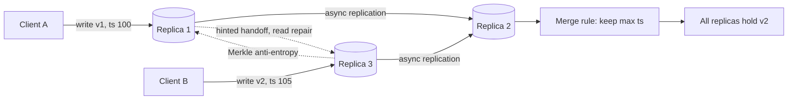
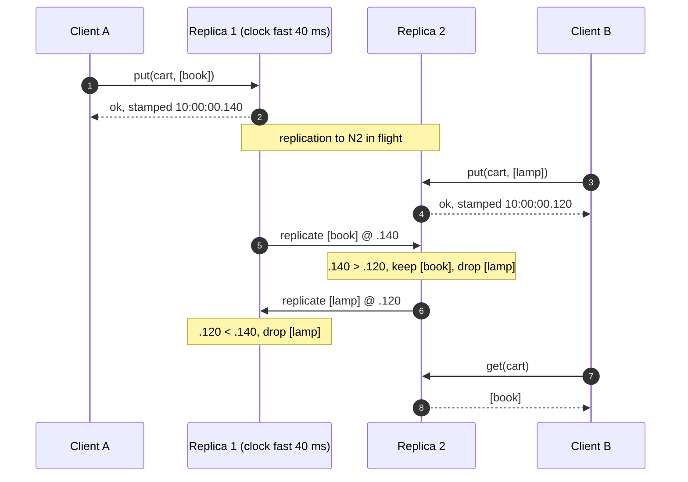
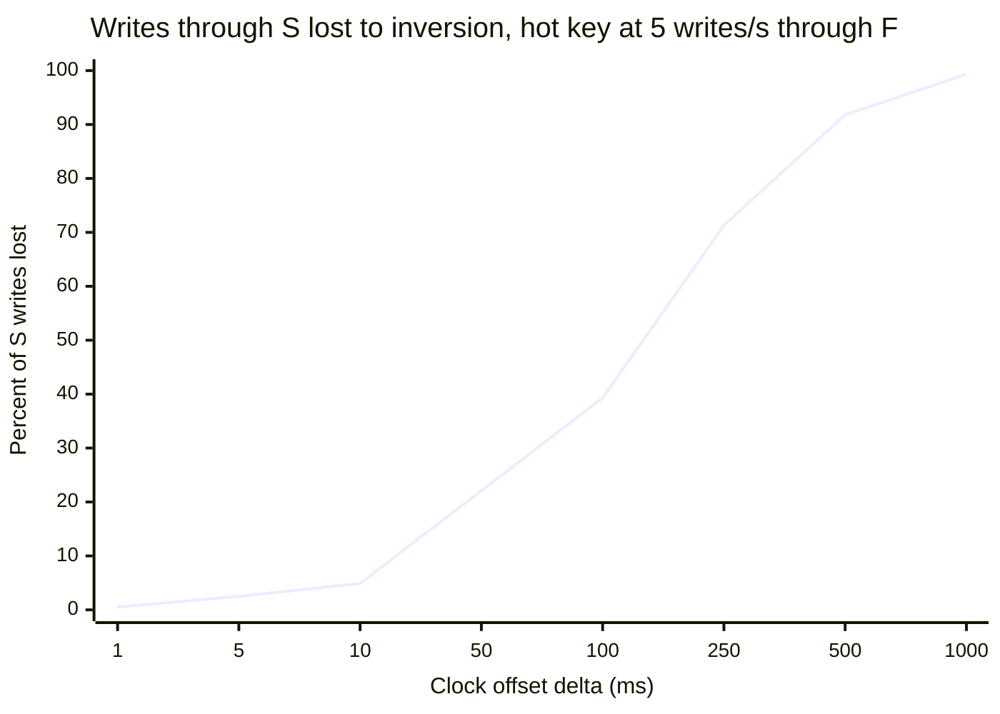
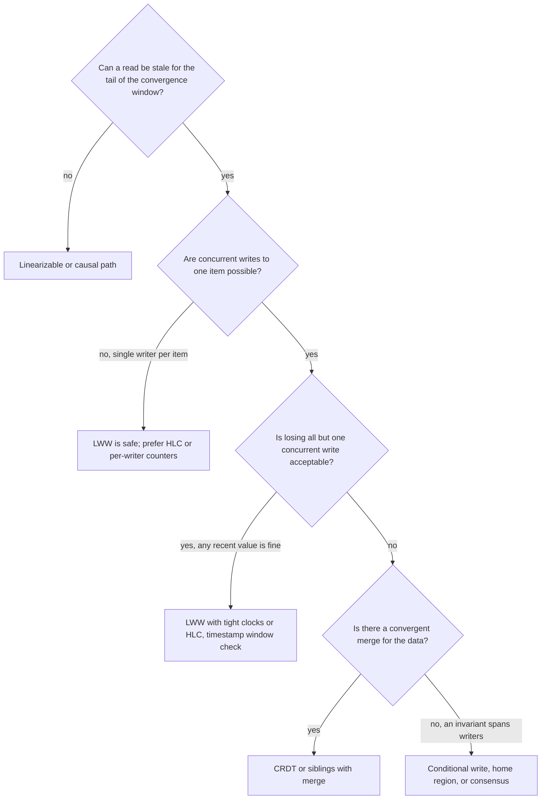

Eventual consistency is the guarantee that if clients stop writing to an item, every replica of that item will, after some unspecified time, hold the same value, and every read will return it. It is the weakest consistency model a replicated store can offer and still be useful. It says nothing about what a read returns while writes are in flight, nothing about how long convergence takes, and nothing about which of several concurrent writes the replicas converge on. A store that makes only this promise can accept a write on any reachable replica, acknowledge it immediately, and propagate it in the background, which is why it stays available through partitions and answers in local-replica latency.

The problem it solves is that every stronger model requires replicas to coordinate before acknowledging, and coordination costs a round trip in the common case and availability during partitions, as the [CAP theorem](/distributed-systems/en/data-management/consistency-models/cap-theorem/) and [PACELC](/distributed-systems/en/data-management/consistency-models/pacelc-theorem/) pages show. Without coordination, two replicas can accept conflicting writes to the same item. Without a rule that settles those conflicts identically everywhere, the replicas never agree, and the store is not even eventually consistent; it is permanently divergent. The convergence half of the guarantee is therefore not free: it is bought by a deterministic reconciliation rule.

Last write wins (LWW) is the cheapest such rule. Every version carries a timestamp, and every replica keeps the version with the greatest one. LWW needs no application code, no conflict storage, and eight bytes of metadata per value, and it converges unconditionally. The core trade-off is that it converges by discarding data: of every set of concurrent writes it keeps one and drops the rest without telling anyone, and because "last" is decided by clocks, it can also drop a write that was made later in real time, or even one made by a client that had already seen the write that beats it. Both kinds of loss happen after the client was told the write succeeded. This page is the canonical treatment of the guarantee and of LWW's failure modes; the propagation machinery is covered in [Leaderless Replication](/distributed-systems/en/data-management/replication/leaderless-replication/) and [Anti-Entropy](/distributed-systems/en/data-management/replication/anti-entropy-merkle/), and the rules that converge without discarding are covered in [CRDTs](/distributed-systems/en/data-management/consistency-models/crdts/).

## The Guarantee: Convergence Without a Deadline

Werner Vogels' widely quoted definition says that if no new updates are made to an object, eventually all accesses will return the last updated value. The definition hides two assumptions. "Eventually" has no bound: a store that converges after a year satisfies it. "The last updated value" presupposes an order on updates that the store does not have, because concurrent writes accepted by different replicas have no natural order. The reconciliation rule supplies that order after the fact, and "last" means whatever the rule says it means.

The more precise formulations, such as Burckhardt's and the one Bailis and Ghodsi use, split the guarantee into two parts. Eventual visibility: every write that is accepted by some replica is eventually delivered to every replica that stays up. Convergence: any two replicas that have received the same set of writes are in the same state, regardless of the order in which the writes arrived. Visibility is a property of propagation; convergence is a property of the reconciliation rule. Together they imply Vogels' statement, and their separation tells an operator where to look when a store does not converge: either writes are not arriving everywhere, or they arrive and are merged differently.

Both parts are liveness properties: they say that something good eventually happens, and no finite observation can violate them. A read that returns a value nobody wrote in the last hour does not violate eventual consistency, because convergence may still happen later. This is the deepest weakness of the model as a contract. Bailis and Ghodsi point out that eventual consistency, read literally, permits a store to return any value at all before convergence. Real stores return a value that some client actually wrote, and that safety property is something they provide in addition to the guarantee, not because of it.


*The two halves of the guarantee. Solid and dashed arrows are propagation, which delivers visibility; the merge rule, applied independently at every replica, delivers convergence.*

The diagram separates three mechanisms that are often blurred under one name. The write is acknowledged by whichever replica or quorum accepted it, before propagation. Propagation runs through several channels, from direct asynchronous replication to the repair paths that catch what it missed; these are the subject of the replication chapter. The merge rule is local: replica 2 does not ask anyone which version to keep, it computes the answer from the versions it holds. Convergence follows only if every replica runs the same rule on the same inputs and the rule's answer does not depend on arrival order. In the picture, replica 2 may receive v2 before v1 or after; under keep-max-timestamp it ends at v2 either way.

### What the Guarantee Does Not Promise

The negative space is where most production bugs live, so it is worth enumerating precisely. Eventual consistency does not promise that a client reads its own write: the next read may go to a replica that has not received it, the problem treated in [Replication Lag](/distributed-systems/en/data-management/replication/replication-lag/). It does not promise monotonic reads: two successive reads may hit different replicas and go backwards in time. It does not promise causal order: a reply may be visible before the post it replies to, which is what [causal consistency](/distributed-systems/en/data-management/consistency-models/causal-consistency-session-guarantees/) adds. It does not promise that any particular write survives: under LWW a write is guaranteed to be visible eventually only until a write with a greater timestamp shadows it, which may happen before any reader saw it. It does not promise a time bound, and it does not promise atomicity across items: two items written together may converge at different times, and under per-item reconciliation they may converge on values from different writes.

What it does promise, once its preconditions hold, is quiescent agreement. The preconditions are that writes eventually stop for long enough, that every replica eventually receives every write (or the effect of it, such as a newer version that shadows it), and that the merge rule is deterministic, order-insensitive, and identical everywhere. Each precondition has a failure mode: a hot key that never stops being written never quiesces, a broken repair schedule violates visibility, and a rule that depends on local state, such as "keep the version I applied most recently", silently violates convergence.

### Making "Eventually" a Number

An operator cannot alert on a liveness property, so the useful measurement is the distribution of the convergence window: the time between a write's acknowledgment and the moment a read on any replica returns it or something newer. Bailis and colleagues' probabilistically bounded staleness (PBS) work modeled this for Dynamo-style quorums and found that partial quorums are usually consistent within a short window, with a tail determined by replica load and propagation delays; the [PACELC](/distributed-systems/en/data-management/consistency-models/pacelc-theorem/) page uses that framing to describe latency-favoring systems. In practice the window has two components with different causes. The body is propagation delay and apply time, milliseconds inside a data center and roughly one inter-region round trip across regions. The tail is everything that stalls propagation: a down replica whose hints expire, a repair schedule that falls behind, a replication queue in backlog. The body is what applications are designed against; the tail is what pages an operator, and it is unbounded by construction.

## Last Write Wins: Convergence by Total Order

LWW turns the set of versions of an item into a totally ordered set and keeps its maximum. The idea is older than the term eventual consistency. Johnson and Thomas described it in 1975 in RFC 677, *The Maintenance of Duplicate Databases*: each entry stores the timestamp of the modification that set its current value, a timestamp is a pair of a clock reading and a database-site identifier, and a replica applies an incoming modification only if its timestamp is greater. The pair matters. Two sites can read the same clock value, and without a tie-breaker two replicas could resolve the same pair of writes differently. The RFC also observed that its clocks could be out of synchrony far enough to timestamp the second of two assignments before the first, and that the probability of this can never be zero.

The mechanism at each replica is a compare-and-keep on every incoming version, whether it arrives as a client write, a replication message, a hint, or a repair stream. The replica compares the incoming `(timestamp, tie-breaker)` with the stored one, keeps the greater, and discards the other. A delete is not a removal but a write of a tombstone, a version that says "absent as of timestamp t", which competes under the same rule; without it, a replica that had deleted the item would have nothing to compare, and a late-arriving older write would bring the item back. Tombstones are purged only after every replica is known to hold them. RFC 677 removed a deleted entry once its timestamp was older than all timestamps the sites had acknowledged to each other; Cassandra instead purges after a fixed grace period and requires repair within it, a design whose failure mode, deleted data coming back, is covered in [Leaderless Replication](/distributed-systems/en/data-management/replication/leaderless-replication/).


*LWW resolving two concurrent writes. Both clients receive success; client B's write arrived 20 ms later in real time but carries the smaller timestamp, and both replicas converge on client A's value. Times are illustrative.*

Steps 1 to 4 are the normal fast path: each replica stamps and acknowledges independently, and at this moment the system holds two different "latest" values. Steps 5 and 6 are propagation, and the notes after them are the merge rule applied locally on each side, reaching the same answer in opposite arrival orders. Steps 7 and 8 are where the cost becomes visible: client B wrote, was told the write succeeded, and now reads a value that does not contain it, with no error, no conflict record, and no trace in either replica's state. If client B's write was made after reading client A's, the loss is worse than an arbitrary choice between concurrent writes: a causally later write lost to an earlier one because of a 40 ms clock offset.

### Why LWW Converges, and What That Proof Does Not Cover

The convergence argument is short. Keeping the greater of two versions under a total order is commutative, associative, and idempotent, so the state of a replica after receiving any set of versions, in any order, with any duplicates, is the maximum of that set. Two replicas with the same set have the same maximum. This is exactly the structure of a state-based CRDT (Conflict-free Replicated Data Type); the LWW register is the simplest one, and the general theory is on the [CRDTs](/distributed-systems/en/data-management/consistency-models/crdts/) page.

The argument has four preconditions, and each is a real-world failure surface. The order must be total: ties must be broken by something every replica sees identically, such as a node identifier or the value bytes, never by arrival order. The comparison must use only data carried with the version: a replica that compares against its local clock, for example to reject versions "from the future", breaks determinism because replicas have different clocks. Tombstones must live until every replica has them, or the maximum of the set can differ by replica. And every replica must run the same rule, which matters during a rolling upgrade that changes tie-breaking or tombstone handling.

What the proof does not cover is whether the surviving value is the right one. Convergence is a statement about agreement, not about intent. LWW converges as reliably on the wrong winner as on the right one, which is why repair and anti-entropy cannot fix an LWW loss: they faithfully spread the winner to every replica.

### Where the Timestamp Comes From

Four sources are used in practice, and the source determines the failure modes. A client-assigned timestamp from the application server's wall clock makes "last" mean "last according to whichever application host stamped it"; Cassandra drivers do this by default (the Java driver 4.x default generator is client-side and monotonic per session). A coordinator-assigned timestamp moves the clock to the storage node that received the request. A logical timestamp, a [Lamport clock](/distributed-systems/en/foundations/time-and-ordering/lamport-timestamps/) or version counter, never inverts causally ordered writes but has no relation to real time, and between non-communicating writers it favors whichever side issued more operations, the activity bias analyzed on its page. A [hybrid logical clock](/distributed-systems/en/foundations/time-and-ordering/hybrid-logical-clocks/) (HLC) combines the two: it never inverts a causal pair and stays within the clock offset bound of physical time. Of the four, only an HLC makes "last" both causally safe and approximately recent, and none of them keeps more than one of two concurrent writes.

### Granularity: Object, Row, Cell

LWW can be applied to a whole object, a row, or each column independently. Coarse granularity loses more: two writes that change different fields of the same object conflict, and one is dropped entirely. [Multi-Leader Replication](/distributed-systems/en/data-management/replication/multi-leader-replication/) covers row versus column resolution for that case. Fine granularity has a less obvious cost: the converged row may be one that no client ever wrote. Cassandra applies LWW per cell, and each cell carries its own timestamp, although all cells written by one statement share one. Two writes that set exactly the same columns therefore win or lose as a unit. Writes that set different column subsets do not. If one write sets `amount = 100, currency = EUR` at timestamp 10 and a concurrent write, computed from an older read in a dollar context, sets only `amount = 90` at timestamp 11, the converged row is 90 euros, a row neither client wrote. Equal timestamps tear rows even when the column sets match: if both writes set both columns with the same timestamp, each cell independently keeps the greater value, so `(100, EUR)` against `(90, USD)` converges on `(100, USD)`. A cross-column invariant, such as an amount being meaningful only in its currency, is then violated on every replica, consistently. Data that must change atomically belongs in one cell, for example a serialized value or a frozen user-defined type, so that the unit of reconciliation is the unit of meaning.

## How LWW Loses Acknowledged Writes

Every LWW loss traces to one of the mechanisms below. They differ in cause, in whether they are inherent to LWW or to its timestamps, and in how they can be detected.

### Concurrent Writes: Loss by Design

Two writes are concurrent when neither writer had seen the other's write; the formal definition is on the [happened-before](/distributed-systems/en/foundations/time-and-ordering/happened-before/) page. For such a pair, no order reflects anyone's intent, and LWW's choice of one is a legitimate policy for data where either value is acceptable: a user's last-seen location, a cache entry, a sensor's latest reading. The loss becomes a defect when the write is a read-modify-write. Two clients that each read a counter at 10 and write 11 have performed two increments; LWW stores 11. Two clients that each read a shopping cart and add an item produce two carts with one item each, and LWW keeps one of them. No clock fix helps, because the problem is not the order but the fact that the rule keeps one value where the semantics needed a combination of both. How often such conflicts occur as a function of write rate and replication delay is worked out on the [Multi-Leader Replication](/distributed-systems/en/data-management/replication/multi-leader-replication/) page.

### Clock Skew: The Inversion Window

When timestamps come from physical clocks, a pair of writes separated in real time by less than the offset between the stamping clocks can be ordered backwards. If host F runs `delta` ahead of host S, a write stamped by S at real time `t2` loses to a write stamped by F at real time `t1` whenever `t1` is before `t2` and `t2 - t1` is less than `delta`. The window is one-sided: F's writes win against S's for `delta` after each F write, and S's writes never wrongly beat F's.

The window matters in two different ways depending on its size relative to the round-trip time between a client's read and its next write. When the offset is smaller than the fastest possible read-then-write cycle, every inverted pair was concurrent anyway; the inversion changes which concurrent write is lost, which harms recency but not causality. When the offset exceeds that cycle, a client can read F's write, act on it, and write through S, and that causally later write loses. Inside a data center the read-then-write cycle can be well under a millisecond, so any offset of a few milliseconds is enough for causal inversions. This is the condition Kingsbury's 2013 Jepsen analysis of Cassandra exhibited, discussed on the [happened-before](/distributed-systems/en/foundations/time-and-ordering/happened-before/) page, and the error budget of real clocks is quantified on [Physical Clocks](/distributed-systems/en/foundations/time-and-ordering/physical-clocks/).

### Worked Example: Inversion Rate and Future-Timestamp Shadowing

Assume, as an illustration, a key written by two coordinators, F and S, with F's clock ahead of S's by `delta`, and assume F's writes to that key arrive as a Poisson process with rate `lambda` writes per second. A write through S is wrongly discarded if F wrote the key during the preceding `delta` seconds of real time, which happens with probability `1 - exp(-lambda * delta)`.

For a hot key with `lambda = 5` writes per second through F, for example a presence record or a shared document's metadata updated by many sessions, and a well-synchronized pair with `delta = 2 ms`, the probability is `1 - exp(-0.01)`, about 1.0%. One in a hundred writes through S to that key is silently replaced by an older value. At `delta = 50 ms`, a plausible offset for a host whose time daemon has lost its sources for a while, it is `1 - exp(-0.25)`, about 22%. For a cold key written through F once a minute, `lambda = 1/60`, the same 50 ms offset gives `1 - exp(-0.05/60)`, about `8.3e-4`. That looks negligible per write, but across one million writes per day through S to such keys it is about 830 lost writes per day, each one acknowledged.


*Inversion probability `1 - exp(-lambda * delta)` for `lambda = 5` per second. The model and the write rate are illustrative.*

The curve is nearly linear for small offsets, with roughly `lambda * delta` of S's writes lost, and saturates once `delta` exceeds the mean gap between F's writes. The practical reading is that the safe offset depends on the write rate of the hottest keys, not on the average key: a 10 ms offset that is harmless for user profiles loses one write in twenty on a key written five times a second. The model ignores coordinator-side monotonic adjustments and treats F's writes as independent, so the numbers are a scale, not a prediction.

The second calculation is the one that turns a clock bug into an outage. Assume a host's clock steps 30 seconds forward and the host keeps coordinating 10% of writes for two minutes before it is removed, on keys written once per second in total. The first write it stamps on a key arrives, on average, about ten seconds into the incident. From then on, every write to that key through any other coordinator carries a timestamp smaller than the poisoned one until real time catches up, which is 30 seconds after the faulty host's last write to the key. Each further write the faulty host stamps extends the shadow. Per key, roughly the writes in the interval from 10 to 150 seconds through healthy coordinators are lost, about 0.9 times 140, or some 126 writes out of the roughly 150 the key received. Every one was acknowledged. Deletes are shadowed the same way, so the key cannot even be deleted until the shadow passes, and the shadow outlives the faulty host. With the clock far enough ahead, hours or years, the item becomes effectively immutable through normal writes.

### Deletes, Tombstones, and Equal Timestamps

Deletes are writes under LWW, so every inversion above applies to them. A delete stamped slightly behind a concurrent update loses, and the item survives the delete; a delete stamped ahead of a later re-insert makes the re-insert invisible until real time passes the tombstone's timestamp. Equal timestamps add a deterministic but surprising case. In Cassandra, when a tombstone and a live cell carry the same timestamp, the tombstone wins, so a delete followed by an insert stamped in the same microsecond, which happens when a batch or a client generates both with one timestamp, leaves the row deleted. Between two live cells with the same timestamp Cassandra compares the values themselves and keeps the greater, a rule that converges but has nothing to do with which write came later. Clients that stamp at millisecond granularity and pad to microseconds make such ties far more likely than the microsecond unit suggests.

The lifetime of tombstones is the last mechanism and the only one that breaks convergence rather than intent. If a tombstone is purged on some replicas before a replica that missed the delete receives it, the older live value on that replica has nothing left to lose against, and repair spreads it back to everyone: the deleted data is resurrected. The grace-period mechanics and the repair schedule that prevents it are on the [Leaderless Replication](/distributed-systems/en/data-management/replication/leaderless-replication/) and [Anti-Entropy](/distributed-systems/en/data-management/replication/anti-entropy-merkle/) pages.

:::danger[A future timestamp silently disables writes to an item]
A version stamped ahead of real time beats every normally stamped write and delete until the clocks catch up, and all of those writes are acknowledged. The source can be a host clock that stepped forward, a client that passes its own timestamps, or a bulk load that used the wrong unit (nanoseconds where Cassandra expects microseconds put a timestamp tens of thousands of years ahead; the opposite mistake, milliseconds, puts it in 1970, and those writes never take effect). Repair does not help, because repair converges replicas on the poisoned version.
:::

### Causal Inversion Without Skew: Logical Timestamps

LWW with logical timestamps has no inversion window, because a causally later write always carries a greater stamp. It has a different bias: between writers that did not communicate, the side that performed more operations has larger counters and wins regardless of real time. After a partition, a quiet region's later edits can lose to a busy region's earlier ones. The mechanism is on the [Lamport Timestamps](/distributed-systems/en/foundations/time-and-ordering/lamport-timestamps/) page; here it matters as the reason that switching from wall clocks to logical clocks trades one LWW anomaly for another rather than removing anomalies.

## LWW Against the Alternatives

LWW's competitors all keep more information or coordinate more. Version vectors detect that two writes were concurrent and keep both as siblings for the reader to merge, as in the original Dynamo design and Riak; the comparison rules are on the [Vector Clocks](/distributed-systems/en/foundations/time-and-ordering/vector-clocks/) page. CRDTs replace the register with a data type whose merge keeps the effect of every write, such as a counter that sums per-replica increments or a set that tracks additions and removals. Conditional writes and consensus avoid the conflict by having one place decide the order before acknowledgment, at the cost of a round trip and of availability on the minority side of a partition.

| Approach | Concurrent writes | Clock dependence | Metadata per value | Coordination on write | When to prefer |
|---|---|---|---|---|---|
| LWW, physical timestamps | One kept, rest dropped silently | Winner and causal safety depend on offsets | One timestamp | None | Values where any recent value is acceptable: caches, last-seen, sensor readings |
| LWW, hybrid logical clock | One kept, rest dropped silently | Causally safe; recency within offset bound | One HLC value | None | LWW semantics where a causally later write must never lose |
| LWW, Lamport timestamp | One kept, rest dropped silently | None; activity bias between writers | Counter and node ID | None | Single-writer-per-item data with replicated reads |
| Version vectors with siblings | All kept until a reader merges | None | One entry per writer or replica | None | Objects with an application-defined merge, such as carts |
| CRDTs | Effect of every write kept | None | Type-dependent, can grow | None | Counters, sets, maps, collaborative text under concurrent writers |
| Conditional write or consensus | Rejected or serialized before ack | None for correctness | Version number | Round trip to a leader or quorum | Invariants, uniqueness, balances, read-modify-write |

Two columns deserve emphasis. The "concurrent writes" column is identical for all three LWW variants: no timestamp source changes the fact that LWW keeps one value. The timestamp source decides only which one, and whether the choice can contradict causality. The "coordination" column explains why LWW remains the default in so many stores despite its weaknesses: it is the only row that keeps the write path fully local, needs no merge code, and has constant metadata. Teams that choose it should do so knowing that the price is paid in data, not latency.

## LWW in Production Systems

### Cassandra and ScyllaDB

Cassandra stamps every cell with a microsecond timestamp and reconciles every read, repair, and compaction by keeping the greatest. The timestamp is assigned by the client driver unless the client chooses server-side generation, in which case the coordinator assigns it. The Java driver 4.x default is a session-wide monotonic client-side generator: when the clock goes backwards or more than one timestamp per microsecond is requested, it increments past the last value it issued and logs a drift warning once the generated timestamps run ahead of the clock by more than a threshold (one second by default). Monotonicity is per generator, so writes from different application hosts are still ordered by those hosts' clocks. A client can also set the timestamp explicitly with `USING TIMESTAMP`, which is how idempotent replays and bulk loaders preserve original write times, and also how a unit mistake poisons a table. The `WRITETIME()` function returns a cell's timestamp and is the primary diagnostic tool.

Lightweight transactions (LWT), Cassandra's Paxos-based conditional writes, take their timestamps from the Paxos ballot rather than from the client; the driver documentation states that client-side timestamps are ignored for conditional updates, and an explicit `USING TIMESTAMP` on one is rejected. Because the two timestamp sources are unrelated, the DataStax documentation warns that mixing LWT and normal operations on the same data can produce errors and recommends using LWT for both reads and writes of such data; its example is a plain `DELETE` followed by `INSERT ... IF NOT EXISTS`, which should be `DELETE ... IF EXISTS` instead.

```sql
-- Find cells stamped in the future (WRITETIME is microseconds since epoch).
SELECT id, status, WRITETIME(status) AS ts_us
FROM orders WHERE id = 42;
-- Compare ts_us with the current time in microseconds; a value ahead of now
-- means every normal write and delete to this cell is being shadowed.

-- Recovery: overwrite with a timestamp strictly greater than the poisoned one.
-- 1800000000000001 is an illustrative value above the poisoned timestamp.
UPDATE orders USING TIMESTAMP 1800000000000001 SET status = 'shipped' WHERE id = 42;
```

The snippet shows the diagnosis and the only immediate recovery. Overwriting with a larger explicit timestamp works, but the new value is itself in the future, so every subsequent normal write must also use explicit timestamps above it until real time catches up; the alternative is to delete the poisoned cells with an explicit high timestamp and then re-insert with explicit timestamps above that, accepting that the tombstone shadows normal writes for the same period. Neither is clean, which is why prevention, rejecting writes whose timestamps are too far from the coordinator's clock at the application or proxy layer, matters more than recovery.

### DynamoDB Global Tables

A single DynamoDB table in one region is not an LWW store; each partition has a Paxos leader that serializes writes. LWW appears in global tables in multi-Region eventual consistency mode: when the same item is modified concurrently in different regions, DynamoDB keeps the modification with the latest internal timestamp, per item. Two documented consequences follow. Conditional writes evaluate their condition against the version of the item in the region where they are issued, so a uniqueness check such as `attribute_not_exists` can succeed in two regions at once, and LWW then discards one of the two "successful" creations. Transactions are atomic only within the region where they run and are not replicated as a unit, so other regions can observe part of a transaction, and per-item LWW can keep some of its writes and drop others. The multi-Region strong consistency mode removes both behaviors by coordinating writes across regions before acknowledgment, at the latency cost covered on the PACELC page.

### Cosmos DB and Riak

Cosmos DB with multiple write regions defaults to an LWW policy on the system `_ts` property or on a numeric property the application names, with deletes always winning; the policy is chosen per container, and the custom merge alternative is described on the [Multi-Leader Replication](/distributed-systems/en/data-management/replication/multi-leader-replication/) page. Naming an application property is useful because it lets the application supply a version that means something, such as a monotonically increasing document revision, instead of a server clock. Riak exposes the choice explicitly per bucket: with `allow_mult` enabled it keeps siblings under vector clocks or dotted version vectors, and with `last_write_wins` it discards concurrent versions by timestamp. That the same store offers both makes the trade-off concrete: siblings cost read-path merge code and metadata, LWW costs lost writes.

:::caution[Client-supplied timestamps move the clock problem to the application tier]
Client-side timestamps remove coordinator clock skew from the picture only if the application fleet is better synchronized than the storage fleet, which is rarely checked. Each application host becomes a source of "last", containers inherit the host clock, and batch jobs that replay data with original timestamps can shadow live writes. Monitor clock offset on every host that stamps writes, not only on database nodes, and keep the driver's drift warning enabled.
:::

## Failure Modes and How They Present

LWW failures share one property that makes them dangerous: the store reports success, every replica agrees, and repair finds nothing. Detection must therefore come from outside the reconciliation path, from clock telemetry, from timestamp inspection, or from application-level invariants.

### Future-Timestamp Shadowing

Trigger: a stamping host's clock steps forward, a client passes timestamps in the wrong unit, or a migration replays data with timestamps ahead of the target's present. Symptoms: writes and deletes to some items succeed but have no effect; the affected items are those touched by the faulty source, and the problem persists after the source is fixed. Detection: clock offset per stamping host against the time source, the time daemon's step and panic messages, the Java driver's drift warnings, and sampled `WRITETIME()` values compared with the current time; an alert on any timestamp more than a few seconds ahead of the coordinator clock catches it at the first write. Mitigation: reject writes with timestamps outside an allowed window at the coordinator or a proxy, cap time steps in the time daemon, and remove a host from rotation on offset alarms. Recovery: find poisoned items by scanning timestamps, then overwrite or delete them with explicit timestamps above the poisoned ones, as shown above.

```mermaid
gantt
    title Illustrative future-timestamp incident, clock stepped 30 s ahead
    dateFormat HH:mm:ss
    axisFormat %H:%M:%S
    section Faulty coordinator
    Clock steps forward 30 s             :milestone, m1, 10:00:00, 0s
    Stamps writes 30 s in the future     :crit, f1, 10:00:00, 120s
    Removed from rotation                :milestone, m2, 10:02:00, 0s
    section Healthy coordinators
    Writes to poisoned keys acked and lost :crit, h1, 10:00:10, 140s
    Writes take effect again             :h2, 10:02:30, 60s
    section Operators
    Offset alarm fires                   :milestone, a1, 10:01:30, 0s
    Users report edits not saving        :u1, 10:00:40, 110s
```


*The shadow outlasts the fault by the size of the clock step. Times and durations are illustrative.*

The timeline shows why this failure is easy to misdiagnose. The fault and the user-visible symptom are on different hosts: the healthy coordinators are the ones acknowledging writes that never take effect. Removing the faulty host at 10:02:00 does not end the incident; writes keep failing for another 30 seconds because the poisoned timestamps are already on every replica. A clock step of hours rather than seconds turns the same sequence into a data-repair project, and an alarm on offset alone, firing at 10:01:30, is late: the first poisoned write landed 80 seconds earlier. Alerting on write timestamps ahead of the coordinator's clock is the faster signal.

### Lost Updates From Read-Modify-Write

Trigger: an application reads a value, computes a new one, and writes it back, while another client does the same on another replica or within the replication delay. Symptoms: counters below the number of increments, items missing from lists or carts, configuration edits that revert. Detection: none from the store, because nothing is inconsistent; reconciliation jobs that compare derived values against an independent record (an event log, an order table) find it, and canary clients that increment and verify can measure the rate. Mitigation: model the value as a CRDT or as an append of events, use the store's conditional write or LWT path for values that must not lose updates, or give each item a single writer. Recovery: rebuild the value from an authoritative log if one exists; otherwise the lost updates are unrecoverable.

### Delete Not Taking Effect, or Insert Not Appearing

Trigger: a delete and an update or insert of the same item are stamped close together by different hosts, or with the same timestamp. Symptoms: a deleted item remains, or a re-created item is missing until some time passes; in Cassandra, a delete and insert issued in one batch with one timestamp leave the row deleted. Detection: `WRITETIME()` of the live cells compared with the tombstone's timestamp, which tracing or sstable inspection tools show, and application logs that record the intended order. Mitigation: never generate a delete and a re-insert with the same timestamp, prefer overwriting to delete-then-insert, and route deletes and re-creations of the same item through one stamping source. Recovery: re-issue the intended final operation with a timestamp greater than both.

### Torn Rows Across Cells

Trigger: per-cell LWW with concurrent writes that touch overlapping column sets, stamped by different hosts. Symptoms: rows whose columns are individually valid but jointly inconsistent: an amount with the wrong currency, a status that does not match its timestamp column. Detection: application-level invariant checks over sampled rows; per-cell `WRITETIME()` values that differ within a row show which write each column came from. Mitigation: put values that must change together in one cell, or route writes for one row through one stamping source. Recovery: decide the correct row from the write log or from the column with the latest timestamp, and rewrite it whole.

### Uniqueness Checks That Pass Twice

Trigger: a conditional create in an LWW-replicated multi-region store, evaluated locally in two regions within the replication delay. Symptoms: two users believe they registered the same name, or two orders reserved the same seat; afterwards one of them is gone from every region, and the client that "won" its condition holds a confirmation for data that no longer exists. Detection: compare acknowledged creations in application logs with the converged state; count conditional writes per key across regions within the replication window. Mitigation: route uniqueness-bearing writes to a single home region or to a strongly consistent mode, or reserve the key through a consensus-backed store before writing it. Recovery: compensate the losing party through the business process; the data layer has already discarded the evidence.

| Failure | Inherent to LWW or to its clock | Symptom | Detection | Mitigation |
|---|---|---|---|---|
| Concurrent loss | LWW | Lost increments, missing items | Reconciliation against an independent record | CRDTs, conditional writes, single writer |
| Skew inversion | Clock | Latest edit reverts to older one | Clock offset per stamping host | Tight offset bound, HLC, single stamping source |
| Future shadowing | Clock | Writes and deletes acked but ineffective | Write timestamps ahead of coordinator clock | Timestamp window check, step limits |
| Equal-timestamp tie | LWW tie-break | Re-insert invisible, arbitrary winner | `WRITETIME()` equal across versions | Distinct timestamps per operation |
| Torn row | Per-cell granularity | Jointly inconsistent columns | Invariant checks, per-cell timestamps | One cell per atomic unit |
| Tombstone purged early | Propagation and GC | Deleted data reappears | Repair age versus grace period | Repair within grace period |

:::tip[Alert on timestamps, not only on clocks]
Clock offset metrics describe the hosts; write timestamps describe the data. A cheap check at the write path, comparing each write's timestamp with the receiving node's clock and counting writes more than a small margin ahead or behind, catches client-supplied timestamps, unit errors, and clock steps alike, and it fires at the first bad write rather than when an offset alarm crosses its threshold.
:::

## Choosing Eventual Consistency and LWW

Eventual consistency is the right contract when the system must accept writes in every location during partitions and at local latency, and when the application can tolerate reading stale values for the length of the convergence window's tail, not just its body. It fits replicated caches, user-facing data where staleness is cosmetic, telemetry, feeds, and any data whose correctness is checked or rebuilt elsewhere. It is the wrong contract when a read must reflect a completed write for correctness, as for authorization changes and leader election, where [linearizability](/distributed-systems/en/data-management/consistency-models/linearizability/) is needed, or when users must see their own actions and causes before effects, where session guarantees or causal consistency are the cheaper fix.


*Deciding whether LWW is acceptable for a given item. The decision is per data type, not per store.*

The tree is applied per item type, because one store usually holds data on several branches. A user profile's display name may be fine under LWW, the same user's follower count needs a CRDT counter, and the user's unique handle needs a conditional write in one place. The second question is often answered wrongly by assuming that concurrent writes are rare; the [Multi-Leader Replication](/distributed-systems/en/data-management/replication/multi-leader-replication/) arithmetic shows that hot items see them constantly even when the average item never does. The single-writer branch is LWW's strongest case: if every item has one writer at a time, as with per-device state or records owned by one service, there are no concurrent writes to lose, and the timestamp only needs to be monotonic per writer, which a per-writer counter or HLC provides without relying on clock synchronization.

Use LWW, in particular, when the value is a complete replacement rather than a modification of the previous value, when a lost concurrent write is semantically equivalent to a write that arrived slightly earlier, when timestamps come from a source whose offset is monitored and bounded well below the write gap of the hottest items, and when writes with out-of-window timestamps are rejected. Do not use it for counters, balances, inventories, or anything read, modified, and written back; for collections that concurrent clients add to; for uniqueness and reservation; for values with cross-field invariants split across cells; or for data whose loss cannot be detected or rebuilt from another source. When the data can be merged, a [CRDT](/distributed-systems/en/data-management/consistency-models/crdts/) gives the same availability and latency as LWW without discarding writes, at the price of metadata and type-specific semantics.

:::note[Strong eventual consistency]
Strong eventual consistency (SEC), defined by Shapiro and colleagues, strengthens convergence into a safety property: any two replicas that have received the same set of updates are in the same state immediately, not eventually, with no rollback or rescheduling. LWW registers satisfy it, because their merge is a semilattice join. SEC says nothing about whether the converged state preserves every write, so it does not remove any of the losses on this page; data types that both satisfy SEC and preserve every write are the subject of the [CRDTs](/distributed-systems/en/data-management/consistency-models/crdts/) page.
:::

## Further Reading

- Paul R. Johnson and Robert H. Thomas, *The Maintenance of Duplicate Databases*, RFC 677, 1975.
- Werner Vogels, *Eventually Consistent*, Communications of the ACM, 2009.
- Peter Bailis and Ali Ghodsi, *Eventual Consistency Today: Limitations, Extensions, and Beyond*, ACM Queue, 2013.
- Sebastian Burckhardt, *Principles of Eventual Consistency*, Foundations and Trends in Programming Languages, 2014.
- Marc Shapiro, Nuno Preguica, Carlos Baquero, and Marek Zawirski, *Conflict-Free Replicated Data Types*, SSS, 2011.
- Peter Bailis, Shivaram Venkataraman, Michael J. Franklin, Joseph M. Hellerstein, and Ion Stoica, *Probabilistically Bounded Staleness for Practical Partial Quorums*, VLDB, 2012.
