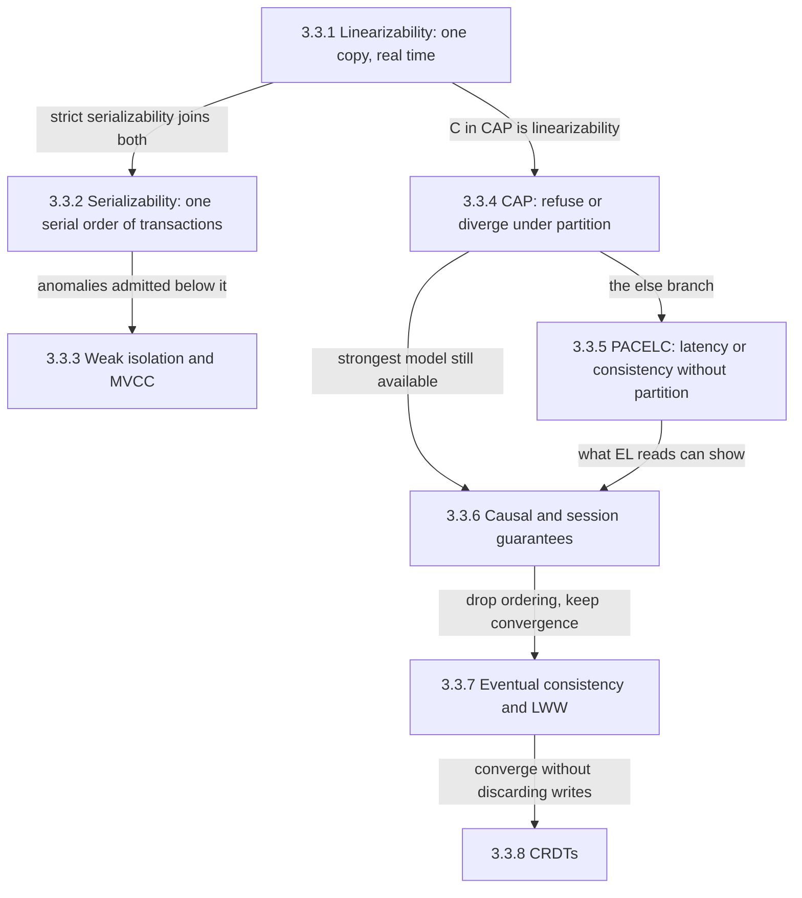
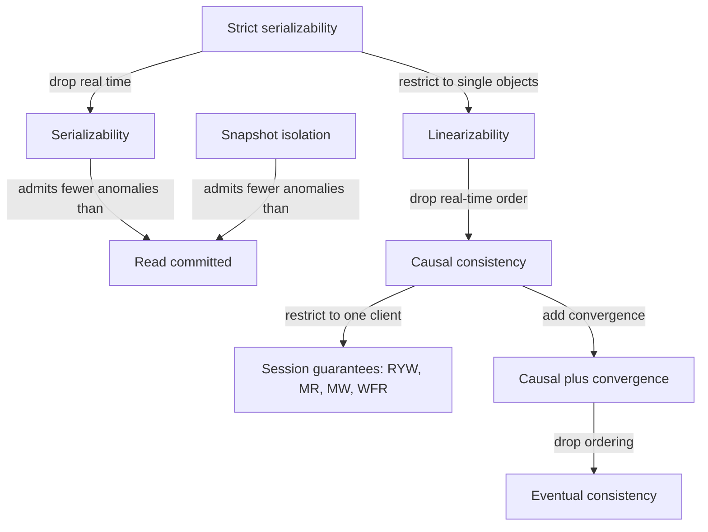
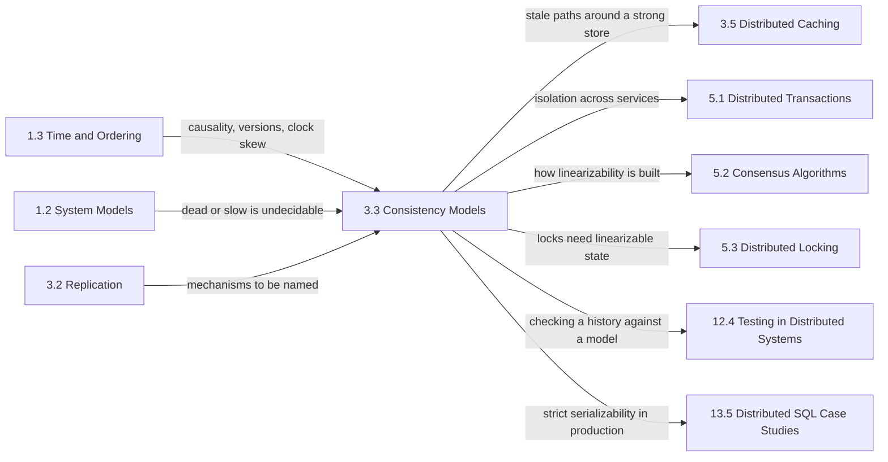

A consistency model is a contract between a data store and its clients about which results a read, or a transaction, is allowed to return while other clients write concurrently and replicas apply those writes at different times. The previous chapter, [Replication Strategies](/distributed-systems/en/data-management/replication/), describes the mechanisms that move writes between copies. This chapter names what those mechanisms promise, proves what no mechanism can promise cheaply, and shows how to make the weakest promises usable. Without a named contract, an engineer cannot tell whether a vanished write, a doubly assigned username, or a report that saw money that never existed is a bug in the store or behavior the store never ruled out.

The tension running through all eight topics is that every guarantee is paid for with coordination, and coordination is paid for with latency on every operation and with availability during partitions. A strong model lets the application reason as if there were one copy and one client at a time; it pays for that with a round trip to a leader or a quorum on the critical path and with refused requests on the minority side of a partition. A weak model answers from the nearest replica and keeps answering when the network splits; it pays for that by moving the work of preserving invariants, ordering effects, and settling conflicts into the application or into the data type. No setting removes the cost. The choices are which operations pay it, and whether the cost appears as latency the operator can measure or as anomalies the users report.

Two misunderstandings cause most of the damage in this area, and the chapter is structured to prevent them. The first is the word itself: "consistency" in CAP means linearizability of single objects, "consistency" in ACID means that transactions preserve application invariants, and isolation levels are a third thing again. The second is treating the models as one ladder. They form two families that meet only at the top: guarantees about single objects in real time, and guarantees about multi-object transactions. A store can be linearizable per key and still let a transaction read a state no serial execution produces, and a serializable database can still order a transaction before one that committed earlier in real time.

## Eight Pages, Two Axes, Two Theorems

The chapter opens with the strongest guarantee on each axis, then the weak isolation levels that production databases actually run, then the two theorems that price the strong end, and finally the models that remain available when that price is too high.

*Dependencies between the chapter's topics. Each arrow names what one page hands to, or imposes on, the page it points to.*

The left branch is the transaction axis and the right branch is the replication axis; they share a root because strict serializability, which Spanner calls external consistency, is serializability with linearizability's real-time constraint added. The edge from linearizability to CAP is the one most often missed: the theorem is about exactly that model, so it says nothing about serializability, snapshot isolation, or causal consistency unless they are restated in its terms. The right branch then descends by what each step gives up. Causal consistency gives up real-time order and keeps cause-and-effect order, which is the most a store can keep while every replica stays available. Eventual consistency gives up ordering altogether and keeps only convergence, and the last two pages are about how convergence is achieved: by discarding concurrent writes with last write wins, or by keeping all of them with a merge the data type defines.

## The Question Each Topic Answers

[Linearizability: The Strongest Guarantee, the Highest Cost](/distributed-systems/en/data-management/consistency-models/linearizability/) answers what it means for a replicated object to behave like a single copy, why a completed write must be visible to every operation that starts after it, and which read paths earn that: quorum or leader reads, read indexes, or leases that depend on bounded clock drift. Open it when building locks, leader election, uniqueness constraints, or configuration flags on top of a store, or when a deposed leader has served stale reads.

[Serializability: Transaction Isolation](/distributed-systems/en/data-management/consistency-models/serializability/) answers when a concurrent execution of multi-object transactions is equivalent to a serial one, why that keeps invariants spanning several rows intact, and how two-phase locking, optimistic validation, serializable snapshot isolation, and deterministic sequencing enforce it at different prices in waiting and aborts. Open it when an invariant spans rows, when a hot row caps throughput, or when serialization failures turn into retry storms.

[Weak Isolation and MVCC: Read Committed, Snapshot Isolation, Write Skew](/distributed-systems/en/data-management/consistency-models/weak-isolation-mvcc/) answers which anomalies the default levels of real databases let through, how multi-version concurrency control (MVCC) gives readers a snapshot without blocking writers, and why write skew passes every check snapshot isolation performs. Open it before trusting a check-then-write path, when lost updates appear in read-modify-write code, or when a forgotten transaction is causing version bloat.

[CAP Theorem: CP vs. AP Systems](/distributed-systems/en/data-management/consistency-models/cap-theorem/) answers what the theorem proves under its literal definitions, what a replica can do when it cannot reach the others, and why many real systems are neither CP nor AP. Open it when deciding how each operation behaves on the minority side of a partition, or when a system believed to be CP has split-brained.

[PACELC Theorem: The Latency-Consistency Trade-off](/distributed-systems/en/data-management/consistency-models/pacelc-theorem/) answers what consistency costs when no partition exists, why a consistent read or write must wait for at least a round trip between replicas, and where real systems expose the choice per statement. Open it when pricing a multi-region design, when a slow replica sets the latency of every coordinated operation, or when a default silently downgraded reads to stale ones.

[Causal Consistency and Session Guarantees: The Middle of the Spectrum](/distributed-systems/en/data-management/consistency-models/causal-consistency-session-guarantees/) answers how a store keeps cause before effect without a round trip, how the four session guarantees decompose causality per client, and why the cost moves from request latency to dependency metadata and delayed visibility. Open it when users see replies before posts or revoked access before the revocation, or when one slow region stalls visibility everywhere.

[Eventual Consistency: Last Write Wins (LWW) and Its Weaknesses](/distributed-systems/en/data-management/consistency-models/eventual-consistency/) answers what the weakest useful guarantee promises, why convergence needs a deterministic reconciliation rule, and how LWW, the cheapest rule, discards acknowledged writes through concurrency, clock skew, future timestamps, and tombstone ties. Open it when acknowledged writes disappear, when a delete does not take effect, or before relying on timestamps to order writes.

[CRDTs: Conflict-free Replicated Data Types](/distributed-systems/en/data-management/consistency-models/crdts/) answers how a data type can merge concurrent updates without losing any of them, what delivery contract state-based, operation-based, and delta-state designs require, and which invariants no CRDT can enforce. Open it when counters, sets, or collaborative documents must accept writes in several places at once, or when CRDT metadata keeps growing.

| Topic | Question it answers | Open it when |
|---|---|---|
| [Linearizability](/distributed-systems/en/data-management/consistency-models/linearizability/) | Does the replicated object behave like one copy in real time? | Locks, uniqueness, config flags, stale leader reads |
| [Serializability](/distributed-systems/en/data-management/consistency-models/serializability/) | Is the transaction history equivalent to a serial one? | Cross-row invariants, hot rows, retry storms |
| [Weak isolation and MVCC](/distributed-systems/en/data-management/consistency-models/weak-isolation-mvcc/) | Which anomalies does the default level allow? | Check-then-write code, lost updates, version bloat |
| [CAP theorem](/distributed-systems/en/data-management/consistency-models/cap-theorem/) | Refuse or diverge when replicas cannot talk? | Partition behavior, split-brain in a "CP" system |
| [PACELC theorem](/distributed-systems/en/data-management/consistency-models/pacelc-theorem/) | What does consistency cost on a healthy network? | Multi-region latency budgets, stale-read defaults |
| [Causal consistency and sessions](/distributed-systems/en/data-management/consistency-models/causal-consistency-session-guarantees/) | Can effects be kept after causes without a round trip? | Out-of-order user-visible effects, visibility stalls |
| [Eventual consistency and LWW](/distributed-systems/en/data-management/consistency-models/eventual-consistency/) | What does convergence promise, and what does LWW drop? | Vanished writes, undead deletes, clock-ordered writes |
| [CRDTs](/distributed-systems/en/data-management/consistency-models/crdts/) | How do concurrent writes merge without loss? | Multi-writer counters, sets, collaborative editing |

The models are related by implication, and the implications are what let a reader move from a guarantee a vendor advertises to the anomalies it still allows.

*How the chapter's models relate. An arrow points from a stronger guarantee to a weaker one it implies or that is obtained by dropping the property on the edge.*

Two things in this map matter more than its shape. Snapshot isolation and serializability are drawn side by side rather than one above the other, because snapshot isolation permits write skew, which serializability forbids, and the two are enforced by different mechanisms; a database that labels its snapshot level "serializable" or "repeatable read" is the most common source of the gap between the assumed and the actual guarantee. And the two families touch only at strict serializability: below it, a linearizable key-value store gives no transaction isolation, and a serializable database gives no real-time promise. Eventual consistency sits at the bottom with a different kind of property: it is a promise about the future, convergence, rather than a restriction on what any single read may return.

## Reading Order and Why

Read the chapter in sidebar order on a first pass. Linearizability comes first because CAP, PACELC, and the causal page define themselves against it, and its read-path analysis is what the later pages price. Serializability and weak isolation follow as a pair, because the anomaly catalog only makes sense once the serial-equivalence standard it falls short of is clear. CAP and PACELC then explain why the strong end cannot be cheap, which motivates the last three pages, read in descending order of strength so that each one starts from what the previous model kept.

Three shortcuts are reasonable. To choose isolation for a relational application, read weak isolation first, then serializability for the levels that close write skew. To design a multi-region store or pick consistency levels in Cassandra, DynamoDB, or Cosmos DB, read CAP, PACELC, and eventual consistency back to back. To build offline-capable or multi-writer features, read causal consistency, then CRDTs.

## Where the Chapter Sits in the Handbook

The prerequisites come from two chapters. [Happened-Before](/distributed-systems/en/foundations/time-and-ordering/happened-before/), [Vector Clocks](/distributed-systems/en/foundations/time-and-ordering/vector-clocks/), and [Hybrid Logical Clocks](/distributed-systems/en/foundations/time-and-ordering/hybrid-logical-clocks/) provide the ordering and versioning machinery that causal consistency, LWW, and CRDTs are built from, and [Physical Clocks](/distributed-systems/en/foundations/time-and-ordering/physical-clocks/) explains the skew behind LWW's losses and the bounded-drift assumption behind lease reads. [Network Models](/distributed-systems/en/foundations/system-models/network-models/) explains why a replica cannot distinguish a dead peer from a slow one, the premise of CAP. [Replication Strategies](/distributed-systems/en/data-management/replication/) supplies the mechanisms whose guarantees this chapter names.

*Prerequisites on the left and the chapters that build on this one on the right. Each arrow names what is handed over.*

The follow-ups apply the models. [Raft](/distributed-systems/en/coordination/consensus-algorithms/raft/) and [Paxos](/distributed-systems/en/coordination/consensus-algorithms/paxos/) are how linearizable replicated state is built; [Fencing Tokens](/distributed-systems/en/coordination/distributed-locking/fencing-tokens/) shows what a lock still needs when the store behind it is linearizable. [Two-Phase Commit](/distributed-systems/en/coordination/distributed-transactions/two-phase-commit/) and the [Saga Pattern](/distributed-systems/en/coordination/distributed-transactions/saga-pattern/) carry isolation, or the explicit absence of it, across services. [Google TrueTime and Spanner](/distributed-systems/en/foundations/time-and-ordering/truetime-spanner/), [Spanner](/distributed-systems/en/case-studies/distributed-sql/spanner-architecture/), and [Follower Reads and Bounded Staleness](/distributed-systems/en/case-studies/distributed-sql/follower-reads-bounded-staleness/) show strict serializability and its relaxations in production. [Distributed vs. Local Cache](/distributed-systems/en/data-management/distributed-caching/distributed-vs-local/) covers the most common way a strong store acquires a stale read path in front of it, and [Correctness Testing: Jepsen and Deterministic Simulation](/distributed-systems/en/deployment/distributed-testing/jepsen-deterministic-simulation/) covers how to check that a system delivers the model it claims.

Two boundaries are commonly blurred. ACID's consistency, the preservation of application invariants by each transaction, is not a model in this chapter; it is the application's obligation that isolation protects, and [ACID vs. BASE](/distributed-systems/en/coordination/distributed-transactions/acid-vs-base/) covers the two philosophies. And a consistency model is not a durability setting: every model assumes that acknowledged writes survive, so a store that acknowledges a write before it reaches enough disks can lose it in a crash and violate the model it advertises; where the acknowledgment point sits is the subject of [Leader-Based Replication](/distributed-systems/en/data-management/replication/leader-based-replication/) and the [Write-Ahead Log](/distributed-systems/en/data-management/storage-engines/write-ahead-log/).
