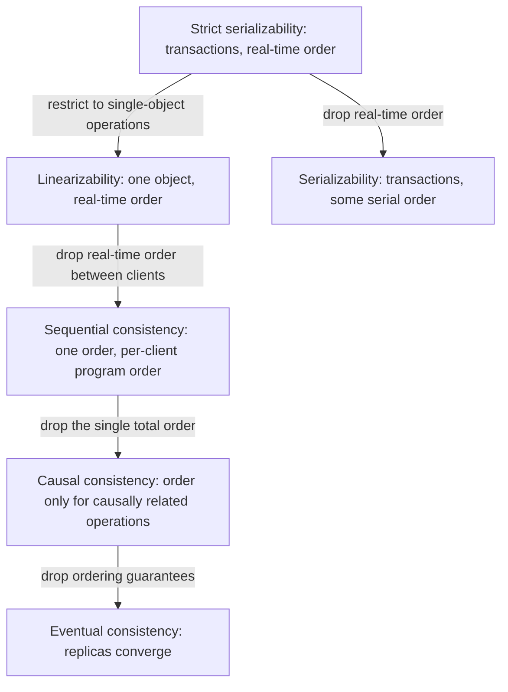
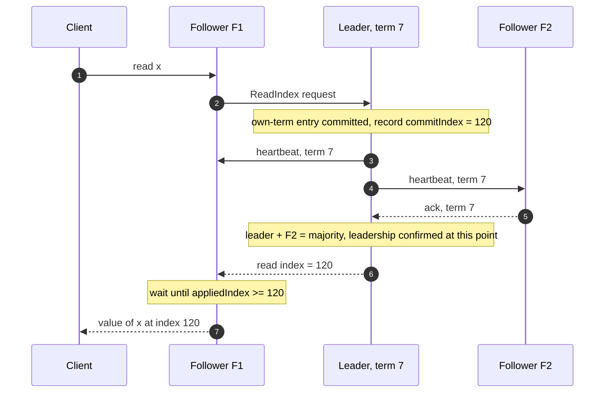
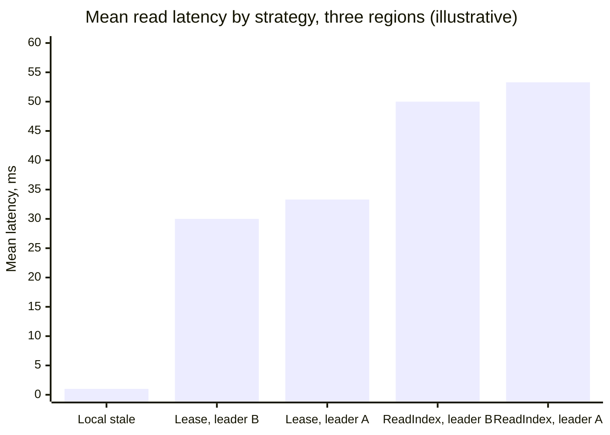
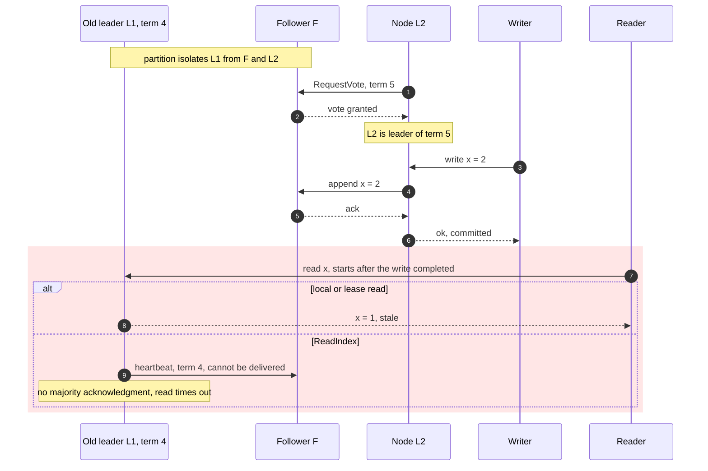
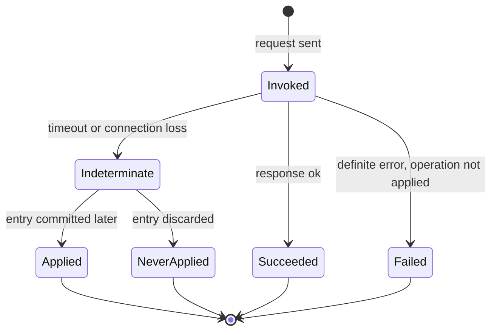

Linearizability is a correctness condition for a shared object, such as a register, a key, a queue, or a lock: every operation must appear to take effect atomically at a single instant between the moment the client invokes it and the moment the client receives its response, and the resulting order of instants must be a legal sequential execution of the object. A replicated system that is linearizable is indistinguishable, from the outside, from one machine executing operations one at a time. Once a write has completed, every operation that starts afterwards observes it or something newer, whichever replica serves it and whichever client issued it.

The problem it solves is the one replication creates. A key stored on three machines has three copies that change at different times. Without a guarantee about which copy a client sees, a completed write can disappear on the next read, two clients can both succeed in claiming the same username, two nodes can each believe they hold a lock, and a process that reads a configuration flag immediately after an operator changed it can act on the old value. Every one of these bugs comes from the same gap: the replicas do not agree, at the moment of the read, on what the latest value is.

The core trade-off is that closing this gap requires coordination on the critical path of every operation, including reads. A linearizable read cannot be answered from whatever copy happens to be nearby; the server must establish that no newer write has completed anywhere, which means either a round trip to a quorum or a time-based lease whose safety rests on bounded clock drift and bounded process pauses. The price is paid in latency proportional to the distance between replicas, in throughput lost to coordination messages, and in availability: a replica cut off from the majority must refuse to answer rather than answer with a possibly stale value. Weaker models such as [causal consistency and session guarantees](/distributed-systems/en/data-management/consistency-models/causal-consistency-session-guarantees/) buy back local reads by giving up the real-time promise to clients that do not communicate with each other.

## The Definition: Intervals, Real-Time Order, and Linearization Points

The definition, given by Herlihy and Wing in 1990, is stated over a history: the record of every operation's invocation and response, as an omniscient observer would see them in real time. Each operation occupies an interval. Two operations are concurrent if their intervals overlap; otherwise one precedes the other in real time. A history is linearizable if there is a way to pick, for each operation, one point inside its interval, called its linearization point, such that executing the operations sequentially in the order of their points produces exactly the responses the clients received.

Two consequences follow immediately. Operations that do not overlap must take effect in their real-time order, because their intervals do not share any point where they could be swapped. Operations that do overlap may be ordered either way, and the system is free to choose. The definition never mentions replicas, messages, or clocks: it is a statement about what clients can observe, and an implementation is linearizable if every history it can produce satisfies it.

```mermaid
gantt
    title One register x, initially 0, observed by three clients
    dateFormat X
    axisFormat %S
    section Client A
    write x = 1, ok              :a1, 1, 6s
    section Client B
    read x returns 1             :b1, 2, 1s
    section Client C
    read x returns 0             :crit, c1, 4, 1s
```


*A history that is not linearizable. Each read is concurrent with the write, yet the pair of reads cannot be ordered consistently. Time units are arbitrary.*

Client B's read returns 1, so the write's linearization point must lie before B's point, which is at the latest second 3. Client C's read starts at second 4, after B's read has finished, so C's point lies after B's and therefore after the write's: C must return 1. It returned 0. No assignment of points works, so the history is not linearizable, even though each read taken alone is legal, since each overlaps the write and could have been ordered before it. This is the new-then-old inversion that quorum reads without write-back produce, analyzed for Dynamo-style stores in [Leaderless Replication](/distributed-systems/en/data-management/replication/leaderless-replication/). If C had returned 1, points at seconds 2.5, 2.8, and 4.5 for the write, B, and C would make the history linearizable. The lesson for implementers is that once any client has observed a value, the system has committed to it: a value can become visible gradually only if the system makes it impossible for a later reader to miss it.

### What Is Guaranteed and What Is Not

Linearizability guarantees three things: a single order of all operations on the object that every client agrees on, consistency of that order with the real-time precedence of non-overlapping operations, and legality of that order under the object's sequential specification. Several properties that engineers associate with "strong consistency" are not part of it.

It says nothing about multi-object atomicity. Each operation touches one object. Reading key `x` and then key `y` as two linearizable operations returns `x` at one instant and `y` at a later instant, so an invariant such as "`x + y` stays 100" can appear violated even though every transfer that preserves it was applied atomically. Guarantees about groups of operations are transaction isolation; the combination of serializability with real-time order is strict serializability, which is covered on [Serializability](/distributed-systems/en/data-management/consistency-models/serializability/) and is what Spanner calls [external consistency](/distributed-systems/en/foundations/time-and-ordering/truetime-spanner/).

It says nothing about progress. Linearizability is a safety property: a system that never answers is trivially linearizable. Availability under partition is the subject of the [CAP theorem](/distributed-systems/en/data-management/consistency-models/cap-theorem/), whose formal proof by Gilbert and Lynch uses exactly this definition for its "C".

It does not bound when an operation without a response takes effect. The definition handles a pending operation, one whose client never received a response, by allowing it either to be dropped or to be completed with a linearization point anywhere after its invocation. A write whose client timed out may therefore take effect later, including after the client has retried or given up. This is not a loophole in the theory; it is the precise description of what happens when a leader appends an entry, crashes, and its successor commits the entry seconds later.

It assumes the object survives failures with its state. A crash that loses an acknowledged write produces a history in which a later read returns an older value, which is a linearizability violation, not a separate durability problem. Systems that acknowledge before data is durable on a majority, or that recover a node from an older snapshot while keeping its vote, break the guarantee through the storage layer.

### Locality: Why the Guarantee Composes

Herlihy and Wing proved that linearizability is local: a history over many objects is linearizable if and only if the subhistory of each object is linearizable. A system built from independently linearizable keys, partitions, or services is therefore linearizable as a whole, per object, without any coordination between them. Sequential consistency, the model that keeps a single agreed order and the program order of each client but drops real-time precedence between clients, does not compose this way: two sequentially consistent objects can together produce a history that no single sequential order explains.

Locality is what makes linearizability practical at scale. A database can run thousands of independent [Raft](/distributed-systems/en/coordination/consensus-algorithms/raft/) groups, one per range, and every single-key operation is linearizable without cross-group coordination. It is also what makes testing tractable: checking whether an arbitrary history is linearizable is NP-complete in general, as Gibbons and Korach showed in 1997, but locality lets a checker split a history by key and check each part separately, which is how practical checkers keep the search manageable. Test harnesses that apply this are covered in [Correctness Testing: Jepsen and Deterministic Simulation](/distributed-systems/en/deployment/distributed-testing/jepsen-deterministic-simulation/).


*Where linearizability sits among neighboring models. Each arrow names the constraint that is removed to reach the weaker model.*

Reading the diagram from the top, each step down removes one constraint and with it one source of coordination. Dropping real-time order between clients, the step from linearizability to sequential consistency, is the one that allows reads from a local replica: a ZooKeeper follower serves reads from its own copy, and clients see a single agreed order of writes and their own operations in order, but a client may read a value that another client already knows to be outdated. Dropping the total order leaves causal consistency, which keeps only the order that [happened-before](/distributed-systems/en/foundations/time-and-ordering/happened-before/) imposes. Linearizability and serializability sit on different branches: one constrains single operations in real time, the other constrains transactions in some order, and neither implies the other.

:::note[Two words that are easy to swap]
Linearizability is about single operations on single objects and real time. Serializability is about transactions over many objects and says nothing about real time: a serializable database may order a transaction that started later before one that committed earlier. Vendor documentation that says "strong consistency" usually means one of the two, or one of them only on some read paths. Ask which operations, on which path, under which configuration.
:::

## Building It: How Replicated Systems Earn the Guarantee

Every linearizable implementation does the same two things. It assigns each write a position in a single order before acknowledging it, and before answering a read it establishes that the value it returns is not older than any write that has completed. The first part is the expensive but well understood half; the second is where implementations differ and where most bugs live.

### One Order for Writes

The simplest design gives every object one owner that executes operations serially. A single Redis instance or a single PostgreSQL primary with no replicas is linearizable for single-key operations for as long as it is the only node anyone talks to, because one thread or one lock manager serializes the operations and the response is sent after the effect. The difficulty begins when the owner must be replaced. A system that replicates asynchronously and fails over can lose acknowledged writes, and a system that cannot guarantee the old owner has stopped can have two owners, as described in [Failover and Leader Election](/distributed-systems/en/data-management/replication/failover-leader-election/).

Consensus protocols such as Raft, [Paxos](/distributed-systems/en/coordination/consensus-algorithms/paxos/), and [Zab](/distributed-systems/en/coordination/consensus-algorithms/zab-zookeeper/) solve the replacement problem. Writes are appended to a replicated log, acknowledged once a majority has persisted them, and applied in log order. Because any two majorities intersect, a newly elected leader always holds every acknowledged entry, so the order survives leader changes. A write's linearization point is the moment its entry is committed: after its invocation, because the client sent it, and before its response, because the leader only replies after commit.

There is a sharper reason that consensus appears here, and it separates two kinds of objects. Herlihy's 1991 wait-free hierarchy assigns each object a consensus number, the largest number of processes that can solve consensus using it. A read-write register has consensus number 1; compare-and-swap has consensus number infinity. A linearizable read-write register can therefore be built in an asynchronous network without consensus, as long as a majority of replicas is reachable: the Attiya, Bar-Noy, and Dolev algorithm uses quorum writes and quorum reads with a write-back phase, as described on the leaderless replication page. A linearizable compare-and-swap, a lock, a unique-name claim, or any read-modify-write operation is equivalent to consensus, inherits the FLP impossibility result for asynchronous systems, and needs the timing assumptions of a consensus protocol to make progress. Requirements of the form "two clients must not both succeed" can never be met by quorum overlap alone.

### Three Ways to Serve a Linearizable Read

A leader holds the newest committed state, but a node that believes it is the leader may have been deposed by an election it has not heard about, and a new leader may already have committed writes. Answering a read from local state is therefore only safe if the node can show that it was still the leader at some instant inside the read's interval. Raft implementations offer three ways to show it, described in Ongaro's dissertation.

The first is to put the read through the log: the leader appends a read entry, and answers when the entry commits. Commitment proves that a majority accepted the leader in its current term after the read arrived. It is simple and costs as much as a write, including the disk sync on a majority.

The second is ReadIndex. The leader records its current commit index as the read index, confirms its leadership by exchanging a heartbeat round with a majority, waits until its state machine has applied entries up to the read index, and answers. The read is linearized at the moment the heartbeat round confirmed leadership. One subtlety matters: a leader that has just been elected may not yet know the latest commit index of the previous term, so it must first commit an entry of its own term, usually an empty no-op, before it may serve ReadIndex reads. The same mechanism lets followers serve reads: a follower asks the leader for a read index, waits until its own log has applied up to that index, and answers from local state, which moves the data transfer and the state machine work off the leader while the leader still pays the heartbeat round.


*A follower read using ReadIndex in a three-node group. The read is linearized when the leader receives the majority acknowledgment in step 5.*

The note after step 2 fixes the floor: every write that completed before the read began had committed by then, so its index is at most 120. Step 5 proves that no other leader with a higher term had been elected at that moment, because F2 would have rejected a heartbeat from a stale term. The read returns state at index 120 or later, which contains every write that completed before the read started, and its linearization point, step 5, lies inside the read's interval. Writes committed after index 120 are concurrent with the read and may be ordered after it. The cost is one round trip from the leader to the nearest majority and, for a follower read, one round trip from the follower to the leader, with no disk writes. Implementations batch: all reads that arrive while one heartbeat round is in flight can share the next round, so the number of rounds per second is bounded by the batching window, not by the read rate.

The third way is a lease read. After a heartbeat round succeeds at time `t`, the leader knows that no follower in that majority will start an election before its election timeout expires, so no other leader can exist before roughly `t` plus the election timeout. Within that window the leader answers reads from local state with no network round trip at all. The argument requires that the leader's clock and the followers' clocks advance at nearly the same rate, and that the leader does not pause between checking the lease and reading its state; implementations subtract a safety margin for drift. It does not require synchronized clocks, only bounded drift, which is why it is safer than designs that compare timestamps across machines, and less safe than ReadIndex, which assumes nothing about time. The general lease mechanism is covered on [Lease-Based Locking](/distributed-systems/en/coordination/distributed-locking/lease-based-locking/); the timing model it depends on is in [Network Models](/distributed-systems/en/foundations/system-models/network-models/).

Outside Raft, two other constructions appear in production. Chain replication, published by van Renesse and Schneider in 2004, orders replicas in a chain: writes enter at the head and are acknowledged by the tail once every node has applied them, and reads are served only by the tail, which by construction holds exactly the set of acknowledged writes. Reads cost nothing extra, but all of them land on one node and a write's latency is the length of the chain. Spanner takes the opposite route, assigning commit timestamps from TrueTime and waiting out the clock uncertainty before acknowledging a commit, so that a read at the current time sees every completed transaction; the mechanism is on [Google TrueTime and Spanner](/distributed-systems/en/foundations/time-and-ordering/truetime-spanner/).

## The Cost and Why It Cannot Be Engineered Away

The cost of linearizability is not an artifact of particular implementations. Attiya and Welch proved in 1994 that in a network whose message delays vary within an uncertainty `u`, no linearizable implementation of a read-write register can complete reads in less than `u/4` or writes in less than `u/2`, while sequential consistency admits implementations in which one of the two operations is local and costs nothing. The asymmetry is the formal version of what ZooKeeper does: local reads, ordered writes, and no real-time promise across clients. The CAP result is the extreme case of the same fact: when the uncertainty becomes unbounded, as during a partition, a linearizable system must stop answering on at least one side.

In practice this means that the latency of linearizable operations is set by geography and by where the leader is, while the latency of non-linearizable reads is set by the distance to the nearest replica. A worked example makes the gap concrete.

### Worked Example: Three Regions, One Raft Group

Assume a three-replica Raft group with one replica in each of regions A, B, and C, and clients spread evenly across the three regions. Assume round-trip times of 20 ms between A and B, 70 ms between B and C, and 80 ms between A and C, and ignore in-region hops and disk syncs, which add a few milliseconds. All numbers are illustrative.

With the leader in A, the leader's quorum is itself plus B, so every commit costs the 20 ms round trip to B after the request reaches A. A write from a client in A costs 20 ms; from B, 20 ms to reach A plus 20 ms to commit, 40 ms; from C, 80 plus 20, 100 ms. The mean write latency is `(20 + 40 + 100) / 3 = 53.3` ms. A ReadIndex read costs the same as a write here, because the heartbeat round to B and the commit round to B are the same network path; it saves the disk sync, not the round trip. A lease read served by the leader costs only the trip to the leader: 0, 20, and 80 ms, a mean of 33.3 ms. A local read from the nearest replica, which is not linearizable, costs about 1 ms everywhere.

Moving the leader to B changes the picture. B's nearest follower is A at 20 ms, so commits still cost 20 ms after arrival. Writes cost 40 ms from A, 20 ms from B, and 70 plus 20, 90 ms, from C: a mean of 50 ms. Lease reads cost 20, 0, and 70 ms: a mean of 30 ms. Placing the leader at the replica with the lowest total distance to clients saves a few milliseconds on average and 10 ms for the worst-placed clients, but no placement brings the linearizable read anywhere near the 1 ms local read.


*Mean read latency over clients spread evenly across regions A, B, and C, computed from the assumed round-trip times above. Disk syncs and in-region hops are ignored.*

The chart shows that the strategy, not the leader placement, determines the order of magnitude. Moving from ReadIndex to lease reads saves one leader-to-majority round trip; moving from lease reads to local reads saves the client-to-leader trip and gives up linearizability. The ReadIndex follower read does not appear separately because in this topology it costs the same as a ReadIndex read at the leader for clients in B and C: the follower must reach the leader, and the leader must reach a majority.

Throughput tells a second story. Suppose the leader in A receives 40,000 linearizable reads per second. Through the log, each read is an entry that must be replicated and synced on a majority, adding 40,000 log entries per second to the write path. With unbatched ReadIndex, each read triggers a heartbeat to two followers: 80,000 messages per second. With ReadIndex batched over 1 ms windows, there are at most 1,000 rounds per second, 2,000 messages, regardless of the read rate, at a cost of up to 1 ms of added latency per read. Batching makes ReadIndex nearly free in messages but cannot remove its round trip, which is why lease reads remain attractive for read-heavy workloads in spite of their timing assumption.

## Linearizability in Production Systems

The strategies above trade the same quantities against different assumptions, and production systems choose differently, often with a weaker mode as the default or as a switch.

| Strategy | Read cost | Write cost | Assumes | When the assumption breaks | When to prefer |
|---|---|---|---|---|---|
| Read through the log | Commit round trip and disk sync on a majority | Commit round trip | Nothing beyond consensus | Not applicable | Low read rates, simplest correct design |
| ReadIndex | One heartbeat round, plus a trip to the leader for follower reads | Commit round trip | Nothing about time | Not applicable | Default for consensus stores, mixed workloads |
| Leader lease read | Local at the leader | Commit round trip | Bounded clock drift, bounded pauses | Silent stale reads | Read-heavy workloads with well-controlled hosts |
| Quorum register with write-back (ABD) | Two quorum rounds | One or two quorum rounds | Majority reachable | Not applicable for reads and writes; no compare-and-swap | Read-write registers without a leader |
| Chain replication, tail reads | Local at the tail | Full chain length | Correct chain configuration from a separate master | Stale reads if a removed node still serves | Strong reads with a dedicated configuration service |
| Commit wait on bounded clocks | Local at a timestamp | Commit round trip plus about twice the clock uncertainty | Clock uncertainty bound holds | Silent stale reads | Global transactions with an engineered time service |

etcd makes linearizable reads the default for key-value operations and has implemented them with Raft ReadIndex since version 3.1; a request can ask for a serializable read instead, which any member answers from its local state. Jepsen's 2020 analysis of etcd 3.4.3 found key-value operations strict serializable, the whole keyspace being one state machine ordered by one log, and found that the optional serializable flag weakens reads to possibly stale committed state, exactly as intended. The same analysis found etcd's lock primitive unsafe as a mutual-exclusion mechanism: with 2-second leases and injected process pauses, about 18% of acknowledged updates to a set protected by the lock were lost. The store was linearizable; the resource the lock protected was not, because a client that paused past its lease kept acting as the holder. Making the protected resource check a monotonically increasing token is the subject of [Fencing Tokens](/distributed-systems/en/coordination/distributed-locking/fencing-tokens/), and etcd's internals are on the canonical [etcd](/distributed-systems/en/coordination/consensus-algorithms/etcd/) page.

```shell
# Linearizable read (the default): confirms leadership through ReadIndex
etcdctl get /config/feature-x
# Serializable read: served from the contacted member's local state, may be stale
etcdctl get /config/feature-x --consistency=s
# Revision and Raft term of each member, to compare during an incident
etcdctl endpoint status --cluster -w table
```

Consul exposes three read modes. The `default` mode forwards reads to the leader and relies on leader leasing; the documentation states that if an election occurs before the lease window ends, the old leader keeps serving reads and Consul may occasionally return a stale result. The `consistent` mode makes the leader verify with a quorum of peers that it is still the leader before answering, which is the ReadIndex idea, at the cost of extra traffic and latency. The `stale` mode lets any server answer and keeps reads available without a leader. Only `consistent` is linearizable without timing assumptions.

ZooKeeper makes writes linearizable through Zab and serves reads from the server a client is connected to, so reads observe a single order of writes and each client's own operations in order, but they may be stale relative to other clients. The recommended remedy, calling `sync` before a read, makes the server catch up with the leader. It does not fully close the gap: the open issue ZOOKEEPER-1675 describes how a deposed leader that still believes it leads can answer a `sync` while a new leader has already committed writes, because `sync` is not confirmed by a quorum.

MongoDB offers a `linearizable` read concern on the primary. Combined with `majority` write concern, reads of a single document reflect every majority-acknowledged write that completed before the read started; the primary confirms with secondaries that it can still acknowledge majority writes before answering, which makes these reads significantly slower than `majority` reads. The guarantee holds only when the query filter identifies a single document, the read concern cannot be combined with causally consistent sessions, and the documentation advises always setting `maxTimeMS`, because without a reachable majority the read can block indefinitely.

```json
{
  "find": "accounts",
  "filter": { "_id": 4711 },
  "readConcern": { "level": "linearizable" },
  "maxTimeMS": 10000
}
```

CockroachDB claims serializability rather than linearizability for transactions. Its uncertainty-interval reads, built on [hybrid logical clocks](/distributed-systems/en/foundations/time-and-ordering/hybrid-logical-clocks/) and a configured maximum clock offset, prevent stale reads of a key whose write completed before the read began, but its engineering blog describes a "causal reverse" anomaly in which two transactions touching disjoint keys can be ordered against real time; a node whose clock exceeds the configured maximum offset terminates itself to protect the guarantee. Redis, finally, is linearizable on a single instance and loses that property as soon as replication and failover are involved, because replication is asynchronous and the `WAIT` command, by the project's own documentation, does not make Redis strongly consistent.

:::danger[Lease reads turn a paused leader into a stale oracle]
A lease read is safe only if the old leader stops answering before a new leader can be elected. A garbage-collection pause, a virtual machine freeze, or a clock step that strikes between the lease check and the read lets the old leader answer from state that a new leader has already superseded, with no error and no log line. Consul's `default` mode documents this window. Use ReadIndex or an equivalent quorum check for any read that decides ownership, authorization, or money; reserve lease reads for hosts whose pauses and clock behavior you monitor, and enable the Raft check that makes a leader step down when it loses contact with a majority (CheckQuorum in the etcd Raft library), which lease-based reads depend on.
:::

## Failure Modes and How They Present

Linearizability failures share an uncomfortable property: the system keeps answering, and every individual answer looks plausible. Detection therefore depends on comparing what different nodes knew at the same time, or on testing histories offline.

### Stale Reads From a Deposed Leader

Trigger: a leader is partitioned from the majority, or paused, and keeps serving reads from local state without confirming leadership, through a lease mode, a `sync`-style shortcut, or an implementation bug. Meanwhile a new leader is elected and commits writes. Symptoms: a client reads a value that another client already overwrote and received an acknowledgment for; coordination built on reads, such as "check the flag, then act", runs on old data.


*A deposed leader answering a read. The shaded window is where a read that skips leadership confirmation returns a value older than an acknowledged write.*

Steps 1 to 6 establish that `x = 2` was committed and acknowledged by a legitimate leader before the read in step 7 began. A read served locally in step 8 violates real-time order. The ReadIndex branch, step 9, shows why the quorum check prevents it: L1 cannot obtain a majority acknowledgment for term 4, because the majority either cannot hear it or has moved to term 5 and would reject it, so the read fails rather than returning old data. Failing is the correct behavior for a linearizable system on the minority side.

Detection: compare the Raft term reported by each member (`etcdctl endpoint status` shows it per member); a node serving reads with a lower term than the majority is the signature. In etcd, `etcd_server_leader_changes_seen_total` counts elections and `etcd_server_read_indexes_failed_total` and `etcd_server_slow_read_indexes_total` show ReadIndex confirmations that fail or take too long, which rise when a leader loses contact with its majority. Mitigation: confirm leadership on every linearizable read, or use leases with CheckQuorum and conservative margins. Recovery: once the partition heals the old leader steps down on seeing the higher term; the damage is in whatever decisions clients made on stale reads, which no database mechanism can undo.

### Indeterminate Operations and Unsafe Retries

Trigger: a client times out on a write, a connection drops after the request was sent, or a leader crashes after appending the entry but before replying. Symptoms: duplicated effects after a retry, such as a double charge or a counter incremented twice, or a write that "failed" appearing later.


*Outcomes of one operation as seen by its client. Only the client cannot tell Applied from NeverApplied; the history decides it later.*

The diagram is the client-side view of pending operations in the definition. A response puts the operation in `Succeeded` or `Failed`, and only errors that guarantee the operation was not applied, such as a rejected precondition or a "not leader" error returned before forwarding, are definite failures. Everything else is `Indeterminate`, and linearizability allows it to resolve either way, at any point after invocation. A retry of an indeterminate non-idempotent write is a second operation, and both may take effect. Detection: count client-side timeouts and retries per operation type, and look for duplicated business keys downstream. Mitigation: make writes idempotent with a client-generated request identifier stored in the same atomic step as the effect, as described on [Idempotency](/distributed-systems/en/communication/api-gateway/idempotency/), or make retries conditional on a version, using compare-and-set so the second attempt fails if the first succeeded. Recovery: reconcile duplicates through the business key; the log alone does not show which client intended what.

:::caution[A timeout is not a failure]
Treating a timed-out write as failed and reporting failure to the user is a correctness bug in any linearizable system, because the write may commit afterwards. Surface the third state: "unknown, will be resolved", and resolve it by reading with the operation's identifier or by retrying idempotently. Jepsen-style checkers model these operations as possibly completed for the same reason.
:::

### A Linearizable Store Behind a Non-Linearizable Path

Trigger: the store is linearizable, but the read path is not. A cache in front of it is filled from a replica; one code path uses serializable or stale reads for speed; reads go to a follower without ReadIndex; a client library silently falls back to a stale mode when the leader is unreachable. Symptoms: anomalies that the database's own tests never reproduce, appearing only on specific endpoints or during leader changes. Detection: trace which consistency level each read path actually uses, alert on fallback-to-stale counters where a client exposes them, and compare cache contents with the store for keys that changed recently. Mitigation: keep linearizable reads on paths that decide something, and treat a cache as a weaker model that must be designed for, as in [Cache Invalidation](/distributed-systems/en/data-management/distributed-caching/cache-invalidation/). Recovery: invalidate and refill from linearizable reads.

The lock case from the etcd analysis belongs here too. A linearizable lock service guarantees that its own records are consistent; it cannot guarantee that a client still holds the lock when its write reaches a different system. The path from "lock acquired" to "resource modified" crosses a boundary the lock service does not control, and only a check at the resource, such as a fencing token, closes it.

### Latency and Availability Collapse Under Distance or Partition

Trigger: the leader sits far from most clients, a region with a voting replica degrades, or a partition leaves clients on the minority side. Symptoms: linearizable read and write latency jump to the cross-region round trip while stale reads stay fast; on the minority side, linearizable operations time out entirely. Detection: proposal and ReadIndex latency per member, `etcd_server_proposals_failed_total`, `etcd_server_heartbeat_send_failures_total`, and disk sync latency on the leader (`etcd_disk_wal_fsync_duration_seconds`), since a slow disk on the leader delays every commit. Mitigation: place the leader near the write load, place voters so a majority sits in nearby regions, route latency-tolerant reads to [follower reads with bounded staleness](/distributed-systems/en/case-studies/distributed-sql/follower-reads-bounded-staleness/), and decide explicitly which operations may degrade to stale reads during a partition. The latency side of this choice, which exists even without partitions, is the subject of the [PACELC theorem](/distributed-systems/en/data-management/consistency-models/pacelc-theorem/). Recovery: restore the majority; nothing else is safe.

### Clock-Dependent Guarantees Outside Their Bound

Trigger: a system whose linearizability rests on clocks, through leases, commit wait, or uncertainty intervals, runs with clocks outside the assumed bound: an NTP step, a virtual machine migration, a failed time daemon. Symptoms: silent stale reads, or nodes terminating themselves when they detect the violation, which can cost a quorum. Detection: clock offset relative to peers and to an independent reference, time daemon synchronization state, and the system's own offset metrics. Mitigation: monotonic clocks for lease durations, alerts well below the configured bound, removal of nodes that drift. The clock behavior itself is covered on [Physical Clocks](/distributed-systems/en/foundations/time-and-ordering/physical-clocks/).

| Failure | First symptom | Detection signal | Mitigation |
|---|---|---|---|
| Deposed leader serving reads | Read older than an acknowledged write | Member term lower than majority, failed or slow ReadIndex | Quorum-confirmed reads, CheckQuorum, conservative leases |
| Indeterminate write retried | Duplicated effects, late writes | Client timeouts and retries per operation | Idempotency keys, conditional writes |
| Non-linearizable read path | Anomalies on specific endpoints only | Per-path consistency level, stale-fallback counters | Linearizable reads on decision paths, explicit cache model |
| Lock without fencing | Two holders acting at once | Overlapping holder activity at the resource | Fencing tokens checked by the resource |
| Distance or partition | Cross-region latency, minority-side timeouts | Proposal and ReadIndex latency, failed proposals | Leader and voter placement, bounded-staleness reads |
| Clock outside bound | Silent stale reads or self-terminating nodes | Peer clock offset, sync state | Monotonic lease timing, early offset alerts |

:::tip[Test the histories, not the claims]
A vendor's "strongly consistent" label tells you little about the read path you use under the failures you will have. Record client-side histories with invocation and response times in a staging cluster, inject partitions, pauses, and clock skew, and run them through a linearizability checker per key. The test is cheap compared with the incidents it prevents, and it is the only evidence that covers your own client library and configuration.
:::

## When to Require Linearizability

Require it for operations whose correctness depends on there being one current value that everyone agrees on at the moment of the decision. Leader election and leadership records, lock and lease records, uniqueness claims such as usernames or idempotency keys, compare-and-set state machines such as order status transitions, configuration and feature flags that gate a coordinated rollout, and the membership and placement metadata of the distributed system itself all fall in this class. A second class is any path with a hidden channel: one client completes a write and tells another, by a message queue, a webhook, or a human, to read it. Causal metadata cannot follow such a channel, and only real-time order guarantees the reader sees the write.

Keep the scope narrow. Linearizability is a property of an operation on a path, not of a system, and paying for it everywhere multiplies its cost by the whole read volume. The usual production design is a small linearizable core, a consensus-backed metadata store or the decision-making read paths of a database, surrounded by reads with weaker, explicitly chosen guarantees.

Do not require it, and do not pay for it, in the following cases:

- Reads that display data and decide nothing, such as feeds, dashboards, product listings, and search results, where [session guarantees](/distributed-systems/en/data-management/consistency-models/causal-consistency-session-guarantees/) like read-your-writes remove the anomalies users notice at local-read cost.
- Multi-region user-facing read paths where a cross-region round trip per read exceeds the latency budget; use bounded-staleness reads and reserve linearizable reads for the few operations that need them.
- Counters, metrics, and aggregates that tolerate brief disagreement and can be merged, where [CRDTs](/distributed-systems/en/data-management/consistency-models/crdts/) give convergence without coordination.
- Requirements that span several objects atomically, such as transfers between accounts; per-object linearizability does not provide them, and the requirement is strict serializability or a transaction protocol.
- Protection of an external resource with a lock from a linearizable store, when the resource cannot check a fencing token; the store's guarantee does not extend past its own boundary.
- Systems that must stay writable on both sides of a partition; that requirement excludes linearizability by the CAP result, and the design should start from [multi-leader replication](/distributed-systems/en/data-management/replication/multi-leader-replication/) or CRDTs instead.

## Further Reading

- Maurice P. Herlihy, Jeannette M. Wing, *Linearizability: A Correctness Condition for Concurrent Objects*, ACM Transactions on Programming Languages and Systems, 1990.
- Hagit Attiya, Jennifer L. Welch, *Sequential Consistency versus Linearizability*, ACM Transactions on Computer Systems, 1994.
- Maurice Herlihy, *Wait-Free Synchronization*, ACM Transactions on Programming Languages and Systems, 1991.
- Diego Ongaro, *Consensus: Bridging Theory and Practice*, PhD dissertation, Stanford University, 2014 (section on processing read-only queries).
- Robbert van Renesse, Fred B. Schneider, *Chain Replication for Supporting High Throughput and Availability*, OSDI, 2004.
- Kyle Kingsbury, *Jepsen: etcd 3.4.3*, jepsen.io, 2020.
