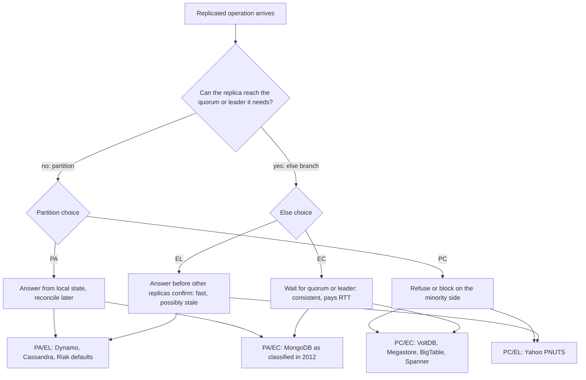
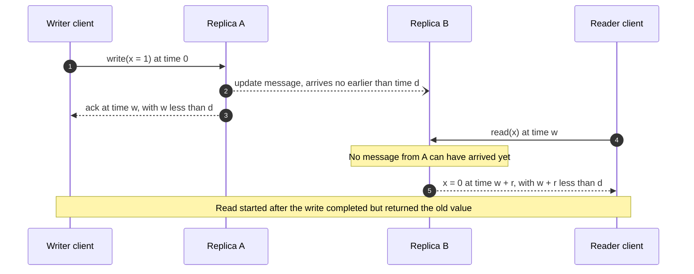
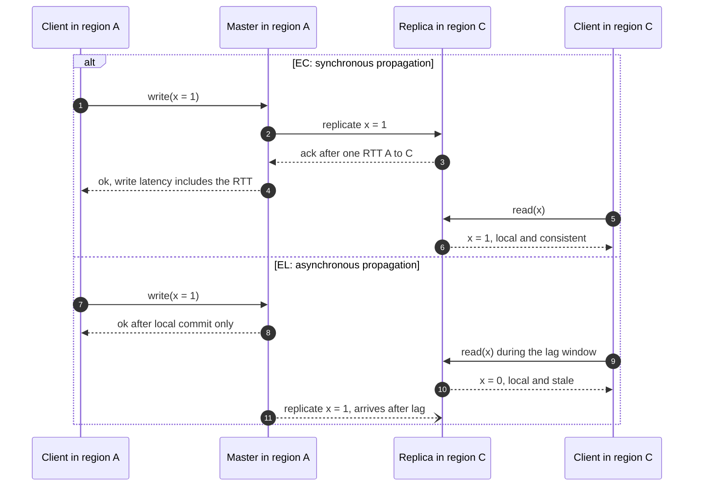
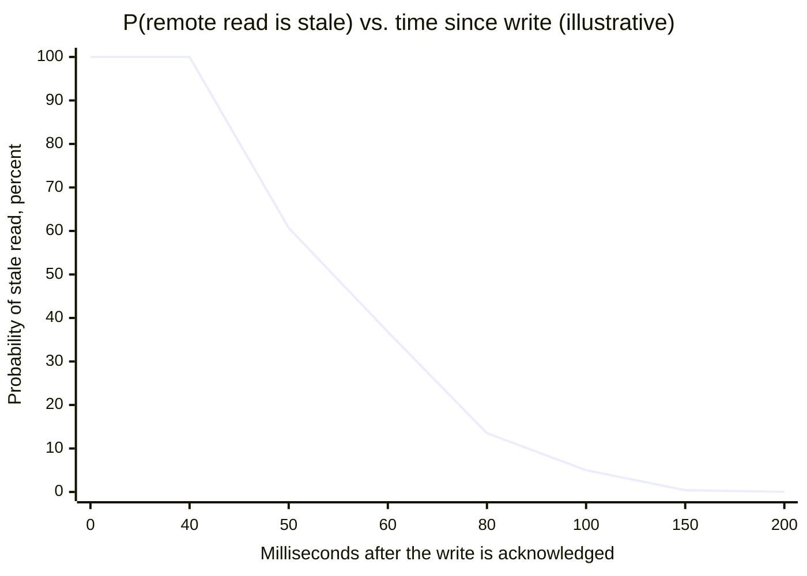
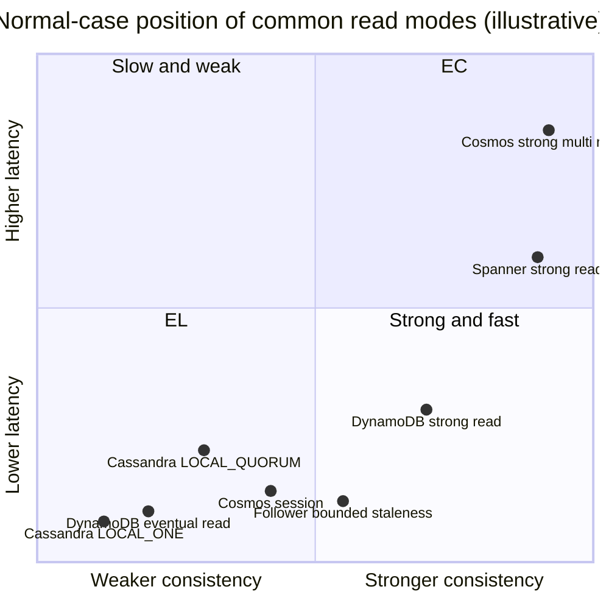
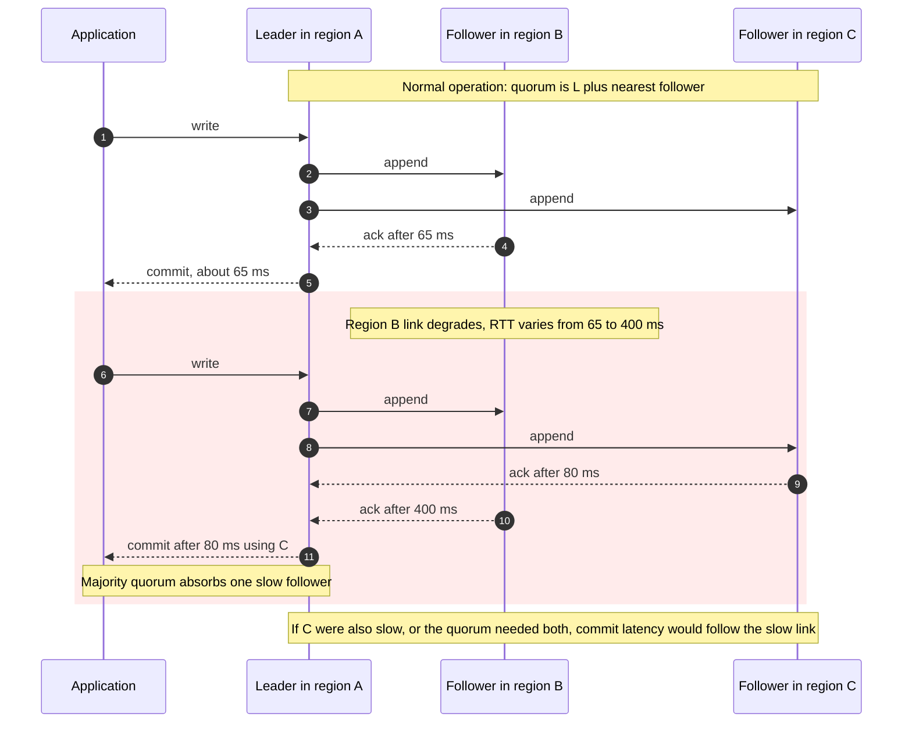

PACELC extends the CAP theorem with the branch that CAP leaves out: if there is a Partition, a replicated system trades Availability against Consistency; Else, when the network is healthy, it trades Latency against Consistency. Daniel Abadi introduced the formulation in a 2010 blog post and developed it in a 2012 IEEE Computer article, pronouncing it "pass-elk". Its central claim is that the trade-off which shapes everyday system design is not the one CAP describes, because partitions are rare and short, while the latency cost of keeping replicas consistent is paid on every coordinated operation, every second of normal operation.

The problem it names is concrete. A system replicates data for availability and durability, so every write has more than one copy to update. The system can wait until enough copies agree before acknowledging or answering, or it can answer from one copy and let the others catch up. Waiting costs at least the network delay between replicas, which across regions is tens to hundreds of milliseconds and cannot be engineered below the speed of light in fiber. Not waiting costs consistency: a read served by a copy that has not yet received a write returns a value the system has already superseded. No partition is involved in either case; the trade-off exists because replicas are far apart and messages take time.

The core trade-off is therefore where to put the wait. An EC operation (consistency in the else branch) pays a round trip, or several, to other replicas on its critical path, and its latency is set by geography and by the slowest replica it must hear from. An EL operation (latency in the else branch) pays nothing on its critical path and exposes a staleness window whose size is set by replication lag, which grows exactly when the system is under stress. Every replicated store makes this choice, usually per operation, and most offer both sides behind a configuration flag whose default decides how the majority of applications behave.

## The Formulation and What It Adds to CAP

CAP constrains one situation: a request arrives at a replica that cannot reach the others. That analysis is covered in [CAP Theorem: CP vs. AP Systems](/distributed-systems/en/data-management/consistency-models/cap-theorem/). PACELC adds the situation that occupies almost all of a system's life: every replica is reachable, but reaching it takes time.

### Two Branches, Four Classes

Abadi writes a system's behavior as two choices joined by a slash: the partition choice (PA or PC) and the else choice (EL or EC). The four combinations are not equally common, and the reason one combination is rare says more about the formulation than the combinations themselves.


*The two PACELC decisions for one operation and the four resulting classes, with the systems Abadi used to illustrate each in 2012.*

The diagram shows that the two decisions are independent in principle but correlated in practice. A system that refuses to answer during a partition in order to stay consistent (PC) has already built the coordination machinery that consistency needs, and that machinery usually sits on the normal-case path as well, so PC systems tend to be EC. A system that answers from local state during a partition (PA) has already accepted reconciliation after the fact, and once that cost is paid it is cheap to also answer locally when the network is healthy, so PA systems tend to be EL. Abadi's argument was that the second decision is the one that actually drives the design of such systems: Dynamo-style stores do not accept staleness because partitions might happen, they accept it because they want single-digit-millisecond writes every day, and their partition behavior follows from that.

The two off-diagonal classes show that the correlation is not forced. Abadi classified PNUTS, Yahoo's geographically replicated store, as PC/EL: in normal operation it serves reads from a local replica that may lag, but each record has a master region, and when a partition isolates that master on a minority side, the paper notes, the system by default makes the record unavailable for updates. He classified MongoDB of that era as PA/EC; the behavior behind the label is that a replica set served reads and writes through a primary in normal operation, but a primary isolated with a minority could accept writes that were later rolled back. Both examples are judgments about the 2012 defaults of those systems, not permanent properties; MongoDB's defaults have since changed, as discussed below.

### Why Replication Creates the Trade-off

The latency-consistency trade-off exists only because of replication. A single copy of the data is trivially consistent and costs one local access. Replication is added for availability (so a node failure does not stop service) and for read capacity or proximity (so clients far from the primary get fast reads), and it is the copies, not the partitions, that create the need to choose. Abadi's point, which is often lost when PACELC is summarized as "CAP plus latency", is that a system cannot avoid the else-branch trade-off by building a good network. As long as it keeps copies in more than one failure domain, an update must either travel to them before it is visible or be visible before it has traveled.

This makes the EL/EC decision a direct consequence of the failure domains the system must survive. Replicas in one rack cost microseconds to coordinate; replicas in three availability zones cost a few milliseconds; replicas on three continents cost a hundred milliseconds or more. A team that moves from zonal to regional replication to survive a region outage has, in the same decision, multiplied the price of every EC operation by one to two orders of magnitude.

### What PACELC Does Not Say

PACELC is a design principle in Abadi's paper, not a theorem with a proof; the formal grounding came from older lower bounds and from later work described in the next section. It does not say that a system belongs to one of four classes. Like CAP, it describes operations, and a store with per-request consistency levels performs EL and EC operations side by side. The classification of a database by its defaults is a statement about what applications get when they do not choose.

It treats consistency as binary for readability, but the trade-off is graded. Linearizable reads, reads bounded to a staleness of five seconds, reads that see the client's own writes, and reads that see any replica's current state cost different amounts of coordination, and the cheapest models that are still useful are covered in [Causal Consistency and Session Guarantees](/distributed-systems/en/data-management/consistency-models/causal-consistency-session-guarantees/). It treats latency as a single quantity, but the relevant number is usually the tail: an EC operation that waits for `k` of `n` replicas inherits the `k`-th fastest reply, whose distribution is analyzed in [Leaderless Replication](/distributed-systems/en/data-management/replication/leaderless-replication/). And it says nothing about throughput, cost, or durability. A write acknowledged by one local replica (EL) is also a write that a single machine failure can lose, which is a durability decision as much as a latency one, covered in [Leader-Based Replication](/distributed-systems/en/data-management/replication/leader-based-replication/).

:::note[The name and the proof]
Abadi's article presents PACELC as a reformulation of CAP, not as a theorem. Wojciech Golab's 2018 note *Proving PACELC* supplies the formal version: the partition branch is the Gilbert-Lynch result, and the else branch follows from a latency lower bound for consistent registers in partition-free executions. "PACELC theorem" in this handbook refers to that combined statement.
:::

## Why Consistency Costs a Round Trip: The Lower Bound

The else branch is not a property of particular implementations. It follows from an impossibility result that predates both CAP and PACELC, and the result says precisely how much latency consistency costs.

### The Bound r + w >= d

Lipton and Sandberg in 1988 and Attiya and Welch in 1994 showed, for sequential consistency and therefore also for the stronger linearizability, that if every message between replicas takes at least `d` to arrive, then no implementation of a consistent read-write register can make the sum of its worst-case read latency `r` and write latency `w` smaller than `d`. Golab restated this as the else-branch half of PACELC: in executions without partitions, a register cannot guarantee both consistency and latency below `d/2` for both operations.

For linearizability the intuition fits in one execution. Suppose a write and a read could both complete with `r + w < d`. A client writes at replica A and receives its acknowledgment after `w`. Immediately afterwards, another client reads at replica B, and the read completes within `r`. The whole interval, from the start of the write to the end of the read, is shorter than `d`, so no message that A sent because of the write can have reached B. B's state during the read is identical to its state in an execution where the write never happened, so B returns the old value. But the read began after the write completed, and linearizability requires any operation that starts after another completes to observe it, so the read must return the new value.


*The else-branch argument. If both operations finish faster than one message delay in total, the reader's replica cannot know about the write.*

Steps 1 to 3 show the write returning before its update message (step 2) can arrive. Steps 4 to 6 show a read that both begins and ends inside the same window. The structure is the same as the CAP proof, with one difference: in CAP the message is lost, so no wait helps; here the message is merely in flight, so waiting long enough always helps, and the bound says exactly how long. Sequential consistency does not order operations of different clients by real time, so its proof needs a symmetric execution: client 1 writes `x = 1` at A and then reads `y` there, while client 2 concurrently writes `y = 1` at B and then reads `x` there. If `r + w < d`, both reads complete before either update arrives, so both return 0. No single sequential order of the four operations produces that result, because whichever write comes first in the order precedes the other client's read. Either way, every implementation must place at least one message delay somewhere on the combined path of a write and a subsequent read. It can put all of it on the write (update every replica before acknowledging, then read locally), all of it on the read (write locally, then read by asking the writer's side), or split it.

### How Far Real Protocols Are From the Bound

Attiya and Welch also showed the bound is tight in a model with constant message delay: there are protocols with instantaneous reads and writes costing `d`, or the reverse. Real systems pay more, because they cannot know that a message has arrived without hearing back. Golab notes that acknowledgment-based protocols exceed the bound by at least a factor of two: read-one/write-all costs a write of `2d` (a round trip to every replica), and majority quorums cost at least `2d` for both reads and writes. A [Raft](/distributed-systems/en/coordination/consensus-algorithms/raft/) leader that commits a write pays one round trip to a majority, and a linearizable read pays another unless the leader holds a time-based lease, the read paths compared in [Linearizability](/distributed-systems/en/data-management/consistency-models/linearizability/).

The bound has two consequences that are easy to miss. First, it applies to sequential consistency, not only to linearizability, so dropping real-time ordering does not make both operations free; it only allows one of them to be. Second, consistency models weaker than sequential consistency escape it entirely. Causal consistency, read-your-writes, and eventual consistency can all be implemented with local reads and local writes, because none of them requires a read at B to reflect a write at A that B has not heard about. This is the formal reason the middle of the consistency spectrum exists: it is the strongest set of guarantees whose operations can all be EL.

### Where the Wait Sits: Abadi's Replication Options

Abadi enumerated the ways an update can be propagated to replicas, and each maps to a position on the bound. In the first, updates are sent to all replicas at the same time; without an ordering step, concurrent updates can be applied in different orders and the replicas diverge, and with an ordering step (a preprocessing layer or an agreement protocol) every update pays the latency of that step. In the second, updates go first to an agreed-upon master: synchronous propagation makes the master wait for the replicas, adding a round trip to every write; asynchronous propagation acknowledges immediately, and then either reads go to the master, paying the trip to it, or reads go to any replica and may be inconsistent; a combination writes synchronously to some replicas and asynchronously to others, so reads stay consistent only if they reach a synchronously updated replica, which is the quorum condition `R + W > N`. In the third, updates go to an arbitrary replica first, which adds the latency of detecting and resolving simultaneous updates when propagation is synchronous and has the inconsistency of asynchronous propagation otherwise.


*The master-based option from Abadi's list, with synchronous (EC) and asynchronous (EL) propagation. The latency moves; it does not disappear.*

In the EC branch, the write pays the A-to-C round trip in step 3 and the read in step 6 is both local and correct. In the EL branch, the write acknowledges in step 8 without any remote message, and the read in steps 9 and 10 is fast but stale because the update in step 11 is still in flight. The third design choice, routing the read in region C to the master instead of the local replica, would make the EL write consistent again by moving the round trip from the write path to the read path.

## Worked Example: Pricing EC and EL Across Three Regions

Assume a user-profile service with one replica in each of three regions, `A`, `B`, and `C`, round-trip times of 65 ms between `A` and `B`, 80 ms between `A` and `C`, and 140 ms between `B` and `C`, and clients spread evenly across the regions. In-region hops and disk syncs add a few milliseconds and are ignored. The workload is 1,000 writes per second and 20,000 reads per second over 1 million profiles. All numbers are illustrative.

### The EC Price

With a consensus group whose leader is in `A`, a write commits when the leader hears from its nearest follower, `B`, at 65 ms. A write from a client in `A` costs 65 ms; from `B`, 65 ms to reach `A` plus 65 ms to commit, 130 ms; from `C`, 80 plus 65, 145 ms. The mean is `(65 + 130 + 145) / 3 = 113.3` ms. A linearizable read using a leader lease costs only the trip to the leader: 0, 65, and 80 ms, a mean of 48.3 ms. A page that issues five dependent reads (profile, then settings, then each of three linked records) costs a client in `C` `5 * 80 = 400` ms of network time before rendering, against roughly 5 ms if each read were local.

### The EL Price

With asynchronous replication from a local primary per region and local reads, every operation costs about a millisecond. The price is a staleness window. Assume the delay from a write's acknowledgment to its arrival at a remote replica is the one-way network delay, about 40 ms on the `A`-`C` link, plus an apply delay that is exponentially distributed with a mean of 20 ms. The probability that a remote read issued `t` ms after the write returns the old value is 1 for `t` up to 40 ms and `e^(-(t - 40) / 20)` afterwards.


*Staleness for a 40 ms one-way delay plus an exponential apply delay with a 20 ms mean. Real lag distributions have heavier tails, especially under load.*

The curve has a flat top and an exponential tail. The flat top is the bound from the previous section made visible: no read in another region can reflect a write before the update has physically traveled there. The tail is the part the system controls: apply speed, replication batching, and queueing at the replica. This is the quantity that Bailis and colleagues' probabilistically bounded staleness (PBS) work measured for Dynamo-style quorums, and it is the right way to talk about an EL system: not "eventually consistent" but "stale with probability `p` at `t` milliseconds after a write".

The expected number of stale reads per write is the remote read rate for that key multiplied by the area under the curve, which for this model is `40 + 20 = 60` ms. With reads spread uniformly, each profile receives `20,000 / 1,000,000 = 0.02` reads per second, two thirds of them from remote regions, about 0.0133 per second. A write then produces `0.0133 * 0.06 = 0.0008` expected stale reads, and 1,000 writes per second produce about 0.8 stale reads per second, 0.004% of all reads.

Real access is not uniform. A profile that receives 2,000 reads per second, a celebrity account or a shared configuration record, gets about 1,333 remote reads per second, and each write to it produces `1,333 * 0.06 = 80` stale reads. Staleness in an EL system concentrates on hot keys, and hot keys are the ones many people look at simultaneously and the ones where an inconsistency, such as a follower count that goes down and then up again, is noticed and reported. The uniform average hides exactly the cases users see.

### The Middle Options

Two hybrid designs sit between the extremes, and their prices can be computed from the same numbers.

In the first, writes are EC and reads are EL with a staleness bound, the design of follower reads and bounded-staleness reads. Writes keep the 113.3 ms mean, reads cost about 1 ms, and the staleness of a read is capped by the bound rather than by the lag distribution.

In the second, each record has a home region, the PNUTS design. A write goes to the record's master, so it is local for clients in the home region and costs a round trip to the master otherwise. If 90% of writes to a record come from its home region (for a user profile, its owner), and remote writes pay the mean inter-region round trip of `(65 + 80 + 140) / 3 = 95` ms, the mean write latency is `0.9 * 1 + 0.1 * 95 = 10.4` ms. Writes to one record are applied in one order everywhere, because they are serialized at one master, which PNUTS called per-record timeline consistency; reads from a non-master region may still be stale. The design buys one order per record for an order of magnitude less write latency than global consensus, and pays with unavailability of a record's writes when its master region is cut off, which is why Abadi classified it PC/EL.

| Design | Mean write latency | Mean read latency | Consistency of a read | When to prefer |
|---|---|---|---|---|
| Consensus, linearizable reads (EC/EC) | 113.3 ms | 48.3 ms with leases | Linearizable | Uniqueness, money, leases, configuration |
| Consensus writes, bounded-staleness reads | 113.3 ms | about 1 ms | Stale up to the bound | Read-heavy data with rare writes |
| Home region per record (PC/EL) | 10.4 ms at 90% locality | about 1 ms | Per-record order, possibly stale | Data with a natural owner and region |
| Local writes, async replication (EL/EL) | about 1 ms | about 1 ms | Stale per the lag curve, concurrent writes conflict | Mergeable data, telemetry, carts, timelines |

The table makes the shape of the decision explicit. The expensive column is always the one that crosses regions on the critical path, and each design chooses which operations cross, how often, and what readers see in exchange.

## PACELC in Production Systems

Most production stores expose both branches and differ in which one is the default, how the knob is shaped, and what the EC option actually costs.


*Positions are qualitative and assume multi-region deployments; single-region strong reads sit much lower on the latency axis.*

The empty quadrants are the information in the chart. Nothing sits in the lower right, strong and fast, because the lower bound forbids it once replicas are far apart; the closest approaches are lease reads at a well-placed leader and per-record masters, both of which are fast only for clients near the data. Nothing deliberate sits in the upper left either, but systems end up there by accident: a weak read routed to a distant replica, or an EL write followed by an application-level retry loop until the value appears, pays latency without obtaining a guarantee.

Dynamo-style stores, which Abadi classified as PA/EL by default, make the choice per request through the consistency level. Cassandra and ScyllaDB at `ONE` or `LOCAL_ONE` answer from the first replica, at `LOCAL_QUORUM` they wait for a majority in the local data center, which costs milliseconds rather than an inter-region round trip, and at `EACH_QUORUM` for writes they wait for a majority in every data center, which is EC across regions. Quorum reads and writes are still not linearizable, for the reasons in [Leaderless Replication](/distributed-systems/en/data-management/replication/leaderless-replication/); the operation that is linearizable is a lightweight transaction, which runs a Paxos round and costs several round trips. The EL default is therefore paired with an EC option that is both slower and stronger than the intermediate quorum levels.

DynamoDB exposes the choice within a region as a read flag: an eventually consistent read may be served by any replica of the item, while a strongly consistent read goes to the item's leader replica. The price of EC is visible in the billing model as well as in latency: a strongly consistent read of up to 4 KB consumes one read capacity unit, and an eventually consistent read of the same size consumes half of one. Across regions, global tables in multi-Region eventual consistency mode are PA/EL, with each region accepting writes locally and the last writer winning, and the multi-Region strong consistency mode that became generally available in 2025 is PC/EC, with writes coordinated with other regions before acknowledgment.

Azure Cosmos DB turns the else branch into a five-step dial: strong, bounded staleness, session, consistent prefix, and eventual. Its documentation states the EC price directly: for an account with strong consistency and more than one region, write latency equals two times the round-trip time between the two farthest regions plus 10 milliseconds at the 99th percentile, while writes at the other levels complete within 10 milliseconds at the 99th percentile. Strong and bounded-staleness reads also consume twice the request units of the weaker levels, because they read from a minority of local replicas rather than one. Strong consistency is not offered for accounts with multiple write regions, and by default it is blocked for regions more than about 8,000 km apart. Bounded staleness shows how a system can convert one side of the trade-off into the other: reads may lag by at most `K` versions or `T` seconds, and when a region's lag exceeds the bound, writes to the affected partition are throttled until the lag falls back within it. The staleness bound is kept by spending write latency and throughput when replication falls behind, which is the else-branch trade-off operating automatically.

Spanner and the systems built on its model, which Abadi's framework puts at PC/EC, make strong reads the default and offer EL reads by request. A strong read in Spanner must observe every transaction committed before it started, which requires a timestamp and, at a non-leader replica, confirmation that the replica is caught up to it. A stale read, requested with an exact staleness, a maximum staleness, or a specific timestamp, can be served by the nearest replica that has applied writes up to that timestamp, with no cross-region communication. The mechanism that makes those timestamps meaningful is described in [Google TrueTime & Spanner](/distributed-systems/en/foundations/time-and-ordering/truetime-spanner/). CockroachDB offers the same shape with follower reads issued `AS OF SYSTEM TIME` a timestamp the replicas have already closed, and with bounded-staleness reads; the implementation is covered in [Follower Reads and Bounded Staleness](/distributed-systems/en/case-studies/distributed-sql/follower-reads-bounded-staleness/). Both systems make the reader state how stale it is willing to be, which is what distinguishes these reads from a replica read that may be arbitrarily behind.

MongoDB illustrates how a classification decays. Abadi's 2012 PA/EC label described a replica set whose writes were acknowledged by the primary alone. Since MongoDB 5.0 the implicit default write concern is `majority` for most deployments, which puts a majority round trip on every write, while the default read concern remains `local`, which reads the node's current data without waiting and can return writes that are later rolled back. The current default is EC for writes and EL for reads, and read preference can move reads to secondaries, making them EL with respect to the primary as well.

Leader-based SQL databases with replicas make the choice in two places: on the write side, whether the primary waits for synchronous standbys, and on the read side, whether the application routes reads to replicas. The write-side options are analyzed in [Leader-Based Replication](/distributed-systems/en/data-management/replication/leader-based-replication/), and the read-side anomalies and fixes in [Replication Lag Problems](/distributed-systems/en/data-management/replication/replication-lag/). Most deployments are EC for writes within one region and EL for any read served by a replica.

| System and mode | Else branch | Partition branch | What the EC option costs | When to prefer |
|---|---|---|---|---|
| Cassandra `LOCAL_ONE` / `LOCAL_QUORUM` | EL | PA | Lightweight transactions: several round trips | High write rates, mergeable or LWW-tolerant data |
| Cassandra `EACH_QUORUM` writes | EC across data centers | PC for writes | One inter-region round trip per write | Writes that must be durable in every region before ack |
| DynamoDB eventual / strong reads | EL / EC within a region | Varies by table mode | Twice the read capacity, leader replica only | Strong reads only for read-modify-write paths |
| DynamoDB global tables, eventual | EL | PA | Not applicable | Independent items written in many regions |
| DynamoDB global tables, strong | EC | PC | Cross-region coordination on writes | Global data needing zero recovery point |
| Cosmos DB eventual, prefix, session | EL | PA | Not applicable | Most user-facing data, with session tokens |
| Cosmos DB bounded staleness | EC with a bound | Writes throttled past the bound | Twice the read RU, throttling under lag | Single write region, readers that need a staleness cap |
| Cosmos DB strong | EC | PC | 2 x RTT to farthest region plus 10 ms at p99 | Small global datasets with strict ordering |
| Spanner, CockroachDB strong | EC | PC | Commit round trip; read timestamp confirmation | Transactions with strict serializability |
| Spanner stale, CockroachDB follower reads | EL with a bound | Served while the replica has the timestamp | Not applicable | Dashboards, catalogs, reads that can lag seconds |
| PNUTS-style home region | EL reads, master writes | PC for the record | Round trip to the record's master | Data with a natural owner region |

### Configuring the Choice per Statement

In a store with per-request levels, the classification belongs to each call site. A CQL session shows the shape; the same choices exist as request options in every driver.

```sql
-- EL: fastest replica in the local data center answers
CONSISTENCY LOCAL_ONE;
SELECT display_name, avatar_url FROM profiles WHERE user_id = ?;

-- EC within the region: majority of local replicas
CONSISTENCY LOCAL_QUORUM;
UPDATE profiles SET display_name = ? WHERE user_id = ?;

-- EC across regions for a write that must survive a region loss
CONSISTENCY EACH_QUORUM;
UPDATE accounts SET plan = ? WHERE account_id = ?;

-- Linearizable compare-and-set: Paxos round, SERIAL for the read phase
UPDATE usernames SET owner = ? WHERE name = ? IF NOT EXISTS;
```

The four statements cost, in the topology of the worked example, roughly 1 ms, a few milliseconds, one inter-region round trip, and several round trips. None of them is the "right" level for the table; each matches what its operation needs. A codebase that sets one level for the whole cluster has made a PACELC decision for every operation at once, usually the wrong one for some of them.

:::tip[Spend EC where a human waits on the result]
The latency of an EC read matters most when it is on a page load that issues several reads in sequence, and least on a background job. Conversely, the staleness of an EL read matters most immediately after the same user wrote, and least for data written by others. The highest-value pattern in most products is EL by default, read-your-writes for the writer's own session, and EC only for the operations that check or claim something. The session tools are in [Replication Lag Problems](/distributed-systems/en/data-management/replication/replication-lag/).
:::

## Failure Modes and How They Present

The else-branch failures are rarely outages. They are latency regressions in EC systems, staleness excursions in EL systems, and, most dangerously, systems that silently switch from one branch to the other under stress.

### Silent Downgrade From EC to EL

Trigger: a retry policy, a client library fallback, or an application-level timeout handler responds to slow or failed EC operations by reissuing them at a weaker level or reading from a replica or cache. The DataStax Java driver's deprecated downgrading retry policy, discussed in [Leaderless Replication](/distributed-systems/en/data-management/replication/leaderless-replication/), is the textbook case; hand-written "if the primary times out, read the replica" code is the common one. Symptoms: the system is EC in normal operation and EL exactly when replicas are slow or disagree, which is when stale reads are most likely; uniqueness checks and balance checks pass on stale data during incidents. Detection: counters of operations by requested and actual consistency level, emitted by the client rather than the server; logs of fallback activations; a rise in invariant violations correlated with latency incidents. Mitigation: never weaken consistency automatically for operations that depend on it; fail them and shed load instead, as described in [Fallback Strategies](/distributed-systems/en/resilience/protection-patterns/fallback-strategies/). Recovery requires finding the operations that ran on the fallback path during the incident, which is possible only if the path was logged.

:::caution[A timeout fallback is a consistency decision]
Any code that answers from a replica, a cache, or a weaker consistency level when the strong path is slow changes the operation from EC to EL under the conditions where the difference is largest. If an operation can tolerate EL, issue it at EL all the time and make its latency predictable; if it cannot, the fallback is a correctness bug that waits for the next incident.
:::

### One Slow Replica Sets the EC Latency

Trigger: in an EC system, a replica on the commit path becomes slow without failing: a degraded inter-region link, a disk with high write latency, a garbage collection pause, or a noisy neighbor. No partition exists, so the partition branch never activates; the system stays consistent and becomes slow. Symptoms: commit latency at p99 tracks the slow replica, write throughput falls as each operation holds locks or connection slots longer, and upstream services time out and retry, adding load. Detection: per-peer replication round-trip time and acknowledgment latency, commit latency percentiles, quorum composition (which replicas are actually acknowledging), and the gap between p50 and p99 of writes. Mitigation: place replicas so that the quorum can be formed without the farthest or least reliable one, which needs at least three regions with two close together; use protocols or settings that drop a slow member from the commit quorum, such as Cosmos DB's dynamic quorum for strong-consistency accounts with three or more regions, in which a removed region stops serving reads until it is added back; and use [hedged requests](/distributed-systems/en/resilience/protection-patterns/hedged-requests/) for reads that can go to more than one replica.


*A hypothetical degradation. A majority quorum of three tolerates one slow follower at the price of the next-fastest round trip; a protocol that waits for all replicas does not.*

Steps 1 to 5 show the normal commit through the nearest follower. Inside the shaded block, the link to `B` degrades, and the leader commits with `C`'s acknowledgment in step 10, so latency rises from 65 to 80 ms but does not follow the 400 ms link. The tolerance has a limit that the diagram's last note makes explicit: with a quorum that requires every replica, as in synchronous replication to all standbys or `EACH_QUORUM` with one replica per data center, or with only two regions, the slowest link sets commit latency for every write. The same reasoning explains why EC systems with replicas in exactly two distant regions perform badly: every quorum crosses the long link.

### Staleness Excursion Under Replication Backlog

Trigger: in an EL system, replication falls behind because of a write burst, a bulk import, compaction or vacuum on replicas, a cross-region bandwidth limit, or a replica restarting from a snapshot. Symptoms: reads that are usually milliseconds stale become seconds or minutes stale; users see their changes disappear, counters go backwards between page loads, and downstream jobs process data that is older than they assume. Nothing fails, so error-rate alerts stay green. Detection: replication lag per replica measured as time (age of the last applied write) rather than bytes, since a byte backlog says nothing about staleness when the write rate varies; the size of replication queues; synthetic probes that write a timestamp in one region and measure when it becomes readable in another. Mitigation: alert on lag in seconds against what the application tolerates, route staleness-sensitive reads away from lagging replicas, and use bounded-staleness modes where the store enforces the bound.

```mermaid
gantt
    title Hypothetical staleness excursion in an EL store, bounded vs. unbounded
    dateFormat HH:mm
    axisFormat %H:%M
    section Workload
    Bulk import starts, write rate x5          :a1, 10:00, 40m
    section Unbounded EL replica
    Lag grows from 100 ms to minutes           :crit, b1, 10:02, 45m
    Reads served, increasingly stale           :b2, 10:02, 45m
    Users report missing edits                 :milestone, m1, 10:25, 0m
    section Bounded staleness store
    Lag reaches the bound                      :c1, 10:05, 2m
    Writes to affected partitions throttled    :crit, c2, 10:07, 33m
    Reads stay within the bound                :c3, 10:02, 45m
    section Response
    Import rate limited, lag drains            :d1, 10:40, 7m
```


*The same backlog in two designs. The unbounded replica converts it into staleness; the bounded store converts it into write throttling.*

The two middle sections show the else-branch trade-off reasserting itself under load. When replication cannot keep up, something must give: either readers see older data (the unbounded EL replica, whose staleness has no ceiling and whose first visible symptom is user reports at 10:25), or writers are slowed until replication catches up (the bounded store, which shows the problem immediately as throttled writes and keeps reads within their promise). Neither is a failure of the store; they are the two answers to the same question, and the choice should be made deliberately for each dataset.

### Session Anomalies Under EL

Trigger: an EL read path combined with routing that sends a user's requests to different replicas, such as a load balancer without affinity, a mobile client that changes networks, or a follow-up request handled in another region. Symptoms: a user's own update is missing on the next page load, a reply appears before the message it answers, or a deleted item reappears. Detection: synthetic write-then-read probes through the real routing path, and support tickets that cluster around write-then-view flows. Mitigation: session guarantees (read-your-writes, monotonic reads, consistent prefix) implemented with position tokens or sticky routing, which keep both operations local in the common case and pay a wait only when the replica is behind the client. These mechanisms are covered in [Replication Lag Problems](/distributed-systems/en/data-management/replication/replication-lag/) and the models in [Causal Consistency and Session Guarantees](/distributed-systems/en/data-management/consistency-models/causal-consistency-session-guarantees/).

### EC Latency Turning Into Contention

Trigger: an EC write path whose round trip is inside a lock or transaction, so the round trip extends the time each lock is held. Symptoms: throughput on hot rows collapses far below the throughput the hardware supports; latency rises nonlinearly with load. The arithmetic is direct: a row locked for the duration of a 100 ms cross-region commit admits at most 10 serialized updates per second, whatever the machines can do, as worked through for lock hold time in [Serializability](/distributed-systems/en/data-management/consistency-models/serializability/). Detection: lock wait time and transaction retry rates by table or key, and the ratio of commit latency to local execution time. Mitigation: keep cross-region round trips out of hot transactions by homing hot records in one region, batching updates to hot keys, or converting them to mergeable data types such as the counters described in [CRDTs](/distributed-systems/en/data-management/consistency-models/crdts/).

| Failure | Branch | Outside symptom | Detection signal | Mitigation |
|---|---|---|---|---|
| Silent downgrade | EC becomes EL under stress | Invariant violations during incidents | Requested vs. actual level counters, fallback logs | Fail instead of weakening; EL only by design |
| Slow replica on the commit path | EC | p99 write latency follows one link | Per-peer ack latency, quorum composition | Three or more regions, dynamic quorum, hedging |
| Staleness excursion | EL | Missing edits, backwards counters | Lag in seconds, cross-region probes | Lag alerts, bounded staleness, routing away |
| Session anomalies | EL | Own writes missing | Write-then-read probes | Position tokens, sticky sessions |
| Contention from EC latency | EC | Hot-row throughput collapse | Lock wait, retry rate by key | Home regions, batching, CRDT counters |

## Choosing EL or EC

Choose EC for an operation when acting on a stale value causes harm that cannot be merged or compensated cheaply: claiming a unique resource, checking a balance before debiting it, reading a lock or lease, reading configuration that other components act on, and any read-modify-write whose write depends on the read being current. Choose it also when the replicas it must reach are close, for example within one region across availability zones, where the EC price is a few milliseconds and the staleness saved is real. When EC operations must span regions, place replicas so that a quorum can form from the nearest ones, keep the number of sequential EC operations per user request small, and keep cross-region round trips out of hot locks.

Do not choose EC by default for data that is read far more often than it is written by people other than its owner, such as profiles, catalogs, timelines, and dashboards; a bounded-staleness or session-consistent read gives the guarantee those readers actually need at a fraction of the latency. Do not choose global EC for a system whose replicas sit in only two distant regions; every operation will pay the long link, and a single slow link will set latency for all of them. And do not choose EC to fix a problem that is really about the writer's own session, which read-your-writes solves without coordination for anyone else.

Choose EL when the data is mergeable or tolerant of last-writer-wins, when latency at every region is a product requirement, or when reads are dominated by data the reader did not just write. Make the staleness concrete: measure lag as time, decide the staleness each reader tolerates, prefer modes where the store enforces that bound, and give writers their own writes back through session guarantees. Treat hot keys separately, because the uniform average understates their staleness by orders of magnitude.

Do not choose EL for operations that check and then act, because no amount of replication speed closes the window in which two clients both see the old value; the lower bound guarantees the window exists. Do not choose EL implicitly through fallbacks, retries, or caches on an operation that was designed as EC. And do not treat a store's PACELC class as a property of the application: the class describes defaults, and the application's actual position is the set of consistency levels its call sites use.

## Further Reading

- Daniel J. Abadi, *Consistency Tradeoffs in Modern Distributed Database System Design*, IEEE Computer, vol. 45, no. 2, 2012.
- Wojciech Golab, *Proving PACELC*, ACM SIGACT News, 2018.
- Hagit Attiya and Jennifer L. Welch, *Sequential Consistency versus Linearizability*, ACM Transactions on Computer Systems, 1994.
- Richard J. Lipton and Jonathan S. Sandberg, *PRAM: A Scalable Shared Memory*, Princeton University Technical Report, 1988.
- Brian F. Cooper, Raghu Ramakrishnan, Utkarsh Srivastava, Adam Silberstein, Philip Bohannon, Hans-Arno Jacobsen, Nick Puz, Daniel Weaver, and Ramana Yerneni, *PNUTS: Yahoo!'s Hosted Data Serving Platform*, VLDB, 2008.
- Peter Bailis, Shivaram Venkataraman, Michael J. Franklin, Joseph M. Hellerstein, and Ion Stoica, *Probabilistically Bounded Staleness for Practical Partial Quorums*, VLDB, 2012.
