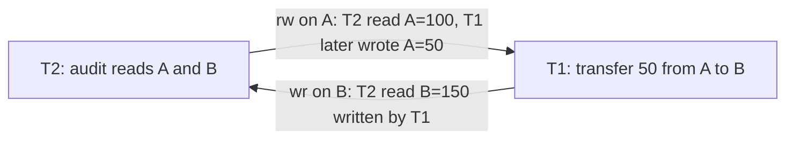
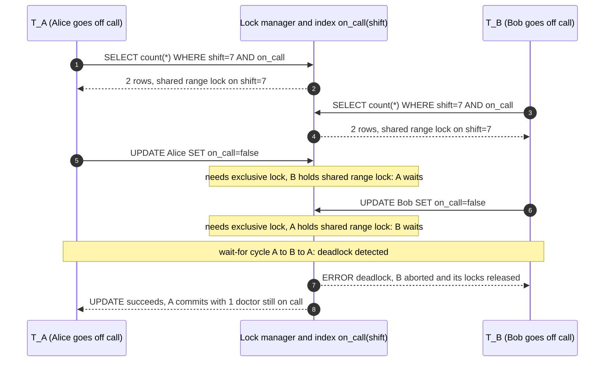
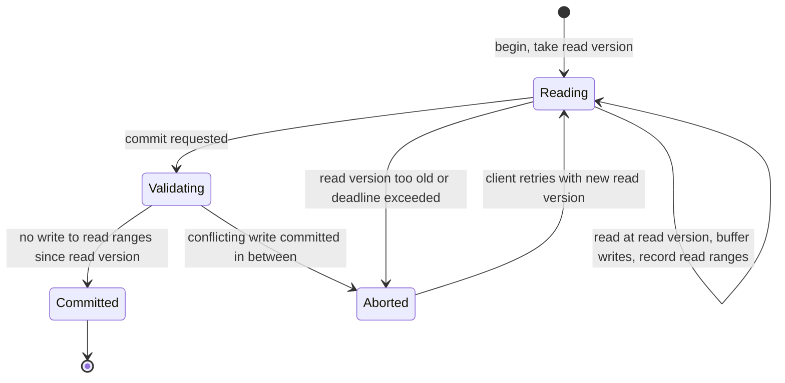
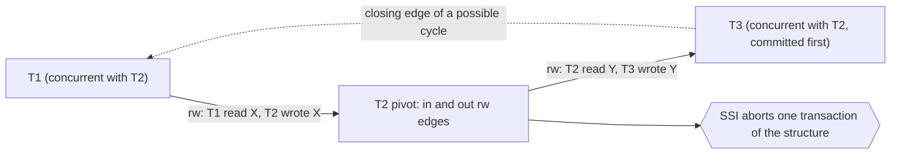
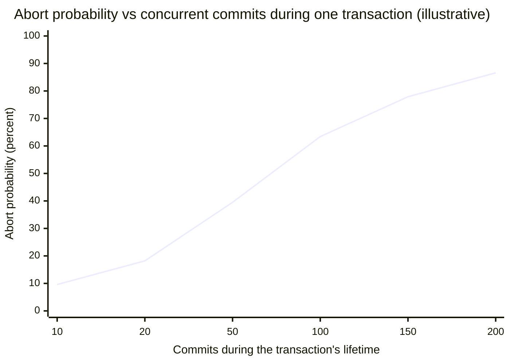
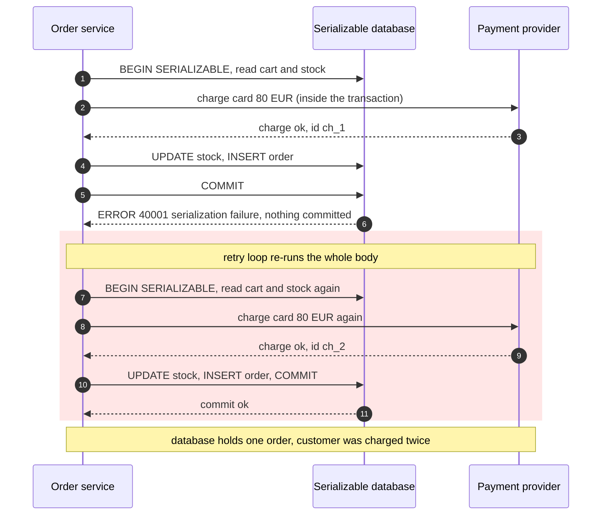

Serializability is a correctness condition for transactions: a concurrent execution of many transactions, each of which reads and writes several objects, is serializable if its outcome is the same as the outcome of some execution that ran the same committed transactions one at a time, with no overlap. The database is free to interleave operations, run them on different cores or machines, and reorder them, as long as every committed transaction observes a state and produces a state that some serial order could have produced. If every transaction, run alone on a consistent database, preserves the application's invariants, then a serializable database preserves them too, regardless of how many transactions run at once. That is the whole value of the guarantee: correctness reasoning stays sequential.

The problem it solves is that invariants span objects. "The sum of all account balances is constant", "at least one doctor is on call", "a username is assigned to at most one account", "an order's line items add up to its total": each of these is a predicate over several rows that a single transaction maintains by reading some of them and writing others. When two such transactions interleave, each can read a state that the other is about to invalidate, and both can commit changes that are individually correct and jointly wrong. No single-object guarantee prevents this. A store in which every key is [linearizable](/distributed-systems/en/data-management/consistency-models/linearizability/) still lets an audit read one account before a transfer and the other account after it, and report money that does not exist.

The core trade-off is concurrency against coordination. To make an interleaved execution equivalent to a serial one, the database must either prevent conflicting operations from overlapping (locks: transactions wait), detect conflicting overlaps after the fact (validation: transactions abort and retry), or decide the order before execution starts (sequencing: transactions must declare what they touch). Waiting, aborting and declaring are the only three currencies available, and contention determines the exchange rate. On a workload where transactions rarely touch the same data, serializability costs a few percent; on a workload with a hot row or a hot range, it caps throughput at one transaction per lock hold time or turns load into an abort storm. Weaker isolation levels buy throughput by letting specific anomalies through, which moves the burden of preserving invariants back into the application.

Serializability also says nothing about real time: a transaction that starts after another commits may be ordered before it. The real-time variant, strict serializability, is a separate and more expensive guarantee, and vendor documentation routinely conflates the two.

## Serial Equivalence: What the Guarantee Says

Formal reasoning about isolation works on histories. A history is the sequence of read and write operations that transactions issued, interleaved in the order the database executed them, plus each transaction's outcome (commit or abort). Two operations conflict if they belong to different transactions, touch the same object, and at least one of them is a write. Conflicting operations are the only ones whose relative order can change what a transaction observes or what the final state is; two reads of the same object, or any two operations on different objects, can be swapped freely without changing anything.

That observation gives the practical definition. A history is conflict serializable if it can be turned into a serial history by repeatedly swapping adjacent non-conflicting operations. Equivalently, build a precedence graph (also called a serialization graph): one node per committed transaction, and an edge from T1 to T2 whenever an operation of T1 conflicts with a later operation of T2. The history is conflict serializable exactly when that graph has no cycle, and any topological sort of the graph is a valid equivalent serial order. The edges come in three kinds. A write-read edge (`wr`) means T2 read a value T1 wrote. A write-write edge (`ww`) means T2 overwrote T1's value. A read-write edge (`rw`, also called an anti-dependency) means T1 read a version that T2 later replaced, so T1 did not see T2's write.

### A Worked History: The Audit That Saw 250

Assume two accounts, A and B, each holding 100, with the invariant that `A + B = 200`. T1 transfers 50 from A to B: it reads A, writes A = 50, reads B, writes B = 150. T2 is an audit: it reads A and reads B and reports the sum. Run serially in either order, the audit reports 200. Now interleave them: `r2(A)=100`, `r1(A)=100`, `w1(A)=50`, `r1(B)=100`, `w1(B)=150`, T1 commits, `r2(B)=150`, T2 commits. The audit reports 250.


*Precedence graph for the interleaved history. Two edges in opposite directions form a cycle, so no serial order explains what T2 observed.*

The `rw` edge on A says T2 must come before T1, because T2 did not see T1's write to A. The `wr` edge on B says T1 must come before T2, because T2 saw T1's write to B. Both cannot hold, the graph has a cycle, and the audit's result of 250 is not producible by any serial execution. Notice what is not wrong here: every read returned a committed value and every operation was atomic, so the history is legal under Read Committed. The defect is purely in the combination. If T2's read of A had held a shared lock until T2 committed, `w1(A)` would have waited, T2 would have read B = 100, both edges would point from T2 to T1, and the audit would report 200. If T2 had instead read B from a snapshot taken at its start, it would also have seen B = 100, the order T2, T1 would be valid, and the audit would again report 200. Every mechanism below is a way of guaranteeing one of those outcomes.

A broader notion, view serializability, also accepts some histories with blind writes, but Papadimitriou showed in 1979 that testing it is NP-complete, while conflict serializability is a cycle check. Production engines target conflict serializability, and this page means that definition.

### What Is Guaranteed and What Is Not

The guarantee covers committed transactions and the reads they performed. It rules out every anomaly that depends on a transaction observing an inconsistent mixture of states: dirty reads, lost updates, non-repeatable reads, read skew, write skew, phantoms, and the read-only transaction anomaly. Those anomalies and the weaker levels that permit them, from Read Committed to Snapshot Isolation, are the subject of [Weak Isolation and MVCC](/distributed-systems/en/data-management/consistency-models/weak-isolation-mvcc/); this page only needs the fact that each one corresponds to a cycle in the precedence graph that the weaker level fails to break.

It does not guarantee which serial order is chosen, nor real-time order between non-overlapping transactions (next subsection). It does not guarantee progress: every mechanism below aborts some transactions under some workloads, so a client that does not retry correctly loses work. It does not constrain anything outside the database: an email sent or an HTTP call made from inside a transaction that aborts and retries happens twice. And it says nothing about the reads of aborted transactions. Under pure commit-time validation, a transaction that is doomed to abort can observe an inconsistent state before it learns so (the stronger condition that forbids this is called opacity), so application code must not take irreversible action on intermediate reads.

The ANSI SQL standard defines isolation levels by the "phenomena" they prohibit, and Berenson and colleagues showed in 1995 that a level preventing all three ANSI phenomena is not necessarily serializable; Snapshot Isolation is the counterexample. The keyword `SERIALIZABLE` is therefore a name, not a proof, and several widely used databases map it to something weaker.

### Strict Serializability: Adding Real Time

Assume a pricing service commits T_w, which raises an item's price, at 10:00:00.000, and returns success. At 10:00:00.050, a checkout transaction T_r starts and reads the price from a replica whose snapshot is five seconds old, seeing the old price. The history is serializable: order T_r before T_w and everything is consistent. Nothing in the definition is violated, and the customer is charged a price that was already obsolete when the checkout began.

Strict serializability adds the constraint that if T1 commits before T2 starts, in real time, then T1 precedes T2 in the equivalent serial order. It is to serializability what linearizability is to sequential consistency. Papadimitriou named it in 1979; Spanner calls its version external consistency. A single-node database running every transaction against its latest committed state provides it for free. A replicated or partitioned one pays for it, either by routing reads through a node that can prove it has seen every earlier commit, or by bounding clock uncertainty and waiting it out, as in [TrueTime commit wait](/distributed-systems/en/foundations/time-and-ordering/truetime-spanner/).

:::note[Serializability and linearizability are not ordered]
Linearizability constrains single operations on single objects in real time; serializability constrains multi-object transactions in some order. Neither implies the other. A store of linearizable keys allows the audit anomaly above, and a serializable database allows the stale checkout. Strict serializability implies both. When a system claims "strong consistency", the first question is which of the three it means and on which path.
:::

### Phantoms: Why Rows Are Not Enough

A transaction often reads a set defined by a predicate rather than a fixed list of rows: "all doctors on call for shift 7", "all bookings for room 12 overlapping 14:00 to 15:00". A concurrent transaction can insert a row that matches the predicate. The first transaction never read that row, because it did not exist, so no row-level conflict connects the two, yet the result of the first transaction's query would have been different. This is a phantom. In precedence-graph terms, the conflict is between a predicate read and a write that changes the predicate's result set, and a mechanism that only tracks individual rows misses the edge. Every serializable mechanism therefore needs some way to represent "the set of rows matching this condition, including rows that do not exist yet": predicate locks, index-range locks, or recorded scan ranges. How each engine does this is one of the main sources of their different performance and false-positive behavior.

## Four Ways to Enforce Serial Equivalence

All serializable engines prevent precedence-graph cycles; they differ in when they act and in who pays when transactions collide. Locking acts as operations happen, optimistic validation acts at commit, Serializable Snapshot Isolation acts only on a specific pattern of anti-dependencies, and deterministic sequencing fixes the order before anything runs.

### Two-Phase Locking

Two-phase locking (2PL) gives every object a lock with a shared mode for readers and an exclusive mode for writers. A transaction acquires a shared lock before reading and an exclusive lock before writing; shared locks are compatible with each other, exclusive locks are compatible with nothing. The two phases are a rule about timing: a transaction may acquire locks during its growing phase and release them during its shrinking phase, but once it releases any lock it may never acquire another. Production engines use strict 2PL, in which exclusive locks (and, in the strong form, all locks) are held until commit or abort, because releasing a write lock early would let another transaction read a value that might still be rolled back.

The correctness argument is short. Each transaction has a lock point, the moment it holds all the locks it will ever hold. Suppose T1 and T2 conflict on object X and T1 accessed X first. T2 could only access X after T1 released its lock on X, which happens after T1's lock point; T2 acquired its lock on X before its own lock point. So every conflict edge from T1 to T2 implies that T1's lock point precedes T2's. A cycle would require a transaction's lock point to precede itself, which is impossible. Ordering transactions by lock point gives the equivalent serial order, and under strict 2PL that order matches commit order.

Phantoms require locking things that do not exist yet. True predicate locks, which lock a logical condition, are expensive to check and almost never implemented. Engines approximate them with index-range locks: a scan over an index locks the index entries it reads and the gaps between them, so an insert into a locked gap blocks. InnoDB calls these next-key locks, SQL Server calls them key-range locks. Without a suitable index, the scan touches the whole table and the engine has to lock the whole table, which is how a missing index turns a serializable workload into a single-threaded one.


*Strict 2PL with range locks on the on-call invariant. Both transactions read the same predicate under shared locks, so neither can write until the other gives up; the engine breaks the deadlock by aborting one of them.*

Steps 1 to 4 are the read phase: both transactions see two doctors on call. Under Snapshot Isolation, both writes in steps 5 and 6 would succeed because they touch different rows, and the shift would end with nobody on call; that is write skew. Under 2PL, each shared range lock blocks the other's exclusive lock, and the waits form a cycle. The lock manager aborts T_B in step 7, releasing its shared lock and letting T_A's update proceed in step 8. When T_B retries, it sees one doctor on call and refuses to leave. One transaction paid with an abort and the other with a wait: under contention, 2PL buys correctness with blocking, and deadlock is a normal outcome rather than a bug.

Engines deal with deadlocks in two ways. Detection builds a wait-for graph and aborts a victim when it finds a cycle; PostgreSQL waits for `deadlock_timeout` (1 second by default) before running the check, so a deadlocked transaction first experiences a one-second stall. Prevention orders transactions by start timestamp and never lets a cycle form: under wait-die, an older transaction waits for a younger one but a younger one requesting a lock held by an older one aborts; under wound-wait, an older transaction requesting a lock held by a younger one aborts ("wounds") the younger one, and a younger requester waits. Both guarantee that the oldest transaction eventually finishes, which prevents starvation. Spanner resolves lock conflicts with wound-wait, favoring older transactions.

### Optimistic Validation and Timestamp Ordering

Optimistic concurrency control (OCC), introduced by Kung and Robinson in 1981, splits a transaction into three phases. In the read phase it reads committed data without locks and buffers its writes privately, recording its read set and write set. In the validation phase, at commit, it checks whether any transaction that committed since it started wrote something it read. If not, it enters the write phase and installs its writes; if so, it aborts and retries. The serial order is commit order: a transaction that passes validation read nothing that a transaction ordered before it changed after the read, so every `rw` edge points forward in commit order, as do the `wr` and `ww` edges by construction, and the graph cannot contain a cycle. Validation and write installation must happen atomically with respect to other validations, which in a single engine is a short critical section and in a distributed engine is a dedicated component.


*Lifecycle of an optimistic transaction. Conflicts are found only at validation, so a transaction that will abort still consumes its full read phase first.*

The state machine shows where OCC spends its cost. A conflicting transaction is not stopped when it reads stale data; it runs to the end and is discarded at validation. Under low contention that is cheap, because almost nothing aborts and nobody waits. Under high contention it is the most expensive outcome possible, because the work is repeated and the retry joins the contention that caused the abort. The "read version too old" edge is the other limit: old versions must stay available for the whole read phase, so long transactions are bounded.

FoundationDB is the clearest production example of OCC at scale. A client obtains a read version on its first read, reads directly from storage servers at that version, and buffers writes along with read and write conflict ranges. At commit, a proxy obtains a commit version, splits the conflict ranges by key range, and sends each piece to the resolver responsible for it; each resolver checks whether any transaction committed between the read version and the commit version wrote into the read ranges. The transaction commits only if every resolver accepts it, and the resulting order is the version order, which makes the system strictly serializable. Storage servers keep multi-version data for only about the last 5 seconds, so a transaction older than that fails with a "transaction too old" error, which is why FoundationDB transactions cannot run longer than 5 seconds. The design documentation also notes a caveat that matters for the strict part of the guarantee: obtaining a read version is strictly externally consistent only if the proxy confirms its liveness with the transaction log system, and production clusters commonly skip that check with the `ALWAYS_CAUSAL_READ_RISKY` option.

Timestamp ordering is the other non-locking family. Each transaction gets a timestamp at start, and the engine ensures the equivalent serial order is timestamp order: a write is rejected if a transaction with a later timestamp already read the object, and a read must see the latest version older than its timestamp. CockroachDB uses a refined form. Each range keeps a timestamp cache of the latest read on each key; a write below that timestamp is pushed to a higher timestamp, because writing in the past of a read already served would invert the order. A pushed transaction is now committing at a later timestamp than the one it read at, so before committing it attempts a read refresh: it re-checks whether any of the keys it read were written between the old and new timestamps. If none were, it commits at the new timestamp; if some were, it fails with a `RETRY_SERIALIZABLE` error. A write that finds a newer committed write on the same key produces `RETRY_WRITE_TOO_OLD`, and a read that finds a write within the clock uncertainty interval of the [hybrid logical clock](/distributed-systems/en/foundations/time-and-ordering/hybrid-logical-clocks/) produces `ReadWithinUncertaintyInterval`. All of them surface to the client as SQLSTATE 40001, and the server retries transparently when it has not yet returned results to the client.

### Serializable Snapshot Isolation

Snapshot Isolation (SI) gives each transaction a consistent snapshot as of its start and aborts a transaction only if it writes a row that a concurrent transaction already wrote (first committer wins). Readers never block writers and writers never block readers, which is why SI became the default high level in many MVCC (multi-version concurrency control) engines. SI is not serializable: write skew, as in the on-call example, passes because the two writes touch different rows. The SI mechanism itself belongs to the [weak isolation page](/distributed-systems/en/data-management/consistency-models/weak-isolation-mvcc/); what matters here is how to repair it.

Fekete, Liarokapis, O'Neil, O'Neil and Shasha proved in 2005 that every non-serializable execution under SI contains a specific structure: a cycle in the precedence graph with two consecutive `rw` anti-dependency edges between transactions that ran concurrently, a "pivot" transaction T2 with an incoming `rw` edge from T1 and an outgoing `rw` edge to T3. Under SI, `wr` and `ww` edges always point forward in time, because a transaction only sees writes committed before its snapshot and first-committer-wins prevents concurrent overwrites. Only `rw` edges can point between concurrent transactions, and a cycle needs at least two of them back to back. Cahill, Röhm and Fekete turned this into a mechanism in 2008: Serializable Snapshot Isolation (SSI) tracks `rw` edges at runtime and aborts a transaction whenever it would become a pivot. Since every cycle contains a pivot, aborting pivots breaks every cycle.


*The dangerous structure that SSI detects. Two consecutive anti-dependencies through a pivot are necessary for an SI anomaly, so SSI aborts on the structure without checking whether the cycle actually closes.*

The dashed edge is what makes the structure an actual anomaly, and SSI does not look for it: detecting full cycles would require tracking the entire graph, while the two-edge structure needs only small per-transaction conflict lists. The price is false positives, aborts of transactions whose execution was in fact serializable. In the on-call example, each transaction reads the predicate the other writes, so both are pivots of a two-transaction cycle, and SSI aborts one at commit without either ever blocking. PostgreSQL's implementation, described by Ports and Grittner in 2012, aborts only if T3 committed first, which removes many false positives.

To detect `rw` edges, SSI must remember what each transaction read, including predicates. PostgreSQL records reads as SIRead locks, which never block and only serve as markers; a write that hits a marker of a concurrent transaction creates an `rw` edge. Markers are taken on tuples, pages, or whole relations, and index scans mark the index pages they cover, which catches phantoms. They must outlive their transaction until every concurrent transaction has finished. Read-only transactions get a further optimization: a read-only transaction writes nothing, so it can only be the T1 end of a dangerous structure, and if it takes its snapshot when no concurrent read-write transaction can become a pivot against it, it needs no tracking at all. PostgreSQL exposes this as `SERIALIZABLE READ ONLY DEFERRABLE`, which may wait at start for such a safe snapshot and then never aborts.

### Deterministic Sequencing

The last family removes the decision from execution entirely. Calvin, published by Thomson and colleagues in 2012, puts a sequencing layer in front of the database: transaction requests are collected into batches (10 ms epochs in the paper), the batches are replicated, and every partition executes the transactions in the agreed global order using deterministic locking in that order. Because every replica executes the same inputs in the same order deterministically, there is no commit protocol at the end and no contention-driven abort: two conflicting transactions simply run one after the other. Locks are acquired in the sequenced order, so deadlocks cannot occur.

The price is that a transaction must declare its read and write sets before it is sequenced. A transaction whose write set depends on what it reads needs a reconnaissance step: a read-only query discovers the set, the transaction is sequenced with it, and it restarts if the set changed by execution time. Interactive transactions, where the client inspects a result before deciding what to do next, do not fit at all, which is why deterministic databases are rare in general-purpose SQL.

## The Cost of Serializability, Worked Through

The cost of every mechanism is driven by how long a transaction's conflict footprint stays open and how many other transactions touch it during that time. Locks convert the product into waiting; validation converts it into aborts.

### Lock Hold Time Caps a Hot Row

Assume an account row that every payment updates, and a payment transaction of four statements issued one by one from an application server: read the balance, insert a ledger entry, update the balance, commit. Under strict 2PL the exclusive lock on the balance row is held from the update until the commit is durable. With a 0.5 ms round trip to a database in the same availability zone and about 1 ms to flush and replicate the commit, the lock is held for roughly 2 to 3 ms. Only one transaction can hold it at a time, so the hot row caps at about 1 / 0.0025 s, which is 400 payments per second, whatever the number of cores.

Move the application to another region with a 70 ms round trip, and the lock is held for at least two round trips, 140 ms, capping the row at about 7 payments per second. The fix is never a bigger database but a shorter lock-holding window: collapse read and update into one statement (`UPDATE ... SET balance = balance - 30 WHERE id = 42 AND balance >= 30`), move the transaction into a stored procedure so it costs one round trip, or take the lock last, after all slow work. A row that genuinely needs more updates than one lock-hold-time permits must be split, as on [Skew and Hot Spots](/distributed-systems/en/data-management/data-partitioning/skew-hot-spots/).

### Abort Probability Grows Faster Than Load

Assume an optimistic engine and a workload where each transaction reads 10 rows chosen uniformly from a hot set of 1,000 rows, and each other committing transaction writes one row from the same set. A transaction aborts if any transaction that commits during its lifetime writes one of its 10 rows. With k such commits during its lifetime, and assuming independence, the probability of surviving is `(1 - 10/1000)^k`, so the abort probability is `1 - 0.99^k`, and the expected number of attempts per successful commit is `1 / 0.99^k`.


*Illustrative model: 10 rows read from a 1,000-row hot set, one row written per concurrent commit, independent choices.*

With 10 concurrent commits, 9.6% of attempts abort and each success costs 1.11 attempts. At 50, 39.5% abort and each success costs 1.65 attempts; at 100, 2.73; at 200, 7.46. The feedback is worse than the curve. The number of commits during a transaction's lifetime is the commit rate multiplied by the lifetime; retries raise offered load, which lengthens every transaction, which raises k and the abort rate, which produces more retries. Past a threshold the system can stay in a state where most work is aborted even after the triggering load disappears, a metastable failure analyzed on [Retry Storms and Metastable Failures](/distributed-systems/en/resilience/flow-control/retry-storms-metastable-failures/). Locking engines degrade differently on the same workload: throughput flattens at the lock-hold-time cap and latency grows with the queue, but completed work is not thrown away.

### Mechanisms Compared

| Mechanism | Readers block writers? | Conflict outcome | Phantom handling | Main cost | Main failure under contention | When to prefer |
|---|---|---|---|---|---|---|
| Strict 2PL with range locks | Yes, both directions | Wait, deadlock abort | Index-range or next-key locks | Blocking, lock memory | Lock convoys, deadlocks, missing index locks the table | Short transactions with moderate contention on known hot rows; workloads where aborted work is expensive |
| OCC / backward validation | No | Abort at commit | Recorded read ranges validated | Wasted work on abort | Abort storms, starvation of long transactions | Low contention, short transactions, key-value APIs; distributed engines that avoid lock managers |
| Timestamp ordering with read refresh | No, but reads push later writes | Push, refresh, or abort | Timestamp cache over spans | Retries, clock uncertainty | Retry errors on hot keys, uncertainty restarts with clock skew | Geo-distributed SQL where transactions stay short |
| SSI over MVCC | No | Abort the pivot at commit | Predicate markers on index pages | Tracking memory, false-positive aborts | Abort spikes when markers are promoted to coarse locks | Read-heavy mixes on an MVCC engine, long read-only reports alongside writes |
| Deterministic sequencing | No (ordered locks) | Wait in sequence order, no contention abort | Declared read and write sets | Sequencing latency, no interactive transactions | Reconnaissance restarts when sets change | High-contention stored-procedure workloads with known footprints |

Moving a workload from a locking engine to an optimistic one, or the reverse, changes its failure mode from latency to aborts or from aborts to latency, even though the isolation level carries the same name in both.

## Serializability in Production Databases

The keyword does not mean the same thing everywhere. The table lists what common engines execute when a transaction asks for `SERIALIZABLE`.

| Engine | Default level | What `SERIALIZABLE` provides | Mechanism | Error a client must retry |
|---|---|---|---|---|
| PostgreSQL (9.1 and later) | Read Committed | Serializable | SSI over MVCC | SQLSTATE 40001, also 40P01 for deadlocks |
| MySQL InnoDB | Repeatable Read | Serializable via locking reads, with an autocommit caveat | 2PL with next-key locks | 1213 deadlock, 1205 lock wait timeout |
| SQL Server | Read Committed | Serializable | 2PL with key-range locks (SNAPSHOT is a separate SI level) | 1205 deadlock victim |
| Oracle Database | Read Committed | Snapshot Isolation, which allows write skew | MVCC, first committer wins | ORA-08177 on write-write conflict |
| CockroachDB | Serializable | Serializable, not strict for disjoint keys | Timestamp ordering, read refresh, HLC | SQLSTATE 40001 with a reason code |
| Spanner | Serializable | Strict serializable (external consistency) | Strict 2PL with wound-wait, TrueTime | ABORTED, retried by client libraries |
| FoundationDB | Serializable (only level) | Strict serializable, caveat on causal-read-risky | OCC with resolvers, 5 s MVCC window | Retryable conflict error |

PostgreSQL has implemented true serializability with SSI since version 9.1 (2011); before that its `SERIALIZABLE` was Snapshot Isolation, which `REPEATABLE READ` provides today. SSI markers live in a shared table sized by `max_pred_locks_per_transaction` (default 64, an average per connection rather than a per-transaction cap). More than `max_pred_locks_per_page` (default 2) tuple markers on one page are promoted to a page marker, and more page or tuple markers on one relation than `max_pred_locks_per_relation` allows (default `-2`, meaning half of `max_pred_locks_per_transaction`) are promoted to a relation marker. Promotion bounds memory and raises the false-positive rate, because a coarse marker conflicts with writes the transaction never read. Jepsen's 2020 analysis of PostgreSQL 12.3 found a real bug in this machinery: G2-item anomalies (anti-dependency cycles) under `SERIALIZABLE` involving freshly inserted rows, because conflict detection could attribute a tuple version to the wrong transaction. The bug dated from SSI's introduction, was confirmed in 9.5 through 13 beta, and was fixed in the August 2020 minor releases. The same analysis confirmed that `REPEATABLE READ` is Snapshot Isolation and allows G2-item.

```sql
-- Report that must not abort and must see a serializable snapshot (PostgreSQL)
BEGIN ISOLATION LEVEL SERIALIZABLE READ ONLY DEFERRABLE;  -- may wait for a safe snapshot
SELECT sum(balance) FROM accounts;
COMMIT;
-- Inspect SSI markers: SIReadLock rows never block, they only record reads
SELECT relation::regclass, locktype, count(*) FROM pg_locks
WHERE mode = 'SIReadLock' GROUP BY 1, 2 ORDER BY 3 DESC;
```

The first statement is the way to run long reports on a busy PostgreSQL primary under SSI: it waits for a snapshot no concurrent writer can invalidate, then runs with no tracking and no abort risk. The `pg_locks` query counts SSI markers per relation and granularity; growing `relation` or `page` counts on a hot table are the leading indicator of false-positive aborts.

MySQL's InnoDB documents its `SERIALIZABLE` as "like `REPEATABLE READ`", except that plain `SELECT` statements are implicitly converted to `SELECT ... FOR SHARE` when autocommit is disabled; with autocommit enabled, each `SELECT` is its own non-locking read-only transaction. A sequence of statements that the application believes is one transaction, but that a driver runs in autocommit mode, gets no protection. Lock waits are bounded by `innodb_lock_wait_timeout` (50 seconds by default), and `SHOW ENGINE INNODB STATUS` prints the latest detected deadlock. SQL Server's `SERIALIZABLE` holds key-range locks to commit, while its separate `SNAPSHOT` level is Snapshot Isolation and permits write skew.

Oracle is the most consequential mismatch. Its `SERIALIZABLE` is Snapshot Isolation, raising ORA-08177 only when a transaction updates a row a concurrent transaction changed. In the on-call example, both transactions commit, so applications ported from PostgreSQL or SQL Server that rely on the keyword lose correctness silently.

Spanner runs read-write transactions under strict 2PL by default: reads take shared locks held until commit, writes acquire exclusive locks at commit, and conflicts are resolved with wound-wait. It can also run serializable transactions optimistically, validating all reads at commit, and now offers a repeatable read level that validates only reads marked `FOR UPDATE`. Read-only transactions take no locks and read at a timestamp, which TrueTime makes consistent with real time. The cross-shard machinery is on [Spanner Architecture](/distributed-systems/en/case-studies/distributed-sql/spanner-architecture/) and [2PC over Consensus](/distributed-systems/en/case-studies/distributed-sql/transactions-2pc-over-consensus/).

CockroachDB defaults to `SERIALIZABLE`. Its uncertainty interval prevents stale reads of single keys, but transactions on disjoint keys are not strictly serializable, as the [linearizability page](/distributed-systems/en/data-management/consistency-models/linearizability/) discusses. Its retry reason codes point at different fixes: `RETRY_WRITE_TOO_OLD` and `RETRY_SERIALIZABLE` mean contention on keys written or read, `ReadWithinUncertaintyInterval` means contention combined with clock skew between gateways, and `RETRY_COMMIT_DEADLINE_EXCEEDED` means a long transaction was pushed repeatedly and should be shortened rather than retried. Internals are on [CockroachDB: Raft, HLC, and Parallel Commits](/distributed-systems/en/case-studies/distributed-sql/cockroachdb-raft-hlc/).

### Retrying Correctly

Every serializable engine aborts some transactions, so the client's retry loop is part of the isolation mechanism. It must re-execute the whole transaction from `BEGIN`, because the decisions depended on values that turned out to be inconsistent. It must retry only errors that mean "serialization failure or deadlock, nothing committed", never "outcome unknown", such as a connection lost after the commit was sent. It must back off with jitter so the colliding transactions do not collide again, and cap attempts so a persistently conflicting transaction surfaces as an error rather than becoming load.

```text
for attempt in 1..MAX_ATTEMPTS:
    begin transaction (isolation = serializable)
    run all reads and writes again        # never reuse values read in a failed attempt
    try commit
        on success: return
        on 40001 / 40P01 / deadlock-victim: rollback, sleep(jittered backoff(attempt)), continue
        on connection lost during commit: outcome unknown -> resolve by idempotency key, do not blindly retry
perform external side effects only after the commit returned success
```

The last line is the one most often violated: code that sends a message or calls a payment provider inside the transaction body repeats that effect on every retry. Effects outside the database belong after commit with an idempotency key, or in the same transaction as an outbox row delivered by a separate process, as on [Outbox Pattern](/distributed-systems/en/coordination/distributed-transactions/outbox-pattern/) and [Idempotency](/distributed-systems/en/communication/api-gateway/idempotency/). Backoff is covered on [Retry with Exponential Backoff](/distributed-systems/en/resilience/protection-patterns/retry-exponential-backoff/).

:::tip[Measure aborts per committed transaction, not aborts per second]
An abort rate that rises from 50 to 500 per second may be harmless if commits rose tenfold, and disastrous if commits stayed flat. The ratio of retry attempts to successful commits, per transaction type, is the number that tracks the curve in the abort chart and warns before a metastable state is reached.
:::

## Failure Modes and How They Present

Most of these failures are not database bugs: they are the cost model reaching its limit, or a guarantee weaker or narrower than the application assumes.

### Serialization-Failure Retry Storms

Trigger: contention rises on some rows or ranges, from a traffic spike, a batch job, a new shared counter, or a slowdown that lengthens transactions; under optimistic, timestamp-ordering or SSI engines the abort rate climbs the curve above. Symptoms: commit throughput flat or falling while CPU and request rate rise, p99 latency dominated by retry attempts, client errors after the retry cap. Detection: client-side SQLSTATE 40001 counts per transaction type; in PostgreSQL, serialization failures in the server log and `xact_rollback` in `pg_stat_database`; in CockroachDB, transaction restart metrics by reason and the contention views that name contended keys. Mitigation: cap retries with jittered backoff, shed or queue the contending workload at admission, shorten transactions, and remove the hot spot from the transaction. Recovery: if the system stays saturated after the trigger is gone, reduce offered load below the knee; a metastable state does not clear on its own.

### Deadlocks and Lock Convoys

Trigger: under 2PL, transactions acquire the same locks in different orders, or many transactions queue for one hot lock whose holder is slow. Symptoms: latency spikes of exactly the deadlock detection interval (about 1 second with PostgreSQL defaults), deadlock errors on a subset of requests, and, for convoys, throughput pinned at the lock-hold-time cap while the database is otherwise idle. Detection: `pg_stat_database.deadlocks`, `log_lock_waits` reports, InnoDB's latest-deadlock section and `Innodb_row_lock_waits` and `Innodb_row_lock_time` counters, `pg_locks` joined to `pg_stat_activity` to find the blocker. Mitigation: acquire locks in a consistent order (for example, ascending account id), lock the hot row last and commit immediately, keep network calls out of the lock-holding window, and add the index without which a range lock becomes a table lock. Recovery: kill an idle-in-transaction blocker; for convoys, reduce concurrency on the hot path so the queue drains.

### Predicate Tracking Promotion and False-Positive Aborts

Trigger: under SSI, a transaction reads many rows of one table, through a sequential scan caused by a missing index, a report at `SERIALIZABLE` without `READ ONLY DEFERRABLE`, or a long transaction. Its markers are promoted to page or relation granularity, and every concurrent write to the table now creates an `rw` edge. Symptoms: serialization failures on transactions that by their logic cannot conflict, an abort rate correlated with the report's schedule, and "out of shared memory" errors hinting to increase `max_pred_locks_per_transaction`. Detection: `SIReadLock` counts by `locktype` in `pg_locks`. Mitigation: run reports as `READ ONLY DEFERRABLE` or on a replica, add indexes, keep read-write transactions short, raise the marker limits if memory allows. Recovery: end the long transaction.

### The Label Is Weaker Than the Assumption

Trigger: the application assumes serializable execution, but runs on a path that provides less: Oracle's `SERIALIZABLE`, PostgreSQL's `REPEATABLE READ`, SQL Server's `SNAPSHOT`, MySQL's `SERIALIZABLE` under autocommit, a connection pool that resets session isolation, or reads from an asynchronous replica. Symptoms: none in metrics; two bookings for one room or an unreconciled balance, found by an audit days later. Detection: log the isolation level actually in effect per session, test invariants under concurrent load in CI, and use history checkers as on [Jepsen and Deterministic Simulation](/distributed-systems/en/deployment/distributed-testing/jepsen-deterministic-simulation/). Mitigation: set the level explicitly per transaction; where the engine cannot provide it, materialize the conflict with `SELECT ... FOR UPDATE` on a row that represents the predicate, or encode the invariant as a unique or exclusion constraint. Recovery: reconcile from the audit trail; the database cannot tell which transactions should not have committed.

:::danger[Write skew under a SERIALIZABLE keyword corrupts data silently]
On engines where `SERIALIZABLE` is Snapshot Isolation, two transactions that read the same predicate and write different rows both commit, and nothing is logged. A constraint that the application enforces by "check, then write" is not enforced. Encode the invariant in a database constraint, or force a write-write conflict on a row that stands for the predicate, before relying on it.
:::

### Serializable Inside, Non-Serializable Outside

Trigger: the transaction is serializable, but the business operation is not contained in it: it calls an external service, publishes to a queue, or writes a second database before commit. Symptoms: duplicate external effects after retries and effects for transactions that eventually aborted.


*A correct retry loop around a body with an external side effect. The database's guarantee holds exactly; the duplicate charge happens outside it.*

The database behaved correctly at every step: the first attempt was aborted in step 6 with nothing committed, and the second committed one order in step 11. Step 2, an effect outside the database, ran in both attempts and no abort can undo it. Detection: reconcile external effects against committed records, and flag every transaction type with external calls and a non-zero retry rate. Mitigation: move the effect after commit with an idempotency key, or write the intent as an outbox row. Operations that genuinely span databases need a distributed commit protocol, as on [Two-Phase Commit](/distributed-systems/en/coordination/distributed-transactions/two-phase-commit/), or compensation, as on [Saga Pattern](/distributed-systems/en/coordination/distributed-transactions/saga-pattern/), which provides no isolation between concurrent sagas. Recovery: reverse the duplicates found by reconciliation.

### Bugs in the Isolation Implementation

Trigger: a defect in the engine's mechanism, as in the PostgreSQL 12.3 case. Symptoms: rare anomalies the design says are impossible, unreproducible in single-threaded tests. Detection: history checkers that record every transaction's reads and writes under concurrency and search for cycles, run against the exact engine version. Mitigation: track release notes for isolation fixes, and keep a database constraint as a second line of defense for critical invariants. Recovery: upgrade, then reconcile.

## When to Require Serializability

Require serializability when correctness depends on invariants across several rows or on the absence of a row, checked by reading and then writing, and when concurrent transactions can touch the same data: booking and inventory reservation, double-entry ledgers, uniqueness that a unique index cannot express (for example "at most one active subscription per customer per product line"), workflow state stored across rows. Require it also when a team cannot afford to analyze every transaction for anomalies under a weaker level: serializability lets each transaction be reviewed in isolation. Require strict serializability when clients communicate outside the database and expect an earlier commit to be visible to a later transaction.

Do not require it in these cases:

- The invariant can be expressed as a database constraint (unique index, foreign key, check constraint, PostgreSQL exclusion constraint for overlapping ranges). The constraint enforces it at any isolation level with less contention.
- The transaction touches a single row or a single key. Single-object atomicity and linearizability, or a compare-and-set, suffice.
- The workload is dominated by a single hot row that every transaction writes. Serializability will cap throughput at the lock hold time or produce abort storms; redesign the data model first (split counters, append-only ledger with asynchronous aggregation).
- The operation spans services with separate databases. No single database's isolation level reaches across them; the choice is between a distributed commit protocol and a saga with explicit compensation, as discussed on [ACID vs. BASE](/distributed-systems/en/coordination/distributed-transactions/acid-vs-base/).
- Long analytical reads run against an OLTP primary. Run them on a snapshot (a `READ ONLY DEFERRABLE` transaction, a replica, or a warehouse) rather than making every writer pay for tracking their reads.
- The required property is real-time visibility of one value, not multi-object consistency; that is linearizability.

When serializability is chosen, match the mechanism to the contention profile: locking for short transactions with predictable hot rows, optimistic or SSI engines for read-heavy mixes with rare conflicts, deterministic engines only for transactions with known footprints. Then budget for the retry loop, the abort metrics, and the hot-spot redesign that every serializable system eventually needs.

## Further Reading

- Christos H. Papadimitriou, *The Serializability of Concurrent Database Updates*, Journal of the ACM, 1979.
- Philip A. Bernstein, Vassos Hadzilacos, Nathan Goodman, *Concurrency Control and Recovery in Database Systems*, Addison-Wesley, 1987.
- Hal Berenson, Phil Bernstein, Jim Gray, Jim Melton, Elizabeth O'Neil, Patrick O'Neil, *A Critique of ANSI SQL Isolation Levels*, SIGMOD, 1995.
- Michael J. Cahill, Uwe Röhm, Alan D. Fekete, *Serializable Isolation for Snapshot Databases*, SIGMOD, 2008.
- Dan R. K. Ports, Kevin Grittner, *Serializable Snapshot Isolation in PostgreSQL*, PVLDB, 2012.
- Alexander Thomson, Thaddeus Diamond, Shu-Chun Weng, Kun Ren, Philip Shao, Daniel J. Abadi, *Calvin: Fast Distributed Transactions for Partitioned Database Systems*, SIGMOD, 2012.
