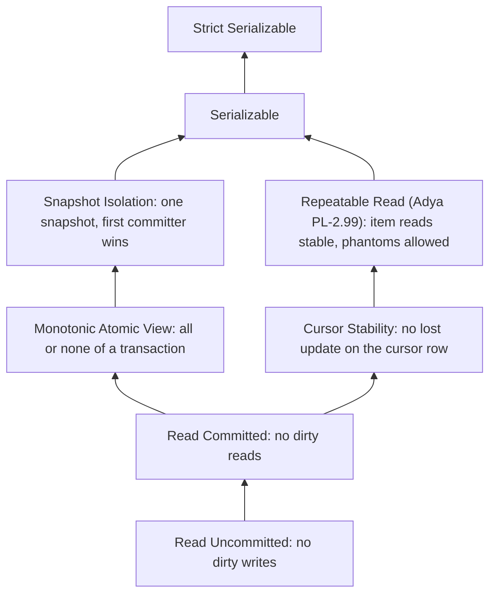
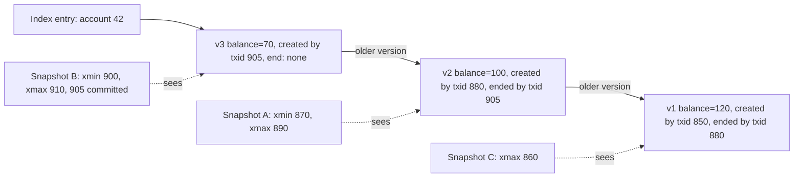
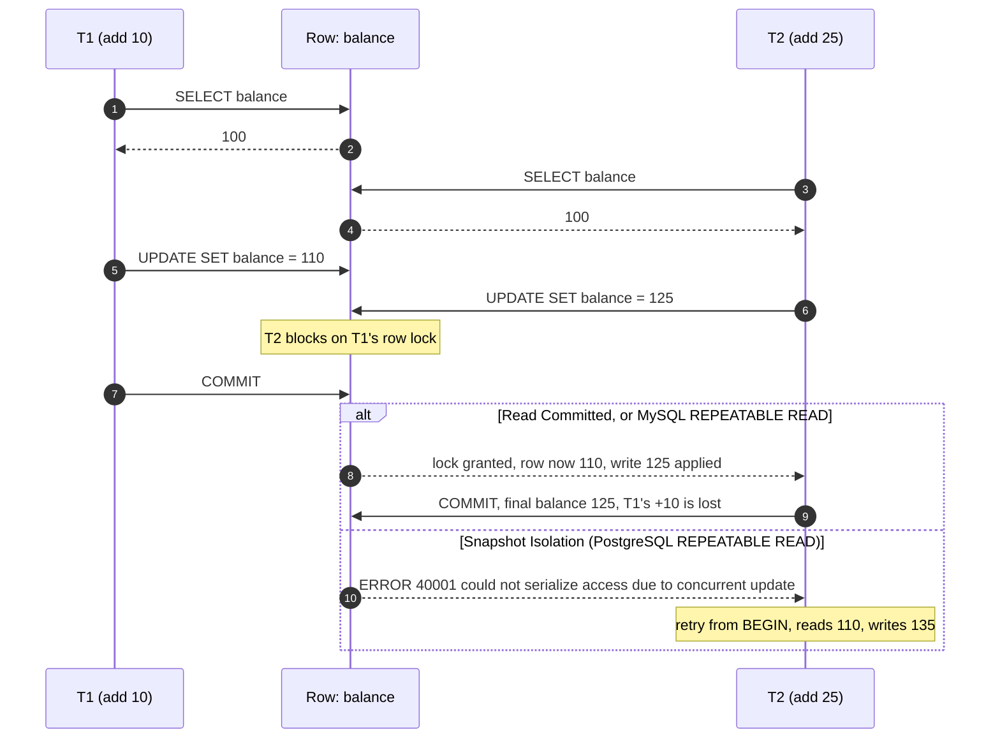
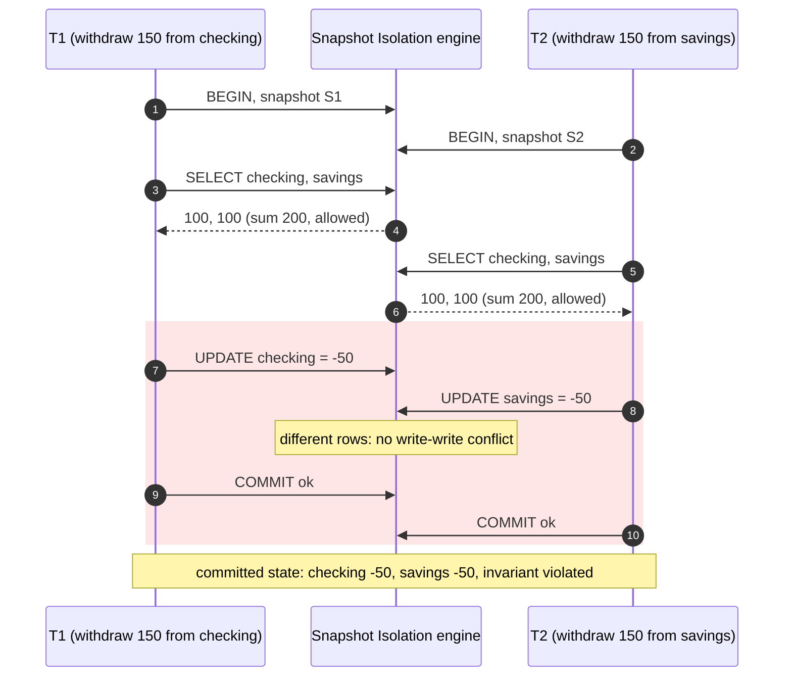
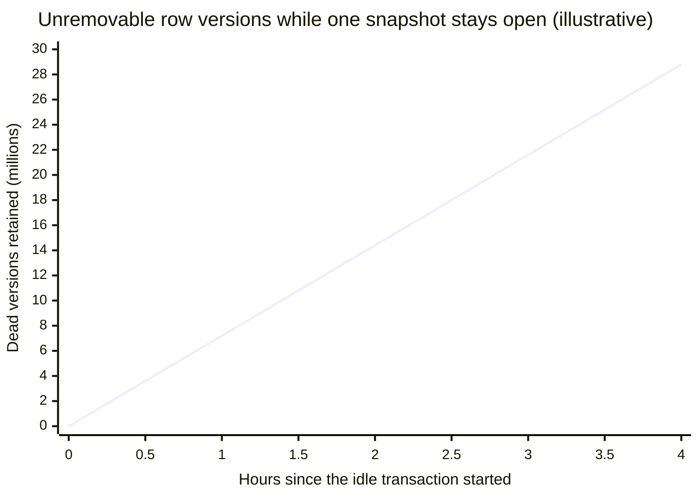

Weak isolation is the family of transaction isolation levels that are weaker than serializability: they let concurrent transactions interleave in ways that no serial execution could produce, but only in specific, named ways. Read Committed guarantees that a transaction never sees uncommitted data. Snapshot Isolation (SI) guarantees that a transaction sees one consistent state of the whole database, frozen at its start, and that two concurrent transactions never both overwrite the same row. Neither guarantees that a decision made from what a transaction read is still valid when it commits. Almost every relational database runs at one of these levels by default, so the anomalies they permit are not edge cases: they are the normal behavior of the production systems most engineers operate.

Multi-version concurrency control (MVCC) is the storage mechanism that makes these levels cheap. Instead of overwriting a row in place and making readers wait for the writer's lock, the engine keeps several versions of each row, each stamped with the transaction that created it, and every reader picks the version that its snapshot says is visible. Readers never block writers and writers never block readers. That property is why MVCC engines can serve long reports and short updates on the same tables without lock contention.

The core trade-off has two halves. Against serializability, weak isolation trades correctness for concurrency: it removes waiting and most aborts, and in exchange the application must find and close the anomalies that matter to its invariants, one transaction pair at a time. Against single-version locking, MVCC trades storage and background work for non-blocking reads: every snapshot that stays open pins every version created after it, and the engine must later find and remove those versions. A five-hour transaction that a reporting tool forgot to close costs nothing in locks and can cost tens of gigabytes of bloat, a purge backlog, or, in PostgreSQL, progress toward a forced shutdown.

This page owns the anomaly catalog below Serializable, the MVCC machinery that implements Read Committed and Snapshot Isolation, and write skew. How serializable engines close the remaining gap, including Serializable Snapshot Isolation, is on [Serializability](/distributed-systems/en/data-management/consistency-models/serializability/); single-object real-time guarantees are on [Linearizability](/distributed-systems/en/data-management/consistency-models/linearizability/).

## The Anomaly Catalog: What Each Level Lets Through

An isolation level is best understood by the anomalies it allows, because the anomalies are what application code must defend against. Each anomaly below is a concrete interleaving of two transactions; each has a name in the ANSI SQL standard, in Berenson and colleagues' 1995 critique of that standard, or in Adya's 1999 generalized definitions, and the names overlap.

A **dirty write** happens when a transaction overwrites a value that another, still uncommitted transaction wrote. If T1 writes A and B, and T2 overwrites A before T1 commits, and both commit, the final state can mix T1's B with T2's A, a combination neither transaction intended; if T1 aborts, rolling back A would also erase T2's write. Every level, including Read Uncommitted, prevents dirty writes, usually by holding write locks to commit. Adya calls the cycle of write-write dependencies G0.

A **dirty read** happens when a transaction reads a value written by a transaction that has not committed. If the writer later aborts, the reader acted on data that never existed (Adya's G1a, aborted read); if the writer later overwrites its own value, the reader saw an intermediate state (G1b). Read Committed exists to prevent exactly this.

A **lost update** happens when two transactions both read a value, both compute a new value from it, and both write: the second write silently discards the first. Two concurrent "add 10 to the balance" operations implemented as `SELECT balance` followed by `UPDATE ... SET balance = 110` leave the balance at 110 instead of 120. Berenson and colleagues named it P4. Read Committed allows it; Snapshot Isolation prevents it.

A **read skew** (also non-repeatable read or fuzzy read) happens when a transaction reads two related values at different points in time and observes a state that never existed. The audit that reads account A before a transfer and account B after it, worked through on the [Serializability](/distributed-systems/en/data-management/consistency-models/serializability/) page, is the canonical case. Hermitage, Kleppmann's suite of isolation tests, files it as G-single, a dependency cycle with exactly one anti-dependency edge. Read Committed allows it; Snapshot Isolation prevents it, because both reads come from one snapshot.

A **write skew** happens when two transactions read an overlapping set of data, each makes a decision based on what it read, and each writes a different object, so that neither write conflicts with the other but together they violate an invariant the reads were checking. When the decision depends on a predicate, such as "no booking overlaps this time slot", and the write inserts a row that would have changed the other transaction's predicate result, the anomaly is a phantom variant of write skew. Adya's names are G2-item for the version on fixed rows and G2 for the predicate version. Snapshot Isolation allows both. The anomaly is analyzed in its own section below.

A **read-only anomaly**, discovered by Fekete, O'Neil, and O'Neil in 2004, is the strangest: under Snapshot Isolation, two read-write transactions can produce a history that is serializable on its own, and a third transaction that only reads can observe a state that makes the whole history non-serializable. It shows that, under SI, even reports can see an impossible state.


*Partial order of isolation levels by the anomalies they forbid. An arrow points from a weaker level to a stronger one; Snapshot Isolation and Repeatable Read in the formal sense are incomparable.*

The diagram is a partial order, not a ladder, and the gaps between branches are where porting bugs come from. Snapshot Isolation forbids phantoms for reads (a snapshot does not change) but allows write skew; Repeatable Read in the formal, lock-based sense forbids write skew on rows it read but allows phantoms, because it locks rows rather than predicates. So neither implies the other, and the SQL keyword `REPEATABLE READ` can map to either branch, or to neither: PostgreSQL implements it as Snapshot Isolation, while MySQL's InnoDB implements something that, as Jepsen showed in 2023, is neither a snapshot nor lock-based Repeatable Read. Monotonic Atomic View, which forbids seeing some but not all of another transaction's writes, matters mostly in distributed and replicated stores, where it is the strongest level achievable without coordination.

### Why the Standard's Definitions Fail

The ANSI SQL-92 standard defines its four levels by three phenomena expressed in English: dirty read, non-repeatable read, and phantom. Berenson, Bernstein, Gray, Melton, O'Neil, and O'Neil showed in 1995 that the definitions were ambiguous: read strictly, they admit histories everyone would call broken, and read loosely, they forbid only what a locking implementation happens to forbid. Their paper defined Snapshot Isolation formally for the first time and showed that it prevents all three ANSI phenomena while still not being serializable, which is why a database can claim "ANSI SERIALIZABLE" and allow write skew.

Adya's 1999 thesis, published with Liskov and O'Neil in 2000, replaced phenomena with dependency graphs over committed transactions, the same `wr`, `ww` and `rw` edges that [Serializability](/distributed-systems/en/data-management/consistency-models/serializability/) uses to define cycles. Each level is the absence of a class of cycles: PL-1 forbids G0, PL-2 additionally forbids G1, PL-2.99 forbids item anti-dependency cycles, and PL-3 forbids all cycles. These definitions are implementation-independent: they apply equally to a lock-based, an optimistic, or a multi-version engine, which is what lets tools such as Hermitage and Jepsen's Elle test any database against them.

:::note[Reading anomaly names in test reports]
Isolation test suites report anomalies by Adya's codes. G0 is a dirty-write cycle, G1a an aborted read, G1b an intermediate read, G1c a cycle of write and read dependencies, G-single a cycle with one anti-dependency (read skew), G2-item a cycle with two or more item anti-dependencies (write skew), and G2 the same with predicate reads. P4 is the lost update from the Berenson critique, and "fractured read" means a transaction saw only part of another transaction's writes.
:::

## MVCC: How Versions Make Snapshots

A multi-version engine needs three things: a way to store several versions of a row, a rule that decides which version a given transaction sees, and a garbage collector that removes versions nobody can see any more. The rule is common to all engines; the storage layout and the collector differ, and they determine each engine's operational failure modes.

### The Visibility Rule

Every transaction that writes receives a transaction identifier, a monotonically increasing number or, in distributed engines, a timestamp. Every version of a row is stamped with the identifier of the transaction that created it and, once superseded or deleted, with the identifier of the transaction that ended it. In PostgreSQL these stamps are the `xmin` and `xmax` fields in each tuple header; in InnoDB, each clustered-index record carries a hidden 6-byte `DB_TRX_ID` field naming the last writer and a 7-byte `DB_ROLL_PTR` pointing to the undo record that reconstructs the previous version.

A snapshot is a compact description of which transactions had committed at a chosen moment. In PostgreSQL it has three parts: `xmin`, the oldest transaction still running when the snapshot was taken (everything older is finished); `xmax`, the next identifier to be assigned (everything at or above it started later and is invisible); and the list of identifiers between the two that were still in progress. A version is visible to a snapshot if its creating transaction committed and is not in the snapshot's future or in-progress set, and its ending transaction, if any, is either aborted, in progress, or in the snapshot's future. A transaction always sees its own writes. InnoDB's read view is the same structure with different names.


*One row with three versions and three snapshots. Each snapshot sees exactly the version whose creator committed before the snapshot and whose ender did not. The chain is drawn newest-first, as InnoDB and Oracle store it.*

Snapshot A was taken after transaction 880 committed and before 905 started, so it sees the version 880 created and treats 905's change as the future. Snapshot C predates 880 and still sees the original value. Nothing about the row changes for any of them while other transactions keep writing; each reader resolves the chain against its own snapshot. The correctness argument is that a snapshot is a cut of the commit order: it contains a transaction's writes either completely or not at all, and if it contains a transaction it also contains every transaction that committed before that transaction's commit was observed. So a reader never sees a partial transaction (no fractured reads) and never sees an effect without its cause within the database. What the snapshot does not do is stay current: by construction, it ignores everything that commits after it was taken.

### Three Ways to Store Versions

Engines disagree on where old versions live, and that one decision determines who pays for long-running snapshots.

PostgreSQL stores every version in the table itself. An `UPDATE` never modifies a tuple in place; it writes a new tuple, sets `xmax` on the old one, and links them through the old tuple's `t_ctid` pointer, so the chain runs oldest to newest. If the new version fits on the same 8 KB page and no indexed column changed, the update is a heap-only tuple (HOT) update and no index is touched; otherwise every index on the table gets a new entry pointing to the new tuple. Dead versions are removed by `VACUUM`, run by the autovacuum workers, which also mark space reusable and freeze old transaction identifiers. Readers that land on an old part of the chain must step through dead versions to find the visible one.

InnoDB updates the clustered-index record in place and writes the before-image into an undo log. A reader whose read view cannot see the current version follows `DB_ROLL_PTR` into the undo log and applies undo records backwards until it reaches a visible version; the chain runs newest to oldest. The purge threads remove undo records once no read view needs them, and the backlog is visible as `History list length` in `SHOW ENGINE INNODB STATUS`. Oracle uses the same in-place-plus-undo design at block granularity: a query reconstructs a consistent read copy of each block from undo segments as of its snapshot System Change Number (SCN), and undo is kept for at least `UNDO_RETENTION` seconds (900 by default) when space allows.

SQL Server keeps the current row in place and copies older versions into a version store, traditionally in `tempdb` and, with Accelerated Database Recovery enabled, in a persistent version store inside the user database. Each versioned row carries 14 bytes of versioning information pointing to its previous version. Versioning is off by default and enabled per database: `READ_COMMITTED_SNAPSHOT` switches Read Committed to statement-level snapshots, and `ALLOW_SNAPSHOT_ISOLATION` permits transactions to request `SNAPSHOT` explicitly.

| Engine | Where old versions live | Chain direction | Who pays for an old snapshot | Collector and its backlog signal |
|---|---|---|---|---|
| PostgreSQL | In the table heap, new tuple per update | Oldest to newest | Every reader and every index scan on bloated tables; disk | `VACUUM` / autovacuum; `n_dead_tup`, age of `backend_xmin` |
| MySQL InnoDB | Undo log in undo tablespaces | Newest to oldest | Mostly the old reader, which walks undo; undo space grows for all | Purge threads; `History list length` |
| Oracle | Undo segments, block-level reconstruction | Newest to oldest | The old reader, which may fail with ORA-01555 | Undo retention; undo tablespace usage |
| SQL Server | `tempdb` version store or persistent version store | Newest to oldest | Old readers; `tempdb` space for everyone | Version cleanup; version store size counters |

The asymmetry in the "who pays" column is the operational point of the table. In PostgreSQL, a long snapshot makes every current reader slower, because the versions it pins stay in the same pages and indexes that fresh queries scan. In the undo-based engines, current readers see the newest version in place at no extra cost, and the long-running reader itself pays by reconstructing old versions, which gets slower the longer it runs, until in Oracle it fails with "snapshot too old".

### Read Committed Under MVCC

Read Committed is implemented in MVCC engines by taking a fresh snapshot for every statement. Each statement sees a consistent state, so a single `SELECT` with a join never mixes two transactions, but two statements in the same transaction can see different states. That is exactly the read skew the level permits.

Writes cannot use the old snapshot, because updating a version that has already been superseded would be a dirty write. PostgreSQL's rule for `UPDATE`, `DELETE`, and `SELECT ... FOR UPDATE` under Read Committed is that if the target row was changed by a concurrent transaction, the statement waits for that transaction to finish; if it committed, the statement re-evaluates its `WHERE` condition against the newest version and applies the change to that version if it still matches. This is why `UPDATE accounts SET balance = balance + 10 WHERE id = 42` is safe at Read Committed: the increment is applied to whatever the latest committed balance is. The same rule causes surprising results for statements whose `WHERE` clause depends on other rows, since only the target row is re-read, not the rest of the query's snapshot. InnoDB at Read Committed behaves similarly, using a "semi-consistent read" for `UPDATE` scans that reads the latest committed version to decide whether a row matches before locking it.

The lost update appears when the read and the write are separate statements. The application reads the balance in one statement, computes the new value in application code, and writes a constant in a second statement; the database has no way to know that the constant was derived from a read that is now stale.

### Snapshot Isolation and the First-Committer Rule

Snapshot Isolation takes one snapshot per transaction, at its first statement in PostgreSQL and at its first consistent read in InnoDB (unless `START TRANSACTION WITH CONSISTENT SNAPSHOT` is used), and reads every statement from it. To prevent lost updates, it adds one write rule: if two concurrent transactions write the same row, at most one of them may commit. Berenson and colleagues defined it as first-committer-wins: the conflict is checked at commit. Most implementations use first-updater-wins instead: the second writer blocks on the first writer's row lock and, if the first commits, the second aborts immediately. PostgreSQL at `REPEATABLE READ` raises SQLSTATE 40001 with the message "could not serialize access due to concurrent update". Oracle's `SERIALIZABLE` raises ORA-08177, and SQL Server's `SNAPSHOT` raises error 3960, an update conflict.


*The same read-modify-write interleaving under Read Committed and under Snapshot Isolation. The difference is entirely in what happens to T2 after step 8.*

Steps 1 to 4 are identical under both levels: each transaction reads 100. In step 6, T2's write waits because T1 holds the row lock, and the outcome is decided when T1 commits in step 8. Under Read Committed, T2 overwrites the row with a value computed from data that is no longer current, and the database cannot tell, because the write is a constant. Under Snapshot Isolation, the engine notices that the row T2 is about to replace was created after T2's snapshot, so T2's read was stale, and aborts it. The retry reads 110 and the result is correct. The mechanism protects only rows that both transactions write: it is a write-write check, and it is blind to rows that were only read.

:::caution[MySQL REPEATABLE READ is not Snapshot Isolation]
InnoDB serves plain `SELECT` statements from the transaction's read view, but `UPDATE`, `DELETE`, and locking reads (`FOR UPDATE`, `FOR SHARE`) operate on the latest committed version and do not check that it is the one the transaction read. A read-modify-write in two statements therefore loses updates at MySQL's default level, and after a transaction writes a row, later reads in the same transaction can return values that other transactions committed after its snapshot. Jepsen's 2023 analysis of MySQL 8.0.34 observed lost updates, read skew, and write skew at this level on a single healthy node. Use `SELECT ... FOR UPDATE` for every read that feeds a write.
:::

## Write Skew: The Anomaly Snapshots Cannot See

Write skew is what remains when a level prevents dirty reads, read skew, and lost updates: two transactions that are each correct on their own, run from snapshots that are each consistent, commit a combined state that violates an invariant. It is the defining weakness of Snapshot Isolation and the reason SI is not serializable.

### The Mechanism

Assume a bank allows a customer's two accounts to go negative individually as long as their sum stays non-negative: the invariant is `checking + savings >= 0`. Both accounts hold 100. Transaction T1 withdraws 150 from checking: it reads both balances, sees a sum of 200, concludes the withdrawal is allowed, and writes checking = -50. Transaction T2, concurrently, withdraws 150 from savings: it reads both balances from its own snapshot, sees 200, and writes savings = -50. Each transaction wrote a different row, so first-updater-wins finds no conflict, and both commit. The sum is -100.


*Write skew under Snapshot Isolation. Each transaction's read set includes the row the other writes, but SI checks only write sets.*

The shaded region is where the anomaly forms. In step 4 and step 6 both transactions read the same two rows and both see a consistent state; nothing about either snapshot is wrong. In steps 7 and 8 each writes the row the other only read. The engine tracks who wrote what, finds disjoint write sets, and lets both commit in steps 10 and 11. In dependency terms, T1 has an anti-dependency to T2 (T1 read savings, which T2 overwrote) and T2 has one to T1 (T2 read checking, which T1 overwrote), a cycle of two `rw` edges, which is G2-item. No serial order explains the result: whichever transaction ran second would have seen a sum of 50 and refused.

The predicate version is more common in application code and harder to spot. A meeting-room booking checks `SELECT count(*) FROM bookings WHERE room = 12 AND tstzrange overlaps the requested slot`, finds zero, and inserts a booking. Two such transactions for overlapping slots both see zero, both insert, and the room is double-booked. Here neither transaction wrote any row the other read; each inserted a row that would have matched the other's predicate. Locking the rows that were read does not help, because there were none. Other instances of the same shape: claiming a username after checking it is free, allocating the last unit of inventory tracked as rows rather than a counter, enforcing "at least one administrator per organization" when administrators can demote themselves, and spending from a balance computed as the sum of ledger rows.

### Closing the Gap

Write skew can be prevented in four ways, and they differ in scope and cost.

The first is to make the conflict visible to the write-write check by locking what was read. `SELECT ... FOR UPDATE` on the rows that the decision depends on turns those reads into writes for conflict purposes: in the bank example, both transactions lock both account rows, the second blocks, and when it proceeds it either sees the first's update (at Read Committed) or aborts (at Snapshot Isolation). This works only when the rows the decision depends on exist.

The second is to materialize the conflict when they do not. For the booking case, create one row per room and time slot, or one row per room, and have every booking transaction lock or update that row before checking for overlaps. The predicate has been turned into a row, and the write-write check applies to it. It is an intrusion of concurrency control into the data model, and the granularity of the materialized row sets the contention.

The third is to move the invariant into the database as a constraint, where it is checked against the latest committed state regardless of snapshots. A unique index prevents the username race; PostgreSQL's exclusion constraints, such as an `EXCLUDE USING gist (room WITH =, during WITH &&)` constraint, prevent overlapping bookings; a check constraint cannot see other rows, so it does not help with the two-account sum.

The fourth is to run the transaction at a truly serializable level, which detects the dangerous pattern itself. In PostgreSQL that means `SERIALIZABLE`, implemented as Serializable Snapshot Isolation, which aborts one of the two transactions at commit with SQLSTATE 40001. The mechanism and its costs are on [Serializability](/distributed-systems/en/data-management/consistency-models/serializability/). It is the only option that does not require the developer to identify every vulnerable pair of transactions in advance.

```sql
-- Option 1: lock every row the decision reads (works at Read Committed and SI)
BEGIN;
SELECT checking, savings FROM accounts WHERE customer_id = 7 FOR UPDATE;
-- application checks checking + savings - 150 >= 0, then:
UPDATE accounts SET checking = checking - 150 WHERE customer_id = 7;
COMMIT;
-- Option 3: let the database enforce the predicate (PostgreSQL, needs btree_gist)
ALTER TABLE bookings ADD CONSTRAINT no_overlap
  EXCLUDE USING gist (room_id WITH =, during WITH &&);
-- Option 4: detect the dangerous structure; the client must retry on 40001
BEGIN ISOLATION LEVEL SERIALIZABLE;
```

The first block assumes both balances live in one row per customer, the layout that makes a single row lock cover the whole predicate; with one row per account, both rows must be locked, in a fixed order to avoid deadlock. The exclusion constraint rejects the second overlapping insert with a constraint violation, whatever the isolation level, which turns a silent double booking into a visible error.

:::danger[Check-then-write under Snapshot Isolation corrupts data silently]
Any code path that reads a set of rows to decide whether a write is allowed, and then writes a row outside that set, is vulnerable to write skew at Read Committed and at every Snapshot Isolation level, including Oracle's `SERIALIZABLE` and PostgreSQL's `REPEATABLE READ`. Nothing is logged, nothing aborts, and the violation is found by an audit or a customer. Audit each such path and close it with a lock, a materialized conflict row, a constraint, or a serializable transaction.
:::

### The Read-Only Anomaly

Fekete, O'Neil, and O'Neil's 2004 example shows that write skew can be exposed by a transaction that writes nothing. Assume a checking balance X and a savings balance Y, both 0, and a rule that a withdrawal leaving `X + Y` negative incurs a penalty of 1. T1 withdraws 10 from checking: it reads X = 0 and Y = 0 from its snapshot, sees that the sum will go negative, and writes X = -11. Concurrently, T2 deposits 20 into savings and commits. After T2 commits but before T1 commits, read-only T3 reads X = 0 and Y = 20 and reports them. Then T1 commits.

Without T3, the history is serializable as T1 before T2: the withdrawal saw no deposit, so the penalty was justified. T3, however, saw the deposit and not the withdrawal, which places T2 before T3 and T3 before T1, so T2 must precede T1, and then the penalty was wrong. T3 is not harmed directly, but if T3 is the customer's statement, the customer sees a deposit, no withdrawal yet, and later a penalty that the displayed balances do not justify. The lesson for operations is that a report run at Snapshot Isolation can see a state that no serial execution passes through, which matters when reports feed decisions or reconciliation. PostgreSQL's `SERIALIZABLE READ ONLY DEFERRABLE` exists for exactly this case.

## The Storage Cost of Old Snapshots, Worked Through

MVCC's promise that readers never block writers has a price measured in versions: a version cannot be removed while any snapshot that might see it is open, and the oldest open snapshot defines the horizon for the whole database (in PostgreSQL, the whole cluster for shared catalogs). The worked example below uses illustrative numbers.

### One Forgotten Transaction

Assume a PostgreSQL `orders` table with 50 million rows, updated at 2,000 rows per second, each tuple about 200 bytes including its 23-byte header, with three indexes. A business-intelligence tool opens a transaction at Repeatable Read, runs a query, and leaves the session idle in transaction for four hours.

During those four hours, 2,000 updates per second for 14,400 seconds create 28.8 million row versions, and none of the superseded versions can be removed, because the idle session's snapshot is older than all of them. At 200 bytes each, that is about 5.8 GB of dead tuples in the heap. If the updates are not HOT (an indexed column changed, or the page had no free space), each one also added an entry to each of the three indexes: about 86 million index entries, at an assumed 20 to 30 bytes each, another 1.7 to 2.6 GB. Autovacuum keeps running throughout, scanning the table and removing nothing, because every dead tuple is newer than the horizon, so it consumes I/O without effect.


*Illustrative model: 2,000 row updates per second, no version created after the oldest snapshot can be removed. The slope is the update rate; the duration is the oldest snapshot's age.*

The chart is a straight line because retention is the product of update rate and snapshot age, and neither term depends on how busy the idle session is. The harm is not linear. Queries that scan the table read pages that are now mostly dead tuples; index scans fetch heap tuples only to reject them as invisible; buffer cache hit rate falls because the working set has grown. When the session finally ends, vacuum can remove the dead tuples, but in PostgreSQL that only makes the space reusable inside the table files: the table stays at its bloated size on disk until it is rewritten with `VACUUM FULL` (which takes an exclusive lock) or an online tool such as pg_repack.

### One Hot Row

Now assume a single counter row updated 50 times per second during the same four hours: 720,000 versions of one logical row. In PostgreSQL every one of them stays in the heap, the page holding the row fills, HOT chains break into new pages, and each break adds index entries for the same key. A fresh reader looking up that key through the index must visit the entries and heap tuples for versions it cannot see before reaching the live one, so the most frequently read row in the database becomes progressively more expensive for every new query. In InnoDB, a fresh reader finds the current version in place and pays nothing extra, but the old transaction, if it reads the row again, must apply up to 720,000 undo records to reconstruct its version, and the undo log for all those changes is kept for its sake. In Oracle, the same reconstruction is attempted, and if the undo it needs has been overwritten, the query fails with ORA-01555.

The arithmetic generalizes: retained versions equal the update rate on the affected tables multiplied by the age of the oldest snapshot, and the cost of reading a hot row grows with the number of versions of that row inside the window. The same horizon is pinned by things that are not user transactions: a PostgreSQL physical standby with `hot_standby_feedback` enabled reports its oldest query's snapshot to the primary, and a replication slot whose consumer has stopped holds back the horizon indefinitely, as discussed on [Leader-Based Replication](/distributed-systems/en/data-management/replication/leader-based-replication/).

:::tip[Bound snapshot age, not just query duration]
A `statement_timeout` does not protect against a session that is idle inside a transaction, because no statement is running. In PostgreSQL, set `idle_in_transaction_session_timeout` for application roles and, from version 17, `transaction_timeout` to bound total transaction age; alert on the age of the oldest `backend_xmin` in `pg_stat_activity` and the oldest `xmin` in `pg_replication_slots`. In MySQL, alert on `History list length` and on transactions in `information_schema.innodb_trx` older than a threshold.
:::

## Isolation Levels in Production Engines

The level names are shared across engines; the behavior is not. The table summarizes what each engine's levels provide for the anomalies on this page, using Hermitage's published results for the single-node engines and vendor documentation for CockroachDB.

| Engine | Default | Read Committed implementation | `REPEATABLE READ` / snapshot level | Lost update at default | Write skew at its snapshot level | When to prefer it |
|---|---|---|---|---|---|---|
| PostgreSQL | Read Committed | Per-statement snapshot, re-check of updated rows | True SI, first updater wins, 40001 on conflict | Allowed | Allowed (closed by `SERIALIZABLE`) | When you want real SI with an SSI upgrade path |
| MySQL InnoDB | Repeatable Read | Per-statement read view, semi-consistent update reads | Read view for plain reads, current reads for writes | Allowed | Allowed | When writes use explicit locking reads |
| Oracle | Read Committed | Statement-level consistent read from undo | `SERIALIZABLE` is SI, ORA-08177 on conflict | Allowed | Allowed (no stronger level) | When long consistent reads must not block writers |
| SQL Server | Read Committed (locking; RCSI on in Azure SQL Database) | Locking, or row versions with `READ_COMMITTED_SNAPSHOT` | `SNAPSHOT` is SI, error 3960 on conflict; `REPEATABLE READ` is locking | Allowed | Allowed under `SNAPSHOT` | RCSI for reader-writer blocking relief |
| CockroachDB | Serializable | Available since v23.2, per-statement snapshots | Serializable by default | Prevented at default | Prevented at default | When the default should stay serializable |

Two rows deserve emphasis. MySQL's default level is the only common default that is called Repeatable Read and allows lost updates on read-modify-write in two statements. And Oracle has no level above Snapshot Isolation, so write skew there can only be closed with explicit locking or constraints.

### Snapshots Across Machines

In a partitioned or replicated database, a snapshot cannot be a list of in-progress transaction identifiers held in one server's memory. Distributed engines replace it with a timestamp: each committed version is stamped with its transaction's commit timestamp, and a snapshot read at timestamp `t` returns, from every partition, the newest version with a commit timestamp at or below `t`. Google's Percolator (Peng and Dabek, 2010) built Snapshot Isolation on Bigtable this way, with a central timestamp oracle handing out start and commit timestamps and a two-phase lock-and-commit protocol per row; TiDB's storage layer follows the same design. Spanner and CockroachDB obtain timestamps from clocks instead, [TrueTime](/distributed-systems/en/foundations/time-and-ordering/truetime-spanner/) and [hybrid logical clocks](/distributed-systems/en/foundations/time-and-ordering/hybrid-logical-clocks/) respectively, and must handle the uncertainty between clocks so that a snapshot at `t` really contains every transaction that committed before `t`.

Two consequences follow. First, a cross-partition scan at one timestamp is consistent even though its sub-scans run on different machines at different moments, which is what makes multi-range reads coherent in [key-range partitioned](/distributed-systems/en/data-management/data-partitioning/key-range-partitioning/) stores. Second, a replica can serve a snapshot read at any timestamp it has fully applied, so an older snapshot taken from a lagging replica is still a valid snapshot, just a stale one. Elnikety, Pedone, and Zwaenepoel called this Generalized Snapshot Isolation in 2005: it keeps every SI property except recency, which is why it allows a client to miss its own recent write, a problem handled on [Replication Lag Problems](/distributed-systems/en/data-management/replication/replication-lag/).

Garbage collection follows the timestamp model too. Distributed engines bound how far back a snapshot may read, through a garbage-collection window measured in time, and reject older reads instead of letting one client pin history across the whole cluster. The [Serializability](/distributed-systems/en/data-management/consistency-models/serializability/) page discusses FoundationDB's 5-second limit, which is the extreme form of this choice.

### Diagnosing Snapshots in PostgreSQL

The visibility fields and the horizon are directly observable, which turns an abstract bloat problem into a query.

```sql
-- Current snapshot as xmin:xmax:in-progress list (PostgreSQL 13+)
SELECT pg_current_snapshot();
-- Version stamps on actual tuples
SELECT xmin, xmax, ctid, id, balance FROM accounts WHERE id = 42;
-- Sessions holding the oldest snapshots, and for how long
SELECT pid, state, age(backend_xmin) AS xmin_age, now() - xact_start AS xact_age, left(query, 60)
FROM pg_stat_activity WHERE backend_xmin IS NOT NULL ORDER BY age(backend_xmin) DESC LIMIT 5;
-- Tables with the most dead tuples waiting for vacuum
SELECT relname, n_live_tup, n_dead_tup, last_autovacuum FROM pg_stat_user_tables
ORDER BY n_dead_tup DESC LIMIT 5;
```

The `xmin_age` column, counted in transactions, and `xact_age`, in wall-clock time, identify the session pinning the horizon. A large `n_dead_tup` with a recent `last_autovacuum` means vacuum is running and failing to remove anything, the signature of a pinned horizon rather than an under-tuned autovacuum.

## Failure Modes and Operations

The failures fall into two groups: correctness failures, where the level permits an anomaly the application assumed was impossible, and resource failures, where the MVCC machinery runs out of room.

### Lost Updates in Read-Modify-Write Code

Trigger: application code, often an ORM that loads an entity, modifies a field, and saves the whole entity, reads and writes in separate statements at Read Committed or MySQL Repeatable Read. Symptoms: counters that drift low, inventory that goes negative, configuration changes that revert, all under concurrency and never in tests. Detection: compare aggregates against an append-only ledger; look for entities written by two requests within the same few milliseconds; run concurrent tests that check totals. Mitigation: push the computation into the statement (`SET stock = stock - 1 WHERE stock >= 1`), add optimistic concurrency control with a version column (`UPDATE ... WHERE id = 42 AND version = 7`, then check the affected-row count), use `SELECT ... FOR UPDATE`, or run at a true Snapshot Isolation level with retries. The version-column check is the same compare-and-set that HTTP exposes as conditional requests with `If-Match`, as described on [REST](/distributed-systems/en/communication/synchronous-protocols/rest/). Recovery: reconcile from the source of truth; a lost update leaves no trace in the database.

### Write Skew in Check-Then-Write Paths

Trigger: two concurrent requests pass the same validation against a snapshot and write different rows or insert new ones. Symptoms: double bookings, two accounts with the same email under case-insensitive comparison, a team with no administrator, overspent balances; frequency grows with concurrency on the same entity, so it surfaces during promotions or retries. Detection: invariant checks run periodically as queries (for example, a self-join that finds overlapping bookings); Elle or Hermitage-style tests against the actual engine and level in CI. Mitigation: the four options above, preferring a database constraint when the invariant can be expressed as one. Recovery: business reconciliation; the database considers both transactions valid.

### Unexpected Serialization Errors After Raising the Level

Trigger: a team moves from Read Committed to PostgreSQL `REPEATABLE READ`, SQL Server `SNAPSHOT`, or Oracle `SERIALIZABLE` to remove lost updates, and the application has no retry loop. Symptoms: SQLSTATE 40001, error 3960, or ORA-08177 surfaced to users as server errors, concentrated on hot rows. Detection: error counts by SQLSTATE and transaction type; in PostgreSQL, `could not serialize access` lines in the server log. Mitigation: retry the whole transaction from `BEGIN`, as described on [Serializability](/distributed-systems/en/data-management/consistency-models/serializability/), and shorten transactions that touch hot rows. Recovery: none needed; nothing committed on the failed attempts.

### Long-Lived Snapshots and Version Bloat

Trigger: a session idle in transaction, a long analytical query on the primary, a `mysqldump --single-transaction` during heavy writes, a standby with `hot_standby_feedback` running long queries, or an abandoned replication slot. Symptoms: table and index size growing faster than row count, rising latency on hot tables, autovacuum running continuously, InnoDB `History list length` growing into the millions, undo tablespace growth, ORA-01555 on long Oracle queries, `tempdb` filling on SQL Server.

```mermaid
gantt
    title Hypothetical incident: one idle transaction pins the MVCC horizon
    dateFormat HH:mm
    axisFormat %H:%M
    section Session
    BI tool opens transaction, then idles      :a1, 09:00, 260m
    section Database
    Autovacuum scans orders, removes nothing   :a2, 09:20, 240m
    Dead tuples grow at update rate            :a3, 09:00, 260m
    section Symptoms
    p99 latency on order lookups climbs        :a4, 11:00, 140m
    Alert on oldest backend_xmin age           :milestone, m1, 12:30, 0m
    section Response
    Session terminated with pg_terminate_backend :milestone, m2, 13:20, 0m
    Vacuum removes dead tuples                 :a5, 13:20, 40m
    Table rewritten online to reclaim disk     :a6, 14:30, 90m
```


*A hypothetical four-hour pinned horizon. The alert fires on snapshot age, well after the latency symptoms start, and disk space returns only after a rewrite.*

The timeline shows why the symptom and the cause are hard to connect. The session that causes the problem consumes no CPU and holds no row locks, so lock dashboards and slow-query logs show nothing. Autovacuum is visibly busy from 09:20, which tempts operators to tune it harder, but it cannot remove anything while the horizon is pinned. Latency rises gradually as bloat accumulates. Only an alert on snapshot age points at the cause; terminating the session releases the horizon, vacuum then works, and the disk space comes back only after a rewrite. Detection: age of `backend_xmin` and replication slot `xmin`, `n_dead_tup` against `n_live_tup`, `History list length`, `information_schema.innodb_trx` ordered by `trx_started`, undo and version store size. Mitigation: timeouts on idle and total transaction age, reports on replicas without feedback or on snapshots exported to a warehouse, monitoring of replication slots with `max_slot_wal_keep_size` (PostgreSQL 13+), which invalidates a slot that falls too far behind. In InnoDB, `innodb_max_purge_lag` (default 0, disabled) can throttle DML when purge falls behind, which trades write latency for bounded undo growth. Recovery: end the pinning session, let vacuum or purge catch up, then reclaim space where needed.

### Transaction ID Wraparound in PostgreSQL

Trigger: PostgreSQL transaction identifiers are 32 bits and compared modulo 2^32, so any identifier more than about 2 billion transactions in the past would appear to be in the future and its rows would become invisible. Vacuum prevents this by freezing old tuples, marking them as visible to everyone. If freezing falls behind, because of a pinned horizon, a vacuum that never finishes on a huge table, or throttled autovacuum on a write-heavy cluster, the age of the oldest unfrozen identifier grows. Symptoms: aggressive anti-wraparound autovacuums that cannot be cancelled, then warnings in the log that the database must be vacuumed within a number of transactions, and finally the server refusing to assign new transaction identifiers, which stops all writes. Detection: `age(datfrozenxid)` per database and `age(relfrozenxid)` per table, alerting long before `autovacuum_freeze_max_age` (200 million by default) is far exceeded. Mitigation: remove anything pinning the horizon, give autovacuum enough workers and a low enough cost delay to finish freezing large tables, and partition very large tables so each can be frozen in bounded time. Sentry's July 2015 outage is a public example: their write-heavy database hit wraparound protection, writes stopped for most of a working day, and they recovered by truncating a large table whose vacuum could not finish. Recovery: a manual `VACUUM` of the oldest tables, in single-user mode on old versions; PostgreSQL 14 added a failsafe that makes vacuum skip non-essential work as wraparound approaches.

### The Level Is Not What the Code Assumes

Trigger: a connection pool or driver resets isolation per session, a migration from PostgreSQL to MySQL keeps the same `REPEATABLE READ` keyword, an Oracle `SERIALIZABLE` transaction is trusted to prevent write skew, or a SQL Server database has `ALLOW_SNAPSHOT_ISOLATION` enabled but transactions never request it. Symptoms: the anomalies above, appearing after an infrastructure change rather than a code change. Detection: log the effective isolation level per transaction type at startup and on sampled transactions; run isolation tests against every engine in the deployment path. Mitigation: set the level explicitly per transaction, and treat the level as part of each transaction's contract. Recovery: reconcile affected records.

## Choosing an Isolation Level

Use Read Committed when every transaction's correctness depends only on single statements: atomic in-place updates (`SET x = x + 1`), inserts guarded by unique constraints, and reads that tolerate seeing different states across statements. It produces the fewest aborts and the least version retention, because each statement's snapshot is released when the statement finishes. Add `SELECT ... FOR UPDATE` or version-column checks wherever a read feeds a write.

Use Snapshot Isolation when transactions read several related rows and must see them consistently, reports and exports must run alongside writes without blocking them, and lost updates must be prevented without auditing every read-modify-write. Accept the obligations that come with it: a retry loop for serialization errors, and a review of every check-then-write path for write skew. On PostgreSQL, Snapshot Isolation is `REPEATABLE READ`; on SQL Server, it is `SNAPSHOT`; on Oracle, it is `SERIALIZABLE`.

Do not rely on weak isolation in these cases:

- An invariant spans several rows or depends on the absence of a row, and cannot be expressed as a database constraint. Use explicit locking on a materialized conflict or a serializable level; neither Read Committed nor SI checks predicates.
- The team cannot enumerate the transactions that might conflict. Write skew analysis is pairwise over all transaction types; when the codebase grows faster than that analysis, use [Serializability](/distributed-systems/en/data-management/consistency-models/serializability/) and pay with retries.
- Long analytical work would run on the OLTP primary inside one snapshot. Move it to a replica without horizon feedback, a time-bounded snapshot, or a warehouse; on the primary, its snapshot is a storage liability for every table it does not even read.
- MySQL's default level is assumed to behave like a snapshot for writes. It does not; use locking reads.
- The operation spans several databases or services. No single engine's snapshot covers it; see [ACID vs. BASE](/distributed-systems/en/coordination/distributed-transactions/acid-vs-base/) and [Saga Pattern](/distributed-systems/en/coordination/distributed-transactions/saga-pattern/), which provides no isolation between concurrent sagas at all.

Whatever the level, the operating rules are the same: bound transaction age, monitor the oldest snapshot and the version backlog, and set the level explicitly in code rather than inheriting a default that differs between engines.

## Further Reading

- Hal Berenson, Phil Bernstein, Jim Gray, Jim Melton, Elizabeth O'Neil, Patrick O'Neil, *A Critique of ANSI SQL Isolation Levels*, SIGMOD, 1995.
- Atul Adya, *Weak Consistency: A Generalized Theory and Optimistic Implementations for Distributed Transactions*, PhD thesis, MIT, 1999.
- Alan Fekete, Elizabeth O'Neil, Patrick O'Neil, *A Read-Only Transaction Anomaly Under Snapshot Isolation*, SIGMOD Record, 2004.
- Daniel Peng, Frank Dabek, *Large-scale Incremental Processing Using Distributed Transactions and Notifications*, OSDI, 2010.
- Martin Kleppmann, *Hermitage: Testing transaction isolation levels*, https://github.com/ept/hermitage
- Peter Alvaro, Kyle Kingsbury, *Jepsen: MySQL 8.0.34*, jepsen.io, 2023.
