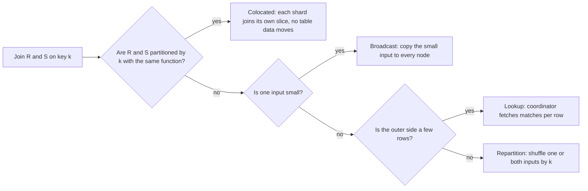
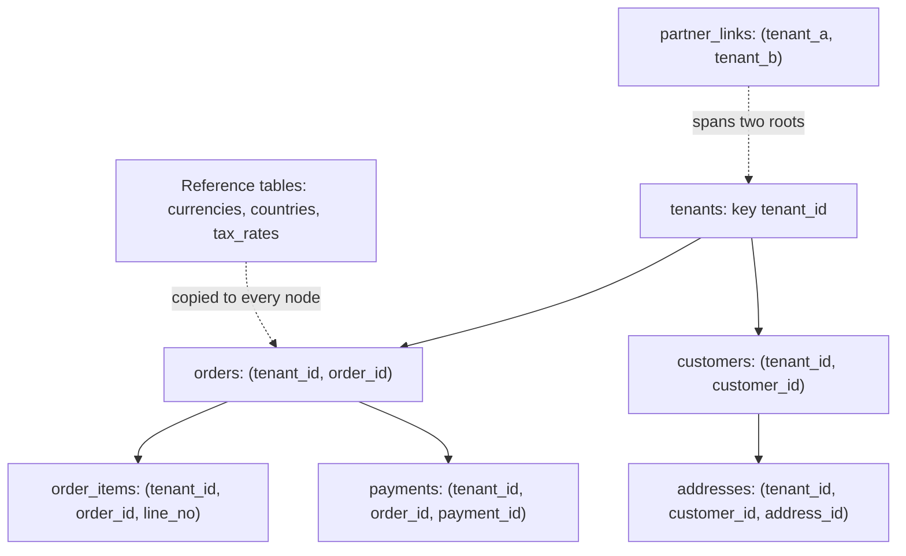
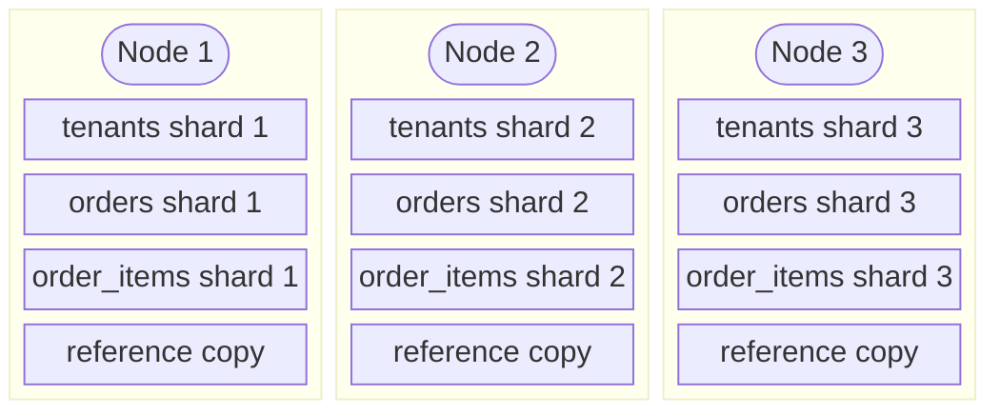
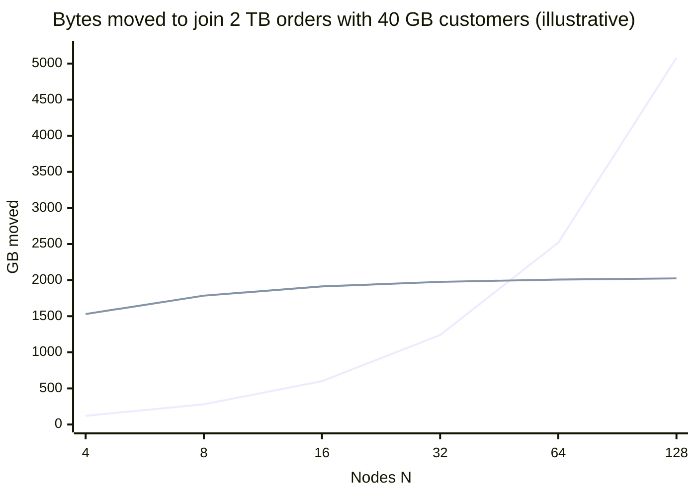
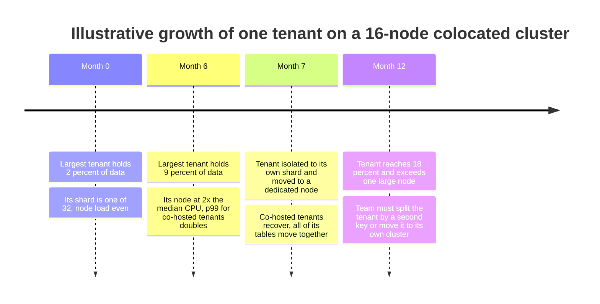

Colocation is the placement of rows from different tables that are read, joined, or written together on the same shard, by partitioning all of them with the same function of the same key. When two tables are colocated on a key and a query joins them with an equality on that key, every pair of matching rows already lives on one node, so each shard joins its own slice and the coordinator only concatenates results. The join moves no table data across the network, and a transaction confined to one key value touches one shard and needs no distributed commit.

Without colocation, a sharded database has three ways to join two large tables, and all of them move data. It can repartition one or both inputs by the join key over the network (a shuffle), copy the smaller input to every node (a broadcast), or have a coordinator look up matching rows shard by shard. The cost of each grows with table size, cluster size, or row count, and the same placement problem turns multi-table writes into [two-phase commit](/distributed-systems/en/coordination/distributed-transactions/two-phase-commit/). The [scaling-dilemma page](/distributed-systems/en/foundations/monoliths-to-distributed/scaling-dilemma/) shows how quickly this tax erodes scale-out when related keys are hashed independently.

The core trade-off is that colocation optimizes one access path at the expense of every other. Choosing a colocation key, typically a tenant, customer, or account identifier, makes every query and transaction scoped to one value of that key local, and makes every operation spanning many values of it a scatter or a shuffle. It also couples tables that would otherwise be independent: they must share a shard count, a hash function, and a key type, they must be moved together, and the heaviest value of the key, a whale tenant, becomes an indivisible unit of load. Colocation converts a network problem into a data-modeling commitment that is expensive to reverse.


*The four strategies a distributed planner chooses among for an equi-join, in order of preference. Only the first moves no input data.*

The order of the questions is the order of cost. A colocated join is decided by schema, before the query exists; the other three are decided at query time from size estimates, and each moves a different quantity: the broadcast moves the small table times the node count, the repartition moves most of the larger table once, and the lookup moves little data but pays a round trip, often to every shard, per outer row. The rest of this page is about earning the first branch and knowing what the other three cost when it is not available.

## Four Ways to Execute a Join Across Shards

Consider two tables, `R` of size `|R|` and `S` of size `|S|`, spread over `N` nodes, and an equi-join on column `k`. The planner's job is to bring every pair of rows with equal `k` to the same place. The strategies differ only in how they do it.

A colocated join (also called a partition-wise join) requires that both tables were placed by `k`, or by a column the join predicate equates to `k`, with the same placement function. Each node runs an ordinary single-node join, hash, merge, or nested loop, on its local shards, and the results are concatenated. The network carries only the query and the output. Citus calls the case where the predicate also fixes a single value of the distribution column a router query, sent to one shard as a plain PostgreSQL query.

A broadcast join copies `S` to every node that holds a shard of `R`, so each node can join its slice of `R` against the full `S`. It moves `|S| * (N - 1)` bytes and holds a full copy of `S` in memory or on disk on every node. A permanent broadcast is a reference table: a small table replicated to every node ahead of time, so joins against it become colocated with any distributed table. Reference tables pay at write time instead, because every write must reach every copy; Citus applies writes to reference tables with two-phase commit.

A repartition join reshuffles inputs by `k`. If `S` is already partitioned by `k` and `R` is not, only `R` moves (a single repartition), costing about `|R| * (N - 1) / N` bytes, because a uniformly hashed row stays local with probability `1 / N`. If neither is partitioned by `k`, both move (a dual repartition), about `(|R| + |S|) * (N - 1) / N`. The shuffle is the same mechanism as the shuffle of a batch job, covered in [MapReduce](/distributed-systems/en/data-processing/batch-processing/mapreduce/): every node sends to every other node, and the receiving side must buffer, sort, or spill what it receives.

A lookup join, which Vitess's query router (VTGate) executes as a nested loop, runs the outer side first and then, for each outer row, sends a query for the matching inner rows. It moves little data when the outer side is small and selective, but each outer row costs a round trip, and if the inner table is not partitioned by the lookup column, each of those queries is a scatter to every shard.

Comparing broadcast with repartition yields a threshold that depends on the cluster size. Broadcasting `S` beats repartitioning `R` alone when `|S| * (N - 1) < |R| * (N - 1) / N`, which simplifies to `|S| * N < |R|`, and beats a dual repartition when `|S| * (N - 1) < |R|`. The broadcast cost grows linearly with the node count while the shuffle cost is nearly constant in it, so a broadcast that was the right plan on a 16-node cluster can become the wrong plan on a 64-node cluster without any change to the data.

:::tip[Broadcast thresholds should scale with the cluster, not stay fixed]
Engines usually decide broadcast by an absolute size limit on the small side; Spark's `spark.sql.autoBroadcastJoinThreshold` defaults to 10 MB. The cost argument says the right limit is relative, roughly the large side divided by the node count. When a cluster grows severalfold, or when a "small" dimension table grows into gigabytes, re-check which joins are broadcast, because the network and memory cost of each one has grown with the node count while the plan did not change.
:::

### What Colocation Guarantees, and What It Does Not

For two tables placed by the same function on the same key, colocation guarantees that every row of `R` and every row of `S` with the same key value reside on the same shard, and therefore that any join, semi-join, anti-join, or outer join whose predicate includes equality on that key can be computed shard by shard with no data movement. The same holds for a `GROUP BY` that includes the key: each group is entirely on one shard, so the aggregate is final when it leaves the shard, without the partial-then-final aggregation a coordinator otherwise performs. A transaction that touches only rows with one key value touches one shard and can commit with that shard's local commit protocol.

It does not guarantee anything for a join on any other column, for a query that filters on a non-key column and must find its shard, or for an operation spanning key values: a report across all tenants is still a scatter across all shards, merely one without a shuffle. It does not guarantee balance: all rows of one key value are bound to one shard, so the largest value sets the floor on the largest shard, the effect analyzed on the [skew page](/distributed-systems/en/data-management/data-partitioning/skew-hot-spots/). And with key-order adjacency rather than a shared hash, described below, it guarantees locality only while the group fits within one range.

### Why the Union of Local Joins Is the Global Join

Write the placement of a row as `place(row) = f(d(row))`, where `d` extracts the distribution column and `f` maps a value to a shard. Suppose `R` and `S` use the same `f` and the join predicate implies `R.d = S.d`. Take any pair `(r, s)` that belongs in the result. The predicate holds, so `r.d = s.d`, so `f(r.d) = f(s.d)`: both rows are on the same shard `i`, and the local join on shard `i` emits the pair. Conversely, every pair a local join emits satisfies the predicate, because the local join evaluates the same predicate. No pair is emitted twice, because each row of `R` is stored on exactly one shard and a pair is emitted only where its `R` row is. The union of the `N` local results is therefore exactly the global result.

The argument is short, and every word in it is a precondition a real system must enforce. "The same `f`" means the same hash function applied to the same bytes, so the column types must hash identically; Citus places tables in the same implicit colocation group only when their distribution columns have the same type and the same shard count. It means the same number of shards, because `h mod 32` and `h mod 64` put the same key in different shard indexes. And it means that shard `i` of `R` and shard `i` of `S` are on the same node at all times, including while shards move. That last condition is a cluster-wide invariant, not a property of the hash, and it is the one that breaks in operations.

Range-partitioned stores colocate differently. Instead of a shared hash, they give child rows a primary key that begins with the parent's key, so that parent and children are adjacent in key order and fall in the same range. Spanner's interleaved tables do this physically: child rows are stored in key order directly after their parent row. Adjacency gives the same correctness argument only while the parent's whole hierarchy sits inside one range. A range splits on size and load, and when a hierarchy becomes too large or contains a hot row, the store must put a boundary inside it, after which some joins over that parent cross ranges. Hash colocation is a guarantee enforced by a function; key-prefix colocation is a strong tendency enforced by split policy. Engines treat the two differently: a hash-colocated join is planned as local, while an interleaved join is planned as a range scan that is usually, but not provably, served by one split.

## Designing Data Around a Colocation Key

Colocation works when the data has a root entity that most operations are scoped to. In a business application the root is usually the tenant or the customer account; in a social or messaging application it is often the user or the conversation; in a game, the match or the player. The design rule is that every table whose rows belong to a root carries the root's key as its distribution column, even when the logical model would not need it. An `order_items` row is logically identified by its order, but if `order_items` is partitioned by `order_id` and `orders` by `tenant_id`, the two are not colocated, and the most common join in the application is a shuffle. Adding `tenant_id` to `order_items`, and making it the first column of the primary key, `(tenant_id, order_id, line_no)`, is the change that makes the join local.


*A tenant-rooted schema. Solid edges are colocated relationships; every child carries the root key as the leading primary-key column. Dotted edges are the two escape hatches: replicated reference data and relationships that span roots.*

The tree shows the three kinds of tables a colocated design contains. Rooted tables, everything under `tenants`, carry `tenant_id` and are distributed by it, so any join along a solid edge, with `tenant_id` in the join predicate, is local. Reference tables hold small, slowly changing data shared by all roots and are copied to every node; joining a rooted table with a reference table is local everywhere. The third kind is the problem: a table whose rows relate two roots, such as a link between two tenants, a transfer between two accounts, or a follow edge between two users. No placement puts both endpoints on one shard. The options are to place the row under one endpoint and accept that queries from the other side are cross-shard; to store the row twice, once under each endpoint, and accept a cross-shard write (or an asynchronous second write) to keep the copies consistent; or to move the relationship into a separate structure, such as a [materialized view](/distributed-systems/en/microservice-patterns/data-management-patterns/materialized-view/) partitioned the other way.

The join predicate must include the colocation key, not only the logical foreign key. `orders JOIN order_items ON orders.order_id = order_items.order_id` is the same result as joining on `(tenant_id, order_id)` when order IDs are globally unique, but a planner that cannot prove that, and most cannot, will see an equi-join on a non-distribution column and plan a repartition. Application code and ORMs must be taught to include the root key in every join and every filter. This is the largest practical cost of a colocated design: the root key appears in every primary key, every foreign key, every index, and every query.


*Placement of a colocation group on three nodes. Shard i of every rooted table covers the same hash range and sits on the same node; reference tables have a full copy everywhere.*

The figure is the invariant a colocation-aware system maintains: the shards with the same index form a unit that is never split across nodes. Citus calls such a set of tables a colocation group and its documentation states the operational consequence directly: shards in the same group must be moved together, so a rebalancer moving shard 2 of `orders` also moves shard 2 of `tenants` and `order_items`, inside the same operation. This makes the unit of movement larger, and the documentation advises placing unrelated tables in separate groups so that their shards can move independently. The mechanics of the move itself, copy, catch-up, and fenced cutover, are those of [dynamic rebalancing](/distributed-systems/en/data-management/data-partitioning/dynamic-rebalancing/), applied to several shards with one cutover point; if one table's shard were cut over before another's, a local join on the source or destination would read one table's rows and miss the other's.

### Changing the Shard Count and Isolating Large Roots

Two operations break the "same function" precondition unless they are applied to the whole group. Changing the shard count changes `f`, so it must be applied to every table in the group at once; a table resharded alone leaves the group, and its joins with the rest become repartitions. Isolating a large root, moving one whale tenant to its own shard or node, changes `f` for one key value, and must again carry every rooted table's rows for that value. Citus provides this as `isolate_tenant_to_new_shard`, which splits out one distribution-column value, with an option to cascade to the colocated tables. Citus 12 added schema-based sharding, in which each PostgreSQL schema becomes a unit placed as a whole on one node: an explicit choice of "the root is a schema", trading the row-level spread of hash distribution for colocation without a root column in every table.

### Worked Example: A Multi-Tenant Order Store

Assume a multi-tenant commerce platform on 16 worker nodes, each with a 10 Gb/s network interface delivering about 1 GB/s of usable throughput. `orders` holds 2 TB, `order_items` 6 TB, `customers` 40 GB. All numbers in this section are illustrative.

Start with the analytic path: a nightly job joins `orders` with `order_items` for every tenant. In the original schema, `orders` is distributed by `tenant_id` and `order_items` by its own `item_id`, so the join is a single repartition of `order_items` by `(tenant_id, order_id)`: `6 TB * 15 / 16 = 5.625 TB` crosses the network. With perfect all-to-all bandwidth, 16 nodes each sending at 1 GB/s need about 352 seconds just for the transfer; in practice the receivers must also write or spill what they receive, and the job's network is shared with live traffic, so the shuffle realistically takes several times longer and saturates every interface while it runs. After adding `tenant_id` to `order_items` and colocating it with `orders`, the same join moves no input data; each node reads its own 0.5 TB of shards and the cluster's network is idle except for results.

Now the joins against `customers`, which is 40 GB and, suppose, distributed by `customer_id` rather than by tenant, joined to `orders` on `customer_id`. Broadcasting `customers` moves `40 GB * 15 = 600 GB`; repartitioning `orders` moves `2 TB * 15 / 16 = 1.875 TB`. Broadcast wins today. The crossover against a dual repartition is at `N - 1 = 2,000 / 40`, about 51 nodes, and against repartitioning `orders` alone it is at `N = 2,000 / 40 = 50` nodes.


*Rising line: broadcast of customers, 40 GB times (N - 1). Flat line: dual repartition of both tables, 2,040 GB times (N - 1) / N. The colocated plan, not drawn, moves zero bytes at every N.*

The chart makes the threshold argument concrete. The repartition line is almost flat because adding nodes only raises the fraction of rows that leave their node from 75% to 99%. The broadcast line is linear in the node count, and it crosses the repartition line between 32 and 64 nodes. A team that doubles its cluster from 32 to 64 nodes for capacity will find this join moving twice as many bytes per run, holding a 40 GB hash table in memory on 64 nodes instead of 32, and the planner, if it decides by a fixed size threshold, will keep choosing broadcast. Distributing `customers` by `tenant_id` and joining on `(tenant_id, customer_id)` removes the question.

The transactional path shows the second benefit. Placing an order writes one `orders` row, five `order_items` rows, and one `payments` row. Colocated, all seven rows are on one shard and the write is one local transaction: one round trip from the coordinator, one write-ahead log flush. With `order_items` on other shards, the seven rows would, if each row's placement were independent, touch on average `16 * (1 - (15/16)^7)`, about 5.8 distinct shards, and the commit needs two-phase commit: a prepare round with a durable flush on each participant, a commit round, and locks held across both. At an illustrative 0.5 ms per round trip and 1 ms per flush, that is roughly 3 ms of commit path instead of about 1.5 ms, and six shards' worth of lock and log capacity consumed instead of one.

Finally the interactive path: a page showing one order and its items. Colocated, it is one router query to one shard. With `order_items` sharded by `item_id` and no secondary index on `order_id`, a nested-loop executor fetches the order from one shard and then sends the items query to all 16 shards; if each shard has an illustrative 1% chance of a slow reply, the request is slow with probability `1 - 0.99^16`, about 15%, the fan-out arithmetic worked through on the [key-range page](/distributed-systems/en/data-management/data-partitioning/key-range-partitioning/). The cluster also executes 17 shard queries per page view instead of one, so this query type alone consumes 17 times the shard capacity.

## Colocation in Production Systems

Every partitioned store offers some way to colocate, and they differ in whether colocation is a guarantee, a tendency, or something the user must maintain by hand.

Citus, a PostgreSQL extension, makes colocation explicit. `create_distributed_table` takes a distribution column and a `colocate_with` argument; the default, `'default'`, puts the table in an implicit group with other tables of the same distribution column type and shard count, `'none'` opts out, and naming a table joins that table's group. Reference tables are created with `create_reference_table` and replicated to every node. Joins between colocated tables on the distribution column, and joins of any distributed table with a reference table, are pushed down to the shards. Non-colocated joins on large tables are repartition joins, and by default Citus refuses them with the error "the query contains a join that requires repartitioning" and a hint to set `citus.enable_repartition_joins`, which is a useful default: a query that would shuffle terabytes fails in development instead of saturating the network in production.

```sql
-- Root table, distributed by tenant
SELECT create_distributed_table('orders', 'tenant_id');
-- Same column type and shard count; join the group explicitly anyway
SELECT create_distributed_table('order_items', 'tenant_id',
                                colocate_with => 'orders');
-- Small shared data: one shard, copied to every worker
SELECT create_reference_table('currencies');
-- Verify: tables in one group share a colocation_id
SELECT table_name, colocation_id, distribution_column
FROM citus_tables ORDER BY colocation_id;
```

The explicit `colocate_with` matters even when the implicit rule would group the tables, because the implicit rule silently produces a different group if `citus.shard_count` was changed between the two `CREATE` statements. Checking `colocation_id` in `citus_tables` is the cheapest audit a team can run.

Vitess, the MySQL sharding layer, expresses colocation through the VSchema. Every sharded table has a primary vindex, a function from a column to a keyspace ID, and the keyspace ID decides the shard. Tables whose primary vindexes use the same function on columns that hold the same values map related rows to the same keyspace ID and therefore the same shard; VTGate pushes a join down to MySQL when it can prove both sides route to the same shard. Otherwise it executes the join itself as a nested loop, one right-hand query per left-hand row. Reference tables are declared with `type: reference` and are typically kept in every shard by a Materialize workflow from a source table; joins between a sharded table and a reference table run locally in each shard.

Spanner colocates by key prefix. A child table declared with `INTERLEAVE IN PARENT` must have a primary key that starts with all of the parent's key columns, and its rows are stored physically after the parent row; `ON DELETE CASCADE` makes the parent's deletion remove its children. Spanner later added `INTERLEAVE IN` without `PARENT`, which keeps the physical colocation but drops referential integrity, so child rows may exist without a parent. Hierarchies can be up to seven tables deep, and interleaving cannot be removed after the fact; changing it means recreating the table and migrating the data. Spanner's documentation states the locality guarantee in the weaker form described above: locality is preserved across splits provided a parent with its children stays under the split size limit and has no hot spot; otherwise Spanner adds split boundaries inside the hierarchy. The original Spanner paper describes the underlying unit as a directory, a set of contiguous keys sharing a common prefix, which is the unit of placement and movement.

```sql
CREATE TABLE Customers (
  CustomerId INT64 NOT NULL,
  Name       STRING(MAX)
) PRIMARY KEY (CustomerId);

CREATE TABLE Orders (
  CustomerId INT64 NOT NULL,   -- parent key repeated as the key prefix
  OrderId    INT64 NOT NULL,
  Total      NUMERIC
) PRIMARY KEY (CustomerId, OrderId),
  INTERLEAVE IN PARENT Customers ON DELETE CASCADE;
```

CockroachDB is the counterexample. It once offered the same feature, `INTERLEAVE IN PARENT`, deprecated it in v21.1 and removed it in v21.2. The removal notice itself is brief, but the structural reason is visible in the design. In a store that is already range-partitioned by primary key, a child table whose key begins with the parent's key is ordered by the parent key in its own index span, so a parent-scoped join is two short, ordered range reads that usually hit few ranges; interleaving rows of different tables into one span adds little to that while making scans of either table alone and schema changes harder. The lesson, as this page reads it, generalizes: in range-partitioned systems a shared key prefix delivers most of the benefit, and physical interleaving buys the rest at a cost that one major implementation decided was not worth keeping.

MongoDB has two forms. The strongest is the document itself: an order with its items embedded in one document is colocated by construction and updated atomically. Across collections, two collections sharded on the same field are not colocated, because each collection's ranges are split and balanced independently, so the range holding customer 42 in `orders` and the range holding customer 42 in `payments` can be on different shards and drift further with every balancer round. Since MongoDB 5.1, `$lookup` accepts a sharded collection in its `from` field, which makes such joins possible; it does not make them local.

:::caution[The same shard key is not the same placement]
In MongoDB, and in any store that balances each table or collection on its own, sharing a shard key between collections gives each of them the same kind of distribution, not the same placement. Joins and multi-collection transactions over one customer will still cross shards. Embed when the data is owned by one document, use zones with identical ranges on both collections when placement must be forced, or choose a system that moves colocated tables as a group.
:::

DynamoDB and Cassandra colocate within one partition key. All items with the same partition key form an item collection (in Cassandra, a partition) stored together and sorted by the sort key or clustering columns, so a "join" between an order and its items is a single query on one partition key with the item type encoded in the sort key, the single-table design described in [The DynamoDB Data Model](/distributed-systems/en/case-studies/dynamodb-cassandra/dynamodb-data-model/). Neither store joins across partition keys at all; the application denormalizes or queries twice. DynamoDB tables with a local secondary index additionally cap each item collection at 10 GB, a hard limit on the size of one colocated root.

Redis Cluster's hash tags are the same idea at the level of single keys: only the substring inside braces, such as `{user:42}`, is hashed, so keys sharing the tag land in the same slot and multi-key commands on them are allowed. The mechanism is described on the [hash partitioning page](/distributed-systems/en/data-management/data-partitioning/hash-partitioning/).

Stream and batch processors make colocation a contract between independently produced datasets. A Kafka Streams join between two topics requires them to be co-partitioned: the same number of partitions, the same key serialization, and the same partitioning function, so that records with the same key are in the same partition number of both topics and are processed by the same task. Kafka Streams verifies only the partition count, and fails with a "Topics not co-partitioned" error when it differs; it cannot see how producers serialized keys or which partitioner they used. A `GlobalKTable`, which every instance reads in full, is the broadcast alternative and does not need co-partitioning. In Spark, tables written with the same bucketing (same columns and number of buckets) can be joined without a shuffle, and Spark 3.3 added storage-partitioned joins, which let Data Source V2 sources such as table formats report their partitioning so the planner can skip the shuffle when both sides are compatible.

| System | Colocation mechanism | Strength of guarantee | Moved together | Non-colocated join | When to prefer |
|---|---|---|---|---|---|
| Citus | Shared distribution column, colocation groups, reference tables | Guaranteed by hash and group invariant | Yes, whole group | Repartition, off by default | Multi-tenant SaaS on PostgreSQL with a clear tenant key |
| Vitess | Same primary vindex function on related columns | Guaranteed per keyspace ID | Yes, shards are units | Nested loop in VTGate | MySQL fleets sharded by customer or user |
| Spanner | Key prefix, interleaved tables | Holds while a hierarchy fits one split | Hierarchy moves as a directory | Distributed join by the engine | Parent-child data with globally consistent transactions |
| CockroachDB | Key prefix only (interleaving removed in v21.2) | Adjacency in key order | Ranges move individually | Distributed join by the engine | Range-partitioned SQL where prefix locality suffices |
| MongoDB | Embedded documents; zones | Guaranteed within a document only | Collections balanced independently | `$lookup` across shards (5.1+) | Data owned by one document |
| DynamoDB, Cassandra | Shared partition key, sort key within it | Guaranteed within one partition key | The partition is the unit | Not supported; application joins | Access patterns known in advance and scoped to one key |
| Kafka Streams, Spark | Co-partitioned topics; bucketed or storage-partitioned tables | Contract between producers; partly checked | Not applicable | Repartition topic or shuffle | Joins over streams or tables produced by different teams |

:::note[Colocation, denormalization, and global indexes solve neighboring problems]
Colocation keeps related rows of different tables on one shard so that joins over one root stay local. Denormalization copies data into the row that needs it so that no join is needed, at the cost of keeping the copies consistent. A [global secondary index](/distributed-systems/en/data-management/data-partitioning/secondary-indexes/) lets a query on a non-key column find its shard instead of scattering, without changing where the base rows live. A schema that needs access by two unrelated roots usually combines colocation on one root with an index or a [materialized view](/distributed-systems/en/microservice-patterns/data-management-patterns/materialized-view/) for the other.
:::

## Failure Modes and Their Signatures

Colocation fails in two ways. Either the alignment invariant quietly stops holding, and queries that were local become shuffles or, in stream processing, return wrong results; or the invariant holds and the colocation key itself becomes the problem.

### Silent Loss of Colocation

Trigger: a table is created, recreated, or resharded without joining the existing group. Typical causes are a different shard-count setting at creation time, a distribution column declared with a different type (`bigint` in one table, `integer` in another), a migration tool that recreates a table with default options, or, in stores that balance tables independently, plain drift. Symptoms: a query whose text did not change becomes slower by one or two orders of magnitude after a deploy or migration; network throughput between workers rises; in Citus, queries that worked start failing with the repartition error, or succeed slowly if repartition joins were enabled globally. Detection: plan inspection in CI for the most frequent queries (`EXPLAIN` showing a repartition, broadcast, or scatter where a pushdown was expected), a periodic audit that every rooted table shares one colocation identifier (`colocation_id` in `citus_tables`, the vindex definitions in the Vitess VSchema), and inter-node bytes per query. Mitigation: re-distribute the stray table into the group, which in Citus means `update_distributed_table_colocation` when shard counts already match and a full redistribution when they do not. Recovery is a data move of the stray table's full size.

### Co-Partitioning Broken Between Streams

Trigger: two topics joined by a stream processor stop placing equal keys at equal partition numbers while their partition counts still match. One producer changes how it serializes keys, a team switches one producer to a client library with a different default partitioner, or partitions are added to both topics. The last case is subtle: after an increase, the default Kafka partitioner sends new records to `hash(key) mod N_new` while the table side's existing state for that key was built from the partition it hashed to under `N_old`.

```mermaid
sequenceDiagram
    autonumber
    participant PO as Orders producer
    participant PC as Customers producer
    participant TO as orders topic, 12 partitions
    participant TC as customers topic, 12 partitions
    participant ST as Streams task for partition 7
    PC->>TC: customer 42, key as string "42", lands in partition 7
    TC->>ST: Table state for customer 42 kept by task 7
    PO->>TO: order for 42, key as string "42", partition 7
    TO->>ST: Join finds customer 42, enriched order emitted
    rect rgb(70, 40, 40)
    Note over PO: Deploy changes the key serializer to 8-byte integer
    PO->>TO: order for 42, key bytes differ, lands in partition 3
    TO->>ST: Task 3 has no customer 42, join emits nothing or a null side
    end
    Note over ST: Partition counts still match, startup check passes
```


*A key-serialization change on one producer breaks co-partitioning without changing partition counts. Topic sizes and partition numbers are illustrative.*

Steps 1 to 4 are the working contract: both producers serialize the key the same way, hash the same bytes, and the record and the table entry meet in task 7. In step 5 the orders producer's bytes for the same logical key change, so the hash and the partition change, while the customers topic keeps its old placement. From step 6 the join for this key runs in a task that holds no matching table state. Nothing fails: the inner join emits nothing for those orders, a left join emits them with an empty customer side, and the only check Kafka Streams performs, equal partition counts, still passes. Symptoms are a drop in the join's output rate relative to its input rate, or a rise in null-side results, beginning at a producer deploy. Detection: track the ratio of joined to unjoined records per join, and alert on a step change; compare key bytes produced by each producer in contract tests. Mitigation: revert the producer, or insert an explicit repartition step (`selectKey` or `repartition` in Kafka Streams) that re-keys both inputs with one serializer and one partitioner inside the application; this costs an extra topic and a network hop but makes co-partitioning the application's own invariant instead of the producers'. Recovery requires reprocessing the affected window, because the missed joins were never emitted.

:::danger[Broken co-partitioning drops results without raising an error]
A stream join whose inputs are not co-partitioned does not fail; it produces fewer or emptier results, and downstream systems record those results as complete. Treat key serializers and partitioners of joined topics as part of a shared schema contract, enforced in CI, and monitor the join's match rate as a correctness signal rather than a performance one.
:::

### The Whale Root

Trigger: one value of the colocation key grows until its rows dominate a shard. In a multi-tenant system this is the largest customer; in a user-rooted system, a celebrity account. Because colocation binds all of the root's tables to one shard, the root can be moved but not split without giving up colocation for it. Symptoms: one node runs hot on CPU, disk, and lock waits while the cluster average is healthy; the tenant's own queries slow first, then every tenant sharing the node. Detection: per-shard size and query time, per-tenant query counts and bytes (Citus exposes per-tenant statistics in `citus_stat_tenants` in recent versions; elsewhere, tag queries with the tenant and aggregate), and the share of the largest root in total data.


*A hypothetical timeline of a whale tenant; not a real incident.*

The timeline shows why the response has stages. Isolating the tenant to its own shard and node, at month 7, preserves colocation and removes the collateral damage, because the problem is now one tenant on one machine rather than many tenants sharing a hot one. It does not remove the ceiling: when the tenant outgrows the largest node, colocation for that tenant must be given up, by sub-partitioning its data on a second key such as region or account, with cross-shard joins inside the tenant, or by moving it to a dedicated cluster. Mitigation is planning: track the largest root's share of total capacity, decide before it reaches a large fraction of one node, and keep the isolation procedure tested. The general remedies for heavy keys are on the [skew page](/distributed-systems/en/data-management/data-partitioning/skew-hot-spots/).

### Cross-Root Creep

Trigger: the product grows features that do not belong to one root: cross-tenant search, admin dashboards, marketplaces where buyers and sellers are different roots, analytics over all customers. Each is a scatter or a shuffle in a colocated schema. Symptoms: the share of multi-shard queries rises release by release; coordinator CPU climbs; tail latency of the new features tracks the slowest shard, while router queries stay fast. Detection: classify queries by executor or plan type and track the multi-shard share and its cost, for example router versus multi-shard queries in Citus's `citus_stat_statements`, or the plan opcodes (single-shard versus scatter) in Vitess's query plans and `vtexplain`. Mitigation: move cross-root reads to a separate store fed by [change data capture](/distributed-systems/en/data-processing/hybrid-architectures/change-data-capture/), add a global index for the lookups that need one, and keep the transactional path rooted. The worst response is changing the colocation key to fit the new feature, which moves the scatter to the old features instead.

### Broadcast Plans That Stop Fitting

Trigger: a join planned as a broadcast keeps that plan while the broadcast side grows or the cluster grows, or table statistics underestimate the small side. Symptoms: memory pressure or out-of-memory failures on executors or the driver, jobs that slow down after a cluster expansion, network peaks at job start. Detection: the size of broadcast relations in query plans and job metrics, compared with the large side divided by the node count. Mitigation: refresh statistics, set the threshold from the relative rule rather than an absolute size, or colocate the dimension table so the join needs neither strategy.

### Failure Signatures at a Glance

| Failure | Symptom from outside | Detection signal | Mitigation |
|---|---|---|---|
| Silent loss of colocation | Unchanged query becomes far slower after a migration | Plan shows repartition or scatter; colocation IDs differ | Redistribute the stray table into the group |
| Broken co-partitioning | Stream join emits fewer or null-side results | Join match rate drops at a producer deploy | Revert, or re-key both inputs inside the application |
| Whale root | One node hot, co-hosted tenants slow | Per-shard and per-tenant load; largest root's share | Isolate the root, then sub-partition or move it to its own cluster |
| Cross-root creep | New features slow, coordinator CPU rises | Multi-shard share of queries and of cost | Separate read store, global index, keep writes rooted |
| Broadcast that stops fitting | Memory failures, slower jobs after expansion | Broadcast size versus large side divided by N | Relative threshold, fresh statistics, colocate the dimension |
| Oversized interleaved hierarchy | Parent-scoped queries touch several splits | Rows and bytes per root; split count per root | Bound children per parent, move unbounded children to their own table |

The last row is specific to key-prefix colocation: when one parent accumulates an unbounded number of children, such as every event a customer ever produced interleaved under the customer row, the store eventually splits inside the hierarchy and parent-scoped queries stop being single-split. Bounded children belong under the parent; unbounded ones belong in their own table keyed by the parent key plus time, accepting that history queries span ranges.

## Choosing a Colocation Key, and When Not To

Colocate when three conditions hold. There is a root entity to which most transactions and most latency-sensitive queries are scoped, which can be checked by measuring the fraction of statements whose predicates fix one value of the candidate key; when that fraction is high, colocation turns them into single-shard operations. The root has many values and none of them is expected to approach the capacity of one node within the planning horizon. And the schema can carry the root key in every primary key and every join predicate, which is cheapest when designed in from the start and expensive to retrofit into an existing schema and its ORM layer. Multi-tenant business applications meet these conditions so often that Citus and Vitess were largely shaped by them.

Use reference tables for small, rarely written data that every root joins against: currencies, countries, plans, feature definitions. Keep them small, because every write reaches every node, and keep their write rate low, because each write is a distributed transaction.

Do not colocate when the dominant access patterns are scoped to different roots, such as a marketplace queried equally by buyer and by seller; colocating on one makes the other side's queries scatters, and a store-per-access-pattern design with change data capture between them is usually better. Do not colocate on a key whose largest value will outgrow a node, unless you have a planned exit for that value. Do not colocate tables that are rarely joined merely because they share a key: each table added to a group enlarges every move and couples every reshard, and the Citus documentation recommends separate groups for unrelated tables for exactly this reason. Do not pick a colocation key by its cardinality alone; a high-cardinality key that no query filters on, such as a random row identifier, spreads load perfectly and makes every join a shuffle. And do not rely on colocation for correctness across systems you do not control, such as topics written by other teams, unless the contract is checked: re-keying inside your own application is cheaper than a silent loss of results.

A useful final test is to write down, for the ten most frequent queries and the five most important transactions, the shard count each touches under the candidate key. If almost all are one, the key is right. If the important ones are many, no amount of tuning the join strategies will recover what the placement gave away.

## Further Reading

- Umur Cubukcu, Ozgun Erdogan, Sumedh Pathak, Sudhakar Sannakkayala, and Marco Slot, *Citus: Distributed PostgreSQL for Data-Intensive Applications*, ACM SIGMOD, 2021.
- James C. Corbett et al., *Spanner: Google's Globally-Distributed Database*, USENIX OSDI, 2012.
- Jason Baker et al., *Megastore: Providing Scalable, Highly Available Storage for Interactive Services*, CIDR, 2011.
- Citus Data, *Creating and Modifying Distributed Objects (DDL)* and *Table Co-Location*, Citus documentation, continuously updated.
- Google Cloud, *Schemas overview* (interleaved tables), Spanner documentation, continuously updated.
- Martin Kleppmann, *Designing Data-Intensive Applications*, O'Reilly Media, 2017 (chapters 6 and 10).
