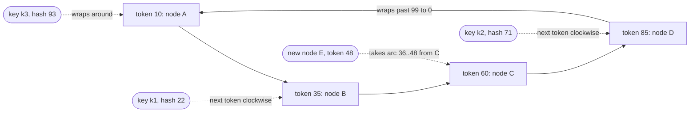
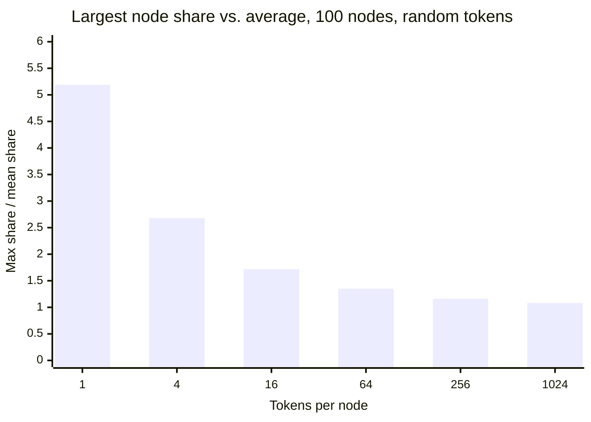
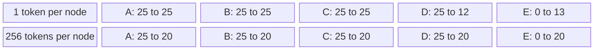
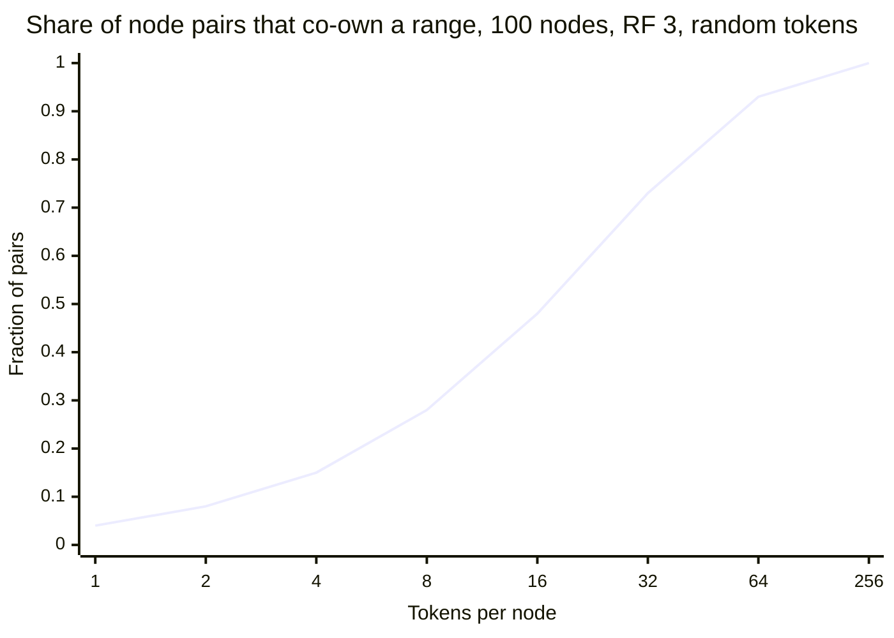
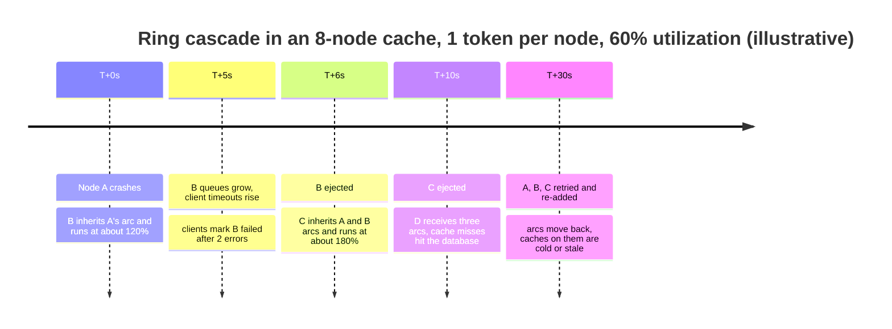
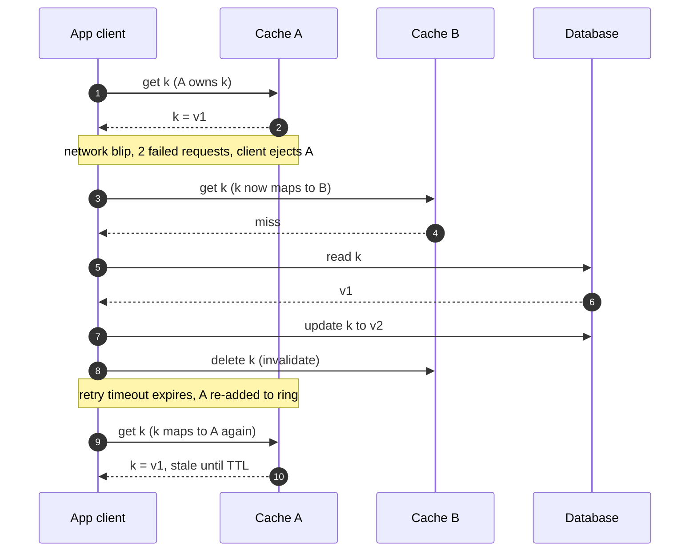

Consistent hashing maps keys and nodes into the same hash space, arranged as a circle, and assigns each key to the first node found by walking clockwise from the key's hash. Because a key's owner depends only on which node points lie between the key and the next point, adding or removing a node changes the owner only of the keys on the arcs adjacent to that node's points; every other key keeps its owner. With `N` nodes the expected share of keys that moves on a single join or leave is about `1 / N`, which is the minimum any balanced assignment can achieve, because the joining node must receive that share and the leaving node must give it away.

The problem it solves is the one created by `hash(key) mod N`. Modulo placement balances well but ties every key's address to the node count, so growing from 10 to 11 nodes moves 91% of keys, as derived in [Hash Partitioning](/distributed-systems/en/data-management/data-partitioning/hash-partitioning/). For a cache that is a near-total cold start; for a store it is a copy of almost all data, coordinated across all clients at once. Consistent hashing was introduced by Karger and colleagues in 1997 for exactly the cache case, web caches whose membership changed constantly and whose clients could not agree on a single view of it, and it was later adopted by Amazon's Dynamo and the stores derived from it (Cassandra, Riak, ScyllaDB before tablets, Voldemort) as their placement function.

The core trade-off is between balance and the amount of state and coordination per node. With one point per node, the ring guarantees minimal movement but delivers ownership that is wildly uneven: on a 100-node ring the largest node owns about five times the average. Balance is bought by giving each node many points, the virtual nodes (vnodes) of the title, or by choosing points deliberately instead of at random. More points mean a larger ring to store and gossip, more independent ranges to stream and repair, and, less obviously, many more pairs of nodes that share a replica set, which raises the probability that any two simultaneous failures make some data unavailable. Every production configuration of consistent hashing is a position on that curve.

## The Ring: Ownership by Successor

Take a hash function that maps strings to integers in `[0, 2^64)` and treat the range as a circle, so that the largest value is followed by zero. Each node is hashed onto the circle, typically by hashing its name or address, and the resulting position is called its token. A key is hashed with the same function, and its owner is the node whose token is the first one at or after the key's position, wrapping around at the top. Equivalently, each node owns the arc that ends at its token and begins just after the previous token on the circle.


*A ring with hash space 0 to 99 and four nodes with one token each. Solid arrows are the clockwise order of tokens; dotted arrows show each key's owner and the effect of node E joining at 48.*

Follow the dotted arrows. Key k1 at 22 walks clockwise and meets B's token at 35, so B owns it; k3 at 93 passes the top of the space and meets A at 10. When node E joins with token 48, it splits C's arc: keys between 36 and 48 now meet E before C and move to E, while keys between 49 and 60 still meet C. No key moves between A, B, C, and D, and the only donor is C. That last property is the ring's correctness argument in miniature, and also its first weakness: one donor, and whatever share of the space the token happened to cut off.

### Why Only the Adjacent Arc Moves

The minimal-movement guarantee follows from the definition of the owner as a successor. For any key `k`, `owner(k)` is the smallest token greater than or equal to `h(k)`, modulo the wrap. Inserting a new token `t` changes the successor of exactly those hash values that lie between the previous token `pred(t)` and `t`: for them `t` is now the nearest token clockwise, and for every other value the nearest token is unchanged because `t` is not between the value and its old successor. So the keys that move are precisely those in `(pred(t), t]`, and they move to the new node, never between old nodes. Removing a token is the mirror image: its arc is absorbed by its successor, and nothing else changes. Karger's paper calls this property monotonicity: when nodes are added, keys move only from old nodes to new ones.

The property holds for every client independently. Any two parties with the same hash function and the same set of tokens compute the same owner without communicating, and two parties whose token sets differ by one node disagree on only that node's arcs. The latter was the point of the original paper: web clients with slightly different views of the cache fleet still sent most requests for an object to the same cache, so the fleet as a whole stored few duplicate copies. In a database, by contrast, disagreement on any key is a correctness problem, which is why stores that use the ring also distribute and version the ring itself.

```text
# Ring lookup and replica placement (tokens sorted ascending)
lookup(key):
    h = hash(key)
    i = first index with tokens[i].value >= h     # binary search
    if i == len(tokens): i = 0                     # wrap around
    return i

replicas(key, RF):
    i = lookup(key); owners = []
    while len(owners) < RF:                        # walk clockwise
        n = tokens[i].node
        if n not in owners: owners.append(n)       # skip repeat vnodes of one node
        i = (i + 1) mod len(tokens)
    return owners
```

Lookup is a binary search over a sorted array of tokens, `O(log T)` for `T` tokens: about 15 comparisons for 25,600 tokens, which is 100 nodes with 256 tokens each, an array of a few hundred kilobytes. The second function is the replication rule introduced by Dynamo: a key's replicas are the first `RF` distinct nodes encountered clockwise from its hash, called its preference list. The `not in owners` check matters once nodes have several tokens; without it, two adjacent tokens of the same node would put two replicas on one machine.

### What the Ring Guarantees and What It Does Not

For a fixed token set and hash function, the ring guarantees a single owner and a single preference list per key, computable by anyone holding the token set. Across a single membership change it guarantees that only keys on the arcs adjacent to the changed tokens move, and that they move to or from the changed node only. With many tokens per node, the expected share of keys a node owns is proportional to its number of tokens.

It does not guarantee balance with few tokens, as the next section shows. It does not balance load, only hash space: a heavy key still has one owner, a problem covered in [Skew and Hot-Spot Problems](/distributed-systems/en/data-management/data-partitioning/skew-hot-spots/). It does not move data; it only says where data should be, and the streaming, dual-ownership window, and cutover that make a join safe belong to [Dynamic Rebalancing](/distributed-systems/en/data-management/data-partitioning/dynamic-rebalancing/). It does not decide when a node is a member: a ring that drops a node the moment a health check fails turns every transient network fault into a remapping, the failure mode analyzed later on this page. And it does not provide agreement on the token set; that comes from a separate mechanism, gossip in Cassandra and Riak, configuration in client-side cache libraries, or a consensus-backed metadata store.

## Virtual Nodes: Buying Balance with Points

With one random token per node, a node's share of the ring is the length of the gap between its token and the previous one. The gaps between `N` random points on a circle are far from equal: their distribution is close to exponential, so some gaps are tiny and a few are several times the mean. The expected largest gap among `N` random points is about `H_N / N`, where `H_N` is the `N`-th harmonic number, roughly `ln N + 0.58`. On 100 nodes that is 5.2 times the average share, and the smallest node owns almost nothing.

Virtual nodes give each physical node `v` tokens instead of one, so its share becomes the sum of `v` independent gaps. Sums of independent gaps concentrate: the relative standard deviation of a node's share falls as `1 / sqrt(v)`, and the largest share among `N` nodes is approximately `1 + sqrt(2 ln N / v)` times the average when `v` is large. The `ln N` term means that a bigger cluster needs more tokens per node for the same worst case, because there are more nodes to be unlucky.


*Mean of the largest node's ownership divided by the average, from a simulation of random token placement run for this page (200 trials per point, 50 for the two largest). With 10 nodes instead of 100 the same points give 2.86, 1.88, 1.42, 1.20, 1.09, and 1.05.*

The chart is the reason Cassandra defaulted to 256 random tokens per node from version 2.0 onward: at that count the hottest of 100 nodes owns about 16% more than average, and the 95th-percentile draw about 21% more. Read leftward and the cost of few random tokens becomes visible. Sixteen random tokens leave the hottest node 72% above average, which means provisioning the whole cluster for 1.7 times its average load. The relationship also explains why the curve flattens: going from 256 to 1,024 tokens quadruples the ring for a gain of 8 percentage points.

### Joins, Leaves, and Who Pays

Virtual nodes change more than balance. They change how many nodes participate when membership changes, and that decides how long a join takes and how a failure's load is absorbed.


*Percent of the hash space owned by each node before and after node E joins a four-node ring with equal shares. Top row: E's single token lands inside D's arc and takes part of it, so D is the only donor. Bottom row: E's tokens fall in arcs of every node, so each donates a fifth of its share in parallel. Values are illustrative.*

With one token per node, a joining node takes part of exactly one arc, so exactly one existing node gives up data and only that node is relieved; the others keep their load. The joiner's share is whatever its random position happens to cut, so a join can leave the cluster less balanced than before. With `v` tokens per node, the joiner's tokens land in arcs belonging to essentially every existing node, so each donates about `1 / (N + 1)` of its data, all nodes stream in parallel, and every node is relieved. A leave or a failure is symmetric: with one token, the dead node's whole arc falls on its single successor; with many tokens, its arcs are spread across all survivors.

### Worked Example: Growing 12 Nodes to 13

Assume a cluster of 12 nodes holding 24 TB of owned data, 2 TB per node on average, and that any single node can send or receive data at 250 MB/s without hurting foreground latency. All numbers are illustrative; real streaming throughput depends on disks, compaction, and the store's throttles.

The new node should end with `24 / 13 = 1.85` TB, the share it must hold for balance. Under `hash mod N` the owner changes for a key unless its hash residues modulo 12 and 13 agree, so `12 / 13 = 92%` of keys, about 22 TB, change node, and the mapping changes for all keys at once.

With one random token per node, the expected data moved is the same 1.85 TB, but it comes from a single donor. At 250 MB/s that is `1.85e12 / 2.5e8 = 7,400` seconds, about two hours during which the donor's disk and network carry the stream on top of its normal traffic. The amount is also a lottery: the joiner lands in an arc chosen with probability proportional to its length and takes a uniformly random part of it, so the new node may own almost nothing or more than twice its fair share, and the eleven other nodes are not relieved at all. Operators of single-token clusters avoided this by computing tokens by hand and doubling the cluster, so that each new token bisected an existing arc exactly.

With 256 tokens per node, the joiner's 256 tokens fall in arcs belonging to all 12 nodes. Each donates about `2 TB / 13 = 154` GB. The senders are no longer the bottleneck; the joiner's ingest is. At the same 250 MB/s per node the joiner needs the same two hours, but if the joiner can absorb 1 GB/s from parallel streams the copy takes `1.85e12 / 1e9 = 1,850` seconds, about 31 minutes, while each donor sends at a quarter of its budget. Afterward every node owns close to `1 / 13` of the data, within the spread the chart above predicts.

Now remove a node instead. With one token, its successor inherits its whole arc and, if arcs were equal, doubles its data and its request rate: from 2 TB to 4 TB, and from, say, 60% to 120% CPU. With 256 tokens, each of the 11 survivors absorbs about `1 / 11` of the lost node's share, a 9% increase, from 60% to about 65%. The first case is the trigger of the cascade shown in the failure section; the second is the main operational argument for vnodes.

### Choosing Tokens Instead of Drawing Them

Random tokens need hundreds per node to be balanced. The alternative is to choose tokens so that the arcs are balanced by construction, and production systems have converged on two ways of doing that.

The Dynamo paper describes three strategies it evaluated. In the first, each node has `T` random tokens and partitions are the arcs between them, the scheme described so far. Its operational problem was not balance but data handling: arcs change boundaries whenever a node joins, so bootstrapping a node means scanning donors' local stores to find the keys in the stolen arcs, and archiving a snapshot of the key space means scanning every node. The third strategy, which Amazon adopted, divides the hash space into `Q` equal, fixed partitions and gives each of `S` nodes `Q / S` of them, preserving that ratio on every membership change by moving whole partitions. Because partition boundaries never change, each partition can be stored as its own file and moved by copying it, without scanning. This is no longer a ring with random points; it is the fixed-slot scheme described in [Hash Partitioning](/distributed-systems/en/data-management/data-partitioning/hash-partitioning/), with the ring surviving only as the order used to build preference lists. Riak adopted the same design: a ring of a fixed number of equal partitions, 64 by default (`ring_creation_size`), claimed by nodes, and its documentation asks for the size to be set before the cluster receives data.

Cassandra took the other path and kept per-node tokens but stopped choosing them at random. Version 3.0 added a token allocation algorithm (CASSANDRA-7032) that, when a node joins, picks its tokens to minimize the variance of replicated ownership given the tokens already present and the replication factor. Cassandra 4.0 changed the defaults accordingly: `num_tokens` from 256 to 16 (CASSANDRA-13701), with `allocate_tokens_for_local_replication_factor` set to 3 (CASSANDRA-15260) so that the allocator is active for new clusters. Sixteen chosen tokens give balance that 16 random tokens cannot, which is the point of the chart above: the curve describes random placement, not allocated placement.

## Replica Placement and the Hidden Cost of Many Vnodes

Replicas are placed by the walk shown in the pseudocode: the first `RF` distinct nodes clockwise from the key. Production stores refine the walk with topology. Cassandra's `NetworkTopologyStrategy` walks the ring separately for each data center and prefers nodes in racks it has not yet used, so that the `RF` replicas of a range land in distinct racks when there are at least `RF` racks. The quorum arithmetic that decides how many of those replicas a read or write must reach is covered in [Leaderless Replication](/distributed-systems/en/data-management/replication/leaderless-replication/); this page concerns which nodes form each replica set.

Each distinct replica set is a set of nodes whose joint failure makes some range unavailable. With one token per node and `RF = 3`, the replica sets are consecutive triples on the ring, so each node shares a range with only its two predecessors and two successors. With many tokens per node, each node's tokens sit next to tokens of almost every other node, so the number of distinct replica sets grows toward the number of possible triples. The consequence appears when two nodes are down at the same time, a routine event during a rolling restart that overlaps a single host failure.


*Fraction of the 4,950 node pairs that appear together in at least one replica set, from a simulation run for this page (5 rings per point). For a pair in the set, losing both nodes makes at least one range lose its QUORUM at RF 3.*

With one token per node, two simultaneous failures among 100 nodes break QUORUM for some range in 4% of cases. With 16 random tokens, 48%. With 256, essentially every pair co-owns a range, so any two failures make some data unavailable at QUORUM. The Last Pickle's test of a six-node cluster with three tokens per node found that losing two nodes made a third of the data unavailable at `LOCAL_QUORUM`; the larger the token count, the more certain such an outcome becomes, though each event covers less data.

The expected amount of unavailable data does not depend on the token count at all. Each range's replica set contains 3 of the 4,950 possible pairs, so for any placement with distinct replicas a random pair of failures takes out, on average, `3 / 4,950 = 0.06%` of the ranges. Vnodes redistribute that expectation: one token per node makes the event rare and large (when the two failed nodes are neighbors, about 1% to 2% of the key space loses quorum), and 256 tokens make it nearly certain and small. Which is worse depends on how requests touch data. A workload whose operations span many keys, a scan, a multi-key batch, a fan-out read, fails if any key it touches is unavailable, so for it the frequent small outage is effectively a full outage. Cidon and colleagues made the same observation for data loss in replicated storage and proposed limiting the number of distinct replica sets, an approach called copysets.

Rack-aware placement removes the dependence for the commonest correlated failures. If replicas always span `RF` racks, any number of failures confined to one rack leave every range with `RF - 1` replicas, and rolling restarts can proceed rack by rack. The co-failure risk then applies only to failures in different racks, which is the reason to configure racks equal to the replication factor even on clusters that would otherwise not need them.

:::tip[Restart by rack, not by node]
With many tokens per node, a rolling restart that takes down one node at a time in arbitrary order is safe only until a second node fails anywhere. If replicas span racks, restarting a whole rack at once keeps every range at `RF - 1` replicas and leaves a full replica's margin for an unrelated failure in another rack. Check `nodetool status` for rack assignment before relying on it.
:::

## Variants and Production Implementations

The ring is one member of a family of placement functions that share the minimal-movement goal and differ in lookup cost, balance, state, and what kinds of membership change they support. Several of them are used primarily for request routing and are explained, with their own worked examples, in [Load Balancing Algorithms](/distributed-systems/en/communication/load-balancing/algorithms/): rendezvous hashing, which scores every node per key and picks the highest; Maglev, which fills a fixed prime-sized table by letting nodes claim slots in turn; and consistent hashing with bounded loads, which caps each node at a multiple of the average and spills the excess clockwise. Two variants not covered there matter for data placement.

Jump consistent hash, published by Lamping and Veach of Google in 2014, computes a bucket number from a 64-bit key in a loop of a few lines, with no stored state and an expected loop count below `ln n + 1` for `n` buckets. Its balance is essentially perfect, and the authors measured it as several times faster than a ring. Its constraint is structural: buckets are numbered `0` to `n - 1`, so buckets can be added or removed only at the end. That fits a store that maps keys to a growing number of logical shards, each of which is a replicated group, and does not fit a cache fleet in which any server can fail. Multi-probe consistent hashing, proposed by Appleton and O'Reilly in 2015, keeps one point per node and instead hashes each key several times, assigning it to the node with the closest point over all probes; it trades extra hashing per lookup for ring memory.

| Scheme | Lookup cost | State | Balance | Supported changes | When to prefer |
|---|---|---|---|---|---|
| Ring, 1 random token per node | `O(log N)` | `N` tokens | Poor: max about `H_N` times mean | Any node joins or leaves | Almost never; hand-assigned tokens on small static clusters |
| Ring, many random vnodes | `O(log Nv)` | `N * v` tokens | Good at `v` in the hundreds | Any node | Peer-to-peer stores and client-side caches without central metadata |
| Ring, allocated tokens | `O(log Nv)` | `N * v` tokens plus allocator | Good at `v` around 16 | Any node; allocator runs on join | Cassandra 4.0 and later; fewer ranges to repair and stream |
| Fixed equal partitions (Dynamo strategy 3, Riak) | `O(1)` partition, then table | `Q` partition owners | Near-even partition counts | Any node; `Q` fixed | Stores that move whole partition files and want simple snapshots |
| Jump consistent hash | `O(log n)`, no memory | Bucket count only | Near-perfect | Add or remove last bucket only | Mapping keys to numbered, replicated shards |
| Rendezvous (HRW) | `O(N)` per key | Node list | Statistical, no vnodes needed | Any node, exactly minimal movement | Small node sets, placement where `N` hashes per key are affordable |
| Maglev table | `O(1)` | Table of prime size `M` | Near-even slot counts | Any node, slightly above minimal movement | High-rate request routing |
| Bounded loads on a ring | `O(log Nv)` plus probing | Ring plus per-node load | Load capped at `c` times mean | Any node | Caches where hot keys must spill rather than overload |

The table separates two families that are often confused. The ring variants and rendezvous place keys on arbitrary named nodes and tolerate any node joining or leaving. Jump hash and fixed partitions place keys on numbered logical units whose count changes rarely, and leave the mapping of units to machines to a separate, mutable table. The second family is what most modern stores use, because it decouples the stable question (which unit holds the key) from the frequently changing one (which machine holds the unit).

### How Real Systems Use the Ring

Cassandra stores tokens per node, gossips them to every node, and lets coordinators and token-aware drivers compute preference lists locally with the `Murmur3Partitioner` token space. Its token count is fixed when a node first bootstraps; changing it later means adding a new data center with the new setting and migrating to it, so a cluster's 2.x-era 256-token layout persists until such a migration. The full ring mechanics of Cassandra, including token metadata and pending ranges during bootstrap, are the subject of the case study [Cassandra's Consistent Hashing Ring](/distributed-systems/en/case-studies/dynamodb-cassandra/cassandra-hashing-ring/).

Memcached clients popularized the ketama scheme, from the libketama library: each server's `ip:port-n` string for `n` from 0 to 39 is hashed with MD5, and each 16-byte digest yields four 32-bit points, for 160 points per server, scaled by weight in weighted variants. Because the server's address is part of the hashed string, re-addressing a server moves all of its points; libraries that hash a stable name instead avoid that. Twemproxy offers `distribution: ketama` with a choice of hash functions, and its `auto_eject_hosts` option (off by default) removes a server from the ring after `server_failure_limit` consecutive failures (2 by default) and retries it after `server_retry_timeout` (30 seconds by default), a convenient behavior with a sharp edge examined below. Envoy's `RING_HASH` load balancer builds a ring between `minimum_ring_size` (1,024 entries by default) and `maximum_ring_size` (8M) using xxHash, scaling each host's entries by weight.

ScyllaDB used the same token ring as Cassandra until version 6.0 made tablets the default for new keyspaces: per-table units of data that are split, merged, and migrated individually by a load balancer, much as key-range systems do. DynamoDB, despite descending from Dynamo, places data by hash ranges that split for size and throughput rather than by a membership ring. Both moves reflect the same limit of the ring: it assigns hash space, not load or bytes, and any adjustment to a hot or large range means changing tokens for the whole node.

### Configuration That Matters

The settings that decide behavior are few, and the most consequential one is fixed at first boot.

```yaml
# cassandra.yaml (4.0+ defaults shown); applies when a node first bootstraps
num_tokens: 16                                    # vnodes per node; cannot change in place later
allocate_tokens_for_local_replication_factor: 3   # choose tokens for balance at this RF
partitioner: org.apache.cassandra.dht.Murmur3Partitioner
```

The token count trades balance against the number of ranges. With random tokens, balance needs hundreds; with an allocator, 8 to 16 suffice for most clusters. Fewer ranges mean fewer repair sessions and streaming sessions per node and, as shown above, fewer node pairs whose joint failure loses quorum. The replication factor given to the allocator must match the keyspaces that hold most of the data, because the allocator balances replicated ownership, not raw token ownership. In client-side rings, the equivalent decisions are the points per server, the hash function, the string that is hashed for each server, and the ordering of the server list; every client must use identical values, or keys silently land on different servers. Weights should be expressed as point counts proportional to capacity, so that a node with twice the memory holds twice the arcs.

:::caution[A token layout is a data format]
Tokens decide where existing data lives. Changing `num_tokens` on a node that already holds data, switching partitioners, or changing the hash function or per-server string in a client-side ring does not rebalance anything; it relocates ownership while the data stays where it was. In a store that means reads that find nothing on the new owners; in a cache it means a fleet-wide cold start. Treat token settings and client hash configuration as part of the on-disk format, and change them only by migrating to a new cluster or data center.
:::

## Failure Modes and Their Signatures

The ring's failures come from three sources: imbalance from too few or poorly chosen points, disagreement about membership, and the coupling between membership and failure detection.

### Imbalance from Too Few Random Tokens

Trigger: a ring with one or a few random tokens per node, often a cluster built with a low `num_tokens` but without the allocator, or a client-side ring configured with a handful of points per server. Symptoms: one or two nodes run out of disk or CPU first while the cluster average looks healthy; adding nodes does not relieve the hot ones. Detection: per-node ownership in `nodetool status` (the "Owns (effective)" column when a keyspace is given), the spread of data size and request rate across nodes, and for Envoy the ring-hash statistics for the minimum and maximum hashes per host. Mitigation: add capacity targeted at the hot arcs with explicitly chosen tokens, or migrate to a layout with allocated tokens. Recovery is a migration, because the existing nodes' tokens cannot be changed in place.

### Successor Overload and the Ring Cascade

Trigger: a node fails in a ring with one or few tokens per node, and its successor inherits its whole arc. If the successor was above 50% utilization, it is now overloaded; its timeouts cause clients or the membership layer to remove it, and its arc and the inherited one move on to the next node. The mechanism is the generic [cascading failure](/distributed-systems/en/foundations/system-models/cascading-failure/), but the ring gives it a direction: it travels clockwise.


*The cascade moves clockwise because each failure hands its whole arc to one successor. With many tokens per node, A's load would spread over seven survivors at about 69% each and the sequence would stop at the first line.*

The timeline shows why the cascade is hard to diagnose from the outside: each step looks like an independent node failure, and the database behind the cache sees a rising miss rate that peaks only after several nodes are out. Detection is the order of failures: nodes failing in ring order within seconds of each other, each after its predecessor, is the signature. Mitigation is structural: many or allocated tokens so that a failure spreads across all survivors, bounded loads so that an overloaded node spills instead of failing, and per-node admission control so that an overloaded node sheds load instead of timing out. Recovery means re-adding nodes slowly, one at a time, with the database protected against the miss storm by the techniques in [Cache Stampede and Thundering Herd](/distributed-systems/en/data-management/distributed-caching/cache-stampede/).

### Stale Data When an Ejected Node Returns

Trigger: a client-side ring that removes a node on failure and re-adds it on recovery, in front of a cache whose entries are invalidated on write. The node is not dead, only unreachable for a while, so it keeps its memory. While it is out, its keys are served by other nodes; writes invalidate copies only there. When it returns, the ring maps those keys back to it, and it serves the values it held before it left.


*An ejected but live cache node returns with entries that missed invalidations sent while it was out of the ring. Steps 9 and 10 update the database and invalidate the copy that the ring currently points to, which is not the copy that will be read in step 11.*

The problem is not consistent hashing itself but the decision to treat a failed health check as a membership change. Steps 3 to 10 are correct by themselves; the error is in step 11, where the ring reverts to a view that was abandoned without clearing what the returning node holds. Symptoms are intermittent stale reads that correlate with network blips rather than with application deploys. Detection: client logs of ejection and re-addition, and stale-read reports clustered on keys owned by one node. Mitigation: do not auto-eject in front of data whose staleness matters, and let requests to an unreachable node fail or fall through to the database instead; or flush a node before it rejoins; or bound the damage with short TTLs; or use versioned keys so that an old entry cannot satisfy a new read, as discussed in [Cache Invalidation](/distributed-systems/en/data-management/distributed-caching/cache-invalidation/).

:::danger[Membership flaps silently corrupt reads]
Any ring that moves ownership on a failure and back on recovery creates a window in which writes go to a temporary owner and the original owner keeps an older copy. In a cache this produces stale reads; in a store without anti-entropy it produces lost updates when the old copy is later treated as current. Dynamo-style stores avoid it by keeping membership changes explicit and administrative and handling transient failures with hinted handoff and repair, never by moving the ring. Reproduce the same separation in client-side rings: failure detection decides where to send a request now, not who owns a key.
:::

### Divergent Ring Views

Trigger: clients that compute placement locally but do not share a single, versioned view of membership: a rolling configuration deploy that changes the server list, two client libraries with different hash functions or point counts, or a server list that one service sorts and another does not. Symptoms: for the keys on the arcs where the views differ, about `1 / N` of keys per differing node, one client writes to one node and another reads from a different one; in a cache that looks like a lowered hit rate and missed invalidations, in a store like missing writes. Detection: compute a fingerprint of the ring (a hash of the sorted token list) in every client and export it as a metric or log field; more than one fingerprint in steady state is the signal. Mitigation: distribute the membership list from one source with a version, refuse to serve with a ring older than the latest known version, and keep one shared, tested implementation of the hash and the point generation across languages, in the same way as the cross-language partitioner checks described in [Hash Partitioning](/distributed-systems/en/data-management/data-partitioning/hash-partitioning/).

### Correlated Replica Loss with Many Vnodes

Trigger: two or more nodes in different racks unavailable at once in a cluster with many tokens per node, for example a rolling restart overlapping a hardware failure. Symptoms: QUORUM operations fail for a small, scattered set of keys; multi-key operations fail far more often than single-key ones. Detection: unavailable-exception and timeout counts at the coordinator, broken down by consistency level, rising when two nodes are down at once. Mitigation: racks equal to the replication factor and rack-by-rack maintenance, fewer allocated tokens for new clusters, and consistency levels chosen with this behavior in mind. Recovery is the return of either node; no data is lost unless `RF` nodes sharing a range fail permanently, and the same arithmetic as the co-ownership chart governs the probability of that.

| Failure | Symptom | Detection | Mitigation |
|---|---|---|---|
| Few random tokens | One node fills or saturates first | Ownership per node, per-node size and rate | Allocated tokens, more vnodes, migration |
| Ring cascade | Nodes fail in ring order, misses spike | Failure order, successor CPU after a loss | Many tokens, bounded loads, admission control |
| Stale return | Intermittent stale reads after blips | Ejection and re-add logs, per-node stale keys | No auto-eject, flush on rejoin, TTL, versioned keys |
| Divergent views | Lower hit rate, missing writes | Ring fingerprint metric across clients | One versioned membership source, one hash implementation |
| Correlated replica loss | Scattered QUORUM failures with two nodes down | Unavailable errors by consistency level | Rack-aware placement, fewer allocated tokens |

## Choosing Consistent Hashing and the Vnode Count

Use a consistent hash ring when nodes must compute placement without a central directory and membership changes over time: a client-side cache fleet, a peer-to-peer store whose nodes gossip tokens, a request router that needs affinity across a changing backend set. In those settings the ring is the simplest function that keeps most keys in place across a change. Give each node either many random points, at least a few hundred for clusters of tens to hundreds of nodes, or a smaller number chosen by an allocator, and weight point counts by capacity. Hash a stable node name, not an address. Keep membership changes deliberate and separate from failure detection.

Prefer fixed logical partitions or jump hash when keys can be mapped to numbered units whose count rarely changes and a small, versioned table can map units to machines. That is the design of Redis Cluster, Riak, Couchbase, and Dynamo's own third strategy, and it keeps the stable and the changing parts of placement apart. Prefer hash ranges that split, as in [Key-Range Partitioning](/distributed-systems/en/data-management/data-partitioning/key-range-partitioning/) applied to hash values, when data grows by orders of magnitude or individual ranges become hot, because a ring can relieve a hot arc only by changing a whole node's tokens.

Do not use a ring when the number of nodes is fixed for the life of the data; modulo or a fixed table is simpler and perfectly balanced. Do not expect a ring to fix skewed key weights; it balances hash space, and a heavy key needs the techniques of the skew page. Do not use client-side rings with automatic ejection in front of data where stale reads are incorrect. And do not choose the vnode count from balance alone: count the ranges you will repair and stream, and the node pairs whose joint failure will cost a quorum.

:::note[Distributed hash tables are a different problem]
Peer-to-peer distributed hash tables such as Chord use the same successor rule but assume that no node knows the full membership; each node keeps `O(log N)` routing entries and a lookup takes `O(log N)` hops. Data stores and caches in a data center keep the full ring at every node or client and resolve a key in one local computation, so the routing machinery of DHTs does not apply to them.
:::

## Further Reading

- David Karger, Eric Lehman, Tom Leighton, Rina Panigrahy, Matthew Levine, Daniel Lewin, *Consistent Hashing and Random Trees: Distributed Caching Protocols for Relieving Hot Spots on the World Wide Web*, ACM Symposium on Theory of Computing (STOC), 1997.
- Giuseppe DeCandia et al., *Dynamo: Amazon's Highly Available Key-value Store*, ACM Symposium on Operating Systems Principles (SOSP), 2007.
- John Lamping, Eric Veach, *A Fast, Minimal Memory, Consistent Hash Algorithm*, arXiv:1406.2294, 2014. https://arxiv.org/abs/1406.2294
- Asaf Cidon, Stephen Rumble, Ryan Stutsman, Sachin Katti, John Ousterhout, Mendel Rosenblum, *Copysets: Reducing the Frequency of Data Loss in Cloud Storage*, USENIX Annual Technical Conference, 2013.
- The Last Pickle, *The Impacts of Changing the Number of VNodes in Apache Cassandra*, 2021. https://thelastpickle.com/blog/2021/01/29/impacts-of-changing-the-number-of-vnodes.html
- Apache Cassandra, *cassandra.yaml configuration reference* (`num_tokens`, `allocate_tokens_for_local_replication_factor`), version 4.0 documentation.
