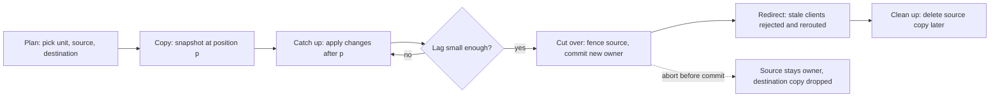
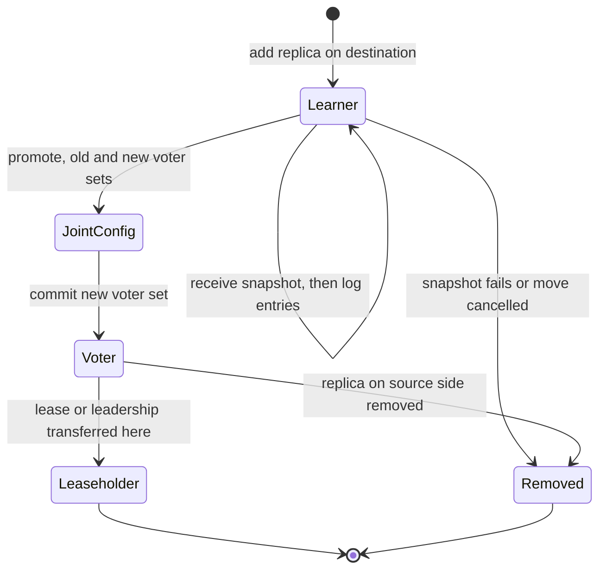
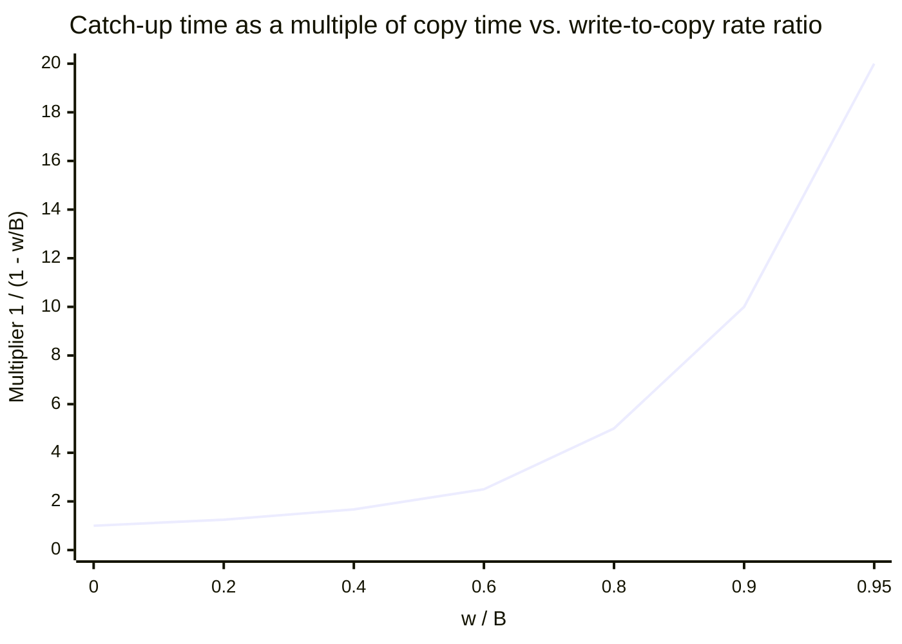
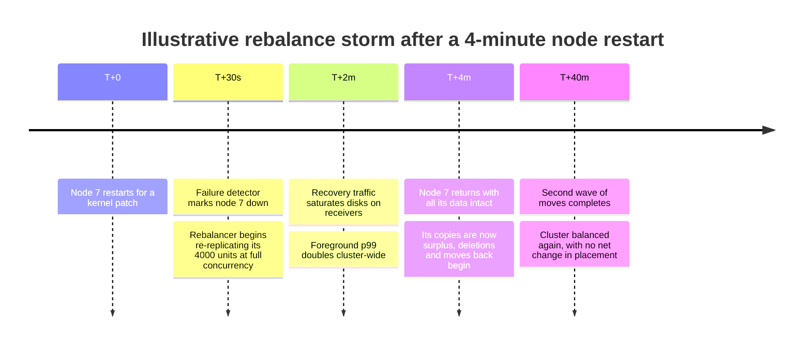

Dynamic rebalancing is the transfer of ownership of a partition, range, slot, or shard replica from one node to another while that partition continues to accept reads and writes. The placement function, whether a [hash scheme](/distributed-systems/en/data-management/data-partitioning/hash-partitioning/), a [ring with virtual nodes](/distributed-systems/en/data-management/data-partitioning/consistent-hashing/), or a [range directory](/distributed-systems/en/data-management/data-partitioning/key-range-partitioning/), only says where data should live. Rebalancing is the protocol that makes the data actually live there: it copies bytes that are still changing, decides the instant at which the new owner becomes authoritative, redirects clients that have not heard about the change, and deletes the old copy without deleting anything still needed.

Every partitioned store needs it, because the conditions that fixed the original placement do not last. Nodes are added for capacity and removed for maintenance or after failure; partitions grow unevenly; load shifts between tenants and hours of the day. Without online movement, every one of these events becomes either a maintenance window or a permanently unbalanced cluster sized for its hottest node. The hard part is not copying data, which is a bulk transfer, but copying data that is being written during the copy and then switching owners without a moment in which two nodes accept writes for the same key or no node does.

The core trade-off is between the speed of a move, its interference with live traffic, and the redundancy the data has while the move is in progress. A move reads the partition from disk on the source, sends it over the network, writes it on the destination, and later deletes it on the source; every byte of that work competes with foreground requests. Moving slowly protects latency but prolongs the window in which the cluster is unbalanced, the window in which a failed node's data has fewer copies than designed, and, for a hot partition, the time the destination needs to catch up with writes that arrive faster than the throttled copy. Moving quickly shortens those windows and spends the latency budget. A second trade-off sits inside the cutover: protocols that never block writes need consensus or dual writes and more machinery; protocols that block writes for a short critical section are simpler and pay with a pause whose length depends on how far behind the destination is.

## Anatomy of a Move: Plan, Copy, Catch Up, Cut Over, Clean Up

Every production rebalancing protocol, despite different vocabulary, performs the same five phases: a planner picks a unit, a source, and a destination; the destination receives a consistent copy as of some position in the unit's history; it applies the changes made after that position; authority is transferred at a single, ordered point; and the source's copy is deleted once no reader can still use it.


*The five phases common to rebalancing protocols. The loop between catch-up and the lag check is where hot partitions get stuck; the abort edge exists only before the commit point.*

The diagram shows two properties that every design must preserve. First, there is exactly one commit point, the arrow into the cutover, before which the source is the owner and after which the destination is. Everything before it can be abandoned without consequence: a destination that crashes during the copy leaves only garbage on itself. Everything after it must complete: if the destination is the owner, its copy is the data. Second, the copy and the catch-up are different activities with different costs. The copy is bounded by the size of the unit and the transfer rate. The catch-up is bounded by the write rate into the unit relative to that transfer rate, which is why a small hot partition can be harder to move than a large cold one.

### What a Move Guarantees, and What It Does Not

A correct rebalancing protocol guarantees four things. Every acknowledged write is present on the destination when it becomes the owner. At every instant there is at most one node that can accept a write for a given key under the store's consistency model, or, in leaderless stores, the set of nodes receiving writes is a superset of every set a reader might consult. A client holding a stale route is rejected or redirected rather than served from the wrong copy. And, in well-designed protocols, the number of durable copies of the data never drops below the configured replication factor because of the move itself.

It does not guarantee that foreground latency is unaffected; the move consumes disk, network, CPU, and cache on both ends. It does not guarantee balance afterwards, since the planner works from measurements that may already be stale and cannot divide a single heavy key, the problem covered in [Skew and Hot-Spot Problems](/distributed-systems/en/data-management/data-partitioning/skew-hot-spots/). It does not make a multi-unit move atomic: moving ten ranges is ten independent moves, and a query spanning them during the move sees some on the old owner and some on the new. And it does not change the partition boundaries; splitting and merging ranges is a separate operation described on the [key-range partitioning page](/distributed-systems/en/data-management/data-partitioning/key-range-partitioning/), even though rebalancers often split a range immediately before moving half of it.

### Copy and Catch-Up: A Snapshot Plus the Changes After It

A unit cannot be copied byte by byte while it is being written, because the copy would mix states from different moments. Every protocol therefore copies a consistent snapshot as of a position `p` in the unit's history (a Raft log index, a replication log offset, an LSM sequence number, an oplog timestamp), and separately transfers every change after `p`. The snapshot can be produced cheaply by storage engines that already keep immutable files: an LSM-tree engine ships its SSTables as they are, and a Raft-based store sends a snapshot of the state machine at an applied index. Engines that update in place need a read transaction at a fixed timestamp, or a fork, as Redis does for its replication snapshots.

The change stream comes from whatever already orders writes on the source. Raft-based stores do not need a separate mechanism: the destination joins the replication group and receives new log entries through the normal replication path. Primary-based stores tail their own log: MongoDB reads changes to the migrating range recorded during the copy, Vitess's VReplication reads the MySQL binary log, and Redis 8.4's atomic slot migration streams incremental writes over a second connection while the snapshot is sent over the first. Leaderless stores avoid the stream altogether by sending new writes to the destination directly while the old data is streamed, which changes the cutover problem, as shown later.

The catch-up phase converges only if the destination applies changes faster than they arrive. If the copy of `S` bytes runs at `B` bytes per second while the unit receives `w` bytes per second of writes, the backlog after the first pass is `S * w / B`, after the second `S * (w / B)^2`, and so on. The total time is `S / (B - w)`, which is the copy time multiplied by `1 / (1 - w / B)`. When `w` approaches `B` the multiplier grows without bound, and when `w` exceeds `B` the backlog grows instead of shrinking.

### Cutover: Transferring Authority at a Fenced Point

Catching up only makes the remaining gap small; it never closes it on its own while writes keep arriving. The cutover closes it by ordering a single ownership change against every write. The source stops accepting writes for the unit at a position `f` (the fence), the destination applies everything up to `f`, and a metadata record naming the destination as owner is committed. That commit is the linearization point of the move. Requests that reach the source after the fence are refused with an error that tells the client to refresh its route, and requests reaching the destination before the commit are refused for the same reason. The server-side ownership checks that make stale routes harmless, with descriptor versions and epoch numbers, are explained with the split protocol on the [key-range partitioning page](/distributed-systems/en/data-management/data-partitioning/key-range-partitioning/); a move relies on the same checks.

```mermaid
sequenceDiagram
    autonumber
    participant C as Client
    participant S as Source owner
    participant D as Destination
    participant M as Metadata store
    S->>D: Snapshot of unit at position p
    S->>D: Changes after p, repeated batches
    Note over S,D: Backlog shrinks while w is below B
    rect rgb(70, 50, 50)
    Note over S: Fence: stop writes to unit at position f
    C->>S: Write k=x
    S-->>C: Retry later, unit in critical section
    S->>D: Final changes up to f
    D-->>S: Applied through f
    S->>M: Commit owner = Destination, version v+1
    end
    C->>S: Retry write k=x
    S-->>C: Stale route, owner is Destination v+1
    C->>D: Write k=x with version v+1
    D-->>C: OK
```


*A snapshot, catch-up, and critical-section cutover. The shaded block is the only interval in which writes to the unit are refused or held; its length is the time to drain the final backlog and commit one metadata record.*

Steps 1 and 2 run while the source serves traffic normally and can take minutes or hours. The shaded block, steps 3 to 7, is the critical section, and good protocols enter it only when the remaining backlog is small: MongoDB 5.0 and later exposes the threshold as `maxCatchUpPercentageBeforeBlockingWrites`, the share of the range still to be transferred below which writes may be blocked, and Vitess refuses to switch primary traffic when replication lag exceeds `--max-replication-lag-allowed`. Step 4 shows what clients see during the critical section: an error they must retry or a request held by a proxy; Vitess's VTGate can buffer queries during the switch so that applications see latency rather than errors. Steps 8 to 10 are the redirection after the commit, which costs one extra round trip per client per moved unit, and the cost becomes a problem only when many units move at once.

### Why the Protocol Is Correct

Take any write `x` that the system acknowledged to a client. Exactly one of three cases holds. If the source applied `x` at a position before `p`, it is in the snapshot. If it applied `x` at a position between `p` and the fence `f`, it is in the change stream, and the destination does not report "applied through `f`" until it has applied it. If `x` was applied after the commit, it was applied by the destination, because the source refuses everything after `f` and the destination refuses everything before the commit. No acknowledged write falls between these cases, because the fence and the commit are both ordered in the same history as the writes: the fence is a position in the source's log, and the commit happens only after the destination has confirmed that position.

The same argument shows why ownership is exclusive. Before the commit, the destination refuses requests, so only the source can accept writes, and after the fence even the source cannot. After the commit, the source refuses because its fence is permanent and its metadata now names a different owner. The interval between fence and commit has zero writers, which is the cost of the critical section, but never two.

Failures are handled by which side of the commit they fall on. If the source, the destination, or the coordinator fails before the commit record is durable, the move is aborted: the source lifts its fence and remains the owner, and the destination's partial copy is discarded. If the failure happens after the commit, the destination is the owner and the move is finished except for cleanup; the source's copy has become orphaned data that must be deleted but never served. This is why the commit must be a single record in a strongly consistent store (a config server replica set, a Raft group, a consensus-backed topology service), and why a protocol whose "commit" is a set of independent updates to several routers has no well-defined owner during the update.

:::danger[Switching routes before fencing the source loses writes]
A homegrown migration that copies a table to a new shard, tails changes, and then updates the routing configuration has a window in which some routers still send writes to the source while others send writes to the destination. Writes that land on the source after the last change was tailed are acknowledged and never copied; writes on both sides to the same row diverge silently. The source must refuse writes for the unit at a recorded position before any router is pointed at the destination, and the destination must have applied everything up to that position before it accepts its first write.
:::

## Four Protocol Families in Production

Production systems implement the five phases in four materially different ways. They differ in where the change stream comes from, whether writes ever pause, and whether redundancy dips during the move.

### Add a Replica, Then Remove One: Raft Stores and Kafka

In a store where each unit is already a replicated group, a move is a membership change: add a replica on the destination, let it catch up, and remove a replica on the source. CockroachDB and TiKV use Raft groups per range or region, and Kafka uses a leader with an in-sync replica set (ISR) per partition. There is no separate cutover protocol for writes, because the group's replication already sends every write to every member; the commit point is the configuration change in the group's own log.


*Life of a replica that a rebalancer adds to move a range. The source replica follows the same machine in reverse: leadership is moved away from it before it is removed.*

The new replica starts as a learner (non-voting member): it receives a snapshot of the state machine and then the log entries after the snapshot index, but it does not count toward the commit quorum. This matters for correctness and availability. If a three-member group added a fourth voter that has no data, the quorum would become three of four, and one slow or failed original member would leave the group unable to commit while the empty voter cannot help. As a learner, the new replica can take as long as it needs to catch up without weakening the quorum. Once it is caught up, it is promoted. Changing several voters at once (adding the destination and removing the source in one step) is done through joint consensus, an intermediate configuration in which decisions need a majority of both the old and the new voter set, so that no two disjoint majorities can exist during the change; the mechanism is part of [Raft membership changes](/distributed-systems/en/coordination/consensus-algorithms/raft/). CockroachDB introduced learner replicas in v19.2 and atomic replication changes through joint consensus in v20.1. TiKV's scheduler, the Placement Driver (PD), expresses the same move as an operator whose steps are "add learner on the destination store, promote it to voter, remove the peer on the source store," with leader transfer inserted if the source holds leadership.

Before the source replica is removed, the lease or Raft leadership must be moved off it, because the leaseholder serves reads and coordinates writes. A lease transfer is cheap, a metadata operation rather than data movement, and it is often used on its own: when a node is overloaded by requests rather than by data, moving leaseholders between existing replicas rebalances load without copying a byte.

Kafka's partition reassignment follows the same order with different machinery. The reassignment sets the partition's replica list to the union of old and new replicas, so the replication factor is temporarily higher. New replicas fetch from the leader like any follower and are added to the ISR once caught up; then leadership moves to the preferred new replica if needed, and the replicas no longer in the target list are removed and their logs deleted. Since Kafka 2.4 (KIP-455), reassignments are submitted through an Admin API that tracks adding and removing replicas explicitly and allows a reassignment in progress to be cancelled, instead of a single ZooKeeper node that the controller processed as a batch. Kafka does not move a partition's data in smaller units, so the copy of a large partition takes as long as its whole log takes to transfer at the throttled rate.

The defining property of this family is that redundancy never dips: the replica count goes from three to four and back to three. The cost is that the destination must hold a full copy before anything is released on the source, and that disk on the destination fills before disk on the source frees.

### Snapshot, Stream, and a Short Write Pause: MongoDB, Vitess, Redis 8.4

Stores in which each unit has a single primary and the destination is a different primary need the full snapshot, catch-up, and critical-section protocol from the sequence diagram above.

MongoDB's balancer moves one range at a time from a donor shard to a recipient shard. Its documented procedure is: the balancer sends `moveRange` to the source; the source keeps serving reads and writes for the range; the destination builds any missing indexes, requests and copies the range's documents, then synchronizes the changes made during the copy; when fully synchronized, the source updates the cluster metadata on the config servers with the new location; and after the update, once no open cursors use the range, the source deletes its copy. Writes to the range are blocked only for the final synchronization and the metadata commit. The deletion is deliberately asynchronous and delayed: documents left on the donor after the commit are orphaned documents, filtered out of reads by the shard's routing-version checks, and removed later by a range deleter in batches, because deleting a large range competes with live traffic for cache and I/O.

Vitess reshards a keyspace with a VReplication workflow. Target shards are populated by a copy phase that reads source tables, followed by a stream of binary log events from the source. Traffic is switched per tablet type: replica and read-only traffic can be switched first, so the new shards serve reads while writes still go to the old ones. Switching primary traffic stops writes on the source primaries, waits for the targets to catch up, updates the routing rules in the topology service, and by default starts a reverse replication stream from the new shards back to the old ones. That reverse stream is the feature that distinguishes Vitess: after the cutover, the old shards remain current, so `ReverseTraffic` can undo the move if the new shards misbehave. The workflow is finalized by a separate `Complete` step that removes the old shards and the replication artifacts; until then, rollback is cheap.

Redis 8.4 introduced atomic slot migration for Redis Cluster, which moves a range of hash slots by sending a forked snapshot over one connection and streaming incremental writes over another, then briefly pausing writes on the source, forwarding the remainder, and handing over ownership of the slots in one step that the destination publishes over the cluster bus. It replaces the key-by-key method described below for clusters that run 8.4 or later.

This family pays with a write pause sized by the residual backlog and a source copy that must be cleaned up after the commit; redundancy does not dip, because each shard keeps its own replicas.

### Write to Old and New Owners: Cassandra Pending Ranges

Leaderless stores have no single node at which to fence writes, so they invert the protocol: the destination starts receiving new writes before it has the old data. When a Cassandra node bootstraps, the token ranges it will own become pending ranges for it. Coordinators send every write for a pending range to the natural replicas and to the pending node, and they raise the number of acknowledgments required by the number of pending replicas, so that a write meeting its consistency level is durable on enough nodes under both the old and the new placement. The original problem and fix are recorded in CASSANDRA-833: without the extra acknowledgments, a write could be satisfied by replicas that were about to lose the range, and once the bootstrap completed and the old replicas were cleaned up, the write would exist on too few owners.

The old data then arrives by streaming: existing replicas send the SSTables, or the parts of them covering the transferred ranges, to the joining node. When streaming finishes, the node announces itself through gossip as a normal member and coordinators start reading from it. There is no write pause at all, because there is no single writer to pause, and reads never consult the joiner before its data is complete. The cost is that the old owners still hold the data for ranges they have given up until an operator runs `nodetool cleanup` on each of them, which rewrites their SSTables without the ranges they no longer own, and that the extra acknowledgments make writes to pending ranges slower and less available for the duration. Cassandra also, by default, refuses to bootstrap several nodes concurrently into overlapping ranges, because pending-range arithmetic with several simultaneous moves is where correctness becomes fragile.

### Move Keys One by One with Redirects: Classic Redis Cluster

Before atomic slot migration, Redis Cluster moved a hash slot one key at a time. The operator marks the slot `IMPORTING` on the destination and `MIGRATING` on the source, in that order, so that the destination is ready to accept redirected requests before the source sends any. A tool then lists keys in the slot and moves them in batches with `MIGRATE`, which serializes each key, restores it on the destination, and deletes it from the source as one blocking operation on both ends. While the slot is migrating, the source serves commands for keys it still has and answers `ASK` for keys it does not; the client retries that one command on the destination, preceded by `ASKING`, without updating its slot map. A multi-key command whose keys are split between the two nodes gets `TRYAGAIN`. When the slot is empty on the source, `CLUSTER SETSLOT ... NODE` assigns it to the destination, first on the destination and then on the source, because updating the source first and losing the destination before it learned the change would leave the slot with no owner.

The protocol never pauses the slot, and each key has exactly one location at any instant, which is what makes it correct without a fence. Its weaknesses are a long interval of mixed location during which every client pays redirections, multi-key operations that fail transiently, and very large keys whose single `MIGRATE` blocks both nodes for the duration of their serialization.

### Comparing the Families

| Family | Systems | Write pause | Redundancy during move | Cleanup | When to prefer |
|---|---|---|---|---|---|
| Add then remove replica | CockroachDB, TiKV, Kafka | None; leadership transfer is brief | Above target (RF + 1) | Source replica removed with the config change | Units are already replicated groups; continuous availability matters more than temporary disk |
| Snapshot, stream, critical section | MongoDB, Vitess, Redis 8.4 | Short, sized by residual backlog | Unchanged (each shard keeps replicas) | Delayed deletion of orphaned source data | Single-primary shards; a sub-second pause is acceptable and rollback must be possible |
| Dual write to pending owner | Cassandra | None | Writes need extra acknowledgments | Manual `nodetool cleanup` on old owners | Leaderless quorum stores where no single writer exists |
| Key by key with redirects | Redis Cluster before 8.4 | None per slot; per-key blocking for big keys | Unchanged | Implicit, keys are deleted as they move | Small values and few multi-key operations; legacy clusters |

Someone always pays during the move: in the first family, destination disk and a temporary fourth copy; in the second, a pause; in the third, write latency and availability on pending ranges; in the fourth, redirects and failed multi-key commands.

## Deciding What to Move, and How Fast

The protocol makes a single move safe; the planner decides how many moves happen, and most operational problems with rebalancing come from moving too much, too fast, or for the wrong reason.

A planner compares the current placement against a target expressed as constraints and goals. Constraints must hold: replicas of one unit in different racks or zones, no node above a disk-fullness threshold, unit counts within limits. Goals are optimized: equal data, equal request rate or CPU, equal leaseholder count. The planner then emits a bounded number of moves that reduce the distance to the goal without violating a constraint. MongoDB's balancer considers a collection balanced while the data size difference between any two shards is below three times the configured range size, 384 MB for the default 128 MB range, and lets a shard take part in only one migration at a time, so an `n`-shard cluster runs at most `n / 2` migrations concurrently. CockroachDB's allocator balances replica counts, disk usage, and load, and moves leases separately from replicas. LinkedIn's Cruise Control plays the same role for Kafka, which has no built-in rebalancer, by computing a reassignment that satisfies prioritized goals (rack awareness, disk capacity, network and CPU balance) and executing it in throttled batches.

Three planner parameters dominate behavior. The threshold, or hysteresis, decides how much imbalance is tolerated before a move: too tight, and the planner moves units back and forth over measurement noise; too loose, and nodes fill unevenly. The concurrency limit decides how many moves run per node and per cluster: Elasticsearch defaults to two concurrent incoming and two outgoing shard recoveries per node, and TiKV's store limit is a token bucket per store for adding and removing peers, so that operators are consumed no faster than the store can absorb snapshots. The bandwidth throttle decides how many bytes per second each move may use: Elasticsearch's `indices.recovery.max_bytes_per_sec` (40 MB per second per node in its long-standing default) covers all recovery traffic into and out of a node, CockroachDB exposes `kv.snapshot_rebalance.max_rate` for rebalancing snapshots, Cassandra limits outbound streaming per node, and Kafka applies a replication quota only to the replicas being reassigned.

A move costs more than its byte count. The source reads the unit from disk, often evicting hot data from its page cache. The destination writes it, and in an LSM-tree engine the ingested files must later be compacted into its levels, so the write amplification described in [SSTables, Memtable, and Compaction](/distributed-systems/en/data-management/storage-engines/sstables-memtable-compaction/) arrives after the move has finished. When the lease or leadership moves, reads go to a node whose cache does not yet hold the unit's working set, and latency for that unit rises until the cache warms. A planner that counts only bytes underestimates the impact of moving hot units; this is why many planners prefer moving cold units to achieve the same data balance.

Reacting to node loss is the hardest timing decision. A node that has died permanently must have its units re-replicated as soon as possible, because every minute is a minute with one copy fewer. A node that is restarting for a kernel upgrade will return in a few minutes with all its data, and re-replicating terabytes in the meantime is pure waste that also has to be undone. Systems resolve this with a delay before treating a node as gone: Elasticsearch waits `index.unassigned.node_left.delayed_timeout`, one minute by default, before reallocating replicas of a departed node, and CockroachDB waits `server.time_until_store_dead`, five minutes by default, before moving replicas off a node that stopped heartbeating. The delay trades a short window of reduced redundancy for the absence of a rebalance storm.

### Worked Example: Draining a Node, and a Range That Will Not Catch Up

Assume a Raft-based store with ten nodes, each holding 3 TB of replica data in ranges of 512 MiB, and an operator decommissioning node 10. Assume the rebalancer may use 100 MB/s of incoming snapshot bandwidth per receiving node and 400 MB/s of outgoing bandwidth on the draining node, rates chosen (illustratively) to keep foreground p99 latency within its objective. All numbers in this example are illustrative.

The 3 TB on node 10 is about `3e12 / 5.37e8`, roughly 5,600 range replicas, each of which must gain a learner elsewhere before its node 10 replica is removed. The nine receivers could absorb `9 * 100 = 900` MB/s, but the source caps the drain at 400 MB/s, so the copy takes `3e12 / 4e8 = 7,500` seconds, a little over two hours. If replicas on other nodes can also act as snapshot senders, which newer CockroachDB releases allow through delegated snapshots, the source cap disappears and the receivers become the limit: `3e12 / 9e8 = 3,333` seconds, about 56 minutes. The bottleneck shifting from sender to receiver is the same effect that the vnode count has on node joins in [Consistent Hashing](/distributed-systems/en/data-management/data-partitioning/consistent-hashing/).

Most ranges receive few writes and catch up immediately. Consider one range that receives `w` = 4 MB/s of writes, and a snapshot stream for it limited to `B` = 50 MB/s. The snapshot of 512 MiB takes `537 / 50 = 10.7` seconds; with `w / B = 0.08`, total catch-up time is `10.7 / (1 - 0.08) = 11.7` seconds. Now consider a hot range receiving 40 MB/s. With `w / B = 0.8`, the multiplier is 5, and a primary-based protocol would need 54 seconds of catch-up before the backlog shrinks to the critical-section threshold. If the throttle is lowered to 30 MB/s to protect foreground latency during a busy hour, `w` exceeds `B` and the backlog grows with every pass: the move never converges.


*The convergence multiplier `1 / (1 - w / B)` for a copy-then-catch-up protocol. Past 0.8 the curve turns sharply upward; above 1.0 the move diverges.*

The curve explains why throttles must be set per move rather than per node for hot units. A per-node throttle shared by ten concurrent moves gives each 10% of the budget, which is ample for cold ranges and fatal for a hot one. In a Raft store the hot range does converge, because new log entries reach the learner through normal replication, independently of the snapshot stream; but the leader may truncate its log past the snapshot's index while a slow snapshot is in flight, in which case the learner needs another snapshot, a loop that can repeat while the range stays hot. For a primary-based protocol, the remedies are to move the hot unit alone with the full budget, to split it first so that each half receives part of the writes, or to accept a longer critical section.

The redundancy arithmetic matters as much. With add-then-remove, each range keeps three replicas throughout the two hours. If the operator had instead stopped node 10 and let the cluster re-replicate (the "dead node" path), every one of its 5,600 ranges would spend the copy time with two replicas, and a second node failure during that window would leave the ranges shared by both failed nodes with one replica, below the majority that Raft needs to commit. Decommissioning a live node and replacing a dead one are different operations with different risk, which is why stores provide an explicit drain or decommission command rather than treating "stop the node" as a rebalance.

### Configuration That Matters in Production

The commands below show the shape of a throttled Kafka reassignment, the one common system where moves are driven entirely by the operator.

```shell
# Generate a plan moving topic partitions off broker 5 (JSON lists topics)
kafka-reassign-partitions.sh --bootstrap-server b1:9092 \
  --topics-to-move-json-file topics.json --broker-list 1,2,3,4,6 --generate
# Execute with a replication throttle in bytes/s for the moving replicas only
kafka-reassign-partitions.sh --bootstrap-server b1:9092 \
  --reassignment-json-file plan.json --execute --throttle 50000000
# Poll until done; when complete, --verify also removes the throttle configs
kafka-reassign-partitions.sh --bootstrap-server b1:9092 \
  --reassignment-json-file plan.json --verify
```

The throttle is implemented as broker-level rates (`leader.replication.throttled.rate`, `follower.replication.throttled.rate`) applied to topic-level lists of throttled replicas, and it stays in place until `--verify` observes a completed reassignment and removes it. The same pattern, a per-node rate plus a list of which transfers it applies to, recurs in other systems under other names; what matters is that the rate is high enough for the hottest unit being moved to converge, low enough that the receiver's foreground p99 stays within its objective, and removed when the move is done.

## Failure Modes and Their Signatures

Rebalancing failures fall into three groups: correctness failures at the cutover, convergence failures during catch-up, and amplification failures in which moves make an incident worse.

### Lost or Divergent Writes at an Unfenced Cutover

Trigger: a migration that switches routing without fencing the source, usually a homegrown copy-and-tail tool or a sequence of manual steps executed out of order. Symptoms: rows missing on the new shard that clients saw acknowledged; rows that differ between old and new copies; reports of "lost updates" from a period that lines up with the migration. Detection is difficult after the fact, which is why the danger aside above exists; the reliable method is a data comparison between source and destination at a known position before the source is deleted, the role of Vitess's `VDiff`.

```mermaid
sequenceDiagram
    autonumber
    participant R1 as Router 1
    participant R2 as Router 2
    participant S as Old shard
    participant T as Tailer
    participant N as New shard
    T->>N: Changes up to position 900 applied
    Note over R1,R2: Config push begins, routers update one by one
    R1->>N: Write order 42 status=paid
    N-->>R1: OK
    R2->>S: Write order 42 status=cancelled, old route
    S-->>R2: OK at position 901
    Note over T: Tailer stopped at 900 when cutover started
    rect rgb(80, 40, 40)
    Note over S,N: Position 901 never reaches the new shard
    R2->>N: Read order 42 after its config updates
    N-->>R2: status=paid, the cancellation is gone
    end
```


*A cutover without a fence. Router 2 still holds the old route when it writes, the old shard accepts the write, and nothing copies it. The order IDs and positions are illustrative.*

The failure needs three ingredients, all present in step 5: a stale router, a source that still accepts writes, and a stopped tailer. Only fencing the source removes it in all cases, because router updates are never instantaneous and a tailer cannot know when the last stale router has finished. Mitigation after the fact is a reconciliation from the source's log past position 900, provided the source has not yet been deleted, which is the argument for keeping the source and its log for a period after every cutover.

### Catch-Up That Never Converges

Trigger: a unit whose write rate approaches or exceeds its transfer rate, often because a per-node throttle is shared by many concurrent moves, or because the unit is one of the hot ranges described in [Skew and Hot-Spot Problems](/distributed-systems/en/data-management/data-partitioning/skew-hot-spots/). Symptoms: a migration stuck in the catch-up state for far longer than its size predicts; repeated critical-section timeouts and aborted migrations in MongoDB's logs and `config.changelog`; in Raft stores, repeated snapshots to the same learner. Detection: migration duration per unit, catch-up backlog over time (a backlog that does not shrink across passes is the signature), and snapshot counts per range. Mitigation: move that unit alone with a higher per-move budget, split it first, move it during a lower-traffic hour, or accept a longer critical section. Do not lower the throttle further; that moves the ratio in the wrong direction.

### Rebalance Storm After a Transient Node Loss

Trigger: a node is unavailable for a few minutes (a restart, a network blip, a long garbage collection pause) and the rebalancer treats it as permanently lost. Symptoms: a spike in replication or recovery traffic across the cluster; foreground latency rising on every node, not only the affected one; when the node returns, a second wave of moves as the planner rebalances its now-empty or now-redundant replicas back.


*A hypothetical storm caused by a short failure-detection delay. The same work is done twice in opposite directions; not a real incident.*

The storm produced no lasting change in placement and cost two waves of cluster-wide I/O. Detection: replica or shard recovery counts correlated with membership events, and moves out of a node followed shortly by moves back into it. Mitigation is a delay between suspecting a node and re-replicating its data, sized from how long planned restarts actually take (one to five minutes in the defaults above), plus a maintenance mode in which operators tell the cluster that a node is going away temporarily. The delay must stay short enough that a truly dead node does not leave units under-replicated for long; a store that tolerates one failure is exposed to data loss for the entire delay plus the copy time.

### Moves That Overload the Cluster They Are Meant to Relieve

Trigger: a planner that responds to an overloaded node by moving data, when the overload comes from the same resources the move consumes, or a throttle set without reference to foreground load. Symptoms: rebalancing begins when latency is already high and latency rises further; disk queue depth on receivers grows; in LSM engines, level-0 file counts climb on destinations as ingested files wait for compaction, triggering write stalls. Detection: rebalance bytes per second plotted with foreground p99 and disk utilization on senders and receivers; compaction backlog on destinations. Mitigation: prefer lease or leadership transfers for request-driven overload, since they move no data; cap rebalancing concurrency and rate; pause automatic rebalancing during incidents. The dynamics are a form of the feedback described in [Retry Storms and Metastable Failures](/distributed-systems/en/resilience/flow-control/retry-storms-metastable-failures/): work intended to restore capacity consumes the capacity that is short.

A variant is the rebalancer that moves a hot unit from node to node because no node has enough spare capacity to absorb it; its mechanics and remedies belong to the [skew page](/distributed-systems/en/data-management/data-partitioning/skew-hot-spots/). Another variant is the burst of stale-route lookups after thousands of units move at once, which overloads the metadata service; it is described as directory overload on the [key-range partitioning page](/distributed-systems/en/data-management/data-partitioning/key-range-partitioning/).

### Half-Finished Moves and Forgotten Leftovers

Trigger: the coordinator of a move, an operator's script, or a destination node fails mid-move, or the move completes and its final step is never run. Symptoms vary by system. A Redis Cluster slot left in `MIGRATING` and `IMPORTING` state keeps producing `ASK` redirections indefinitely; `redis-cli --cluster fix` resolves the state. A Kafka reassignment whose target broker is down never completes, because the new replica never joins the ISR, and the partition runs with an inflated replica list. A Kafka replication throttle that nobody removed with `--verify` limits ordinary follower catch-up long after the move, so the next broker restart takes far longer to restore the ISR. Cassandra nodes on which `nodetool cleanup` was never run keep data for ranges they no longer own, wasting disk and, if those ranges later move back to them, risking the return of data whose deletions were applied elsewhere and whose tombstones have since been purged.

Detection: inventory of in-progress moves (pending reassignments, slots in transitional states, MongoDB migration entries in the config server's changelog), throttle configurations present on brokers with no reassignment in progress, and on-disk size compared with owned size per node. Recovery: complete or cancel each move explicitly, through the system's own commands, and treat the removal of throttles and the cleanup step as part of the move rather than as optional follow-up.

:::caution[A forgotten throttle is a latent incident]
Reassignment throttles in Kafka are ordinary broker and topic configurations, not properties of the reassignment, and they survive broker restarts. A throttle left in place after a large move silently caps how fast replicas on those topics can catch up after any later outage. Check for throttle configs on brokers as part of every post-move checklist and in routine configuration audits.
:::

### Failure Signatures at a Glance

| Failure | Symptom from outside | Detection signal | Mitigation |
|---|---|---|---|
| Unfenced cutover | Acknowledged writes missing or divergent after migration | Source vs. destination diff at a known position | Fence at a log position before switching routes; keep source and log for a period |
| Non-converging catch-up | Move stuck far beyond its size estimate | Backlog not shrinking across passes; repeated snapshots | Higher per-move budget, split first, off-peak move |
| Rebalance storm | Cluster-wide latency after a short node loss, then moves back | Recoveries correlated with membership events | Delayed reallocation, maintenance mode |
| Self-defeating moves | Latency worsens as rebalancing starts | Rebalance bytes vs. p99 and disk queue depth | Lease transfers first, rate and concurrency caps, pause during incidents |
| Half-finished moves | Endless redirects, inflated replica lists, slow later recovery | Transitional states and throttles with no active move | Explicit complete or cancel; cleanup as part of the move |
| Rebalancer chasing a hot unit | Hot spot moves from node to node | Repeated moves of the same unit | Split or key-level remedy (skew page) |

## Choosing a Rebalancing Strategy

Use automatic rebalancing when the store's units are small enough that one move takes seconds to minutes, the protocol is built in and fenced, and the cluster has a few nodes or more, so that imbalance would otherwise accumulate faster than operators can correct it. Range stores with hundreds of megabytes per unit and per-unit replication (CockroachDB, TiKV, MongoDB with its balancer) are designed for this, and turning their balancers off generally converts a smooth background process into periodic manual emergencies.

Use operator-driven or planner-assisted rebalancing when units are large and movement is expensive: Kafka partitions holding days of retention, Elasticsearch shards of tens of gigabytes, Cassandra nodes holding terabytes. Here each move is a capacity-planning event with a predictable duration, and the right tool is a planner such as Cruise Control that proposes a plan, a throttle that bounds its interference, and a schedule that keeps it out of peak hours.

Prefer add-then-remove whenever the store supports it, because it keeps redundancy at or above target for the whole move. Prefer a protocol with a short critical section when units have a single primary and a pause of a fraction of a second is acceptable, and prefer one with reverse replication, as Vitess provides, when the move is a one-way architectural change (a reshard to more shards) that may need to be undone. Move leases or leadership before moving data whenever the imbalance is in request load rather than storage, since a lease transfer costs a metadata write instead of a copy.

Do not rebalance to fix a hot key: the key's owner changes and the heat follows it. Do not let an automatic rebalancer react to a node failure without a delay, and do not set that delay longer than the time the store can afford to run with one copy fewer. Do not build a homegrown migration that copies, tails, and switches routes unless the source is fenced at a recorded position and the destination applies through that position before accepting writes. Do not rebalance during an incident caused by saturation unless the move itself relieves the saturated resource. And do not confuse this mechanism with two others that share the name: [Kafka consumer group rebalancing](/distributed-systems/en/case-studies/apache-kafka/consumer-group-rebalancing/) reassigns which consumer reads which partition and moves no data, and [zero-downtime database migrations](/distributed-systems/en/deployment/deployment-patterns/zero-downtime-db-migrations/) change a schema in place rather than its placement.

:::tip[Measure moves as first-class operations]
Export, for every move, its unit, source, destination, bytes, start and end time, catch-up passes, and critical-section duration. Most rebalancing incidents are diagnosed from the relationship between these and foreground latency, and most stores record only aggregate counts by default. The per-move record is also what tells you whether a throttle is too low (moves of cold units taking much longer than their size predicts) or too high (foreground p99 rising with each batch).
:::

:::note[Where adjacent mechanisms are covered]
Splitting and merging ranges and the server-side epoch checks that reject stale routes are covered in [Key-Range Partitioning](/distributed-systems/en/data-management/data-partitioning/key-range-partitioning/). How much data a membership change must move under a ring is covered in [Consistent Hashing](/distributed-systems/en/data-management/data-partitioning/consistent-hashing/). Replica re-creation after failure without a placement change, and the hints and repair that keep replicas consistent, are covered in [Anti-Entropy: Read Repair and Merkle Trees](/distributed-systems/en/data-management/replication/anti-entropy-merkle/).
:::

## Further Reading

- Diego Ongaro and John Ousterhout, *In Search of an Understandable Consensus Algorithm*, USENIX Annual Technical Conference, 2014.
- Giuseppe DeCandia et al., *Dynamo: Amazon's Highly Available Key-value Store*, ACM SOSP, 2007.
- Martin Kleppmann, *Designing Data-Intensive Applications*, O'Reilly Media, 2017 (chapter 6, Partitioning).
- MongoDB, *Balancer Administration and Range Migration*, MongoDB Manual.
- Vitess, *Reshard* and *SwitchTraffic* reference, Vitess documentation.
- Apache Kafka, *KIP-455: Create an Administrative API for Replica Reassignment*, Apache Kafka wiki, 2019.
