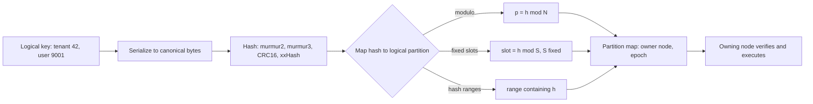
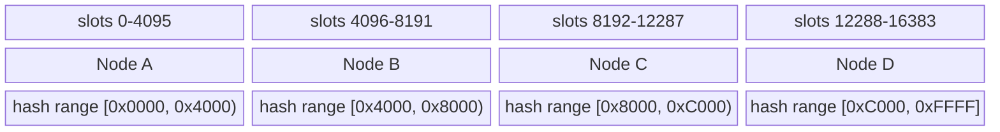
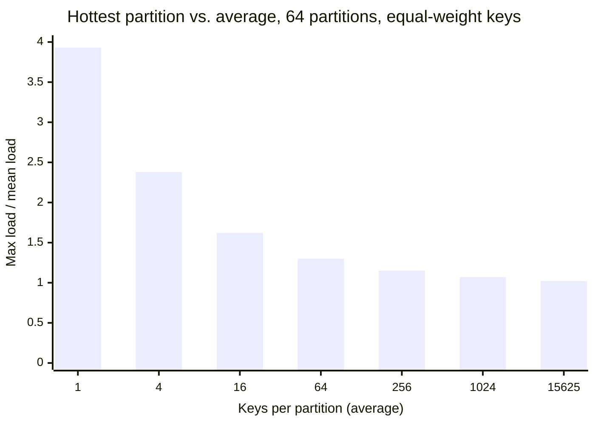
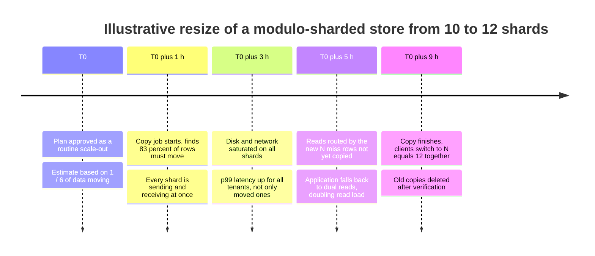
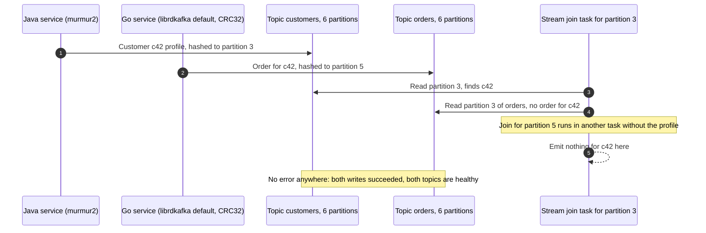

Hash partitioning assigns every key to a partition by computing a hash function over the key and mapping the hash value, not the key itself, onto the set of partitions. Two keys that differ by one character produce unrelated hash values, so they land on unrelated partitions, and a stream of keys with any structure at all (sequential IDs, timestamps, names sharing a prefix) is spread as if it were random. The placement can be computed by any client that knows the hash function and the partition map, without a lookup in a per-range directory.

The problem it solves is concentration. Placing keys by their sort order, as [Key-Range Partitioning](/distributed-systems/en/data-management/data-partitioning/key-range-partitioning/) does, sends every insert with a monotonically increasing key to the last range and every query on a popular prefix to one node. Hashing breaks the link between what a key looks like and where it lives, so the write load of a sequence, the data of a million tenants, and the point lookups of a user population are divided among partitions in proportion to their count. Kafka, Redis Cluster, Cassandra, DynamoDB, Elasticsearch, Citus, and the hashed modes of MongoDB and YugabyteDB all use it as a primary placement scheme.

The core trade-off is uniformity against locality. Hashing balances the number of keys, not their weight, and it destroys adjacency: a query for a contiguous span of keys, or for anything that is not an equality match on the full partition key, must ask every partition. The second trade-off is in the mapping step. The simplest mapping, `hash mod N`, gives near-perfect balance and relocates most keys whenever `N` changes; mappings that survive resizing need either a fixed number of logical partitions decided up front, or a directory of hash ranges that brings back some of the machinery hashing was meant to avoid.

## From Key to Partition: The Hashing Pipeline

Every hash-partitioned system runs the same four steps, and each step has its own way of going wrong. The key is first turned into a canonical byte sequence; the bytes are hashed into a fixed-width integer; the integer is mapped to a logical partition; and the logical partition is looked up in a partition map that names the node currently owning it.


*The hashing pipeline. The first three steps are a pure function of the key and the configuration; only the last step consults mutable state.*

The left half of the diagram is a pure function, and that is the source of both the scheme's strength and its most dangerous failure. Because the placement depends only on the key bytes, the hash function, and the mapping parameters, every client computes the same answer with no coordination, which makes routing cheap and lets producers in Kafka choose a partition without asking a broker. For the same reason, any difference in any of the three inputs between two clients, a different serializer, a different hash, a different partition count, produces a different answer with no error anywhere. The right half is ordinary mutable metadata, a partition-to-node table with an epoch or version number, and it is handled exactly like the range descriptors of a range-partitioned store: cached by clients, checked by servers.

### What the Hash Function Must Provide

A partitioning hash needs four properties, and cryptographic strength is not one of them. It must be deterministic across processes, languages, and versions, because a key written by one client and read by another must be hashed identically for the life of the data. It must be computed over a canonical encoding of the key, because hashing the integer 42 as eight big-endian bytes, as the ASCII string `"42"`, or as UTF-16 code units gives three unrelated results. It must have good avalanche behavior: flipping any input bit should flip each output bit with probability close to one half, so that structured inputs produce outputs that look independent. And it must be fast, because it runs on every request.

That is why production systems use non-cryptographic hashes. Kafka's Java producer uses 32-bit murmur2; Cassandra's default `Murmur3Partitioner` uses the 64-bit MurmurHash3 output as a token, replacing the MD5-based `RandomPartitioner` of early versions; Redis Cluster uses CRC16; Elasticsearch uses 32-bit MurmurHash3 over the UTF-16LE encoding of the routing string. The determinism requirement rules out some functions that look suitable. Python's built-in `hash()` for strings is randomized per process since Python 3.3 unless `PYTHONHASHSEED` is fixed, so two workers of the same service disagree; language runtime hash codes in general are designed for in-memory hash tables, may change between versions, and often have weak low bits.

Weak low bits matter because the mapping step usually discards everything else. Taking a hash modulo a power of two keeps only its low bits. If the "hash" is the key itself, or a function that passes low bits through unchanged, the partition is decided by whatever structure the key's low bits have.

:::caution[An identity hash with a power-of-two modulus partitions by the key's lowest bits]
A Snowflake-style ID ends in a per-millisecond sequence counter, which is zero for most IDs on a lightly loaded worker. Using the raw ID modulo 1,024 as the partition keeps only the low 10 bits, which are the sequence, so almost every ID lands on partition 0. The same happens to IDs allocated in blocks or with a fixed stride. Always pass keys through a real hash before the modulo, even when the keys are already integers; the layout of such IDs is covered in [Distributed ID Generation](/distributed-systems/en/foundations/time-and-ordering/distributed-id-generation/).
:::

Two further properties are optional and situational. A keyed hash, such as SipHash with a secret seed, prevents an adversary who controls keys from choosing keys that all land on one partition, the partition-level form of the hash-flooding attacks Crosby and Wallach described against in-memory hash tables in 2003. It is rarely used for data placement because every client must share the secret and the seed can never change without moving all data. Consistency of the hash with the database's own index ordering is the other: Citus, MongoDB, and YugabyteDB compute the hash on the server, and the hash value is also what their chunk and tablet boundaries are expressed in.

### Three Ways to Map a Hash to a Partition

The mapping step decides what happens when the cluster changes size, and it is where real systems differ most.

**Modulo over the node count.** The partition is `h mod N`, and partition `i` lives on node `i`. Balance is as good as the hash. The weakness is resizing: a key keeps its owner when `N` grows to `N + 1` only if `h mod N` equals `h mod (N + 1)`, which holds for `N` residues out of every `N(N + 1)`, so a fraction `N / (N + 1)` of all keys moves. Growing from 10 to 11 nodes moves 91% of keys; from 10 to 12, 83%. The minimum possible, for a balanced result, is the share the new nodes must hold, about 17% in the second case.

**Fixed logical slots.** The hash is taken modulo a constant `S` chosen far larger than any expected node count, and a slot table maps each of the `S` slots to a node. Resizing never changes `S`, so no key changes slot; only whole slots change owner, and moving the minimum number of slots moves the minimum fraction of data. Redis Cluster uses 16,384 slots, Couchbase 1,024 vBuckets, and Elasticsearch fixes the number of primary shards at index creation, with a larger number of routing shards behind it. Kafka partitions play the same role for consumers, but Kafka maps keys to partitions with modulo over the partition count, so the partition count itself is the `N` that must never change.

**Hash ranges.** The hash output space, for example `[-2^63, 2^63)` in Cassandra or `[0x0000, 0xFFFF]` in YugabyteDB, is treated as a sorted key space and cut into contiguous ranges, each owned by one replica group, with a directory of boundaries. This is key-range partitioning applied to hash values instead of keys: ranges can split when they grow or become hot, so the partition count follows the data instead of being fixed in advance. DynamoDB, MongoDB hashed sharding, Citus, and YugabyteDB work this way, and Cassandra's tokens are hash-range boundaries placed by node membership rather than by splitting.

A fourth family, consistent hashing, places partitions or nodes at points of a hash ring so that adding a node takes over only the arcs adjacent to its points; its construction, virtual nodes, and the variance that sets how many points are needed belong to [Consistent Hashing and Virtual Nodes](/distributed-systems/en/data-management/data-partitioning/consistent-hashing/). On this page it is one row of the comparison.

```text
# Mapping a 64-bit hash h to an owner (S, N, ranges are configuration)
modulo:       owner = nodes[h mod N]               # N changes -> most keys move
fixed slots:  slot  = h mod S                      # S never changes
              owner = slot_table[slot]             # moving a slot = data copy + table update
hash ranges:  r     = first range with end > h     # binary search over sorted boundaries
              owner = range_table[r]               # ranges split and move independently
```

The pseudocode makes the difference in state visible. Modulo needs only `N`. Fixed slots need a table of `S` entries, small and easy to gossip or cache whole (16,384 entries for Redis Cluster). Hash ranges need a directory whose size grows with the number of ranges, which the system must version, cache, and correct on staleness, exactly as a range-partitioned store does.


*Top two rows: 16,384 fixed slots assigned to four nodes in contiguous blocks. Bottom row: a 16-bit hash space cut into four hash ranges. Boundaries are illustrative.*

Both layouts look alike at a single moment, which is why they are often confused. They differ in what can change. In the slot layout the 16,384 boundaries are permanent and only the bottom-row ownership changes; slot 4,095 and slot 4,096 can be moved to different nodes, but slot 4,095 can never be divided, so the slot is the smallest unit of balance forever. In the hash-range layout a range such as `[0x4000, 0x8000)` can split at `0x6000` when it grows, so a hot or large region of hash space can be subdivided down to a single hash value. The cost of that flexibility is a directory that changes at runtime.

### What Hashing Guarantees, and What It Does Not

For a fixed configuration, hash partitioning guarantees that each key has exactly one owning partition, that every client computing the placement with the same function and configuration gets the same answer, and that the expected number of distinct keys per partition is equal. With a well-mixing hash the guarantee holds regardless of the structure of the key set: sequential, clustered, and prefix-sharing keys are spread as well as random ones. Because one key always maps to one partition, all operations on one key are serialized by that partition's owner, which is what Kafka's per-key ordering and Cassandra's single-partition lightweight transactions rely on.

It does not guarantee equal load. Keys are counted, not weighed: a key with a thousand times the traffic or the bytes of the average key makes its partition hot, and no hash function can divide one key. It does not guarantee balance with few keys, as the next section quantifies. It does not keep related keys together unless the application chooses a partition key that makes them equal. It provides no order across partitions, so range queries, ordered pagination, and "top N by key" become scatter-gather operations. And it does not guarantee that placement survives a configuration change: under modulo mapping the configuration includes `N`, and changing it changes almost everything.

## How Uniform Is Uniform: The Statistics of Hash Placement

A good hash behaves like throwing each key independently into one of `N` partitions at random, the balls-into-bins model of probability theory. The number of keys in one partition then follows a binomial distribution with mean `K / N` for `K` keys and standard deviation close to `sqrt(K / N)`. The relative spread is therefore about `1 / sqrt(K / N)`: it depends on the number of keys per partition, not on the total. A partition expected to hold 10,000 keys varies by about 1%; one expected to hold 16 varies by 25%.

Capacity is set by the most loaded partition, not by the average, and the maximum of `N` such variables sits above the mean. For `K` much larger than `N log N`, Raab and Steger's analysis gives the maximum as approximately `K / N + sqrt(2 (K / N) ln N)`, so the ratio of maximum to mean is about `1 + sqrt(2 ln N / (K / N))`. With 64 partitions, `2 ln 64` is 8.3, and the excess of the hottest partition shrinks with the square root of keys per partition.


*Mean of the hottest partition's load divided by the average, from a simulation of uniform random placement (200 trials per point; 20 at the largest). The formula above gives 3.88, 2.44, 1.72, 1.36, 1.18, 1.09, and 1.02 for the same points.*

Read the chart from the right. With a million keys over 64 partitions, about 15,600 per partition, the hottest partition carries 2% more than average and hashing is effectively perfect. At 64 keys per partition, a realistic figure when the partition key is a tenant, a region, or a device model, the hottest carries 30% more, so a cluster must be provisioned 30% above its average load before any skew in key weight is considered. At one key per partition, which is what happens when a team hashes 64 customers onto 64 shards, the hottest shard has four keys and many shards are empty. The practical rule is that hashing delivers uniformity only when the number of distinct partition-key values exceeds the number of partitions by two orders of magnitude or more.

### Weighted Keys: Uniform in Count, Skewed in Load

Real keys are not equal. Tenants, accounts, products, and documents usually have heavy-tailed sizes and request rates, often close to a Zipf distribution in which the `i`-th largest key carries a weight proportional to `1 / i`. Hashing then distributes the count of keys evenly and the weight unevenly, because the largest keys are few and each lands on exactly one partition. The load of the hottest partition is bounded below by the weight of the single heaviest key, whatever the partition count. The canonical treatment of this effect, with detection and mitigation patterns such as key salting and write sharding, is [Skew and Hot-Spot Problems](/distributed-systems/en/data-management/data-partitioning/skew-hot-spots/); the worked example below shows how large it is relative to the statistical noise of the hash.

### Worked Example: Sharding a 50-Million-User Profile Store

Assume a profile store holding 50 million users at an average of 2 KB each, 100 GB in total, serving 120,000 point reads and writes per second on 10 nodes and about to grow to 12. All numbers in this section are illustrative.

Keyed by user ID through a 64-bit hash and 1,024 fixed slots, each slot holds on average `50,000,000 / 1,024 = 48,828` users, and the hash noise on that count is about `sqrt(48,828) = 221` users, 0.45%. Ten nodes cannot divide 1,024 slots evenly: six nodes get 102 slots and four get 103, and the 103-slot nodes carry `103 / 102.4`, 0.6% more than average. The slot granularity, not the hash, is the larger source of imbalance, and both are negligible.

Growing to 12 nodes under the slot scheme, each node should end with 85 or 86 slots. Each of the 10 old nodes gives up about 17 slots, about 170 slots in total: `170 / 1,024 = 16.6%` of the data, 16.6 GB, moved slot by slot while the remaining 83.4% of keys never change owner. Under `hash mod N` placement, the same growth moves `10 / 12 = 83.3%` of keys, 83 GB.

The comparison is less obvious than the 5-to-1 byte ratio suggests. With modulo placement every node is simultaneously a sender and a receiver, so in wall-clock terms the copy is spread over 12 links and does not necessarily take five times as long. What modulo cannot do is move incrementally. The mapping switches for all keys at once when `N` changes, so either every client switches together with a copy of 83% of the data already in place, or reads must consult both the old and the new owner until the copy finishes. Slots move one at a time, each with its own short handover, and a failed or paused migration leaves a valid table. That operational difference, more than the bytes, is why stores that expect to grow do not use modulo over the node count.

Now change the partition key. Suppose the same store is keyed by tenant ID, with 2,000 tenants whose traffic follows a Zipf distribution. The largest tenant carries 12.2% of all requests, and the ten largest 35.8%. On 12 nodes the average node carries 8.3%, so the node holding the largest tenant runs at least `12.2 / 8.3 = 1.47` times average from that tenant alone. Simulating random slot placement of all 2,000 tenants gives a hottest node at 2.35 times average on a typical draw and nearly 3 times average at the 95th percentile. With the user key, the same cluster needs about 1% headroom for placement imbalance; with the tenant key, it needs about 200%. The hash function is identical in both cases; the cardinality and weight of the partition key decided the outcome.

## Queries After Hashing: Lookups, Scatter-Gather, and Compound Keys

A point operation on the full partition key is the case hashing optimizes. The client or a coordinator hashes the key, finds the slot or range, and sends one request to the owner. Cassandra's drivers and Redis Cluster clients compute the placement themselves and send requests directly to an owning node; MongoDB's `mongos`, Citus's coordinator, and DynamoDB's request routers compute it on the server side for clients that send requests to them. When a client's partition map is stale, the receiving node must reject the request and say who owns the key, as Redis Cluster does with `MOVED` and, during a slot migration, `ASK` redirections, described in [Redis Cluster Architecture](/distributed-systems/en/data-management/distributed-caching/redis-cluster/). The correctness argument is the one made for range descriptors on the key-range page: a stale cache costs a round trip, provided the owner checks ownership under the same ordering that applies ownership changes.

Every other query shape pays for the lost order. A range predicate on the partition key, a query on any other column, and an ordered scan must be sent to every partition, or to every node holding a partition, and the response waits for the slowest. The tail-latency arithmetic of that fan-out, where a 1% per-partition chance of a slow reply becomes 47% across 64 partitions, is worked through on the [key-range page](/distributed-systems/en/data-management/data-partitioning/key-range-partitioning/). Secondary indexes reduce the fan-out for non-key queries at the cost of distributed index maintenance, the subject of [Secondary Indexes in Partitioned Data](/distributed-systems/en/data-management/data-partitioning/secondary-indexes/).

:::tip[Partition count multiplies per-query work, not only per-key spread]
Engines that execute a scatter query once per partition, such as Elasticsearch searching every shard of an index or Citus running one task per shard, pay the fixed per-partition cost of a query, its parsing, scheduling, and result merging, once per partition. Raising the partition count improves balance and resizing granularity but makes every broadcast query more expensive. Choose the count from the expected maximum node count and per-partition size, and do not raise it further "for balance" on a cluster whose traffic includes many broadcast queries.
:::

### Compound Keys: Hash the Entity, Order Within It

The way out of the locality loss is to hash only part of the key. A compound primary key that hashes a leading component and keeps the rest sorted inside the partition gives uniform spread across entities and ordered, contiguous access within one entity. Cassandra calls the parts the partition key and the clustering columns; DynamoDB calls them the partition key and the sort key; MongoDB's compound hashed shard keys and YugabyteDB's `HASH` plus `ASC` or `DESC` columns express the same layout.

```sql
-- Cassandra CQL. The partition key (sensor_id, day) is hashed to choose the replicas;
-- ts orders rows inside the partition, so one sensor-day is one contiguous read.
CREATE TABLE readings (
  sensor_id uuid,
  day date,
  ts timestamp,
  value double,
  PRIMARY KEY ((sensor_id, day), ts)
) WITH CLUSTERING ORDER BY (ts DESC);
```

The design decision is how much of the key to hash. Hashing `sensor_id` alone would make each sensor's history one partition that grows forever; adding `day` bounds every partition to one day of one sensor, at the price that a query for a week needs seven partition reads. The same lever controls colocation: hashing a shared component, such as Redis Cluster's hash tags, where only the substring inside braces is hashed, or Citus's colocated distribution columns, places keys that must be read or written together in one partition, covered in [Colocated Joins](/distributed-systems/en/data-management/data-partitioning/colocated-joins/). Every such choice moves the balance point: the fewer distinct values the hashed component has, the closer the layout gets to the low-cardinality regime of the chart above.

## Placement Schemes and Their Implementations

The four mapping schemes trade resizing cost, metadata, and balance granularity against one another.

| Scheme | Keys moved when growing from N to N+1 nodes | Metadata | Smallest unit of balance | Range scan on key | When to prefer |
|---|---|---|---|---|---|
| `hash mod N` over nodes | `N / (N+1)`, all at once | None beyond N | One key's hash residue | Every partition | Fixed-size clusters that never resize, or caches that tolerate a full cold start |
| Fixed slots (`hash mod S`, slot table) | About `1 / (N+1)`, slot by slot | Table of S entries | One slot; S fixed forever | Every partition | Stores and caches with a known upper bound on node count (Redis Cluster, Couchbase) |
| Hash ranges with splitting | About `1 / (N+1)`, range by range | Versioned directory of ranges | Down to one hash value | Every partition | Data that grows by orders of magnitude, managed services (DynamoDB, MongoDB hashed, YugabyteDB) |
| Consistent hashing ring | About `1 / (N+1)`, arc by arc | Ring of node or vnode points | One arc; balance improves with vnodes | Every partition | Peer-to-peer membership without a central directory (Dynamo-style stores) |
| Key-range (no hash) | Moves only ranges chosen by the balancer | Versioned directory of ranges | Down to one key | Only overlapping ranges | Range queries and ordered scans dominate |

The table's last column is the decision. Modulo is defensible only when `N` is a constant: a fixed number of Kafka partitions chosen for the life of the topic, or a database sharded once into a fixed number of logical shards that are then placed on nodes, which is the fixed-slot scheme under another name. Fixed slots are simple and robust but cap the cluster: Redis Cluster's documentation suggests a practical maximum of about 1,000 nodes, and an Elasticsearch index can grow its primary shard count only by the split operation, to factors of the routing shard count chosen at creation. Hash ranges remove the cap at the cost of the directory machinery.

### How Real Systems Implement It

| System | Hash and input | Mapping | Who computes placement | Changing partition count |
|---|---|---|---|---|
| Kafka (Java producer) | 32-bit murmur2 of serialized key bytes, sign bit cleared | Modulo over partition count | Producer | Adding partitions remaps keys; existing records stay |
| librdkafka-based producers | CRC32 by default (`consistent_random`); `murmur2_random` matches Java | Modulo over partition count | Producer | Same as Kafka |
| Redis Cluster | CRC16 of key, or of the hash tag inside braces | 16,384 fixed slots | Client, with `MOVED` and `ASK` redirections | Slots migrate between nodes; slot count fixed |
| Cassandra | 64-bit Murmur3 token (`Murmur3Partitioner`, default) | Token ranges owned by nodes or vnodes | Coordinator or token-aware driver | Ranges reassigned when nodes join or leave |
| DynamoDB | Internal hash of the partition key | Hash ranges split by size and throughput | Service request router | Automatic splits; not user-visible |
| MongoDB hashed sharding | 64-bit hash of the field; floats truncated to integers first | Hash ranges (chunks) moved by the balancer | `mongos` router | Balancer moves ranges; resharding changes the key |
| Elasticsearch | 32-bit Murmur3 of the UTF-16LE routing string, `_id` by default | `(hash mod routing_shards) / factor` | Coordinating node | Fixed primaries; split to multiples only |
| Citus | PostgreSQL hash function of the distribution column | 32-bit hash ranges per shard, `citus.shard_count` (32 by default) | Coordinator | Shards move between nodes; resharding to change count |
| YugabyteDB | 16-bit hash of hash columns, `[0x0000, 0xFFFF]` | Hash ranges per tablet | Tablet server or smart driver | Tablet splitting |

Three details from the table cause most production surprises. Kafka maps by modulo over the partition count, so the partition count is part of the key's address, and the consequences of raising it for per-key ordering are covered in [Kafka Architecture](/distributed-systems/en/communication/async-messaging/kafka-architecture/). Clients built on librdkafka (the C library behind many Go, Python, .NET, and Node.js Kafka clients) default to a CRC32-based partitioner, while the Java producer uses murmur2, so a mixed-language fleet sends the same key to different partitions unless every non-Java client sets `partitioner=murmur2_random`. MongoDB documents that hashed indexes truncate floating-point values to 64-bit integers before hashing, so 2.2, 2.3, and 2.9 hash identically, and values above `2^53` are not supported.

Elasticsearch's mapping is a fixed-slot scheme in disguise. The routing value is hashed and reduced modulo `number_of_routing_shards`, a hidden slot count set at index creation (768 for a six-shard index), and each primary shard owns a contiguous block of `routing_shards / primaries` slots. Splitting a shard divides its block, which is why an index can grow only to primary counts that divide the routing shard count. Re-implementing Elasticsearch routing outside Elasticsearch requires hashing the UTF-16LE bytes of the string, not its UTF-8 bytes, an example of the canonical-encoding requirement that is easy to get wrong.

Cassandra's hash-range ownership is set by membership, not by splits: each node, or each of its virtual nodes, owns the token ranges ending at its tokens, so the number and placement of tokens decide balance, a topic of [Consistent Hashing and Virtual Nodes](/distributed-systems/en/data-management/data-partitioning/consistent-hashing/) and the case study [Cassandra's Consistent Hashing Ring](/distributed-systems/en/case-studies/dynamodb-cassandra/cassandra-hashing-ring/). DynamoDB hides partitions entirely but documents per-partition throughput limits of 3,000 read capacity units and 1,000 write capacity units per second, so the hashed partition key still decides whether a table's traffic can use its provisioned throughput, as analyzed in [The Hot Partition Problem](/distributed-systems/en/case-studies/dynamodb-cassandra/hot-partition-problem/).

### Configuration That Matters in Production

Four decisions dominate, and the first is the hardest to change later. The partition key decides cardinality and weight distribution, so it decides balance more than any other setting; changing it means rewriting the data, through MongoDB resharding, a Kafka topic migration, or a table copy. The mapping scheme decides the cost of growth: anything other than modulo over a changing `N`. The slot or partition count, where it is fixed, should be chosen from the maximum node count expected over the data's life times a factor that leaves room to balance, for example tens of slots per node at the largest planned size; too few slots caps growth and limits balance granularity, too many multiplies per-partition overhead and broadcast-query cost. Finally, the hash function and key serialization must be pinned and documented as part of the data format, with a compatibility test that hashes a fixed set of keys in every client language and compares the results against values computed by the server.

## Failure Modes and Their Signatures

Hash partitioning rarely fails loudly. Its failures are misplacement that no component reports, imbalance that hides inside cluster averages, and reorganizations that move far more data than anyone planned.

### Modulo Resizing: The Reorganization Nobody Planned

Trigger: a cluster or cache tier placed with `hash mod N` is resized, or a node is removed from the list after a failure. Symptoms: in a cache, the hit ratio collapses and the origin receives most of the traffic, the remap storm analyzed in [Load Balancing Algorithms](/distributed-systems/en/communication/load-balancing/algorithms/); in a store, a migration that was expected to move a sixth of the data moves most of it, and reads during the migration miss rows that are still at their old location.


*A hypothetical timeline; not a real incident. Numbers follow the worked example above.*

The timeline shows the two properties that make modulo resizing an incident rather than a maintenance task. The work is global, so there is no quiet part of the cluster to absorb it and no way to slow it down for one tenant. And the switch is atomic for all keys, so the system has to choose between a long window of dual reads and a stop-the-world cutover. Detection: rows-moved counters far above the planned fraction, cluster-wide rather than per-node resource saturation during a scale-out, and miss rates on reads routed by the new mapping. Mitigation is to never resize the modulus: introduce fixed logical shards (many per node) once, and from then on move shards. Recovery from a resize already in progress is to finish it under throttling with dual reads, not to roll back, which repeats the same movement in reverse.

### Clients That Hash Differently

Trigger: two writers or a writer and a reader compute placement differently: different hash functions (librdkafka's CRC32 default against the Java murmur2), different serializations of the same logical key (an integer against its decimal string, UTF-8 against UTF-16), a language runtime hash randomized per process, or a client library upgrade that changed the default. Symptoms depend on whether the server checks ownership. Where it does, as in Redis Cluster, the mismatched client sees redirections or errors. Where the client's choice is final, as with Kafka's producer-selected partitions or a homegrown sharding layer, nothing fails: records for one key are split across partitions, per-key order is lost, and joins and aggregations keyed on the partition find half of their inputs missing.


*A co-partitioned stream join broken by two producers with different default partitioners. Topic sizes and keys are illustrative.*

The join in the diagram is correct only if a key lands on the same partition number in both topics, which co-partitioning assumes and nothing enforces. Step 2 breaks the assumption silently: the Go producer's write succeeds and the record is durable, just in the wrong place for the join. Steps 3 to 5 show that each join task sees half of the key's data, so the output has missing or null-enriched rows, which is the symptom Confluent describes for mixed Java and librdkafka producers feeding Kafka Streams and ksqlDB joins. Detection: compute the expected partition of sampled records from their keys with the reference function and compare with the partition they were found in; any mismatch rate above zero is the bug. Mitigation: pin the partitioner in every client configuration, add the cross-language hash compatibility test described above to CI, and repartition through a single trusted component when producers cannot be controlled. Recovery requires rewriting the misplaced records into the correct partitions, after which consumers must reprocess from before the first misplaced record.

:::danger[Client-side placement without server-side checks fails silently]
Any design in which the client decides the partition and the server accepts whatever it is sent, including Kafka producers and most application-level sharding libraries, turns a hash mismatch into data stored where readers do not look. Nothing is lost, and nothing reports an error, which is worse. Treat the hash function, key serialization, and partition count as part of the data format, verify them on the server where the system allows it, and test them across every client language.
:::

### Too Few Keys, or Keys Too Heavy

Trigger: a partition key with low cardinality (country, status, a small set of tenants) or a heavy-tailed weight distribution. Symptoms: from the first day, some partitions are empty and others full; adding nodes improves the average but not the maximum; per-node utilization spread stays wide. Detection: distinct partition-key values divided by partition count (below roughly 100, expect visible imbalance from hashing alone), maximum over median of per-partition bytes and request rate, and the share of load carried by the top keys from a sampled key histogram. Mitigation: a higher-cardinality key, a compound key that adds a well-spread component, or, for a few known heavy keys, splitting those keys explicitly. Hashing cannot repair a single heavy key, which belongs to [Skew and Hot-Spot Problems](/distributed-systems/en/data-management/data-partitioning/skew-hot-spots/).

### A Partition Count That Cannot Change

Trigger: the fixed slot or partition count was chosen for today's cluster. Symptoms: nodes cannot be added beyond the slot count, or each node holds so few slots that one slot is a large share of its load and balance is coarse; in Kafka, consumer parallelism is capped at the partition count. Detection: slots per node at the planned maximum cluster size, per-slot size and load compared with a node's capacity. Mitigation depends on the system: Elasticsearch's split to a multiple of the primary count, Citus or MongoDB resharding, or a new Kafka topic with a controlled cutover. All of them rewrite data, so the count should be planned for the data's lifetime at creation.

### Broadcast Queries Grow with the Cluster

Trigger: a workload that started as point lookups acquires range queries, non-key filters, or "list everything for X" pages. Symptoms: these queries slow down as the cluster grows, while point lookups stay fast; coordinator CPU rises; tail latency of the broadcast queries tracks the slowest partition. Detection: per-query fan-out (partitions contacted per request) and its share of total request work. Mitigation: a compound key or colocation so the query targets one partition, a secondary index, or a separate read model built for the query, for example through [CQRS](/distributed-systems/en/microservice-patterns/event-sourcing-cqrs/cqrs/).

### Failure Signatures at a Glance

| Failure | Symptom from outside | Detection signal | Mitigation |
|---|---|---|---|
| Modulo resize | Most data moves, cluster-wide saturation, cache cold start | Rows moved vs. plan, hit ratio, reads missing during copy | Fixed logical shards, move shards not the modulus |
| Mismatched client hashes | Missing join results, per-key order lost, no errors | Expected vs. actual partition on sampled records | Pin partitioner and serializer, cross-language hash tests |
| Low cardinality or heavy keys | Empty and full partitions, adding nodes does not help | Distinct keys per partition, max over median, top-key share | Higher-cardinality or compound key, split heavy keys |
| Identity hash with power-of-two modulus | Most keys on one partition from day one | Per-partition key count | Real hash before the modulo |
| Fixed count too small | Cannot add nodes, coarse balance, consumer parallelism capped | Slots per node at planned size | Split or reshard, plan count at creation |
| Broadcast query growth | Non-key queries slow as the cluster grows | Partitions contacted per query | Compound key, secondary index, read model |

## Choosing Hash Partitioning

Use hash partitioning when the dominant operations are point reads and writes on a key with many distinct values, when keys carry structure that would concentrate load under range partitioning (sequences, timestamps, prefixes shared by many keys), and when the important queries can be expressed as "everything for one entity", which a compound key with a hashed entity component serves in one partition. It is the right default for user, session, device, and order stores, for event logs keyed by entity, and for caches. It also suits systems where clients should route without a directory lookup, provided the hash, serialization, and partition count are pinned.

Check two numbers before committing: distinct partition-key values per partition at the largest planned size, which should be in the hundreds or more, and the share of load carried by the heaviest key, which sets a floor on the hottest partition that no partition count removes. If the first is small or the second large, the key is wrong, whatever the scheme.

Do not use hash partitioning when the important queries are ranges, ordered scans, or "latest N across all entities"; those belong to key-range partitioning, or to a hash prefix with order inside it if the range is within one entity. Do not use `hash mod N` over physical nodes for anything stateful that will ever be resized. Do not hash a low-cardinality attribute such as country or status and expect balance. Do not rely on a language runtime's built-in hash, or on any client-side placement without a cross-language test, when more than one codebase writes the data. And do not choose hash partitioning to fix a single hot key: it spreads keys, and a hot key remains one key.

The chapter overview, [Data Partitioning / Sharding](/distributed-systems/en/data-management/data-partitioning/), connects this page to moving partitions without downtime in [Dynamic Rebalancing](/distributed-systems/en/data-management/data-partitioning/dynamic-rebalancing/) and to the replication of each partition, which is independent of how keys were placed.

## Further Reading

- Martin Kleppmann, *Designing Data-Intensive Applications*, O'Reilly Media, 2017 (chapter 6, Partitioning).
- Giuseppe DeCandia et al., *Dynamo: Amazon's Highly Available Key-value Store*, ACM SOSP, 2007.
- Avinash Lakshman and Prashant Malik, *Cassandra: A Decentralized Structured Storage System*, ACM SIGOPS Operating Systems Review, 2010.
- Martin Raab and Angelika Steger, *"Balls into Bins": A Simple and Tight Analysis*, RANDOM, 1998.
- Scott A. Crosby and Dan S. Wallach, *Denial of Service via Algorithmic Complexity Attacks*, USENIX Security Symposium, 2003.
- Redis, *Redis Cluster Specification*, Redis documentation, continuously updated.
