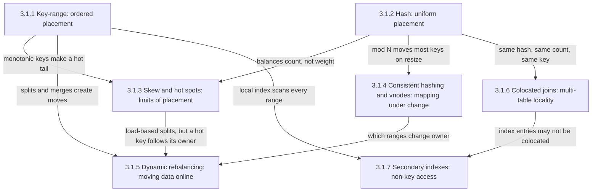
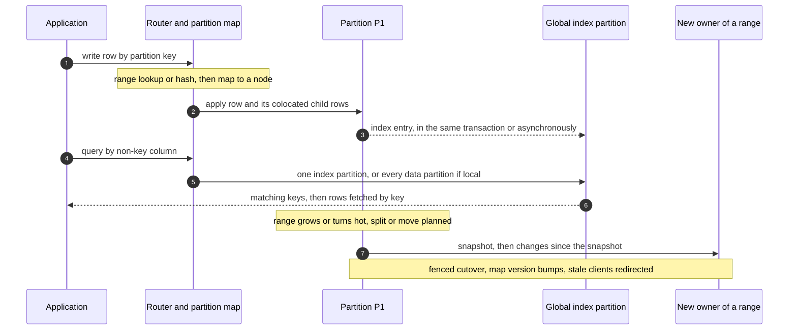
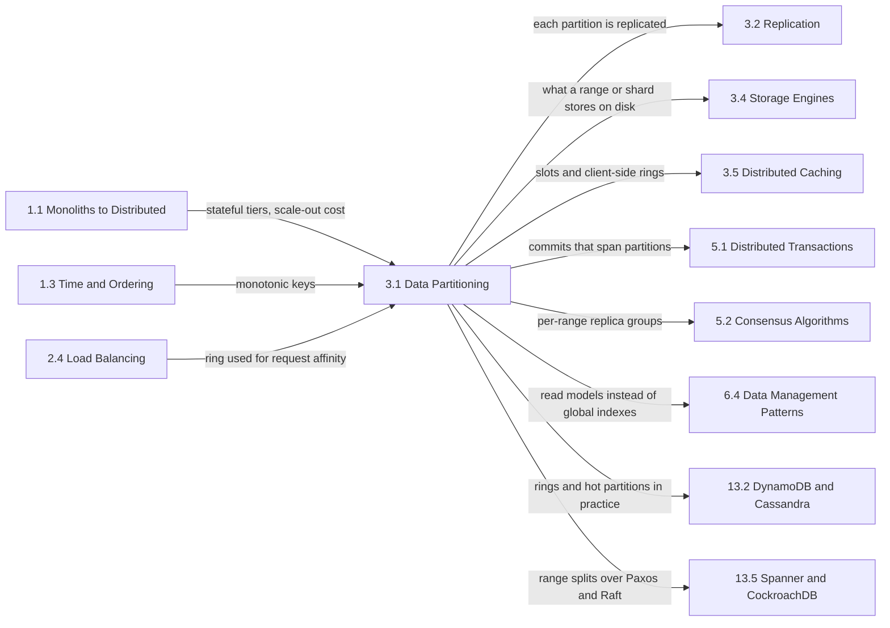

Partitioning, also called sharding, splits a dataset across nodes so that each key is owned by exactly one partition at a time, and each partition is served by one replica group. It is the only mechanism that scales writes and stored bytes beyond one machine: replication multiplies read capacity, but every replica still absorbs every write and holds every byte. Once a table's write rate, its size, or the working set of its indexes exceeds what one node can carry, the data must be divided; every stateful design in [The Scaling Dilemma](/distributed-systems/en/foundations/monoliths-to-distributed/scaling-dilemma/) that scales out assumes it.

The single problem this chapter addresses is the placement decision: given a key, which partition owns it, and how that answer can change while the system keeps serving traffic. That decision has a function (compare the key against sorted boundaries, or hash it), a limit (one key can never be split by placement), a mapping layer that decides how much moves when membership changes, a protocol that actually moves the data, and consequences for every operation that touches more than one key: joins, multi-row transactions, and queries by any attribute other than the partition key.

The tension that runs through all seven topics is locality against spread. Keys that are read, joined, or written together should live together, because an operation confined to one partition needs no scatter-gather, no network shuffle, and no distributed commit. Load should be spread apart, because the capacity of a partitioned system is set by its hottest partition, not by the average. Every placement serves one access path at the expense of the others: range placement keeps adjacent keys together and concentrates sequential inserts on one range; hash placement spreads keys uniformly and turns every range query, and every query by a non-key column, into a query of every partition.

A second tension produces most of the chapter's failure modes: placement is stated as a function, but its inputs do not stay still. Data grows unevenly, a tenant becomes hot, nodes join and fail. A placement that cannot change leaves a cluster sized for its hottest node; one that changes carelessly moves most of the data at once, or accepts writes on two owners during a cutover.

## Seven Decisions Behind One Key: How the Topics Fit Together

The two placement functions are the roots, because every later page assumes a key already has an owner computed one way or the other.

*Dependencies between the chapter's topics. Each arrow names what one page hands to, or imposes on, the page it points to.*

Four edges carry most of the chapter's reasoning. The two edges into skew show that neither placement function protects against load concentration: range placement turns a monotonically increasing key into a hot spot at the tail of the key space, and hash placement equalizes the number of keys per partition but not the weight of the heaviest key, which no partition count can divide. The edge from skew to rebalancing is the most common misdiagnosis in the chapter: moving or splitting the partition that holds a hot key gives the key a new owner and leaves the heat intact. The edge from colocation to secondary indexes shows that the locality bought for joins is lost for any access path not keyed by the colocation key; a global index is in effect a second table partitioned by a different key.

## The Question Each Topic Answers

[Key-Range Partitioning: Advantages and Range Scans](/distributed-systems/en/data-management/data-partitioning/key-range-partitioning/) answers how a sorted key space is cut into contiguous ranges, how clients route through a directory of range descriptors that may be stale, how ranges split and merge under live traffic, and why the ordering that makes scans cheap turns a sequential key into a single hot range. Open it when the important queries read contiguous spans or prefixes, or when time-keyed inserts pile onto one node.

[Hash Partitioning: Uniform Distribution](/distributed-systems/en/data-management/data-partitioning/hash-partitioning/) answers how a key becomes canonical bytes, a hash value, and an owning partition through modulo, fixed slots, or hash ranges, how uniform the result is for a given number of keys, and how mismatched hash functions across clients and resizing under `hash mod N` break it. Open it when choosing a partition key for a point-lookup store, when two clients disagree about where a key lives, or when a fixed partition count has stopped fitting.

[Skew and Hot-Spot Problems: Real-World Scenarios](/distributed-systems/en/data-management/data-partitioning/skew-hot-spots/) answers why a partitioned system is limited by its hottest partition, how to find heavy keys with bounded memory, and which remedy fits which hot spot: salting, hot-key replication and caching, pre-aggregation, load-based splitting, or isolation. Open it when one node saturates while the average looks healthy, when adding nodes does not raise throughput, or before modeling a counter or tenant that can grow without bound.

[Consistent Hashing and Virtual Nodes (vnodes)](/distributed-systems/en/data-management/data-partitioning/consistent-hashing/) answers how a hash ring keeps most keys in place across a membership change, why one point per node gives badly skewed ownership, and how the number of virtual nodes trades balance against streaming parallelism, repair cost, and the probability that two failures lose a quorum. Open it when nodes must compute placement without a directory, or when choosing a vnode count or deciding between a ring and fixed slots.

[Dynamic Rebalancing: Zero-Downtime Strategies](/distributed-systems/en/data-management/data-partitioning/dynamic-rebalancing/) answers how a partition moves to another node while it keeps accepting reads and writes, through copy, catch-up, a fenced cutover, and cleanup, and how the protocol families used in production differ. Open it when adding or draining nodes, when a move never finishes catching up, when a transient node loss triggers a storm of moves, or before building a homegrown migration between shards.

[Colocated Joins: Placing Related Data on the Same Shard](/distributed-systems/en/data-management/data-partitioning/colocated-joins/) answers how partitioning related tables by the same function of the same key turns distributed joins and transactions into local ones, what alignment that requires, and how it is silently lost. Open it when designing a multi-tenant schema or when one tenant outgrows its shard.

[Secondary Indexes in Partitioned Data: Local vs. Global](/distributed-systems/en/data-management/data-partitioning/secondary-indexes/) answers where the cross-partition cost of a non-key query lands: on every read, for an index stored with its rows, or on every indexed write, for an index partitioned by the indexed value, and how a global index is kept in step with its table. Open it when a non-key query fans out to every partition, when an index returns rows that no longer match, or when uniqueness must hold table-wide.

| Topic | Question it answers | Open it when |
|---|---|---|
| [Key-range partitioning](/distributed-systems/en/data-management/data-partitioning/key-range-partitioning/) | How are ordered keys placed, routed, and split? | Range scans matter, time-ordered inserts hit one node |
| [Hash partitioning](/distributed-systems/en/data-management/data-partitioning/hash-partitioning/) | How does a key map to a partition uniformly? | Choosing a partition key, cross-client placement bugs, fixed partition count |
| [Skew and hot spots](/distributed-systems/en/data-management/data-partitioning/skew-hot-spots/) | Why does one partition saturate, and what removes it? | One hot node, scale-out with no gain, viral keys and whale tenants |
| [Consistent hashing and vnodes](/distributed-systems/en/data-management/data-partitioning/consistent-hashing/) | How little can move when membership changes? | Directory-free placement, vnode count, ring vs. slots |
| [Dynamic rebalancing](/distributed-systems/en/data-management/data-partitioning/dynamic-rebalancing/) | How does data move without downtime or lost writes? | Adding or draining nodes, stuck moves, rebalance storms |
| [Colocated joins](/distributed-systems/en/data-management/data-partitioning/colocated-joins/) | How do related tables stay on one shard? | Multi-tenant schemas, shuffling joins, distributed commits per request |
| [Secondary indexes](/distributed-systems/en/data-management/data-partitioning/secondary-indexes/) | Who pays for queries by a non-key column? | Scatter queries, stale index results, global uniqueness |

The chapter can also be read along the life of one table, asking which page owns each decision.

*One table through the seven decisions. The placement pages own the lookup between steps 1 and 2, colocation which rows land together in step 2, the secondary-index page steps 3 through 6, the skew page whether the partition that turns hot is hot because of one key, and the rebalancing page step 7 and the cutover after it, with the consistent-hashing page deciding how many such moves a membership change causes.*

Two features of the sequence explain how the pages divide the work. Every step depends on the partition map being shared correctly by everyone who routes: a client that hashes differently, or holds a map from before the cutover that follows step 7, sends work to a node that no longer owns the key. And the steps that cross partitions, the index update in step 3 and the scatter in step 5, are where the partitioning choice is paid for on every request, while the move in step 7 is where it is paid for in bulk.

## Reading Order and Why

Read the chapter in sidebar order on a first pass. Key-range partitioning comes first because it introduces the vocabulary later pages reuse: a partition as an interval with a versioned descriptor, a routing directory that clients cache and see stale, and splits as the unit of change. Hash partitioning follows as its mirror image. Skew comes third because it is the limit of both functions. Consistent hashing then refines the mapping step of hashing for a membership that changes, and rebalancing describes the protocol that executes whatever the mapping decides must move. Colocated joins and secondary indexes come last because both price the chosen placement for operations that touch more than one key.

Three shortcuts are reasonable. To choose a partition key for a new store, read the range and hash pages, then the skew page's design-time guidance, then secondary indexes for the queries the key will not serve. To design a sharded multi-tenant schema, start with colocated joins, then secondary indexes and the skew page's whale-tenant sections. When one node is saturated or an expansion is causing errors, go directly to skew to separate key-level heat from partition-level imbalance, then to dynamic rebalancing.

## Where the Chapter Sits in the Handbook

The prerequisites come from three earlier chapters. [Stateful vs. Stateless Services](/distributed-systems/en/foundations/monoliths-to-distributed/stateful-vs-stateless/) explains why stateful tiers cannot be scaled by adding interchangeable replicas, which is the reason partitioning exists. [Algorithms: Round Robin, Least Connections, Weighted, Consistent Hashing](/distributed-systems/en/communication/load-balancing/algorithms/) applies the ring from this chapter to request routing; the ring itself is owned here. Time-ordered identifiers, which create the hot tail of a range-partitioned table, are designed in [Distributed ID Generation](/distributed-systems/en/foundations/time-and-ordering/distributed-id-generation/).

*Prerequisites on the left and the chapters that build on this one, or own mechanisms it relies on, on the right. Each arrow names what is handed over.*

The next chapter, [Replication Strategies](/distributed-systems/en/data-management/replication/), describes how each partition is copied, independently of how keys were placed: a range store may replicate each range with [Raft](/distributed-systems/en/coordination/consensus-algorithms/raft/), a ring store each arc with leaderless quorums. Operations that write several partitions atomically, including a synchronous global index update, rely on [Two-Phase Commit](/distributed-systems/en/coordination/distributed-transactions/two-phase-commit/). The sorted storage beneath a single partition is covered in [LSM-Tree vs. B-Tree](/distributed-systems/en/data-management/storage-engines/lsm-tree-vs-b-tree/). [Redis Cluster Architecture](/distributed-systems/en/data-management/distributed-caching/redis-cluster/) is a concrete use of fixed hash slots. The case studies show the chapter in practice: [Cassandra's Consistent Hashing Ring](/distributed-systems/en/case-studies/dynamodb-cassandra/cassandra-hashing-ring/), [The Hot Partition Problem](/distributed-systems/en/case-studies/dynamodb-cassandra/hot-partition-problem/) for DynamoDB's evolution of hot-partition handling, and [Spanner](/distributed-systems/en/case-studies/distributed-sql/spanner-architecture/) for range splits combined with Paxos groups.

Three boundaries are commonly blurred. Partitioning is not replication: shards without replicas lose data with every node, and replicas without shards still take every write. Rebalancing data is not [Kafka consumer group rebalancing](/distributed-systems/en/case-studies/apache-kafka/consumer-group-rebalancing/), which reassigns which consumer reads which partition and moves no data, and neither is a [zero-downtime database migration](/distributed-systems/en/deployment/deployment-patterns/zero-downtime-db-migrations/), which changes a schema rather than its placement. And partitioning one service's data across nodes is not splitting data between services: [Database per Service](/distributed-systems/en/microservice-patterns/data-management-patterns/database-per-service/) draws ownership boundaries between teams, and queries across those boundaries are served by [materialized views](/distributed-systems/en/microservice-patterns/data-management-patterns/materialized-view/) fed by [change data capture](/distributed-systems/en/data-processing/hybrid-architectures/change-data-capture/), not by a secondary index the database maintains.
