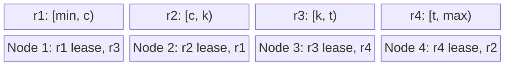
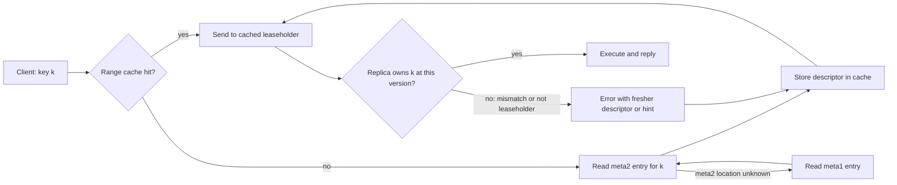
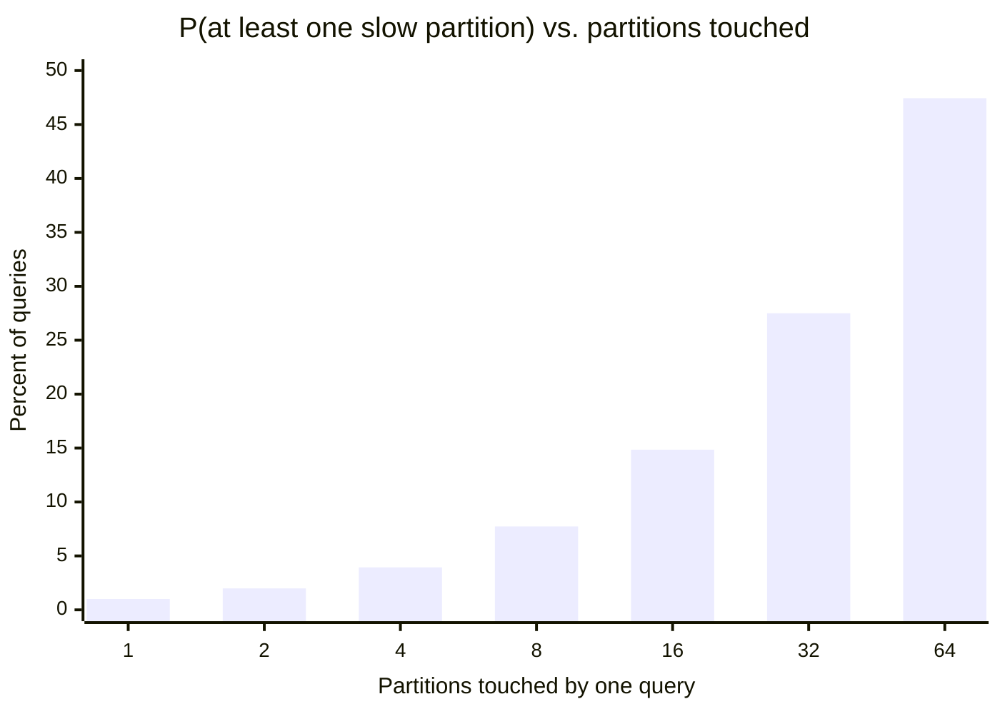
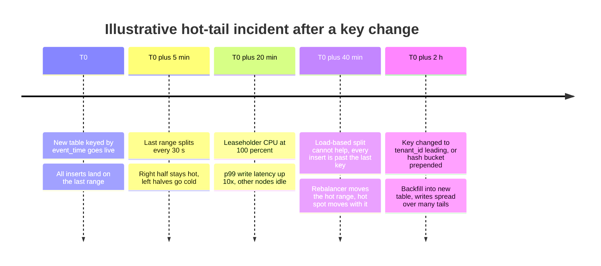

Key-range partitioning assigns every key to a partition by comparing it against a sorted list of boundary keys. The key space is treated as one ordered sequence, cut into contiguous, non-overlapping intervals called ranges (CockroachDB), regions (HBase, TiKV), tablets (Bigtable), splits (Spanner), or chunks (MongoDB), and each interval is owned by one replica group at a time. Two keys that sort next to each other almost always live in the same partition, and a query asking for "all keys between `a` and `b`" is answered by the handful of partitions whose intervals overlap that span.

The problem it solves is keeping order across machines. A single-node B-tree or LSM-tree answers range queries, prefix queries, and ordered pagination by walking adjacent keys; placing keys by hash destroys that adjacency, so the same query becomes a scatter-gather over every partition. Key-range partitioning preserves adjacency at cluster scale, which is why Bigtable, HBase, Spanner, CockroachDB, TiKV, YugabyteDB's range-sharded tables, and MongoDB's ranged sharding all use it as their primary placement scheme or as an option.

The core trade-off is locality against load uniformity. The partitioner places keys exactly where their sort order puts them and does nothing to spread load, so any access pattern concentrated on a narrow part of the key space, above all inserts with a monotonically increasing key, lands on one partition however many nodes the cluster has. Hash partitioning makes the opposite trade: uniform load for most key distributions, at the cost of every range query touching every partition; it is covered in [Hash Partitioning](/distributed-systems/en/data-management/data-partitioning/hash-partitioning/). The second cost is that range boundaries cannot be computed from a formula: they are data, they change while the system runs, and every client must look them up and cope with seeing them stale.

## A Sorted Key Space Cut into Ranges

A range is a half-open interval of the key space, `[start, end)`, together with a descriptor: a range ID, the set of replicas that store it, and a version number that changes whenever the interval or the replica set changes. The first range starts at the empty key and the last ends at a sentinel above every possible key, so the collection of descriptors covers the whole key space with no gaps and no overlaps. That covering property is the invariant the rest of the mechanism exists to protect: at any committed version of the metadata, each key belongs to exactly one range.


*Four ranges of one sorted key space and their placement on four nodes. Each range has several replicas; one holds the lease and serves reads and writes. Boundaries are illustrative single letters.*

The top row is the logical view a client reasons about: one sorted sequence, cut at `c`, `k`, and `t`. The bottom row is physical placement, which is independent of order: range `r1` is led from node 1 while `r3`, far away in key order, may share the same machine. Adjacency is preserved only within a range; neighbouring ranges are separate replica groups with no special relationship, so the cluster can move them independently. Production systems make each range a replication group of its own, usually a [Raft](/distributed-systems/en/coordination/consensus-algorithms/raft/) group in CockroachDB and TiKV or a Paxos group in Spanner, so the range is simultaneously the unit of placement, of replication, and of failover.

Inside a range, keys are stored sorted by the node's local storage engine, typically an LSM-tree, whose write path and read amplification are described in [LSM-Tree vs. B-Tree](/distributed-systems/en/data-management/storage-engines/lsm-tree-vs-b-tree/). The partitioner adds no structure of its own: a range is just the subset of the local engine's key space that falls between two boundaries. Splitting one is therefore a metadata operation, not a rewrite, which is the property that makes dynamic splitting affordable.

### What the Scheme Guarantees, and What It Does Not

It guarantees that each key has exactly one owning range at each metadata version, that keys within a range are stored and returned in order, and that a span query needs to contact only the ranges overlapping that span. Combined with replication inside each range, single-key operations are as strongly consistent as the range's replication protocol makes them.

It does not guarantee uniform load: a range holds whatever keys fall into it, and the system balances only by moving boundaries after observing imbalance. It does not guarantee atomicity across ranges; a write touching two ranges needs a distributed transaction protocol, which CockroachDB and Spanner run as two-phase commit over consensus groups, covered in [Distributed Transactions in Practice: 2PC over Consensus](/distributed-systems/en/case-studies/distributed-sql/transactions-2pc-over-consensus/). It does not guarantee that boundaries are stable, so application logic must never depend on which keys share a range. And it does not guarantee that a range stays near its target size: a single key or row cannot be divided, so one oversized value or one very hot key defeats splitting entirely.

### Designing the Key: What Leads Decides Where Data Lives

Because placement follows sort order, the leading component of the key decides which data is adjacent, and therefore which queries are cheap and which writes collide. A composite key such as `(tenant_id, event_time, event_id)` clusters each tenant's events together and orders them by time inside the tenant, so "tenant 42's events from the last hour" is one contiguous span. The same columns in the order `(event_time, tenant_id, event_id)` make "all events in the last hour" contiguous instead, and also send every new event, from every tenant, to the end of the key space.

Encoding matters as much as column order. The storage layer compares keys as byte strings, so a database must encode typed values into bytes whose lexicographic order matches the type's logical order: signed integers with the sign bit flipped, big-endian, and descending columns with every byte inverted. Engineers who build keys by hand in a raw key-value store frequently get this wrong, for example by concatenating decimal strings so that `"10"` sorts before `"9"`, or by using little-endian integers. The data is stored correctly and range scans silently return wrong results.

## Routing Requests to the Owning Range

A hash partitioner computes the owner from the key; a range partitioner must look it up. The boundaries live in a metadata table that is itself a sorted key space, keyed by the end key of each range, so that finding the range for key `k` is a seek to the first entry whose end key is greater than `k`. Because that table can grow large, systems store it in ranges of its own and add an index above it.

Bigtable introduced the canonical three-level design. A file in Chubby, Google's lock service, names the location of the root tablet; the root tablet holds the locations of all METADATA tablets; each METADATA tablet holds the locations of a set of user tablets. CockroachDB has the same shape with two meta levels (`meta1` addressing `meta2`, `meta2` addressing user ranges) and the location of the first range gossiped among nodes. HBase uses one catalog table, `hbase:meta`, whose location is found through ZooKeeper. TiKV moves the directory out of the data path entirely into the Placement Driver (PD), a separate Raft-replicated service that every client asks for region locations.


*Range lookup with a client-side cache and a two-level meta index, in the CockroachDB style. Bigtable adds a third level; TiKV replaces the meta ranges with the PD service.*

The important path is the bottom loop. The cache is never trusted: every request carries the descriptor it was routed with, and the receiving replica checks that the key still falls in its current span and that it still holds the lease. A stale cache therefore costs latency, never correctness; the error usually returns the fresher descriptor, or a hint naming the new leaseholder, so the client repairs its cache without a full lookup. Bigtable's paper quantifies the cost: with an empty cache a lookup takes three network round trips, and with a stale cache up to six, because stale entries are discovered only on a miss. It reduced the expected cost by prefetching several tablet locations whenever it read the metadata table.

The metadata is small enough to cache whole. Bigtable stores about 1 KB of memory per METADATA row and limits METADATA tablets to 128 MB, so one METADATA tablet indexes `2^27 / 2^10 = 2^17` user tablets, the root indexes `2^17` METADATA tablets, and the hierarchy addresses `2^34` tablets. Real deployments are many orders of magnitude smaller, which is why a production client typically holds every descriptor it has ever needed.

### Range Scans: Where Order Pays Off

A range scan for `[a, b)` is executed as a sequence of sub-scans: find the range containing `a`, scan from `a` to the lesser of `b` and that range's end key, then continue at the next range's start key until `b` is reached. The client, or a gateway node acting on its behalf, can run these sub-scans in parallel when it wants all results, or strictly one after another when the query has a `LIMIT` and order matters, because the first range may already satisfy the limit. Reverse scans follow the same pattern from the end. In both cases the number of ranges contacted is proportional to the size of the result, not to the size of the cluster.

Two properties make this safe while boundaries move. First, each sub-scan carries the end key it expected; if the range has split in the meantime, the replica returns only the part it still owns and a resume key, and the client continues from there. Second, a scan that spans ranges reads at one MVCC (multi-version concurrency control) timestamp, so the separately executed sub-scans observe one consistent snapshot even though writes continue on every range; snapshot semantics are covered in [Weak Isolation and MVCC](/distributed-systems/en/data-management/consistency-models/weak-isolation-mvcc/).

## Splitting and Merging Without Stopping Traffic

Boundaries come from two sources. Pre-splitting chooses them when a table is created, from knowledge of the key distribution. Dynamic splitting chooses them while the system runs, from observation. Every production system relies mainly on dynamic splitting, because nobody knows a key distribution in advance and distributions drift.

The classic trigger is size. A range that grows beyond a threshold is split near its middle key, computed from the storage engine's index rather than by scanning: HBase takes the midpoint of the block index of the largest store file in the largest store. The second trigger is load. A range that receives more requests, or in newer CockroachDB releases more request CPU time, than a threshold for a sustained period is split at a key that divides the observed load rather than the bytes: the splitter samples keys of recent requests and picks a point with roughly equal load on each side, skipping candidates that too many requests would straddle. Load-based splitting is the only defence against a hot range that is small, which is the common case for a hot range.

The opposite operation, merging two adjacent ranges whose combined size and load are low, keeps the range count from growing without bound after deletes, expired data, or a load spike that has passed. A merge is harder than a split: the two ranges usually live on different replica sets, so the system first relocates replicas until both ranges share the same nodes, then subsumes the right-hand range into the left in a single replicated operation.

### Why a Split Is Safe Under Concurrent Writes

The split must preserve the covering invariant at every instant, including for requests already in flight. Each system achieves this by ordering the split with respect to every write on the range, then publishing it atomically.

In TiKV the split is an administrative command proposed to the region's own Raft log. Every replica applies it at the same log index: writes before that index were applied to the parent, writes after it are checked against the daughters' spans, and the region epoch's `version` field increments so that requests carrying the old epoch are rejected with an `EpochNotMatch` error. In CockroachDB the split is a transaction that rewrites the left-hand range descriptor, creates the right-hand one, and updates the `meta2` records, committed through the range's Raft log while the split holds a latch over the right-hand span. HBase runs the split as a procedure whose commit point is the `hbase:meta` update listing the daughters; the daughters initially hold reference files pointing at the top and bottom halves of the parent's files, so no data is rewritten until later compactions.

```mermaid
sequenceDiagram
    autonumber
    participant C as Client
    participant A as Node A, leaseholder r3
    participant M as Meta ranges
    participant B as Node B
    C->>A: Put k=p, routed with r3 [k, t) v7
    A-->>C: OK
    rect rgb(60, 60, 90)
    Note over A: Split r3 at n, applied at one Raft index
    A->>M: Commit r3 [k, n) v8 and r9 [n, t) v1
    end
    A->>B: Lease for r9 transferred to node B
    C->>A: Put k=q, routed with stale r3 [k, t) v7
    A-->>C: Mismatch: key outside [k, n), here is r9 [n, t) v1
    C->>C: Update cache, record lease hint
    C->>B: Put k=q, routed with r9 v1
    B-->>C: OK
```


*A split and a lease transfer between two writes from one client. The stale request in step 5 is rejected, not misapplied; the error carries enough to reroute without a meta lookup.*

The argument for correctness rests on step 3 being one atomic event in the range's replicated history. Before it, the parent owns `[k, t)`; after it, the parent owns `[k, n)` and `r9` owns `[n, t)`; no state exists in which both or neither own `q`. Every write is checked against the span and version current at the moment it is applied, under the same serialization (Raft log order, latch) that orders the split, so the request in step 5 cannot slip past the check. The client's cache is only an optimization whose staleness costs one extra round trip, steps 6 to 9. Note what the diagram does not show: a read at a timestamp before the split may still arrive at `r9` for data that was written to `r3` before the split; both systems handle it because the split carries the MVCC history of the right-hand span along with the descriptor.

### Worked Example: Sizing Ranges for a Multi-Tenant Event Store

Assume a multi-tenant event store holding 20 TiB of logical data, keyed by `(tenant_id, event_time, event_id)`, on a CockroachDB-style system with the default maximum range size of 512 MiB, replication factor 3, and 30 nodes. All workload numbers in this section are illustrative.

Ranges split at the maximum and are about half full right after a split, so assume an average of 384 MiB per range. The cluster then holds `20 TiB / 384 MiB = 54,613` ranges, about 164,000 replicas, or roughly 5,500 replicas per node. If each descriptor in a client's cache costs about 300 bytes (an assumption), a client that has touched every range holds about 16 MB of routing state, small enough that the realistic cost of a cache miss is the extra round trip rather than memory.

Now the query that motivated the key design: one tenant's events for the last 24 hours, assumed to be 50,000 events of 400 bytes, 20 MB in total. Because the tenant's events are contiguous and ordered by time, the span `[(42, now - 24h), (42, now))` is 20 MB of a 384 MiB range: it lies inside one range unless it happens to straddle a boundary, in which case it touches two. The scan reads 20 MB sequentially from one node, or two.

Under hash partitioning on the full key into 64 partitions, the same query has no contiguous span to read. Either it scans every partition for matching rows, or it consults a secondary index whose entries are themselves partitioned, as discussed in [Secondary Indexes in Partitioned Data](/distributed-systems/en/data-management/data-partitioning/secondary-indexes/). Even when each partition answers quickly, the request waits for the slowest. If each partition independently has a 1% chance of a slow response, the probability that at least one of `n` contacted partitions is slow is `1 - 0.99^n`.


*Each partition has an assumed, independent 1% chance of a slow reply. A range scan of contiguous data sits at the left; a scatter-gather over a 64-partition hash layout sits at the right.*

The range scan that touches one or two ranges sees the per-partition tail almost unchanged, 1% to 2%. The scatter-gather over 64 hash partitions turns a 1% tail event into one that affects 47% of queries, the fan-out effect described by Dean and Barroso in *The Tail at Scale*. This is the quantitative core of the case for range partitioning: the cost of a query tracks the size of its answer instead of the size of the cluster.

The same layout has a price on the write side. Suppose ingestion is 50,000 events per second across all tenants, 20 MB per second. With `tenant_id` leading, each tenant writes to the tail of its own span, so there are as many insertion points as active tenants, and a tenant's tail range splits when it fills. If instead the key led with `event_time`, all 20 MB per second would land on the last range of the table, which would reach 512 MiB and split every `512 MiB / 20 MB/s = 27` seconds, each split producing a cold left half and a hot right half that keeps the tail. Throughput would be capped by one leaseholder's write capacity no matter how many of the 30 nodes were idle. The tenant-leading key avoids that, but it inherits the distribution of tenant sizes: if the largest tenant generates 30% of writes, its tail range takes 30% of cluster ingest. That per-key concentration is the subject of [Skew and Hot-Spot Problems](/distributed-systems/en/data-management/data-partitioning/skew-hot-spots/).

## Range, Hash, and Hybrid Placement

Placement schemes differ in which operation they make cheap and which pathology they invite. The table compares key-range partitioning with the alternatives a designer will actually choose between.

| Scheme | Placement function | Range scan on leading key | Load spread | Monotonic insert key | Boundary metadata | When to prefer |
|---|---|---|---|---|---|---|
| Key-range | Sorted boundary list | Touches only overlapping ranges | Follows key distribution; fixed by splitting | One hot tail range | Per range, dynamic, must be looked up | Range queries, ordered pagination, prefix scans, time-ordered reads within an entity |
| Hash | `hash(key) mod` partitions or ring | Touches every partition | Uniform for non-skewed keys | Spread evenly | Formula plus partition map | Point lookups dominate and no query needs order across keys |
| Hash prefix, range within | Hash of leading column, then sorted | Cheap within one prefix value, scatter across prefixes | Uniform across prefix values | Spread across prefix values | Partition map plus per-partition sort | Per-entity time series and feeds (DynamoDB and Cassandra partition plus sort key) |
| Bucketed range (hash-sharded index) | `hash(key) mod B` prepended to a sorted key | B parallel sub-scans | Spread over B buckets | Spread over B tails | Same as key-range | Range-partitioned store with an unavoidable monotonic key |
| Directory | Explicit key-to-partition lookup | Depends on directory granularity | Fully controllable | Controllable | Large, one entry per key or group | Per-tenant placement, data residency, manual moves of large tenants |

The hybrid rows show that the choice is rarely pure. DynamoDB and Cassandra hash the partition key to choose a node and keep rows sorted by the sort key, or clustering columns, within it, so "range scans within one entity" are cheap and range scans across entities are not supported efficiently at all. YugabyteDB offers both hash and range sharding per table, choosing hash by default for the first primary-key column unless the column is declared `ASC` or `DESC`. Bucketing goes the other way: it keeps a range partitioner but prepends a small hash so that a monotonic key writes to `B` tails instead of one, paying with `B` sub-scans per range query; CockroachDB exposes this as hash-sharded indexes and Spanner's documentation recommends a hash or bit-reversed prefix for the same reason.

Range partitioning also changes how rebalancing works. A hash ring with virtual nodes moves fixed slices of hash space, as described in [Consistent Hashing and Virtual Nodes](/distributed-systems/en/data-management/data-partitioning/consistent-hashing/); a range system moves whole ranges as units and changes their number by splitting and merging, so rebalancing is local and driven by measured size and load rather than by membership changes. The procedures for moving a range without downtime are covered in [Dynamic Rebalancing](/distributed-systems/en/data-management/data-partitioning/dynamic-rebalancing/).

:::note[Range partitioning and colocation are the same lever]
Because adjacency follows key order, choosing the leading key columns is also choosing what is colocated. Spanner's interleaved tables and the general practice of prefixing child rows with the parent's key place a parent and its children in the same range, so joins and transactions over one parent stay local. [Colocated Joins](/distributed-systems/en/data-management/data-partitioning/colocated-joins/) covers the design of those keys.
:::

## How Real Systems Implement It

The textbook scheme is the same everywhere; the defaults, split triggers, and stale-routing behaviour differ in ways that matter during an incident.

| System | Unit | Split trigger and default size | Directory | Stale-route signal |
|---|---|---|---|---|
| Bigtable (2006 paper) | Tablet | Size; 100 to 200 MB per tablet by default in the paper | Chubby file, root tablet, METADATA tablets | Miss on cached location, client re-reads metadata |
| HBase 2.x | Region | Size; `SteppingSplitPolicy` (default since 2.0) bounded by `hbase.hregion.max.filesize`, 10 GB | `hbase:meta`, located through ZooKeeper | `NotServingRegionException` |
| CockroachDB | Range | Size, 512 MiB max and 128 MiB min since v20.1 (previously 64 and 16 MiB); load, `kv.range_split.load_qps_threshold` 2,500 or a CPU threshold | `meta1` and `meta2` ranges | Range key mismatch error with fresher descriptors |
| TiKV | Region | Size, `coprocessor.region-split-size` 256 MiB since TiDB 8.4 (previously 96 MiB); load-based split | PD service | `EpochNotMatch`, `NotLeader` |
| MongoDB ranged sharding | Chunk (range) | Size, 128 MB default range size; no automatic splitting since 6.0.3 | Config servers, cached by `mongos` | Stale configuration error, router refreshes |
| Spanner | Split | Size and load, managed by the service | Internal; not user-visible | Handled inside the client library |

Bigtable fixed the vocabulary and the three-level directory; its tablets were small by later standards because recovery and movement were cheap at that size. HBase inherited the design with much larger regions. Its default `SteppingSplitPolicy` splits a table's first region on a server early (at twice the memstore flush size) and then at the maximum file size, so a new table spreads over the cluster quickly instead of sitting in one region until it reaches 10 GB. During an HBase split the parent region is briefly offline and clients see `NotServingRegionException` and retry, which is why write-heavy HBase tables are usually pre-split.

CockroachDB grew its default range from 64 MiB to 512 MiB in v20.1, an eightfold reduction in range count for the same data, because per-range overhead (Raft state, heartbeats, background queues) had come to dominate on large nodes. It splits by load as well as size; in newer releases the load signal can be request CPU time, set by `kv.range_split.load_cpu_threshold` when the rebalancing objective is CPU, rather than queries per second. Manual splits made with `SPLIT AT` can carry an expiration, after which the merge queue is free to undo them.

TiKV moved the opposite way in emphasis: a region is a Raft group whose metadata lives in PD, and PD both answers routing queries and schedules splits, merges, and leader transfers from heartbeats every region sends. Its default region size rose from 96 MiB to 256 MiB in TiDB 8.4. PingCAP's guidance on region size names the trade-off: small regions add parallelism and per-region overhead, large regions slow snapshot transfer, rebalancing, and recovery and make hot regions harder to split.

MongoDB took a different direction for ranged sharding: since 6.0.3 the balancer distributes data by size between shards and chunks are no longer split automatically; the auto-split commands still exist but do nothing. A collection whose shard key is monotonic therefore cannot rely on splitting to escape its hot shard; it needs a hashed shard key or a compound key with a well-spread leading field. Spanner exposes neither range size nor split thresholds; it splits on size and load internally, and its schema guidance focuses on keeping monotonic values out of leading key positions, as discussed in [Distributed ID Generation](/distributed-systems/en/foundations/time-and-ordering/distributed-id-generation/).

### Configuration That Matters in Production

Four decisions dominate. The key order decides which scans are contiguous and where inserts land; it cannot be changed without rewriting the table. Range size trades per-range overhead against movement and recovery granularity: halving the size doubles the number of replication groups, background-queue entries, and routing entries, while doubling it doubles the time to move or rebuild a range and halves the granularity at which load can be balanced. Load-based splitting should be enabled wherever it exists, because a size-only splitter never splits a small hot range. Pre-splitting is worth doing for any table that receives a bulk load or a launch-day burst, because dynamic splitting reacts only after a range is already overloaded.

```sql
-- CockroachDB. Pre-split a new table at tenant boundaries before a bulk load.
-- The expiration lets the merge queue remove splits that turn out unnecessary.
ALTER TABLE events SPLIT AT VALUES (1000), (2000), (3000)
  WITH EXPIRATION '2026-12-01 00:00:00+00';

-- Inspect boundaries, sizes and leaseholders after the load.
SHOW RANGES FROM TABLE events WITH DETAILS;

-- A monotonic key that cannot be avoided: prepend a hash bucket (v22.1+ syntax).
-- Writes spread over 16 tails; a time-range scan becomes 16 sub-scans.
CREATE TABLE readings (
  ts TIMESTAMPTZ NOT NULL,
  sensor_id INT8 NOT NULL,
  value FLOAT8,
  PRIMARY KEY (ts, sensor_id) USING HASH WITH (bucket_count = 16)
);
```

The `WITH DETAILS` option and the exact columns of `SHOW RANGES` changed across CockroachDB releases, so check the output format of the version in use before scripting against it. Pre-split points should come from the actual key distribution, for example sampled from a source table or computed as quantiles of tenant sizes; splitting at evenly spaced values only works when the keys are evenly spread over the encoded byte space.

:::caution[Uniform split algorithms assume uniform keys]
HBase's `HexStringSplit` and `UniformSplit` choose boundaries evenly over hex-string or raw byte space. Applied to keys that are actually decimal strings, readable names, or integers with a common prefix, they put almost all data into one or two regions and leave the rest empty. Generate split points from a sample of real keys, then verify the distribution of data across regions immediately after the load.
:::

## Failure Modes and Their Signatures

Range partitioning fails mostly by concentration: of writes on a tail, of load on a key that cannot be split, of metadata traffic on the directory. Most of these failures look healthy from the cluster average, so detection depends on per-range metrics.

### The Moving Hot Tail

Trigger: a leading key component that increases monotonically, such as a timestamp, a sequence, a Snowflake ID, or UUIDv7. Symptoms: one node runs at high CPU and write latency while its peers idle; adding nodes does nothing; the hot range splits repeatedly and the hot spot moves to the newest right-hand range, often staying on the same node because a newly split range starts on its parent's replicas. Detection: per-range write rate or CPU (the Hot Ranges page in CockroachDB, PD hot-region statistics in TiKV, per-region request counts in HBase), and a split rate that tracks ingest rate.


*A hypothetical timeline of a monotonic-key incident; not a real event.*

The middle entries carry the lesson. Splitting is the system's normal response to load, and here it is useless: every new key is greater than every existing key, so whichever range holds the end of the key space takes every insert, and a split only renames that range. Rebalancing is equally useless, because it moves the hot range to a different node rather than dividing it. Mitigation is a key change: put a well-spread component first, prepend a hash bucket, or bit-reverse a sequence. Recovery requires rewriting existing data into the new layout, so the cheapest time to catch the problem is in schema review.

### The Unsplittable Hot or Oversized Range

Trigger: one key receives a large share of traffic (a global counter, a celebrity account, a configuration row read on every request), or one row or key prefix grows beyond the maximum range size, such as an unbounded list stored under one key. Symptoms: a range persistently above the load-split threshold that does not split, or a range far larger than the configured maximum. Detection: per-range load stays high after the split delay; range size above its maximum; CockroachDB backpressures writes to ranges that have grown well past their maximum size, which shows up as write stalls on that range. Mitigation: split the logical key (sharded counters, one row per list element), cache hot reads, or move the key to a store designed for it. Load-based splitting can divide load among keys; it can never divide one key.

### Split and Merge Churn, and Too Many Ranges

Trigger: a range size set too small, aggressive load-based splits during a spike, or mass manual pre-splitting. When load subsides the merge queue undoes the splits, and the next spike repeats them. Symptoms: high split and merge rates, rising CPU spent on Raft heartbeats and background queues, slower rebalancing and recovery because there are more units to move. Detection: ranges or regions per node, split and merge counts over time, and the share of CPU in background work. Mitigation: larger ranges, expirations on manual splits rather than permanent ones, longer delays before merging load-split ranges, and in TiKV region merge and hibernation of idle regions. The ceiling is real: each range is a replication group, and a node's capacity is bounded by group count as well as by bytes.

### Directory Overload After Mass Movement

Trigger: a large rebalance, a node restart that moves thousands of leases, or a fleet of clients restarting together. Every client's cache becomes stale at once, and every request becomes a lookup in the meta ranges or a call to PD. Symptoms: latency rises everywhere while user ranges are healthy; the meta ranges or PD show request rates far above normal. Detection: lookup and cache-miss rates on the client side, request rate on the directory, and errors of the stale-route kind per second. Mitigation: prefetch neighbouring descriptors on each lookup (as Bigtable did), use the descriptors returned in mismatch errors rather than re-reading meta, retry with jittered backoff, and pace lease transfers. The failure feeds itself, because a slow directory lengthens the window in which caches are stale, the dynamic described in [Retry Storms and Metastable Failures](/distributed-systems/en/resilience/flow-control/retry-storms-metastable-failures/).

:::danger[Never route writes from a cache without server-side ownership checks]
A homegrown range-sharded system that routes writes with a client-side boundary map and lets the receiving node apply any key it is sent will write to the wrong owner the first time a split or move races a request. The data is not lost; it is stored where no reader looks, which is worse. The owning node must verify the key against its current span and descriptor version under the same ordering that applies splits, and reject anything else.
:::

### Long Scans Competing with Point Traffic

Trigger: an analytical or export job scans a large span of a range-partitioned OLTP table. Because the scan walks ranges in order, each range in turn receives a burst of sequential reads that compete with its foreground traffic, and a scan at an old MVCC timestamp can hold up garbage collection of old versions. Symptoms: a latency wave that moves through ranges in key order. Detection: per-range read bytes, scan duration, and the age of the oldest active read timestamp. Mitigation: run scans against follower replicas or a separate analytical copy, page with bounded batch sizes, and rely on admission control where the database provides it.

### Failure Signatures at a Glance

| Failure | Symptom from outside | Detection signal | Mitigation |
|---|---|---|---|
| Moving hot tail | One node saturated, adding nodes does nothing | Per-range write rate; split rate tracking ingest | Key redesign, hash bucket, bit-reversed sequence |
| Unsplittable hot key | Range stays hot after split delay | Per-range load above threshold without splits | Split the logical key, cache, separate store |
| Oversized range | Write stalls on one range | Range size well above maximum | Break up the large row or prefix |
| Split and merge churn | Rising background CPU, slower recovery | Ranges per node, split and merge counts | Larger ranges, split expirations, merge delays |
| Directory overload | Global latency rise, user ranges healthy | Meta or PD request rate, client cache misses | Prefetch, use mismatch hints, jittered retry, paced lease moves |
| Bad pre-split | Data in few ranges after a bulk load | Range size distribution after load | Split points from sampled keys |
| Scan interference | Latency wave moving in key order | Per-range read bytes, oldest read timestamp | Follower reads, paging, admission control |

The DynamoDB variant of the hot-key failure, where a managed service throttles one partition, is examined in [The Hot Partition Problem](/distributed-systems/en/case-studies/dynamodb-cassandra/hot-partition-problem/).

:::tip[Watch the split rate as an early warning]
A steady split rate proportional to ingest rate, with the newly created ranges always on the same node, is the signature of a monotonic key well before that node saturates. Alerting on per-table split rate catches a bad key in staging or on launch day, while a key change is still cheap.
:::

## Choosing Key-Range Partitioning

Use it when the workload's important queries read contiguous spans of the key: time-ordered events within an entity, prefix scans over hierarchical keys, ordered pagination, range predicates on the leading key, or "latest N" queries per parent. Use it when you want the system to adapt placement to observed size and load without a global reshuffle, and when the store will grow by orders of magnitude, because splitting scales the number of partitions with the data. It is also the right choice when transactions should stay within one parent's data, since a key prefix places the parent and its children together.

The decision depends on having a leading key component with natural spread under the write workload. Before committing, measure what share of writes would fall on the hottest value or tail of the candidate key, and what share of queries read a contiguous span of it. If the first number is small and the second large, range partitioning is the better fit. If both are small, hash partitioning is simpler.

Do not use it with a monotonic leading key unless write throughput fits comfortably on one range's leaseholder for the life of the system. Do not use it when every query is a point lookup by an opaque identifier, because you pay for a dynamic directory and split machinery and gain no scan you will use. Do not use it as a cure for a single hot key: no partitioner divides one key's traffic. Avoid it where the platform has removed the dynamic parts, such as MongoDB ranged sharding without automatic splitting, unless the key distribution is well understood and pre-split. And do not build it yourself on top of a plain key-value store without ownership checks on the server side, because a split racing a write is the first thing that will go wrong.

Range partitioning is the placement layer only. Replication of each range, transactions across ranges, and secondary indexes over ranges are separate mechanisms with their own pages; the chapter overview in [Data Partitioning / Sharding](/distributed-systems/en/data-management/data-partitioning/) connects them. How Spanner combines range splits, Paxos groups, and TrueTime is covered in [Spanner Architecture](/distributed-systems/en/case-studies/distributed-sql/spanner-architecture/), and CockroachDB's range implementation in [CockroachDB: Raft, HLC, and Parallel Commits](/distributed-systems/en/case-studies/distributed-sql/cockroachdb-raft-hlc/).

## Further Reading

- Fay Chang, Jeffrey Dean, Sanjay Ghemawat, Wilson C. Hsieh, Deborah A. Wallach, Mike Burrows, Tushar Chandra, Andrew Fikes, and Robert E. Gruber, *Bigtable: A Distributed Storage System for Structured Data*, OSDI, 2006.
- James C. Corbett et al., *Spanner: Google's Globally-Distributed Database*, OSDI, 2012.
- Rebecca Taft et al., *CockroachDB: The Resilient Geo-Distributed SQL Database*, ACM SIGMOD, 2020.
- Martin Kleppmann, *Designing Data-Intensive Applications*, O'Reilly Media, 2017 (chapter 6, Partitioning).
- Jeffrey Dean and Luiz André Barroso, *The Tail at Scale*, Communications of the ACM, 2013.
- Google Cloud, *Schema design best practices*, Spanner documentation, continuously updated.
